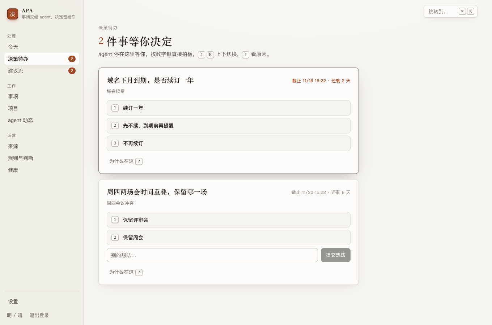
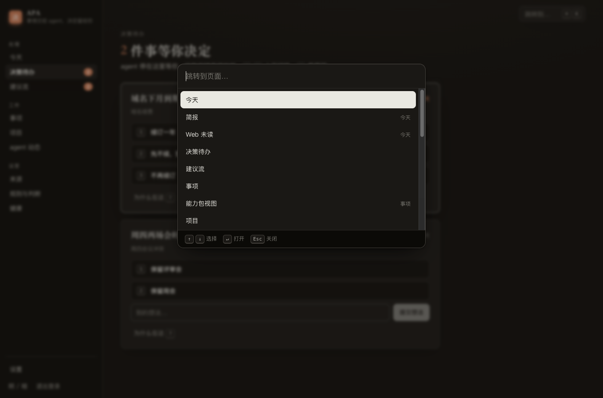

# awesome-personal-agent（APA）

Developed with [oh-my-multica](https://github.com/xiaohei-info/oh-my-multica)

**让 agent harness 具备主观能动性，成为你真正的个人助手。**

APA 是架在 Agent 之上的开源、自部署的一层。Agent 指运行 agent 的工具，如 Hermes、Claude Code、Codex CLI，业内也叫 agent harness。

Agent 很能干，但只在被调用时才动：任务跑完没人看，对方不回没人催，三个 session 同时等你拍板。它是一件冷冰冰的工具，要你替它记事、替它盯着。APA 给它补上主观能动性：了解你手上的事，有条不紊地安排和推进，重复的事按你批准的规则自己处理，只在需要你决定时才来问一个具体问题。

所以 APA 不是对话工具，也不是开发工具。它是你的个人助手，工作和生活里的事都归它跟，工具链和模型都不用换。

Agent 管怎么把活干完，APA 管事情有没有人盯、什么时候该找你。

*APA is an open-source, self-hosted layer on top of an Agent. An Agent is capable but passive: it only moves when called. APA gives it initiative, so it knows what you have on your plate, keeps things moving after the session ends, handles repeat work under rules you approved, and only interrupts you when a decision is really yours. You and your agents share one workbench: delegate from an item, discuss it and @ an executor, and search everything on it. It is a personal assistant, not another chat tool or developer tool.*

## 为什么需要 APA

Agent 已经很会干活：能写代码、查资料、操作工具、调用子 agent，模型和权限也由你自己配。困难出现在两次调用之间。它不知道你在等什么，不会自己醒来，也不会因为一件事到期了就来找你。

它有能力，但没有主动性。主动性只好由人来补，人就成了 agent 之间的调度员和传话筒。这样做的代价是：

- **每个 session 都在等你。** 三个终端开着三个 agent：一个问要不要改接口，一个等确认清理脚本，一个卡在权限提示上。你逐个切过去重读上下文；漏看一个，它就一直等下去。这些请求随进程消失，事后查不到谁同意了什么。
- **每次开工都要从头交代。** 新会话再说一遍项目是什么、按什么规范做、上次定了什么。换 Agent 或换机器，再来一遍。
- **事情过去了，没人替你记着。** 任务跑完，结果停在某个终端里；发出去的问题三天没回音；约好下周复查的事，只有你可能还记得。漏掉的常常是对别人的承诺。
- **外面的事，要么进不来，要么全涌进来。** 续保通知躺在邮箱里，Issue 和报价回复各在各处。全接进来又要你自己筛，里面还可能夹着诱导 agent 的内容。
- **没有一处能回答"我手上现在有哪些事"。** 周一在会话里让 agent 调研，周二在群里答应周五给结论，周三来了续保通知。窗口一关，只能翻历史。

根因是：Agent 的生命周期是一次会话，事情的生命周期不是。

多开 session 只会让等待翻倍。定时脚本能把 agent 叫醒，但记不住事项，也问不到人。Agent 自带的定时、网关和记忆能力差异很大，状态留在各自内部，无法跨 Agent 查询和审计。

## 核心价值：主观能动性

APA 只提供这一样东西：不等你开口，它自己发现事情、记着事情、推进事情，轮到你拿主意时才来找你。其他能力都围绕它构建。

| 它会 | 具体是 |
|---|---|
| **了解你** | 工作和生活里的项目、事项、讨论、材料、决定和偏好规则都记在账上，新会话不用重新交代，需要时按词检索、逐级展开。这些是你可查、可改、可撤销的记录，不是从对话里推断的画像。个人记忆仍由 Agent 负责，APA 不重复保存，也不建关于你的档案 |
| **有条不紊地安排和推进** | 事情不因会话关闭而停。到期的事、等别人的回复、派出去的工作都有系统盯着，到点给出该催、再等或建议放弃 |
| **重复的事自己处理** | 你开启过的规则直接照做。会改状态、建事项或起运行的规则先只观察，看过它"本来会做什么"再打开；只提醒你的规则开箱生效 |
| **只在需要你决策时才打扰** | 要决定的事进一个队列，一次一个具体问题，回一句话或选一个选项，事情就继续。新建议不触发提醒；其余提醒按静默、合并、阈值控制 |

接入之后，你主要只做三件事：说清要什么、决定放开给 Agent 多少、回答只能由你拿主意的问题。

## 主动的边界

主动不等于替你做主。下面这些边界是敢把事情交出去的前提：

- **每个 Agent 一张权限卡。** 动作分十组：查看、整理事项、处理来源事件、替我拍板、改日常规则与提醒、接入来源、数据去向、渠道、Agent 与执行者配置、物理删除。每组由你选"不允许"或"允许"，后果较大的可以限时开放，物理删除只能限时。新 Agent 默认只有前三组。
- **有几件事只有你能做。** 改权限卡、签发和吊销钥匙、口令与会话、指定渠道里谁能回答，任何设置都开放不给 Agent。在 Web 上做这些和更改接入与配置类设置时，要在 10 分钟内输过口令。
- **替你做决定要先放开。** 没开"替我拍板"时，Agent 只能提建议、提问题，等你在 Web 或已配对的渠道里回答；开了之后（可限定项目），它替你回答的每一条都可见、会另推提醒、可以撤回（已经触发的运行和外部动作撤不回）。聊天里的一句话不算授权，问题也不会超时自动按默认值处理。
- **后台运行不另开后门。** 它和主会话按同一张权限卡判定，能用的工具（只读、可编辑、完全）由卡决定；默认只看你信任的发件人发来的消息。
- **动手的规则默认只观察。** 由你或你放开了"改日常规则与提醒"的 Agent 切到自动；动作类规则内容一变，自动退回观察。
- **外部内容只是资料。** 邮件、Issue 正文不会被当成指令。
- **每一步都能回放。** `apa why <id>` 显示来源、命中的规则、判断结果、回执和谁作的决定；被拦下时说明是哪一组没开、去哪开。

这些规则由 APA 的内核判定，不写在提示词里靠 agent 自律。

它们也有范围：APA 管的是经过它流转的事项和决定。工具级权限和主机隔离仍归 Agent，agent 绕开 APA 直接调用工具时，APA 拦不住；能用终端的 Agent 如果和 APA 用同一个系统账号，也能直接碰到数据文件。所以 Agent 自己的权限要照常配好。

## 接入之后的一天

- **08:30** 工作日简报已经写好：昨晚哪些委派有了回执，今天什么到期，还有两件事等你决定。新会话开头，agent 看到一份工作台概览。
- **11:00** 邮箱来了一封保险续保通知，GitHub 上来了一条新 Issue。两者筛过后进了建议流，没有提醒你。你空下来时看一眼，接受前者，丢弃后者。
- **14:00** 手机上收到一条消息：一个 PR 要决定合并到哪个分支，有两个选项和一个推荐。回复选项，事情继续，不用打开电脑。
- **15:00** 你在一个事项下写"这个方案有没有并发问题"，并 @ 一个执行者。它开工，回复出现在你那条发言下面。
- **16:00** 上周问装修公司的报价还没有回音。系统判断该催了，提醒随下一次对话带到，你让 agent 发出催问。
- **17:30** 续保方案要付款。你没把"替我拍板"放开给 Agent，卡片等你本人回复；APA 只记下你的决定，不替你付款。
- **22:00** 静默时段开始，提醒留到明早。Agent 后台运行继续处理手头的事，需要你决定时就停下来等。

这一天里，你没有逐个切换 session 查状态，也没有重复交代背景，只回答了几个具体问题。

## 和其他做法的区别

| | 只用 Agent | 商业个人 agent（Grok、Meta 的 Muse） | Agent + APA |
|---|---|---|---|
| 谁盯着事情 | 你。部分 Agent 带定时、网关或记忆，能力差异很大 | agent。Grok Automations 按计划或收到符合条件的邮件时运行；Grok Bot 在合上电脑后继续工作；Muse 在关闭应用后继续，情况变化或需要批准时回来找你 | APA 的时钟和来源事件，再叫起你的 Agent |
| 在哪运行 | 你的机器 | 厂商托管的云端 | 你自己的主机 |
| 模型和工具 | 你选 | 厂商定。Grok Bot 不提供模型选择；Muse 用 Muse Spark | 你选，沿用 Agent 的配置 |
| 了解你什么 | 各 Agent 的记忆和指令文件 | 你的偏好和对你重要的事 | 工作现场，都是可查、可改、可撤销的记录；个人记忆仍归 Agent |
| 敏感操作 | 取决于 Agent 的工具权限 | 执行前请你批准，如 Muse 在发邮件或购买前询问，Grok Bot 显示批准卡片 | 经 APA 的动作按你设的权限卡判定，由内核强制；授权类设置只有你能改 |
| 上手成本 | 已经在用 | 低，厂商托管，不用自己部署 | 高，要自己部署和配置 |

差别主要在谁拥有运行环境和事项状态。商业产品开箱即用，也能操作电脑和网页；APA 不提供执行环境，能做的动作取决于你接入的 Agent 和执行者。

产品信息依据 2026-11 查阅的官方资料，可能变化：[Grok Automations](https://x.ai/news/grok-automations)、[Grok Bot FAQ](https://docs.x.ai/grok-bot/faq)、[Grok Bot 批准与安全](https://docs.x.ai/grok-bot/approvals-security-and-privacy)、[Muse 发布说明](https://about.fb.com/news/2026/09/introducing-muse-personal-ai-agent/)、[Muse 批准说明](https://www.meta.com/help/superintelligence/1385290430137537/)。

APA 是独立的开源项目，与上述产品及其厂商没有关联。

## 适合谁

**适合：** 已经在用 Agent，想要一个能替你盯事、推进事情的个人助手，同时要保留工具链、模型选择和数据归属，也愿意自己部署的人。插件按 Agent 提供，当前提供 Hermes 插件。

**不适合：**

- 想要一个更好的聊天窗口或编码工具。这些是 Agent 的事，APA 不增强。
- 没有在用 Agent，希望开箱即用。直接用商业产品更合适。
- 团队协作。APA 是单用户系统。
- 想让 agent 替你拿主意。APA 不做这件事。

## 怎么做到

**一条规则：执行归 Agent，状态归账本。** 账本是 APA 保存事项、项目和材料的数据库，也是唯一的真理源。

主观能动性靠下面五项能力支撑：

| 能力 | 做法 |
|---|---|
| 主动感知 | 来源程序定时拉取邮件、日历、提醒事项、GitHub、RSS/Atom 和通用 HTTP JSON，监视本地目录，外部系统也可经 webhook 推送，对话里冒出的事也能捕获。先按规则筛，规则判不了的交给模型。每个来源可选常规处理（先成建议）、只口头提醒或直接立项 |
| 主动跟进 | 时钟跑在 APA 服务里，不依赖任何会话在线。到期后判断该催、再等还是建议放弃；委派的回执回到原事项；默认安排好工作日简报和每周复盘 |
| 了解工作现场 | 账本记着事项、进展和决定，项目带材料和规范。会话开头给分组概览，之后只带变化，更多内容由 agent 检索 |
| 一个工作台 | 工作、生活和日常事务进一本账。你和各个 Agent 在 Web、CLI 和渠道看到同一份状态，在事项上讨论、派活 |
| 决策队列与打扰控制 | 要决定的事可挂起、可跨端回答、可追溯；建议和提醒分开，静默、合并、日上限由系统控制 |

分工：

| 归 Agent | 归 APA |
|---|---|
| agent loop、回合控制、聊天界面 | 事项、项目和材料的账本 |
| 工具、沙箱、工具级权限 | 到期、跟进和周期任务的时钟 |
| 模型选择、技能、子 agent | 外部事件的入站与筛选 |
| 代码、文档和外部系统上的实际操作 | 决策队列、打扰控制和提醒的产出 |
| 个人长期记忆 | 工作现场：项目、任务、材料、决定和偏好规则 |

一件事的路径：

1. 来源带来一个外部事件，比如一封邮件。
2. 规则和模型判断它值不值得看，值得的变成一条建议。
3. 你接受后，它成为事项，带上截止日。
4. 工作从事项上委派给执行者（子 agent、外部 CLI 或人），执行者回执并附上结果，回执同时记成原事项的进展。
5. 需要决定时，事项挂起，一个具体问题送到你那里。
6. 你回答，事情继续；全过程都能回放。

### 协作工作台

任何 Agent 接入后，从 `apa guide` 和会话开头的概览就知道怎么用这个工作台。

- **开场与增量：** 不属于某个项目的对话开头看到分组概览（等你决定、在途派活、今天、这段对话在跟的事、各项目未结事项），每组有条数上限，多出的给查询命令；之后只带有变化的事项。
- **记事：** 工作台约定按权限卡生成：何时建事项、写进展、派活、关单。每次写入带会话身份，用于归属，不参与授权。对话里漏记的事由捕获补上，同一回合已经记下的只补充、不重复新建；把来源处理方式设为"直接立项"后（处理它的 Agent 要开着"替我拍板"），建议直接成为事项。
- **登记执行者：** 一份接入声明可以登记多个执行者，声明里列出可选的模型和思考强度。声明经你在 Web 确认后生效；你可以给每个执行者定默认，单次委派也能在可选值里覆盖。
- **托管委派：** `apa delegate --parent <事项> --assignee <执行者> --start` 建子事项并由 APA 拉起、计时、收结果；`--model`、`--thinking` 换模型和思考强度。别的机器上的执行者不拿运行凭据，按约定格式交回结果。APA 或接收通知的 Agent 重启后，完成通知不丢、不重复。
- **自己派的活走同一条账：** Agent 用自己的工具派活，也记成同样的子事项、委派记录和回执（附带的插件自动记录，认不出的用 `apa dispatch add` 补记）。没挂到事项上的派活会持续提醒，直到 `apa dispatch attach` 或 `apa dispatch untrack`。这类活何时完成，取决于派出方回报。

### 事项讨论区与 @Agent

每个事项有一条讨论流：发言、回复、决定、派活与回报、外面来的消息按时间排在一起。

- **@ 执行者就是开工。** 在进行中或等待中的事项里 @ 一个已登记的执行者，APA 建一个委派子事项并拉起它；它的回复就是结果，出现在你那条发言下面，评估类回复不必附 PR。
- **接力有上限。** 执行者可以在回复里再 @ 别人；一条发言最多 @ 3 个，不能 @ 自己，同一事项上还在跑的执行者不能重复叫，连锁层数到顶即拒绝。有一个叫不动，整条不发送并说明原因。
- **触发永远是显式的。** 不带 @ 的发言和回复不拉起任何运行。@ 常驻的主会话 Agent 时只通知它来回复。发送前能看到会叫起谁，发出后能看状态、停止运行。
- **命令行等价：** `apa item thread <事项>` 读讨论；`apa item comment <事项> --text … [--reply-to <评论>] [--mention <执行者>]` 发言、回复和 @。

### 上下文库与分层检索

账本同时是你的工作上下文库，一个空白 Agent 接入后也能查清一件事的来龙去脉。

- **一个入口：** `apa search <词>` 跨项目检索项目、事项（含进展）和材料，按相关度（BM25，标题权重更高）排名，中英文和混排都支持，给出命中位置和片段。已放弃的事项默认不列、只报条数；来源事件的标题与摘要要显式指定才搜。
- **逐级展开：** 工作台概览 → 项目 → 事项清单或检索结果 → 事项详情（正文分段、最近进展）→ 来源原文。每一级都有上限，写明总量和下一步命令，不会一次灌满上下文。
- **权限一致：** 搜得到的就是这把钥匙读得到的。检索不调模型，目前不做语义向量检索。
- **和 Agent 记忆共存：** 项目、进展、决定和项目约定以账本为准；个人偏好、沟通习惯和人格仍放在 Agent 自己的记忆里。

组成部分：

- **内核**：常驻服务，管账本、时钟、决策和提醒，自身没有 agent loop。对外只做你配置过的事：调模型端点、按声明拉起执行者、把提醒送到你的渠道。轻量判断直连模型端点，只做分类和起草、摘要。
- **Web 中台**：你的首要界面，处理决策待办、建议流、事项与讨论、日历、项目、简报、消息来源和设置。界面支持中文和英文。
- **CLI（`apa`）**：agent 的入口，输出结构化结果，`apa guide` 自带使用说明。常用设置也能从命令行改，同样按权限卡判定。
- **Agent 插件**：把工作台概览、变化和待决事项注入会话，带上会话身份，记录派活与回执，声明 APA 怎样在后台拉起它。每个 Agent 一份，当前提供 Hermes 插件。
- **渠道**：内置 Bark 推送连接；附带 Telegram ext（独立程序，只经 HTTP API 接入），提醒和决策卡片经它们送达。你也可以按对外接口接自己的程序。
- **能力包**：声明一类自动化怎么做的目录（yaml 和模板），不含代码，也不能改策略或把规则设成自动。

扩展不用改内核逻辑：新增自动化写能力包，自己接渠道写 ext，接入 Agent 写插件。外部对接优先复用成熟的 CLI 或库，放在 APA 自己的通用契约之后，可替换。

## 怎么用

**你：**

1. `apa init` 建立数据目录并设置 Web 登录，`apa serve` 启动服务。
2. 在 Web 上配置模型端点（可选）、签发钥匙（选"APA 内部"读全文，"外部程序"逐个来源给读取档位），在 Agent 页设权限卡。执行者来自 Agent 提交的声明或第一次委派时的登记。
3. 在 Agent 里安装 APA 插件，填入地址和钥匙；要让 APA 后台拉起 Agent 或直接派活，在 Web 确认它提交的声明。
4. 登记来源。邮件和日历要先装好对应工具并用它自己的命令完成认证。
5. 之后主要处理决策待办和建议流。装好异常时运行 `apa doctor`。

**agent：** 插件和 `apa guide` 告诉它怎么用，不用读文档。上下文由注入和 `apa context` 带到，找东西用 `apa search`、`apa item show`。需要决定时用 `apa ask`，记进展和讨论用 `apa item comment`，派活用 `apa delegate`（可由 APA 拉起的加 `--start`；否则用自己的方式派出），交结果用 `apa report`。

## 部署与数据

| 形态 | 适合 | 限制 |
|---|---|---|
| 本机单机 | 只在一台电脑上工作 | 默认只监听本机。关机期间时钟暂停，错过的周期任务醒来只补最近一次 |
| 常开主机或服务器 | 跨设备访问，要时钟不停 | 经 VPN、隧道或反向代理加 HTTPS 暴露，主机安全自己负责 |
| 中心 APA + 多台 Agent 主机 | 多台机器都在用 agent | APA 只在所在主机上拉起进程，其他主机的工作经委派完成：由执行者工具远程派发，或由那台机器上的 Agent 回报 |

"事情不因会话关闭而停"依赖 APA 服务本身在线，要时钟不停就得放在常开的主机上。

- **数据：** APA 自身的状态都在一个目录里，默认 `~/.apa`，用 `apa backup create|verify|restore` 备份和恢复；升级前自动留快照。来源原文完整保存，可设保留天数、物理删除。外部工具的凭据由工具自己保管，换主机要重新认证。
- **技术栈：** 单个 Go 二进制，SQLite 账本，React 前端。
- **模型端点：** 可选。分写作端点（OpenAI Chat Completions、OpenAI Responses、Anthropic Messages 或 Google Gemini 原生协议）和判断端点（System One 接口或自建分类服务），可以在本机或外部；送给端点的来源内容范围由你选。可随时暂停模型。不配时规则仍生效，规则判不了的事件留在来源页，可以手动转成建议。
- **额外依赖：** 邮件和日历来源要另装成熟的开源 CLI：himalaya 和 gog calendar；macOS 上的邮件、日历、提醒事项来源用 apple-pim 的命令行工具。
- **代价：** 上手门槛高于托管产品，要自己部署、配置和认证。

## 不做什么

- **agent loop 和会话编排**：归 Agent。
- **聊天界面、模型路由、沙箱、工具级权限**：归 Agent。
- **额度和成本管理**：归你的模型账户和 Agent。
- **个人记忆和关于你的档案**：个人记忆归 Agent，APA 也不从对话里推断画像。
- **团队协作**：单用户系统。
- **工作流引擎和字段设计器**：用事项类型和能力包承接扩展。

## 参与与许可

提交信息遵循 Conventional Commits。

完整设计在 [`docs/`](docs/README.md)，给 coding agent 的规则在 [`AGENTS.md`](AGENTS.md)。读懂本页不需要它们。

本项目由 [oh-my-multica](https://github.com/xiaohei-info/oh-my-multica) 编排开发。[`.omac/`](.omac/) 是开发编排记录：任务拆解、验收清单和各节点的运行状态，留作过程证据，不参与 APA 运行。

[MIT](LICENSE)
