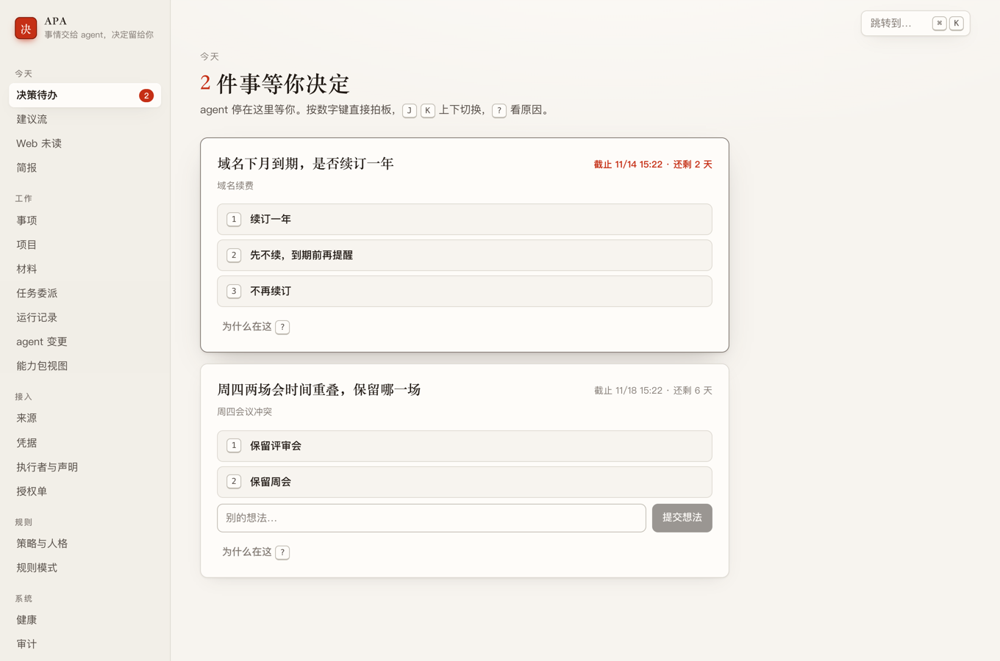
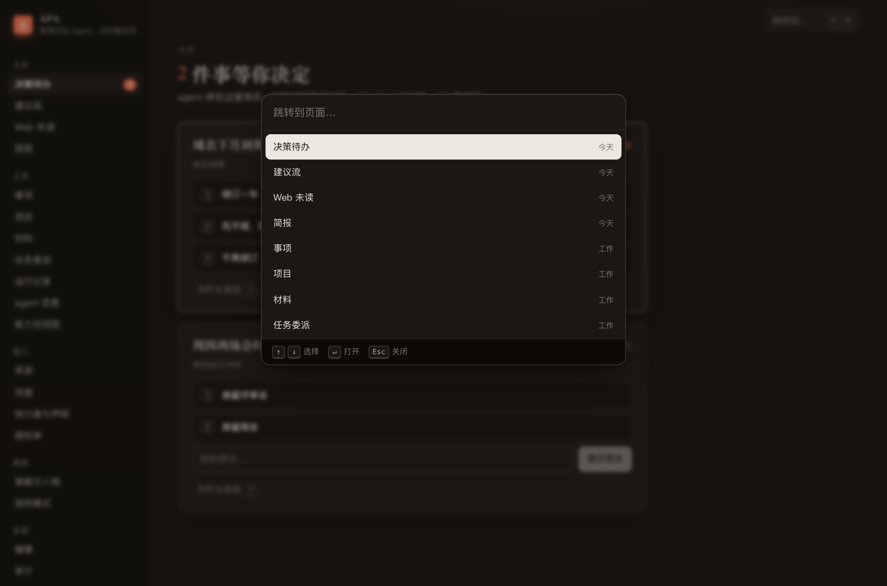

# awesome-personal-agent（APA）

Developed with [oh-my-multica](https://github.com/xiaohei-info/oh-my-multica)

**让 agent harness 具备主观能动性，成为你真正的个人助手。**

APA 是架在 agent harness 之上的开源、自部署的一层。harness 指运行 agent 的工具，如 Hermes、Claude Code、Codex CLI。

Harness 很能干，但只在被调用时才动：任务跑完没人看，对方不回没人催，三个 session 同时等你拍板。它是一件冷冰冰的工具，要你替它记事、替它盯着。APA 给它补上主观能动性：了解你手上的事，有条不紊地安排和推进，重复的事按你批准的规则自己处理，只在需要你决定时才来问一个具体问题。

所以 APA 不是对话工具，也不是开发工具。它是你的个人助手，工作和生活里的事都归它跟，工具链和模型都不用换。

harness 管 agent 怎么把活干完，APA 管事情有没有人盯、什么时候该找你。

*APA is an open-source, self-hosted layer on top of an agent harness. A harness is capable but passive: it only moves when called. APA gives it initiative, so it knows what you have on your plate, keeps things moving after the session ends, handles repeat work under rules you approved, and only interrupts you when a decision is really yours. It is a personal assistant, not another chat tool or developer tool.*

## 为什么需要 APA

Harness 已经很会干活：能写代码、查资料、操作工具、调用子 agent，模型和权限也由你自己配。困难出现在两次调用之间。它不知道你在等什么，不会自己醒来，也不会因为一件事到期了就来找你。

它有能力，但没有主动性。主动性只好由人来补，人就成了 agent 之间的调度员和传话筒。这样做的代价是：

- **每个 session 都在等你。** 三个终端开着三个 agent：一个问要不要改接口，一个等确认清理脚本，一个卡在权限提示上。你逐个切过去重读上下文；漏看一个，它就一直等下去。这些请求随进程消失，事后查不到谁同意了什么。
- **每次开工都要从头交代。** 新会话再说一遍项目是什么、按什么规范做、上次定了什么。换 harness 或换机器，再来一遍。
- **事情过去了，没人替你记着。** 任务跑完，结果停在某个终端里；发出去的问题三天没回音；约好下周复查的事，只有你可能还记得。漏掉的常常是对别人的承诺。
- **外面的事，要么进不来，要么全涌进来。** 续保通知躺在邮箱里，Issue 和报价回复各在各处。全接进来又要你自己筛，里面还可能夹着诱导 agent 的内容。
- **没有一处能回答"我手上现在有哪些事"。** 周一在会话里让 agent 调研，周二在群里答应周五给结论，周三来了续保通知。窗口一关，只能翻历史。

根因是：harness 的生命周期是一次会话，事情的生命周期不是。

多开 session 只会让等待翻倍。定时脚本能把 agent 叫醒，但记不住事项，也问不到人。harness 自带的定时、网关和记忆能力差异很大，状态留在各自内部，无法跨 harness 查询和审计。

## 核心价值：主观能动性

APA 只提供这一样东西：不等你开口，它自己发现事情、记着事情、推进事情，轮到你拿主意时才来找你。其他能力都围绕它构建。

| 它会 | 具体是 |
|---|---|
| **了解你** | 工作和生活里的项目、事项、材料、决定和偏好规则都记在账上，新会话不用重新交代。这些是你可查、可改、可撤销的记录，不是从对话里推断的画像。个人记忆仍由 harness 负责，APA 不重复保存，也不建关于你的档案 |
| **有条不紊地安排和推进** | 事情不因会话关闭而停。到期的事、等别人的回复、派出去的工作都有系统盯着，到点给出该催、再等或建议放弃 |
| **重复的事自己处理** | 你批准过的规则直接照做。新规则先只观察，你看过它"本来会做什么"再切到自动 |
| **只在需要你决策时才打扰** | 要决定的事进一个队列，一次一个具体问题，回一句话或选一个选项，事情就继续。新建议不触发提醒；其余提醒按静默、合并、阈值控制 |

接入之后，你主要只做三件事：说清要什么、批准自动规则、回答系统替不了的决定。

### 风格与人格

助手可以热情、有人味，也可以简洁克制，由你定。你在 Web 设置里写一段人格：语气、怎么称呼你、热情到什么程度、该说和不该说的话。

之后在 harness 里每开一个新会话，APA 插件都会读取当前人格，放进系统提示词，这个 harness 的所有会话都保持这个人格。改了人格，下一个新会话生效。

人格只改说话方式，不改判断。权限、高风险确认和其他内核规则都不受它影响，它也只能在 Web 上改。

## 主动的边界

主动不等于替你做主。下面这些边界是敢把事情交出去的前提：

- **高风险决定只能你本人确认。** 资金、对外承诺、不可逆操作、权限变更和规范生效，只能在 Web 上确认，agent 和聊天渠道都答不了。
- **自动规则默认只观察。** 切到自动只能在 Web 做；规则内容一变，自动退回观察。
- **后台运行不能代答。** 无人值守的运行遇到要决定的事就停下来等你。
- **替你做决定要有依据。** agent 代你回答普通决定，必须有你本回合的原话，或你事先在 Web 签发的授权单（限定 agent、范围、动作和有效期），事后都可以撤销。依据不足就停下来等你。回执、候选和提问是 agent 自己的工作，不需要你的原话，但报完成要附可核对的结果。
- **外部内容只是资料。** 邮件、Issue 正文不会被当成指令。
- **每一步都能回放。** `apa why <id>` 显示来源、命中的规则、判断结果、回执和谁作的决定。

这些规则由 APA 的内核判定，不写在提示词里靠 agent 自律。

它们也有范围：APA 管的是经过它流转的事项和决定。工具级权限和主机隔离仍归 harness，agent 绕开 APA 直接调用工具时，APA 拦不住，所以 harness 自己的权限要照常配好。

## 接入之后的一天

- **08:00** 简报已经写好：昨晚哪些委派有了回执，今天什么到期，还有两件事等你决定。第一个会话开始时，摘要已经带到 agent 那里。
- **11:00** 邮箱来了一封保险续保通知，GitHub 上来了一条新 Issue。两者筛过后进了建议流，没有提醒你。你空下来时看一眼，接受前者，丢弃后者。
- **14:00** 手机上收到一条消息：一个 PR 要决定合并到哪个分支，有两个选项和一个推荐。回复选项，事情继续，不用打开电脑。
- **16:00** 上周问装修公司的报价还没有回音。系统判断该催了，提醒随下一次对话带到，你让 agent 发出催问。
- **17:30** 续保方案要付款，属于高风险类。消息里只有一个 Web 链接，agent 不能代答，只能你在 Web 确认。
- **22:00** 静默时段开始，提醒留到明早。已批准规则的后台运行继续处理手头的事，需要你决定时就停下来等。

这一天里，你没有逐个切换 session 查状态，也没有重复交代背景，只回答了几个具体问题。

## 和其他做法的区别

| | 只用 harness | 商业个人 agent（Grok、Meta 的 Muse） | harness + APA |
|---|---|---|---|
| 谁盯着事情 | 你。部分 harness 带定时、网关或记忆，能力差异很大 | agent。Grok Automations 按计划或收到符合条件的邮件时运行；Grok Bot 在合上电脑后继续工作；Muse 在关闭应用后继续，情况变化或需要批准时回来找你 | APA 的时钟和来源事件，再叫起你的 harness |
| 在哪运行 | 你的机器 | 厂商托管的云端 | 你自己的主机 |
| 模型和工具 | 你选 | 厂商定。Grok Bot 不提供模型选择；Muse 用 Muse Spark | 你选，沿用 harness 的配置 |
| 了解你什么 | 各 harness 的记忆和指令文件 | 你的偏好和对你重要的事 | 工作现场，都是可查、可改、可撤销的记录；个人记忆仍归 harness |
| 敏感操作 | 取决于 harness 的工具权限 | 执行前请你批准，如 Muse 在发邮件或购买前询问，Grok Bot 显示批准卡片 | 五类高风险决定只能你在 Web 确认，由内核强制 |
| 上手成本 | 已经在用 | 低，厂商托管，不用自己部署 | 高，要自己部署和配置 |

差别主要在谁拥有运行环境和事项状态。商业产品开箱即用，也能操作电脑和网页；APA 不提供执行环境，能做的动作取决于你接入的 harness 和执行者。

产品信息依据 2026-11 查阅的官方资料，可能变化：[Grok Automations](https://x.ai/news/grok-automations)、[Grok Bot FAQ](https://docs.x.ai/grok-bot/faq)、[Grok Bot 批准与安全](https://docs.x.ai/grok-bot/approvals-security-and-privacy)、[Muse 发布说明](https://about.fb.com/news/2026/09/introducing-muse-personal-ai-agent/)、[Muse 批准说明](https://www.meta.com/help/superintelligence/1385290430137537/)。

APA 是独立的开源项目，与上述产品及其厂商没有关联。

## 适合谁

**适合：** 已经在用 harness，想要一个能替你盯事、推进事情的个人助手，同时要保留工具链、模型选择和数据归属，也愿意自己部署的人。插件按 harness 提供，当前提供 Hermes 插件。

**不适合：**

- 想要一个更好的聊天窗口或编码工具。这些是 harness 的事，APA 不增强。
- 没有在用 harness，希望开箱即用。直接用商业产品更合适。
- 团队协作。APA 是单用户系统。
- 想让 agent 替你拿主意。APA 不做这件事。

## 怎么做到

**一条规则：执行归 harness，状态归账本。** 账本是 APA 保存事项、项目和材料的数据库，也是唯一的真理源。

主观能动性靠下面五项能力支撑：

| 能力 | 做法 |
|---|---|
| 主动感知 | 来源程序定时拉取邮件、日历、GitHub Issue、RSS/Atom 和通用 HTTP JSON，监视本地目录，外部系统也可经 webhook 推送。先按规则筛，规则判不了的交给模型，筛过的才成为建议 |
| 主动跟进 | 时钟跑在 APA 服务里，不依赖任何会话在线。到期后判断该催、再等还是建议放弃；委派的回执回到原事项；定期生成简报 |
| 了解工作现场 | 账本记着事项和决定，项目带材料和规范，策略写明什么算高风险、什么时候不打扰。这些内容在每次会话时按需带给 agent |
| 一个工作台 | 工作、生活和日常事务进一本账。Web、CLI、已接入的 harness 和渠道看到同一份状态 |
| 决策队列与打扰控制 | 要决定的事可挂起、可跨端回答、可追溯；建议和提醒分开，静默、合并、阈值由系统控制 |

分工：

| 归 harness | 归 APA |
|---|---|
| agent loop、回合控制、聊天界面 | 事项、项目和材料的账本 |
| 工具、沙箱、工具级权限 | 到期、跟进和周期任务的时钟 |
| 模型选择、技能、子 agent | 外部事件的入站与筛选 |
| 代码、文档和外部系统上的实际操作 | 决策队列、打扰控制和提醒的产出 |
| 个人长期记忆 | 工作现场：项目、任务、材料、决定和偏好规则 |

一件事的路径：

1. 来源带来一个外部事件，比如一封邮件。
2. 规则和模型判断它值不值得看，值得的变成一条建议。
3. 你接受后，它成为事项，带上截止日。
4. agent 把工作委派给执行者（子 agent、外部 CLI 或人），执行者回执并附上证据。
5. 需要决定时，事项挂起，一个具体问题送到你那里。
6. 你回答，事情继续；全过程都能回放。

组成部分：

- **内核**：常驻服务，管账本、时钟、决策和提醒。它只改账本、只提供接口，不主动向外推送，自身也没有 agent loop。轻量判断直连你配置的模型端点，只做分类和生成摘要。
- **Web 中台**：你的首要界面，处理决策待办、建议流、事项、项目和设置。
- **CLI（`apa`）**：agent 的入口，输出结构化结果，`apa guide` 自带使用说明。
- **harness 插件**：把待决和相关事项注入会话，声明如何无头拉起 harness。每个 harness 一份，当前提供 Hermes 插件。
- **ext**：独立的外部程序，如聊天渠道（提供 Telegram），只经 HTTP API 接入。提醒由它们来领取并送达。
- **能力包**：声明一类自动化怎么做的目录（yaml 和模板），不含代码，也不能改策略或把规则设成自动。

扩展都不用动内核：新增自动化写能力包，新增渠道写 ext，接入 harness 写插件。外部对接优先复用成熟的 CLI 或库，放在 APA 自己的通用契约之后，可替换。

## 怎么用

**你：**

1. `apa init` 建立数据目录并设置 Web 登录，`apa serve` 启动服务。
2. 在 Web 上配置模型端点（可选）、签发 token、维护执行者清单。
3. 在 harness 里安装 APA 插件，填入地址和 token。
4. 登记来源。邮件和日历要先装好对应工具并用它自己的命令完成认证。
5. 之后主要处理决策待办和建议流。

**agent：** 插件和 `apa guide` 告诉它怎么用，不用读文档。上下文由注入和 `apa context` 带到。需要决定时用 `apa ask`，派活用 `apa delegate`，交结果用 `apa report`。

## 部署与数据

| 形态 | 适合 | 限制 |
|---|---|---|
| 本机单机 | 只在一台电脑上工作 | 默认只监听本机。关机期间时钟暂停，错过的周期任务醒来只补最近一次 |
| 常开主机或服务器 | 跨设备访问，要时钟不停 | 经 VPN、隧道或反向代理加 HTTPS 暴露，主机安全自己负责 |
| 中心 APA + 多台 harness 主机 | 多台机器都在用 agent | 无头运行只在 APA 所在主机，其他主机的工作经委派完成 |

"事情不因会话关闭而停"依赖 APA 服务本身在线，要时钟不停就得放在常开的主机上。

- **数据：** APA 自身的状态都在一个目录里，默认 `~/.apa`，可以整体复制备份。外部工具的凭据由工具自己保管，换主机要重新认证。
- **技术栈：** 单个 Go 二进制，SQLite 账本，React 前端。
- **模型端点：** 可选，只需 chat completions 兼容协议，可以用本机端点。不配时规则仍生效，规则判不了的事件留在来源页，可以手动转成建议。
- **额外依赖：** 邮件和日历来源要另装成熟的开源 CLI：himalaya 和 gog calendar。
- **代价：** 上手门槛高于托管产品，要自己部署、配置和认证。

## 不做什么

- **agent loop 和会话编排**：归 harness。
- **聊天界面、模型路由、沙箱、工具级权限**：归 harness。
- **额度和成本管理**：归你的模型账户和 harness。
- **个人记忆和关于你的档案**：个人记忆归 harness，APA 也不从对话里推断画像。
- **团队协作**：单用户系统。
- **工作流引擎和字段设计器**：用事项类型和能力包承接扩展。

## 参与与许可

提交信息遵循 Conventional Commits。

完整设计在 [`docs/`](docs/README.md)，给 coding agent 的规则在 [`AGENTS.md`](AGENTS.md)。读懂本页不需要它们。

本项目由 [oh-my-multica](https://github.com/xiaohei-info/oh-my-multica) 编排开发。[`.omac/`](.omac/) 是开发编排记录：任务拆解、验收清单和各节点的运行状态，留作过程证据，不参与 APA 运行。

[MIT](LICENSE)
