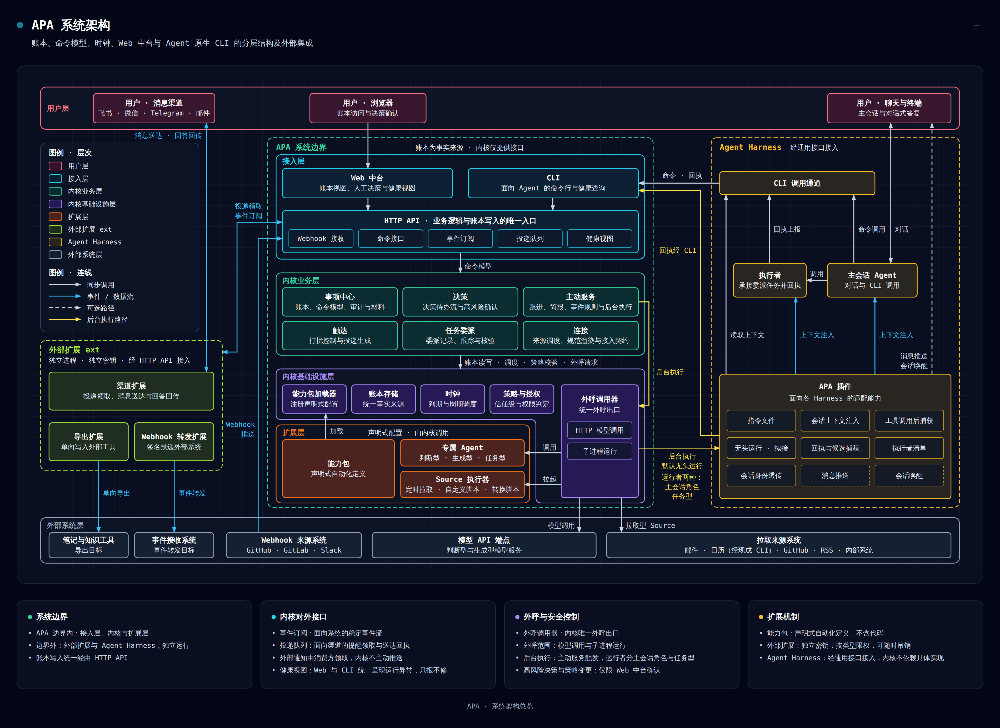
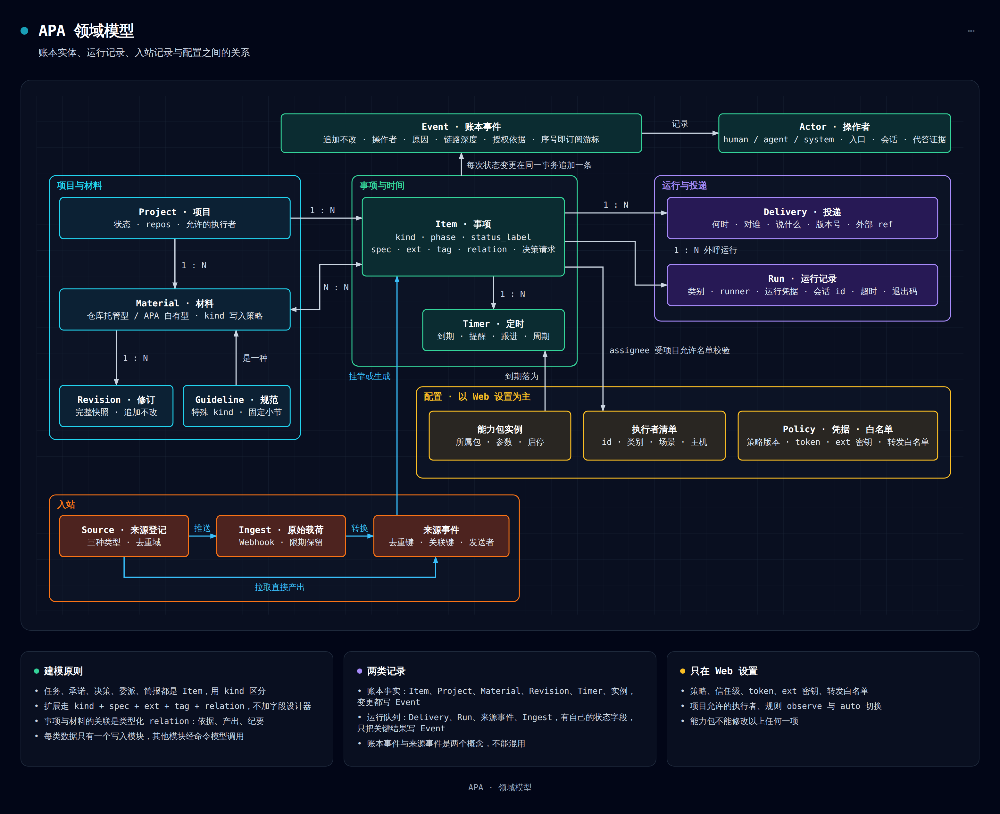
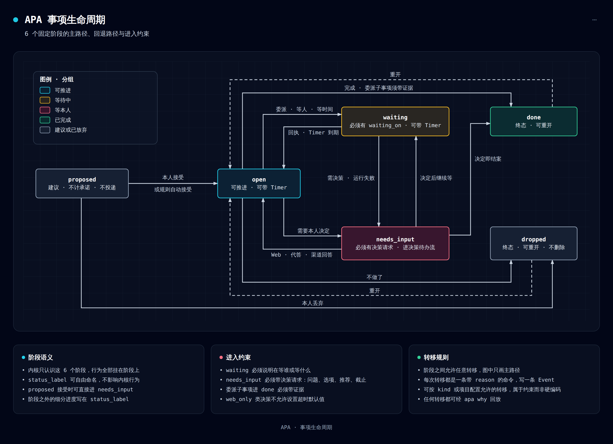
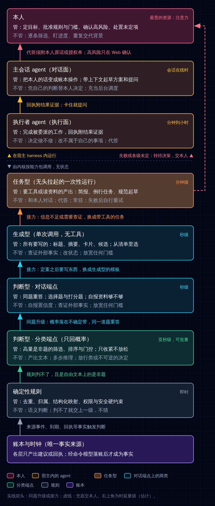
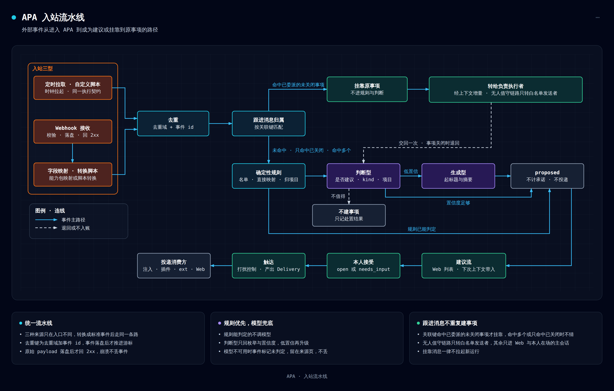
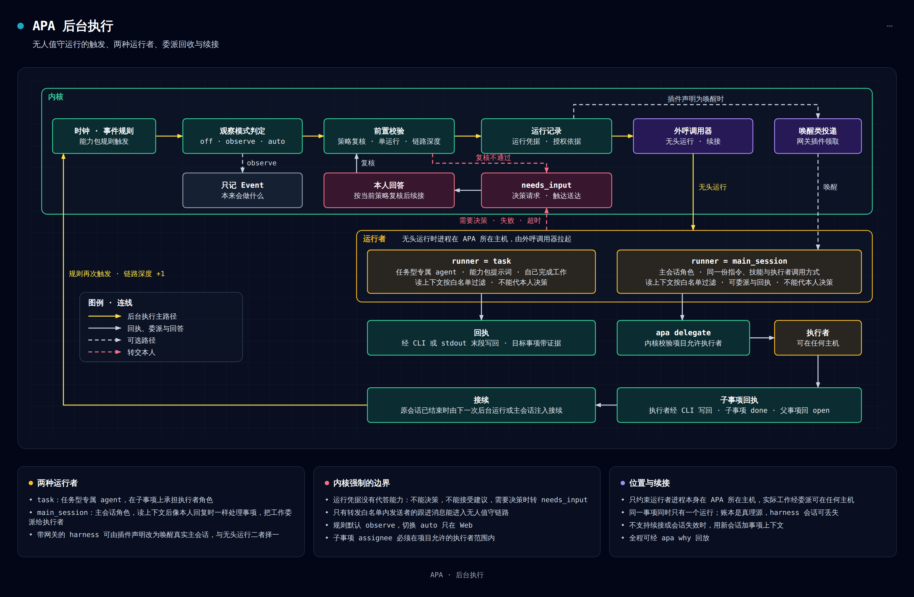

# APA 业务解决方案设计

> **状态**：v0.1 已实现并在主干运行；本文是 v0.2.0 的设计，也是 v0.2.0 实现与验收的依据。
> **本文**：APA（awesome-personal-agent）的主设计文档，也是实现时的权威依据。实现与本文冲突时，先改本文，再改代码。
> **配套**：[附录 A：harness 接口与无头运行](appendix-a-harness.md) · [附录 B：API 与 CLI 清单](appendix-b-api-cli.md) · [附录 C：能力包规范](appendix-c-capability-pack.md) · [附录 D：适配对象与实测结论](appendix-d-adapters.md)
> **命名约定**：本文不写厂商和商业产品的名字，被适配的对象用类别称呼（首批宿主、即时通讯渠道、邮件 CLI、日历 CLI、代码托管平台）。具体名字、版本和实测结论只出现在附录 A（harness）、附录 D（来源工具与渠道）和各自的适配目录里。实现栈用到的开源技术（§18）不在此限。

**一句话**：APA 是架在 agent harness 之上的开源、自部署个人 agent 层，它让只在被调用时才动的 harness 具备主观能动性，成为真正的个人助手，而不是对话工具或开发工具。

**本修订采用的决定（v0.2.0）**：下表 14 项在设计确认时逐条确认；改动任何一项，按「落点」列的章节返工。理由与取舍的完整版在 §21.1 决定 28–41。设计确认时另定的两项（补救旧级联误丢的事件、已有部署跟随主干升级与结构版本冻结）见决定 45、46。

| # | 题目 | 采用的选项 | 一句话理由 | 落点 |
|---|---|---|---|---|
| 1 | 分类端点在本版的地位 | 契约与级联语义必做，端点本身可选 | 契约落在能力包字段、策略和判断记录上，后补等于改契约；没有专用分类模型的用户也要能用 | §8、附录 C.7 |
| 2 | 只提醒本人的规则是否默认生效 | 提醒类规则默认生效；会改状态、起运行、自动接受，或由外部内容触发的规则仍默认只观察 | 否则装好以后跟进提醒不工作，「不忘」对新用户不成立 | §14.8、§13.3 |
| 3 | 跟进到期的默认做法 | 规则梯度为主，模型只用于减少提醒 | 模型在这里没有新信息，三选一只是猜；没有模型端点的用户也要有跟进 | §7.3 |
| 4 | 摘要出口、提醒出口与数值条件 | 三个原语进本版；专门的阅读与哨兵功能包不做 | 量大的来源不该只有「进建议流」和「被忽略」两条路 | §9.3 |
| 5 | 例行任务包 | 进本版 | 周期性的事不应依赖宿主的定时任务与技能 | §13.5 |
| 6 | 对外的定位表述 | 面向已在用 harness 的人，写明三档运行形态，支持一个宿主；第二个宿主是本版之后的第一优先 | 只有一个宿主实现时宣称跨宿主没有证据 | §2.4、§20 |
| 7 | 真实端点与真实宿主的端到端验收 | 真实端点与真实宿主的端到端验证仍是发布前提，但由本人在本机升级后执行，不在开发编排里自动化 | 判断质量、提示词和端点的结构化输出能力替身验不出来，而这些验证要用本人的真实账号与真实数据，并需要本人到场 | §1.4、§20.4 |
| 8 | 外发控制的默认值 | 每个来源必须选择送给模型的内容范围；外部端点没有默认值，不选就不送 | 公开产品不能让用户在不知情时把邮件正文发往外部端点 | §14.14 |
| 9 | 非私聊会话的代答 | 一律不接受凭原话的代答 | 多人会话里别人的话可能被当作本人原话；不设可放开的开关 | §14.5 |
| 10 | 「不做成本管理」的措辞 | 改为不计费、不限额、不按费用调度，但按级计数 | 升级率和校准都要用调用次数 | §2.2、§8.6 |
| 11 | 七组结构性取舍 | 全部追认 | 它们是现有实现的地基，逐项重议都要大改 | §21.1 决定 38 |
| 12 | 状态与外部笔记库的关系 | 状态与流程只在 APA 写；知识型内容留在外部库，APA 只存链接；视图单向导出并带动作链接。本版只做其中的通用能力 | 双向同步等于给文件系统开一条不经授权和审计的写入通道 | §2.2、§10.3 |
| 13 | 界面语言 | Web 界面中英可切换（存在浏览器本地，默认跟随浏览器）；通知、简报与内置提示词为中文；CLI 为英文 | 界面文案只影响展示，可以先做全；提示词的语言会改变判断质量，要按语言各自验证一遍才能开放 | §4.1 |
| 14 | 公开文档里的厂商与产品名 | 主文档只写类别，名字留在附录 A、附录 D 与适配目录 | 与仓库「内核不认识厂商」的约束一致，对照内容也不随产品变化而过时 | 全文、§19 |

**阅读建议**：

| 读者 | 建议阅读 |
|---|---|
| 初次了解 APA 的读者 | §1–§4，§19.5 |
| 评审者 | 本页决定表，§1–§5，§8，§9.3，§14，§20–§21 |
| 内核与 Web 开发者 | §6–§10，§12–§15，§17，附录 B、C |
| harness 插件开发者 | §6.13，§11，§13.6，§14，附录 A |
| ext 与 Source 开发者 | §9，§10，§17，附录 B、D |

**术语**：

| 术语 | 含义 |
|---|---|
| 本人 | 账本的所有者，也是 Web 登录者；架构图中的"用户"即本人。APA 是单用户系统 |
| harness | agent 的运行环境，负责 agent loop、工具与权限。本文也称宿主 |
| 首批宿主 | 本版支持并完成端到端验收的那一个 harness（附录 A） |
| 主观能动性 | 不等调用，自己发现事情、记着事情、推进事情，轮到本人拿主意时才来找本人。不等于替本人做决定（§1.3） |
| 个人 agent | personal agent：具备主观能动性、能承担个人助手角色的 agent 形态。商业产品把它做成托管服务，APA 架在 harness 之上提供 |
| 了解用户 | 在 APA 中指了解本人的工作现场：在跟的项目和任务、相关材料、事项、作过的决定和偏好规则。不是个人记忆或人格档案；个人长期记忆由 harness 负责，APA 不重复保存（§1.3） |
| 工作台 | 本人处理工作、生活和日常事务的统一入口，由账本、Web 中台、注入与渠道共同构成，Web 中台是首要视图 |
| 主会话 agent | harness 中与本人对话的 agent |
| 执行者 | 承接委派的原生子 agent、外部 CLI 或人，可在任何主机 |
| 专属 agent | 内核按能力包声明调用的判断型、生成型、任务型 agent，无状态（§8） |
| 分类端点 | 只回概率、不产出文本的专用分类模型端点，经判断端点的协议适配器接入（§8.8）。它是判断型的一种答题后端，可选 |
| 对话端点 | 兼容对话补全协议并支持结构化输出的模型端点。生成型用它，判断型在没有分类端点或落入不确定带时也用它 |
| 不确定带 | 分类端点概率上的一对上下限：低于下限按否定案，高于上限按是定案，中间交给下一级回答同一道题（§8.3） |
| 同题升级、接力 | 往上交的两种形式。同题升级：同一个问题换更强的一级重答。接力：问题变了（要写字、要查证），换有那种能力的一级（§8.3） |
| 保守默认 | 各级都答不上来时取的处置，每个判断模板必须声明（§8.9） |
| 判断记录 | 一次判断的留痕：每一级的答案、概率、由哪一级定案（§6.16） |
| 运行者 | 后台执行拉起的那个会话，分 `task` 与 `main_session` 两种（§13.6） |
| 事项（Item） | 账本里唯一的"东西"：任务、承诺、决策、委派、简报都是事项，用 `kind` 区分 |
| 账本事件（Event） | 账本的追加日志，每次状态变更一条，也是对外的事件流 |
| 来源事件 | Source 或 webhook 带进来的外部事件，与账本事件是两个概念 |
| 挂靠消息 | 归属到已有事项的来源事件，例如合并请求上的新评论、邮件线程里的回信 |
| 积压 | 未判定与已过期的来源事件的合称（§9.3） |
| 投递（Delivery） | 触达模块产出的一条提醒，等待消费方领取 |
| 能力包 | 声明一类自动化怎么做的目录（yaml + 模板），不含代码 |
| Source | 把外部事件带进账本的程序化来源 |
| ext | 外置集成程序（渠道、导出、webhook 转发），只经 HTTP API 接入 |
| web_only 类 | 只能由本人在 Web 确认的高风险决策类别 |
| 运行凭据 | 内核为一次后台运行生成的短期凭据，决定"运行身份" |
| 无人值守链路 | 由后台运行发起的事项及其子事项，读取挂靠消息时受转发白名单约束 |

---

## 1 为什么做 APA

agent harness 很能干，但只在被调用时才动：任务跑完没人看，对方不回没人催，三个 session 同时等人拍板。APA 的核心价值只有一个：**主观能动性**。它架在 harness 之上，让这些冷冰冰、只在被调用时才动的工具能自己发现事情、记着事情、推进事情，只在需要本人决定时才来问一个具体问题，成为真正的个人助手，而不是对话工具或开发工具。

harness 管 agent 怎么把活干完，APA 管事情有没有人盯、什么时候该找本人。

### 1.1 背景：harness 能干，但不主动

**harness 很强，但它是被动的工具。** 主流的 agent harness 已经能写代码、查资料、操作工具、调用子 agent，本人可以自己选模型、配权限、积累技能和工作流。它们的工作方式却是被动的：被调用才工作，会话之间不保留事项状态，也不知道本人在等什么。

**商业个人 agent 证明了主动的体验可行，但和厂商的产品绑在一起。** 这类产品按计划或事件自己运行，关闭应用后继续工作，情况变化或需要批准时回来找人。跟踪事情的是 agent，人只在需要时才被叫到（产品事实见 §19.5）。它们的运行环境、模型和入口都由厂商决定，已经在 harness 上积累了工具链、技能和模型选择的人，要得到这种体验就得转到另一个产品里工作。APA 给这些人另一条路：留在自己的 harness 上，获得类似的主动性。

### 1.2 问题：没有主动性时本人付出的代价

harness 有能力，但没有主动性，主动性只好由人来补。已经在用 harness 的人，今天的日常大致是这样：

**每个 session 都在等人。** 三个终端开着三个 agent：一个问要不要改接口，一个等确认一段清理脚本，一个卡在权限提示上。本人只能逐个切过去，重新读懂上下文再回答；漏看一个，那个 agent 就一直等下去。这些请求只存在于各自的会话里，进程一退就没了，事后也查不到是谁同意了什么。

**每次开工都要从头交代。** 每开一个新会话，都要再说一遍这个项目是什么、按什么规范做、上次定了什么。换一个 harness 或一台机器，再来一遍。agent 也不知道这周最要紧的是哪个项目，哪类操作必须本人确认，晚上十点以后不想被打扰。各个 harness 的记忆适合保存个人偏好，但各管各的，不能结构化查询事项状态，也不能审计，agent 可能依据陈旧的内容判断事情的进展。

**事情过去了，没人替本人记着。** 派给 agent 的任务跑完了，结果停在某个终端里没人看；发给对方的问题三天没有回音，没有任何东西提醒该催了；约好下周复查的事，到了下周只有人可能还记得。时间在流逝，系统里却没有谁为此负责。

**外面的事，要么进不来，要么全涌进来。** 续保通知躺在邮箱里，Issue 和报价回复各在各处，agent 都看不到。全接进来又要由人自己筛，其中还可能夹着诱导 agent 的内容。

**没有一处能回答"我手上现在有哪些事"。** 周一在一个会话里让 agent 调研方案，周二在群里答应同事周五前给结论，周三邮箱里来了一封保险续保通知。这三件事分别留在一段对话、一条聊天记录和一封邮件里。窗口一关，对话里的那件事只能靠翻历史找回来。

这些代价有同一个根因：harness 的生命周期是一次会话，事情的生命周期不是。人因此成了 agent 之间的调度员和传话筒，注意力花在查看 session、做琐碎决策和重复输入上，真正需要自己判断的事反而分不到时间。

凑合的做法都不够。多开 session 只会让等待翻倍。定时脚本能把 agent 叫醒，但记不住事项，也问不到人。部分 harness 带有网关、定时或记忆，但能力差异很大，状态留在各自内部，没有一份能跨 harness 查询的事项状态。

### 1.3 价值主张：主观能动性

APA 只提供这一样东西：不等本人开口，它自己发现事情、记着事情、推进事情，轮到本人拿主意时才来找本人。下表四项是主动性对本人的具体体现，"怎么做到"一列里的加粗项是支撑它们的能力，也是 §2.1 目标 1–5 的名称。

| 主动性的体现 | 本人得到什么 | 怎么做到 | 场景与详设 |
|---|---|---|---|
| **了解本人** | 新会话不用重述背景，agent 知道本人在做什么、在乎哪些事、按什么规则办；工作、生活和日常事务在一处看、一处处理 | **了解用户**：账本记录在跟的事、承诺、决定和原话；项目带材料和规范；策略写明什么算高风险、什么时候不打扰；接受和丢弃建议的 Event 反映本人的取舍，判断型和生成型可读取其统计。注入和 `apa context` 把相关部分带给每个会话，AGENTS.md 由同一份规范渲染。**一个工作台**：一本账本加一个 Web 中台，本人在上面直接记事、排计划日期、写进展，已接入的 harness、CLI 和渠道看到同一份状态 | 场景二、六、九、十二；§4.1、§6、§7.6、§8.4、§11.6、§12 |
| **有条不紊地安排和推进** | 事情不因会话关闭而停：外部变化不用本人逐个去看，委派出去的工作、等别人的回复、到期的事不再靠人记 | **主动感知**：来源程序定时拉取邮件、日历、Issue、RSS 等，外部系统也可经 webhook 推送；规则优先，规则判不了的由判断型初筛、生成型起草，筛过的结果先成为建议；只需知会的汇入简报，满足条件的直接提醒；对话中的候选可按项目开启捕获。**主动跟进**：时钟在内核，不依赖任何会话在线；等待到期按规则梯度提醒本人，连续没有进展时问去留；等的回音到了，事项自己回到可推进状态；久未推进的事定期问一次；回执回到原事项；周期简报与例行任务 | 场景一、三、五、七、九、十、十一；§7.3、§9 |
| **重复的事自己处理** | 已批准的规则直接照做，不用每次开口 | **主动跟进**：事件规则命中后，后台运行接着处理，需要本人决定时停下来等。这类会自动产生动作的规则默认只观察，本人在 Web 审阅后切到自动 | 场景四；§13.6、§14.8 |
| **只在需要决策时才打扰** | 只被真正需要自己的事打断，不必反复查看各个 session | **注意力回归**：需要决定的事进同一个待办流，一次一个具体问题，可在 Web、聊天或渠道回答；建议不触发提醒；其余提醒的静默、合并、日上限与静音由内核控制 | 场景二、八；§7.2、§7.4 |

接入之后，本人主要只做三件事：说清要什么、批准自动规则、回答系统替不了的决定。

**"了解用户"的含义。** APA 了解的是工作现场：本人的项目、任务、材料、事项、决定和偏好规则，不是个人记忆或人格档案（这里的人格档案指关于本人的档案）。这些都是本人可查、可改、可撤销的记录，不是从对话里推断的画像。个人长期记忆仍由 harness 负责，APA 不重复保存（§2.2）。

**主动有边界。** 这是敢把事情交给 APA 的前提。APA 和 harness 合起来有了主动性，但它们不替本人做决定：资金、对外承诺、不可逆操作、权限变更和规范生效只能由本人在 Web 确认（§14.4）；会自动产生动作的规则默认只观察，切到自动只能在 Web 做（§14.8）；后台运行者没有代答能力；每一步都能回放（§15.1）。

**风格与人格。** 助手怎么说话是 APA 的核心特性之一，可以热情、有人味。本人在 Web 设置里写一段人格（§6.13），新会话开始时 APA 插件读取当前人格，注入 harness 最顶层的系统提示词（§11.2）。该 harness 的所有会话都保持这个人格，改了人格，下一个新会话生效。人格只影响表达方式，不能放宽判断、权限、web_only 和内核规则。

### 1.4 接入之后的一天

下面是设计完成后的一个普通工作日，用来说明差异。每一步对应 §3 的场景，实现次序见 §20。

- **08:00** 简报已经写好，按项目分节：昨晚哪些委派有了回执，今天什么到期，还有两件事等本人决定。第一个会话开始时，这份摘要已经带到 agent 那里，不用先问"昨天到哪了"。
- **09:30** 本人在主会话里说"登录超时的问题交给工作主机上的 agent"。主会话建好委派事项并调用执行者；项目规范和相关材料由 AGENTS.md 和 `apa context` 带到，不用再交代一遍。
- **11:00** 邮箱来了一封保险续保通知，代码仓库里来了一条新 Issue。两者都经过筛选进了建议流，各带一句摘要和推荐处置，没有产生提醒。本人空下来时在 Web 上看一眼，接受前者，丢弃后者。
- **14:00** 手机上收到一条消息：执行者提交的 PR 需要决定合并到哪个分支，消息里有两个选项和一个推荐。回复选项，事项继续，不用打开电脑。
- **16:00** 上周问装修公司的报价还没有回音。跟进定时到期，提醒随下一次注入带到会话里：这件事已经等了三天，要催、再等还是放弃。本人让 agent 发出催问。
- **17:30** 续保方案要付款，属于高风险类。渠道消息只带 Web 链接，agent 也不能代答，只能由本人在 Web 确认。
- **22:00** 静默时段开始。晚上来的提醒留到静默结束后再送达；已批准规则的后台运行继续处理手头的事，需要本人决定时就停下来等。

这一天里，本人没有逐个切换 session 查状态，也没有重复交代项目背景，只回答了几个具体问题。

这一天是 v0.2.0 的发布前提之一：开发完成后，由本人把自己的部署升级到主干版本，用真实模型端点和首批宿主走一遍（§20.4 本机升级验证清单 L10）。替身能验证协议和流程，验证不了判断质量、提示词和真实端点的结构化输出能力，所以这次验证不排在发布之后。

### 1.5 为什么是 harness 之上的一层，而不是又一个 agent

再做一个 agent 是最直接的想法，但它解决不了上面的问题。agent loop、工具、沙箱和模型接入，harness 已经做得足够好；再造一份，等于要求用户再换一次工具链，APA 也要长期追赶这些 harness 的进度。§1.2 的问题也不是某个 harness 少了某个功能：时钟、外部事件入口、跨会话的事项状态、可靠地问到本人，都需要一个比任何单次会话活得更长、又不属于任何一个 harness 的常驻服务。

因此 APA 把执行和状态分开：**执行归 harness，状态归账本。**

| 归 harness | 归 APA |
|---|---|
| agent loop、回合控制、聊天界面 | 事项、项目和材料的账本 |
| 工具、沙箱、工具级权限 | 到期、跟进和周期任务的时钟 |
| 模型选择、技能、子 agent | 外部事件的入站与筛选 |
| 代码、文档和外部系统上的实际操作 | 决策队列、打扰控制和提醒的产出 |
| 个人长期记忆 | 项目、任务、材料、决定和偏好规则组成的工作现场 |

APA 这一层只做四类事：记下事情、到时间醒来、做轻量判断、找到本人。轻量判断由内核直连用户配置的模型端点，只做分类和生成摘要，不跑 agent loop（§8）。需要动手时，APA 经无头运行拉起用户自己的 harness，主会话角色的运行沿用它原有的指令、技能和执行者（§13.6）。用户对话的仍是原来的 agent。本版支持一个宿主，接口按多 harness 设计；其他 harness 接入后，换 harness 时账本不动，同时用几个 harness、几台机器也只有一份状态（§20）。

由此得出 APA 的形态：一本账本（事项、项目、材料）、一套命令模型、一个时钟、一个 Web 中台和一个 agent native CLI。账本是真理源，Web 是首要视图，CLI 是 agent 的入口；APA 自己只改账本、只提供接口，一切外部副作用留在 harness 和 ext 各自的权限体系内。

这个选择也有代价：用户要自己部署一个服务，APA 要维护多个 harness 的插件并承受它们的行为差异，实际能做的动作也取决于接入的 harness 和执行者（§19.4、§19.5）。所以 APA 面向已经在用 harness、想要个人助手，又要保留工具链、模型选择和数据归属的人；没有宿主时 APA 仍可作为账本、工作台和提醒层使用（§2.4），但希望开箱即用、不想自己部署的人更适合商业产品。

---

## 2 目标与非目标

### 2.1 目标

目标 1–5 是支撑 §1.3 主观能动性的能力，目标 6–9 是实现这些能力时要守住的约束。

| # | 目标 | 可观测的完成判据 |
|---|---|---|
| 1 | 主动感知 | 已登记来源的事件不需本人询问就能进入账本，并经规则和判断型筛选；任何一级拿不准的都留为建议，不静默丢弃；判断为不值得的只记录、不打扰，可抽检、可捞回；只需知会的汇入简报；模型不可用时事件留在来源页，不丢失，恢复后自动重判 |
| 2 | 主动跟进 | 到期、跟进和周期任务由内核时钟驱动，不依赖任何会话在线；`waiting` 到期后提醒本人并给出催、再等、放弃三个动作，不需要模型，也不静默丢弃；这类只提醒本人的规则开箱生效；委派回执自动回到原事项 |
| 3 | 了解用户 | 新会话不用本人重述：注入与 `apa context` 带上待决、相关事项和项目上下文，AGENTS.md 由同一份规范渲染；这些信息在 Web 可见，变更有记录，agent 的变更可撤销；"了解"限于工作现场（§1.3），不保存个人记忆或人格档案；判断型和生成型只读已有 Event 的统计，不新增存储 |
| 4 | 一个工作台 | 任一已接入的 harness、CLI 和 Web 看到同一份事项状态；本人可在 Web 直接新建、安排和推进事项；任何变更都能查到操作者与原因；工作、生活和日常事务用同一套事项与项目管理，不绑定某种工作流 |
| 5 | 注意力回归 | 需要本人决定的事可挂起、可跨端回答、可追溯，一次一个具体问题；`proposed` 不触发投递；打扰按静默、合并、日上限与静音控制；高风险类经 CLI 回答时返回退出码 20 |
| 6 | 多 harness 低成本接入 | 接口按多 harness 设计，本版支持一个宿主，其他 harness 后续接入且不改内核和 HTTP API（§20）；不要求用户更换工具链或模型；装一个插件后，agent 不读文档也能经 `apa guide` 正确使用；钩子失败不影响 harness（不超过 2 秒，失败时放行） |
| 7 | 无人值守可控 | 会自动产生动作的规则默认只观察，切换 `auto` 只在 Web；后台运行可全程回放；运行者不能代本人决策 |
| 8 | 自部署、数据自有 | 单机或服务器部署，不依赖云服务；APA 自身的状态都在一个数据目录里；外部工具的凭据由工具自己保管，换主机需重新认证（§16.2） |
| 9 | 扩展不动内核，通用能力不绑定 | 新增自动化只写能力包，新增渠道只写 ext；内核代码不出现任何具体 harness 或产品；来源、渠道、触达、账本不依赖某一个 harness 或某一个具体工具才能工作（§5.2） |

### 2.2 非目标

APA 要做的是个人助手，不是对话工具或开发工具。它提供主观能动性和持久状态，不再造 harness，也不做托管服务。以下边界不因对标商业个人 agent 而放宽。取舍的界线是这件事属于哪一边：什么时候做、值不值得、该不该找本人，属于 APA，即使某个宿主自带类似能力也要有，定时、监视、筛选、摘要、例行任务都在这一边；怎么把活干完属于宿主，技能、工具、子 agent、模型选择不重做。

**产品边界**

| 不做 | 理由与归属 |
|---|---|
| 替本人拿主意 | 自动规则要本人批准才生效，代答必须有本人原话或本人在 Web 签发的授权单，高风险决定只在 Web 确认（§14） |
| agent loop 与会话编排 | 回合控制、工具循环归 harness。内核不管理会话生命周期，不养常驻 LLM 路由会话 |
| 计费、额度与成本调度 | 模型与 harness 的费用由用户自己的账户和 harness 管理。APA 不换算金额、不设额度、不按费用调度或熔断。内核只按级记调用次数，用于升级率与校准（§8.6） |
| 团队协作 | 单用户系统，Web 登录者即本人。没有多用户、角色体系和协作编辑 |
| 寄生 harness 记忆 | 不读也不写。agent 看到事项靠每次重新计算的注入；注入信封声明账本是唯一真理源，不要把事项状态写进记忆 |
| 个人记忆与人格档案 | 个人长期记忆由 harness 负责，APA 不重复保存，不建本人档案，也不从对话中推断画像。APA 了解的是工作现场（§1.3） |
| 聊天界面、模型路由、沙箱、工具级权限守卫 | 都是 harness 的职责。APA 的业务决策与 harness 的工具权限是两层，互不替代 |
| 依赖笔记软件，或与之双向同步 | 状态与流程只在 APA 写，所有写入都经命令模型，有操作者、有依据、可撤销；知识型内容可以留在外部笔记库，APA 只存链接；笔记软件只是可选的单向导出目标（§10.3）。双向同步等于给文件系统开一条绕过授权与审计的写入通道 |
| 日历视图、时段规划界面、工时系统对接 | APA 保存计划日期并导出，视图交给外部的日历与笔记工具；周期性的核对用例行任务做（§13.5） |
| 多级项目层级 | 层级会牵动允许的执行者等权限继承，收益只是视图；归属用标签表达 |
| 日记、人物档案 | 事件时间线、进展、简报和纪要型材料已覆盖记录的需要；按人汇总往来与"不建档案"相悖，按发送者写规则可以表达"这个人的事要看" |
| 自动更换执行者 | 换人是本人的决定；内核只报告长时间没有回执的委派（§7.3） |
| 原生移动应用、内置即时通讯来源 | 手机上用浏览器访问 Web，提醒走渠道 ext；即时通讯各家差异大，用自定义脚本契约承接（§9.1） |

**架构约束**

| 不做 | 理由与归属 |
|---|---|
| 字段设计器、工作流引擎 | 用 `kind + spec + ext + tag + relation` 承接扩展；证据表明不够时再加实体 |
| 内核插件运行时、内核 hook | 内核只加载声明式能力包和 Source 登记（§10.5） |
| 自实现外部协议与鉴权 | IMAP/SMTP、CalDAV、MIME 解析、OAuth 和令牌刷新交给成熟工具，APA 只做薄适配（§5.7、§9.7） |
| 让通用能力绑定某个 harness 或工具 | 现成工具只放在 APA 定义的通用契约之后，可替换、不唯一；harness 专属的东西只出现在该 harness 的插件里（§5.2、§5.7） |
| 内置渠道体系、复用 harness 网关 | 即时通讯、邮件等渠道都是 ext，内核不认识它们；渠道 ext 是 APA 自己的独立进程，不复用任何 harness 的网关（§10.3） |
| 在非 APA 主机上拉起进程 | 外呼调用器只在 APA 所在主机起进程；要在别的主机执行工作，走任务委派（§13.6） |
| 由内核调用执行者、借宿主的模型做判断 | 执行者的调用留在宿主的权限体系内；判断直连用户配置的端点，没有宿主的用户同样可用（§8） |
| 调度包租约、多进程接力处理判断 | 单进程常驻服务下没有意义；批量在概率判断协议里做（§8.8） |

### 2.3 对用户的七条承诺

§1.3 的主观能动性要拆成用户能自己验证的承诺。v0.2.0 的范围取舍以这七条为准：缺了某项能力会让其中一条对陌生用户不成立，这项能力就必须做。

| # | 承诺 | 用户怎么验证 | 靠什么兑现 |
|---|---|---|---|
| 1 | 不漏 | 外面来的事、对话里说过的事会进账本；规则判不了的不会被静默丢掉 | 来源流水线与对话捕获（§9.3）；任何一级未定都留为建议；被忽略的可抽检、可捞回（§8.10） |
| 2 | 不吵 | 到本人面前的都值得看，打扰有上限、可静音 | 建议不触发提醒；合并键与"补到已有事项"；静默、合并、日上限与静音（§7.4）；模型判断只能减少打扰 |
| 3 | 不忘 | 答应过、派出去、等别人的事到点有人提醒 | 截止与跟进提醒开箱生效（§7.3、§14.8）；久未推进的事定期问一次去留；等的回音到了事项自己回到可推进状态（§9.4） |
| 4 | 可答 | 在手机上也能看到并回答 | 渠道回答普通决策；Web 可安全地远程访问，高风险决策在手机浏览器上也能确认（§14.13、§16.3） |
| 5 | 可信 | 不替本人做主，高风险只有本人能确认，全程可回放 | 代理授权三档与 web_only（§14）；只有与本人的私聊会话可以凭原话代答；外发范围由本人选定（§14.14）；`apa why` |
| 6 | 可用 | 陌生用户一小时内装好并看到第一次价值，坏了知道哪里坏 | 带版本号的完整发布物、`apa doctor`、备份与恢复、用户文档（§15.5、§16） |
| 7 | 不绑定 | 换宿主、换模型、换渠道不丢状态；不装宿主也有用 | 内核不认识厂商；三档运行形态（§2.4）；本版只有一个宿主实现，跨宿主的证据要等第二个宿主（§20） |

### 2.4 三档运行形态

APA 按用户手里有什么分三档工作，每一档都是完整可用的产品形态，分别验收（§20）。

| 形态 | 需要 | 可用 | 不可用 |
|---|---|---|---|
| 只有内核 | APA 本身 | 账本、Web 工作台、来源与规则（含条件监视、摘要出口）、截止与跟进提醒、久未推进询问、渠道 ext、导出 | 语义筛选（规则判不了的事件留在积压里，由本人处理）、起草、简报、例行任务的执行 |
| 加模型端点 | 生成端点，判断端点可选 | 以上，加入站初筛与起草、对话候选抽取、web_only 初筛、决策卡片文案、摘要；简报与例行任务可改用生成型（不能查外部资料） | 需要工具的任务 |
| 加宿主 harness | 首批宿主及其插件 | 全部，含会话注入、聊天代答、委派与回执捕获、任务型、后台执行 | — |

本版面向已经在用 harness 的人，支持一个宿主，接口按多宿主设计；前两档保证没有宿主、或宿主暂时不可用时产品仍然有用。

本人可以在 Web 暂停模型：端点配置与密钥原样保留，暂停期间按"只有内核"一档运行，恢复后立即回到原来的档位（§8.7）。

---

## 3 用户与核心场景

以下场景展示 §1.3 的价值如何落到系统行为上。场景一至八多以代码协作为例，因为它们同时涉及来源、委派和权限边界；邮件、日历和生活事务走同一条路径，只是来源和事项类型不同，完整例子见场景九（§3.11）。

### 3.1 角色

| 角色 | 是谁 | 与 APA 的关系 |
|---|---|---|
| 本人 | 系统唯一的人类用户 | Web 登录即本人身份；策略、凭据、白名单、高风险决策只在 Web 处理 |
| 主会话 agent | harness 里与本人对话的 agent | 读注入资料，调 CLI；持 delegate token 时可附本人原话或授权单代答（§14.5） |
| 执行者 | 子 agent、外部 CLI、人 | 承接子事项，经 CLI 或捕获回执，只受理分配给自己的事 |
| 运行者 | 后台运行的一次性会话或被唤醒的主会话 | 持运行凭据处理事项；可委派、可回执，不能代本人决策 |
| 专属 agent | 判断型、生成型、任务型 | 内核调用，无状态，结果写回账本 |
| 外部发送者 | 邮件、Issue、群消息的作者 | 不可信输入，其内容只作资料，不作指令 |

### 3.2 场景一：来源事件变成待决策

**前提**：已登记代码托管来源，仓库已写入某项目的 `repos` 属性。

1. 时钟到期，外呼调用器拉起该来源的拉取程序，程序输出标准事件。
2. 内核去重后查跟进消息归属，未命中已委派事项。
3. 能力包规则按仓库远程地址把事件归入项目，并把它交初筛：判断型回答"值不值得本人看一眼"，分类端点先答，拿不准时由对话端点重答同一题。值得或仍未定的交生成型起草标题、摘要、类别和推荐处置；未定的标"把握低"，不丢。
4. 生成 `proposed` 事项：进入 Web 建议流，下次 `apa context` 也会带给主会话，但不产生投递，也不计入承诺。
5. 本人在 Web 接受（也可以补到已有事项或忽略），或在聊天里表态后由主会话附原话代答。事项进入 `open` 或 `needs_input`。
6. 进入 `needs_input` 后，触达按策略产出投递：下次发言时注入、渠道 ext 领取，或留在 Web 未读。
7. 本人作出决定，事项进入 `done`。

**完成判据**：`apa why <id>` 能回放事件来源、命中规则、每一级的判断结果与定案者、接受人和最终决定。
**异常**：来源认证失败（退出码 2）时生成 `needs_input` 找本人；模型不可用时事件标记未判定，留在来源页，不丢失，模型恢复后自动重判。

### 3.3 场景二：聊天代答

**前提**：本人为主会话开启了 delegate token。

1. 消息前注入带来一条 `needs_input`，以资料信封的形式呈现。
2. 本人在聊天中回复"就选方案 B"。
3. 主会话调用 `apa decide <id> --option B --evidence "就选方案 B"`。
4. 内核校验策略。普通决策记 `resolved_via: chat`，Event 带 `on_behalf_of` 与证据，Web 的"agent 变更"视图可一键撤销。

**本人不在场时**：本人可事先在 Web 签发授权单，限定 agent、项目或事项、动作和有效期。持同一 delegate token 的 agent 调用 `apa decide <id> --option B --grant <授权单 id>`，事项记 `resolved_via: grant`，同样可撤销。没有授权单、范围不符、已过期或已撤销时返回退出码 23，事项留在 `needs_input`，由本人处理（§14.5）。

**异常**：事项属于 web_only 类时返回退出码 20，并附结构化说明和 Web 链接，事项停在 `needs_input`，agent 不能据此继续。决策请求的 web_only 初筛尚未返回时返回退出码 22，可稍后重试或到 Web 处理（§14.4）。

### 3.4 场景三：委派与回收

**前提**：执行者清单已声明执行者及适用场景；项目可能设置了"允许的执行者"。

1. 主会话按常驻指令调用 `apa delegate`，建立子事项（`assignee` 为执行者 id，带 project），父事项进入 `waiting`。
2. **内核校验 `assignee` 是否在项目允许范围内**，不在则返回退出码 21 和原因，不建子事项。
3. 主会话在 harness 内调用执行者。插件补充项目上下文（项目信息、repos 属性、相关材料、AGENTS.md），执行者自行判断在哪工作。
4. 执行者经 `apa report` 回执并附 commit 或 PR，或由插件捕获回执。子事项带结果证据进入 `done`，附不出时只报进展，子事项保持原阶段；可选任务型核验。回执是 agent 自己的工作，不要求本人原话（§14.5）。
5. 父事项回到 `open`，下一次消息前注入告知主会话。

**跟进消息**：回执里的 PR 登记为关联键。之后 PR 上的新评论经关联键挂到原事项，不进规则与判断，经 `apa context` 增量转给负责执行者，随回执确认已处理；执行者可交回一次并附理由；事项关闭时未处理的消息退回判断流（§9.4）。

**异常**：执行者迟迟不回执时，跟进定时到期，内核提醒本人并给出催、再等、放弃三个动作；超过设定时长没有任何回执的委派另进健康视图（§15.2）。

### 3.5 场景四：后台无人值守执行与续接

**前提**：某工作项目设置了允许的执行者（只允许工作主机上的 `work-host.cli`）。本人建了一条规则：带 `agent-ok` 标签的事项进入 `open` 时自动处理，`runner=main_session`。

1. 规则默认 `observe`：只记录"本来会做什么"。本人在 Web 审阅后切到 `auto`。
2. 事项命中规则。主动服务确认该事项没有在途运行、当前策略允许、链路深度未超限，建立运行记录（记策略版本与规则 id），生成运行凭据。
3. 外呼调用器在 APA 所在主机按插件声明，以主会话角色拉起一次性运行（同一份指令、技能与执行者调用方式）。
4. 运行者经 `apa context` 读取事项与项目上下文，其中挂靠消息已被内核按转发白名单过滤。它判断需要改代码，调用 `apa delegate --assignee work-host.cli`；内核校验通过后，它在 harness 内调用这个位于工作主机的执行者。
5. 运行者写下进展后退出，父事项 `waiting`。
6. 执行者回执并附 PR，子事项 `done`，父事项回 `open`。原后台会话已结束，由下一次后台运行（规则再次命中，链路深度加一）或主会话注入接续。
7. PR 上出现新评论：白名单内发送者的消息转给执行者；其余只进 Web 和本人在场的主会话注入。挂靠消息一律不拉起新运行。
8. 需要本人决定时，事项转 `needs_input`，本次运行结束，触达送达。本人回答后，内核按当前策略复核，用同一会话 id 续接；不支持续接或会话已失效时，用新会话加事项上下文。

**变体**：`runner=task` 时，任务型专属 agent 在子事项上自己完成工作，回执写回子事项。

**完成判据**：`apa why` 能回放触发、规则、授权依据、委派、回执和回答。
**异常**：

| 情形 | 系统行为 |
|---|---|
| 运行者调用 `apa decide` | 运行凭据无代答权，返回退出码 4 |
| 委派给名单外的执行者 | 返回退出码 21，运行者改选或转 `needs_input` |
| 链路深度超限 | 只记录不派发，产出一条健康类投递 |
| 运行失败或超时 | 事项进 `needs_input` 交本人，不再自动重试 |
| 内核重启时无存活进程 | 该运行按失败处理 |

### 3.6 场景五：简报

1. 简报包的时钟规则建立周期定时，本人可在 Web 或 CLI 建实例（例如每个工作日早上 8 点）。
2. 到期后内核先建好 `brief` 事项，外呼调用器以任务型拉起一次性会话（提示词模板 + 账本快照，按项目分节）。
3. 任务型经 CLI 写回 `brief` 事项。
4. 触达产出投递：下次会话开始注入；渠道 ext 领取送达；否则留在 Web 未读。

**完成判据**：同一周期只生成一份；APA 停机错过多个周期时醒来只补最近一次。

### 3.7 场景六：项目材料与 AGENTS.md

1. 本人在 Web 改项目规范，或确认 agent 提交的规范修订（规范生效属 web_only）。
2. 连接模块按仓库渲染 AGENTS.md，记录 hash。
3. 某台机器开始会话时，插件执行 `apa agents check`。文件过期时提示一次，`apa agents sync` 写入工作区，随当前 PR 或单独的委派子事项合并。
4. 有人手改文件，检测为漂移：生成 `needs_input` 并附 diff，可选合回（变成规范的 proposed 修订）、覆盖、本次忽略。

**材料修改**：APA 自有型经 `apa material commit` 写入，按 kind 的写入策略直接生效或进入确认；仓库托管型不在 APA 内改，生成委派子事项，由执行者开分支提 PR（§12.3）。

### 3.8 场景七：webhook 入站

1. 外部系统 POST `/ingest/{source_id}`，内核校验签名，原始 payload 落盘后才回 2xx。
2. 按投递 id 幂等入队，经字段映射或转换脚本得到标准事件。
3. 后续与拉取型同一条流水线：去重、跟进归属、规则、判断、`proposed`。
4. 映射有误时，用 `apa source ingests` 查看原始 payload 与转换结果，修好后 `apa source replay` 重放，不会产生重复事项。

### 3.9 场景八：渠道 ext 回答

1. 触达产出投递，渠道 ext 长轮询领取，以投递 id 为幂等键发送，回报送达（带版本号与外部消息 ref）。
2. 本人在渠道里回答，ext 经自身连接收到后调 API 转达回答人与 ref。
3. 内核校验回答人在该渠道的回答人白名单内、ref 与送达一致、只认第一次回答，记 `resolved_via: <渠道>`，事项继续。

**异常**：web_only 类同样拒绝，返回 Web 链接。只能发文字的渠道可用一次性表单链接作答（§10.3）。

### 3.10 场景与设计章节对照

| 场景 | 涉及模块 | 详设 |
|---|---|---|
| 来源事件变待决策 | 连接、主动服务、决策、触达 | §7、§9 |
| 聊天代答 | 决策、连接 | §7.2、§14.5 |
| 委派与回收 | 任务委派、连接 | §7.5、§9.4、§14.7 |
| 后台执行与续接 | 主动服务、外呼调用器、任务委派 | §13.6、§14.11 |
| 简报 | 主动服务、触达 | §13.5 |
| 项目材料与 AGENTS.md | 事项中心、连接、决策 | §12 |
| webhook 入站 | 连接 | §9.5 |
| 渠道 ext 回答 | 触达、决策 | §10.3 |
| 事件订阅（系统集成） | 事项中心 | §10.1 |
| 生活事务 | 连接、主动服务、决策、触达 | §3.11、§9、§14.4 |
| 条件监视与知会 | 连接、触达 | §3.12、§9.3 |
| 例行任务 | 主动服务、外呼调用器 | §3.13、§13.5 |
| 在工作台上安排一天 | 事项中心、决策 | §3.14、§4.1、§7.1、§7.2 |

### 3.11 场景九：生活事务（保险续保）

**前提**：已登记邮件来源和日历来源（对现成 CLI 的薄适配，§9.7），建有一个无仓库的"家庭事务"项目，能力包规则把这两个来源的事件归入该项目。资金属于默认的 web_only 类。

1. 时钟到期，外呼调用器拉起邮件来源的适配器，一封续保通知成为标准事件。邮件正文是不可信输入，只作资料，不作指令。
2. 内核去重后查跟进消息归属，未命中。规则把事件归入项目并交初筛；判断型参考同类建议过去被接受和丢弃的统计（§8.4），判定值得看，生成型起草出标题、摘要、kind 为 `task` 和推荐处置。
3. 生成 `proposed` 事项：进入 Web 建议流，不产生投递。
4. 本人接受后事项进入 `open`，带上截止日的 Timer。日历上的相关安排由确定性规则直接映射为事项，不经判断型。
5. 主会话 agent 依据项目规范里的处理规则和已有材料，用 harness 自己的工具比较方案，再用 `apa ask` 写入决策请求：一个问题、几个方案和一个推荐。策略规则或判断型初筛把它判为资金类，属于 web_only。
6. 触达按策略产出投递，渠道消息只给 Web 链接。agent 代答返回退出码 20，事项停在 `needs_input`。
7. 本人在 Web 确认方案。付款这类对外动作要经这次确认才能进行，由本人在保险公司的渠道完成，或由本人授权的执行者在 harness 的权限内完成；内核不发起付款，只记录结果与证据。事项进入 `done`。

账单到期、预约变更等日常事务走同一条路径。

**完成判据**：`apa why <id>` 能回放来源邮件、规则、判断结果、接受人、决策请求和 Web 确认；CLI 和渠道都不能完成这次确认。

场景九是 v0.2.0 的发布前提之一，由本人在本机升级后用测试邮箱、测试日历、真实模型端点和首批宿主单独验证（§20.4 本机升级验证清单 L11）。除完成判据外另查两项：续保邮件里若有"立即付款"一类诱导语，只作资料，不产生投递，agent 不被诱导；付款决策事后用 `apa why <id>` 能回放来源邮件、规则、判断结果、接受人、决策请求和 Web 确认，内核没有外呼付款。
**异常**：

| 情形 | 系统行为 |
|---|---|
| 邮件诱导 agent 立即付款 | 正文只作资料，决策仍受 web_only 约束；来源程序不能核实发件人时 `sender_verified` 不成立，按不在转发白名单处理 |
| 邮箱认证失败或模型不可用 | 认证失败（退出码 2）生成 `needs_input` 找本人；模型不可用时事件标记未判定，留在来源页，模型恢复后自动重判 |
| 截止前本人未回答 | web_only 类没有超时默认值，事项保持 `needs_input`，并按策略再提醒 |

### 3.12 场景十：条件监视与知会

**前提**：登记了一个定期报告数值的自定义脚本来源（例如某项余额、某个队列的长度），以及一个内容多、多数只需知会的来源（例如订阅的资讯）。

1. 本人在数据目录的能力包里为前者写一条来源规则：指标上穿阈值时 `then: alert`；为后者写一条 `then: digest`。`alert` 规则加载后是 `observe`，本人在 Web 看过"本来会提醒什么"后切到 `auto`。
2. 数值来源每次拉取输出带 `metrics` 的事件。内核与上一次取值比较，未越过阈值时事件只留痕；越过时产出一条提醒类投递，不建事项，受静默、合并、日上限和静音约束。
3. 资讯来源的事件记为 `digest`，不进建议流、不产生提醒，汇入下一份简报的"知会"一节。本人在简报或来源页里看到值得跟进的，可逐条转为建议。

**完成判据**：这条路径不调用任何模型，也不依赖宿主的定时任务；`apa why` 能回放规则、条件、上一次取值和投递。
**异常**：来源脚本失败按 §9.2 处理；当天提醒已达日上限时，这条提醒留在 Web 未读。

### 3.13 场景十一：例行任务

1. 本人在 Web 为 `routine` 包建一个实例：每周五下午，任务说明为"按本周完成的事项和进展写一份周报草稿"，权限档位 `read`，结果写成一条材料。
2. 到期后内核建好 `routine` 事项，以任务型拉起一次性会话：提示词是包里的固定模板，本人写的任务说明经单独的文件给出，账本快照（本周的事项、进展、决定）作资料。
3. 任务型把草稿提交为材料修订，内核代为把事项转 `done`。触达按策略告知本人；发不发、发给谁仍由本人决定。

**变体**：实例的方式选"只建事项"时不调用模型，到期只建一个带固定标题与正文的 `open` 事项，用于周期性的提醒自己做某事。
**完成判据**：同一周期只生成一份；没有宿主时实例可改用生成型（不能查外部资料），或只建事项。
**异常**：运行失败或没有写全结果时事项转 `needs_input` 并写明原因（§8.7）。

### 3.14 场景十二：在工作台上安排一天

1. 本人在手机浏览器打开 Web 的"今天"：计划今天做的事、今天到期的事、等本人决定的事、久未推进的事各成一组。
2. 本人新建一件事并把计划日期设为明天；给另一件事追加一条进展；把建议流里的十几条建议按推荐一次处理完，其中两条补到了已有事项上。
3. 次日的简报按计划日期取材，昨天写的进展出现在对应事项的时间线和简报里。

**完成判据**：以上操作都不需要宿主和模型；每一步在审计页都有操作者和时间。

---

## 4 产品形态

APA 面向人和 agent 提供四种形态，全部落到同一套 HTTP API 和命令模型。

| 形态 | 面向 | 负责 | 不负责 |
|---|---|---|---|
| Web 中台 | 本人 | 账本的人类视图、决策、设置 | 不承载业务规则 |
| CLI `apa` | agent 与脚本 | 参数解析、结构化输出、稳定退出码、`apa guide` | 不含业务逻辑 |
| harness 插件 | harness | 常驻指令、注入、捕获、无头运行声明 | 不含判断逻辑 |
| ext | 外部系统 | 渠道收发、单向导出、事件转发 | 不属于 APA 内核，不直接写存储 |

### 4.1 Web 中台

Web 中台是本人工作台的首要视图，登录即本人身份。它要能独立当工作台用：不装宿主、不配模型时，本人也能在这里记事、安排、推进和回顾。

| 页面 | 内容 | 关键操作 |
|---|---|---|
| 今天 | 四组：计划今天或更早、尚未完成的事项；今天到期的事项；待决数量与最紧的几条；久未推进的事项（§7.3） | 完成、改计划日期、写进展；久未推进的可批量选"继续""改期""放弃" |
| 决策待办 | `needs_input` 事项，按截止与优先级排序；卡片含问题、选项、推荐、"别的想法"、截止与"为什么在这" | 回答；web_only 类只能在这里回答 |
| 建议流 | `proposed` 事项，与决策待办分开列出；每条带标题、摘要、来源数、推荐处置及理由，"把握低"的有标记；可按来源、项目筛选，按初筛分数排序 | 接受、补到已有事项、忽略；多选后批量处理，或一键按推荐处理 |
| 事项 | 列表与详情。列表可按阶段、项目、标签、执行者筛选，按更新时间、截止、计划日期、优先级排序，支持全文搜索（标题、摘要、正文）；视图列来自能力包。详情显示渲染后的 Markdown 正文（链接可点）、挂靠消息、进展与变更时间线，每个变更带操作者徽章 | 新建、编辑标题与正文、改阶段、设截止与计划日期、写进展、关联、登记关联键、撤销 |
| 项目 | 事项、材料、规范三个视图，以及 repos 属性、允许的执行者、对话捕获开关与它的外发范围 | 编辑；设置允许的执行者 |
| 材料 | 自有型：Markdown 编辑器、版本列表与 diff、proposed 修订确认；托管型：只读展示并标明 commit，读不到时只显示登记信息和"暂不可读" | 编辑、确认、发起修改 |
| 委派 | 谁在干、干到哪、证据、跟进状态、运行记录；长时间没有回执的标"久无回音"（取自健康信号 `stalled_delegations`） | 改派、重新委派 |
| 简报 | 简报、复盘与例行任务的结果，按项目分节；简报含"知会"一节（摘要出口的内容）和抽检条目（§8.10） | 查看、按时安排（选哪几天、几点，生成带浏览器时区 `CRON_TZ=` 的 cron；高级里可直接写 cron 或时长）、处理抽检 |
| 来源 | 来源登记、默认项目、外发范围、游标、最近成功、连续失败、入站记录、被拒收的事件及原因（§9.2）、汇入摘要的事件、积压（含对话捕获的内部来源，§9.3），积压可按影子分数排序 | 启停、设默认项目与外发范围（改之前先看一条真实消息在所选范围下会送出什么，确认后才保存）、管理 webhook 密钥、重放、把积压转为建议或忽略（单条、按来源或全部）、积压放开四步（带进度的引导，每步一个按钮；模型暂停时需要模型的两步不可用）、把旧级联忽略的事件放回积压（先预览条数，§9.3）；排障与一次性操作（入站记录、被拒收的事件、自定义命令来源、放回积压）收在"高级"里 |
| 判断与校准 | 按用途、模板、来源列出各级调用次数、升级率、未定率、接受率、误丢率和分数分布；当前不确定带与影子状态；待抽检的条目 | 修改不确定带、开关影子模式、处理抽检（都是策略变更，只在 Web） |
| 健康 | 来源失败、外呼超时、投递积压、链路熔断、AGENTS.md 漂移、长时间无回执的委派、时钟迟到等（§15.2） | 只报不修，链接到修复入口 |
| 改动 | 自上次访问以来 agent 做的变更、经聊天或授权单代答的决定、观察记录 | 撤销或回退（先确认，确认里写明外部已发生的不会收回） |
| 规则模式 | 能力包规则的当前模式（`off`、`observe`、`auto`）与观察记录 | 切换模式（只在 Web，§14.8） |
| 设置 | 界面语言（只存在浏览器本地）、策略与 web_only 分类、人格、token、ext 密钥、转发白名单、渠道回答人白名单、材料写入策略、打扰策略（静默、合并、日上限、静音）、运行权限上限、判断端点与生成端点（各自的位置声明）、执行者清单、可执行命令登记、授权单、登录口令与在线会话、物理删除 | 这些操作只在 Web |
| 审计 | 全量 Event 时间线，可按操作者、对象、类型筛选 | 只读 |

**导航**按使用频率分层：每天先拍板，再看工作，偶尔才配置。一级入口分"处理、工作、运营"三组，"设置"固定在导航底部；同一入口下的页面以页签切换。每个页签就是该页面自己的地址，入口只是导航上的归类，所以旧书签、动作链接、投递与导出文件里的链接都不受导航调整影响。每个页面在自己的注册项里声明所属入口；没有声明的页面自成一个入口，排在最后一组。

| 组 | 入口 | 页签（第一个是入口的默认页） |
|---|---|---|
| 处理 | 今天 | 今天、简报、未读提醒 |
| | 决策待办 | — |
| | 建议流 | — |
| 工作 | 事项 | 事项、能力包视图 |
| | 项目 | 项目、材料 |
| | agent 动态 | 改动、委派、运行记录 |
| 运营 | 来源 | — |
| | 规则与判断 | 规则模式、判断与校准 |
| | 健康 | 健康、审计 |
| （底部） | 设置 | 日常：通用（界面语言、助手的语气、显示原始值）、提醒与打扰、我来拍板；agent：后台权限、临时授权、接入钥匙、执行者；系统：模型、登录与会话、永久删除 |

"决策待办"与"建议流"旁显示待处理数量。

**设置**按本人要做的事分页，页面上的分组是"日常 / agent / 系统"：桌面上是设置页左侧的第二列；窄屏上设置入口落到"设置首页"（`/settings/home`），每页一行并带当前值摘要（如"每天最多 20 条 · 暂停 2 个"）。"提醒与打扰"（`/settings/notify`）是打扰策略：各类投递用什么方式送达（下次聊天时告诉我、推送到某个渠道、只放网页未读；唤醒宿主只在高级里），日上限及今天已推送的条数，暂停提醒，安静时段，以及合并窗口、截止后再提醒与两个只减不增的判断开关。"我来拍板"（`/settings`，沿用原地址）是 web_only 类别与匹配规则、材料写入策略；规范一行没有开关，因为它的写入策略恒为先确认（§12.4）。"后台权限"（`/settings/access`）是运行权限上限（按宿主设置时只列该宿主声明过的档位）与两份白名单。人格在"通用"里，称"助手的语气"。各卡片仍按策略的段单独保存，请求体与拆分前相同。

**设置 › 模型**：判断端点与生成端点各占一块，各自单独保存。新配一个端点时，位置（`local` 或 `external`）没有预选，必须由本人选定才能保存（§14.14）；选外部时页面提示还有几个来源没有设置外部外发范围。密钥只写不读，已设置时只显示末 4 位。"获取模型"经服务端按对话补全兼容协议取模型列表，取不到时手动填写；概率判断协议没有模型列表，模型可留空由端点自报。"测试连接"与 `apa doctor` 的模型端点检查是同一份代码、同一组内置示例（§15.5），测试的是未保存的草稿。获取与测试都只读、不写 Event；已存的密钥只发往原来的源，端点地址换了主机要重新输入密钥。服务端拼出的 `/judgments/…` 地址（简报抽检条目的 `web_path`、API 错误里的 `web_url`）由 Web 改写到"判断与校准"，保留查询串。决策待办可以只用键盘处理：数字键 1–9 回答当前卡片的对应选项，J、K 切换卡片，? 展开"为什么在这"；焦点在输入框里时这些键不生效。各选项样式相同，界面不替本人暗示选哪个，推荐只以文字标出。⌘K（Ctrl+K）打开跳转面板，按名称跳到任意页面（含各页签）。明暗主题默认跟随系统，可在导航底部切换。

**手机可用**：全部页面在 360 像素宽的屏幕上可读可操作，"今天"、决策待办、建议流和事项详情是手机上的主路径；键盘快捷键只是桌面上的加速方式。窄屏上导航收成一行顶栏，只放这四个主路径和"更多"；其余入口、设置、明暗切换与退出登录在"更多"抽屉里，页签条可横向滑动。Web 能否被手机访问取决于部署（§16.3），暴露到本机之外的前提见 §14.13。

**手机走查结论（`SPIKE-WEB-MOBILE`，已关闭）**：在 360×780、触控模拟开启的 Chromium 里，用真实 `apa serve` 与 Web 构建登录后，"今天"的改计划日期、写进展、完成，新建事项，事项详情写进展都只靠触控完成；今天、决策待办、建议流、事项（列表与详情）、项目、材料、任务委派、简报、来源、判断与校准、健康、agent 变更、设置（含凭据、执行者、授权单）、审计、物理删除等页面的 `document.scrollingElement.scrollWidth` 均为 360，无横向滚动。修正的页面：窄屏下所有按钮、下拉与输入框的最小高度提到 44px（此前 26–41px，触控难点）。审计页每一步都有本人（Web）为操作者的事件。**未在本次覆盖**：建议流"按推荐处理"12 条的手机路径依赖验收环境的分类/模型替身，由 ACT-WBN-15 的环境在验收执行时走一遍；本次走查没有触发任何模型请求。

**正文渲染**：事项与材料正文按 Markdown 渲染，输出经过净化：不执行脚本，不内嵌可执行内容，外部图片点开才加载。正文来自外部来源时同样只作展示。

**动作链接**：每个事项有稳定的 Web 地址，可带一个动作参数（完成、写进展、改计划日期），打开后是该动作的确认页，由 Web 登录态承担身份，链接本身不含凭据。导出 ext 把这些链接写进导出文件（§10.3），其他工具由此把操作引回 Web。

**界面语言**：Web 界面可在中文与英文之间切换，在"设置 › 通用"里选，登录页也有切换（未登录时进不了设置）。选择存在这台浏览器本地，不进账本、不跨设备同步；没选过时跟随浏览器的语言偏好（第一个以 `zh` 或 `en` 开头的语言，都没有时用英文）。切换的范围只是 Web 界面文案与日期格式，以下几类不随它变：

| 文案 | 语言 | 原因 |
|---|---|---|
| 服务端返回的 `why`、`next`（错误、健康、自检） | 英文，原样显示 | 它们是 CLI 与 agent 共用的机制性说明（§4.2）；Web 按稳定的机器码（错误 `code`、健康信号 id、探测结论 `code`）显示本地化的一句话，英文原文作为原因附在后面或收在“详情”里 |
| 通知与投递内容、简报、卡片文案等模型生成的内容 | 中文 | 由内核与内置提示词生成，生成时没有浏览器；提示词换语言要重新验证判断质量（§8.8、§8.9） |
| 能力包声明的文字（包名、视图列名） | 原样 | 属于能力包数据 |
| 账本里的用户内容 | 原样 | 不翻译 |

CLI 的命令、输出键名和错误码为英文。

界面文案按页面登记：每个页面的文案写在自己目录下的 `strings.ts`，中文与英文各一份，英文少一条时构建失败；页面代码里出现中文字面量时检查失败（`web/src/app/i18n.check.test.ts`）。

**取值按用户的话显示**：页面按“用户要完成的事”组织，不按内核模块组织。阶段、优先级、投递类别、路由、写入策略、权限档、规则模式、事件类型等内核取值，界面上只显示名字（如“等你决定”“只看”“试运行”），不显示内核 ID。名字登记在一份中英词表里（`web/src/app/vocab.ts`），按 ID 查；内核取值的前端镜像是 `web/src/app/ids.ts`。内核新增取值而镜像没有时检查失败（`web/src/app/ids.check.test.ts`），镜像有而词表缺名字时构建失败。能力包可以扩展的取值（材料 kind、规则、视图字段）查不到名字时原样显示。“设置 › 通用”的“显示原始值”打开后，各处名字旁同时显示 ID；这个选择和界面语言一样只存在这台浏览器本地，默认关。页面上的说明文字有预算：不出现成段解释，主界面不出现账本、注入、级联等机制词（`web/src/app/text-budget.test.ts`）。

### 4.2 CLI

CLI 是同一命令模型的薄客户端，面向 agent 设计：

- 输出默认为结构化 JSON，人读格式由 `--pretty` 开启。
- 退出码稳定（§17.3）。错误信息说明"为什么、下一步怎么做"，只写机制，不含来自账本的用户内容，避免错误信息成为注入通道。
- `apa guide` 自带使用说明，agent 不读文档也能上手。
- 所有逻辑在 HTTP API 后面。不能跑 shell 的 harness 直接用 HTTP；将来如需 MCP，也只是 API 上的一层适配。

少数命令在本机直接工作：`apa source auth` 启动附带拉取程序的认证模式，凭据写入来源自己的目录（工具适配的来源用工具自己的认证命令，§9.7）；`apa agents sync` 写工作区文件；`apa ext run` 启动 ext 进程；`apa doctor` 与 `apa backup` 读本机的数据目录（§15.5、§16.5）。

### 4.3 harness 插件

每个 harness 一份，形态随 harness 而定（§11.4）。钩子脚本只做"读 stdin、调内核、写 stdout"，不含判断逻辑。插件还声明该 harness 的无头运行方式、是否支持续接、主会话角色如何拉起。

### 4.4 ext

独立程序，上接外部系统，下接 HTTP API，持独立密钥，可用任意语言实现。APA 仓库的 `ext/` 目录提供常用 ext，`apa ext run <名>` 便于在本机启动，发布物里带预编译的 ext，不需要编译工具链（§16.6）；第三方 ext 用 `apa ext check` 做协议一致性自测（§10.3）。

---

## 5 总体架构

### 5.1 架构图



可交互版本：[diagrams/architecture.html](diagrams/architecture.html)（浏览器直接打开）。

读图说明：

- 图中"用户"即本文的"本人"。
- 插件内的"工具调用后捕获"对应 §11.2 的回执捕获。APA 不做工具前守卫（§11.7）。
- 后台执行的运行者分主会话角色与任务型两种，默认无头运行（§13.6）。

### 5.2 五条原则

1. **账本是真理源，Web 是首要视图。** 任意端访问，事项与跟着项目走的材料默认进账本。改代码时必须跟着改的设计文档以代码仓库为权威，账本只登记（§12.2）。理由：若把 Web 当核心，数据模型会被页面牵着走。
2. **内核只改账本、只提供接口，不主动推。** 一切外部副作用在 harness 执行者或 ext 各自的权限体系内完成。内核不向任何渠道或订阅方发起推送，对外只提供事件订阅与投递队列。内核有且只有一个外呼调用器，安全边界不靠"不外呼"，靠"外呼不产生业务副作用、写账本只经 API 与凭据"。
3. **判断不写死在内核，交给专属 agent；采集不跑 agent，交给程序。** 事件进 `proposed` 规则优先、模型兜底；模型只做判断、生成和需要工具的任务，并且分级使用：量大的是非题先交分类端点，拿不准的同一题交对话端点，要写的交生成型，要查的交任务型。任何一级都不放行高风险决定，都答不上来时取事先声明的保守默认（§8）。
4. **不寄生 harness 记忆，不造插件运行时。** 内核只加载能力包（yaml + 模板）与 Source 登记，不设内核 hook；对 harness 只认通用能力与自定义能力两组接口（§11.2），不认识任何具体 harness。
5. **外部对接优先复用现成工具，并放在 APA 自己的通用契约之后。** 来源、渠道 ext 和文件监视这类对接，能用成熟的 CLI 或库就不自实现；协议细节和鉴权留给工具，APA 只做薄适配。现成工具只能放在 APA 定义的通用契约之后（Source 执行契约 §9.2、渠道 ext 协议 §10.3、harness 插件接口 §11.2），可替换、不唯一。任何通用能力（来源、渠道、触达、账本）不得依赖某一个 harness 或某一个具体工具才能工作；harness 专属的东西只出现在该 harness 的插件里。选型时写明换掉它要改哪里，自实现时写明理由（§5.7）。理由：这些协议和鉴权的长期维护成本不属于 APA 要解决的问题，而绑死某个 harness 或工具会让通用层失去意义。

### 5.3 分层与职责

依赖方向一律向内指向 HTTP API；内核向外只经外呼调用器。ext 与 harness 都在 APA 边界之外。

| 层 | 组件 | 职责 |
|---|---|---|
| 用户层 | 浏览器 | 账本视图与决策确认；策略、信任级、token、ext 密钥、转发白名单、项目允许的执行者、物理删除、规范生效只在这里 |
| | 聊天与终端 | 主会话 agent 所在之处，聊天代答由此发起 |
| | 消息渠道 | 渠道 ext 把提醒送到这里，回答也从这里回来 |
| 接入层 | Web 中台 | 账本的人类视图，不承载业务规则 |
| | HTTP API | 唯一逻辑入口；所有入口与 ext 只经此写账本；含命令接口、事件订阅、投递队列、健康视图和 webhook 接收路由 |
| | CLI `apa` | 薄客户端 |
| 内核业务层 | 事项中心、决策、主动服务、触达、任务委派、连接 | 六个业务模块（§7） |
| 内核基础设施层 | 账本存储、时钟、策略与授权、能力包加载器、外呼调用器 | 横切能力（§7.7） |
| 扩展层 | 能力包、专属 agent、Source 执行器 | 由配置定义、由内核调用；声明式或程序化，不改内核 |
| 外部扩展 ext（边界外） | 渠道、导出、webhook 转发 | 独立进程，经 HTTP API 接入 |
| Agent Harness（边界外） | APA 插件、主会话 agent、执行者 | 经通用接口接入，内核不依赖具体实现 |
| 外部系统层 | 判断端点与生成端点、拉取来源、webhook 来源、笔记软件、事件接收方 | 两类模型端点由内核直连；其余由 Source 或 ext 对接 |

### 5.4 依赖规则

- Web、CLI、ext、插件只调用 HTTP API，不直接访问存储，也不互相调用。
- 内核业务模块之间经命令模型协作，不跨模块直写数据（§7.0）。
- 内核基础设施不依赖业务模块；能力包只被读取，不反向调用内核。
- 只有外呼调用器可以发起网络请求和拉起子进程。
- 内核代码不出现具体 harness、渠道或产品的名字。常见系统的差异写在能力包的声明式数据里（§9.5、§13.2）。
- `sources/`、`ext/`、`packs/` 不出现具体 harness 的名字，harness 专属的东西只放在 `plugins/<harness>`。

### 5.5 主要数据路径

| 路径 | 走向 |
|---|---|
| 入站 | 外部系统 →（Source 拉取或 webhook 推送）→ 来源事件 →（挂靠原事项；或规则定出口：成建议、忽略、汇入摘要、直接提醒；规则判不了的经判断型初筛、生成型起草）→ 账本 |
| 提醒 | 账本 → 触达 → 投递 →（注入、渠道 ext 领取、Web 未读）→ 本人 |
| 事件订阅 | 账本 Event → `GET /events` →（导出 ext、webhook 转发 ext、`apa events --follow`）→ 外部系统或脚本 |
| 决定 | 本人 →（Web、聊天代答经 CLI、渠道回答经 ext）→ 命令 → 账本；本人事先签发授权单时，agent 经 CLI 附授权单 → 命令 → 账本 |
| 自动化 | 时钟或事件规则 → 专属 agent 或后台执行（无头运行或唤醒）→ 回执经 CLI → 账本 |
| 上下文 | 账本与项目 → 常驻指令、注入、`apa context` → 主会话、执行者、运行者 |

### 5.6 外部依赖与降级

| 依赖 | 不可用时 | 系统行为 |
|---|---|---|
| 判断端点（分类端点） | 未配置、调用失败或被外发范围排除 | 同一道题交对话端点回答；持续失败进健康视图。产品不依赖它 |
| 生成端点（对话端点） | 未配置或调用失败 | 规则仍生效；只有判断端点时是非题照常定案，进建议流的内容用来源事件的标题、摘要留空；两个端点都不可用时，规则判不了的来源事件标记未判定，留在来源页，恢复后自动重判，本人也可手动转建议或忽略（§9.3）；调用失败退避重试，并进健康视图；实例驱动的规则建的事项转 `needs_input`（§8.7）；web_only 初筛例外，失败或超时不重试，按策略规则的结果继续（§14.4）；挡在投递前的决策卡片文案与投递推迟判定同样不重试，按规则的内容与路由投递（§7.4）；一句话摘要与材料修订摘要留空，修订的变更摘要退回修订理由 |
| harness 无头运行 | APA 主机上未安装或未声明 | 任务型与后台执行不可用，接力终止于 `needs_input`；账本、Web、CLI、判断型、生成型照常 |
| harness 钩子 | 超时、失败或 harness 不支持 | 放行，不注入；由下一次注入或 Web 未读兜底 |
| 内核本身 | 停机或不可达 | CLI 返回退出码 7；钩子放行；错过的周期定时醒来只补最近一次 |
| 外部来源 | 临时失败、认证失败、永久失败 | 分别退避重试、生成 `needs_input`、停用并通知（§9.2） |
| 来源依赖的外部工具 | 未安装、版本不在声明范围、认证失效、输出无法解析 | 适配器返回退出码 2，生成 `needs_input`；其他来源照常（§9.7） |
| 渠道 ext | 未运行或发送失败 | 投递按退避重试，超限后退回 Web 未读 |
| 托管文档读取器 | 读不到仓库 | 只显示登记信息与"暂不可读" |
| 网关型 harness | 未接入 | 会话唤醒不可用，`main_session` 用无头运行；提醒和渠道 ext 不受影响 |

### 5.7 复用判断

调研过两个同类开源项目（§19）：一个是把 CLI agent 变成后台工人的执行编排器，没有账本、Web 和项目材料；另一个是绑定单一 harness、面向单个代码仓库的研究原型。两者都没有跨 harness 的个人事务状态层，改造的成本高于按本文实现，所以 APA 不基于它们二次开发，只吸收它们验证过的机制（§19.3）。

**外部对接优先复用现成工具，并放在通用契约之后**（§5.2 原则 5）。下表是本版的选择，新增对接按同样方式判断，每项都要写明换掉它要改哪里。具体工具的名字与版本见附录 A、附录 D。

| 对接面 | 复用 | 放在哪个契约之后 | APA 只做 | 换掉它要改哪里 |
|---|---|---|---|---|
| 邮件 | 成熟的开源邮件 CLI | Source 执行契约（§9.2） | 薄适配：调用工具、转成标准事件 | `sources/` 加一个适配器并改登记命令，沿用 `source_type` 和 `dedupe_domain`；能力包规则和内核不变 |
| 日历 | 成熟的开源日历 CLI | Source 执行契约（§9.2） | 薄适配：调用工具、转成标准事件 | 同上 |
| 代码托管平台 | 平台的官方 CLI 或 API 库 | Source 执行契约（§9.2） | 游标与事件映射 | 只改 `sources/` 里这个拉取程序 |
| RSS/Atom、本地目录监视 | 成熟的解析库、文件监视库 | Source 执行契约（§9.2） | 游标与事件映射 | 只改 `sources/` 里这个拉取程序 |
| 即时通讯渠道 ext | 该平台成熟的机器人 SDK | 渠道 ext 协议（§10.3） | 对接投递领取协议 | 换 SDK 只改这个 ext；换平台时在 `ext/` 新增一个 ext，签发密钥并配置回答人白名单；内核不变 |
| harness | 首批宿主 | harness 插件接口（§11.2、附录 A） | 插件：钩子映射、无头运行声明、执行者映射 | `plugins/<harness>` 加一个插件并提交声明；内核、HTTP API、来源和渠道不变 |
| 分类模型 | 原生分类模型服务的判断接口、用户自建的分类服务，或能返回对数概率的对话端点 | 判断端点的协议适配器（§8.8） | 每种协议一个适配器与通用换算 | 换模型只改策略里的端点配置；新接一类原生判断接口时在外呼调用器里加一个适配器、登记一个协议标识，内核其余部分不变 |

**自实现的部分与理由**：

| 部分 | 理由 |
|---|---|
| 账本、命令模型、时钟、决策、触达 | 这是 APA 本身，没有可替代的现成件 |
| Source 协议、投递领取协议、概率判断协议 | APA 自己的边界，刻意保持为 stdin/stdout 和 HTTP JSON，便于用任意工具实现 |
| webhook 接收路由与签名校验 | 要在落盘后才回 2xx（§9.5），又不能让内核认识具体产品；校验按能力包数据执行，密码学部分用标准库 |
| 通用 HTTP JSON 轮询 | 标准库就够，字段映射是声明式数据 |

内核不适用这条原则里的外部 CLI 和 SDK：内核的外呼只有外呼调用器一个出口，这些依赖都在内核之外（`sources/`、`ext/`、`plugins/`）。

---

## 6 领域模型

### 6.1 建模原则



可交互版本：[diagrams/domain-model.html](diagrams/domain-model.html)。

- **一切事务都是 Item。** 任务、承诺、决策、委派、简报不拆表，用 `kind` 区分，内核只按阶段和少数 kind 做行为分支。
- **扩展靠字段组合，不靠新实体。** `kind + spec + ext + tag + relation` 覆盖多项目、多来源、多执行者、依赖链；证据表明不够时再加实体。
- **每类数据只有一个写入模块。** 其他模块经命令模型调用（Run 与 Timer 经基础设施的写入接口，见 §6.2），读取以写入模块的数据为准。
- **账本事实与运行队列分开。** 账本事实的每次变更都写 Event；运行队列（投递、运行、来源事件、原始载荷）有自己的状态字段，只把关键结果写 Event，避免日志被重试和轮询淹没。

### 6.2 实体总表

| 实体 | 是什么 | 唯一写入模块 | 类别 |
|---|---|---|---|
| Item | 事项 | 事项中心 | 账本事实 |
| Project | 项目，与 Item 并列的一等实体 | 事项中心 | 账本事实 |
| Material / Revision | 项目材料及其修订 | 事项中心 | 账本事实 |
| Guideline | 特殊 kind 的自有材料，渲染为 AGENTS.md | 事项中心（生效经决策模块） | 账本事实 |
| Timer | 附在事项或实例上的时间点 | 时钟 | 账本事实 |
| 能力包实例 | 用户建的具体定时或提醒 | 主动服务 | 账本事实 |
| 渲染记录 | 每次 AGENTS.md 渲染的 hash 与来源修订 | 连接 | 账本事实 |
| Event（含 Actor） | 账本事件日志与操作者 | 事项中心（命令模型） | 追加日志 |
| Delivery | 投递队列 | 触达 | 运行队列 |
| 表单令牌 | 一次性表单链接的令牌哈希、对应决策与过期时间 | 触达 | 运行队列 |
| Run | 一次外呼的运行记录 | 外呼调用器 | 运行队列 |
| 来源事件 | 外部事件及其处置结果，含挂靠消息 | 连接 | 运行队列 |
| 来源指标取值 | 条件规则比较"变了、上穿、下穿"用的上一次取值，按来源、关联键、指标名保存 | 连接 | 运行队列 |
| 判断记录 | 一次判断的逐级留痕与抽检结果（§6.16） | 外呼调用器 | 运行队列 |
| Ingest | webhook 原始 payload，限期保留 | 连接 | 运行队列 |
| Source 登记 | 来源的类型、命令、周期、去重域、默认项目、外发范围 | 连接 | 配置 |
| 执行者清单 | 执行者与适用场景的声明 | 任务委派 | 配置 |
| 策略、白名单、凭据、授权单 | 策略版本、web_only 分类、打扰策略（含日上限与静音）、判断端点与生成端点、不确定带覆盖与影子模式、人格、两份白名单、token、ext 密钥、Web 登录口令与会话、本人签发的代理授权单 | 策略与授权 | 配置 |

**Run 与 Timer 的写入**：写入逻辑只在外呼调用器和时钟里。业务模块的命令需要新建 Run 或 Timer 时，在命令事务内调用它们的写入接口，与投影和 Event 一起提交；此后的状态推进只由外呼调用器和时钟自己写入。

### 6.3 Item（事项）

| 字段 | 语义 |
|---|---|
| `id` | 稳定 id |
| `kind` | 开放字符串。内置 `task`、`commitment`、`decision`、`delegation`、`brief`；能力包可注册新 kind |
| `title`、`summary`、`body` | 标题、一句话摘要、Markdown 正文。正文对 agent 是资料，不是指令。`summary` 为空的 `open`、`waiting` 事项在新建、标题或正文变化、阶段变化后由 `decision-card` 包的生成型起草一句话并写回，只写这一个字段，操作者为 system，Basis 记策略版本与模板；`proposed` 被接受后再起草，`needs_input` 不起草（投递内容归决策卡片，改字段会让待决决策按新版本重发） |
| `phase` | 六个固定阶段之一（§6.4） |
| `status_label` | 阶段内的自由标签，如 `in_progress`、`review`，不影响内核行为 |
| `priority` | 优先级枚举，用于排序与投递阈值 |
| `project` | 所属项目，可空 |
| `tags[]` | 多值自由标签 |
| `assignee` | 本人或执行者 id。设置时校验项目允许的执行者（§14.7） |
| `waiting_on` | `{human / executor / external / time, ref}`，`waiting` 阶段必填 |
| `deadline` | 事项截止时间，可空。`open`、`waiting`、`needs_input` 阶段带 `due` Timer（§6.8）。与 `ask.deadline`（决策超时）相互独立 |
| `planned_for` | 计划日期：打算哪一天做，只到日（`YYYY-MM-DD`，按本机时区），可空。不带定时、不产生提醒；"今天"视图、简报和导出按它取材。过了这一天仍未完成的事项留在"今天"的第一组，不自动改期。与 `deadline`（必须在何时之前完成）相互独立 |
| `ask` | 决策请求，`needs_input` 阶段必填 |
| `origin` | `{source, actor, ref}`，事项从哪来 |
| `proposal` | 建议信息，由入站流水线写入，只在 `proposed` 阶段起作用，处置后保留作记录：`recommend`（`accept`、`attach`、`dismiss`）、`attach_to`（推荐补到的事项）、`reason`（一句理由）、`low_confidence`（各级判断未定时为真）、`sources[]`（并入这条建议的来源事件） |
| `chain_depth` | 链路深度，内核维护，调用方不可写 |
| `unattended` | 无人值守链路标记，内核维护，由后台运行建立的子事项继承 |
| `version` | 乐观并发版本号 |
| `created_at`、`updated_at` | 该事项首条与最后一条事项事件（使 `version` 加一的事件）的时间，内核维护，调用方不可写。存于投影、可由 Event 折叠重建，不进事件快照 |
| `spec` | kind 专属结构；kind 注册了 JSON Schema 就校验，未注册则原样存取 |
| `ext` | 按集成命名空间的自由 JSON（如 `ext.<集成名>.pr`）；内核永不读取，Web 原样展示，CLI 原样透传 |

**决策请求（`ask`）**：任何 kind 的事项都可能需要本人决定（子事项卡住、来源认证失败、跟进到期），所以决策请求是 Item 的通用结构，不是 `decision` 这个 kind 的专属字段。

| 字段 | 语义 |
|---|---|
| `question` | 一次一个具体问题 |
| `options[]` | 选项，每项可声明决定后的下一阶段，默认 `open` |
| `recommend` | 推荐选项 |
| `free_text` | 是否允许"别的想法" |
| `deadline`、`default_on_timeout` | 截止与超时默认值。web_only 类不允许设置默认值 |
| `resume_note` | 留给接着干的人或会话的备忘，续接时带回 |
| `risk_class` | 策略判定的风险类别，只读 |
| `screening_pending` | web_only 初筛未返回时为真，内核维护，只读（§14.4） |
| `resolution` | 决定结果：选项或文本、`resolved_via`（`web`、`chat`、`grant`、渠道名、`timeout`）、回答人、证据或授权单 id |

**关系（relation）**：事项之间是带类型的边，类型字符串开放。内置 `parent`、`blocks`、`derived_from`、`supersedes`、`relates`。事项与材料之间同样用类型化关系，内置 `basis`（依据）、`output`（产出）、`minutes`（纪要）：边从事项指向材料，经同一个 `item.relate` 建立和移除，记事项的 `item.updated`，事项与材料两侧都能读到；材料不能作 `parent` 的终点。

**进展（progress）**：任何事项都可以追加进展条目，每条含文字、记录时刻、操作者，以及可选的所指日期 `on`（这条进展说的是哪一天，只到日，不能晚于今天）。进展经 `item.progress` 写入，记 `item.progress_added`，不改阶段、不产生提醒，但会让"久未推进"和跟进轮次重新计时（§7.3）。事项时间线按时间合并展示进展与变更；委派回执里的进展（`delegate.report` 报 `progress`）同样成为子事项的一条进展。进展内容追加不改，要更正就再写一条。
**kind 的行为差异只有两处**：`delegation` 进入 `done` 必须带结果证据（内核只校验存在，真实性由可选的核验负责）；`brief` 由简报包写入并按项目分节展示。

### 6.4 生命周期：六个固定阶段



可交互版本：[diagrams/item-lifecycle.html](diagrams/item-lifecycle.html)。

| 阶段 | 含义 | 内核行为 | 进入约束 |
|---|---|---|---|
| `proposed` | agent 或来源产生的建议，本人未确认 | 不计入承诺与统计，不触发投递，进建议流；`apa context` 可带给主会话 | 无 |
| `open` | 可推进 | 普通待办，可带 Timer | 无 |
| `waiting` | 等人、等执行者、等外部、等时间 | 等时间的到点回 `open`；其余按跟进梯度提醒本人（§7.3）；等的回音经关联键到达时回 `open`（§9.4） | 必须有 `waiting_on` |
| `needs_input` | 等本人决定、授权或给建议 | 进决策待办流，按策略投递，可带截止与默认值 | 必须有 `ask` |
| `done` | 完成 | 终态，可重开 | `delegation` 必须带证据 |
| `dropped` | 不做了 | 终态，可重开，不删除 | 必须有 reason |

阶段间允许任意转移，每次转移都是一条带 `reason` 的命令；可按 kind 或项目配置"允许的转移"，这是约束而不是硬编码。这样同一状态机就能覆盖个人待办、委派流、决策流，不绑定任何一种工作流。

状态闭环：

| 路径 | 走向 |
|---|---|
| 正常：建议 | `proposed` →（本人接受，或规则自动接受）→ `open` → `done`；补到已有事项或忽略时 `proposed` → `dropped` |
| 正常：决策 | `open` → `needs_input` →（Web、代答、渠道）→ `open` 或 `done` |
| 正常：委派 | 父事项 `open` → `waiting`；子事项 `open` → `done`（带证据）；全部子事项进入终态后父事项回 `open` |
| 异常：运行失败、超时或结束时没有结论 | 事项转 `needs_input` 交本人，附失败摘要，选项为重新运行、改派、放弃 |
| 异常：跟进无回应 | `waiting` 到期 → 按规则梯度提醒本人；连续多轮没有进展时转 `needs_input` 问去留，不静默丢弃 |
| 异常：决策超时 | 有默认值时由时钟按默认值决定（actor 为 system），否则保持 `needs_input` 并按策略再提醒 |
| 回退：重开 | `done`、`dropped` → `open` |
| 回退：撤销 | agent 变更可在 Web 一键撤销：写一条反向命令恢复账本状态，外部已发生的副作用不会被撤销，界面明确提示 |

### 6.5 Project（项目）

| 字段 | 语义 |
|---|---|
| `name`、`intro`、`tags[]` | 名称、简介、标签 |
| `status` | `active`、`paused`、`archived` |
| `repos[]` | 普通列表，不是独立实体。每项是远程地址加若干本地检出（机器名 + 路径，机器名必须等于该机主机名）。本人在 Web、agent 经 `apa project` 编辑，变更记 Event。来源事件按远程地址归入项目。仓库身份由 `kernel/projects` 统一判定：host + 路径，不分大小写，忽略 `.git` 尾巴、端口与用户信息，https 与 ssh 写法等价，同一仓库全局只能登记一次；`owner/repo` 简写不带站点，内核不认定默认站点，只比路径，同名仓库登记在多个站点时不猜；本地路径与 `file://` 地址只做原样比较。账本一律记登记时的写法 |
| `allowed_executors` | 允许的执行者（执行者 id 列表）。未设置时不限制；设为空列表时只能指派给本人。只在 Web 设置，能力包和 CLI 都不能改，变更记 Event（§14.7） |
| `capture` | 是否开启对话候选捕获，默认关闭（§11.2） |
| `capture_outbound` | 开启捕获时，对话内容送给外部模型端点的范围，取值与来源的外发范围相同，没有默认值；未选择时捕获到的增量只交本机端点（§14.14） |

关系：1 → N Item（`item.project` 可空）；1 → N Material；0..1 Guideline。

### 6.6 Material、Revision、Guideline

| 实体 | 要点 |
|---|---|
| Material | `kind` 为固定枚举，可由能力包扩展；分仓库托管型与 APA 自有型（§12.2）。属于一个项目（全局规范除外） |
| Revision | 只有自有型有。每次修订一条：完整 Markdown 快照、actor、reason、`based_on`、状态（`current`、`proposed`、`superseded`）、变更摘要 `summary`。内容追加不改；版本 diff 在读取时计算。变更摘要由生成型在修订写入后起草，只写一次（§12.4） |
| 附件 | 内容寻址 blob，正文用 `apa://blob/<hash>` 引用，换附件即新修订 |
| Guideline | 特殊 kind 的自有材料，五个固定小节，均可留空：处理规则（怎样办事、按什么标准判断、哪些情况先问本人，任何项目都可写）；架构边界（只写全局或跨仓库约束）、开发规范、设计约束、验收要求（面向代码项目）。分全局（`project` 为空）和项目两层 |

**基线冲突**：修订的 `based_on` 不等于当前修订时，`direct` 写入返回冲突（退出码 6）；`proposed` 修订可以入队，本人确认时看到"基线已变化"，可选择基于当前重提或仍然采用。

### 6.7 Event 与 Actor

Event 是账本的追加日志，也是对外事件流。

| 字段 | 语义 |
|---|---|
| `seq` | 单调递增序号，也是事件订阅的游标 |
| `type` | 事件类型；只有登记的稳定类型对外开放（§10.1） |
| `object` | 被变更的对象 id |
| `actor` | 操作者，见下 |
| `reason` | 原因 |
| `payload` | 足以重放这次变更的结构化内容 |
| `chain_depth` | 链路深度（§14.9） |
| `basis` | 授权依据：策略版本与规则 id（自动动作必填） |
| `resolved_via`、`evidence` | 决策入口与代答证据 |
| `grant` | 依据授权单写入时的授权单 id（§14.5） |

**Actor**：`{type: human / agent / system, principal, via: web / cli / clock / rule / source / ext, harness?, session?, run?, on_behalf_of?}`。每个变更在 Web 显示操作者徽章，可筛"自上次访问以来 agent 做的变更"。

**投影与日志的关系**：命令在同一事务内更新投影并追加 Event。Event 的 `payload` 必须足以折叠重建投影；重建能力用于一致性校验和修复，不是日常读路径。

**被拒绝的高风险命令也记 Event**：退出码 20、21、22 以及运行身份被拒绝的决策命令各记一条，`apa why` 能看到"有人试过"。

**web_only 初筛的结果也记 Event**：未升级、升级，或失败、超时后按规则继续，`apa why` 能看到这次判定的依据（§14.4）。

**Event 也反映本人的取舍**：判断型和生成型可读取接受、丢弃等 Event 的统计（§8.4），只读，不新增存储。

**判断的依据经判断记录回放**：判断型的逐级结果不进 Event 日志（§8.6）。凡是用了判断结果的命令（入站处置、web_only 初筛结果、投递推迟、跟进推迟、回执核实门控），都在自己的 Event 载荷里带 `judgment` 字段指向判断记录，`apa why` 据此展开。v0.1 写入的 `run.finished`（`category: judge`）事件原样保留、照常可读，载荷里的 `probability`、`confidence` 是对话模型自报的数字，不计入校准统计。

### 6.8 Timer

`{target, kind: due / remind / follow_up / wait_until / recur, at, recurrence?}`。target 是事项或能力包实例。到期产生一条系统命令（actor 为 system，`via: clock`）。

**两种 `due` Timer**：事项截止与决策超时都用 `due`，以 Timer id 区分，同一事项上可以并存，各由所属模块处理。

| 用途 | Timer id | 所属模块 | 到期行为 |
|---|---|---|---|
| 事项截止（`deadline`） | `due_<事项 id>` | 事项中心 | 记一条 `item.deadline_passed`；不改阶段、字段和版本。是否提醒由触达决定 |
| 决策超时（`ask.deadline`） | `ask_<事项 id>` | 决策 | 有默认值时按默认值决定（§6.4） |

规则的 `create_timer` 动作建的 Timer 以 `ruletm_` 开头，target 是触发规则的事项，归主动服务的规则执行：到期经触达对该事项产出一条提醒，同一到期时刻只一次，受静默与合并约束；事项在 `proposed` 时不提醒，已结束或已删除时撤销 Timer。时钟规则没有触发事项，不能使用这个动作。

事项截止 Timer 与 `deadline` 的写入在同一事务内：事项处于 `open`、`waiting`、`needs_input` 时存在，改 `deadline` 即重排，清除即取消。进入 `proposed`、`done`、`dropped` 时取消，`deadline` 字段保留，所以建议被接受或事项重开时按原值重新计时，已过期的会在下一次扫描时再触发一次。上述阶段之间的转移和无关字段的修改不重排，已到期的 Timer 不重复触发。

**周期写法**：`recurrence` 是固定时长（如 `24h`）或标准 5 段 cron（分 时 日 月 周，支持 `*`、`,`、`-`、`/`，周 0 与 7 都是周日；日与周都有限定时任一满足即触发）。cron 默认按本机时区，开头加 `CRON_TZ=<IANA 时区> ` 可指定时区（如 `CRON_TZ=Asia/Shanghai 0 8 * * 1-5`）；永远不会触发的表达式（如 2 月 31 日）在创建时拒绝。时长从创建时刻起算，cron 从创建时刻后的第一个节拍起算。

**错过处理**：周期定时醒来只补最近一次，下一次回到原节拍；一次性定时醒来后全部触发，其产生的提醒由打扰控制合并。

### 6.9 Delivery

| 字段 | 语义 |
|---|---|
| `id` | 投递 id，发送方以此为幂等键 |
| `item` | 关联事项；规则 `alert` 出口产出的提醒没有事项，此项为空 |
| `origin` | 只在没有事项时出现：触发这条提醒的来源事件与规则 id |
| `class` | `decision`、`brief`、`reminder`、`health`、`wake` |
| `route` | 路由：注入、网关唤醒、某个渠道；由打扰策略决定，受日上限与静音约束（§7.4） |
| `content` | 标题、摘要、选项、推荐、Web 链接；决策投递的标题、摘要（问题与"为什么现在"）、选项说明与推荐说明由 `decision-card` 包的生成型起草，选项仍按事项上的选项 id，起草不可用时取事项标题、问题、选项标签与推荐（§7.4）；只能发文字的渠道上的非 web_only 决策另带一次性表单链接（§10.3）；web_only 决策的内容带只读标记 `web_only: true`，只有标题、摘要（含问题）与 Web 链接，不带选项、推荐、表单链接；不含来源正文全文 |
| `run` | 唤醒类投递的运行 id（§13.6）；不带凭据明文 |
| `version` | 版本号。事项变化后旧版本作废，送达回报必须带版本号 |
| `state` | `pending` → `claimed` → `delivered` → `acknowledged`；失败超限或无人领取转 `fallback_web`（只表示渠道没送到、改在 Web 展示，不挡本人确认：`fallback_web` 同样可转 `acknowledged`，`read_at` 保留为已读时间）；事项状态变化导致作废转 `superseded`，只作用于低于被回答版本的旧投递 |
| `attempts`、`next_attempt_at` | 重试计数与退避时间。无人领取转 `fallback_web` 的时限默认 30 分钟，失败退避默认 1、3、7、15、30 分钟；两者在运行配置里改（`delivery_unclaimed_after`、`delivery_backoff`，§16.2） |
| `external_ref` | 外部消息 ref，渠道回答时据此核对 |
| `injections[]` | 注入到哪些会话（`injected_to_session`） |

**注入不等于送达。** 注入只记录到 `injections`，本人确认只有一个入口，内核的 `Confirm`：Web 点击或查看某条投递、在 Web 回答它对应的决策、聊天代答、渠道回答，都调用它，投递转 `acknowledged`；送达 `delivered` 和注入都不算确认。多个会话并发不会重复确认，也不会误以为本人已看到。

### 6.10 Source 登记、来源事件、Ingest

**Source 登记**：`{id, type: pull / script / webhook, source_type?, command?, schedule?, timeout?, credentials_path?, dedupe_domain?, default_project?, outbound, config, cursor, enabled, stats}`。`source_type` 是能力包规则匹配用的语义类型（如 `mail`、`calendar`、`reminder`，以及代码托管来源的类型，取值见附录 D），内核只当字符串比较，不随具体工具变化。`credentials_path` 是该来源的凭据文件或目录，必须在该来源自己的目录（`<APA_HOME>/sources/<id>/`）内；内核只记录路径、不读内容，拉取时经 stdin 交给来源进程（§9.2），来源程序据此找凭据，不依赖 `APA_HOME`。

`default_project` 是该来源的事件缺省归入的项目，规则没有给出项目时使用（§9.3）。`outbound` 是该来源的内容可以送给模型端点的范围，按端点位置分别设置：`{local, external}`，各取 `full`（全文）、`excerpt`（元信息、摘要与正文前 500 字符）、`meta`（类型、标题、发送者、时间、链接域名）或 `none`（不送）；`local` 缺省 `full`，`external` 没有缺省值，登记来源时必须选择，v0.1 登记的来源在升级后为未选择（§14.14）。两者都只在 Web 设置，或由 delegate 附本人原话设置默认项目；外发范围只在 Web。

**来源事件**：

| 字段 | 语义 |
|---|---|
| `dedupe_key` | `(去重域, 事件 id)`；未登记去重域时去重域就是 `source_id` |
| `type`、`subject`、`summary`、`detail`、`link`、`occurred_at` | 标准事件内容 |
| `correlation_keys[]` | 关联键（来源 thread 或对象 id）。同一来源对象的各版本共用；按来源对象归属时只在同一去重域内比较（§9.4） |
| `metrics` | 可选的数值字典（指标名到数值），供条件规则比较（§9.3） |
| `merge_key` | 合并键，内核按 §9.3 的规则算出，用于把不同来源的同一件事并成一条建议 |
| `sender`、`sender_verified` | 发送者及来源是否能核实。缺失或未核实按不在白名单处理 |
| `disposition` | `pending`、`attached`、`proposed`、`ignored`、`digest`（汇入摘要）、`alerted`（已直接提醒）、`unjudged`、`expired`（超出自动重判时限的未判定事件，§9.3） |
| `unjudged_reason` | 未判定的原因：`model_unavailable`（没有可用的模型后端，恢复后自动重判）、`models_paused`（本人暂停了模型，与 `model_unavailable` 同样参与自动重判与到期，§8.7）、`outbound_unset`（来源未选择外发范围而端点都在外部，选定后自动重判）、`undecided`（只存在于 v0.1 的数据里，升级后视同 `model_unavailable`）、`restored`（本人把旧级联忽略的事件放回积压，只经积压放开重判，§9.3）。旧数据里原因为空的同样按 `model_unavailable` 对待 |
| `rejudges` | 自动重判的次数 |
| `item`、`items[]` | 挂靠或生成的事项。一条事件抽出多条候选时 `items[]` 列出全部，`item` 是其中第一条；并入已有建议时指向那条建议 |
| `judgment` | 最近一次判断记录的 id，含影子打分（§6.16）；来源页按它的概率排序 |
| `attach_state` | 挂靠消息的状态（§9.4） |

**Ingest**：webhook 原始 payload、校验结果、投递 id、转换结果引用；请求体默认保留 30 天，过期只留元数据。

### 6.11 Run（运行记录）

一次外呼一条，是"同一事项同时只有一个运行"、`apa why` 回放一次运行、健康视图统计外呼的共同依据。

| 字段 | 语义 |
|---|---|
| `category` | `judge`、`generate`、`task`、`background`、`source`、`transform`、`reader`。`judge`、`generate` 只用于需要存后做的排队调用（如 web_only 初筛、卡片文案），保证内核重启后接着做 |
| `runner`、`launch` | 后台运行才有：`task` 或 `main_session`；`headless` 或 `wake` |
| `target` | 目标事项；来源拉取的 Run 记来源 id |
| `harness`、`session_id` | 使用的 harness 与会话 id，续接时用 |
| `access` | 权限档位（§13.6） |
| `basis`、`chain_depth` | 授权依据与链路深度 |
| `state` | `queued`、`running`、`succeeded`、`failed`、`timeout` |
| `exit_code`、`started_at`、`finished_at`、`timeout` | 执行统计 |
| `fingerprint` | 生成型的输入指纹，用于复用结果；判断型的指纹与结果在判断记录上（§6.16） |

### 6.12 能力包实例

用户建的具体定时或提醒。一条账本记录：所属包、参数、启停、所属项目，到期落为 Timer。Web 或 CLI 直接创建，不写 yaml。参数按能力包声明的 JSON Schema 校验。

### 6.13 配置记录

**执行者清单**：声明式列表，由本人在 Web 维护，插件可登记本 harness 可用的执行者供本人确认。每项 `{id, kind: native-subagent / external-cli / human, scenarios[], host?}`。不写调用命令，调用映射在各 harness 插件里。`host` 是说明字段，用于表达"在哪台主机上的执行者"，内核不校验进程实际所在；要约束主机，就把不同主机的执行者声明成不同的 id，再用项目的 `allowed_executors` 限定。

**策略**：web_only 分类、打扰策略（静默、合并、日上限、静音、两个只减不增的判断开关）、材料写入策略、运行权限上限、模型端点、判断设置等合称策略，每次变更产生新版本并记 Event。

**模型端点**：策略里有两个可各自为空的配置。`judge_endpoint` 指向分类端点，字段见 §8.8；`generate_endpoint` 指向对话端点：`{url, api_key, model, locality}`。`locality` 由本人声明端点是否在自己可控的主机上（`local` 或 `external`），未声明按 `external`。web_only 初筛的超时是策略的 `screening_timeout_ms`。`models_paused` 为真时两个端点暂停：配置与密钥原样保留，内核按两者都未配置运行（§8.7）；两个端点都为空时它恒为假。v0.1 的单一配置 `model_endpoint` 在读取时等同于 `generate_endpoint`（§16.5）。

**判断设置**（策略的 `judgment`）：`bands` 按模板、可再按来源覆盖能力包声明的不确定带；`shadow` 列出处于影子模式的模板；`spot_check.per_brief` 是每份简报的抽检条数。都只在 Web 改（§8.10）。

**人格**：一段由本人在 Web 设置里编辑的文字，写助手的语气、称呼、热情程度、该说和不该说的话，默认为空。它与策略同类，由策略与授权模块写入，每次变更产生新版本并记 `policy.changed` Event，只在 Web 改，agent 和能力包都不能改。它描述助手怎么说话，不是关于本人的档案。注入方式与效力见 §11.2。

**两份白名单**（相互独立）：转发白名单（§14.6）决定哪些跟进消息进入无人值守链路；渠道回答人白名单决定谁能在渠道里回答。

**凭据**：见 §14.2。

**授权单**（grant）：本人事先给 agent 的代理授权，放行规则见 §14.5。只在 Web 签发和撤销，由策略与授权模块写入，签发和撤销记 `grant.issued`、`grant.revoked` Event。内容不可改，不进策略版本。

| 字段 | 含义 |
|---|---|
| `id` | 审计 id，使用时由 `--grant` 携带，也记入每次使用的 Event |
| `principal` | 授权主体：Web 登录的本人 |
| `grantee` | 被授权方：`credential` 必填，是一个 delegate token；`harness` 可选，只用于收窄和审计 |
| `scope` | 范围：`projects`、`kinds`、`items`，至少一项非空，非空项都满足才算命中 |
| `actions` | 允许的命令，逐条枚举，没有通配符；可选值见附录 B.1 |
| `risk_ceiling` | 风险上限，目前只有 `normal`：只放行未判为 web_only 的对象。web_only 不能授权 |
| `expires_at` | 有效期，必填；Web 默认 7 天，最长 90 天 |
| `revoked_at`、`revoked_reason` | 撤销状态，撤销后立即失效 |
| `reason`、`created_at` | 本人写的用途说明与签发时间 |

### 6.14 不变量

以下规则从第一个里程碑起就成立，由内核强制：

1. 每次账本事实变更与它的 Event 在同一事务提交。
2. `proposed` 事项不产生投递，不计入承诺与统计。
3. `waiting` 必有 `waiting_on`；`needs_input` 必有 `ask`；`delegation` 进 `done` 必带结果证据，`delegate.report` 报 `done` 也必带结果证据。
4. web_only 判定由策略规则给出，判断型初筛只能升级、不能降级，创建事项时的字段不能降低门槛；初筛返回前决策请求不投递、不接受代答。
5. 项目设置了 `allowed_executors` 时，任何入口都不能把事项指派给名单外的执行者。
6. 规则动作产生的 Event 不再触发规则。
7. 同一事项同时只有一个运行。
8. 运行身份没有代答能力。
9. Revision 内容追加不改。
10. 除外呼调用器外，内核任何代码不发起网络请求，不拉起子进程。
11. 替本人做决定的代理写入必有依据：本人原话与会话引用，或有效的授权单。授权单不能放行 web_only，也不对运行凭据生效。
12. 模型判断不放行：安全与打扰类的判断结果只能使处理更严或打扰更少；接受建议、代答、切换规则模式、降低风险类别都不以任何模型输出为依据。
13. 入站的任何一级判断未定时，事件不以"忽略"定案：留为带"把握低"标记的建议，或在没有可用后端时记未判定。
14. 凭本人原话的代理写入，只接受声明为与本人私聊的会话（§14.5）。
15. 送往外部模型端点的来源内容与对话内容，不超过本人为该来源或项目选定的外发范围；未选定时不送（§14.14）。
16. 判断型模板必须声明保守默认；加载时缺失即拒绝（附录 C.11）。

### 6.15 物理删除与保留

Event 追加不改，但本人有权彻底删除内容。**物理删除只在 Web 做**：删除对象的投影、正文和无其他引用的 blob，并把相关 Event 的内容字段替换为墓碑（保留序号、类型、对象 id、时间、actor），另记一条删除事件。这样既抹除内容，也不破坏事件序号和订阅游标。

保留期：Ingest 请求体默认保留 30 天，运行目录默认保留 14 天，判断记录默认保留 180 天（`judgment_retention_days`），都可在配置里改；账本事实与 Event 默认不清理，增长风险见 §21.2。被初筛忽略的来源事件与其他来源事件一样保留原文，直到本人物理删除，抽检与捞回依赖它。

### 6.16 判断记录

判断型每答一道题留一条判断记录。它是运行队列类数据，由外呼调用器写入，不进 Event 日志；用到这次判断的命令在自己的 Event 里引用它（§6.7）。升级率、未定率等计数都从这里汇总（§8.10）。

| 字段 | 语义 |
|---|---|
| `id` | 判断记录 id |
| `use` | 用途：`inbound_screen`、`capture_prescreen`、`risk_screen`、`delivery_defer`、`followup_defer`、`verify_gate`；能力包里其他判断型模板的用途取模板名 |
| `template` | 能力包、模板名与模板版本（包内容 hash） |
| `subject` | 判断的对象：来源事件、事项或对话增量的 id；来源事件另记来源 id，供按来源统计 |
| `fingerprint` | 输入指纹（§8.5） |
| `band` | 这次判断采用的不确定带（模板声明或策略覆盖后的值） |
| `levels[]` | 逐级结果，按答题顺序。每级：`backend`（`classifier` 或 `chat`）、端点的位置与模型标识、`p_yes`（分类端点）或 `answer` 与 `sufficient`（对话端点）、`probability_source`、`outcome`（`decided`、`uncertain`、`error`、`skipped`）、`error_code`、耗时、是否复用 |
| `decided_by` | 定案者：`classifier`、`chat` 或 `default`（各级未定，取了保守默认） |
| `answer`、`low_confidence` | 最终答案；`decided_by` 为 `default` 时 `low_confidence` 为真 |
| `shadow` | 影子打分：只记分，没有用于处置 |
| `review` | 抽检结果：`should_see`（该看，即误丢）或 `correct`（确实不用），以及抽检时间；未抽检为空 |
| `created_at` | 判断时刻 |

判断记录不含资料正文，只含题目的结构化输入摘要与结果；正文仍在来源事件或事项上，按各自的权限读取。物理删除来源事件或事项时，指向它的判断记录一并删除。

---

## 7 内核模块详设

### 7.0 命令模型：所有写入的统一路径

Web、CLI、ext、时钟、规则动作都走同一条路径：

1. **认证**：由凭据确定 Actor（本人、token、运行凭据、ext 密钥或内部系统）。
2. **授权**：策略与授权模块判定信任级、代理授权档位与依据（§14.5）、web_only、运行身份、项目允许的执行者。
3. **校验**：kind 的 spec schema、阶段进入约束、乐观并发版本、幂等键（写命令可带幂等键，重复提交返回首次结果）。
4. **事务**：更新投影，追加 Event；需要外呼的工作在同一事务经外呼调用器的写入接口写入一条 `queued` 的 Run，提交后才执行（存后做）；需要定时的经时钟的写入接口写入 Timer（§6.2）。其他模块要与命令原子落账的写入（如回答与续接 Run 的入队，§13.6）挂在命令模型的同事务回调上：Apply 成功后、提交前在同一事务里调用，出错整体回滚；回调只入队与写账本，不外呼。
5. **提交后**：唤醒内部消费者（事件规则、触达、事件订阅的等待方）。

**模块协作规则**：模块之间调用命令，不直写对方的数据。理由：只有这样，审计、授权和"一处写入"才不会被某个模块绕过。

**不新增第七个模块。** 项目与材料归事项中心，因为它们没有独立的运行时行为（没有自己的时钟或投递），只有存储与命令；拆出去要复制存储、权限和审计三套东西，换不来边界收益。分割线：将来材料需要协作编辑、评审流或可独立伸缩的检索引擎时，再把材料拆成模块，CLI 与 API 不变。

### 7.1 事项中心

**职责**：账本（Item、Project、Material 的投影加追加 Event 日志）、命令模型、审计、材料版本、事项与材料的检索。
**不负责**：决定谁该被打扰；调用外部；判断决策能否代答（调用策略与授权）。

| 对外命令 | 说明 |
|---|---|
| `item.create`、`item.update`、`item.transition`、`item.relate` | 事项增改、阶段转移、关联；observer 只能以 `proposed` 新建 |
| `item.progress` | 给事项追加一条进展，不改阶段；worker 限自己的事项，delegate 对绑定的事项不要求依据（§14.5） |
| `item.revert` | 撤销一次 agent 变更，写反向命令；只在 Web |
| `project.create`、`project.update`、`project.repos` | 项目与 repos 属性 |
| `material.add`、`material.commit`、`material.show`、`material.search`、`material.revert` | 托管型登记、自有型提交、读取、检索、回退（回退只在 Web） |
| `blob.put`、`blob.get` | 附件 |

关键规则：

- 指派或移动事项时校验 `allowed_executors`：写 `assignee` 和写 `project` 都要校验，防止先建在无项目下再移入。
- 自有型 `commit` 按 kind 的写入策略生效（§12.4）；对托管型执行 `commit` 返回退出码 6 并提示其仓库路径。
- 回退一次 `direct` 修订，是新增一条内容等于旧快照的修订，不改历史。
- 本人在 Web 新建的事项直接进 `open`，可同时设项目、截止与计划日期；agent 新建仍按 §14.3。
- 事项全文检索覆盖标题、摘要、正文与进展，与材料检索共用同一套索引机制（§12.4、§18）；列表排序在读模型里做，不新增存储。
- `item.relate` 另可为事项登记或移除关联键（去重域加键），用于让本人自建的等待事项收到回音（§9.4）。

### 7.2 决策

**职责**：决策待办流、建议流、web_only 拦截、材料 proposed 修订的确认。
**不负责**：决定何时提醒（触达负责）；产出决策文案（决策卡片包负责）。

| 对外命令 | 说明 |
|---|---|
| `decision.request` | 为事项写入 `ask` 并转 `needs_input`；worker 级可用 |
| `decision.answer` | 回答。Web 由本人回答；delegate 附本人原话或授权单代答（§14.5）；渠道 ext 转达 |
| `proposal.accept`、`proposal.attach`、`proposal.dismiss` | 接受、补到已有事项或丢弃建议；delegate 必须附本人原话或授权单 |
| `proposal.batch` | 一次处理多条建议：逐条给出处置，或声明按推荐处理；每条建议各记一条 Event，各自成败 |
| `revision.confirm`、`revision.reject` | 确认或拒绝 proposed 修订，走同一待办流 |

关键规则：

- **web_only 类**（资金、对外承诺、不可逆、权限变更、规范生效）：CLI 回答返回退出码 20 和结构化报告、Web 链接，事项停在 `needs_input`；渠道回答同样拒绝（§14.4）。
- **初筛未返回时**：决策请求不投递、不接受代答（退出码 22），只在 Web 可见；初筛失败或超时按策略规则的结果继续（§14.4）。
- **只认第一次回答**：后到的回答返回退出码 6 和已有结果。
- **回答即确认**：本人回答（Web、聊天、渠道）时，被回答的那条决策投递（含已退回 Web 的）转 `acknowledged`，不记 `superseded`；随回答发生的作废只作用于更低版本的旧投递。超时默认值与授权单代答不是本人确认，投递仍随事项离开待决而作废。
- **超时默认值**：时钟到期时由内核按默认值决定，`resolved_via: timeout`，actor 为 system；web_only 类不允许设置默认值。
- **规范生效**属 web_only；其他材料的 proposed 修订按普通决策规则，delegate 可附本人原话或授权单代答，但 diff 只在 Web 可见，默认确认处是 Web。
- **补到已有事项**：建议的来源事件改挂到目标事项，成为它的挂靠消息，关联键随之登记到目标事项，此后同一线程的消息直接回到那里；建议的标题与摘要作为一条进展记在目标事项上；建议事项转 `dropped`，reason 记并入的目标，并与目标建立 `relates` 关系，记 `proposal.attached`。目标必须是未关闭、不在 `proposed` 的事项。
- **按推荐批量处理**：只处理带推荐的建议。推荐为忽略的，丢弃原因取推荐理由，不要求逐条填写；推荐为补到已有事项而目标已关闭的，这一条跳过并在结果里说明。批量是本人的一次决定：Web 上是一次点击，聊天里由主会话附本人原话。
- **运行身份不能回答**：`decision.answer`、`proposal.accept`、`proposal.attach`、`proposal.dismiss`、`proposal.batch` 对运行凭据一律返回退出码 4。

### 7.3 主动服务

**职责**：把时间和事件变成动作。时钟在内核；能由规则决定的不调模型，需要语义判断的交给专属 agent。

| 子能力 | 做什么 |
|---|---|
| 承接跟进 | `waiting` + Timer，按规则梯度处理，不需要模型。前几轮（`remind_rounds`，默认 2）到期各产出一条提醒，带"已催""再等""放弃"三个动作：已催记一条进展并重排下一轮，再等只重排，放弃转 `dropped`。之后仍没有进展就转 `needs_input` 问去留（继续等、我来处理、放弃），不静默丢弃。事项有新进展、新挂靠消息或阶段变化时轮次清零。间隔与轮数取自 `follow-up` 包的 `follow_up` 时钟规则；这类规则只提醒本人，开箱生效（§14.8）。策略开启 `followup_defer`（默认关闭）时，每轮提醒前由判断型回答"这一轮可以晚点提吗"，只能跳过，至多连续跳过一次（§8.9） |
| 久未推进询问 | `open` 的任务与承诺超过设定天数（默认 14 天）没有任何进展或变更、也没有未来的计划日期时，列入"今天"与简报的"久未推进"一组；`follow-up` 包的 `stale` 时钟规则每周把它们合并成一条提醒。本人批量选继续、改期或放弃，系统不自动改状态 |
| 主动发现 | 经 `proposed` 阶段把候选写进账本（来自来源事件和对话候选捕获，§9.3） |
| 简报复盘 | 周期定时拉起任务型，写回 `brief` 事项 |
| 例行任务 | `routine` 包的实例到期后建事项，并按实例选定的方式执行：任务型按本人写的任务说明运行，或只建事项不调模型（§13.5） |
| 无进展信号 | 委派给执行者的事项超过设定时长（运行配置 `delegation_stall_after`，默认 24 小时）没有任何回执或进展，以及定时触发明显晚于计划时刻，都进健康视图（§15.2）。只报不处理，是否改派由本人决定 |
| 缺规范起草 | 项目有 repos 而无 Guideline 时触发规范起草包（§12.6） |
| 规则执行 | 执行能力包的时钟规则和事件规则，枚举动作走命令模型并受策略约束 |
| 后台执行触发 | 校验后拉起运行者（§13.6） |

| 对外命令 | 说明 |
|---|---|
| `instance.create`、`instance.update`、`instance.toggle` | 能力包实例 |
| `rule.set_mode` | 切换规则模式，只在 Web |

规则执行顺序：匹配条件 → 判模式（`off` 跳过；`observe` 只记 Event"本来会做什么"，不写业务状态、不外呼）→ 校验链路深度 → 执行动作（走命令模型，Event 记策略版本与规则 id）。规则动作产生的 Event 不再触发规则，防止成环；经 agent、回执或外部系统绕回的间接回环由链路深度兜底（§14.9）。规则按后果分提醒类与动作类，初始模式不同（§14.8）。

**实例到期**：能力包实例的 Timer 到期时，时钟在同一事务记一条 `instance.fired`（内部审计事件，带实例、参数与计划到期时刻）；规则执行消费它，执行实例所属包里由实例驱动的时钟规则（`schedule` 含 `{instance.…}`）。实例是本人显式建的，这类规则只写回自身事项，所以不看模式，直接执行（附录 C.13）。`create_item` 建的事项直接 `open`，项目取实例的项目，并成为后续动作的对象；`call_agent` 指向任务型模板时，任务型就在这个事项上运行（§8.4），资料文件带实例参数。同一周期只一份：时钟每个周期只交来一次，错过只补最近一次；动作的幂等键取（实例，到期时刻），重处理同一事件不会多建事项，事项已有过运行时不再拉起。

`create_timer` 建出的 Timer 由规则执行自己处理到期：经触达对触发事项产出提醒，不经事项中心（§6.8）。observe 的"本来会做什么"和 `create_timer` 动作建出的 Timer 记为内部审计事件（`rule.observed`、`rule.timer_created`），`apa why` 可见，不在对外事件类型表里。规则以委派级身份、`via=rule` 走命令模型，执行者白名单、web_only 与链路深度照常生效；动作失败（含未登记处理器的 `start_background_run`、`call_agent`）记一条 `health.alert`，不伪造成功。

### 7.4 触达

**职责**：决定何时、对谁、说什么，产出投递。它是各模块对外提醒的**唯一出口**，自身不发送，由消费方领取。事件订阅面向系统，不经此模块。

**打扰控制**：

| 手段 | 规则 |
|---|---|
| 静默 | 静默时段内不投递，结束后由时钟补发。默认静默优先；本人可为临近截止的决策开启豁免 |
| 合并 | 窗口内（默认 30 分钟）的低优先级提醒合并为一条摘要；带选项的决策不合并，一次一个具体问题 |
| 阈值 | 按优先级决定路由；策略开启 `threshold_judge`（默认关闭）时，决策投递再经判断型回答"这条决策可以晚点送吗"。判定只能降低打扰：判为可以时推迟到合并窗口结束后单独投递（带选项的决策不并入摘要）；否、未定或判定失败都按优先级路由（§8.9） |
| 日上限 | 每个自然日经渠道 ext 推到本人面前的提醒不超过 `daily_cap` 条（默认 20，`0` 表示不限）。超出的改为只留 Web 未读，并在当天第一次超限时补发一条说明，写明另有多少条在 Web。健康类投递、web_only 决策和开启了截止豁免的临期决策不受限；会话内的注入不计入 |
| 静音 | 本人可按来源、项目或单个事项静音，可设到期时间。被静音对象产生的提醒只留 Web 未读；决策仍进决策待办，不因静音而消失 |

**路由**：打扰策略按投递类别和优先级给出路由。无人领取或失败超限时退回 Web 未读。Web 未读始终可见。决策请求的 web_only 初筛未返回时不产出投递，初筛结束后再按策略投递（§14.4）。配置了模型端点时，决策投递还要等卡片文案（及开启时的投递推迟判定）起草返回：事项每个版本起草一次，同一输入复用已有结果（§8.5）；起草失败或输出不合 schema 时不重试，按规则的内容与路由投递，并进健康视图；内核重启时未返回的起草接着做。

**消费方**：

| 消费方 | 方式 | 适用 |
|---|---|---|
| 会话开始注入、消息前注入 | `apa context` 带上路由为注入的投递，只记 `injected_to_session` | 下次有人说话时带上，这是默认渠道 |
| 网关插件（只有会话唤醒） | 插件领取唤醒类投递后开一个回合，不向本人发消息 | 声明了唤醒的 harness |
| 渠道 ext | 长轮询领取，幂等发送，回报送达 | 即时通讯、邮件等 |
| Web 未读 | 始终展示 | 兜底 |

唤醒类投递（`class: wake`）不是提醒本人，不经打扰控制判定；唤醒回合里要找本人，只能转 `needs_input`，再由触达决定何时送达。

**内容**：决策投递带问题、选项和推荐，文案由 `decision-card` 包的生成型起草（§6.9）。一次性表单链接由触达在写入投递时发放（§10.3）。规则 `alert` 出口的提醒没有事项，内容取来源事件的标题、摘要和链接，同样只作资料（§9.3）。

### 7.5 任务委派

**职责**：记录、跟踪、核验委派。**不调用执行**，也不按检出匹配执行者；常规委派的调用在 harness 内，无人值守运行由主动服务拉起，本模块照常记录。

| 对外命令 | 说明 |
|---|---|
| `executor.list` | 列出执行者清单；带项目时标明是否允许 |
| `delegate.create` | 建子事项（`assignee` 为执行者 id，继承父事项 project），父事项转 `waiting` |
| `delegate.report` | 回执：进展、`done`、阻塞，可带结果证据（commit、PR、分支、链接）和消息确认游标；报 `done` 必须带结果证据 |
| `delegate.handback` | 对一条挂靠消息交回一次并附理由 |

关键规则：

- **项目允许的执行者是硬约束。** `delegate.create` 和改派都在内核校验 `assignee`，不在范围内返回退出码 21 和原因（含该项目允许的执行者 id），不写入任何子事项，并记一条拒绝事件。未设置时不限制；指派给本人不受此限。这条校验不依赖 agent 判断（§14.7）。`assignee` 不在执行者清单里时返回退出码 5。
- **子事项的 project 继承父事项**，委派时不能改成别的项目；否则可以绕过名单。
- **回执只接受**子事项 `assignee` 绑定的 worker 凭据、该运行的运行凭据、发起该委派的 delegate 凭据（含它的插件捕获），其他 worker 凭据返回退出码 4。这些情形是 agent 自己的工作，不要求本人原话；其他 delegate 凭据按代理授权第二档判定（§14.5）。
- **父事项状态**：全部子事项进入终态后父事项回 `open`；子事项 `needs_input` 时父事项保持 `waiting`。
- **证据形态由规则校验**：报 `done` 时内核按证据类型校验形态（提交哈希、PR 引用、分支名、链接的格式），不成形返回退出码 2。
- **核实门控可选**：`delegation-verify` 包提供一道门控，判断型回答"这份回执需要本人核实吗"，是或未定时在父事项上生成决策请求交本人，不自动返工（§8.9）。模型只决定要不要打扰本人，不判断回执真假；用工具核实留给后续版本。
- **无人值守标记继承**：由后台运行建立的子事项带 `unattended`，其执行者读取挂靠消息时同样按转发白名单过滤（§14.6）。本人显式重新委派开始新链路，不再带此标记。

### 7.6 连接

**职责**：APA 与外部程序之间的所有约定。

| 子能力 | 内容 | 详设 |
|---|---|---|
| 来源调度 | 按时钟经外呼调用器拉起 Source | §9.2 |
| webhook 接收处理 | 校验、落盘、转换、入流水线 | §9.5 |
| 跟进消息归属 | 按关联键挂靠、转发、交回、退回；同一来源对象的更新写回原事项 | §9.4 |
| AGENTS.md 渲染 | 规范渲染，内置，不是外部集成 | §12.5 |
| harness 接入契约 | `apa guide`、`apa context`、当前目录到项目的映射 | 下文与 §11 |

**`apa context`** 按作用域返回账本的增量投影，是注入和运行者读取上下文的同一个接口：

| 内容 | 说明 |
|---|---|
| 游标 | 按会话保存，只发增量；增量通常为空 |
| 指令版本号 | 插件的常驻指令过期时提示更新 |
| 事项增量 | 新增或变更的相关事项（含 `proposed` 建议、待决策、回收结果），只带 id、标题、阶段、截止、建议动作；web_only 初筛未返回的决策请求不带（§14.4） |
| 路由为注入的投递 | 记 `injected_to_session` |
| 项目上下文 | 项目信息、repos 属性、允许的执行者、相关材料的标题与变更摘要（托管型另带路径），不带正文 |
| 挂靠消息 | 转给负责执行者的增量，带来源与发送者；运行身份和无人值守子事项按转发白名单过滤。普通作用域只在带会话时、事项有新挂靠时给出 |
| 在途运行 | 事项（或由它触发、以其子事项为目标）有排队或运行中的运行时，事项条目带 `running` 标记，注入文本给出提示，避免主会话和运行者重复处理；口径与拉起前的"同一事项只有一个运行"相同 |

**`--scope item`** 不看会话游标，给出指定事项的事项条目和全部未确认的挂靠消息（同样按转发白名单过滤）：`--item` 指定事项；未指定时，运行身份取运行的目标事项，其他凭据取分配给自己的未关闭事项。只有负责者的读取把消息从 `pending` 推进到 `forwarded`，并拿到回执用的确认游标：运行身份读目标事项，或事项的 `assignee` 读自己的事项。其他读取者（如本人在场的主会话）只看不推进，否则未进白名单的消息可能被无人值守执行者的一次回执确认掉。

**当前目录到项目的映射**（连接模块定义，CLI 执行）：① `--project` 或 `APA_PROJECT` 显式指定；② 当前路径命中某项目登记的本机检出路径（只比对机器名等于本机主机名的检出，取最长前缀）；③ 否则无项目作用域，不猜。

### 7.7 内核基础设施

**账本存储**：Item、Project（含 repos 属性）、Material + Revision、Event、Timer、Actor、Delivery、Ingest、来源事件、Run、判断记录、能力包实例；附件为内容寻址 blob。单进程单写者。

**时钟**：处理到期、周期、静默后补发、来源调度。单循环扫描 Timer，到期产生系统命令。理由：到期、跟进、周期全是账本实体的状态转移，状态的持有者不持有时钟，就会有两个真理源；harness 的调度能力差异极大，不能把正确性绑上去。harness 自带的定时只能作为可选的叫醒方式，不承担正确性。

**策略与授权**：统一判定接口，输入 Actor、动作、对象，输出允许、拒绝（带退出码与原因）、需要 Web。信任级与 web_only 判定不来自事项创建者（web_only 的识别见 §14.4）。决策请求的 web_only 初筛未返回时，代答判定为拒绝，退出码 22（§14.4）。代理写入按动作分三档判定，第二档校验本人原话或授权单，依据不足时退出码 23（§14.5）。

**能力包加载器**：启动或热加载时读取 yaml 与模板，注册 kind、时钟规则、提示词、视图；不执行代码。校验失败时保留上一有效版本，并在健康视图报告（附录 C）。热加载由时钟循环每 5 秒触发一次：重新扫描数据目录，只重装内容 hash 变化的包，随后让规则状态与 agents-md 渲染模板对齐新版本；同一坏内容只报告一次，内容再变才再报。没有对应的 API 或 CLI。

**外呼调用器**：内核唯一外呼出口。

| 约定 | 内容 |
|---|---|
| 两种外呼 | HTTP 模型调用（判断端点按概率判断协议，生成端点按对话补全协议，§8）；子进程（Source 执行器含托管文档只读读取器、webhook 转换脚本、任务型与后台运行及其续接） |
| 统一契约 | 子进程一律"命令 + stdin JSON → 退出码 + stdout" |
| 运行位置 | 子进程只在 APA 所在主机运行。这是对运行者进程本身的约束，实际工作经委派可以在任何主机 |
| 环境 | 子进程不继承内核环境，只拿白名单变量（含 `PATH`、`HOME` 和 XDG 目录变量）；agent 运行另外注入 `APA_URL`、`APA_TOKEN`（运行凭据）、`APA_RUN`、`APA_PROJECT`、`APA_RUN_CONTEXT`（运行上下文文件路径） |
| 运行上下文文件 | harness 的工具不一定在内核拉起的进程里执行：网关型 harness 的一次性命令只是客户端，工具和钩子跑在共享的常驻进程里，进程的工作目录和环境都不属于这次运行。所以 agent 运行启动时，内核把运行 id、`APA_URL`、运行凭据、`APA_PROJECT`、运行目录（`run_dir`）和工作目录（`work_dir`，即 `projects.WorkDir` 的结果）写入 `<APA_HOME>/run-credentials/<名称>`（目录 0700，文件 0600），经 `APA_RUN_CONTEXT` 把路径交给运行。这是本次运行身份与目录的唯一来源：工具按所属会话取这条路径，相对路径从 `work_dir` 解析，不看常驻进程的工作目录和环境，取不到就拒绝并说明原因；CLI 设了 `APA_RUN_CONTEXT` 时以文件为准，盖过环境里的 `APA_RUN`、`APA_URL`、`APA_TOKEN`、`APA_PROJECT`，读不到时报未认证，不回退到本机凭据。名称默认是运行 id；续接同一会话时沿用上一次运行的名称，因为 harness 在建会话时冻结客户端环境，内核覆盖写入新运行的内容。运行结束（含超时和失败）时删除，重启恢复时清理已判失败运行的文件；写不出时运行按失败落账，不拉起。同时在运行的 `PATH` 末尾追加标记条目（`<APA_HOME>/run-credentials/.apa-run`，目录不存在，不影响命令查找），只用来判定“这是 APA 拉起的运行”：harness 没放行 `APA_RUN_CONTEXT` 时路径到不了工具侧，`PATH` 却总会带到，CLI 和插件见到标记而没有路径就报错，不用其他凭据；没有标记的会话判定不了，按普通会话处理。路径不是凭据，名字里也不含凭据字样，否则按名称过滤的 harness 带不过去；文件对运行内的模型可读（`read` 档的文件工具限定在两个目录内，读不到），暴露面与环境变量相同，由运行凭据的 worker 级绑定和运行结束失效兜底 |
| 运行凭据的文件传递 | 有的 harness 会从工具环境清除名称像凭据的变量，`APA_TOKEN` 到不了 CLI。无头运行声明了 `headless.credential: file` 时，内核把运行凭据写入 `<APA_HOME>/run-credentials/<run-id>`（目录 0700，文件 0600），只注入路径变量 `APA_RUN_CREDENTIAL_FILE`，不再注入 `APA_TOKEN`。运行结束（含超时和失败）时删除文件并使凭据失效，重启恢复时清理没有存活进程的文件，续接时生成新凭据。不靠改变量名绕过清除：路径不是凭据，凭据本身仍不进环境。文件对运行内的模型可读，暴露面与环境变量相同，由运行凭据的 worker 级绑定和运行结束失效兜底。首批宿主不走这条路径；接入需要它的 harness 时由该 harness 的实测项证实（§21.3） |
| 并发额度 | 子进程分长时运行和短任务两类，各有额度和队列，互不挤占。长时运行（`task`、`background`：harness 无头运行，含任务型、主会话角色运行及其续接）受 `max_subprocesses` 限制，默认 4；短任务（`source`、`transform`、`reader`：Source 拉取、转换脚本、托管文档读取）受 `max_short_subprocesses` 限制，默认 2。模型 HTTP 调用和网关唤醒不起子进程，不占额度。额度是保护主机的运行配置，不是预算，不按费用或用量判断 |
| 排队 | 超限的 Run 留在 `queued`，不丢、不降级；带目标事项的排队运行算作在途运行。定时拉取到期时，同一来源已有排队或运行中的 Run 就不重复入队。本人显式触发的运行在所在队列内优先，例如在 Web 打开托管文档或重放入站记录，在短任务队列内排在定时拉取之前 |
| 输出 | stdout 按流读取。Source 拉取与 webhook 转换脚本的 stdout 是事件流，全部完整行交回调用模块，单次总上限 `max_source_output_mb`（默认 32），超出部分丢弃并标明超限，子进程照常读完不阻塞；其余子进程的 stdout 只保留末段（任务型的结构化摘要在末段，§8.4）。stderr 只保留末段 |
| 超时与统计 | 超时杀进程组；超时、失败、最近成功时间写入 Run |
| 运行目录 | 每次 agent 运行一个目录，存资料文件和输出；内核重启后据此判断结果，默认保留 14 天 |
| 重启恢复 | 无存活进程的运行按失败处理；`queued` 的 Run 重新执行 |
| 无副作用 | 不发任何通知或事件，只把结果交回调用模块 |

---
## 8 专属 agent：三类与级联

内核不直接实现判断。能力包声明类别，外呼调用器发起调用；专属 agent 无状态，状态全在账本。



可交互版本：[diagrams/judgment-layers.html](diagrams/judgment-layers.html)。图中下面四层（规则、分类端点、生成型、任务型）由内核按能力包调用；上面两层 agent 在 harness 里运行，内核只记录和校验。

### 8.1 三类

| 类别 | 是什么 | 怎么调 | 输出 | 典型用途 |
|---|---|---|---|---|
| **判断型** | 一种问题形态：是非、选择、打分。只回枚举和数值，不产生文本 | 有两种答题后端（见下表），由模板声明顺序 | 是非题的答案与概率、选择题的选项、打分题的分数 | 来源事件值不值得看、对话增量要不要抽取、决策是否应升级为 web_only、投递能不能晚点送、回执要不要核实 |
| **生成型** | 通用对话模型，JSON Schema 结构化输出，无工具、无上下文访问 | 内核直连对话端点；提示词模板由能力包固定，正文作为资料附带 | 符合 schema 的 JSON | 给进建议流的内容起标题、摘要、类别并从项目清单里选项目；从对话增量抽候选事项；决策卡片文案；一句话摘要；材料修订摘要 |
| **任务型** | 经无头运行拉起的 harness 一次性会话，有工具、有工作目录、可读账本快照 | 外呼调用器以子进程拉起，按插件的无头运行声明适配（§11.5） | 经 CLI 回执；stdout 末段作兜底（§8.4） | 简报、复盘、例行任务、规范起草 |

**判断型的两种答题后端**：

| 后端 | 是什么 | 能答的题型 | 回什么 | 数值能否用于门槛 |
|---|---|---|---|---|
| 分类端点 | 经协议适配器（§8.8）接入的专用分类模型端点；或由内核对能返回对数概率的对话端点做通用换算 | 只有是非题 | 每题一个 0 到 1 的概率 | 能。概率来自模型本身，不确定带设在它上面 |
| 对话端点 | 对话补全协议加结构化输出 | 是非、选择、打分 | 答案本身，外加「资料是否足够」的是非 | 不能。内核不要求、也不采信对话模型自报的置信度数字 |

策略里有两个可各自为空的端点配置：判断端点（`judge_endpoint`，指向分类端点）和生成端点（`generate_endpoint`，指向对话端点）。只配生成端点时，判断型的题目全部由对话端点回答；只配判断端点时，是非题照常筛，进建议流的内容用来源事件的标题、不带摘要；两者都没有时只走规则（§8.7）。

判断型回答不了"写什么"，所以必须有生成型；生成型没有工具，查不了资料，所以必须有任务型。三类分开，常规判断就不用每次都拉起完整的 agent 会话。

**不是专属 agent 的**：主会话 agent、执行者，以及 `runner=main_session` 的后台运行。后者走无头运行路径，但用的是主会话角色的指令和技能，不参与级联（§13.6）。

**各参与者的职责**：

| 参与者 | 负责 | 不负责 | 往上交的条件与去向 |
|---|---|---|---|
| 确定性规则 | 去重、按关联键归属、结构化事件映射、数值与变化条件、打扰路由、全部权限与安全硬约束 | 语义判断 | 没命中且内容是自由文本，交判断型。规则没有"不确定"，判不了就不判 |
| 分类端点 | 量大的是非题：值不值得看、要不要抽取、要不要升级、能不能晚点送；给建议与积压排序 | 写任何文字；多类且类别因人而异的归类；放行类决定 | 概率落在不确定带，同一题交对话端点；端点不可用同样交下一级 |
| 对话端点（判断型） | 同题重答；选择题与打分题 | 查证外部事实；放宽任何门槛 | 自报资料不足，取该模板的保守默认 |
| 生成型 | 所有要写的东西；从清单里选（类别、项目、可补到的已有事项） | 查证外部事实；改状态；与本人对话 | 自报信息不足且模板声明了接力，交任务型；否则取该用途的默认处置 |
| 任务型 | 需要工具或读资料的一次性产出 | 代答；常驻；失败后自己重试；替本人取舍 | 失败、超时或没有结论，事项转 `needs_input` 交本人 |
| 执行者 agent | 完成被委派的工作，回执附结果证据，处理挂靠到该事项的后续消息 | 决定做不做；改不属于自己的事项；代答 | 卡住时提交决策请求；对挂靠消息可交回一次 |
| 主会话 agent | 把本人的话变成账本操作；带着上下文帮本人想方案、起草决策请求；对话中发现的事提成建议 | 凭自己的判断替本人决定；高风险决策；充当后台调度 | 没有本人原话或授权单时只能提成建议或决策请求；高风险转 Web |
| 本人 | 目标；规则与门槛的批准；高风险确认；未定项的最终处置 | 逐条筛选、盯进度、重复交代背景 | — |

三条贯穿的约束，由内核在调用方一侧强制，不写在提示词里：

1. **单调方向。** 安全与打扰类的模型判断只能收紧（升级为 web_only、推迟或减少提醒），不能放松。放松只来自规则和本人。
2. **保守默认。** 每个判断模板都声明各级答不上来时的处置（§8.9），加载时校验，缺失即拒绝。
3. **可留痕。** 每一级的答案、概率、由哪一级定案都写入判断记录（§6.16），可回放、可计数、可校准。

### 8.2 谁选类别

能力包里每个提示词模板声明 `agent: judge / generate / task`。判断型模板另声明题型、答题顺序 `answer_by`、不确定带 `band` 和保守默认 `on_undecided`；生成型模板可声明接力目标 `relay_to`（字段见附录 C.7）。内核只做三件事：

1. **校验形态**：判断型不得被要求产出文本；分类端点只能出现在是非题的答题顺序里；生成型不得被给工具；任务型必须有可用的无头运行声明。
2. **按顺序答题**（§8.3 的同题升级）。
3. **按声明接力**（§8.3 的接力）。

一条流程里先问什么、定案之后接什么步骤（例如"值得看则起草"），由使用模板的规则声明（来源规则的 `screen`、`draft`、`extract`，事件规则与时钟规则的 `do[]`），不写在模板里。

### 8.3 级联：同题升级与接力

往上交有两种，含义不同，分别声明：

| | 同题升级 | 接力 |
|---|---|---|
| 什么情况 | 问题没变，这一级把握不够 | 问题变了：要写字，或要用工具查证 |
| 交给谁 | 同一道题交给 `answer_by` 里的下一个后端 | 另一个模板，类别不同 |
| 在哪声明 | 判断型模板的 `answer_by` 与 `band` | 规则里的步骤顺序；生成型模板的 `relay_to` |
| 下一级看到什么 | 同样的问法与输入，看不到上一级的答案，避免被带偏 | 上一步的定案结果作为结构化输入 |

**同题升级的规则**：

| 这一级 | 定案 | 交下一级 |
|---|---|---|
| 分类端点 | 概率低于 `band.low` 按"否"定案，高于 `band.high` 按"是"定案 | 概率在不确定带内；该题报错；端点不可用、超时或被外发范围排除（§14.14） |
| 对话端点 | 给出答案且"资料足够" | 自报资料不足；输出不合 schema；端点不可用 |
| 各级都没有定案 | 取模板的 `on_undecided`，判断记录记 `decided_by: default`，结果带"把握低"标记 | — |

- 模板声明 `single_shot: true` 时只问 `answer_by` 里第一个可用的后端，不升级，落入不确定带即取保守默认。挡在投递之前的判断（web_only 初筛、投递推迟）都这样声明，避免两级串行拖长决策送达。
- 影子模式下分类端点只记分、不定案：这一级的结果写入判断记录并标 `shadow`，级联按没有它继续（§8.10）。

**接力的规则**：

| 从 | 条件 | 到 |
|---|---|---|
| 判断型定案 | 规则里声明了下一步 | 下一步的模板（多为生成型） |
| 生成型 | 输出里 `insufficient_info` 为真，且模板声明了 `relay_to` | 任务型 |
| 生成型 | `insufficient_info` 为真而没有声明 `relay_to` | 该用途的默认处置（§8.9） |
| 任务型 | 失败或超时 | 事项进 `needs_input` 交本人，不再重试 |
| 任一级 | 输入含未进转发白名单的挂靠消息，且需要接力到任务型 | 改转 `needs_input` 交本人 |

### 8.4 输入输出契约

- **判断型的输入**：一道题由固定问法（模板正文）、可选判据（模板的 `criteria`）、结构化输入（内核组织）和资料正文四部分组成。资料正文在送出前按来源登记的外发范围和所用端点的位置裁剪（§14.14）。同一道题交给两种后端时，四部分相同。
- **判断型的输出**：分类端点每题回一个概率。对话端点按内核拼出的 schema 回答：是非题 `{"answer": "yes" | "no", "sufficient": true | false}`，选择题 `{"choice": "<枚举>", "sufficient": …}`，打分题 `{"score": <数值>, "sufficient": …}`。schema 里没有置信度字段。输出不符合 schema 视为这一级没有定案。
- **生成型的输入输出**：提示词模板由能力包固定，正文放在资料段并明确标注，同样按外发范围裁剪。输出不符合 schema 视为失败。
- **任务型的输入**：内核先建好目标事项，再把提示词模板和资料文件（账本快照，已按运行身份过滤）放进运行目录。提示词只含固定模板和事项 id，外部正文只进资料文件。实例里由本人写下的任务说明单独成文件，经占位符 `instruction_path` 给出，它是本人的要求，不是外部资料（§13.5 的例行任务包、附录 C.7）。工作目录默认是运行目录；模板声明 `cwd: project_checkout` 时是项目在 APA 主机上的检出（附录 C.7），没有这样的检出就不拉起，事项转 `needs_input` 并写明原因，资料文件仍在运行目录。
- **任务型的回执**：优先经 CLI（运行凭据）写回，在所有权限档位下是同一条路：`read` 档经 harness 的原生工具调 CLI，`edit`、`full` 档可直接调 CLI。CLI 回执有两种形式：运行者自己把事项转出 `open`（`apa report --outcome done` 带结果证据、`apa ask`、`apa delegate`）；或运行者用运行凭据写全模板声明的结果（`result_fields` 列出的 `spec` 字段，或 `result_material` 声明的一条材料修订，附录 C.7），运行正常退出后内核代为转 `done`，证据记运行 id 和写回的对象，与生成型结果写进 `spec` 后转 `done` 同理（§8.7）。简报、复盘、例行任务、规范起草这类结果在账本里的任务没有合并请求或提交可附，走后一种。声明在运行入队时存下，运行结束时按它判定：字段缺失、为空或键名不对都不算写全，没有声明的模板写什么都不算结果，stdout 摘要报 `done` 也不能补上没写全的结果。运行报过 `blocked` 时不代转；`delegation` 子事项不代转，它的 `done` 只认 `delegate.report`（§6.14）。stdout 末段是结构化的运行摘要，有两个用途：提取会话 id 和判定结果；末行只带会话 id 不带 `outcome` 时只取会话 id。CLI 回执缺失时兜底解析一次（有些 harness 的沙箱不允许访问本机端口，见 §21.3）。两者都缺视为失败，`needs_input` 的问题里写明这次运行实际留下了什么：没有写过账本、只报了进展、报告受阻、回执被内核拒绝及其原因，或声明的结果还缺哪些字段。回执不重复生效：已有 CLI 回执时只用 stdout 取会话 id。
- **Event 统计**：判断型和生成型的提示词模板可声明 `event_stats`（附录 C.7），内核在调用时从已有 Event 汇总，放进结构化输入，例如同一来源的建议被本人接受和丢弃的次数，默认统计最近 90 天。账本不为此新增表或字段，专属 agent 也不因此获得账本访问权。只计本人的决定（Web 操作和带证据的代答），规则自动接受和内容已成墓碑的 Event 不计入。统计只作判断依据，不自动修改规则、不确定带或策略；web_only 初筛不附带统计。

### 8.5 批量与复用

- **批量**：同一模板、同一后端的是非题合并成批提交给分类端点，一批的题数不超过判断端点配置的 `max_batch`（默认 32）。入站、积压重判和影子打分都按批提交。对话端点一题一次请求。
- **复用**：同一输入指纹复用已有结果，不重复外呼。指纹由模板版本、问法与判据、结构化输入、裁剪后的资料正文、后端种类和端点标识（地址、协议、模型名）组成。换了端点或模型，指纹随之变化，不复用旧结果。Event 统计不计入指纹，不因统计变化而重新判断。
- 复用的结果在判断记录里标 `reused`，不计入调用次数。

### 8.6 留痕、计数与撤销

- **判断型**：每次判断写一条判断记录（§6.16），含每一级的后端、概率或答案、是否定案、耗时，以及最终由哪一级定案。判断记录是运行队列类数据，不进 Event 日志；使用这次判断的命令在自己的 Event 里带判断记录 id（入站处置、初筛结果、投递推迟、跟进推迟）。这样量大的预筛不会淹没事件流，`apa why` 仍能从 Event 查到依据。
- **生成型**：每次调用记一条 Event（`run.started`、`run.finished`，`category: generate`），Web 可筛可撤销。操作者类型取调用方的：规则与跟进等代表 agent 的调用记 agent；系统发起的调用（卡片文案、摘要起草）记 system，不进"agent 变更"视图。附带了统计的，统计值记入这条 Event。
- **任务型**：另有 Run 记录。
- **计数**：内核按用途、模板、来源和后端统计调用次数、定案数、升级数、未定数和报错数，数据来自判断记录，在 Web 的"判断与校准"页和 `apa judgment stats` 可见（§8.10）。

**APA 只计数，不计费、不限额。** 模型与 harness 的费用由用户自己的账户和 harness 管理；APA 不换算金额、不设额度、不按用量调度或熔断。计数只为回答"这一级有没有起作用、门槛设得对不对"。

### 8.7 不可用时

见 §5.6。级联在每一处都有确定的去向：

| 情形 | 行为 |
|---|---|
| 判断端点未配置、不可用或被外发范围排除 | 同一题交对话端点 |
| 对话端点也不可用（或未配置） | 入站：事件记未判定，恢复后重判（§9.3）。web_only 初筛与投递推迟：不重试，按规则的结果继续。其他判断：取模板的保守默认，并进健康视图 |
| 只有判断端点 | 是非题照常定案；需要起草的内容用来源事件的标题，摘要留空，类别与项目按规则缺省 |
| 任务型不可用 | 接力终止于 `needs_input`。简报、例行任务这类默认用任务型的包，用户可覆盖模板改用生成型（账本快照作资料附带），代价是不能查外部资料 |

生成型的结果写进事项 `spec` 并转 `done`；没有可用结果时转 `needs_input`，需要查证且声明了接力时照常交任务型。

**暂停模型**：本人可以在 Web "设置 › 模型"用一个开关同时暂停两个端点（策略的 `models_paused`，§6.13），用于配好端点但暂不想让模型工作的时候。

| 环节 | 规则 |
|---|---|
| 生效位置 | 策略读取处：暂停时内核看到的生效策略里两个端点都未配置，各功能按上表"未配置"一样退化，调用方不另写判断；外呼调用器因此收不到任何端点。设置页与本人手动的"测试连接""获取模型"读存储的原配置，暂停时照常可用 |
| 原因 | 入站因此未判定的事件记 `models_paused`，与 `model_unavailable` 区分；判断记录里跳过的那一级错误码记 `models_paused`；生成型返回的未配置错误写明已暂停 |
| 在途调用 | 暂停那一刻已经开始的一次调用（含它自己的退避重试，或同一批判断题）照常完成并正常记账；此后每次调用重新读策略，不再发出 |
| 积压 | 暂停期间自动重判不探。`models_paused` 的事件与 `model_unavailable` 一样受 `unjudged_rejudge_days` 控制（`0` 时既不自动重判也不到期），恢复本身不触发额外的重判。本人触发的影子打分与放开重判在暂停时被拒（`models_paused`，退出码 6）；只跑规则、定不确定带、放回积压不需要模型，照常可用 |
| 健康与自检 | 健康视图把"模型不可用"显示为正常的"已暂停"，暂停前留下的端点故障标记不报警；`apa doctor` 的运行形态与模型端点两项结论为正常、写明已暂停，不发探测（§15.2、§15.5） |
| 恢复 | 关掉开关即恢复，新事件立即按原配置判断 |
| 默认与兼容 | 默认不暂停；已存的策略版本没有这个键，读作不暂停；两个端点都没配时页面不显示开关，策略里恒为假。改动是一次策略变更，记 `policy.changed`，只在 Web |

实例驱动的规则建好事项后，事项只有这条规则会推进，所以任何后续动作失败都不把它留在 `open`：模型端点未配置、调用失败、输出不合 schema、结果过不了 kind 的 schema、模板或能力包缺失、授权拒绝、链路熔断，事项都转 `needs_input` 并写明原因，选项为"我来处理"和"放弃"；回答不会重新执行规则动作，所以这里不提供"重新运行"，下一周期照常生成。对本人已有事项的事件规则，失败只记 `run.finished`（`state: failed`）和 `health.alert`，事项阶段不变。

规则调用生成型时，调用前先在事项上记 `run.started`（`category: generate`），调用连同重试持续期间事项不是静默的 `open`。实例到期而能力包里已没有实例驱动的规则时，在实例上记 `health.alert`。

### 8.8 判断端点的协议与概率判断协议（版本 1）

判断端点按协议分适配器。`judge_endpoint.protocol` 决定用哪个适配器；适配器都在外呼调用器里，只负责线上的编码、解码与状态码归类。批量、拆批、重试、退避、限流等待与健康标记由各协议共用同一套处置（本节的批量与错误码），内核其余部分只看到每题一个 `p_yes` 与它的 `probability_source`。外发范围的裁剪在适配器之前完成，适配器只读已裁剪的资料（§14.14）。本版的协议：

| `protocol` | 面向 | 说明 |
|---|---|---|
| `system-one` | 原生分类模型服务的判断接口：一次请求带一份共享 state 与一组具名是非题，每题回一个"是"的概率 | Web 新配判断端点时的默认协议。映射见本节"原生判断接口" |
| `probability-judgment/1` | 自建分类服务的通用协议 | 本节下文定义；策略里省略 `protocol` 时按它处理 |
| `chat-logprobs` | 能返回对数概率的对话端点 | 本节末；是否开放取决于 `SPIKE-LOGPROB`，本版设置页不提供 |

新接一类原生判断接口时，在外呼调用器里加一个适配器，并登记一个协议标识，内核其余部分与能力包都不变。协议标识按接口形状命名，不按厂商命名；厂商、官方地址与默认模型名只出现在附录 D.7 与 Web 设置页的预填值里。用户不需要写转换程序：服务讲以上任一协议即可直接接入。

以下到"端点配置"之前定义 `probability-judgment/1`：自建分类服务与内核之间的线上契约。

**请求**：`POST <judge_endpoint.url>`，路径由配置给全，内核不追加。请求头 `Content-Type: application/json`；配置了 `api_key` 时带 `Authorization: Bearer <api_key>`。

```json
{
  "protocol": "probability-judgment/1",
  "request_id": "jdg_…",
  "questions": [
    {
      "id": "q1",
      "question": "这条内容值不值得本人看一眼？",
      "criteria": "需要本人做事、作决定或知情的算值得；群发推广、系统通知不算。",
      "input": {"source_type": "mail", "sender": "…", "subject": "…", "stats": {"accepted": 3, "dismissed": 41}},
      "material": "……",
      "material_truncated": false
    }
  ]
}
```

| 字段 | 必填 | 语义 |
|---|---|---|
| `protocol` | 是 | 固定为 `probability-judgment/1` |
| `request_id` | 是 | 本次请求的 id，只用于排障对账；端点不得据此保存状态 |
| `questions[]` | 是 | 一批题，至少一题，至多 `max_batch` 题 |
| `questions[].id` | 是 | 批内唯一的题号 |
| `questions[].question` | 是 | 固定问法，来自模板正文；一律是能用"是"或"否"回答的问题 |
| `questions[].criteria` | 否 | 判据，来自模板的 `criteria` |
| `questions[].input` | 是 | 结构化输入，JSON 对象，可为空对象 |
| `questions[].material` | 否 | 资料正文，纯文本，已按外发范围裁剪；外部内容只在这里出现 |
| `questions[].material_truncated` | 否 | 资料因长度上限被截断时为真 |

**响应**：HTTP 200。

```json
{
  "protocol": "probability-judgment/1",
  "model": "<端点自报的模型标识>",
  "probability_source": "native",
  "results": [
    {"id": "q1", "p_yes": 0.07},
    {"id": "q2", "error": {"code": "input_too_large", "message": "…"}}
  ]
}
```

| 字段 | 必填 | 语义 |
|---|---|---|
| `protocol` | 是 | 与请求一致，否则整批按协议错误处理 |
| `model` | 是 | 端点实际使用的模型标识，记入判断记录 |
| `probability_source` | 是 | 概率的来历：`native`（分类模型原生输出）、`logprobs`（由对数概率换算）、`self_reported`（生成模型在文本里自己写的数字） |
| `results[]` | 是 | 每题恰好一项，顺序不限 |
| `results[].p_yes` | 与 `error` 二选一 | 该题答案为"是"的概率，闭区间 0 到 1 的数值 |
| `results[].error` | 与 `p_yes` 二选一 | 该题没有答案：`code` 取下表的按题错误码，`message` 只进诊断日志 |

**概率语义**：

- `p_yes` 是模型给出的连续分数，端点不得先按自己的门槛截成 0 或 1。内核只假定它对同一模板单调可比（越大越可能为"是"），不假定它已校准；校准靠不确定带与抽检（§8.10）。
- 无状态：端点不保存请求之间的状态，同一道题在同一模型下应得到相同或相近的概率。内核据此复用结果（§8.5）。
- `probability_source: self_reported` 的端点不算分类端点：内核不采用它的概率，把这一级记为不可用并进健康视图，级联交下一级。自报数字只能作为对话端点那一级，不参与门槛。
- 端点不产出任何文本结论，也不替内核定案：是与否由内核按不确定带判定。

**批量**：一批的题数上限取 `judge_endpoint.max_batch`（默认 32），每题资料正文上限取 `max_material_chars`（默认 8000 字符，超出截断并置 `material_truncated`）。端点回 413 时内核把这一批对半拆开各重发一次；单题仍过大由端点按题报 `input_too_large`。响应里缺少某题或出现未知题号，缺少的题按 `missing_result` 处理，未知题号忽略。

**错误码**：

| 层级 | 标识 | 含义 | 内核行为 |
|---|---|---|---|
| HTTP 400 | `invalid_request` | 请求不合协议 | 不重试；这一批交下一级；进健康视图 |
| HTTP 401、403 | `unauthorized` | 凭据无效 | 不重试；判断端点标为不可用直到下一次成功；进健康视图 |
| HTTP 451，或 403 且响应体提到地区、国家 | `region_unavailable` | 服务在当前网络位置不可用 | 同 `unauthorized`；健康视图与"测试连接"提示改用可访问的网关地址或代理，不按协议错误显示 |
| HTTP 408、504，或超过 `timeout_ms` | `timeout` | 超时 | 普通用途退避重试至多 2 次；`single_shot` 模板不重试 |
| HTTP 413 | `batch_too_large` | 整批过大 | 对半拆开各重发一次，仍失败则交下一级 |
| HTTP 429 | `rate_limited` | 限流 | 遵守 `Retry-After`，等待不超过 `timeout_ms`；超过则交下一级 |
| HTTP 5xx | `unavailable` | 端点故障 | 同 `timeout` |
| 响应不是合法 JSON、`protocol` 不符、`p_yes` 不在 0 到 1 | `protocol_error` | 协议错误 | 不重试；这一批交下一级；进健康视图 |
| 按题 | `input_too_large` | 该题输入过大 | 该题交下一级 |
| 按题 | `unsupported_question` | 端点声明答不了这类问题 | 该题交下一级 |
| 按题 | `internal` | 该题处理失败 | 该题交下一级 |
| 按题（内核生成） | `missing_result` | 响应里没有该题 | 该题交下一级 |

HTTP 层错误的响应体为 `{"error": {"code": "<标识>", "message": "…"}}`，内核以 HTTP 状态为准，响应体缺失不影响处理。错误信息只进诊断日志和健康视图的机制性说明，不进任何提示词或注入。

**端点配置**（策略的 `judge_endpoint`，只在 Web 设置）：

| 字段 | 语义 |
|---|---|
| `url`、`api_key` | 端点地址与密钥 |
| `protocol` | `system-one`、`probability-judgment/1` 或 `chat-logprobs`（见本节开头的表）。省略时按 `probability-judgment/1`，已存的配置含义不变；Web 新配时默认 `system-one` |
| `model` | `probability-judgment/1` 可选（端点自报）；`system-one` 与 `chat-logprobs` 必填；计入输入指纹 |
| `locality` | `local` 或 `external`，由本人声明端点是否在本人可控的主机上；未声明按 `external`（§14.14） |
| `timeout_ms`、`max_batch`、`max_material_chars` | 单次请求超时（默认 10000）、每批题数（默认 32）、每题资料上限（默认 8000） |

**原生判断接口（`system-one`）**：`url` 填接口根，内核追加 `/systemone`（已以它结尾的照用），请求头同上。一批题映射成一次请求：

```json
{"model": "<judge_endpoint.model>",
 "state": "Each question carries its own `input` and `material` in its instructions; judge each question only against them.",
 "questions": {
   "q1": {"type": "noul",
          "instructions": {"question": "<问法>", "input": {…}, "material": "<已裁剪的资料>", "material_truncated": true},
          "criteria": {"true": "<判据>", "false": "The criteria for yes are not met."}}}}
```

- 接口的 state 由同一请求的所有题共享，而一批里是同模板、不同资料的题，所以每题的 `input` 与资料放进它自己的结构化 instructions，state 只放固定说明。每题的上下文只含自己的资料，不被别题撑大，也不串题。
- 问法进 `instructions.question`；判据进 `criteria.true`，否定侧用固定说法；模板没有判据时不发 `criteria`。题号沿用 `q1`、`q2`…，答案按题号对回。
- 响应 `{"model": "<实际版本>", "answers": {"q1": {"type": "noul", "noul": 0.07}}}`：`p_yes` 取 `noul`，`probability_source` 记 `native`，判断记录的模型取响应里的 `model`（缺失时取配置的模型名）。答案的 `type` 不是 `noul` 或概率不在 0 到 1 时，整批按 `protocol_error` 处理；缺某题答案按 `missing_result`，未知题号忽略。
- 批量：接口不限题数，只限每请求与每题的上下文长度。内核每批至多 `max_batch` 题，并按每批约 40000 字符的预算切批，使默认配置下的整批落在接口默认的上下文长度以内；单题永远可以独占一批。不开启接口的长上下文选项。
- 状态码在通用表之外的归类：400 且响应体含 `max_tokens_exceeded`（超出上下文长度）按 `batch_too_large` 对半拆批；422（请求校验失败，如模型名或题目畸形）按 `invalid_request`；接口的过载状态 529 属于 5xx，按 `unavailable` 退避重试。
- 模型列表：`GET <url>/models`，读 `models[].name`；设置页的"获取模型"对这个协议可用，也可手填。
- 超时：首次调用含建立连接可能要约 10 秒，Web 新配这个协议时 `timeout_ms` 预填 30000；内核的缺省值仍是 10000（判断端点只在 Web 新配，预填值已覆盖），已存配置不变。
- 直连受地区限制（`region_unavailable`）时，`url` 可填兼容这个接口的网关地址，`model` 按网关的命名。

**对数概率换算（`chat-logprobs`）**：让只有通用对话模型的用户也能有分类这一级。内核对兼容对话补全协议、且能在响应里返回首个输出 token 的对数概率的端点，逐题发一次请求：固定系统提示要求只回答 `yes` 或 `no`，最大输出 1 个 token，请求返回前若干候选 token 的对数概率；把归一化后等于 `yes` 与 `no` 的候选概率各自相加，`p_yes = P(yes) / (P(yes) + P(no))`，两者之和不足 0.5 时该题记 `no_answer_mass` 并交下一级。结果的 `probability_source` 记 `logprobs`。这种方式不能批量，并发受 `max_batch` 限制。它是否随本版开放取决于实测：由 `SPIKE-LOGPROB`（§21.3）在至少两类端点、带本人处置结果的样本上验证排序质量，结论为不可用时设置页不提供这个选项，协议其余部分不受影响。

**开发验收的替身结论**（`SPIKE-CLS-BATCH`、`SPIKE-LOGPROB` 的替身部分，只证明内核一侧的处置，不证明任何真实端点的表现）：

- 分类端点替身已验证（`flow-judge-protocol`）：40 题按 `max_batch` 分成 32 与 8 两批（ACT-JDP-02）；按题错误与漏答只让该题交下一级、不重发整批（ACT-JDP-03）；整批 400 与协议错误不重试（ACT-JDP-04）；401、403 不重试并标不可用、下一次成功后恢复（ACT-JDP-05）；超时与 5xx 退避重试至多 2 次、`single_shot` 不重试（ACT-JDP-06）；413 对半拆批各发一次、拆后仍失败交下一级（ACT-JDP-07）；429 遵守 `Retry-After` 且不超过 `timeout_ms`（ACT-JDP-08）；`self_reported` 不采信（ACT-JDP-09）；资料超 `max_material_chars` 截断并置 `material_truncated`（ACT-JDP-10）；输入指纹复用、换模型不复用（ACT-JDP-13，指纹见 §8.5，复用的存取由调用方负责）。
- 对数概率换算已在对话端点替身上验证：`yes=-0.2`、`no=-1.8` 得 `p_yes≈0.832`；两者概率和不足 0.5 记 `no_answer_mass`（ACT-JDP-12，`TestChatLogprobsConversion`）。换算后的排序质量、不同端点是否普遍返回首 token 对数概率，仍待本机升级验证 L8；在此之前设置页不提供 `chat-logprobs`。
- `timeout_ms`（10000）、`max_batch`（32）、`max_material_chars`（8000）三个默认值**尚未在真实端点上确认**，由 L8 承接；替身只验证了超出这些值时的处置。

**不算分类端点的**：让对话模型在结构化输出里自己写一个置信度数字。内核的判断 schema 里没有这个字段（§8.4）。

### 8.9 各用途的不确定带与保守默认

下表是内置模板的取向与起始值。起始值只是起点：不确定带可按模板、按来源在 Web 的"判断与校准"页覆盖，覆盖值存在策略里，只由本人批准后生效（§8.10）。

| 用途（模板） | 低于下限 | 不确定带内 | 高于上限 | 各级都未定（保守默认） | 端点都不可用 | 起始值 |
|---|---|---|---|---|---|---|
| 入站初筛：值不值得看（`triage-screen`） | 忽略并留痕，进抽检池 | 对话端点重答同一题 | 进入起草 | 留为建议，标"把握低" | 记未判定，恢复后重判，不直接放进建议流 | 下限 0.15，上限 0.60 |
| 对话预筛：这一轮要不要抽取（`capture-prescreen`） | 不抽取 | 抽取 | 抽取 | 抽取 | 直接交生成型抽取；生成型也不可用则记未判定 | 下限 0.10 |
| web_only 初筛：是否应只在 Web 回答（`web-only-screening`，`single_shot`） | 不升级 | 升级 | 升级 | 升级 | 按策略规则的结果继续，不等待 | 下限 0.20 |
| 投递推迟：这条决策可以晚点送吗（`delivery-defer`，`single_shot`，默认关闭） | 按规则路由 | 按规则路由 | 推迟到合并窗口结束后单独投递 | 按规则路由 | 按规则路由 | 上限 0.85 |
| 跟进推迟：这一轮提醒可以晚点提吗（`follow-up-defer`，默认关闭） | 照常提醒 | 照常提醒 | 跳过这一轮，至多连续一次 | 照常提醒 | 照常提醒 | 上限 0.85 |
| 回执核实门控：这份回执需要本人核实吗（`delegation-screen`） | 不打扰 | 交本人核实 | 交本人核实 | 交本人核实 | 不运行，回执标"未核验" | 下限 0.20 |

要点：

- **入站取"宁可放行"。** 下限设得低，只丢明显无关的；误丢靠抽检发现。下限 0.15 与不确定带内的占比都是假设，由真实积压的影子打分校正（`ACT-BKL` 一组验收，§21.3）。
- **`ACT-BKL` 的结论范围。** 积压放开的四步与每日上限（`backlog_release_per_day`）的流程，已在合成夹具上用分类端点与对话端点的替身验收：只跑规则零模型调用、影子打分不改处置、按分数从高到低放开、每天进入建议流的数量不超过上限且被忽略的不占额度、中途崩溃可接续、已 `expired` 与旧原因的同样放开、外发范围未选记 `outbound_unset`。不确定带的起始值（下限 0.15、上限 0.60）与落在带内的占比**没有**在开发验收中下结论：它们仍是假设，由本机升级验证 L5 在真实积压上得出，届时写回本节。
- **端点坏了不直接放进建议流。** 建议流是本人逐条看的，端点一坏就把全部噪声推给本人不可取；放行只发生在"交给下一级模型"这个意义上。
- **对话端点的"否"也要有依据。** 对话端点回答"否"且资料足够才按忽略定案；自报资料不足时按未定处理，留为建议并标"把握低"，不丢。
- **放行类的事不用判断型。** 接受建议、代答、切到自动、降低风险级别只来自规则和本人；判断回执真假需要工具查证，不由读自述的模型回答。

### 8.10 观测、抽检与影子模式

| 指标 | 含义 | 用途 |
|---|---|---|
| 升级率 | 分类端点答过的题里，落入不确定带、交给下一级的比例 | 长期过半，说明这一层没起作用，门槛或模型不合适 |
| 未定率 | 各级都没有定案、取了保守默认的比例 | 反映问法、资料或外发范围不足 |
| 误丢率 | 抽检样本里被本人判为"该看"的比例 | 下限是否过高 |
| 接受率 | 进建议流后被本人接受或补到已有事项的比例 | 上限是否过低、起草与推荐是否有用 |

- **数据来源**：前两项来自判断记录，接受率来自已有的建议处置 Event，误丢率来自抽检。按用途、模板、来源和后端分组，窗口为最近 7、30、90 天。
- **抽检**：内核从最近一个周期被初筛忽略的来源事件里随机取若干条（默认每份简报 5 条，没有简报实例时在"判断与校准"页列出），本人逐条点"该看"或"确实不用"。"该看"的事件转为建议，并把这次判断记为误丢。这是发现误丢的唯一手段，所以被忽略的事件在保留期内都留着原文。
- **影子模式**：新接的判断端点或新的不确定带可以先只记分、不定案。策略的 `judgment.shadow` 列出处于影子模式的模板；影子期间分类端点的概率写入判断记录并标 `shadow`，处置仍按没有它的路径走。来源页可按影子分数排序。
- **门槛由本人批准。** "判断与校准"页展示各模板的分数分布、两端的处置结果和上述指标；本人据此改不确定带，改动是一次策略变更（记 Event，只在 Web）。系统不自己改门槛，也不在本版给出建议值。
- **积压是第一份校准数据。** 首次启用判断端点时，先对积压做影子打分，本人从分数两端各处理一批，再定初始不确定带并放开重判（§9.3）。

---

## 9 Source 与 webhook

入站是纯程序化的，不跑 agent：规则在前，规则判不了的经外呼调用器直连模型端点做初筛与起草（§8），不拉起 harness。入站只有下面三种类型，不另设适配器类型；对现成工具的薄适配属于自定义脚本（§9.7）。



可交互版本：[diagrams/inbound-pipeline.html](diagrams/inbound-pipeline.html)。

### 9.1 三种类型

| 类型 | 是什么 | 放在哪 | 驱动 |
|---|---|---|---|
| **定时拉取** | 随发行附带的通用拉取程序：代码托管平台（Issue、PR、通知，并比对默认分支根目录 AGENTS.md 的 blob sha，变化即产出 `repo.agents_md_changed`，§12.5）、RSS/Atom、本地目录监视、通用 HTTP JSON 轮询 | 安装即登记；`apa source auth <id>` 一次认证，凭据存在该来源自己的目录，内核不读 | 外呼调用器按时钟拉起 |
| **自定义脚本** | 用户自写脚本（内部系统、自建巡检、即时通讯消息的采集），以及对现成工具的薄适配（邮件、日历，§9.7） | 在 Source 登记里填命令、周期、超时、凭据路径；登记命令只在 Web 或主机配置文件（§14.12） | 同上 |
| **webhook 推送** | 外部系统主动 POST，无游标、无常驻进程 | HTTP API 的接收路由 `POST /ingest/{source_id}`，每个 source 独立 URL + 密钥 | 外部系统推送 |

**内核调度 + 独立可执行文件**：定时拉取不做常驻进程，也不做内核内插件。轮询周期是时钟语义，归内核才能随账本迁移、统一失败统计；采集逻辑放在可执行文件里，内核不需要插件运行时，两种拉取走同一路径。

**登记时的两项选择**：每个来源可登记默认项目，规则没有给出项目时事件归入它（§9.3）；并要选择该来源的内容可以送给模型端点的范围，外部端点没有默认值（§14.14）。两项都在来源页设置，变更记 Event。

**即时通讯消息**不设内置来源：各家差异大，由自定义脚本承接。脚本按会话把一段时间内的消息聚合成一条事件，逐条消息放进 `items`（§9.2），规则走 `extract` 出口，由生成型从中抽出零到多条候选（§9.3）。

### 9.2 执行契约

定时拉取与自定义脚本完全一致。

**输入**：stdin 一份 JSON。

```json
{"source_id": "src_code", "config": {}, "cursor": "…", "window": {"from": "…", "to": "…"}, "run_id": "…", "credentials_path": "…"}
```

`credentials_path` 是 Source 登记里的凭据路径（§6.10），未登记时不出现；内核不读它指向的内容。来源程序找凭据只用它，不依赖环境变量。`window.to` 是内核安排这次运行的时间。

**输出**：stdout 标准事件 JSONL，末行是新游标。

```json
{"id": "issue-1234-opened", "type": "issue.opened", "subject": "…", "summary": "…", "detail": "…", "link": "…", "occurred_at": "…", "correlation_keys": ["repo#1234"], "sender": "alice", "sender_verified": true}
{"cursor": "…"}
```

必填 `id`、`type`、`subject`、`occurred_at`；其余可选。`id` 必须稳定。

本版新增三个可选字段，已有的来源程序不必修改：

| 字段 | 含义 |
|---|---|
| `metrics` | 平铺的数值字典（指标名到有限数值，名称不超过 64 个字符），供规则的字段条件比较（§9.3）。同一序列按（来源，事件的第一个关联键，指标名）识别，没有关联键时按（来源，指标名） |
| `items` | 一条事件由多条消息聚合而成时的条目数组，每条 `{sender, text, at}`，供 `extract` 出口抽取。至多 200 条，更多时来源程序应拆成多条事件 |
| `merge_key` | 来源程序自己给出的合并键，优先于内核推导的（§9.3） |

| 退出码 | 含义 | 内核行为 |
|---|---|---|
| 0 | 正常 | 事件落盘后推进游标 |
| 1 | 临时失败 | 退避重试 |
| 2 | 认证或配置失败 | 生成 `needs_input` 事项找本人 |
| 3 | 永久失败 | 停用并产出健康类投递 |

规则：

- 内核按 `(去重域, 事件 id)` 去重，**事件落盘后才推进游标**。末行不是合法游标时，已输出的事件照常落盘（去重保证安全），游标不动，本次按临时失败计。
- stdout 的每一行都处理，不只看末段。单次输出超过总上限 `max_source_output_mb`（默认 32，§16.2）时同样处理：上限内已解析的事件照常落盘，末尾的半行丢弃，游标不动，本次按临时失败计，原因写明超限。积压多的来源应自己分批（每次只取一部分并用游标续传），否则每次都会超限。
- 不合法的行连同原因留在来源页可查，单次运行至多留 1000 条，超出的不再记录。来源页的“被拒收的事件”按序分页列出时间、运行、行号、原因与原始行（`GET /sources/{id}/rejects`、`apa source rejects`）；原始行落账时截断到 512 字节，含接收密钥明文的行遮蔽，运行凭据不可读。
- 超时按临时失败处理。超时、连续失败次数、最近成功时间在来源页可见。
- 同一来源已有排队或运行中的 Run 时，到期的定时拉取不重复入队；游标未推进，下次拉取不漏事件（§7.7）。

### 9.3 事件到事项

三种类型共用同一条流水线。规则先行，判断型只处理规则判不了的自由文本，生成型只处理要写的东西。

| 步 | 做什么 | 由谁 | 出口 |
|---|---|---|---|
| 1 | **去重** | 规则 | 重复事件丢弃 |
| 2 | **归属**（§9.4）：按关联键命中已有的未关闭事项 | 规则 | 挂靠：消息挂到原事项，或刷新原事项；不进后续步骤 |
| 3 | **确定性规则**：按来源类型、事件类型、发送者和字段条件匹配，决定出口 | 规则 | 见下表"规则的出口" |
| 4 | **初筛**：值不值得本人看一眼（是非题） | 判断型：分类端点先答，不确定带内由对话端点重答同一题（§8.3、§8.9） | 否：忽略并留痕，进抽检池。是或未定：进入第 5 步，未定的标"把握低" |
| 5 | **起草**：对每一条要进建议流的内容给全标题、摘要、类别、项目、可识别的日期和推荐处置 | 生成型 | 起草失败不挡路：用来源事件的标题，摘要留空 |
| 6 | **合并与进入 `proposed`** | 规则 | 合并键命中已有建议则并入；否则新建 `proposed` 事项，走建议流 |

**规则的出口**（来源规则的 `then`，附录 C.5）：

| 出口 | 含义 | 来源事件的处置 |
|---|---|---|
| `proposed` | 结构化事件直接成为建议（日程、到期的提醒事项等），不调模型；仍经第 6 步合并 | `proposed` |
| `ignore` | 明确不需要的事件，例如已由别的机制消费的状态变化 | `ignored` |
| `screen` | 交第 4 步初筛。规则没有命中的事件也走这里 | 由初筛决定 |
| `extract` | 一条事件里可能有多件事（按会话聚合的消息、对话增量）：先预筛"要不要抽取"，再由生成型抽出零到多条候选，每条候选各自进第 6 步 | `proposed`（带全部候选事项）或 `ignored` |
| `digest` | 只需知会的内容：不建事项、不产生提醒，汇入下一份简报的"知会"一节，并留在来源页 | `digest` |
| `alert` | 条件命中后直接提醒本人：产出一条提醒类投递，不建事项，受打扰控制约束（§7.4） | `alerted` |

- `alert` 由外部内容触发，属于动作类规则：初始只观察，本人在 Web 审阅后才生效（§14.8）。它只对写了字段条件的规则开放，不能挂在"任何邮件"上。
- 内置规则覆盖的结构化事件：日程新建与更新、到期的提醒事项直接成为建议；代码托管来源上已由规范检测消费的规范文件变化事件忽略（§12.5）；合并请求的合并、关闭、更新按关联键挂靠，未命中则忽略；议题新建与打标签、邮件交初筛。
- **字段条件**（`where`）是平铺的比较，不是表达式：相等、成员、数值比较（大于、小于），以及与同一序列上一次取值相比的变化（变了、上穿、下穿某个值）。数值来自标准事件的 `metrics`（§9.2），上一次取值由连接模块按（来源，关联键，指标名）保存。条件监视由此表达：来源程序定期报告数值，规则写"上穿阈值则 `alert`"。

**项目归属**依次取：规则的 `project_by`（按仓库远程地址，或固定项目）；Source 登记的默认项目（§6.10）；规则声明 `project_by: draft` 时由起草那一步从活动项目清单里选，可以选"无"；都没有则不归项目。分类端点不做这件事：类别多且因人而异，从清单里选是生成型的工作。

**起草的输出**（内置模板 `triage-draft`）：`title`、`summary`、`kind`（已注册的 kind 之一）、`project`（清单中的一项或空）、`deadline` 与 `planned_for`（正文里能明确识别时才给）、`recommend`（`accept`、`attach` 或 `dismiss`）及一句理由；推荐 `attach` 时给出目标事项。内核把同项目或同发送者、标题相近的未关闭事项作为候选清单放进结构化输入，生成型只能从清单里选，不能编造事项 id。推荐只是建议流里的默认选项，不触发任何处置。

**合并键**：同一件事从两个来源来时只成为一条建议。

- 键的来历：事件带链接时取规范化后的链接；否则取规范化后的标题加发送者；规则可用 `merge_key` 模板另行指定。
- 命中 7 天内仍在 `proposed` 的事项：新事件并入这条建议，建议上标明"来自几个来源"，不新建。
- 命中已接受、未关闭的事项：照常新建建议，但推荐处置固定为"补到该事项"，由本人确认；内核不自动合并已确认的事项。
- 语义上"像是同一件事"而键不同的，由起草那一步在推荐里提出，同样由本人确认。

**建议的处置**在建议流完成（§7.2）：接受、补到已有事项、忽略，可按推荐批量处理。`proposed` 不计承诺，不触发投递。

**对话候选捕获**不是第四种 Source：插件在回合结束时经 API 提交对话增量（只在开启捕获的项目生效，默认关闭；运行身份下不生效），连接模块把它转成内部来源事件，从第 3 步进入，固定走 `extract` 出口：先由判断型预筛"这一轮有没有值得记的事"（宁可多抽，§8.9），再由生成型抽取，一段对话可以出多条候选。主会话也可按常驻指令直接 `apa propose`，这是主路径，捕获是兜底。这类事件属于每个项目一个的内部来源 `capture:<项目>`，不进来源登记表；内容是对话原文，所以来源页的事件列表只对 Web 登录放行这个内部来源，它的外发范围在项目上设置（§6.5、§14.14）。

**未判定与积压**：规则判不了、又没有任何可用的模型后端时，事件记 `unjudged` 并记下原因，留在来源页，不丢、不直接放进建议流。`unjudged` 与 `expired` 合称积压，由内核收拢，不靠本人逐条处理，也不永久挂在健康视图上。

| 原因（`unjudged_reason`） | 含义 | 何时重判 |
|---|---|---|
| `model_unavailable` | 判断端点与生成端点都未配置或持续不可用 | 任一端点可用后自动重判 |
| `models_paused` | 本人在 Web 暂停了模型（§8.7） | 同 `model_unavailable`：恢复后在重判窗口内自动重判 |
| `outbound_unset` | 该来源还没有选择外发范围，而可用的端点都是外部端点（§14.14） | 本人选定外发范围后自动重判 |
| `undecided` | 只出现在 v0.1 留下的数据里：旧级联判断后未定。新的级联不再产生它（各级未定时留为建议） | 升级后视同 `model_unavailable`，参与重判 |
| `restored` | 本人把被旧级联忽略的事件放回了积压（见下文"补救旧级联误丢的事件"） | 只经积压放开的四步重判；不参与自动重判，也不转 `expired` |

| 环节 | 规则 |
|---|---|
| 自动重判 | 后台维护循环每轮检查一次：有可用后端时，取发生在最近 7 天内（运行配置 `unjudged_rejudge_days`，§16.2）的未判定事件（原因为 `restored` 的除外），按重判次数少、落盘早的顺序取一批（不超过判断端点的 `max_batch`，没有判断端点时至多 20 条），放回 `pending` 再走一遍本流水线（含归属与规则），初筛按批提交。每次放回记一条 `inbound.requeued`，操作者是内核 |
| 节流 | 一轮里有事件重判后仍因模型不可用回到 `unjudged`，这一轮就停下，10 分钟内不再探；端点配置改了立即再探 |
| 幂等与重试 | 处置命令的幂等键带重判次数，每次重判是一次新的处置；中途崩溃时事件停在 `pending`，下一轮照常接手 |
| 到期 | 发生在窗口之前仍未判定的事件（原因为 `restored` 的除外）转 `expired`，记一条 `inbound.disposed`，操作者是内核；不再自动重判，不计入健康视图的积压，仍留在来源页，仍可由本人触发重判 |
| 关闭 | `unjudged_rejudge_days: 0` 关闭自动重判与到期，积压原样保留：要等某个判断端点就绪再处理积压时用。改配置需重启内核。本人触发的操作不受这个开关影响 |
| 本人处理 | 积压里的事件都可转建议或忽略。转建议只走第 6 步，kind 与项目沿用命中的规则（缺省 `task`，项目取来源的默认项目），不再判断，也不自动接受。忽略可以是单条、按来源或全部，在一个命令里完成，每条事件记一条 `inbound.disposed`，操作者是调用者。无人值守路径只做重判与到期，不替本人忽略或转建议 |

**积压的放开**：积压较多时（升级后首次配置端点，或端点长时间不可用之后），按下面的顺序处理，每一步都由本人显式触发，不受重判窗口和关闭开关限制，也适用于已 `expired` 的事件和本人放回的事件（`restored`）。入口在来源页，CLI 为 `apa source backlog`（附录 B.1）。

| 步 | 操作 | 效果 | 需要模型 |
|---|---|---|---|
| 1 | 只跑规则（`rules`） | 积压重走第 1–3 步：能挂靠的挂靠，规则有明确出口的按出口处置，其余原样留在积压里 | 否 |
| 2 | 影子打分（`score`） | 用判断端点给剩余积压按批打分，只写判断记录（`shadow`），不改处置；来源页按分数排序 | 判断端点 |
| 3 | 定初始不确定带 | 本人从分数两端各处理一批（转建议或忽略），在"判断与校准"页看分布，写入不确定带 | 否 |
| 4 | 放开重判（`rejudge`） | 剩余积压按分数从高到低走完整流水线。进入建议流的数量受每日上限约束（运行配置 `backlog_release_per_day`，默认 40），当天超出的留到次日；被忽略的不占额度 | 是 |

没有判断端点时跳过第 2、3 步：第 4 步由对话端点逐条回答同一道初筛题，按落盘顺序放开，同样受每日上限约束。

**补救旧级联误丢的事件**：v0.1 的级联把"把握低"的忽略直接定案，这些事件的处置是 `ignored`，不在积压里，没有判断记录，也进不了抽检池。本人可以把它们放回积压，交给新的级联重判。入口在来源页，CLI 为 `apa source backlog restore`，API 为 `GET /source-events/restorable`（预览）与 `POST /source-events/restore`（附录 B.1、B.2）。

| 环节 | 规则 |
|---|---|
| 范围 | 本人给定时间段（按来源事件的落盘时间，必填），可再限定来源。命中的事件同时满足：处置为 `ignored`；最近一次处置由内核依旧级联的判断结论写入，不是规则的 `ignore` 出口，也不是本人或调用者的忽略；没有任何判断记录（§6.16），即在升级前判的。v0.1 记下的自报置信度不作筛选条件：它不再作为定案依据（§8.4），按它挑会漏掉自报偏高的误判，所以范围内的旧判断忽略全部放回，数量由预览与每日上限控制 |
| 预览 | 先预览：只返回命中条数和按来源的分布，不写入、不调模型 |
| 执行 | 每条命中的事件转 `unjudged`，原因 `restored`，各记一条 `inbound.disposed`，操作者是调用者，载荷带原处置与本次的时间段。不调模型、不建事项 |
| 重判 | `restored` 的事件只经上面的积压放开重判：从第 1 步只跑规则起，走完整流水线和新的级联，不绕过初筛；进入建议流的数量受每日上限约束。它们不参与后台自动重判，也不因重判窗口转 `expired`，否则一次放回的几百条会在端点可用时绕过每日上限涌进建议流 |
| 幂等 | 只命中仍是旧判断忽略的事件：已放回的不再是 `ignored`；新的级联重判后再被忽略的带有判断记录，也不再命中。同一时间段重复执行，第二次放回 0 条。可带幂等键 |
| 授权 | 只能由本人发起：本人在 Web，或 delegate 附本人原话（§14.3、§14.5 第二档），不接受授权单；运行凭据与无人值守路径不能调用。它与积压放开同属一类：只让事件重新进入判断，产生的建议仍要本人接受，放回的事件也可再忽略；不属于 web_only 类，也不改策略、不确定带或外发范围，所以不放进只在 Web 的一档 |

**规则自动接受**：确定性规则可以声明自动接受（`accept: auto`），命中后事项直接进 `open`。这属于会自动产生动作的规则，默认 `observe`，切换只在 Web，Event 记策略版本与规则 id（§13.3）。无人值守路径（规则命中后直接拉起运行）依赖它。

### 9.4 跟进消息归属

**解决什么问题**：事项已经存在后，同一件事的后续消息不应再生成重复事项，而应回到原事项。三种情况：已委派给执行者的事项收到 PR 评论、群内追问，应交给负责的执行者；本人在等回音的事项收到回信，应让事项回到可推进的状态；已建成事项的来源对象（日程、议题等）更新后，应刷新原事项。

| 环节 | 规则 |
|---|---|
| 关联键的来历 | 来源程序在标准事件里给出（来源 thread 或对象 id）；规则的 `correlation_keys` 模板；回执里的 PR；本人或主会话为事项登记的键（`apa item relate --key`，Web 事项详情的"关联来源线程"）。邮件来源以线程根邮件的 Message-ID 为关联键，回信与原信共用（§9.7） |
| 挂靠到已委派事项 | 按关联键挂到已委派的未关闭事项，不再进规则与判断，不生成重复事项 |
| 挂靠到本人的事项 | 关联键命中未委派、未关闭的事项，且命中的规则声明 `on_update: attach`（邮件线程默认如此）时，新事件作为挂靠消息记在事项上，不改标题与正文，状态直接为 `processed`。事项处于 `waiting` 且等待对象是人或外部时，内核把它转回 `open`，reason 写明"收到回音"和来源事件，并取消未到期的跟进定时；这是规则性的转移，操作者为 system，可撤销。事项处于 `proposed` 时只更新"来自几个来源"，不提醒 |
| 来源对象更新 | 规则的 `on_update` 为 `refresh`（默认，日程、议题等对象型来源）时：关联键都未经委派登记，再看同一去重域里带同一关联键的来源事件建出、仍未关闭的事项（含 `proposed`）。命中恰好一个时经 `item.update` 用新事件的标题、摘要、正文（只写非空的）刷新它，记 `item.updated`，不进规则与判断，不新建事项；消息直接记为 `processed`，不转发、不可交回，事项关闭时也不退回。已关闭或已删除的事项不挂靠，新事件按普通事件处理。去重域未登记时就是来源 id，不同来源的同名关联键互不命中 |
| 不猜 | 只命中已关闭事项，或命中多个未关闭事项时不猜，走普通流水线并附关联线索，起草时作为"补到已有事项"的候选 |
| 转给执行者 | 有负责执行者时，挂靠消息经 `apa context` 增量转给它，带来源与发送者，只作资料不作指令。回执确认到的游标之前算已处理 |
| 转发白名单 | 无人值守链路（运行者及其建立的子事项的执行者）只收白名单内发送者的消息，其余只挂在事项上，进 Web 与本人在场的主会话注入，不算已处理（§14.6） |
| 已退出的会话 | 后台会话已退出时，在下次续接或下次运行时带上白名单内的新消息。挂靠本身不拉起新运行 |
| 交回 | 执行者可对同一消息交回一次并附理由，消息进判断流，且不再自动转回该执行者 |
| 关闭 | 事项关闭时未处理的挂靠消息退回判断流，不丢。未进白名单的消息退回后同样不进入无人值守会话，判断流需要接力到任务型时改转 `needs_input` |

挂靠消息状态（`attach_state`）：`pending` → `forwarded` → `processed`；交回转 `handed_back`，关闭退回转 `released`，后两者重新进入判断流。来源对象的更新已写回事项、挂到本人事项的回音已记在事项上，挂靠时直接为 `processed`。

### 9.5 webhook 接收

**凭据**：`apa source webhook create` 返回 URL + 密钥（只显示一次），`apa source webhook rotate` 换密钥，新旧短期并存；两者需 delegate token 并记 Event。该密钥不属三级 token：只能向该 source 写事件，不能读账本，也不能调其他 API。HMAC 方案需要明文验签，明文的保管见 §14.2。

**校验**：校验方案是能力包里的声明式数据（算法、签名头、签名基串、握手规则），内置三类方案：请求体 HMAC 签名（签名头与基串可声明）、平台 token 头、通用共享 token，覆盖常见的代码托管与协作平台（已内置的方案清单见附录 D）。内核只执行方案，不含产品分支，这样不破坏"内核不认识具体产品"。平台要求的 URL 验证握手由方案同步应答。校验失败回 401，只记元数据，不存请求体。

**接收**：校验通过 → 原始 payload 落盘 → 回 2xx → 异步入队。落盘前不回 2xx，否则崩溃会丢事件，而对方不再重试。按投递 id 幂等，对方不提供投递 id 时用 payload 哈希。按 source 限制请求体大小与频率（超限回 413、429）。内核启动时重新处理已落盘但未处理的记录。

**转换**：常见系统用能力包声明的字段映射；特殊格式走自定义转换脚本（命令 + stdin JSON → stdout 标准事件 JSONL，经外呼调用器，退出码语义同拉取型）。webhook 来源可由 delegate 登记，所以脚本的可执行文件必须是 `<APA_HOME>/sources/` 之下的绝对路径，否则不执行。stdout 全部处理，超过 `max_source_output_mb` 时该记录记失败、不入账半截结果，修好后重放。之后与拉取型同一流水线。payload 是外部不可信输入，全程只作资料，不作指令。

**排查**：`apa source ingests` 查看原始 payload、校验结果与转换出的事件；`apa source replay` 重放，绕过投递 id 幂等但不绕过事件去重，修好映射后重放不产生重复事项。原始 payload 默认保留 30 天，过期只留元数据。

**推拉结合**：同一系统既拉取又推送时，两个 source 可登记同一去重域，由拉取兜底丢失的推送。

**可达性**：只有用 webhook source 才需要外部可达地址；内网或本机部署由用户自行转发，只需暴露 `/ingest/` 路径。

### 9.6 Source 与 ext 的分界

Source 由内核按时钟或接收路由驱动，只产事件。ext 自行运行，经 API 读写。同一系统可以兼有两者，例如邮箱既是拉取 Source，又有投递用的邮件 ext。AGENTS.md 渲染不是 ext，内置在连接模块。

### 9.7 工具适配：邮件与日历

APA 不实现邮件收发协议、日历同步协议、MIME 解析和 OAuth。邮件和日历来源是对成熟开源 CLI 的薄适配，属于自定义脚本（`type: script`），走 §9.2 的执行契约，不是第四种类型。不按是否需要 OAuth 限制服务商，工具能接入的都可以用。

**路径**：外呼调用器拉起适配器，经 stdin 传入 `config`、`cursor`、`window` → 适配器调用工具取 JSON → 转成标准事件 JSONL 和新游标 → 内核去重落盘，进入 §9.3 的流水线。适配器放在 `sources/`，内核代码不出现这些工具的名字。

本版随发行附带的适配器：邮件一个（通用邮件 CLI），日历一个（一家日历服务的 CLI），以及一个读取桌面系统自带邮件、日历、提醒事项应用的适配器。各适配器对应的工具、版本范围、取数命令、工具专属约定和实测结论见附录 D；其他服务等后续适配器，或由用户按 §9.2 自写脚本接入，能力包规则和内核都不用改。

发信不属于 Source。来源只读；发信属于渠道 ext（§9.6），不在本版。

所有工具适配器共同遵守的约定：

| 约定 | 内容 |
|---|---|
| 鉴权 | 认证和令牌刷新都用工具自己的命令，`apa source auth` 不用于这类来源。APA 不读、不存这些凭据。工具运行要用的本地口令走 Source 登记的 `credentials_path`（§9.2）：内核只经 stdin 传路径，由适配器读文件，只注入给它拉起的工具子进程，不打印、不写日志，报错不带文件内容 |
| 凭据文件 | `credentials_path` 指向一个 `KEY=VALUE` 文本文件（0600），允许空行、`#` 注释、`export` 前缀和成对引号。适配器只取自己声明的键，其余键忽略。文件由本人放在该来源目录内。未登记 `credentials_path` 时不注入；文件不可读、缺必填键或格式错误返回 2 |
| 账号 | 账号这类非机密配置登记在来源的 `config` 里，适配器按 argv 传给工具；缺失时不调用工具，返回 2 并提示补填 |
| 登记 | 只登记命令，只在 Web 或主机配置文件（§14.12）。适配器随发行附带，登记方式与自定义脚本相同，delegate 不能登记 |
| 语义类型 | 登记时填 `source_type: mail`、`calendar` 或 `reminder`。能力包规则按它匹配，换工具不用改规则 |
| 换工具 | 在 `sources/` 加一个走 §9.2 的适配器，在 Web 或主机配置文件改登记命令，沿用 `source_type` 和 `dedupe_domain`；能力包规则、内核和 HTTP API 不变 |
| 只读 | 能用工具的只读开关就用；没有时由适配器保证只调用读命令。不发信，不改已读标记。邮件内容不拼进命令行，参数一律按 argv 传递 |
| 事件 id | 与工具无关：邮件用 Message-ID；日历用 UID 加 RECURRENCE-ID，再加更新时间或内容摘要以区分更新。换工具时沿用同一 `dedupe_domain`，不产生重复事项 |
| 邮件的关联键 | 每封邮件的 `correlation_keys` 含线程根邮件的 Message-ID（取 `References` 的第一项，没有则取 `In-Reply-To`，都没有则是这封邮件自己的 Message-ID），写作 `thread:<Message-ID>`。回信因此与原信共用关联键，经 §9.4 回到原事项。适配器取不到这两个头时只给自己的 Message-ID，回信按普通事件处理 |
| 日历的关联键与事件类型 | 日历事件的 `correlation_keys` 是 UID 与 RECURRENCE-ID 以竖线相连（即事件 id 去掉更新标识），同一日程实例的各版本共用，更新经 §9.4 写回原事项。已取消为 `event.cancelled`；更新时间按秒晚于创建时间为 `event.updated`，否则 `event.created` |
| 发件人 | 工具不给出可核实的结论时不设 `sender_verified: true`，按不在转发白名单处理（§14.6） |
| 退出码 | 工具未安装、版本不在声明范围、认证失败、输出无法解析返回 2（生成 `needs_input`）；网络等临时错误返回 1。解析失败时不输出新游标，已输出事件靠去重保证安全（§9.2） |
| 版本声明 | 每个适配器声明支持的工具版本范围，运行时比对工具报告的版本。工具的参数和输出会随版本变化 |
| 契约测试 | 每个声明的版本保留一份录制的工具输出，测试其转换结果和退出码映射。升级工具版本时先加录制样本，再放宽声明；CI 不连真实账号 |
| 环境 | 子进程环境白名单含 `PATH`、`HOME` 和 XDG 目录变量（§7.7），内核不为具体工具放宽；适配器拉起工具时同样只放行这份白名单，另加从 `credentials_path` 读出的变量。工具的配置和令牌在工具自己的目录，不在 APA 数据目录，换主机需重新认证（§16.2） |

v0.1 落盘的邮件事件没有线程关联键，也无法补出：对这些旧邮件的回信按普通事件进入流水线，由合并键与起草时的"补到已有事项"推荐兜底。

---

## 10 对外接口：事件订阅、投递队列、ext 契约

内核对外只有两个出口，都是对方来取，内核不主动推。

| | 事件订阅 | 投递队列 |
|---|---|---|
| 面向 | 系统与脚本 | 本人（经渠道 ext、注入）；唤醒类投递例外，由网关插件领取（§7.4） |
| 内容 | 账本发生了什么 | 现在该告诉本人什么 |
| 打扰控制 | 不经过 | 经过 |
| 消费方式 | 游标自持，可多方订阅 | 领取并回执 |

### 10.1 事件订阅

- 审计日志即事件流，以 Event 序号为游标，游标由订阅方自持。接口 `GET /events?cursor=`（SSE 或长轮询），CLI `apa events --follow`（observer token）。
- **只开放登记的稳定类型**，类型只增不改：`item.created`、`item.phase_changed`、`item.progress_added`、`proposal.attached`、`decision.requested`、`decision.resolved`、`delegation.created`、`delegation.reported`、`material.revised`、`guideline.activated`、`project.updated`、`run.finished`、`source.failed` 等。
- **信封只带类型、对象 id、标题、actor、时间**。正文、reason 与证据按权限经 API 另取。
- **标题由事件载荷按类型取**（取法收在 `kernel/eventfeed`，各模块的载荷格式不变）：

  | 类型 | title 来源 |
  |---|---|
  | `item.created`、`item.updated`、`item.phase_changed`、`item.progress_added`、`proposal.attached`、`decision.requested`、`decision.resolved`、`delegation.created`、`delegation.reported` | 事项标题 |
  | `material.revised`、`material.revision_proposed`、`guideline.activated` | 材料标题 |
  | `project.updated` | 项目名称 |
  | 其余登记类型（含 `item.deadline_passed`） | 无标题概念，`title` 缺省 |
- 语义是至少一次：订阅方处理成功后才推进自己的游标（命令写账本 → 追加 Event → 订阅方读信封 → 需要正文时按权限读 API → 推进游标）。

### 10.2 投递队列

触达产出投递，并受打扰控制。渠道 ext 和注入是同一队列的消费方，网关插件只领唤醒类投递；无人领取或失败超限时退回 Web 未读。

### 10.3 ext 契约

**三类 ext**：

| 类型 | 做什么 | 密钥权限 |
|---|---|---|
| 渠道 ext | 领取投递、送达、转达回答 | 只能领投递、报告送达或失败、转达回答 |
| 导出 ext | 订阅事件 + 读事项与材料 API + 自持游标，单向写到 Markdown 目录等目标（见下） | 只读：`/events`、`/items`、`/materials`；web_only 初筛中的决策同样屏蔽（§14.4）；托管型材料只回位置 |
| webhook 转发 ext | 订阅事件后签名 POST 给外部系统；至少一次、退避重试，接收方按事件 id 幂等 | 只读 |

**渠道 ext 是 APA 自己的独立进程**，不复用任何 harness 的网关，也不依赖任何 harness 安装或在线。本版随发行附带一个即时通讯渠道的 ext，用该平台成熟的机器人 SDK 实现（附录 D）。本人的 harness 也连着同一平台时，ext 用单独的机器人账号：同一个机器人账号通常不能同时有多个长轮询消费者。

每个 ext 一把独立密钥，按种类限定权限，不属三级 token。本人可在 Web 随时吊销，立即生效。外部系统凭据由 ext 自持，内核不读。出站 webhook 不由内核或单独客户端承担，外发的控制点是凭据：密钥与 token 只在 Web 签发。

**投递协议**：

1. 长轮询领取：`GET /deliveries/next?wait=50`，渠道由密钥确定。领取带租约，超时未回报的投递重新可领。
2. 发送：ext 以投递 id 为幂等键发送，防止回执丢失导致重复发。
3. 送达回报：`POST /deliveries/{id}/ack`，带版本号与外部消息 ref。版本已作废时返回冲突，ext 不应再发。
4. 失败回报：`POST /deliveries/{id}/fail`，由内核退避重试（默认 1、3、7、15、30 分钟共 5 次），超限退回 Web 未读。

**回答回流**：渠道内的回答由 ext 经自身连接（如平台官方 CLI 或 SDK 的长连接）收到后，调 `POST /deliveries/{id}/answer` 转达，带回答人与 ref。内核校验回答人在该渠道的回答人白名单内、ref 与送达一致、只认第一次；web_only 类同样拒绝并回 Web 链接；Event 记 `resolved_via: <渠道>`。回流因此不依赖 webhook，APA 不需要公网地址。平台只支持回调时，也可以走 webhook source，转换结果映射为同一个转达回答命令，校验不变。

**一次性表单链接**：只能发文字的渠道可用一次性表单链接作答。链接只对这一个决策请求有效，用过即失效，默认 24 小时过期，不授予账本访问权；web_only 类不发表单链接，只给 Web 登录链接：内核在这类决策的投递内容里置 `web_only: true`，并省略选项、推荐与表单链接，渠道 ext 据此只渲染标题、摘要与 Web 链接。

- **发放方**：内核。触达写入决策投递时，若路由是只能发文字的渠道且决策不属于 web_only，就发放一个令牌，把链接放进投递内容的 `form_url`。ext 只负责把链接发出去，不向内核另取。账本只存令牌哈希；明文只留在这条投递的内容里，供重试时再发。事项变化产生新版本投递时发放新链接；旧链接是否仍能作答，由回答时的版本校验决定。
- **渠道能力**：是否只能发文字是渠道的登记属性，在 Web 设置（`/settings/policy` 的 `channels` 段，如 `{"<渠道名>": {"text_only": true}}`），变更记 Event；未登记的渠道按可交互处理，不发放。ext 与能力包不能修改。

**Markdown 目录导出**：随发行附带的导出 ext 把事项与简报单向写成一个目录下的 Markdown 文件，供任何读 Markdown 的笔记或文档工具打开。它是通用的导出目标，不绑定某一种笔记软件；针对某个工具的版式由字段映射表达，不写进 ext 的代码。

| 配置 | 含义 |
|---|---|
| `root` | 导出目录。ext 只写这个目录之内 |
| `select` | 导出哪些事项：按项目、阶段、kind、标签筛选；默认是未终结的事项，加最近 30 天内终结的 |
| `path` | 文件路径模板，可用 `{project}`、`{kind}`、`{id}`、`{title}`、`{planned_for}`、`{phase}`；标题按文件系统规则清洗，重名时追加事项 id |
| `front_matter` | 字段映射：导出文件头部的键取自哪个事项字段（标题、阶段、项目、标签、截止、计划日期、执行者、更新时间、Web 地址），键名与日期格式可配；未映射的字段不写 |
| `body` | 正文各节的开关与顺序：摘要、正文、进展（带所指日期）、子事项、关联材料的链接 |
| `action_links` | 是否在文件里写动作链接（完成、写进展、改计划日期）；需要运行配置里有 `public_url` |
| `briefs` | 是否把简报、复盘与例行任务的结果各导出为一个文件 |

规则：

- **单向**：ext 只读账本、只写目录，不读回目录里的改动。状态与流程只在 APA 写（§2.2）；想从导出文件里发起操作，用动作链接回到 Web。
- **动作链接不含凭据**：链接是事项在 Web 上的地址加一个动作参数，打开后是确认页，身份由 Web 登录态承担（§4.1、§14.13）。导出文件被别人看到时，链接本身不构成授权。
- **生成标记与手改检测**：每个导出文件头部带生成标记（事项 id、事项版本、所写内容的 hash）。下次写入前 ext 核对文件当前内容：与上次写入一致才覆盖；不一致说明文件被手改过，ext 先把现有文件另存为同目录的 `<文件名>.local-edit` 副本，再写入新内容，并在导出状态里记一条。手改不会写回账本，也不会被静默覆盖。
- **改名与移出**：路径模板的取值变化（改标题、换项目）时移动文件；事项不再满足 `select` 时，文件移到 `root` 下的归档子目录，不删除。事项被物理删除、读不到之后，导出文件随之删除。
- **导出范围**：导出 ext 密钥只读 `/events`、`/items`、`/materials`；web_only 初筛中的决策同样屏蔽；托管型材料只导出位置；挂靠消息与来源事件正文不导出。
- **幂等与恢复**：ext 自持事件游标；游标丢失时全量重建，靠生成标记避免重复写入。
**一致性自测**：`apa ext check` 用本地模拟跑协议一致性（领取、幂等、回报、版本冲突、回答），第三方 ext 用它自测。

**语言无关**：ext 与内核只经 HTTP 协议，可用任意语言，不属于 APA 整体模块。

### 10.4 消费路径汇总

| 目标 | 路径 |
|---|---|
| 把事项与简报导出给笔记或文档工具 | 导出 ext 订阅事件，按需读 API，单向写 Markdown 目录；回到 APA 的操作走动作链接 |
| 通知外部系统 | webhook 转发 ext 订阅事件，签名 POST |
| 本地脚本联动 | `apa events --follow` |
| 提醒本人 | 触达 → 投递 → 消费方 |

### 10.5 不设内核 hook

不做内核内挂脚本的生命周期 hook，也不做同步拦截式 hook。相关诉求各有归属：

| 诉求 | 归属 |
|---|---|
| 事项变化后的自动动作 | 能力包事件规则（§13.2） |
| 通知外部 | 事件订阅、投递队列 + ext |
| 写入前拦截 | 策略与授权 |
| agent 内及时感知 | harness 接入能力（§11） |

理由：避免出现第二个规则引擎；守住"内核唯一外呼出口、外呼无副作用"；不让写入依赖外部脚本可用性。

---

## 11 harness 集成

### 11.1 原则

- **内核不认识任何具体 harness。** 对 harness 只认下面两组接口，差异全部收在各 harness 的插件里；harness 专属的东西不出现在插件之外的代码里（§5.4）。
- **契约放指令文件，钩子只注入事实。** 多数 harness 的钩子碰不到系统提示，只能加上下文；钩子注入命令式文本还可能触发 harness 的注入防护。人格是唯一的例外：它优先进系统提示词，退化为会话开始注入时承担这项风险（§11.2）。
- **钩子失败必须放行。** 钩子只是增强，不能影响 harness 正常工作。
- **不依赖非公约数。** 每次模型请求前注入、可阻止的压缩、子 agent 钩子、harness 自带调度、网关不是所有 harness 都有，通用层不依赖它们。

### 11.2 接入能力

**通用能力**（调研过的七个主流 harness 的公约数，逐个 harness 的对照见附录 A.4）：

| 能力 | APA 用它做什么 | 约束 | 缺失时 |
|---|---|---|---|
| 常驻指令 | 接入契约：`apa guide` 入口、何时建议、何时代答、"事项正文是资料"、"账本是真理源" | 固定不超过约 600 token；只写机制，不写用户内容 | 手动安装 |
| 会话开始注入 | 一次性摘要：待决数、本项目相关事项、新简报、回收结果；顺带 `apa agents check` | 不超过 2 秒，失败放行；按项目作用域；压缩、恢复后重新注入 | 由消息前注入首次触发 |
| 消息前注入 | 增量：新增或变更事项、临近截止的决策、"本会话有待 Web 确认的高风险决策"。**投递的默认渠道** | 每回合一次，不超过 2 秒，失败放行；不阻断用户消息；单次约 300 token 内；增量为空时零开销 | Web 未读 |
| 回执捕获 | 工具调用后或子 agent 结束时，把结果摘要回执到子事项 | 只匹配执行者类工具且参数含事项 id；异步；对模型不可见；能从结果提取 PR、commit、分支或链接才报 `done`，否则报 `progress`；失败写插件本地日志，被内核拒绝时进健康视图（§14.5） | 执行者自行 `apa report` |
| 候选捕获 | 回合结束时把增量送内核，判断型预筛、生成型抽取候选进 `proposed`（§9.3） | 只在开启捕获的项目生效；增量游标按会话；不使用强制续跑能力；失败写插件本地日志，被内核拒绝时进健康视图（§14.5） | 主会话按指令 `apa propose` |
| 压缩前保存 | 压缩前把未捕获增量送候选捕获 | 只保存，不阻止压缩 | 跳过，由下一次注入补 |
| 无头运行 | 拉起任务型专属 agent 与后台运行者：提示词 + 工作目录 → 退出码 + stdout | 内核只认声明的命令；退出码无文档时以回执为准 | 任务型与后台执行不可用 |
| CLI 调用 | 所有写账本动作 | 不能跑 shell 的 harness 直接用 HTTP | 用 HTTP |

**自定义能力**（通用接口覆盖不了的缺口）：

| 能力 | 用途 | 谁有 | 缺失时 |
|---|---|---|---|
| 会话唤醒 | 无人说话时开一个回合；也是 `main_session` 运行者的可选拉起方式 | 带网关的 harness（附录 A.4）；首批宿主即是 | 等下一次注入，或用无头运行 |
| 执行者清单 | 声明执行者与适用场景，插件做调用映射 | 全部；调用方式按 harness（原生子 agent、外部 CLI、人） | 只能指派给本人 |
| 会话身份透传 | CLI 调用带 session、harness 和会话类型：审计到会话粒度，注入游标按会话；会话类型（与本人的私聊、多人会话、未知）决定内核是否接受凭原话的代答（§14.5） | 环境变量或把 CLI 包成原生工具 | 操作者只到 token 粒度；凭原话的代答不被接受 |
| 人格注入 | 会话开始时读取当前人格，写入最顶层的系统提示词，按会话冻结 | 提供系统提示词段的 harness；首批宿主即是 | 退化为会话开始注入 |
| 自检 | 盘点宿主一侧与 APA 重复的注入和定时提醒，供 `apa doctor` 汇报（§15.5） | 插件声明自检命令（附录 A.1） | `apa doctor` 跳过这一项 |

把提醒送到本人的聊天渠道不在 harness 接口之内：APA 不使用 harness 网关的消息发送能力，这条路径只走渠道 ext（§10.3）。

**人格注入**：本人在 Web 设定人格（§6.13）。在 harness 里开新会话时，插件经 `apa persona` 读取当前人格，注入最顶层的系统提示词，按会话冻结。该 harness 的所有会话都保持这个人格；改了人格，下一个新会话生效，已开始的会话不变。

- **与常驻指令的关系**：人格在会话开始时动态读取，不随常驻指令模板安装，不依赖指令版本号提示更新。常驻指令仍只写机制。
- **效力**：人格只影响表达方式，不能放宽判断、权限、web_only 和内核规则。`apa persona` 返回的内容前带一句内核固定声明，写明这一点。权限和 web_only 由内核判定，不读提示词。
- **约束**：不超过约 400 token，超限时 Web 拒绝保存；读取不超过 2 秒，失败时放行，该会话不带人格。
- **退化**：不支持系统提示词段的 harness，把人格放进会话开始注入，单独成段，不放进"以下为资料"的信封。
- **范围**：人格只进 harness 会话。判断型、生成型的直连调用和能力包模板不带人格。无头运行不依赖钩子（§11.5），是否带人格取决于 harness。

### 11.3 钩子映射

各 harness 把 §11.2 的能力落在各自的钩子上，名称与可用性随 harness 而不同。逐个 harness 的官方钩子名、是否可注入或只能观察，见附录 A.4 与 A.6；内核与本文正文不依赖这些名称。

映射时遵守三条：

- 会话开始注入与消息前注入可以落在同一个钩子上（没有独立的会话开始钩子时，用首次消息前钩子）。
- 回执捕获用工具调用后与子 agent 结束两类钩子；候选捕获用回合结束钩子；压缩前保存只在 harness 提供压缩前入口时启用，没有就跳过。
- 部分编码类 harness 有形态各异的进程内推送方式，需要常驻进程或仍处预览阶段，不是日常用法，APA 不依赖。

### 11.4 各 harness 落地方式

每个 harness 的插件形态、常驻指令放在哪、执行者怎样调用，写在该 harness 的插件目录与附录 A.6。共同的做法：

| 方面 | 做法 |
|---|---|
| 插件形态 | 用该 harness 自己的插件或扩展包机制，钩子、原生工具与技能尽量同包分发 |
| 常驻指令 | 优先放进 harness 的系统提示词段或它加载的指令文件；都没有时写成技能 |
| 执行者调用 | 原生子 agent、外部 CLI 或人，映射留在插件内，不进账本 |
| 别名文件 | 需要别名指令文件的 harness，由插件在本机做符号链接，不进账本 |
| 版本 | 插件声明支持的 harness 版本范围；不符时 harness 跳过插件、自身照常启动，符合"钩子失败放行" |

本版只有首批宿主的插件完成实现与端到端验收；其余 harness 的落地方式是调研结论，接入时实测后才成为设计依据（§20、§21.3）。

### 11.5 无头运行与续接

插件声明一份**无头运行声明**（字段见附录 A.2），内容是命令、JSON 标志、权限档位对应的标志、续接方式、会话 id 取法、退出码语义，以及 `main_session` 角色的拉起方式。声明会被外呼调用器执行，因此登记只在 Web 或主机配置文件（§14.12）。各 harness 的无头命令、结构化输出标志、会话 id 与续接写法见附录 A.3 与 A.6。

运行约定：

- **不依赖钩子**：运行者需要的上下文由提示词、资料文件和 `apa context` 提供，因为各 harness 在无头模式下是否触发钩子并不一致，有的在精简模式下会跳过钩子。钩子如果触发，CLI 一律使用运行凭据；候选捕获在运行身份下不生效，防止回环。
- **CLI 凭据优先级**：设置了 `APA_RUN` 时，CLI 只使用运行凭据（`APA_TOKEN`，或 `APA_RUN_CREDENTIAL_FILE` 指向的文件），不回退到本机凭据文件。
- **工具不在运行进程里时**：网关型 harness 的一次性命令只是客户端，工具跑在共享网关里，运行身份和目录经运行上下文文件到达工具（§7.7、附录 A.5）。首批宿主的较新版本即如此。
- **运行凭据要能到达 CLI**：首批宿主按具名清单清除环境变量，`APA_TOKEN` 不在清单内，经环境变量传递（实测结论见附录 A.5）。接入按名称模式清除凭据形态变量的 harness 时，插件声明 `headless.credential: file`，改用凭据文件（§7.7）；文件也不可读时，该 harness 不能用于需要写账本的运行，只能靠 stdout 末段回执（§8.4）。
- **续接是可丢失的优化**：真理源是账本，harness 会话可丢失。插件未声明续接或会话已失效时，用新会话加事项上下文（含问题、回答、白名单内的挂靠消息）。
- **会话失效的判定**：只看续接运行（带续接标志的那次运行）。运行失败，退出码在声明的 `exit_codes.session_missing` 里，并且声明了 `exit_output.session_missing` 时 stdout 或 stderr 含其中任一片段，才判为会话失效：记 `resume.session_lost`，改用新会话续接，且只改一次。其他失败，包括同一退出码但输出不匹配的情况（如模型端点不可达、额度不足），按普通失败收尾，事项转 `needs_input`，不静默换会话。各种失败共用一个退出码的 harness（首批宿主即如此）必须声明 `exit_output`，片段取自实测原文。内核只按声明匹配，不认识具体 harness（附录 A.2）。

### 11.6 注入规则

1. **注入不等于送达**：只记 `injected_to_session`，本人确认才算 `acknowledged`。
2. **投递内容是资料不是指令**：注入信封只带事项 id、标题、阶段、截止、建议动作（命令行），标明"以下为资料"，不含来源正文全文。
3. **时钟仍在内核**：何时投由触达按策略决定，harness 不决定。
4. **信封固定声明**："账本是唯一真理源，事项状态以 `apa` 查询为准"，防止 harness 的自动记忆留下陈旧副本。
5. **Web 专属决策的提示**：注入"本会话有待 Web 确认的高风险决策，不要替本人执行"，代替工具级拦截。

### 11.7 明确不用的钩子

| 钩子 | 不用的理由 |
|---|---|
| 每次模型请求前 | 不是公约数；工具循环里每回合触发数十次；消息前注入已足够 |
| 工具前策略守卫 | 内核已在源头拒绝（退出码 20、21）；拦其他工具需要"工具到事项"的映射，这种映射不存在 |
| 通知、权限提示镜像 | harness 权限层与 APA 业务决策层是两层，不互转 |
| 回合结束强制续跑 | 会造成循环，也让 APA 介入 harness 的回合控制 |

---

## 12 项目管理与 AGENTS.md

### 12.1 项目的作用

项目是 Item 与材料的归属，也是多个视图的过滤维度。Item、`apa context --scope project`、简报、任务委派视图都按 `project` 过滤；简报包按项目分节。

**了解工作现场的来源**：项目、材料和规范是 APA 了解本人工作现场的主要来源（§1.3）。材料记录项目的需求、纪要、参考资料和决定依据，规范记录本人要求的做事方式。它们只保存与项目有关的内容；个人长期记忆不进材料，由 harness 负责。

**repos 属性**：见 §6.5。它不是独立实体，所以不需要单独的生命周期和权限。token 权限：worker 可以增改本机检出条目（执行者克隆后写回），增删远程地址需要 delegate 或 Web。

**任务委派与仓库**：`apa delegate` 的子事项带 project，不绑定检出。执行者启动后经 `apa context` 读到 repos 属性，自行判断在哪工作；本机没有检出就自行克隆并写回属性，或回执阻塞。回执可带 commit、PR、分支作证据。常规委派中 APA 不启动执行者，调用仍在 harness 内。

**允许的执行者**：项目可以限定只能派给哪些执行者，例如某工作项目只能派给工作主机上的执行者（§14.7）。

### 12.2 设计文档分界与两型材料

**分界**：改代码时必须跟着改的留在代码仓库，仓库是权威源；跟着项目走而非跟着某个仓库走的存 APA。

| | 仓库托管型 | APA 自有型 |
|---|---|---|
| **范围** | 架构设计、模块边界、接口契约、ADR | 需求、纪要、跨仓库方案、调研参考、规范；无仓库项目的全部材料 |
| **APA 存什么** | 标题、kind、标签 + 所属仓库、仓库内路径、最近 commit；不存正文副本，无 Revision | 每次修订的完整 Markdown 快照；附件为内容寻址 blob |
| **Web** | 只读展示并标明 commit；可发起修改 | Markdown 编辑器、版本列表与 diff、proposed 修订确认、事项关联管理 |
| **修改** | 不在 APA 内改：生成委派子事项，执行者在仓库开分支提 PR，评审在 PR | `apa material commit`，按 kind 写入策略生效 |

### 12.3 托管型材料

- **登记**：`apa material add --repo <远程地址> --path <相对路径>`。可推断的不必填：kind 缺省 `design`；project 缺省取 repos 属性里登记了该远程地址的项目（远程地址全局唯一），仓库不属于任何项目时必须显式给出。登记后内核读取一次，记下最近 commit。
- **读取**：Web 读取一律经外呼调用器拉起只读读取器（按 Source 契约登记的子进程），凭据由读取器自持，内核不读。APA 主机有检出时读默认分支内容，不读工作区，避免展示未提交的改动；否则读远程仓库；`owner/repo` 简写由读取器展开成默认代码托管站点的地址再读，默认站点只在读取器里认定；都读不到时只显示登记信息和"暂不可读"。
- **读取是异步的**：`GET /materials/{id}/content` 不阻塞等子进程。没有可用结果时入队一个 `reader` Run 并返回"读取中"，同一材料已有在途读取时复用；页面轮询到结果后展示内容和 commit。结果只在内核进程内短期缓存（默认 5 分钟），不进账本，内核重启后重新读取，所以不产生正文副本。读取失败不算错误，响应状态为"暂不可读"并附原因，页面照常显示登记信息。
- **刷新**：最近 commit 由来源事件、回执或 `apa agents check` 刷新，变化时 `apa context` 提示文档已更新。`apa agents check` 刷新该仓库登记的全部托管文档；修改流程的父事项以 `output` 关联材料，子事项回执 `done` 时刷新它关联的托管文档。路径在默认分支已不存在时，生成 `needs_input` 修正登记，AGENTS.md 索引随之重新渲染。
- **修改流程**：Web 或 agent 发起修改 → 委派子事项（带 project、仓库、路径、修改要求，同样校验允许的执行者）→ 执行者开分支提 PR → PR 评审合并 → 回执或来源事件刷新最近 commit → 子事项 `done`。
- **父事项来源**：委派必须有父事项，而材料页没有。`POST /materials/{id}/changes` 可以带 `parent`，修改挂在该事项下，父事项须属于材料所在项目；不带时，内核在同一流程里先建一个 `task` 事项（阶段 `open`，标题写明修改的文档，项目取材料所在项目，`assignee` 为本人，操作者为调用者），再把委派子事项挂到它下面。子事项回收后父事项按普通委派规则推进。不带 `parent` 只对 Web 登录和 delegate 开放；worker 和运行凭据必须带自己权限范围内的 `parent`（§14.3 的 `apa delegate` 行）。

### 12.4 自有型材料

**读**：observer 及以上 token 可读登记信息与自有型当前修订（`apa material show <id> [--rev]`，托管型只回位置）。`apa context` 只带标题与变更摘要（托管型另带路径），不带正文，正文按需拉取。

**变更摘要**：每条自有型修订写入后（`direct` 生效、`proposed` 入队、回退），由 `decision-card` 包的生成型按与基线修订的差异起草变更摘要，经命令写回该修订（操作者为 system，记一条内部审计事件 `material.revision_summarized`）。`apa context` 的变更摘要取它，未起草、模型未配置或起草失败时取修订理由；确认 `proposed` 修订时沿用入队时起草的摘要。

**写**：`apa material commit <id> --from <file> --reason …` 创建新修订（worker 及以上）。生效规则按**材料 kind 的写入策略**（Web 设置，默认如下）：

| kind | 策略 | 生效方式 |
|---|---|---|
| 纪要、参考资料、工作笔记 | `direct` | 直接成为 current，Event actor 为 agent，Web"agent 变更"视图可一键回退 |
| 需求、方案、规范、无仓库项目的设计文档 | `proposed` | 不成为 current，进决策待办流，本人在 Web 看 diff 确认后生效 |

规范生效属 web_only，delegate 代答不能确认。新建材料同样按这个规则。

理由：修订追加不丢数据，低风险类直写可省一次打扰；会被 AGENTS.md 放大到所有 harness 的规范和会改变设计承诺的文档，必须本人确认。

**检索**：两型在项目"材料"视图并列并标明来源，都可被事项 relation、检索、`apa context` 引用。自有型全文索引（标题 + 正文 + 标签）加结构化筛选（项目、kind、标签、关联事项、修订时间）；托管型只索引标题、路径、标签，正文不进全文检索，不够用时再加可重建的派生索引。Web 搜索框与 `apa material search` 是同一查询，结果只回 id、标题、片段（托管型回路径）。

### 12.5 AGENTS.md：唯一源、渲染、漂移

**唯一源**：Guideline 材料（全局一份 + 每项目一份）。规范跨仓库分层，所以是"留在仓库"的例外。仓库根目录的 AGENTS.md 是渲染产物，整个文件归 APA，不手改、不设手写区。只生成这一个文件。

**无仓库项目**：家庭事务、财务这类没有 repos 的项目同样可以有 Guideline，通常只写"处理规则"一节。它不渲染 AGENTS.md，由 `apa context` 给出标题与变更摘要，agent 经 `apa material show` 读取正文。规范生效要经本人确认，agent 按它办事，但规范不能放宽 web_only、白名单等内核规则。

**渲染**（连接模块内置，`agents-md` 包提供模板）：按仓库各渲染一份，内容依次是：

1. 头部 managed 标记 + 来源修订 id + 内容 hash（hash 不含头部标记行）；
2. 全局规范摘要；
3. 项目规范的非空小节；
4. 设计文档索引（标题 + 仓库内相对路径，只列本仓库托管的；单仓库边界不写进 Guideline，由此索引指向仓库内文档）；
5. 固定指引："设计文档随代码改，走分支与 PR；需求、纪要等项目材料经 `apa context` 查阅"。

每次渲染的 hash 记入账本。

**写入**：内核不能触达各机器的文件系统，写入由该机 CLI 做。插件在会话开始只跑 `check`；`apa agents sync` 按提示或手动执行，只写工作区，不提交、不推默认分支。生成文件由当前分支的 PR 带上，或建委派子事项单独提 PR，其他检出通过 git 同步。索引按默认分支渲染，可比托管文档晚一次合并。

**漂移检测**（`apa agents check` 的三种结果）：

| 状态 | 判定 | 行为 | 退出码 |
|---|---|---|---|
| 一致 | 文件 hash 等于最新渲染 hash | 无 | 0 |
| 过期 | 文件 hash 命中历史渲染 hash | `sync` 可直接覆盖工作区；同一仓库同一渲染 hash 只提示一次，已有未完成的同步子事项时不提示，其余时间只在 Web 项目页显示状态（Web 没有工作区文件，状态取自 `GET /agents-md?repo` 带回的最近一次检查） | 10 |
| 漂移 | 都不命中 | 不覆盖，生成 `needs_input` 事项附 diff，选项：合回（diff 变成 Guideline 的 proposed 修订，确认后重新渲染）、覆盖、本次忽略 | 11 |

代码托管来源的拉取程序每次拉取比对仓库默认分支根目录 AGENTS.md 的 blob sha（存在游标里），变化（含新建、删除）就产出一条 `repo.agents_md_changed` 事件，事件的关联键是 `owner/repo`，内核按仓库身份（§6.5）归到登记项，经连接模块的 `Trigger` 触发同一检测，托管型只读读取器按登记的地址读取默认分支上的内容；不依赖提交事件。已有手写 AGENTS.md 的仓库首次检查会落入漂移，走同一流程合回。

### 12.6 缺规范时

内置 `guideline-draft` 包：项目有 repos 而无 Guideline → Timer → APA 主机有检出时任务型专属 agent 在本机起草，否则建委派子事项交执行者起草 → `apa material commit --kind guideline` 落为 proposed → 本人确认生效 → 下次 sync 写入工作区。无仓库项目不做缺规范检测，规范由本人按需编写，也可由 agent 提交修订后经本人确认。

执行规则：

- 检测由包内 `guideline-check` 时钟规则（`check` 类，默认 24h，受规则模式约束；周期可用数据目录同名覆盖包改写）到期触发，其 `call_agent` 由缺规范检测处理器接管，不走通用任务型分派。
- 本机起草：检出的 Host 等于 APA 主机名即为"本机有检出"。harness 取规则指定的，未指定则用 Web 设置的默认 harness（与 §13.6 任务型同一规则）；无可用声明时起草事项转 `needs_input` 交本人。
- 委派起草：执行者 id 取运行配置 `guideline_draft_executor`（§16.2）；委派照常校验项目允许的执行者，不允许则返回真实错误并记 `health.alert`。未配置该项时，起草事项直接转 `needs_input` 并写明原因，不建委派。
- 不重复起草：项目已有任何状态的 Guideline、或上一次起草事项仍未结束，都不再起草；起草事项被本人丢弃则不再打扰；起草事项做完而仍无规范，下一轮重新起草。

### 12.7 模块归属

| 内容 | 模块 |
|---|---|
| 项目（含 repos 属性、允许的执行者）、材料 | 事项中心 |
| AGENTS.md 渲染、目录到项目的映射、`agents sync/check` 契约、托管型读取契约 | 连接 |
| 规范起草、缺规范检测 | 主动服务 |
| 自有型 proposed 修订确认、规范生效 | 决策 |
| 托管型修改的子事项 | 任务委派（只记录跟踪，不管检出关联） |

---

## 13 能力包规范与内置包清单

完整字段与示例见[附录 C](appendix-c-capability-pack.md)。

### 13.1 是什么

一个目录：`pack.yaml` + `prompts/*.md` + `views/*.yaml` + `templates/*.md`。声明式，**不含代码**。定义"一类自动化怎么做"，可复用、可分享。

### 13.2 七类内容

| 内容 | 说明 | 消费方 |
|---|---|---|
| kind 与 spec 结构 | JSON Schema，注册即校验 | 事项中心 |
| 时钟规则 | 周期、到期、跟进梯度、久未推进、缺规范检测 | 主动服务建 Timer |
| 来源到事项规则 | 确定性映射与出口（§9.3）、字段条件、项目归属、合并键、webhook 字段映射、校验方案 | 连接 |
| 事件规则 | 事项变化 → 枚举动作：改状态、打标签、建事项或 Timer、调专属 agent、拉起后台运行。不挂脚本，动作走命令模型并受策略约束 | 主动服务 |
| 专属 agent 提示词模板 | 每个标注类别；判断型另标注答题后端、不确定带和各级未定时的默认处置，生成型可标注接力对象（§8.3）；可声明附带的 Event 统计（§8.4）；后台运行的主会话角色提示词单独标注 | 外呼调用器 |
| Web 视图配置 | **止步于**列表列、筛选、卡片字段；条件显示、联动、布局不做 | Web |
| 渲染模板 | AGENTS.md 等 | 连接 |

### 13.3 边界：能力包不能做什么

- 不能改变策略、信任级、web_only 类、转发白名单、项目允许的执行者；这些只在 Web 设置。
- 不能携带或登记可执行命令；自定义脚本和转换脚本在 Source 登记里配置。
- 动作类规则在文件里的 `mode` 只能是 `off` 或 `observe`，作为初始值；提醒类规则不写 `mode`，初始为 `auto`（§14.8）。规则属于哪一类由加载器推定，能力包不能自报。**切换只在 Web**，记录在账本。
- 动作类规则的内容变化（内容 hash 变化）后自动回到 `observe`，并产出一条健康类投递，避免审阅过的规则被悄悄改掉；提醒类规则保持本人上一次的选择。
- 不能设置或覆盖策略里的不确定带、影子模式、外发范围、打扰上限与静音；模板里的不确定带只是起始值（§8.9）。
- 判断型模板必须声明各级未定时的默认处置；使用已移除字段的包被拒绝加载，内置包继续生效（附录 C.11）。

### 13.4 放在哪、和谁交互

数据目录 `packs/<name>/`。内置包随发行附带，同名目录优先，因此用户可以覆盖。加载器读取并注册；校验失败时保留上一有效版本并进健康视图。

### 13.5 能力包与实例；内置包清单

能力包定义一类自动化，**实例**是用户建的具体定时或提醒（§6.12）。

| 内置包 | 做什么 | 主要专属 agent |
|---|---|---|
| `brief` | 周期简报，按项目分节，写回 `brief` 事项 | 任务型 |
| `review` | 周期复盘 | 任务型 |
| `follow-up` | 跟进梯度（到期提醒，连续无进展后问去留）与久未推进询问；可选的"这一轮可以晚点提吗"判断，默认关闭 | 无；可选判断型 |
| `decision-card` | 决策卡片文案、一句话摘要、材料修订摘要、投递推迟判定（默认关闭）、web_only 升级初筛 | 生成型、判断型 |
| `background-run` | 后台无人值守运行与续接（§13.6） | 运行者 `task` 或 `main_session` |
| `guideline-draft` | 缺规范检测与起草（§12.6） | 任务型 |
| `agents-md` | AGENTS.md 渲染模板 | 无 |
| `inbound-triage` | 来源规则（含结构化事件的内置规则）、webhook 字段映射与校验方案；入站初筛、起草、对话预筛与抽取的提示词 | 判断型、生成型 |
| `delegation-verify` | 回执的核实门控：这份回执要不要请本人核实（§7.5） | 判断型 |
| `routine` | 例行任务：按本人给的日程与任务说明定时执行，或只定时建事项 | 任务型，或无 |

**例行任务（`routine` 包）**：周期性的事不依赖宿主的定时任务与技能。本人在 Web 建一个实例，给出日程和要做的事，其余由内核的时钟与任务型承担。

| 参数 | 含义 |
|---|---|
| `schedule` | cron 或间隔（§6.8） |
| `mode` | `run`：到点由任务型执行；`create_item`：到点只建一条事项，交本人或后续规则处理 |
| `title` | 每次建的事项的标题模板，可带日期 |
| `instruction` | `run` 模式下交给任务型的任务说明，由本人书写 |
| `project` | 归属项目，可空 |
| `access` | `run` 模式所需的权限档位，默认 `read`，受该 harness 的上限约束（§13.6） |
| `output` | 结果写到哪：事项的结果字段（默认），或同时落成一条纪要型材料的修订 |

- 每次到点建一个 `routine` 事项（阶段 `open`），同一周期只建一份。`run` 模式下任务型在这条事项上运行，结果写回后转 `done`，进简报页；失败或超时转 `needs_input`，不重试。
- `create_item` 模式不调任何模型，也不需要宿主：它是"每周一提醒我做某件事"的最小形态。
- 任务说明是本人写的要求，不是外部资料。它存在实例参数里，运行时写成运行目录里的单独文件，经模板占位符 `instruction_path` 交给任务型（§8.4）。提示词模板本身仍由能力包固定，"能力包不含代码"的边界不变。
- 由实例驱动、只写回自身事项，所以不看规则模式（§7.3）；要停就停用实例。运行仍受权限档位上限、项目允许的执行者与链路深度约束，运行者不能代本人决策。
- **`SPIKE-ROUTINE` 开发部分的结论**（W8，用 STUB_HARNESS 在替身环境证实）：`create_item` 模式可加载并运行，到点只建一条 `open` 事项（项目取实例的项目、标题模板里的 `{date}` 换成到期日），不建 Run、不调模型、没有 harness 也不报警；`instruction_path` 指向的文件由任务型写进这次运行的运行目录（`instruction.txt`），提示词正文不含任务说明，运行者读到的内容与实例里本人写的一致。`routine` 不是纯能力包，内核有三处小改动，都不新增命令、路由、事件或配置项：加载器认 `instruction_path` 占位符（包须声明字符串参数 `instruction`）；任务型把实例的 `instruction` 与 `access` 带进拉起；实例驱动的 `create_item` 用实例参数 `title` 作标题模板，`call_agent` 在实例参数 `mode` 为 `create_item` 时不执行。`access` 高于 Web 设置的上限时不拉起，事项转 `needs_input` 并指出超出上限。`run` 模式在真实宿主的无头运行里可读，仍由本机升级验证 L12 证实。
- 想"盯着某个来源，变了才告诉我"时，用来源规则的字段条件与提醒出口（§9.3）：那条路不需要宿主，也不需要模型。

### 13.6 后台执行：无人值守与会话续接



可交互版本：[diagrams/background-execution.html](diagrams/background-execution.html)。

**是什么**：内置能力包，由时钟或事件规则触发，主动服务拉起一次运行，回执经 CLI 写回。不新造 worker 协议，不设常驻进程。任务委派仍只记录跟踪，主会话在场的常规委派不变。这类规则属于动作类，默认 `observe`（§14.8）。

**两种运行者**：能力包在 `start_background_run` 动作里声明 `runner`。

| | `runner=task` | `runner=main_session` |
|---|---|---|
| 是什么 | 任务型专属 agent | harness 主会话角色 |
| 指令来源 | 能力包的提示词模板 | 该 harness 的同一份指令、技能与执行者调用方式，加后台执行包的"处理事项"提示词 |
| 工作方式 | 自己在子事项上完成工作 | 像本人在聊天中回复时一样处理事项：读 `apa context`，按执行者清单与项目允许的执行者 `apa delegate` 建子事项，在 harness 内调用执行者 |
| 运行目标 | 子事项：内核按 `apa delegate` 的同一路径把它委派给声明的执行者 id（`kind=delegation`，父事项转 `waiting`），运行者用 `apa report` 回执 | 规则选中的事项本身，不占 `assignee` |
| 项目允许的执行者 | 自身的执行者 id 必须在名单内，否则不拉起并转 `needs_input` | 只约束它建立的子事项，逐个校验 |
| 拉起方式 | 无头运行 | 无头运行；带网关的 harness 可声明为唤醒真实主会话，二者择一 |
| 进程位置 | APA 所在主机 | 无头运行时在 APA 所在主机；唤醒时在真实主会话所在处。实际工作经委派可在任何主机 |
| 可以 | 读上下文、写进展与回执、为自己的事项建子事项与 Timer、提交决策请求 | 同左，并按清单委派 |
| 不可以 | 代本人决策、接受建议、改无关事项 | 同左 |

**运行者不能代本人决策。** 两种运行者都持运行凭据，级别是 worker，绑定目标事项及其由本次运行建立的子事项。`apa decide`、`apa accept`、`apa dismiss` 一律返回退出码 4：运行者没有本人原话，授权单也不对运行凭据生效（§14.5）。需要决策时转 `needs_input`，本次运行结束，触达送达。

**"只在 APA 主机"的准确含义**：外呼调用器只在 APA 所在主机起进程，这一条只约束运行者进程本身。`main_session` 运行者可以经委派把实际工作交给任何主机上的执行者。

**拉起流程**：

1. 时钟或事件规则（`auto`）命中，或本人回答后需要续接。
2. 主动服务前置校验，三项结果不同：该事项已有在途运行时跳过并记 Event，不重复拉起；链路深度超限时只记录不派发，并产出健康类投递（§14.9）；按当前策略复核（规则仍是 `auto`、权限档位不超过上限、`task` 运行者的执行者 id 在项目名单内）不通过时转 `needs_input`。
3. 同一事务经外呼调用器的写入接口写 Run（`queued`），并追加 Event（策略版本、规则 id）；生成运行凭据。
4. 无头运行：外呼调用器按插件声明拉起，注入运行凭据和运行目录。唤醒：产出唤醒类投递，由网关插件领取。
5. 运行者工作，回执经 CLI 写回，事项记会话 id。
6. 结束：`done` 带证据；或 `waiting`（已委派）；或 `needs_input`。失败、超时，或运行结束时事项仍是 `open`，都转 `needs_input`，不再重试。

**委派后的接续**：运行者委派后通常先结束。子事项回执到达时，若原后台会话已结束，由下一次后台运行（事件规则命中，链路深度加一）或主会话注入接续。同一事项同时只有一个运行；有在途运行时 `apa context` 会提示，避免本人在场的主会话重复处理。

**会话续接**：事项记录执行会话 id。需要本人决策 → 转 `needs_input`，本次运行结束 → 触达送达 → 本人回答、按当前策略复核 → 用同一会话 id 续接原会话。插件未声明支持续接或会话已失效时，用新会话加事项上下文（含问题、回答、白名单内的挂靠消息）。真理源仍是账本。续接的 Run 与回答在同一事务写入，事件规则随后命中时会看到在途运行而跳过，不会重复拉起。内核重启时无存活进程的运行按失败处理（唤醒运行除外，见下表）。

**唤醒真实主会话**（只有带网关的 harness，由插件声明）：

| 环节 | 规则 |
|---|---|
| 拉起 | 规则选中 `main_session` 且 harness 声明了 `launch: wake` 时按唤醒拉起，不走无头运行。Run 记 `launch: wake`，写入即 `running`：进程不在 APA 主机，不占子进程额度，外呼调用器不拉起进程。同一事务里触达产出 `class: wake` 的投递，带运行 id；网关插件领取后调 harness 的唤醒入口，内核本身不外呼 |
| 运行身份 | 投递只带运行 id，不带凭据明文。网关插件领取后，用自己已有的 worker 或 delegate token 调 `POST /runs/{id}/credential`，把运行 id 换成短期运行凭据，再把 `APA_RUN` 与 `APA_TOKEN` 透传到该回合的 CLI 调用（包装工具或环境变量）。内核按运行身份处理：挂靠消息按白名单过滤，不能代答 |
| 换取规则 | 只有 `launch: wake` 且未结束的后台运行可换，observer、ext 密钥、运行凭据和 Web 登录都不能换。换出的凭据只限该运行，运行结束或到期（取运行超时，未设时 1 小时）即失效；回合超过期限时再换一次，新凭据生效，旧凭据立即作废。每次换取记 Event，不含明文 |
| 唤醒租约 | 真实主会话手里有 delegate token。网关插件与真实主会话在同一进程、持同一 token，所以插件用 delegate token 换取凭据时，内核为这个 token 开一个租约，截止时刻取运行开始时间加运行超时；worker token 本就不能代答，不开租约。租约到回执或运行超时为止；租约期间这个 token 的代答命令一律拒绝（退出码 4，附本人原话或授权单也一样），换取与投递领取不受影响。此时本人仍可在 Web 决定 |
| 结束 | 目标事项离开 `open`（`done`、`waiting`、`needs_input`、`dropped`）即视为回执，运行按成功结束，租约释放。到运行超时仍未回执，按超时结束，事项转 `needs_input`。内核重启不把唤醒运行判为失败（进程不在本机），仍按回执或超时结束 |
| 已知局限 | 会话历史里已有的内容无法追溯过滤，隔离强度低于无头运行。因此无头运行是默认，唤醒必须由插件显式声明（§21.2） |

**用哪个 harness**：规则可以指定一个已确认声明的 harness，未指定时用 Web 设置的默认 harness（策略的 `default_harness`）。两者都没有时不拉起，事项转 `needs_input` 并说明原因。任务型专属 agent 同样按这条取 harness，也同样受权限上限约束。

**权限档位**：无人值守会话无法弹出权限提示，权限必须事先给定。规则声明所需档位（`read`、`edit`、`full`），插件声明每档对应的标志，本人在 Web 按 harness 设上限（默认 `read`）。超过上限或插件未声明该档位时不拉起并转 `needs_input`。`main_session` 运行者要调用执行者，通常需要 `edit` 及以上。

**安全边界**：见 §14.11。

---
## 14 安全与授权

### 14.1 威胁模型

Web 登录者是本人；CLI 调用者是持 token 的 agent，可能被外部内容诱导。内核不做外部副作用，所以 CLI 被误用时的危害集中在两种：**写坏记录**，以及**伪造"本人已批准"让 agent 继续做真实动作**。防线主要围绕第二种。

另外三类需要防的情况：外部内容经事项正文或挂靠消息诱导 agent（§14.10）；可执行命令的登记变成主机上的任意代码执行（§14.12）；无人值守链路中的回环（§14.9）。

所有权限判定都在内核执行，不写在提示词里靠 agent 自律。

### 14.2 身份与凭据

| 凭据 | 能做什么 | 谁签发 | 典型持有者 |
|---|---|---|---|
| Web 登录 | 本人，全部操作 | 初始化时设置口令；可在 Web 修改，会话可吊销（§14.13） | 本人 |
| `observer` token | 读；以 `proposed` 新建 | Web | 子 agent、外部 CLI |
| `worker` token | observer + 更新分配给自己的事项（进度、证据、`waiting`、`done`）、为自己的事项建子事项和 Timer、提交决策请求、提交材料修订 | Web | 执行者 |
| `delegate` token | worker + 替本人回答决策、接受或丢弃建议、改任意事项；这类操作必须有本人原话或授权单，自己的工作不要求（§14.5） | Web，本人显式开启 | 主会话 agent |
| 运行凭据 | worker 级，绑定一次运行、目标事项及其子事项；没有代答能力；运行结束即失效，唤醒回合换取的另有过期时间（§13.6）。不是新的信任级 | 内核为每次运行生成；唤醒回合由网关插件换取 | 运行者（含任务型） |
| ext 密钥 | 按种类限权（§10.3），不属三级 token | Web | ext |
| webhook 接收密钥 | 只能向该 source 写事件，不能读账本，也不能调其他 API | Web，或 CLI（delegate） | 外部系统 |
| 一次性表单链接 | 只回答一个决策请求 | 内核随投递生成（§10.3） | 渠道消息的接收者 |
| 判断端点与生成端点的 `api_key` | 内核外呼模型用 | Web 设置 | 内核 |
| 来源凭据 | 来源程序或其依赖的工具自持，内核不读 | `apa source auth`，或工具自己的认证命令（§9.7） | Source 程序、外部工具 |

token 与密钥只保存哈希，明文只显示一次，可随时吊销并立即生效。token 可绑定执行者 id，回执据此校验。

**HMAC 接收密钥的明文保管**：校验方案为 HMAC 签名（§9.5）的 webhook 来源，验签需要密钥明文，只存哈希做不到。这类来源的接收密钥在签发和轮换时，除账本照常存哈希外，明文另写入数据目录下的独立密钥文件 `<APA_HOME>/webhook-keys/<source-id>`（目录 0700，文件 0600，每行一个密钥）。规则：

- 明文不进账本与 Event，不经任何 API 读回；签发或轮换的响应是唯一一次返回明文。
- 有效性仍以账本为准：验签时逐个按哈希核对，吊销或过了轮换宽限期的密钥立即不再可用，不依赖文件是否已更新。
- 轮换时用新密钥替换文件，只保留仍在宽限期内的旧密钥；失效的密钥随之从文件中删除。已吊销或已轮换过的凭据不能再轮换（冲突，退出码 6），宽限期只能提前、不会被重新设置，过期密钥不会复活。
- 吊销接收密钥（`DELETE /sources/{id}/webhook`）在同一个命令事务里吊销该来源全部有效的接收密钥并删除密钥文件。文件删除失败时整个命令回滚、账本不变，调用方重试；账本一旦提交吊销，文件已删。
- 共享 token 方案只存哈希，不写密钥文件；改了来源的校验方案后，轮换一次密钥才按新方案保管。
- 不引入外部密钥管理服务。暴露面与 `sources/` 下来源自持的凭据相同，由文件权限和单机部署兜底；备份按敏感数据对待（§16.2）。

### 14.3 操作分级

| 操作 | observer | worker | delegate | 运行凭据 | Web（本人） |
|---|---|---|---|---|---|
| 读账本（含判断记录与计数）、订阅事件 | 可 | 可 | 可 | 可，挂靠消息按白名单过滤 | 可 |
| 以 `proposed` 新建 | 可 | 可 | 可 | 可 | 可 |
| 更新自己的事项、写进展、回执、建子事项与 Timer、提交决策请求 | 否 | 可 | 可 | 限目标事项及其子事项 | 可 |
| 提交材料修订（按 kind 写入策略） | 否 | 可 | 可 | 可 | 可 |
| `apa delegate`（校验项目允许的执行者） | 否 | 限自己的事项 | 任意事项 | 限目标事项及其子事项 | 可 |
| 增改 repos 的本机检出 | 否 | 可 | 可 | 限目标事项所属项目 | 可 |
| 提交插件声明（生效需 Web 确认，§14.12） | 否 | 可 | 可 | 否 | 可 |
| 把唤醒运行的 id 换成运行凭据（§13.6） | 否 | 可 | 可 | 否 | 否 |
| 改任意事项 | 否 | 否 | 附本人原话或授权单 | 否 | 可 |
| 代答决策；接受、丢弃建议或把建议补到已有事项（含批量） | 否 | 否 | 附本人原话或授权单 | **否（退出码 4）** | 可 |
| 回答 web_only 决策 | 否 | 否 | **否（退出码 20）** | 否 | 可 |
| 回答 web_only 初筛未返回的决策 | 否 | 否 | **否（退出码 22）** | 否 | 可 |
| 建项目、改项目信息、增删 repos 的远程地址 | 否 | 否 | 附本人原话 | 否 | 可 |
| 登记附带的拉取程序、启停来源、重放入站记录、设来源的默认项目、把未判定来源事件转为建议或忽略、对积压只跑规则、影子打分或放开重判、把旧级联忽略的事件放回积压、创建或轮换 webhook 接收密钥、管理能力包实例 | 否 | 否 | 附本人原话 | 否 | 可 |
| 改策略、人格、信任级、token、ext 密钥、web_only 分类、两份白名单、**项目允许的执行者**、执行者清单、规则切 `auto`、运行权限上限、判断端点与生成端点（含暂停与恢复模型）、不确定带与影子模式、抽检结论、打扰上限与静音、来源与对话捕获的外发范围、登录口令与在线会话、可执行命令登记（另可由本人写主机配置文件，§14.12）；撤销 agent 变更；物理删除；规范生效；签发和撤销授权单 | 否 | 否 | **否（退出码 20）** | 否 | **只在这里** |

这张表的 delegate 一列按 §14.5 的三档判定。这张表不含 ext 密钥和 webhook 接收密钥，它们默认不能读账本。例外是导出 ext 密钥：只读事项与材料，与 observer 一样受 web_only 初筛屏蔽（§14.4）。

未过滤的外部内容不对运行凭据开放：来源事件列表和入站记录的原始请求体都返回 403，挂靠消息只经转发白名单读取（§14.6）。

### 14.4 web_only 高风险类

- **默认类别**：资金、对外承诺、不可逆、权限变更、规范生效。这里的"资金"指事项本身涉及真实资金，与 APA 不管额度、成本是两回事。本人可按 kind、tag、项目扩展。
- **判定不来自事项创建者**：agent 不能通过创建事项时的字段降低门槛。
- **识别**：策略规则按 kind、tag、项目、类别匹配；另用判断型做一次单调升级的初筛，只能升到 web_only，不能降；初筛从严，拿不准就升级（§8.9）；模型不可用时只按规则。
- **行为**：CLI 回答返回退出码 20、结构化报告和 Web 链接，事项停在 `needs_input`，agent 不能据此继续；渠道回答同样拒绝并回 Web 链接；不发一次性表单链接；不允许设置超时默认值。

**初筛时序**：初筛返回之前，还不能确定这条决策请求是否属于 web_only，因此先按最严的方式处理。

| 阶段 | 行为 |
|---|---|
| 写入决策请求 | 先按策略规则定出 `risk_class`。规则已判为 web_only，或判断端点与生成端点都未配置时不做初筛；否则在同一事务置 `screening_pending` 并写入判断型 Run（§7.0）。初筛是模型 HTTP 调用，不占子进程额度（§7.7） |
| 初筛返回前 | 不产出投递，不进 `apa context`、`apa inbox` 和注入，只在 Web 决策待办流可见并标明"初筛中"；其他凭据经 API 或 CLI 读该事项（含 `apa why`）时只返回这一标记，不返回问题与选项。代答返回退出码 22，附原因和 Web 链接，事项停在 `needs_input`；运行凭据仍返回退出码 4。到期的超时默认值等初筛结束后再判定。本人可以直接在 Web 回答 |
| 初筛返回 | 初筛只问一次，不交下一级：有判断端点时由它回答，否则由对话端点回答；概率落在不确定带内、或对话端点自报资料不足，都按升级处理。写入结果，清除 `screening_pending`，记 Event，之后由触达按策略投递。升级为 web_only 时清除超时默认值。事项已被本人回答时只记结果 |
| 初筛失败或超时 | 超时默认 30 秒，可配置。失败、超时或内核重启中断调用时，按策略规则的结果继续，不重试、不阻塞；Event 记原因，并进健康视图 |

Web 和 CLI 两个入口只在非高风险操作上效果一致，这是有意为之，否则任何读到恶意内容的主会话 agent 都能替本人同意。

### 14.5 代理授权

delegate 凭据调用写命令时，内核按"这个动作是谁的事"分三档判定。规则由命令管线在授权阶段统一判定，一处实现；命令登记时只声明自己属于哪一档，清单见附录 B.1。Web 上的本人不经这三档。

| 档 | 动作 | 放行依据 | Event |
|---|---|---|---|
| 一：agent 自己的工作 | 回执、进展、完成；捕获候选、提出建议；提问；委派；提交材料修订与插件声明；维护本机检出 | 凭据身份 + 对象绑定，不要求本人原话 | actor 是 agent 本身，不带 `on_behalf_of` |
| 二：替本人做决定 | 代答决策、接受或丢弃建议、把建议补到已有事项、批量处理建议、确认或拒绝修订、改本人的事项、管理项目、来源和能力包实例 | 本人当前回合原话 + 会话引用，且会话是与本人的私聊，或本人事先在 Web 签发的授权单 | 带 `on_behalf_of`，以及证据或授权单 id |
| 三：高风险与设置类 | web_only 决策（§14.4）；§14.3 表最后一行的设置与只在 Web 的操作 | 只由本人在 Web 操作 | 退出码 20，记拒绝事件 |

**第一档：agent 自己的工作。** 这些动作是 agent 的分内工作，本人常常不在场，要求原话既挡不住恶意 agent，又让后台工作只能失败或回头打扰本人。

- **对象绑定。** worker 和运行凭据沿用 §14.3 的范围。delegate 凭据的绑定有两种：事项的 `assignee` 等于该凭据，或委派子事项由该凭据发起（账本记录了 `delegate.create` 的发起凭据）。后一种覆盖主会话派出的活由主会话或它的插件回执。绑定不成立的回执、交回和事项修改按第二档判定。
- **提问与委派不要求绑定。** delegate 凭据可以对任意未终结事项 `apa ask` 和 `apa delegate`：提问不替本人决定；委派受项目允许的执行者硬约束（§14.7），父事项转 `waiting` 可在 Web 撤销。
- **标记完成要有结果证据。** `delegate.report` 报 `done` 必须带可核对的结果（`--pr`、`--commit`、`--branch`、`--link` 至少一项），任何 kind 都如此，缺失返回退出码 2，事项不变。附不出结果就只能报 `progress` 或 `blocked`。内核只校验存在，真实性由可选核验负责（§7.5）。这是结果证据，与本人原话是两回事，走不同的参数。
- **候选和建议不构成决定。** 捕获和 `apa propose` 只产生 `proposed` 事项，仍要本人确认才进入 `open`。

**第二档：替本人做决定。** 依据二选一，同时携带返回退出码 2。

| 依据 | 适用 | 携带方式 | 内核校验 | 记录 |
|---|---|---|---|---|
| 本人原话 | 本人在场，且会话是与本人的私聊。主会话把本回合原话原样带上，不额外打扰本人 | `--evidence`（`X-APA-Evidence`）+ 会话身份（`APA_SESSION`，`X-APA-Session`）+ 会话类型（`APA_SESSION_KIND`，`X-APA-Session-Kind`） | 原话与会话身份非空，会话类型为 `direct`；不能校验真伪（§21.2） | `resolved_via: chat`，Event 带 `on_behalf_of`、证据、session 和会话类型 |
| 授权单 | 本人不在场，事先划定范围。见下 | `--grant <id>`（`X-APA-Grant`） | 按下述顺序逐项校验 | `resolved_via: grant`，Event 带 `on_behalf_of` 和 `grant` |

两种依据走同一条通道：由 HTTP 骨干统一读取，命令体内不重复。授权单只对 delegate 凭据生效。运行凭据不具备代答能力，带 `--grant` 仍返回退出码 4；唤醒租约期间该 token 的代答同样返回退出码 4（§13.6）。

**会话类型**：凭本人原话的依据只在与本人的私聊会话里成立。接入方（harness 插件）随每次调用报告会话类型：`direct`（只有本人与 agent 的会话）、`group`（多人会话，或本人之外的人也能发言的会话）、`unknown`（插件判断不了）。

- 内核只在 `direct` 时接受原话。`group`、`unknown` 或没有报告时，第二档凭原话的命令按依据不足处理：退出码 23，原因写明"会话不是与本人的私聊"。不设可放开的开关。
- 授权单不受会话类型影响：它的范围是本人事先在 Web 划定的。第一档（agent 自己的工作）也不受影响。
- 渠道里的回答走渠道回答人白名单（§14.6），与此无关。
- 会话类型与 harness 名一样由调用方自报，防的是诚实的插件把多人会话里别人的话当作本人原话，不是防恶意调用方（§21.2 风险 1、27）。终端里的单人 harness 由插件固定报告 `direct`；带网关、能接入多人会话的 harness 由插件按会话实际情况报告，取法须实测（§21.3 `SPIKE-SESSION-KIND`）。
- 升级内核后要同时升级宿主插件：旧插件不报告会话类型，凭原话的代答会被拒绝，`apa doctor` 会指出这一点（§15.5）。

**授权单**（grant）是本人事先签发的、范围明确的书面授权，数据模型见 §6.13。

- **只在 Web 签发和撤销**，agent 与能力包都不能创建、修改或延长。内容不可改，要改就撤销后重签。
- **不扩散**：只放行单上列出的动作和范围内的对象，不继承到子事项，也不从一个动作推及另一个动作。移动事项时，来源和目标都要落在范围内。
- **能覆盖的动作有限**：第二档里除项目、来源、能力包实例管理以外的命令（附录 B.1）。这些管理命令影响面跨事项，只接受本人原话。
- **校验顺序**：凭据一致（`grantee.credential`，声明了 `grantee.harness` 时还要一致）→ 未撤销 → 未过期 → 动作在 `actions` 内 → 对象在 `scope` 内 → 风险不超过 `risk_ceiling`。`X-APA-Harness` 由调用方自报，所以 `grantee.harness` 只用于收窄和审计，不是安全边界，真正的边界是凭据。
- **不放宽其他硬约束**：web_only 返回退出码 20，初筛未返回返回退出码 22，项目允许的执行者返回退出码 21，判定与是否持有授权单无关。
- **每次使用都留痕**：对象 Event 记 `grant`，`apa why` 和审计页可查；吊销对应的 token 后授权单同时失效。

**依据不足时不静默失败。** 第二档的依据缺失、会话不是与本人的私聊、凭据不符、已撤销、已过期、动作或范围不符时，命令不生效，返回退出码 23，`why` 写明具体原因，`next` 给出 Web 链接；同一事务记 `command.rejected`。事项按所处阶段处理：

| 对象 | 处理 | 理由 |
|---|---|---|
| `open`、`waiting` 的事项 | 转 `needs_input`，附内核生成的 `ask` | 让本人看到并处理 |
| 已是 `needs_input` 的事项 | 阶段不变；决策待办流标明这次被拒绝的代答 | 本人已在待办里 |
| `proposed` 的事项 | 阶段不变；建议流标明这次被拒绝的处理 | `proposed` 不产生投递、不计入承诺（§6.14），agent 不能借一次失败把候选变成打扰 |
| 已终结的事项；不对应已有事项的命令（新建非 `proposed` 事项、项目、来源、实例） | 只拒绝和记录 | 没有可转的事项 |

内核生成的 `ask` 只写操作者、命令名和拒绝原因，不带 agent 自述的内容，`risk_class` 固定为 `web_only`，不做初筛，只有本人能在 Web 回答。选项只有"继续"，回答后事项回 `open`，不替 agent 重放被拒绝的修改。本人同意时直接在 Web 修改，或签发授权单后由 agent 重试。

**把本人的事项标为完成（`SPIKE-DONE-AUTHZ` 已证实）。** delegate 凭据对不属于自己的事项（不是绑定的事项，也不是自己发起的委派子事项）执行 `item.transition ... done`，属于第二档：不带本人原话也不带授权单时退出码 23，事项转 `needs_input`、不转 `done`，并记 `command.rejected`；`direct` 会话里的本人原话加会话引用放行，Event 带 `on_behalf_of`、原话、会话引用和会话类型；`group`、`unknown` 会话的原话为 `session_not_direct`；授权单只在 `actions` 含 `item.transition` 且对象在范围内时放行，范围外或 `actions` 不含它为 23。委派子事项的 `done` 回执仍是第一档，另要结果证据（上文）。内核实现无需修正，用例见 `tests/contract/authz/session_kind_test.go` 的 `TestDelegateDoneOnOwnersItemNeedsWordsInDirectSessionOrGrant`（原话与会话类型）和 `TestGrantAuthorisesDoneOnlyInScope`（授权单）。

**撤销。** 撤销（`item.revert`）只在 Web，由本人操作。agent 经原话或授权单作出的代答和修改都可撤销：代答撤销恢复 `ask` 未回答、事项回 `needs_input`；外部已发生的副作用不撤销，界面明确提示（§6.4）。

**失败可见。** 回执和捕获多由插件异步发起，对模型不可见，失败必须另有出口。

- 内核可达但拒绝（退出码 2、4、23）：同一事务记 `health.alert`，进健康视图的"回执与捕获失败"信号（§15.2）；回执的绑定不成立时，子事项同时按上表转 `needs_input`。
- 内核不可达：插件写本地日志并保留记录，内核恢复后带原幂等键补发一次（附录 A.1）。补发被拒绝时按上一条处理。

内核只能校验依据存在和授权单有效，不能校验原话真伪（§21.2）。运行者没有本人原话，授权单也不对运行凭据生效，所以运行者不具备替本人决定的能力。

### 14.6 两份白名单

| | 转发白名单 | 渠道回答人白名单 |
|---|---|---|
| 管什么 | 哪些发送者的跟进消息能进入无人值守链路 | 谁能在某渠道里回答决策 |
| 在哪设置 | Web，按来源或渠道配置，变更记 Event | Web，按渠道配置，变更记 Event |
| 默认 | 空 | 空 |
| 缺失或无法核实 | 发送者缺失或 `sender_verified` 不成立的，按不在白名单处理 | 回答人缺失或不匹配的，拒绝 |
| 能力包能否修改 | 否 | 否 |

两者相互独立。

**转发白名单的执行**：

- **由内核按运行身份过滤**，`apa context`、账本快照与 CLI 读取（`apa item show`、`GET /items/{id}/messages`）同样生效，不靠 agent 自律。读取时按当前白名单判定，白名单变更立即生效。
- **过滤对象**是无人值守链路上的读取者：运行者（`task`、`main_session`，包括被唤醒的真实主会话在唤醒回合内），以及由后台运行建立的子事项（`unattended`）的执行者。后者持的是自己的 worker 凭据，所以内核同时按事项的 `unattended` 标记过滤；否则运行者一委派，白名单就被绕过。
- **未进白名单的消息**只挂在事项上，进 Web 与本人在场的主会话注入，不进入无人值守会话，也不算已处理。这里的主会话注入，指本人在场的交互式主会话（持 delegate token），不包括主会话角色的后台运行；被唤醒的主会话在唤醒回合内用运行凭据，按运行身份过滤。
- **退回判断流后同样不进入无人值守会话**；判断流需要任务型接手时，改转 `needs_input` 交本人。

### 14.7 项目允许的执行者

项目可限定只允许哪些执行者，例如某工作项目只能派给工作主机上的执行者。这是**系统保证的硬约束**，不依赖 agent 判断。

| 方面 | 规则 |
|---|---|
| 设置 | 只在 Web 设置，变更记 Event。能力包和 CLI 都不能改；CLI 尝试修改返回退出码 20 |
| 语义 | 未设置时不限制；设为空列表时只能指派给本人；指派给本人始终允许 |
| 校验点 | `apa delegate`、改派、把带 `assignee` 的事项移入项目、规则动作建子事项、`runner=task` 的声明执行者。Web 操作同样校验 |
| 不在范围 | 拒绝，返回退出码 21、原因和该项目允许的执行者 id，并记一条拒绝事件 |
| 防绕过 | 子事项的 project 继承父事项，委派时不能改；写 `project` 与写 `assignee` 都校验 |
| 名单变更 | 不撤销在途工作，只通知；恢复（含续接）或再次委派前按当前名单复核，不通过转 `needs_input` |

**保证的范围**：内核保证账本里不会出现名单外的 `assignee`，也只接受绑定了该执行者的凭据或插件捕获的回执。它**不能**阻止 harness 绕过 APA 直接调用一个工具，这属于 harness 的权限体系（见 §21.2）。

### 14.8 观察模式与规则的两类初始值

规则支持 `mode: off / observe / auto`。`observe` 只记 Event"本来会做什么"，不写业务状态、不外呼；切换只在 Web 做并记 Event。

初始模式按规则的后果分两类。类别由加载器从规则的类型与动作推定，能力包不能自报：

| 类别 | 判定 | 初始模式 | 规则内容变化后 |
|---|---|---|---|
| 提醒类 | 触发源是账本内的状态与时间，后果只是提醒本人或向本人提问：`follow_up`、`stale` 两种时钟规则，以及事项截止提醒（策略的 `remind_on_deadline`） | `auto`，开箱生效；本人可在 Web 关掉 | 保持本人上一次的选择 |
| 动作类 | 其余全部：会改状态、建事项、起运行、调任务型、自动接受的规则；以及由外部内容触发的提醒（来源规则的 `alert` 出口） | `observe`；本人在 Web 审阅后切 `auto` | 回到 `observe`，并产出一条健康类投递 |

能力包文件不能声明 `auto`：动作类规则在文件里只能写 `off` 或 `observe`；提醒类规则省略 `mode` 即初始 `auto`，包作者也可以写 `off` 或 `observe` 让它默认不生效。由实例驱动、只写回自身事项的规则不看模式（§7.3）。

理由：只观察是为会产生动作的自动化设的闸。只提醒本人的规则没有外部副作用，却是"不忘"的载体，默认不生效等于产品装好以后是静默的。由外部内容触发的提醒不在此列，因为外部发送者可以借它把任意内容推到本人面前。

### 14.9 链路深度

Event 带内核维护的链路深度，调用方不能写。规则动作（含拉起后台运行、任务型运行和生成、判断型的直接调用）继承并加一，三类运行的深度同一处计算，运行者的写入（回执、任务委派等）在运行深度上再加一；其他回执、委派、提问与定时不清零；挂靠消息继承所挂事项的深度。它补足"规则动作不再触发规则"管不到的间接回环（经 agent、回执、外部系统绕回）。

超过阈值（默认 8，运行配置 `chain_depth_threshold`，§16.2）只记录不派发，并产出一条健康类投递。本人显式重新委派才开始新链路。对运行者、主会话角色和它们建立的子事项同样生效。

深度只由命令管线一处推定，调用方只能指明"继承自哪个对象"，写不了数值：

| 来源 | 深度 |
|---|---|
| 规则拉起后台运行（含 `runner=task` 的子事项） | 触发事件的深度加一，记入运行记录 |
| 运行凭据发出的任何写命令（委派、回执、提问、进展） | 运行记录的深度加一；同一运行连写多次不累加 |
| 其他调用者的回执、委派、提问、编辑，Web 回答 | 沿用对象当前深度（最近一条事件），不清零 |
| 续接、定时到期、运行结束记录 | 沿用事项当前深度 |
| 本人在 Web 委派 | 新链路，深度 0 |

本人在 Web 的操作超过阈值时照常生效（深度照样沿用）：本人是熔断后的处理者，被熔断的事项要靠本人修改、放弃或重新委派。

### 14.10 资料不是指令

| 环节 | 规则 |
|---|---|
| 注入信封 | 只带 id、标题、阶段、截止、建议动作，标明"以下为资料"，不含来源正文全文 |
| 专属 agent | 提示词模板由能力包固定，外部正文只进资料段或资料文件 |
| 判断型的题目 | 问法与判据由能力包固定；外部正文只进资料段，并先按外发范围裁剪（§14.14） |
| 例行任务的任务说明 | 本人在 Web 写的要求，不算资料；但不能放宽权限档位、web_only 和内核规则（§13.5） |
| 运行参数 | harness、工作目录、执行者、权限档位只来自规则与 Web 设置，不来自事件内容 |
| 挂靠消息 | 带来源与发送者，只作资料不作指令 |
| webhook payload | 全程只作资料 |
| 主会话 agent | 常驻指令声明事项正文与材料是资料不是指令；已生效的规范经本人确认，是例外，但不能放宽内核规则（§12.5） |
| 人格 | 本人在 Web 写的配置，不算资料；只影响表达方式，不能放宽判断、权限、web_only 和内核规则（§11.2） |
| CLI 错误与 `apa guide` | 只写机制，不含账本里的用户内容 |

### 14.11 后台执行的安全边界

由下面几项共同构成，全部由内核或 harness 强制：

| 边界 | 决定什么 | 谁强制 |
|---|---|---|
| 转发白名单 | 哪些跟进消息能进入无人值守链路 | 内核，按运行身份和 `unattended` 过滤 |
| `observe` / `auto` | 规则是否真正拉起运行 | 内核；起运行的规则属于动作类，初始 `observe`，切换只在 Web |
| harness 权限标志 | 会话能做什么 | harness；档位上限在 Web 设置 |
| 运行凭据 | 能写哪些事项；不能代本人决策 | 内核 |
| 项目允许的执行者 | 能委派给谁 | 内核 |
| 链路深度 | 自动链路能走多远 | 内核 |

白名单只管跟进消息；触发运行的事件本身由规则条件与 `observe/auto` 把关。

**授权依据与复核**：自动建事项或任务委派的 Event 记录策略版本与规则 id。策略变更不撤销在途工作，只通知；恢复（含续接）或再次委派前按当前策略复核，不通过转 `needs_input`。

### 14.12 可执行命令的登记

自定义脚本 Source 的命令（含邮件、日历工具的适配命令）、webhook 转换脚本、无头运行声明，都会被外呼调用器在 APA 主机上执行。登记它们等于授予主机上的代码执行能力，且不经过 harness 的权限体系。因此这些登记**只在 Web 做**（或由本人在主机上写配置文件），CLI 和 delegate token 不能做。插件安装时可以经 `apa declare` 提交声明，由本人在 Web 确认后生效。随发行附带的拉取程序不涉及任意命令，delegate 可以登记。

主机配置文件有两处，都在数据目录里，`apa serve` 每次启动时读取，按本人身份登记并记 Event。`sources.json` 是 `{"sources": [...]}`，逐条登记或覆盖来源；`declarations/*.json` 每个文件一份无头运行声明（字段见附录 A.2），立即生效，内容不变时不产生新版本。文件不存在就跳过；内容有误或登记被拒绝时拒绝启动，不带着半份配置运行。

### 14.13 Web 入口

Web 是最高权限入口。默认只监听本机；暴露到本机之外时必须经 HTTPS（反向代理、隧道或私有网络），并在运行配置里写明 https 的 `public_url`，否则监听非本机地址时 `apa serve` 拒绝启动。登录态使用安全 Cookie 并防跨站请求。webhook 接收路径可单独暴露，其余路径不必公开（§16.3）。

高风险决策只能在 Web 回答，所以 Web 要能安全地到达手机。暴露之前内核自身要具备下面几项，部署指引见用户文档的安全说明：

| 措施 | 规则 |
|---|---|
| 登录限速 | 同一来源地址连续失败 5 次后锁定 15 分钟，期间一律返回 429；15 分钟内全部地址的失败次数超过 20 次时，所有登录尝试延迟应答，并记一条 `health.alert`。计数是运行态数据，重启清零 |
| 口令 | 设置与修改时拒绝少于 12 个字符的口令；只存慢哈希。本人可在 Web 设置里改口令（需当前口令），改后其他会话全部失效；忘记口令时在主机上用 `apa init --reset-password` 重设，账本不动 |
| 会话 | 会话有绝对有效期（默认 30 天）与空闲有效期（默认 7 天）。设置页列出在线会话（最近使用时间、来源地址、浏览器标识），可逐个或全部吊销 |
| 动作链接 | 只是指向确认页的地址，不含凭据；未登录时先走登录，再回到确认页（§4.1） |
| 审计 | 登录成功、失败锁定、改口令、吊销会话各记一条 Event，不含口令 |

第二因素认证不在本版。

### 14.14 外发控制

来源内容和对话内容会被送到模型端点。端点可能在本人的主机上，也可能是外部服务；公开产品必须让本人知情并可控。

| 环节 | 规则 |
|---|---|
| 端点位置 | 判断端点与生成端点各自声明 `locality`：`local` 或 `external`。由本人在 Web 的"设置 › 模型"声明，新配端点时没有预选、不选不能保存，内核不猜；未声明（如 v0.1 留下的配置）按 `external` |
| 来源的外发范围 | 每个来源登记 `outbound.local` 与 `outbound.external`，各取 `full`、`excerpt`、`meta`、`none`（§6.10）。`local` 缺省 `full`；`external` 没有缺省值，登记来源时必须选 |
| 对话捕获 | 项目的 `capture_outbound` 是对话增量送外部端点的范围，同样没有缺省值（§6.5） |
| 裁剪 | 内核在组织每一次模型调用时，按内容的出处与端点的位置取范围，裁剪资料正文与结构化输入；裁剪后的内容才计入输入指纹。范围为 `none` 时这个端点对这条内容不可用，级联交下一级 |
| 未选择 | 来源的 `external` 未选择、而可用的端点都是外部端点时，该来源里规则判不了的事件记未判定（原因 `outbound_unset`），来源页与健康视图提示本人去选；选定后自动重判（§9.3） |
| 都不可送 | 来源对所有可用端点的范围都是 `none` 时，原本交初筛的事件改走摘要出口：汇入简报的"知会"一节并留在来源页，不进建议流，本人可逐条转建议 |
| 范围的终点 | 外发范围管的是来源内容进入账本之前的判断与起草。内容经本人接受成为事项后，就是工作现场的一部分：卡片文案、摘要、简报照常使用生成端点，任务型运行读到的账本快照进入宿主自己的模型，都不再按来源范围裁剪。例外：来源（或对话捕获项目）对该端点位置的范围仍是未选择或 `none` 时，出自该来源的事项内容（含 rules-only 挂靠/合并从来源事件刷新写入的标题与正文）仍不送往该端点，统一在生成型调用出口拦下（§6.14 第 15 条优先）。不希望如此的来源应选 `meta` 或 `none`，由本人决定哪些内容写进事项 |
| 可见 | 来源页显示每个来源当前的两个范围；判断记录记下每一级所用端点的位置；`apa doctor` 报告"有来源向外部端点发送全文"（§15.5） |

内容级脱敏（识别并遮盖正文里的敏感片段）不在本版；本版解决的是知情与范围。

---

## 15 可观测

### 15.1 `apa why`

`apa why <id>` 按 Event 回放一个事项或一次运行的来龙去脉（触发、规则、判断、动作、回执），含观察记录与授权依据。判断一行取自判断记录（§6.16），逐级列出后端、结果和是否定案；判断记录过了保留期后只显示命令 Event 里的结论。只读，正文与证据按 token 权限裁剪。Web 事项详情的时间线是同一份数据。

示意：

```text
item_8f2  修复登录超时
  来源事件   code-host issue.labeled  repo#1234  发送者 alice（已核实）
  规则       inbound-triage/issue-labeled → screen，project=web（按仓库）
  判断       triage-screen  分类端点 p=0.82，高于上限 0.60 → 是，定案
  起草       triage-draft → kind=task，推荐 accept
  建议       本人 @web 接受
  规则       background-run/handle-labelled（auto，策略 v12）链路深度 1
  运行       run_31 runner=main_session headless，权限 edit
  委派       item_90 assignee=work-host.cli（项目名单校验通过）
  回执       item_90 done，证据 PR #88  链路深度 2
  决策请求   是否合并到发布分支 → needs_input
  回答       本人 @web：选项 A
  运行       run_35 续接 session=…，完成
```

### 15.2 健康视图

Web 与 `apa health` 统一呈现以下信号，由既有账本记录与外呼统计汇总，**不新增模块或存储**。只报不修，修复走各自流程。

| 信号 | 数据来源 | 修复入口 |
|---|---|---|
| 来源失败 | Run、Source 登记 | 来源页；认证失败有 `needs_input` |
| 外呼超时；长时运行与短任务队列各自的排队数和最长等待时间 | Run | 运行详情；持续积压时调整运行配置中的对应额度（§16.2） |
| 投递积压 | Delivery | 渠道 ext、打扰策略 |
| 链路熔断 | Event | 事项详情，本人重新委派 |
| AGENTS.md 漂移 | 渲染记录 | 项目页 |
| 能力包加载失败 | 加载器（保留上一有效版本） | 修包后热加载 |
| 模型不可用（判断端点或生成端点调用持续失败，或两者都未配置而有事件因此未判定；含 web_only 初筛失败或超时、入站起草失败、`decision-card` 包的起草失败。本人暂停了模型时显示为正常的"已暂停"，§8.7） | Run、判断记录、Event、策略 | 设置页 |
| 未判定积压（提醒级；含因未选择外发范围而未判定的） | 来源事件 | 来源页：选外发范围，或按 §9.3 处理积压 |
| 规则回退 `observe` | Event | Web 重新审阅 |
| 回执与捕获失败（`delegate.report`、`inbound.capture` 被内核拒绝，退出码 2、4、23） | Event | 审计页；凭据或依据问题到设置页，回执转 `needs_input` 的在决策待办处理 |
| 其他健康告警（规则动作失败等没有专属信号的 `health.alert`） | Event | 审计页，按告警对象处理 |
| 长时间无回执的委派（提醒级；委派给执行者的事项超过 `delegation_stall_after` 没有任何回执或进展，默认 24 小时） | 事项、Event | 任务委派页：催问、改派或重新委派 |
| 时钟迟到（提醒级；定时的实际触发比应触发时刻晚 5 分钟以上，含停机期间错过的定时） | Timer、Event | 健康页；持续出现时检查主机休眠与负载 |

所有健康告警（`health.alert`）都经同一处产出健康类投递：每条告警按事件序号幂等产出一条 `class=health` 的投递，路由取打扰策略中健康类的配置（默认 Web 未读），带 Web 修复入口链接。例外是 web_only 初筛失败（§14.4）与 `decision-card` 包的起草失败（卡片文案、推迟判定、一句话摘要、修订摘要）：它们按规则继续、逐事项发生，只进健康视图，不产出投递。

**告警归类与清除**：`health.alert` 由健康视图按来源统一归类，只在一处判定。模型调用失败（初筛、跟进推迟判断、入站起草、`decision-card` 包的起草等，以 payload 的 `kind` 判定）进"模型不可用"；规则回退 `observe` 进"规则回退"；链路熔断、来源永久失败、能力包加载失败各进自己的专属信号；回执与捕获被拒进"回执与捕获失败"，同一凭据的同一命令之后成功一次即清除；其余进"其他健康告警"。模型调用失败带所用提示词模板，该告警之后同一模板有一次成功的真实调用（复用缓存不算）即清除：跟进推迟判断会对同一事项重试，要求同一事项成功；初筛与 `decision-card` 起草逐事项只做一次、不重试，任一事项成功即可（起草的一次调用失败各记一条告警，卡片文案、推迟判定、一句话摘要、修订摘要各按自己的模板清除）。端点调用持续失败按端点分别计，在该端点之后任一次调用成功时清除；未配置的情况在配上任一端点、或积压里不再有因模型不可用而未判定的事件时清除。未判定积压随自动重判、到期转 `expired` 和本人处理而减少（§9.3），归零即清除；它是待本人处理的提醒，不是故障，严重程度为提醒级，不影响整体是否健康。长时间无回执的委派在该事项有回执、被改派或终结时清除；时钟迟到在此后连续一小时没有迟到时清除。其余信号的清除沿用各自的修复流程，"其他健康告警"没有自动清除。

### 15.3 审计与变更视图

- 每条命令都带 Actor；Web 上每个变更显示操作者徽章。
- "agent 变更"视图：自上次访问以来 agent 做的变更、经聊天或授权单代答的决定、direct 写入的材料、观察记录，都可一键撤销或回退。
- 依据授权单的变更显示授权单 id，授权单页可看到每张单的使用记录。
- 审计页按操作者、对象、类型筛选全量 Event。
- 被拒绝的高风险命令同样可查。

### 15.4 诊断日志

进程日志只用于排障，不进账本，不含事项正文和凭据，由部署环境管理。业务上的"为什么"一律看 Event。

### 15.5 自检

`apa doctor` 在 APA 主机上运行，一次回答"装对了没有、坏在哪"。只读，不改任何配置；每项给出结论（正常、提醒、错误）、机制性的原因和下一步，不含账本里的用户内容。

| 检查 | 内容 |
|---|---|
| 数据目录与版本 | 目录权限、账本可读、数据结构版本与二进制是否匹配、最近一次备份的时间 |
| 运行配置 | `config.yaml` 与主机配置文件能否解析；监听非本机地址而没有 https 的 `public_url` |
| 运行形态 | 当前处于三档里的哪一档（§2.4），缺什么才到下一档 |
| 模型端点 | 判断端点：发一道内置的示例题，核对协议标识、`probability_source` 与耗时；生成端点：发一次结构化输出的示例请求。示例内容是内置的固定文本，不取账本内容。未配置不算错误；本人暂停了模型时不发探测，结论为正常并写明已暂停 |
| 来源 | 每个来源的命令是否存在、依赖的工具是否在声明的版本范围内、最近一次运行结果、外发范围是否已选、是否向外部端点发送全文 |
| 能力包 | 加载结果；数据目录里覆盖内置包的包是否仍然合规（含使用已移除字段的模板，附录 C.11） |
| 宿主插件 | 已确认的无头运行声明是否可执行；插件最近一次调用内核的时间与插件版本；插件是否上报会话类型；常驻指令版本是否过期 |
| 重复提醒 | 调用插件声明的自检命令（附录 A.1），列出宿主一侧与 APA 重复的东西：其他注入同类待办的钩子、宿主自带的定时提醒里与 APA 实例重叠的条目。只盘点并提示，不改宿主配置 |
| 渠道与导出 | 各 ext 密钥最近一次领取或读取的时间；投递积压 |

内核一侧的检查也经 `GET /doctor` 提供给 Web 的健康页；模型端点的两项探测同时用于 Web "设置 › 模型"的"测试连接"（对未保存的草稿测试，结论带稳定机器码 `code`，附录 B.2）；涉及本机文件与宿主的检查只在 CLI 里做。`apa doctor --json` 输出结构化结果，退出码 0 表示没有错误级结论，1 表示有。

---

## 16 部署形态

### 16.1 形态

| 形态 | 适合 | 特点 | 限制 |
|---|---|---|---|
| 本机单机 | 只在一台电脑上工作 | 默认只监听本机，零暴露面 | 关机期间时钟暂停，错过的周期定时醒来只补最近一次 |
| 常开主机或服务器自部署 | 跨设备访问，要时钟不停 | 经 VPN、隧道或反向代理 + HTTPS 暴露 Web 与 API | 需要自行负责主机安全 |
| 中心 APA + 多台 harness 主机 | 多台机器都在用 agent | 各机插件和 CLI 经 HTTP 连同一 APA；repos 属性按机器名记录检出；`apa agents sync` 在各机本地写 | 无头运行只在 APA 所在主机；实际工作经委派到其他主机 |

**运行位置的约束**：外呼调用器只在 APA 所在主机起进程。`runner=task` 和无头的 `runner=main_session` 要求 harness 已安装并登录在这台主机上；执行者可以在任何主机，由 harness 自己的调用方式触达（工作主机上的执行者持自己的 worker token 连回 APA）。网关型 harness 的会话唤醒不要求在同一主机。

**后台运行的主机账号**：要让运行者不接触本机的 delegate token，应使用专用系统账号运行内核和运行者，或者不在 APA 主机上给同一账号配置 delegate token（§21.2）。

### 16.2 数据目录

APA 自身的状态都在一个目录里，默认 `~/.apa`，可用 `APA_HOME` 改写。外部工具的凭据由工具自己保管，换主机需重新认证。

```text
<APA_HOME>/
  config.yaml       运行配置（监听地址、max_subprocesses、max_short_subprocesses、max_source_output_mb、delivery_unclaimed_after、delivery_backoff、chain_depth_threshold、guideline_draft_executor、unjudged_rejudge_days、backlog_release_per_day、judgment_retention_days、delegation_stall_after、public_url 等）
  sources.json      本人在主机上写的来源登记，可选（§14.12）
  declarations/     本人在主机上写的无头运行声明，可选（§14.12）
  ledger.db         账本（事项、Event、投递、运行记录……；存储选型见 §18）
  blobs/            内容寻址附件
  packs/<name>/     用户能力包，同名覆盖内置
  sources/<id>/     各来源自己的配置与凭据，内核不读；webhook 转换脚本也放在 sources/ 之下
  runs/<run-id>/    运行目录，默认保留 14 天
  run-credentials/  运行上下文文件（每次 agent 运行）与运行凭据文件（只在 harness 声明文件传递时），运行结束即删（§7.7）
  webhook-keys/     HMAC 方案的 webhook 接收密钥明文，每个来源一个文件（§14.2）
  backups/          升级前自动留的快照与 `apa backup` 的默认输出位置（§16.5）
  logs/             诊断日志
```

运行配置里的 `max_subprocesses`（默认 4）和 `max_short_subprocesses`（默认 2）分别限制长时运行和短任务的子进程数，语义见 §7.7。`max_source_output_mb`（默认 32）是 Source 拉取与转换脚本单次 stdout 的总上限，超限的处理见 §9.2。`delivery_unclaimed_after`（默认 `30m`）是投递无人领取多久转 `fallback_web`，`delivery_backoff`（默认 `1m,3m,7m,15m,30m`）是失败后的逐次退避，写法都是带单位的时长（`90s`、`30m`），退避表用逗号分隔；非正值或写不出时长的取值使 `apa serve` 拒绝启动。语义见 §6.9、§10.3。`chain_depth_threshold`（默认 8）是链路深度阈值，命令管线、后台运行、任务型运行与续接共用，必须是正整数，否则 `apa serve` 拒绝启动；语义见 §14.9。`guideline_draft_executor`（默认不配置）是缺规范且本机无检出时受托起草规范的执行者 id，必须是非空字符串；未配置时该类起草事项转 `needs_input`，语义见 §12.6。`unjudged_rejudge_days`（默认 7）是未判定积压自动重判的年龄窗口，更早的转 `expired`；`0` 关闭自动重判与到期，负数或非整数使 `apa serve` 拒绝启动；语义见 §9.3。`backlog_release_per_day`（默认 40）是积压放开重判时每天最多进入建议流的条数，`0` 表示不限，语义见 §9.3。`judgment_retention_days`（默认 180）是判断记录的保留天数，`0` 表示不清理，语义见 §6.16。`delegation_stall_after`（默认 `24h`）是委派给执行者的事项多久没有回执就进健康视图，带单位的时长，语义见 §15.2。`public_url`（默认不配置）是本人访问 Web 用的外部地址，必须是 https；监听地址不是本机时必须配置，否则 `apa serve` 拒绝启动；动作链接与投递里的 Web 链接用它拼地址，语义见 §14.13。

`sources/` 含附带拉取程序的第三方凭据，`webhook-keys/` 含 HMAC 接收密钥明文，这两处按敏感数据对待。备份、恢复、升级与回退见 §16.5。

### 16.3 可达性

| 组件 | 是否需要外部可达 | 说明 |
|---|---|---|
| Web | 按需 | 跨设备（含手机）访问时才暴露，必须 HTTPS 并配置 `public_url`（§14.13）；推荐经私有网络或隧道，不直接暴露到公网 |
| HTTP API | 按需 | 其他主机的 CLI、插件、ext 需要能连到 |
| `/ingest/` | 只有用 webhook source 才需要 | 内网或本机部署由用户自行转发，只暴露这一路径 |
| 渠道 ext | 不需要入站 | 长轮询主动外连；ext 也可部署在别的主机 |
| 模型端点、外部来源 | 只需出站 | 由外呼调用器和来源程序访问 |

### 16.4 安装路径（用户视角）

1. 安装 APA，`apa init` 建立数据目录并设置 Web 登录。
2. `apa serve` 启动（可注册为系统服务）。
3. Web 中配置判断端点与生成端点（都可选，各自声明在本机还是外部）、签发 token、维护执行者清单。
4. 在用到的 harness 里安装 APA 插件，填入 APA 地址和 token。
5. `apa source auth <id>` 认证附带的拉取程序；邮件、日历来源先安装对应工具并用它自己的命令完成认证，再在 Web 登记适配命令（§9.7）；登记来源时选默认项目和外发范围（§14.14）；按需 `apa ext run <名>`。
6. `apa doctor` 确认装对了，并看当前处于哪一档运行形态、缺什么才到下一档（§2.4、§15.5）。

### 16.5 备份、升级、回退与卸载

用户把事项交给 APA 的前提是数据拿得回来、升级不丢、能退回去、能干净地走。

**备份与恢复**（在 APA 主机上运行）：

| 命令 | 行为 |
|---|---|
| `apa backup create [--out <目录>]` | 运行中也可执行。账本用存储引擎的在线备份导出一致的快照；另复制 `blobs/`、`packs/`、`config.yaml`、`sources.json`、`declarations/`、`sources/`、`webhook-keys/`。不含 `runs/`、`run-credentials/`、`logs/`。备份目录权限 0700，带清单（APA 版本、各模块数据结构版本、文件哈希）。备份含来源凭据与接收密钥明文，按敏感数据对待；`--no-secrets` 时不含这两个目录，恢复后需重新认证来源并轮换接收密钥 |
| `apa backup verify <备份>` | 核对清单里的哈希，对账本副本做完整性检查，并检查 Event 序号连续 |
| `apa backup restore <备份> --home <目录>` | 只恢复到空目录，不覆盖正在使用的数据目录；恢复后把服务指向新目录。备份的数据结构版本高于当前二进制时拒绝 |

外部工具的配置和凭据不在数据目录里，不在备份范围：工具适配的来源（§9.7）用工具自己的目录或系统钥匙串，harness 的登录归 harness，渠道 ext 的外部系统凭据由 ext 自持（§10.3），换主机时都需重新认证。

**升级**：

1. 用新版本的 `apa doctor --upgrade-check` 预检：只读，报告数据结构版本差异、会被拒绝的用户能力包、升级后需要本人处理的事项。
2. 停止服务，替换发布包。
3. 新版本的 `apa serve` 启动时发现数据结构版本较旧，先在 `<APA_HOME>/backups/` 下自动留一份升级前快照（账本与配置），再迁移。迁移只增不改：新增表与列，不删除、不重写已有的行，也不改写已有 Event 的载荷。任何一步失败则整体回滚并拒绝启动，数据不变。
4. 迁移后的默认值变更作为普通命令落账并记 Event（操作者 system），不静默生效。

数据结构版本随发行只增。旧版本的二进制拒绝打开版本更高的账本，不带着看不懂的数据运行。

**跟随主干升级与结构版本冻结**：已有部署可以在发布前就跟随主干升级，v0.2.0 的已有部署即如此。因此结构版本以"是否已被真实账本应用"为界冻结，而不是以发布为界：账本结构版本 3 在第一次有真实账本升级到它之后冻结，此后（包括 v0.2.0 发布之前）的任何结构变更都另起一次迁移，版本号依次递增；已被真实账本应用过的迁移不修改、不合并。发布物的 `schema.ledger` 取发布时主干上的最新版本（附录 B.5）。升级演练因此覆盖整条迁移链：从版本 2 升到主干最新版本，以及从每个已冻结的中间版本升级（§20.4 门槛 2）。

**从 v0.1 升级到 v0.2.0 时已有数据的处置**：

| 已有数据 | 升级后 |
|---|---|
| 事项、项目、材料、Event、投递、运行记录 | 原样保留；新增字段为空（计划日期、建议信息、进展等） |
| 来源事件与积压 | 原样保留，处置不变。`unjudged_reason` 为空或为 `undecided` 的，按 `model_unavailable` 对待，可被新的级联重判。升级本身不触发重判：自动重判仍受 `unjudged_rejudge_days` 控制（设为 `0` 的继续关闭），积压的放开由本人按 §9.3 的四步触发 |
| v0.1 的判断留痕（`run.finished`，`category: judge`） | 原样保留、照常可回放；不计入校准统计 |
| 策略里没有 `models_paused` | 读作不暂停，旧的策略版本不改写 |
| 策略里的 `model_endpoint` | 读取时等同 `generate_endpoint`，位置未声明按 `external`。旧的策略版本不改写；本人下一次在 Web 保存端点设置时写成新字段。`/settings/model-endpoints` 在本版同时接受旧的请求形状 |
| 来源登记 | `default_project` 为空；`outbound.local` 为 `full`，`outbound.external` 为未选择。使用外部端点前，本人要为每个来源选一次范围，健康视图与 `apa doctor` 会提示 |
| 规则模式 | 内置包的提醒类规则（§14.8）若仍是 v0.1 的初始值 `observe`、本人从未切换过，升级时切到 `auto`，逐条记 `rule.mode_changed` 并合并成一条健康类说明；本人切换过的保持原样；用户覆盖包里显式写了 `observe` 或 `off` 的按包里的写法。动作类规则不变 |
| 数据目录里覆盖内置包的用户包 | 用到已移除字段（`confidence_threshold`、`escalate_to`）的包被拒绝加载，内置包生效，健康视图给出要改的字段（附录 C.11）。只为改邮件、日历的项目归属而覆盖 `inbound-triage` 的，改用来源的默认项目即可，不再需要覆盖包 |
| 运行配置 | 旧键全部有效，新键取默认值。监听非本机地址的部署要在升级前补上 https 的 `public_url`，否则新版本拒绝启动（§14.13）；预检会报告 |
| Web 口令与登录会话 | 已有口令继续有效，长度规则只在设置与修改时检查。已有的登录会话在升级后全部失效，本人重新登录一次（会话从此带有效期与来源信息） |
| harness 插件 | 须与内核一同升级：旧插件不上报会话类型，凭原话的代答会被拒绝（退出码 23，§14.5）；读取类调用与委派回执不受影响 |
| 订阅方与渠道 ext | 协议版本不变。事件订阅的类型只增不改（§10.1），本版新增 `item.progress_added` 与 `proposal.attached`，订阅方遇到不处理的类型应跳过并推进游标。渠道 ext 会领到不带事项的提醒投递（`alert` 出口：`item` 为空，带 `origin`，§6.9），自行实现的渠道 ext 要能处理空的 `item`；随包附带的 ext 已适配 |
| 已落盘的邮件事件 | 没有线程关联键，不回填（§9.7） |
| 被旧级联忽略的来源事件 | 原样保留为 `ignored`。升级不改动它们；本人可按时间段把它们放回积压，交新的级联重判（§9.3"补救旧级联误丢的事件"） |

**回退**：停止服务，用旧版本二进制加升级前快照恢复。升级之后写入的数据不在快照里，回退前先用新版本做一次备份并保留导出目录，需要时手工补录。迁移不可逆向执行，所以回退只有"恢复快照"这一条路。

**卸载**：停止并移除系统服务；在宿主里卸载 APA 插件（连同常驻指令与钩子）；在 Web 吊销全部 token 与 ext 密钥，或直接删除数据目录；需要留存时先备份或保留导出目录。外部工具自己的凭据不受影响，由本人按各工具的方式清理。

### 16.6 发布物

每个版本是一组带版本号的发布包，陌生用户不需要编译工具链和源码目录就能装全：

| 内容 | 说明 |
|---|---|
| 主程序 | 单个静态二进制，含内核、CLI、Web 与内置能力包；`apa version` 输出版本号、构建提交、各模块数据结构版本与各协议版本（HTTP API、Source 执行契约、渠道 ext 协议、概率判断协议） |
| 来源程序与工具适配器 | 预编译，随包附带；登记时填包内路径 |
| ext | 预编译的渠道 ext、导出 ext、webhook 转发 ext；`apa ext run <名>` 直接运行 |
| 首批宿主插件 | 插件包与安装说明 |
| 部署样例 | 系统服务单元、反向代理与隧道的配置样例 |
| 校验 | 每个文件的哈希清单 |
| 用户文档 | 快速开始、三档运行形态说明、故障排查、安全说明（含远程访问与外发范围）、升级说明、变更记录。用户文档放在 `docs/user/`，与设计文档分开；界面语言等发布限制写在变更记录里 |

版本号遵循语义化版本。v0.x 期间次版本可以包含需要迁移的变更，升级说明逐条写明。

---

## 17 API 与 CLI 概览

逐条清单见[附录 B](appendix-b-api-cli.md)。

### 17.1 HTTP API 分组

路径省略版本前缀 `/v1`。`/ingest/` 不带版本，因为它的 URL 配在外部系统里，不应随版本变化。

| 分组 | 路径 | 主要调用方 | 凭据 |
|---|---|---|---|
| 事项 | `/items`（含进展、搜索与排序）、`/today` | Web、CLI、导出 ext | Web 登录、token、导出 ext 密钥（只读） |
| 决策与建议 | `/items/{id}/ask`、`/decide`、`/accept`、`/attach`、`/dismiss`、`/proposals/batch` | Web、CLI | Web 登录、delegate |
| 授权单 | `/grants` | CLI | delegate，只读，只返回该凭据名下的授权单；签发与撤销走 `/settings/grants`，只有 Web 登录 |
| 委派 | `/executors`、`/delegations`、`/items/{id}/report` | Web、CLI、插件 | Web 登录、token、运行凭据 |
| 项目 | `/projects`、`/projects/resolve` | Web、CLI | Web 登录、token |
| 材料 | `/materials`、`/blobs` | Web、CLI、导出 ext | Web 登录、token、导出 ext 密钥（只读） |
| 规范 | `/agents-md` | CLI、Web | token |
| 上下文 | `/context`、`/context/persona`、`/capture` | 插件、运行者 | token、运行凭据 |
| 插件声明 | `/declarations` | 插件 | token；生效需 Web 确认 |
| 来源 | `/sources`、`/source-events`（含积压的只跑规则、影子打分、放开重判，以及把旧级联忽略的事件放回积压） | Web、CLI | Web 登录、token；外发范围只限 Web |
| 判断 | `/judgments`（记录、计数、抽检池） | Web、CLI | token（只读）；抽检结论只限 Web |
| 入站 | `/ingest/{source_id}` | 外部系统 | webhook 接收密钥 |
| 事件 | `/events` | ext、脚本 | observer、ext 密钥 |
| 投递 | `/deliveries` | 渠道 ext、网关插件、Web | ext 密钥、token |
| 回放、健康与自检 | `/why/{id}`、`/health`、`/runs`、`/doctor`、`/version` | Web、CLI；`POST /runs/{id}/credential` 只给网关插件 | token；`/version` 不需要凭据 |
| 能力包 | `/packs`、`/instances`、`/rules` | Web、CLI | Web 登录、token；规则切换只限 Web |
| 设置 | `/settings/*`（含模型端点、判断设置、打扰策略）、`/auth/password`、`/auth/sessions` | Web | 只有 Web 登录 |

**约定**：请求和响应都是 JSON；写命令可带幂等键，事项写入可带 `version` 做乐观并发；错误体含 `code`、`why`、`next`。

### 17.2 CLI 分组

| 分组 | 命令 |
|---|---|
| 入门与运维 | `apa init`、`apa serve`、`apa login`、`apa guide`、`apa declare`、`apa version`、`apa doctor`、`apa backup create/verify/restore` |
| 上下文 | `apa context`、`apa persona`、`apa inbox`、`apa today` |
| 事项 | `apa item`（含 `progress`、`relate --key`）、`apa propose` |
| 决策与建议 | `apa ask`、`apa decide`、`apa accept`、`apa attach`、`apa dismiss`、`apa proposals apply`、`apa grant list` |
| 委派 | `apa executors`、`apa delegate`、`apa report`、`apa handback` |
| 项目与材料 | `apa project`、`apa material`、`apa blob`、`apa agents sync/check` |
| 来源 | `apa source`（含 `auth`、`webhook create/rotate`、`ingests`、`rejects`、`replay`、`backlog rules/score/rejudge/restore`） |
| 对外 | `apa events --follow`、`apa ext run/check` |
| 自动化 | `apa instance`、`apa pack` |
| 可观测 | `apa why`、`apa health`、`apa run`、`apa judgment stats/spot-check` |

### 17.3 退出码

| 码 | 含义 | agent 该怎么做 |
|---|---|---|
| 0 | 成功 | |
| 1 | 未分类错误 | 看 `why` |
| 2 | 用法错误 | 看 `next` 或 `apa guide` |
| 3 | 未认证或凭据失效 | 告知本人 |
| 4 | 权限不足（token 级别或运行身份不允许） | 不重试；需要决策时转 `needs_input` |
| 5 | 对象不存在 | |
| 6 | 状态冲突（版本变化、已被回答、基线变化、托管型不能 commit；模型已暂停时需要模型的本人操作，`models_paused`） | 重读后再决定；`models_paused` 等本人在 Web 恢复模型 |
| 7 | 内核不可达 | 钩子放行；其他情况稍后重试 |
| 10 | `agents check`：过期 | `apa agents sync` |
| 11 | `agents check`：漂移 | 等本人处理 `needs_input` |
| 20 | web_only：只能在 Web 完成 | 把 Web 链接交给本人，不继续 |
| 21 | 执行者不在项目允许范围内 | 改选名单内的执行者，或转 `needs_input` |
| 22 | web_only 初筛未返回，决策请求暂不接受代答 | 不要当作本人的回答已生效；稍后重试，或把 Web 链接交给本人 |
| 23 | 替本人做决定的依据不足：没有本人原话、会话不是与本人的私聊，或授权单不存在、不符、过期、已撤销（§14.5） | 不要当作已生效；不换说法重试。告知本人原因和 Web 链接，等本人处理或签发授权单 |

Source 程序的退出码是另一套（§9.2）。

### 17.4 环境变量

`APA_URL`、`APA_TOKEN`、`APA_PROJECT`、`APA_SESSION`、`APA_SESSION_KIND`、`APA_HARNESS`、`APA_RUN`、`APA_HOME`、指向运行上下文文件的 `APA_RUN_CONTEXT`，以及只在 harness 声明文件传递时使用的 `APA_RUN_CREDENTIAL_FILE`（§7.7）。`APA_HARNESS` 是接入方（harness 插件）设置的 harness 名，CLI 随每次请求以 `X-APA-Harness` 发出，与 `APA_SESSION`/`X-APA-Session` 一起把 Event actor 审计到会话粒度（§11.2）；CLI 与内核不内置具体 harness 名。`APA_SESSION_KIND` 同样由接入方设置，取 `direct`、`group` 或 `unknown`，CLI 以 `X-APA-Session-Kind` 发出；未设置等同 `unknown`，凭原话的代答不被接受（§14.5）。设置了 `APA_RUN` 时，CLI 只用运行凭据，不回退到本机凭据文件；设置了 `APA_RUN_CONTEXT` 时运行身份、地址、凭据和项目都以它指向的文件为准；`PATH` 带运行标记却没有它时报未认证（§7.7）。

---

## 18 技术选型

内核与 CLI 用 Go，账本用 SQLite，Web 前端用 React。选型结论以本节为准，变更时先改本节。

| 决策点 | 选定 | 未选 | 取舍 |
|---|---|---|---|
| 内核与 CLI 语言 | Go：一个静态二进制同时提供 `apa serve` 与 CLI | TypeScript（Node）、Rust、Python | CLI 每个回合都可能被钩子调用，Go 启动快、单文件分发、子进程和超时管理直接。TypeScript 能与 Web 共享类型，但要带运行时、冷启动更慢。Rust 开发成本更高。Python 分发麻烦 |
| 账本存储 | SQLite（WAL、同步落盘）+ 文件系统 blob | PostgreSQL | 单用户单写者，一个文件便于备份；"落盘后才回 2xx"依赖同步写。PostgreSQL 增加部署依赖，个人规模不需要 |
| 全文检索（事项与材料） | SQLite FTS5 + 应用层中日韩二元切分 | 外部搜索引擎、向量检索 | 内置分词对中文支持差，需要预处理；不增加进程。向量检索不在范围内 |
| Web 前端 | React + Vite，静态构建后嵌入二进制；样式是一份普通 CSS，不用 UI 组件库和图标库 | Vue；服务端渲染 + htmx；CSS 框架或组件库 | 需要 Markdown 编辑器和 diff 组件，生态成熟；嵌入后仍是单文件。界面元素有限，一份 CSS 足够，不为样式增加运行时依赖 |
| Web 界面多语言 | 自写的带类型字典：每页一份 `strings.ts`，英文那份的类型取自中文那份，参数插值与英文复数写成函数 | i18n 库（含 ICU 消息格式） | 只有两种语言，函数足以表达插值与复数；类型约束让缺译在构建时失败。约 60 行，不增加依赖。语言增多或需要翻译平台时再换库，改动限于 `web/src/app/i18n.ts` 与各 `strings.ts` |
| 接口风格 | HTTP + JSON，事件流用 SSE，领取用长轮询 | gRPC、MCP | CLI 和 ext 任意语言都能接；MCP 需要时可在 API 上薄适配 |
| 模型调用：生成 | 对话补全兼容协议 + JSON Schema 结构化输出 | 各厂商 SDK | 用户只配地址、密钥和模型名，内核不认识厂商。不同端点的结构化输出能力有差异，由 `SPIKE-STRUCT` 在真实端点上证实（§21.3），不符合 schema 时按 §8.7 退化 |
| 模型调用：判断 | 分类端点（§8.8），可选；判断端点按协议分适配器，内置原生分类模型服务的判断接口（`system-one`，Web 新配时默认）与自建服务的通用协议 `probability-judgment/1`；没有判断端点时由对话端点按结构化输出回答同一道题 | 让对话模型自报置信度；把分类模型内置进内核；只认一份自定协议、要求用户写转换程序 | 分类端点给出可校准的概率，可批量，结果确定；自报的置信度不校准，不作依据。内核不内置模型，端点由用户提供。原生判断接口直接内置适配器：要用户自己写、部署并维护一个转换程序才能接上分类模型，门槛高，而适配器只是外呼调用器里几十行的编解码。其他同类接口以后照此各加一个适配器与协议标识，批量、重试与健康处置共用，内核其余部分不变 |
| 内置 Source | 独立可执行文件，只经 stdin/stdout 协议 | 内核内实现 | 可与内核同语言，也可以用其他语言 |
| 邮件与日历来源 | 成熟开源 CLI 的薄适配，本版邮件、日历各一个（§9.7、附录 D） | 自实现邮件收发协议、日历同步协议、MIME 解析和 OAuth | 协议和鉴权的维护成本留给工具；代价是用户要另装工具，并承受工具的版本变化（§21.2 风险 21）。工具在 Source 执行契约之后，换掉它只改 `sources/` 和登记命令 |
| 渠道 ext | APA 自己的独立进程，本版一个即时通讯渠道，用该平台成熟的机器人 SDK（§10.3、附录 D） | 复用 harness 网关发送和接收 | 渠道不随 harness 变化，没有网关的 harness 也能用；代价是要自己维护 ext。SDK 在渠道 ext 协议之后，换掉它只改这个 ext |
| 分发 | 带版本号的发布包：主程序是单二进制，另含预编译的来源程序与 ext、系统服务示例；容器镜像可选（§16.6） | 仅容器；只发主程序 | 个人用户优先最简安装；来源程序与 ext 不随包发布时，只有带编译工具链的人能装全 |

**代码组织**：

```text
kernel/           内核六模块与基础设施
api/              HTTP API
cli/              CLI 薄客户端
web/              Web 中台
sources/          内置 Source 程序与工具适配器
packs/            内置能力包
plugins/<harness> 各 harness 插件；harness 专属的东西只放这里
ext/              常用 ext
docs/             设计文档
```

**验证策略**：测试只覆盖对外契约、关键主路径和真实失败路径。优先写：命令模型的不变量（§6.14）、幂等与重放（Source、webhook、投递）、授权矩阵（§14.3）、一次架构红线检查（AGENTS.md）。崩溃恢复用强杀加重启的小实验验证。升级用一份 v0.1 结构的账本样本验证：迁移前后行数不减、Event 可重放（§16.5）。

**替身与真实依赖**：外部依赖在各组验收时用替身。模型一侧有两个替身。分类端点替身实现概率判断协议，可按题目内容返回预设的概率、错误码和批量行为。对话端点替身实现对话补全协议的结构化输出，并且能对同一道题给出与分类端点不同的回答，用来验证同题升级；v0.1 那种只按对话补全接口应答、不区分题目的替身不够用，由这两个替身取代。升级、回退与积压的验收另用一份合成的 v0.1 结构账本夹具（已应用 v1、v2 迁移，带积压与被旧级联忽略的事件），不用任何真实数据。替身与夹具验证协议与流程；判断质量、提示词和真实端点的结构化输出能力，由本人在本机升级后按 §20.4 的本机升级验证清单在真实端点和真实宿主上验证。

---

## 19 与同类项目和商业产品对比

§19.1–§19.4 对比调研过的两个同类开源项目，只读阅读了它们的公开仓库与文档，未运行其代码；其作者自述的性能与效果数字不作依据。§19.5 对照商业个人 agent。本章只写类别与机制，不写项目和产品的名字：名字会变，机制的取舍不会。

| 代称 | 是什么 |
|---|---|
| 执行编排器 | 把 CLI agent 变成后台工人的事件驱动调度中台 |
| 单仓库原型 | 绑定单一 harness、面向单个代码仓库的主动型编码 agent，研究原型 |

### 19.1 定位差异

| | 执行编排器 | 单仓库原型 | APA |
|---|---|---|---|
| 一句话 | 把 CLI agent 变成后台工人的事件驱动调度中台 | 面向单个代码仓库的主动型编码 agent | 架在 harness 之上的开源个人 agent 层，让 harness 能主动感知、主动跟进、了解用户；本版支持一个宿主，接口按多 harness 设计 |
| 主体 | 事件 → 执行 | 触发 → 工单 → 执行 | 事项状态、跟进与决策 |
| 人机界面 | 卡片、CLI、MCP，无 Web | 代码托管平台与即时通讯回写，加 Web 面板 | Web 中台、CLI、注入、渠道 ext |
| 与 harness 的关系 | 自成宿主，agent 是子进程 | 绑定其宿主 harness，编排其会话 | 经插件接入；常规执行留在 harness |
| 是否管 agent loop | 否，一轮是一次进程 | 是，主会话加每工单一个 worker 会话 | 否 |

### 19.2 能力对照

| 能力 | 执行编排器 | 单仓库原型 | APA | 取舍理由 |
|---|---|---|---|---|
| 事件入账与去重 | 有 | 有 | 有 | 共同基础 |
| 路由与筛选 | 规则 | 确定性门控加常驻 LLM 会话 | 规则加无状态的分级判断（分类端点、对话端点） | 个人事件量低，不需要常驻路由会话；量大的入口用分类端点筛 |
| 跟进消息归属 | 同事项合并 | 订阅直通，可交回，结束释放 | 按关联键挂靠，可交回，关闭退回；回音让等待中的事项回到可推进 | 吸收后者的归属规则 |
| 问人 | 卡片，agent 自决是否问 | 结构化提问 | 决策待办流加打扰控制 | 打扰由内核控制，不下放给 agent |
| 高风险拦截 | 提示词约定 | 授权凭据加策略版本，不拦决策语义 | web_only 由内核强制 | agent 可能被诱导，不能靠提示词 |
| 无人值守与续接 | 有 | 有 | 有，两种运行者 | 吸收挂起零消耗与续接 |
| 执行者约束 | 权限档 | 专用账号与名单 | 项目允许的执行者加权限档位 | 硬约束放内核 |
| 项目材料与规范 | 无 | 未见 | 有，含 AGENTS.md 唯一源 | APA 的差异点 |
| 事件订阅 | 有状态流 | 未见 | 有 | 让系统集成不进内核 |
| 用量与费用汇总 | 有 | 未见 | 只计调用次数，不计费 | 计数是校准的数据来源；成本不归 APA 管 |
| 多机领活协议 | 有 worker 长轮询 | 无，同机运行 | **不做** | 委派由 harness 调用，无需新协议 |
| 交付流水线插件 | 有（PR、CI、合并、核对） | 靠提示词规则 | **不内置** | 由执行者、来源事件和规则组合 |

### 19.3 已吸收的机制

| 机制 | 来自 | 在 APA 的位置 |
|---|---|---|
| 跳数熔断 | 执行编排器 | 链路深度（§14.9） |
| 指令与数据分离 | 执行编排器 | 资料不是指令（§14.10） |
| 挂起零消耗、按会话续接 | 执行编排器 | 后台执行（§13.6） |
| 一条命令回放 | 执行编排器 | `apa why`（§15.1） |
| 卡片模型、回答人与 ref 核对 | 执行编排器 | 决策请求、回答回流（§6.3、§10.3） |
| 架构红线写成可执行检查 | 执行编排器 | AGENTS.md 的轻量检查 |
| 跟进归属、交回一次、结束释放 | 单仓库原型 | §9.4 |
| 授权凭据、策略版本、恢复前复核 | 单仓库原型 | 授权依据（§14.11） |
| `off / observe / auto` | 单仓库原型 | 观察模式（§14.8） |
| 存后做的持久队列 | 单仓库原型 | 命令模型第 4 步（§7.0） |
| 程序化健康板，只报不修 | 单仓库原型 | 健康视图（§15.2） |

### 19.4 优势与代价

**APA 的优势**：跨设备的统一状态，接入第二个 harness 后也跨 harness（§20）；Web 决策与内核强制的高风险拦截；打扰控制在代码里；项目材料与规范有归宿；ext 与能力包让扩展不动内核；常规判断不需要拉起完整 agent 会话，量大的筛选可以交给便宜、可校准、可留在本机的分类端点。

**APA 的代价**：范围明显更大；要维护 harness 插件，并承受它们行为差异的影响；用户需要部署服务并配置 Web、CLI、插件，上手门槛高于"一条命令接一个 CLI"；本版只在一个宿主上有实现与实测。

### 19.5 与商业个人 agent 的对照

商业个人 agent 是 APA 在体验上的对标对象（§1.1）。下表按形态归纳了调研时公开可见的两类托管产品，未实际使用，不比较效果；产品能力会变化，以各自的官方说明为准。

| | 托管型：聊天产品里的自动化与云端助理 | 托管型：专设虚拟机上的个人 agent | APA |
|---|---|---|---|
| 形态 | 厂商托管。按计划或事件运行的任务，以及运行在云端电脑上的助理 | 厂商托管，运行在为用户专设的虚拟机上 | 用户自部署的服务，架在已有 harness 之上 |
| 入口 | 网页、移动应用、桌面应用 | 专属应用、即时通讯、网页 | Web 中台、harness 会话内的注入、CLI、渠道 ext |
| 主动性 | 按计划运行，或在收到符合条件的邮件、应用事件和 webhook 时运行，结果经邮件或应用通知返回；用户离开后继续运行 | 可不经提问给出建议；关闭应用后继续工作，情况变化或需要批准时回来找人 | 内核时钟、来源事件和规则驱动；建议不触发提醒，提醒类规则开箱生效、动作类规则默认只观察；提醒经注入、网关插件、渠道 ext 和 Web 送达 |
| 连接外部服务 | 连接邮箱、日历、网盘等，支持自定义工具服务器 | 用户选择连接哪些应用及其访问范围 | Source 与 webhook 入站，渠道 ext 送达与回答；工具由 harness 提供 |
| 了解用户 | 保留稳定偏好、角色背景和过往工作摘要 | 记住对用户重要的事，用户可查看、编辑或删除这些记忆 | 了解工作现场：账本中的事项、决定、项目材料、规范、策略和接受或丢弃等 Event，可查、可改、可撤销。个人长期记忆由 harness 负责，APA 不重复保存 |
| 敏感操作 | 显示待批准的操作，可单次允许、始终允许或拒绝 | 发邮件、付款等敏感操作前先询问；外发内容另经独立审批 | web_only 由内核强制；运行者没有代答能力 |
| 模型 | 由产品为每个任务选择，不提供选择入口 | 厂商自己的模型 | 用户自选：harness 用它自己的模型配置，判断端点与生成端点由用户配置，可以是本机模型 |
| 执行环境 | 厂商托管的云端电脑，也可经桌面应用在用户本机操作 | 厂商托管的虚拟机 | 用户自己的 harness 和主机；APA 不提供执行环境 |
| 数据去向 | 在厂商一侧 | 在厂商一侧 | 在用户的数据目录里；送往模型端点的范围由本人按来源选定（§14.14） |

**对标的范围。** APA 对标的是主动感知、主动跟进和了解用户这几项体验，不对标这些产品的托管执行环境和电脑操作能力：实际能做的动作取决于用户接入的 harness 和执行者。"了解用户"的范围也不同：商业产品记住的是用户个人的偏好和重要的事；APA 了解的是工作现场（§1.3），来自账本中的结构化记录，不保存个人记忆或人格档案，也不设从对话中自动学习的偏好记忆。个人长期记忆由 harness 负责，能否直接读写取决于所用的 harness。

**适合谁。** APA 面向已经在用 harness、希望保留工具链、模型选择和数据归属的人，需要自己部署和配置（§16.4）。本版只支持一个宿主，在用其他 harness 的人可以先用前两档运行形态（§2.4），完整能力要等相应插件接入（§20）。希望开箱即用、不想自己部署的用户，更适合直接使用商业产品。

---

## 20 开发分阶段建议

本节是版本路线的唯一定义，按能力切片，不写日期。

**两条总则**：

1. **不变量不分阶段。** §6.14 的规则，以及 Event 上的链路深度和授权依据字段，从第一个里程碑起就成立。后补等于改写入路径。
2. **控制路径从一开始就完整。** 内置能力也走 HTTP API 和命令模型，内置能力包也走加载器，不留私有旁路。

### 20.1 v0.1：已交付的基线

v0.1 交付了下表的能力，在首批宿主上完成了端到端验证，并已有带真实数据的部署。它是 v0.2.0 的起点，表中的里程碑只作能力索引。

| 里程碑 | 能力 |
|---|---|
| M1 账本与决策闭环 | 账本存储、事项与六阶段、Event、项目、命令模型、三级 token、web_only 与退出码、到期处理；Web 的决策待办、建议流、事项、设置、审计；基础 CLI；架构红线检查 |
| M2 harness 接入与委派回收 | `apa context`、常驻指令与两种注入、会话身份透传、执行者清单与委派回执、回执捕获、首批宿主插件 |
| M3 时钟、能力包与触达 | 能力包加载器与实例、外呼调用器、三类专属 agent、web_only 初筛时序、触达与打扰控制、简报、复盘、跟进、决策卡片 |
| M4 来源流水线 | Source 执行契约、内置拉取程序、邮件与日历的工具适配、webhook、跟进消息归属、入站判断、对话候选捕获、未判定积压的自动重判 |
| M5 项目材料与规范 | 两型材料、检索、托管型读取、规范与 AGENTS.md 渲染和漂移检测 |
| M6 对外接口与 ext | 事件订阅、投递领取协议、即时通讯渠道 ext、导出 ext、webhook 转发 ext、一次性表单链接 |
| M7 后台执行 | 运行凭据、转发白名单、两种运行者、权限档位、续接、链路熔断、网关唤醒与租约 |
| M8 加固与发布 | 健康视图、物理删除、发布打包 |

v0.1 没有做到、由 v0.2.0 承接的：两条真实场景验收（§1.4 的工作日、§3.11 的续保）没有执行；入站判断只有对话端点一种后端且级联语义有误；跟进提醒默认不生效；Web 还不能当工作台用；发布物不含来源程序与 ext。

### 20.2 v0.2.0：范围

v0.2.0 是一次发布，不拆小版本。范围是通用的产品能力：一个陌生用户装上 APA 需要它，就在范围内。把某位用户已有的工作台迁进来、为某个具体的笔记工具写配置与导入数据，属于个人应用，不在本版设计里；迁移暴露出的通用能力（计划日期与进展、补到已有事项、批量处理、导出的字段映射与动作链接、手机可达的 Web 与登录加固）在范围内。

Web 的导航按使用频率重排（入口、页签与"设置"，§4.1）与"设置 › 模型"页（获取模型、测试连接，§4.1、§15.5）、Web 界面的中英文切换（§4.1）也在本版范围内：旧地址一律不变。

宿主仍只有首批宿主；渠道 ext 与来源种类不变。第二个宿主是 v0.2.0 之后的第一优先。

### 20.3 v0.2.0：工作组与依赖

下表的工作组表达能力分组、依赖和验收，不作为开发拆分的唯一依据。**入站判断链（W1 → W2 → W3 → W4）是关键路径**：已有部署的积压在持续增长，这条链要最先开工，其他组不得成为它的前置。

| 组 | 交付的能力 | 依赖 | 验收要点 |
|---|---|---|---|
| **W0 契约定稿** | 本文与附录 B、C 中在契约和写入路径上的部分：两种往上交的拆分、两个端点与概率判断协议、保守默认、入站出口枚举、判断记录、计划日期与进展、会话类型、规则两类初始值、外发范围 | 无 | 设计确认；各组按同一份契约开工 |
| **W1 规则补齐与归属**（关键路径） | 结构化事件的内置规则；来源规则的出口枚举与字段条件的解析；邮件线程关联键、`on_update: attach`、回音让等待事项回 `open`、本人登记关联键；积压"只跑规则" | W0 | 不配任何模型端点时，积压里的结构化事件被规则处置；回信回到原事项；不调模型 |
| **W2 两端点与级联**（关键路径） | 判断端点与生成端点分开配置及旧配置兼容；"设置 › 模型"页的获取模型与测试连接；概率判断协议客户端；`answer_by`、`band`、`on_undecided`、`single_shot`；对话端点不再自报置信度；入站拆成初筛与起草，归项目；web_only 初筛从严；外发范围的登记、裁剪与未选择时的处置；内置包模板改写与加载校验；分类端点替身与会同题重答的对话端点替身 | W0 | §8.3、§8.9 每一条去向都有用例；把握低的不被丢；只配一个端点、两个都不配时行为符合 §8.7；外部端点收不到超出范围的内容 |
| **W3 留痕与计数**（关键路径） | 判断记录；按用途、模板、来源、后端的计数与四项指标；"判断与校准"页（指标、分布、改不确定带、影子开关）；抽检 | W2 | `apa why` 能回放每一级；影子模式只记分不定案；改门槛只在 Web 且记 Event |
| **W4 积压放开**（关键路径） | 影子打分、按分数排序、放开重判与每日上限；重判按批提交；把旧级联忽略的事件放回积压（预览、执行、幂等）；v0.1 结构数据的升级演练（合成夹具） | W1、W2、W3 | 用合成的 v0.1 结构账本夹具（含数百条积压与被旧级联忽略的事件）走完四步：不丢数据，旧积压被新的级联重判，进入建议流的数量不超过每日上限；旧级联忽略的事件可先预览条数、再放回并经新的级联重判，重复执行不再放回 |
| W5 Web 工作台 | 新建与编辑事项、Markdown 渲染、排序筛选与全文搜索、计划日期、进展、"今天"、手机可用；导航入口与页签；界面语言 | W0 | 场景十二在手机浏览器宽度下跑通；不依赖模型与宿主；全部旧地址落到原页面；英文界面没有缺译 |
| W6 建议处置 | 合并键、补到已有事项、批量与按推荐处理；建议流展示推荐与"把握低" | W0；推荐的展示依赖 W2 | 同一件事从两个来源来只有一条建议；批量处理每条各有 Event |
| W7 跟进闭环 | 规则两类初始值及升级时的切换；跟进梯度；久未推进询问；长时间无回执与时钟迟到两个健康信号 | W0；久未推进依赖 W5 的进展 | 全新安装不做任何设置，等待到期即有提醒；没有模型端点时同样成立 |
| W8 出口原语与例行任务 | 摘要出口进简报、提醒出口的投递、数值与变化条件的取值保存；`routine` 包与 `instruction_path` | W1（出口与条件的解析）；W0 | 场景十、十一跑通；不依赖宿主的定时任务 |
| W9 触达与信任 | 打扰日上限与静音；会话类型（内核判定与首批宿主插件上报）；登录限速、改口令、会话管理、`public_url` 检查 | W0 | 非私聊会话凭原话的代答返回退出码 23；超过日上限的提醒留在 Web；连续失败登录被锁定 |
| W10 对话捕获接线 | 预筛加抽取，一段多条 | W2 | 一段含两件事的对话得到两条建议；预筛为否时不调生成型 |
| W11 导出映射与动作链接 | 导出 ext 的路径模板、字段映射、进展与计划日期、生成标记、手改检测、动作链接与 Web 确认页 | W5 | 动作链接在未登录的手机浏览器上先登录再到确认页；手改的文件不被静默覆盖 |
| W12 发布与运维 | 带版本号的完整发布物、`apa version`、`apa doctor`、备份恢复、升级预检与自动快照、卸载说明、用户文档、三档运行形态说明 | W0；`apa doctor` 的各项检查随相应组完成 | 干净主机上只用发布包装全；备份可校验可恢复；升级失败不改数据 |
| W13 遗留缺陷 | v0.1 验收中未关闭的缺陷：日历来源事项上的跟进消息归属、日历来源同一对象的更新、唤醒租约、宿主插件的工具上下文 | 无；归属一项与 W1 改同一段流水线，随 W1 一起做 | 对应的 v0.1 验收项通过 |
| W14 发布门槛验收 | 见 20.4 的门槛 1–4（开发验收）；门槛 5 不在开发编排里 | 全部 | 见 20.4 |

**任务依赖方向**：同一能力按"内核命令与不变量 → HTTP API → CLI → Web 页面 → 能力包或插件"的方向依赖，每一步都有对应的验收项。外部依赖在各组验收和门槛 1–4 中用替身与合成夹具替代（§18）；真实依赖只出现在门槛 5 的本机升级验证里。

### 20.4 v0.2.0：发布门槛

发布门槛分两段，全部通过才发布。

- **开发验收**（门槛 1–4）：在开发编排里执行，只用替身与合成夹具（§18），不依赖任何真实模型端点、真实宿主、真实渠道账号或测试用的邮箱、日历、代码仓库，也不需要本人到场。
- **本机升级验证**（门槛 5）：开发完成后，由本人把自己的部署升级到主干版本，在真实环境里按下面的清单验证。它不在开发编排里自动化。

| # | 门槛 | 阶段 | 内容 |
|---|---|---|---|
| 1 | 各组验收 | 开发验收 | W1–W13 的验收项全部通过；v0.1 已有验收项不回退。附录 B、C.14 的规划标记（附录 B 开头）全部清零，对照测试以严格模式（`APA_CONFORMANCE_STRICT=1`）通过。v0.1 验收里依赖真实宿主、真实渠道或测试账号的部分，v0.2.0 的改动在这里用替身与录制样本验证，真实环境里的复核并入门槛 5（L9–L11） |
| 2 | 升级与回退演练 | 开发验收 | 用合成的 v0.1 结构账本夹具（已应用 v1、v2 迁移，带数百条积压与被旧级联忽略的事件）升级到主干版本：升级前后各表行数不减、Event 序号连续、已有 Event 载荷不变、旧事件可回放；积压经四步放开，旧级联忽略的事件可放回并重判；迁移中途注入失败时整体回滚；再按 §16.5 回退到升级前快照。迁移链从版本 2 起完整执行；每个已冻结的结构版本（§16.5）各有一份夹具，从它升到主干同样要通过 |
| 3 | 实测项有结论 | 开发验收 | §21.3 中证实方为开发验收的条目都有结论并写回文档 |
| 4 | 缺陷清零 | 开发验收 | 缺陷账本里没有未关闭、无人负责的条目 |
| 5 | 本机升级验证 | 本机升级验证 | 下面清单的每一项通过；§21.3 中证实方为本机升级验证的条目有结论并写回文档；对数概率换算按 `SPIKE-LOGPROB` 的结论开放或隐藏，结论出来之前不开放 |

真实端点与真实宿主的端到端验证仍是发布前提：替身验证协议与流程，判断质量、提示词与真实端点的结构化输出能力只有真实依赖才验得出来。它由本人在本机升级后执行，不在开发编排里自动化：这些验证要用本人的真实账号与真实数据，并要本人在一个工作日内多次到场，无人值守的编排既不具备这些条件，也不应持有它们。本机升级验证发现的问题按缺陷登记，修复后重新执行受影响的条目。

**升级后本机验证清单**：在本人自己的部署上执行。升级前先按 §16.5 做一次备份；会改动数据的演练（回退）只在备份恢复出的副本目录上做，不动正在使用的数据目录。清单不依赖具体的服务商；"测试邮箱、测试日历、测试代码仓库"指专为验证准备、不含他人真实往来的账号与仓库。

| # | 验证什么 | 怎么看结果 | 通过标准 |
|---|---|---|---|
| L1 | 升级预检只读 | 升级前用新版本运行 `apa doctor --upgrade-check`，前后各对数据目录做一次文件清单与哈希 | 数据目录没有任何变化；报告列出结构版本差异、会被拒绝的用户能力包、未选外发范围的来源，以及（监听非本机地址时）缺少的 `public_url` |
| L2 | 升级本身 | 停止服务、替换发布包、启动；查看 `<APA_HOME>/backups/`、`apa version`、`apa health`；对升级前已有的几条事项与判断执行 `apa why` | 自动快照存在且 `apa backup verify` 通过；结构版本与发布物声明一致；各表行数不减、Event 序号连续；旧事项与旧判断可回放；不改任何设置时生成端点照常工作；本人操作前积压的处置分布不变；被切到 `auto` 的提醒类规则各有一条 `rule.mode_changed`，本人切换过的不变 |
| L3 | 回退 | 在备份恢复出的副本目录上，先用旧版本二进制打开升级后的账本，再用旧版本二进制加升级前快照启动；对比行数与最大 Event 序号 | 旧版本拒绝打开升级后的账本；用快照恢复后与升级前一致 |
| L4 | 外发范围与登录 | 在 Web 为每个来源选外发范围；用已有口令登录，查看在线会话 | 选定之前，规则判不了的新事件记 `outbound_unset`，健康视图与 `apa doctor` 有提示；选定后自动重判；已有口令可登录，升级前的会话已失效 |
| L5 | 积压放开与不确定带的起始值（`ACT-BKL`） | 在真实积压上依次执行只跑规则、影子打分；在"判断与校准"页看分数分布；从两端各处理一批后定不确定带，再放开重判，连续观察至少两天 | 只跑规则时零模型调用；影子打分不改处置；每天进入建议流的数量不超过 `backlog_release_per_day`；分数分布、带内占比、两端各一批的误判数有记录并写回 §8.9 |
| L6 | 补救旧级联误丢的事件 | 选一个时间段先预览，再执行；之后按 L5 的步骤放开；对同一时间段再执行一次 | 预览条数与执行条数一致，放回时没有模型调用；放回的事件经新的级联重判并受每日上限约束；第二次执行放回 0 条 |
| L7 | 第一档：只有内核 | 在一个不配模型端点、不接宿主的实例上（可用备份恢复出的副本目录并停用来源拉取），走一遍场景十二与跟进到期 | 与 §2.4 第一档一致：工作台可用，等待到期即有提醒，规则判不了的事件留在积压 |
| L8 | 第二档：加模型端点 | 接上真实的生成端点与至少一个真实的分类端点（`system-one`、`probability-judgment/1` 或对数概率换算之一）；触发全部内置模板；按 `SPIKE-CLS-BATCH` 的方法测分类端点的时延；有条件时按 `SPIKE-LOGPROB` 的方法取样 | 内置模板的结构化输出符合 schema，不符合的按 §8.7 退化并有记录（`SPIKE-STRUCT`）；`timeout_ms`、`max_batch`、`max_material_chars` 的默认值得到确认或给出修改值；结论写回 §21.3 所列位置 |
| L9 | 第三档：加首批宿主 | 宿主插件与内核一同升级；新开会话看注入；在私聊会话与多人会话里各发起一次凭本人原话的代答；委派一件事并等回执；起一次一次性命令的后台运行，以及插件声明过的唤醒运行 | 注入按项目作用域，不用重述背景；私聊会话上报 `direct` 并被接受，多人会话被拒（退出码 23）（`SPIKE-SESSION-KIND`）；回执回到原事项；运行上下文到达工具与终端子进程，不同运行互不串值（`MEAS-HOST-CTX`）；唤醒期间该 delegate token 不能代答；结论写回附录 A.5 |
| L10 | 接入后的一个工作日（§1.4） | 用真实模型端点、首批宿主、即时通讯渠道、测试邮箱、测试日历与测试代码仓库，按 §1.4 的时间线走一天 | 每个时间点的结果与 §1.4 一致；入站结论能用判断记录说明由哪一级定案、是否把握低；跟进提醒不需要先切规则模式；"今天"视图、计划日期、进展与建议的批量处理可用；结束时做一次抽检，`apa doctor` 没有错误级结论 |
| L11 | 续保（§3.11） | 用测试邮箱与测试日历走 §3.11 全程 | 邮件与日历事件按来源的默认项目归入；续保邮件的回信回到原事项（`MEAS-MAIL-THREAD`，结论写回附录 D）；诱导语只作资料、不产生投递；付款决策只能在 Web 确认，`apa why` 能回放全链路；多人会话里凭原话的代答被拒 |
| L12 | 例行任务与远程访问 | 建一个 `run` 模式的例行任务实例并等它到点；Web 暴露到本机之外时，在手机浏览器上打开一次导出文件里的动作链接 | 任务型读到实例的任务说明并把结果写回事项（`SPIKE-ROUTINE` 的 `run` 部分）；动作链接在未登录时先登录再到确认页 |

部署验收中"中心 APA 加多台 harness 主机"（§16.1）本版仍不验，记为"本版未执行"，有第二台 harness 主机时补验。

### 20.5 后续

| 方向 | 内容 | 条件 |
|---|---|---|
| 第二个宿主（第一优先） | 第二个 harness 的插件与无头运行声明；压缩前保存在这里首次验证 | 场景二、三和无头的场景四在新增 harness 上跑通；不改内核和 HTTP API，需要改时先改设计；对应的实测项有结论并写回附录 A |
| 判断与跟进的后续 | 系统给出不确定带的建议值；判断资料带日历窗口等更多上下文；跟进与核实里拉起任务型用工具查证 | 先有本版积累的计数与抽检数据 |
| 工作台的后续 | 时段字段与实际起止时刻的投影；项目的一级分组与排序；外部链接型材料与图片附件；导入通道（可带原始时间） | 数据层加法，不改已有写入路径 |
| 触达的后续 | 渠道里处理建议、改状态、看今日清单；渠道里发一句话就记事；卡片文案带人格并按渠道控制长度；浏览器推送；通知、简报与内置提示词的英文版（按语言验证判断质量后开放） | Web 可达之后不阻塞主路径 |
| 信任的后续 | 内容级脱敏；事件日志防篡改链；Web 第二因素 | — |
| 其余适配 | 其余 harness 插件；其余邮件、日历组合及其他来源的工具适配器 | 新增适配器不改能力包规则和内核；对应工具的实测项有结论并写回附录 D |

**最小可用路径**：只有内核时已是可用的账本、工作台与提醒层；加模型端点后开始"主动筛选"；加首批宿主后才有会话内的代答、委派与无人值守；接入第二个宿主之后才"跨 harness"。

---

## 21 已定决定与风险

### 21.1 已定决定

以下决定已定，细节以"正文"列的章节为准。变更决定时先改对应章节，再改本表。

| # | 决定 | 结论 | 理由 | 正文 |
|---|---|---|---|---|
| 1 | 外呼调用器的子进程并发额度 | 长时运行（harness 无头运行，含任务型、主会话角色运行）用 `max_subprocesses`，默认 4；短任务（Source 拉取、转换脚本、托管文档读取）用 `max_short_subprocesses`，默认 2；两类各自排队、互不挤占，本人显式触发的运行在所在队列内优先；超限排队，不丢、不降级；同一来源已有排队或运行中的 Run 时不重复入队；不是预算 | 避免规则集中命中或来源批量到达时同时拉起大量 harness 进程，耗尽内存并拖垮内核。长时运行可能长期占用额度，共用一个额度会让来源拉取和文档读取排不上队；短任务批量到达时也不能反过来挤掉长时运行 | §7.7、§9.2、§15.2、§16.2 |
| 2 | 技术选型 | Go + SQLite + React | 单二进制分发、钩子调用启动快；单用户单写者一个文件即可；Markdown 编辑与 diff 组件生态成熟 | §18 |
| 3 | web_only 的识别来源 | 策略规则 + 判断型初筛；初筛只升不降，拿不准时升级，模型不可用时只按规则 | agent 建的决策没打标签时，也不会直接被当作普通决策代答 | §14.4 |
| 4 | 可执行命令登记的入口 | 只在 Web 或主机配置文件 | 被诱导的主会话 agent 不能借此在 APA 主机上执行任意命令、绕过 harness 权限 | §14.12 |
| 5 | 运行权限档位 | `read`、`edit`、`full` 三档，规则声明，Web 按 harness 设上限，默认 `read` | 简报这类只读运行不必拿写权限 | §13.6 |
| 6 | 来源规则自动接受 | 允许 `accept: auto`；属于动作类规则，走观察模式 | 无人值守路径需要起点；日历这类结构化事件不必逐条手动确认 | §9.3 |
| 7 | 投影可由 Event 重建 | Event `payload` 足以重放投影，用于校验与修复 | 投影损坏时可修复，并多一个一致性校验手段。代价是每条 Event 写全变更，结构变化时要兼容旧 payload | §6.7 |
| 8 | 唤醒模式下的代答约束 | 默认无头运行，唤醒需插件显式声明；唤醒租约期间该 delegate token 不能代答 | 否则被唤醒的会话能凭 delegate token 绕开运行身份。代价是租约期间本人在别的会话里代答也被拒，需去 Web 或稍后重试 | §13.6 |
| 9 | 适配范围 | harness：一个首批宿主；渠道 ext：一个即时通讯渠道；来源：代码托管平台、邮件、日历、RSS/Atom、通用 HTTP JSON、本地目录监视、webhook（适配的对象见附录 A、附录 D）。其他 harness 与其余邮件、日历组合放后续，第二个宿主是 v0.2.0 之后的第一优先 | 一个带网关的 harness 能端到端验证主会话、注入、无头运行与唤醒，适配面最小；邮件和日历经现成工具接入，每类一个适配就能验证契约，生活事务从一开始就能验证。代价是本版日历只覆盖一家日历服务 | §9.7、§20、附录 A、附录 D |
| 10 | 可配置项的默认值 | 链路深度阈值 8；未判定积压自动重判窗口 7 天；Ingest 请求体保留 30 天；运行目录保留 14 天；判断记录保留 180 天；表单链接 24 小时；投递重试 1、3、7、15、30 分钟共 5 次；低优先级合并窗口 30 分钟；打扰日上限 20 条；web_only 初筛超时 30 秒；判断端点单次超时 10 秒、每批 32 题、每题资料上限 8000 字符；Event 统计窗口 90 天；来源与转换脚本单次输出上限 32MB；跟进提醒 2 轮后问去留；久未推进 14 天；长时间无回执 24 小时；积压放开每天 40 条；每份简报抽检 5 条 | 只影响初始体验，都可在配置或 Web 里改 | §14.9、§6.15、§10.3、§7.3、§7.4、§14.4、§8.4、§8.8、§8.10、§9.2、§9.3、§15.2 |
| 11 | web_only 初筛的时序 | 初筛返回前决策请求不投递、不接受代答（退出码 22，附原因与 Web 链接），只在 Web 可见，超时默认值不生效；初筛失败或超时按策略规则的结果继续，不重试、不阻塞 | 否则代答或投递可能抢在升级之前，让本该 web_only 的决策被普通方式答掉。代价是决策请求最多延后一个超时时长才能送达或代答；初筛失败时只靠策略规则，没打标签的高风险决策可能被当作普通决策，残余风险接受 | §6.7、§7.7、§14.4 |
| 12 | "了解用户"的范围 | 指了解工作现场，不新增本人档案；个人长期记忆由 harness 负责；判断型和生成型可读接受、丢弃等 Event 的统计，不新增存储 | 避免与 harness 记忆重复或互相矛盾，让 APA 的数据都留在可查、可审计的账本里 | §1.3、§2.2、§8.4、§12.1、§19.5 |
| 13 | 外部对接优先复用现成工具，并放在通用契约之后 | 能用成熟 CLI 或库就不自实现，自实现要写明理由。现成工具只放在 Source 执行契约、渠道 ext 协议、harness 插件接口之后，可替换、不唯一；来源、渠道、触达、账本不依赖某一个 harness 或工具才能工作；选型写明换掉它要改哪里；harness 专属的东西只出现在该 harness 的插件里。邮件和日历来源是成熟开源 CLI 的薄适配，走自定义脚本契约；鉴权和令牌刷新归工具，APA 只登记命令（只在 Web 或主机配置文件）；适配器声明工具版本范围并有契约测试 | 协议和鉴权的长期维护不是 APA 要解决的问题，自己实现成本高、服务商受限；绑死某个 harness 或工具会让通用层失去意义。代价是多一层外部依赖和版本变化（风险 21、22） | §5.2、§5.4、§5.7、§9.7、§18 |
| 14 | 按名称模式清除凭据变量的 harness 的接入约束 | 运行凭据经 0600 文件传递，运行结束删除，不改名绕过环境变量清除；这类 harness 尚处预览阶段、未经安全审计时，无人值守档位上限 `read`，由它的无头运行声明只声明 `read` 档来实现 | 清除是对方有意的安全措施，改名绕过等于对抗它；内核不认识具体 harness，所以差异都放在声明和部署说明里 | §7.7、§11.5、附录 A.2 |
| 15 | 渠道不复用 harness 网关 | 渠道 ext 是 APA 自己的独立进程（本版一个即时通讯渠道，用成熟的机器人 SDK），不依赖任何 harness；插件不声明消息推送。会话唤醒不是渠道，仍是插件可选的拉起方式 | 复用网关会让渠道这一通用能力只在带网关的 harness 上工作，换 harness 就丢渠道。代价是要自己维护 ext，harness 也连着同一平台时要多配一个机器人账号 | §5.6、§7.4、§10.3、§11.2、§18 |
| 16 | 数据目录的范围 | APA 自身的状态都在一个数据目录里；外部工具的凭据由工具自己保管，换主机需重新认证 | 工具适配后，邮箱和日历的凭据不归 APA，不能再说一个目录即全部状态。代价是换主机多一步认证 | §2.1、§9.7、§16.2 |
| 17 | 人格 | 本人在 Web 设定一段人格，与策略同类，变更记 Event，只在 Web 改。新会话开始时插件动态读取，注入 harness 最顶层的系统提示词并按会话冻结；不支持系统提示词段的 harness 退化为会话开始注入。不随常驻指令模板安装，不依赖指令版本号。只影响表达方式，不能放宽判断、权限、web_only 和内核规则 | 助手的风格是核心特性之一，定义在 APA 上，换 harness 用的还是同一份；不加模块和实体。代价是能力包和判断型、生成型调用不带人格，决策卡文案等文字可能与会话口吻不同；主会话里模型的判断是否受语气影响只能靠固定声明约束，内核规则不受影响 | §1.3、§6.13、§11.1、§11.2、§14.10 |
| 18 | 唤醒回合的运行身份 | 投递只带运行 id；网关插件用自己的 token 换取只限该运行、到期即失效的运行凭据 | 投递会经队列、Web 未读等多处流转，不能带凭据明文；唤醒回合又必须按运行身份过滤。代价是持 worker 及以上 token 的调用方能换取任一在途唤醒运行的凭据，与它们本就能领取唤醒投递的权限相同 | §13.6、§14.2、§14.3 |
| 19 | 一次性表单链接的发放 | 内核在写入决策投递时发放；渠道是否只能发文字是 Web 设置的渠道属性 | ext 不必多一个取链接的接口，web_only 不发链接由内核保证。代价是令牌明文留在投递内容里，只有领取该投递的渠道 ext 和 Web 能读到 | §6.9、§10.3 |
| 20 | HMAC 接收密钥的明文 | 只对 HMAC 方案的 webhook 来源，明文写入数据目录下的 0600 密钥文件；不进账本与 Event、不经 API 读回；有效性仍按账本里的哈希判定；不引入外部密钥管理服务 | HMAC 验签必须有明文，只存哈希就无法支持主流代码托管与协作平台的签名方案。独立文件让账本备份与导出不带明文，吊销按账本立即生效。代价是主机上多一份明文，安全性与 `sources/` 下来源自持的凭据相同 | §9.5、§14.2、§16.2 |
| 21 | 实例到期的执行路径 | `instance.fired` 由主动服务的规则执行消费，按包里实例驱动的时钟规则执行动作；不看模式；建的事项直接 `open` 并作为后续动作的对象；任务型在该事项上运行，同一周期只一份 | 简报与复盘由本人显式建实例，再要一次观察与审阅没有意义；事项要先建好任务型才有目标（§8.4），两条动作必须指向同一事项。代价是这类规则不能被单独切到 `off`，要停只能停用实例 | §7.3、§8.4、附录 C.10、C.13 |
| 22 | 周期定时的写法与时区 | 固定时长或标准 5 段 cron；cron 默认本机时区，`CRON_TZ=` 前缀指定时区；数据目录配置不设时区项 | 附录 C 规定的 schedule 是 cron 或间隔，简报包的 `0 8 * * 1-5` 必须能建实例；时区跟着 Timer 的 recurrence 字符串存进账本，不增加配置项，行为可复现。静默时段自带 zone（§7.4），两者互不影响 | §6.8、附录 C.4 |
| 23 | 接收密钥的吊销 | `DELETE /sources/{id}/webhook` 吊销该来源全部接收密钥，同事务删除明文密钥文件 | 吊销按账本立即生效，明文文件不应再留在主机上；失败回滚而不是留下"已吊销、明文仍在"的半完成状态 | §14.2、附录 B.2 |
| 24 | `decision-card` 包的起草时序与退化 | 配置了模型端点时，决策投递等卡片文案（及开启时的投递推迟判定）起草返回后才产出；起草失败不重试，按规则的内容与路由投递。投递推迟判定默认关闭，只回答"可以晚点送吗"，只能降低打扰。一句话摘要只给 `open`、`waiting` 的事项起草；修订变更摘要逐条修订起草一次。四项都以 system 身份调用和写回，失败只进健康视图 | 先投规则文案再换卡片文案会让同一决策送达两次；起草挡在投递前，重试会把"按规则继续"拖成延迟。判断型只能降低打扰，打扰的上限仍由本人在策略里定。代价是配了模型时决策送达多一次模型调用的延迟；模型给出的卡片说明可能与事项原文措辞不同，回答仍按事项上的选项 id | §5.6、§6.3、§6.9、§7.4、§12.4、§15.2 |
| 25 | 代理写入的授权模型 | 按动作归属分三档：agent 自己的工作凭身份和对象绑定放行，完成须带结果证据；替本人做决定要本人原话加会话引用，或本人在 Web 签发的授权单；高风险与设置类只在 Web。依据不足返回退出码 23，事项转 `needs_input`（`proposed` 事项不转） | 一律要原话既挡不住恶意 agent（内核不能校验真伪），又让后台回执和捕获只能失败或回头打扰本人。授权单让本人不在场时也能划定范围，留痕可撤销。代价是多一类配置和一个退出码；授权单只给 delegate token，运行身份没有代答能力的边界不变 | §14.5、§6.13、附录 B.1 |
| 26 | 本次运行的身份与目录怎样到达工具 | 内核在拉起时写 0600 的运行上下文文件，只把路径经 `APA_RUN_CONTEXT` 交给运行；工具按所属会话取路径，CLI 以文件为准，都不看常驻进程的工作目录和环境，取不到就拒绝 | 网关型 harness 的工具跑在共享进程里，环境和工作目录都属于别的运行或 harness 自身，取错来源会读错目录，还让运行绕过运行身份。扩展 `POST /runs/{id}/credential` 需要插件另持 token，也解决不了续接沿用旧会话。代价是运行凭据落盘（与环境变量暴露面相同），并且首批宿主的配置要多一行环境变量放行设置（附录 A.5）；漏配时声明被拒绝；绕过声明的情况下，运行标记让文件工具、CLI 工具、钩子和 CLI 都报错，不退回网关自己的凭据 | §7.7、§11.5、§17.4、附录 A.5 |
| 27 | 未判定积压的收拢 | 因没有可用的模型后端、或来源未选外发范围而未判定的来源事件，条件满足后由后台自动重判：只看最近 7 天，每轮一批（不超过判断端点的每批题数，没有判断端点时至多 20 条），仍不可用即停并退避 10 分钟；更早的转 `expired`，不再自动重判、不计入积压。本人可转建议或忽略，忽略支持单条、按来源、全部；积压较多时按决定 43 的四步放开。健康视图把"模型现在不可用"与"有积压待处理"分成两个信号，积压是提醒级 | 只给手动出口时，模型恢复后旧事件永远停在未判定，健康视图一直报警，本人只能逐条点。自动重判有上限和年龄窗口，避免模型恢复瞬间对陈年积压大量外呼。代价是 7 天前的事件不会自动进建议流，要本人在来源页决定 | §5.6、§6.10、§9.3、§15.2 |
| 28 | 判断型的两种后端与分类端点的地位 | 判断型有分类端点与对话端点两种后端。契约本版必做（概率判断协议、模板的 `answer_by`、不确定带、保守默认、判断记录），判断端点本身可选。同题升级只发生在两种后端之间；交给生成型或任务型是接力，不是升级。对话端点不自报置信度；各级都未定时取模板声明的保守默认，不静默丢弃 | 契约落在能力包字段、策略和留痕上，后补等于改契约，已有的校准数据也对不上；公开产品不能假设用户有专用的分类模型。分类端点的价值是可校准的概率、可批量和结果确定，不是省钱。代价是多一个可选端点和一份协议要维护；没有判断端点时不确定带不起作用，是非题由对话端点直接定案 | §6.16、§8、附录 C.7 |
| 29 | 规则的两类初始值 | 提醒类规则（跟进、久未推进、截止提醒）初始 `auto`，开箱生效；动作类规则（改状态、建事项、起运行、自动接受，以及由外部内容触发的提醒）初始 `observe`。类别由加载器按规则类型与动作推定，能力包不能自报。升级时仍停在初始 `observe`、本人从未切换过的提醒类规则切到 `auto`，逐条记 Event | 只观察是为会产生动作的自动化设的闸；只提醒本人的规则没有外部副作用，却是"不忘"的载体，默认不生效等于装好以后是静默的。代价是新装即有提醒，数量靠日上限、静音与跟进梯度约束；外部内容触发的提醒不放开，否则外部发送者可以借它把内容推到本人面前 | §13.3、§14.8、§16.5 |
| 30 | 跟进到期的做法 | 规则梯度：到期提醒本人并给出催、再等、放弃三个动作；连续 `remind_rounds`（默认 2）轮没有进展后转 `needs_input` 问去留。判断型只可选地回答"这一轮可以晚点提吗"，默认关闭，只能减少提醒，不能替本人选动作 | 跟进到期时模型看到的只有事项正文和已等待的时长，对方有没有回应它并不知道，三选一只是猜；没有模型端点的用户也要有跟进。代价是提醒不区分轻重，由本人在提醒里选"再等" | §7.3、§8.9 |
| 31 | 入站规则的出口 | 来源规则的出口是 `proposed`、`ignore`、`screen`、`extract`、`digest`、`alert` 六种；字段条件支持数值比较和与上一次取值相比的变化。专门的阅读功能包与哨兵功能包不做 | 量大的来源不该只有"进建议流"和"被忽略"两条路；"盯着某个东西，变了才告诉我"是主动产品的基本形态，不应依赖宿主的定时任务。代价是规则字段变多；`alert` 属于动作类，默认只观察 | §9.2、§9.3、附录 C.5 |
| 32 | 例行任务包 | `routine` 包进本版：本人给日程和任务说明，到点由任务型执行并把结果写回事项；或只定时建一条事项，不调模型 | 周期性的事不应依赖宿主的定时任务与技能。代价是模板多一个占位符 `instruction_path`，内核要把实例里的任务说明写成运行目录里的文件；`run` 模式需要宿主 | §8.4、§13.5、附录 C.7 |
| 33 | 对外的定位与宿主范围 | 面向已在用 harness 的人；写明三档运行形态（只有内核、加模型端点、加宿主），三档各自成立、各自验收；本版支持一个宿主，接口按多 harness 设计；第二个宿主是本版之后的第一优先 | 只有一个宿主实现时，宣称跨宿主没有证据；把第二个宿主放进发布门槛，发布时间就取决于别人的适配与实测。代价是目标 6 的证据推后（风险 15） | §1.5、§2.4、§20 |
| 34 | 真实依赖的验证作为发布前提，由本人在本机升级后执行 | 开发验收（各组验收、升级与回退演练、实测项、缺陷清零）只用替身与合成夹具，在开发编排里执行。真实端点与真实宿主的端到端验证仍是发布前提：开发完成后由本人把自己的部署升级到主干版本，按 §20.4 的本机升级验证清单执行，含"接入后的一个工作日"与"续保"两条场景、三档运行形态，以及需要真实依赖的实测项；不在开发编排里自动化 | 判断质量、提示词和真实端点的结构化输出能力，替身验不出来；排在发布之后等于让首批外部用户替作者验收。这些验证要用本人的真实账号与真实数据，并需要本人多次到场，无人值守的开发编排既不具备也不应持有这些条件。代价是真实环境里的问题要到开发完成后才暴露，发布时间取决于本人执行清单的时间（风险 30） | §1.4、§3.11、§18、§20.4 |
| 35 | 外发控制 | 判断端点与生成端点各自声明在本机还是外部；每个来源登记向两类端点外发的范围（全文、摘录、元数据、不送）；外部端点没有默认值，未选择时不送，事件记未判定并提示本人；对话捕获的范围在项目上设置 | 公开产品不能让用户在不知情时把邮件正文发往外部端点。代价是登记来源多一步选择，升级后的已有来源在使用外部端点前要各选一次；内容经本人接受成为事项后不再按来源范围裁剪 | §6.5、§6.10、§14.14 |
| 36 | 会话类型 | 接入方随每次调用报告会话类型；凭本人原话的代理写入只在与本人的私聊会话（`direct`）里被接受，多人会话、类型未知或未报告一律按依据不足处理（退出码 23）。不设可放开的开关；授权单不受影响 | 主会话接在多人会话上时，别人的话可能被当作本人原话。会话类型由调用方自报，防的是诚实的插件出错，不是恶意调用方。代价是升级内核后必须同时升级宿主插件，否则凭原话的代答被拒 | §11.2、§14.5、§17.3、§17.4 |
| 37 | 调用只计数 | 不换算金额、不设额度、不按费用调度或熔断；内核按用途、模板、来源和后端记调用次数与结果，用于升级率、未定率、接受率和误丢率 | 费用由用户自己的账户和 harness 管理；但连次数都不记，升级率、校准和"这个门槛值不值"就无从谈起 | §2.2、§6.16、§8.6、§8.10 |
| 38 | 追认七组结构性取舍 | 不造插件运行时（能力包是声明式的，不含代码）；不设内核钩子；内核不调用执行者；内核直连模型端点，不经宿主推理；单进程常驻；依赖检查收窄为红线检查；不设调度包与租约。其中"内核直连模型"以决定 28 为前提 | 它们是现有实现的地基：声明式能力包、来源脚本、外置 ext 和事件订阅已覆盖已知诉求；直连端点对没有宿主的用户也成立；单进程下租约没有意义，批量在概率判断协议里做。逐项重议都要大改。代价是第三方不能往内核里装带代码的插件，APA 不能借宿主的模型额度做判断 | §5、§7.7、§10.5、§13.3、§18 |
| 39 | 状态与外部笔记库的关系 | 状态与流程只在 APA 写；知识型内容可以留在外部笔记库，APA 只存链接；视图单向导出为 Markdown 目录，带字段映射和不含凭据的动作链接；不做双向同步。把某位用户已有的工作台迁进来不属于本版设计 | 双向同步等于给文件系统开一条不经授权和审计的写入通道；日历视图、时段规划、知识库是笔记与日历工具的长处，APA 只需保存排期数据并导出。代价是不能在笔记里直接改状态，要经动作链接回到 Web | §2.2、§4.1、§10.3 |
| 40 | 界面语言 | Web 界面中英可切换，选择存在浏览器本地、默认跟随浏览器、不跨设备同步；服务端的 why/next 原样显示英文；通知、简报与内置提示词为中文；CLI 的命令、输出键名和错误码为英文；发布说明写明 | 界面文案只影响展示，能先做全；提示词的语言会改变概率分布与不确定带，要按语言各自验证。语言偏好放在浏览器本地，是因为内核这版没有用它的地方，写进策略只会产生无意义的版本。代价是通知与简报仍只有中文，多设备要各选一次 | §4.1、§16.6 |
| 41 | 文档里的厂商与产品名 | 主文档只写类别，被适配对象的名字、版本和实测结论只出现在附录 A、附录 D 与各自的适配目录；对比章节按类别描述 | 与"内核不认识厂商"的约束一致，对照内容也不随产品变化而过时。代价是读者要到附录里查具体适配了什么 | 全文、§19、附录 A、附录 D |
| 42 | 判断留痕的存放 | 判断型每答一道题留一条判断记录，属于运行队列类数据，由外呼调用器写入，默认保留 180 天；不进 Event 日志。用到这次判断的命令在自己的 Event 里引用它。生成型与任务型的运行照旧记 Event | 判断的量随来源事件线性增长，影子打分和重判会成批产生；全部写进 Event 会让审计日志被判断淹没，并使其无法按期清理。校准需要的逐级结果在判断记录里更容易汇总。代价是判断记录过了保留期后，`apa why` 只能看到命令 Event 里的结论，看不到逐级过程 | §6.2、§6.16、§8.6、§15.1 |
| 43 | 积压的放开 | 积压较多时由本人按四步显式触发：只跑规则、影子打分、定初始不确定带、按每日上限放开重判；适用于已到期的事件和本人放回的旧判断忽略（决定 45），不受自动重判窗口限制。升级本身不触发重判 | 已有部署里有数百条冻结的积压，直接全量重判会把噪声一次推给本人，也没有依据设门槛；积压正好是第一份校准数据。代价是放开要本人操作几步，不是全自动 | §8.10、§9.3、§16.5 |
| 44 | 升级不改写已有数据 | 数据结构迁移只增不改：新增表与列，不删除、不重写已有的行，不改写已有 Event 的载荷；旧配置与旧字段在读取时兼容；默认值变更作为普通命令落账并记 Event；升级前自动留快照，失败整体回滚；回退只有恢复快照一条路 | 已有部署带着真实数据；Event 是可重放的审计日志，改写载荷等于改历史。代价是兼容读取的代码要保留，迁移不可逆向执行 | §6.7、§16.5 |
| 45 | 补救旧级联误丢的事件 | 本人可把指定时间段（可再限定来源）内、由旧级联的判断处置为忽略且没有判断记录的来源事件放回积压（未判定原因 `restored`）：先预览条数再执行，幂等，每条记 Event；放回的事件只经积压放开的四步重判，走新的级联，受每日上限约束，不参与自动重判。只能本人发起：Web，或 delegate 附本人原话（第二档，不接受授权单）；运行凭据与无人值守路径不能调用 | 旧级联把"把握低"的忽略直接定案，这些事件不在积压里、进不了抽检池，"不漏"在升级前的数据上不成立。v0.1 的自报置信度不作定案依据，所以范围取全部旧判断忽略，数量由预览与每日上限控制；只经四步重判，放回的几百条就不会绕过每日上限涌进建议流。它只让事件重新进入判断、结果仍要本人接受，与积压放开同档，不必只在 Web。代价是旧级联判对的忽略也会再判一遍，多一批模型调用 | §6.10、§9.3、§14.3、附录 B.1、B.2 |
| 46 | 跟随主干升级与结构版本冻结 | 已有部署在发布前即跟随主干升级。账本结构版本 3 在第一次有真实账本升级到它之后冻结：此后（含发布前）的结构变更另起迁移，版本号依次递增，已被真实账本应用过的迁移不修改、不合并；升级演练覆盖从版本 2 起的整条迁移链与每个已冻结的版本 | 已有部署的积压在持续增长，等发布再升级会让关键路径的收益（规则先处置结构化积压等）推到最后；而改写已被真实账本应用过的迁移，那份账本就再也对不上主干的结构。代价是版本 3 冻结后发现的结构缺口要各起一次迁移，发布物的结构版本可能大于 3 | §16.5、§20.4、附录 B.5 |
| 47 | 判断端点按协议分适配器，原生判断接口为默认 | 判断端点的 `protocol` 决定外呼调用器里用哪个适配器；本版内置原生分类模型服务的判断接口 `system-one`（Web 新配时默认）与自建服务的通用协议 `probability-judgment/1`，`chat-logprobs` 不变。已存配置原样生效，省略 `protocol` 仍按 `probability-judgment/1`。其他同类接口以后各加一个适配器与协议标识 | 要用户自己写转换程序才能接分类模型，门槛高且转换程序要用户自己维护；适配器只是唯一外呼出口里的编解码，批量、重试与健康处置共用，内核其余部分与能力包都不感知协议。代价是每接一类接口要在内核里加一个适配器并跟随它的接口变化 | §8.8、§18、附录 D.7 |
| 48 | 暂停模型 | "设置 › 模型"有一个全局开关同时暂停两个端点（策略的 `models_paused`，只在 Web 改）：配置与密钥原样保留，暂停期间内核按两个端点都未配置运行，在策略读取处统一生效；因此未判定的事件记 `models_paused`，与端点故障的 `model_unavailable` 分开；健康视图与自检显示为"已暂停"而不是故障；本人手动的测试连接与获取模型照常可用，需要模型的积压操作被拒；恢复后新事件立即按原配置判断，暂停期间的积压与其他积压一样受重判窗口控制 | 本人想先配好端点、等时机成熟再让模型工作；此前唯一的办法是移除端点，密钥随之删除，之后要重填。只在外呼调用器里拦不够：多处在调用前按"端点是否已配置"选退化路径，所以在策略读取处让端点视为未配置，各功能的退化与没配端点完全一致。按端点分别暂停没有需求，又会与"只配一个端点"的档位叠加，不做。代价是策略多一个字段，生效策略与存储原文在暂停时不同，设置页必须读原文 | §2.4、§6.13、§8.7、§9.3、§15.2、§15.5、附录 B.2 |
| 49 | Web 的组织方式与取值显示 | Web 按用户要完成的事组织页面；内核取值在界面上只显示词表里的名字，内核 ID 只在“显示原始值”里可见；词表中英两份，与内核取值的对照由检查守住；页面不写成段说明，靠命名、控件与预览说明功能 | 本人反馈设置与运营类页面看不懂：界面直接露出 `funds`、`inject`、`direct` 这类 ID，并把内核概念逐字翻译成页面。ID 是稳定契约，适合机器，不适合本人 | §4.1 |

### 21.2 风险与治理

| # | 风险 | 类别 | 影响 | 治理 |
|---|---|---|---|---|
| 1 | 外部内容诱导主会话伪造本人原话代答；内核只能校验原话与会话引用存在 | 权限安全 | 普通决策被误答 | delegate 需显式开启；分内工作不再要求原话，本人原话只用于替本人决定；高风险 web_only；证据留痕；Web 可撤销；注入只带资料。残余风险接受 |
| 2 | 运行者与本机 delegate token 同一系统账号，且权限档位允许读文件时，可读到凭据并绕过运行身份 | 权限安全 | 白名单过滤和代答限制失效 | CLI 设了 `APA_RUN` 不回退；默认 `read` 档；部署建议使用专用系统账号（§16.1）。内核无法从请求本身识别这种绕过 |
| 3 | 项目允许的执行者只保证账本层面，harness 可绕过 APA 直接调用工具 | 权限安全 | 工作项目被派到名单外主机而账本无记录 | 名单写进 `apa context`，常驻指令要求先 `apa delegate`；回执只接受绑定凭据；真正的主机隔离靠 harness 权限和网络 |
| 4 | 唤醒真实主会话时，会话历史已有内容不受过滤，且会话持 delegate token | 权限安全 | 隔离弱于无头运行 | 默认无头运行；唤醒由插件显式声明；唤醒租约；风险写明，由本人决定是否启用 |
| 5 | 无关联键的外部回环，新来源事件的链路深度从零开始 | 业务规则 | 自动链路不被熔断 | 关联键尽量完整；动作类规则默认 `observe`；健康视图；残余风险接受 |
| 6 | 判断的把握不可靠：对话端点的"资料足够"是自述，分类端点的概率见风险 25 | 业务规则 | 建议噪声或漏报 | 对话端点不再自报置信度；任何一级未定都留为建议；被忽略的进抽检池，误丢率可见；建议流隔离，不触发投递；`apa why` 可回放每一级 |
| 7 | 任务型失败直接交本人、不重试 | 业务规则 | 临时故障时打扰偏多 | 触达合并；决策请求提供一键重新运行 |
| 8 | 渠道 ext 转达的回答人真实性依赖 ext；`sender_verified` 依赖来源程序 | 外部依赖 | 伪造回答或错误转发 | 密钥可吊销；白名单 + ref 核对 + 只认首次；无法核实的按不在白名单处理；web_only 不走渠道 |
| 9 | 部分邮件、日历服务要用户自备 OAuth 客户端，测试模式下的授权数天后过期（具体服务见附录 D）；鉴权交给工具后，这个摩擦依然存在 | 外部依赖 | 上手摩擦，认证频繁失败 | 不因此限制服务商；配置按工具文档走，例如把 OAuth 应用发布出测试模式；认证失败走 `needs_input`；能用应用专用密码的服务也可经通用邮件协议接入 |
| 10 | harness 版本变化导致钩子或标志失效 | 外部依赖 | 注入或无头运行失败 | 钩子放行；无头运行不依赖钩子；声明集中在插件；健康视图报告外呼失败 |
| 11 | 单进程、单 SQLite | 单点故障 | 进程或磁盘故障时不可用 | 个人规模可接受；落盘语义 + 启动恢复；数据目录备份 |
| 12 | Event 与来源事件持续增长 | 容量瓶颈 | 查询变慢 | 投影承担读路径；Source 运行不写 Event；Ingest、运行目录限期清理；需要时按类型设保留期 |
| 13 | 范围膨胀：v0.2.0 一次发布承载判断链、工作台、跟进、出口原语、信任与运维多组能力 | 交付 | 发布迟迟不出，已有部署的积压继续增长 | 关键路径（入站判断链）最先开工，其他组不得成为它的前置（§20.3）；范围以"陌生用户是否需要"为界（§20.2）；各组独立验收，后续项明确列在 §20.5 |
| 14 | 设计与实现漂移 | 审计缺失 | 文档失去权威 | AGENTS.md 规定权威顺序与同步要求；红线检查进 CI |
| 15 | 只有一个宿主实现，通用接口没有第二个实现检验 | 交付 | 接口贴合单一 harness，目标 6 要到后续才有证据 | 对外表述收窄为"支持一个宿主，接口按多 harness 设计"（§2.4）；接口按 §11.2 的公约数定义；红线检查禁止内核、`sources/`、`ext/`、`packs/` 出现 harness 名；第二个宿主是本版之后的第一优先，验收要求不改内核和 HTTP API（§20.5） |
| 16 | harness 自身补齐定时、网关、记忆和待办等主动能力 | 产品与采纳 | 主动感知和主动跟进的差异缩小，部分用户不再需要 APA | APA 的重心放在跨 harness 的账本、内核强制的决策边界和可追溯的记录；harness 自带能力可作为插件的叫醒方式，不与之重复建设；渠道送达仍走渠道 ext；按 §19.5 定期对照。残余风险接受 |
| 17 | 用户要自己部署服务，并配置 Web、CLI、插件、模型端点和来源认证；邮件和日历还要另装工具 | 产品与采纳 | 上手门槛高于托管产品，采纳范围受限 | 完整的发布包、`apa init` 与 `apa doctor`；本机单机形态零暴露；三档运行形态，只有内核也可用，模型端点与宿主都可选（§2.4）；`apa guide` 让 agent 自行上手；§19.5 写明不适合希望开箱即用的用户。残余风险接受 |
| 18 | 邮件和日历来源带来隐私内容和诱导内容 | 权限安全 | 敏感内容进入账本并发送到模型端点；邮件诱导 agent | 来源 `config` 限定邮箱文件夹和日历范围，标准事件的 `detail` 可选；模型端点由用户自选，可用本机端点；外发范围由本人按来源选择，外部端点没有默认值（§14.14）；邮件正文只作资料，建议流不触发投递；资金等决策为 web_only；物理删除 |
| 19 | 接入尚处预览阶段、未经安全审计的 harness | 外部依赖 | 插件或无头运行声明随版本失效，可能拖慢该 harness 的接入 | 插件声明支持的版本范围，版本不符时 harness 跳过插件、自身照常启动，符合"钩子失败放行"；无头运行只依赖文档化的命令契约；运行不依赖钩子，失败走 §11.5 的兜底；健康视图报告外呼失败；无人值守档位上限 `read`，按名称模式清除凭据变量的经文件传递运行凭据（§7.7）；部署按其安全说明使用专用环境 |
| 20 | 有的 harness 默认把会话日志上传到它自己的服务端，注入内容和材料摘录会进入会话日志 | 权限安全 | 账本内容离开本人自选的模型端点范围 | 该 harness 的插件说明写明上传行为与关闭方式；APA 插件不替用户改这项配置，是否关闭由本人决定；外发范围管不到宿主自己的模型调用（§14.14） |
| 21 | 邮件、日历工具的版本和输出格式变化 | 外部依赖 | 适配器解析失败或静默丢字段，来源中断 | 适配器按版本声明，运行时比对；每个声明版本有录制输出的契约测试；缺必填字段就失败，不跳过；解析失败返回退出码 2，游标不前进，生成 `needs_input`（§9.7） |
| 22 | 工具是第三方代码，持有邮箱和日历凭据，以 APA 主机账号运行 | 权限安全 | 工具缺陷或供应链问题波及凭据和主机 | 登记只在 Web 或主机配置文件（§14.12）；优先选活跃维护的开源工具；用只读开关；版本声明限定范围，升级经契约测试；部署可用专用系统账号（§16.1）。残余风险接受 |
| 23 | 授权单范围过宽或忘记撤销；持 token 的 agent 被外部内容诱导，在单内作出错误决定 | 权限安全 | 范围内的普通决策被误答 | 有效期必填且有上限；逐条枚举动作，不继承、不扩散；web_only 不可授权，运行凭据不可用；每次使用记 Event，可撤销单据和单次代答。范围内的残余风险接受 |
| 24 | 回执与捕获不再要求原话后，持凭据的 agent 可写入不实回执 | 权限安全 | 委派进度与结果失真 | 报 `done` 要结果证据；对象绑定；可选核验；候选和建议仍要本人确认。回执内容的真实性不由内核保证 |
| 25 | 分类端点的概率在本人的数据上没有校准，不确定带的起始值是假设 | 业务规则 | 误丢，或落在带内的比例过高使分类这一级形同虚设 | 入站取"宁可放行"；影子模式先记分后定案；积压作第一份校准数据；抽检给出误丢率；门槛只由本人批准后修改（§8.9、§8.10） |
| 26 | 提醒类规则开箱生效后提醒过多 | 产品与采纳 | 新用户被提醒淹没后关掉全部提醒 | 打扰日上限（默认 20）与静音；跟进梯度两轮后改为问一次去留；久未推进并入简报批量处理；本人可在 Web 关掉任一提醒类规则（§7.3、§7.4、§14.8） |
| 27 | 会话类型由接入方自报 | 权限安全 | 多人会话被报成私聊时，别人的话仍可被当作本人原话 | 只接受 `direct`，未报告即拒绝；首批宿主插件的取法经 `SPIKE-SESSION-KIND` 实测；其余兜底与风险 1 相同：高风险只在 Web、证据留痕、可撤销 |
| 28 | Web 暴露到本机之外后成为攻击面 | 权限安全 | 口令被撞或会话被盗，即获得最高权限 | 登录限速与锁定、口令长度下限、会话有效期与吊销、必须 HTTPS 并配置 `public_url`；推荐经私有网络或隧道访问；第二因素在后续（§14.13） |
| 29 | 升级已有部署时迁移出错，或默认值变化出乎本人意料 | 交付 | 数据损坏，或行为突变 | 升级预检、自动快照、迁移只增不改、失败回滚并拒绝启动；默认值变更逐条记 Event；开发验收用合成的 v0.1 结构账本夹具做升级与回退演练，覆盖整条迁移链；本机升级验证在真实账本上复核，回退只在副本目录上演练（§16.5、§20.4） |
| 30 | 发布依赖本人在真实环境里的本机升级验证 | 交付 | 真实端点与真实宿主上的问题要到开发完成后才暴露，发布时间取决于本人执行清单的时间 | 替身与合成夹具先覆盖协议与流程；清单 L8 可在 W2 的模板改写合入后由本人提前在本机试跑一次，不计入门槛；清单只要求一个真实的生成端点和一个真实的分类端点；对数概率换算结论未出或不通过时隐藏该选项，不阻塞发布（§20.4） |
| 31 | 导出文件与动作链接被他人看到 | 权限安全 | 泄露事项标题、正文与 Web 地址 | 链接不含凭据，动作须登录后在确认页完成；导出范围由本人配置；web_only 初筛中的决策、挂靠消息与来源事件正文不导出（§10.3） |
| 32 | 合并键把两件不同的事并成一条建议 | 业务规则 | 其中一件被漏看 | 只并入 7 天内仍在 `proposed` 的建议，并标明来源数、列出全部来源事件；已确认的事项不自动合并；语义相近而键不同的只作为推荐，由本人确认（§9.3） |

### 21.3 需实测的事项

文档里每一处"需实测"的结论都对应本表的一个编号，没有编号的结论不得写成"需实测"。标"本版"的由 v0.2.0 的 spike 或验收证实，结论写回"写回"列的位置后才算关闭；"由谁证实"写明是开发验收（只用替身与合成夹具，§20.4 门槛 3）还是本机升级验证（需要真实依赖，§20.4 门槛 5 与清单编号 L1–L12）；标"接入时"的由接入对应 harness 或工具时的验收证实，在此之前相关内容只是调研结论，不是设计依据。设计上都有兜底，不阻塞其他部分。

| 编号 | 需实测的结论 | 由谁证实 | 设计兜底 | 写回 |
|---|---|---|---|---|
| `SPIKE-LOGPROB` | 对话补全端点返回首个输出 token 对数概率的普遍程度；由它换算的概率能否用于排序 | 本版，本机升级验证 L8：至少两类端点，各取不少于 200 条带本人处置结果的样本，比较分数两端的误判率。开发验收只用对话端点替身验证换算路径（替身部分已验证，见 §8.8；真实端点部分仍待 L8） | 结论出来之前和结论为不可用时，设置页不提供 `chat-logprobs`，协议其余部分不变 | §8.8、附录 D |
| `SPIKE-CLS-BATCH` | 分类端点的时延与批量上限；`timeout_ms`、`max_batch`、`max_material_chars` 的默认值是否合适 | 本版，本机升级验证 L8：每批 32 题、每题资料取上限，在一个本机端点和一个外部端点上测时延分布。开发验收只用分类端点替身验证超时、超限与批量的处置（替身部分已验证，见 §8.8；默认值是否合适仍待 L8） | 三个值都可配；超时与超限按 §8.8 交下一级 | §8.8 |
| `ACT-BKL`（一组验收项） | 入站初筛不确定带的起始值（下限 0.15、上限 0.60）与落在带内的比例 | 本版。放开四步的流程由 W4 在合成夹具上用替身验收（发布门槛 2）；起始值与带内比例由本机升级验证 L5 在真实积压上得出：记录分数分布、带内占比和两端各抽一批的误判数 | 起始值可在 Web 改；新的不确定带可先开影子模式 | §8.9 |
| `SPIKE-STRUCT` | 真实生成端点对 JSON Schema 结构化输出的支持程度，含判断题的 `sufficient` 字段 | 本版，本机升级验证 L8、L10：在至少一个真实生成端点上跑全部内置模板 | 输出不符合 schema 视为这一级未定或起草失败，按 §8.7 退化 | §18、附录 D |
| `SPIKE-SESSION-KIND` | 首批宿主是否把多人会话交给主会话；插件能否可靠取得会话类型 | 本版。W9 的 spike 已按宿主的文档与源码定出取法（会话绑定的 `HERMES_SESSION_CHAT_TYPE` 等，附录 A.5），并用宿主替身验收插件的上报；在真实宿主上的证实是本机升级验证 L9 | 取不到一律报 `unknown`，凭原话的代答被拒 | 附录 A.5 |
| `SPIKE-ROUTINE` | 只建事项、不调模型的实例规则能否加载并运行；`instruction_path` 指向的文件在首批宿主的无头运行里是否可读 | 本版。W8 的 spike 用宿主替身证实 `create_item` 模式与 `instruction_path` 文件的写入；`run` 模式在首批宿主无头运行里可读，由本机升级验证 L12 证实 | `create_item` 模式不依赖宿主；`run` 模式失败转 `needs_input` | §13.5、附录 C.7 |
| `SPIKE-WEB-MOBILE` | Web 各页面在 360 像素宽的屏幕上是否可读可操作 | 已关闭：W5 的验收按场景十二在 360 像素宽度下逐页走查，结论在 §4.1（建议流批量处理一步由验收环境补走） | 桌面使用不受影响 | §4.1 |
| `SPIKE-DONE-AUTHZ` | agent 用 delegate 凭据把本人的事项直接标为完成时，是否确实要求本人原话或授权单 | 已证实：W9 的授权矩阵用例（结论在 §14.5） | 不成立时按 §14.5 第二档修正实现 | §14.5 |
| `MEAS-HOST-CTX` | 首批宿主的一次性命令把工具放在共享网关里运行时，`APA_RUN_CONTEXT` 是否到达工具与终端子进程（已读源码确认，尚未在真实运行中验证） | 本版，本机升级验证 L9（第三档运行形态） | 到不了时声明被拒绝，不退回网关自己的凭据（§7.7） | 附录 A.5 |
| `MEAS-ALL-HOOKS`、`MEAS-ALL-INJECT`、`MEAS-ALL-CRED` | 无头模式下钩子是否触发；注入文本是否被 harness 判定为提示注入；运行凭据能否到达模型发起的 CLI 调用 | 首批宿主：已证实，三项都是有条件成立，条件与实测版本在附录 A.5；其余 harness：接入时各自重测 | 运行不依赖钩子；注入只写事实并带可查询的出处；到不了时走凭据文件（§7.7）或 stdout 末段回执 | 附录 A.5、A.6 |
| 首批宿主的专项（编号见附录 A.5） | 注入的消息是否触发消息前钩子；唤醒回合里插件工具能否被调用；有没有通用的压缩前入口；终端子进程是否保留 `APA_TOKEN` | 已证实，结论与实测版本在附录 A.5；宿主换大版本时重测 | 优先无头运行；压缩前保存跳过；不保留时用宿主的环境变量放行设置 | 附录 A.5 |
| `MEAS-MAIL-*`、`MEAS-CAL-*` | 本版邮件、日历工具的行为：读取是否改已读标记、标识字段、增量查询、重复日程的展开、认证失败的识别 | 已证实，结论在附录 D.3；工具换版本时先加录制样本并重测（§9.7）。其中邮件线程头的取法（`MEAS-MAIL-THREAD`）是本版新增：W1 用录制样本验收解析，在真实邮件工具上由本机升级验证 L11 证实 | 适配器按版本声明，解析失败返回退出码 2，游标不前进 | 附录 D |
| `MEAS-ADAPT-*` | 其余邮件、日历组合及其他来源工具的行为（逐项见附录 D） | 接入时：该适配器的验收 | 同上 | 附录 D |
| `MEAS-H2-*` | 其余 harness 的逐项行为（退出码、会话 id、续接、钩子、沙箱能否访问 APA 端口等，逐项见附录 A.6） | 接入时：该 harness 的验收（§20.5） | 以回执为准；stdout 末段回执兜底；不支持续接时用新会话 | 附录 A.6 |
