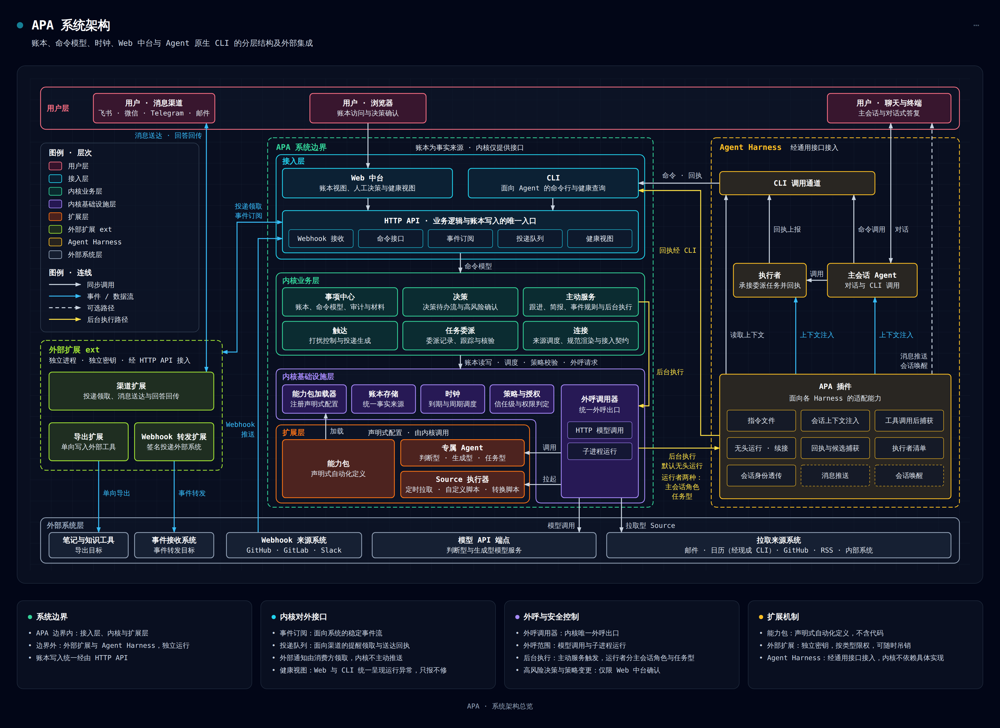
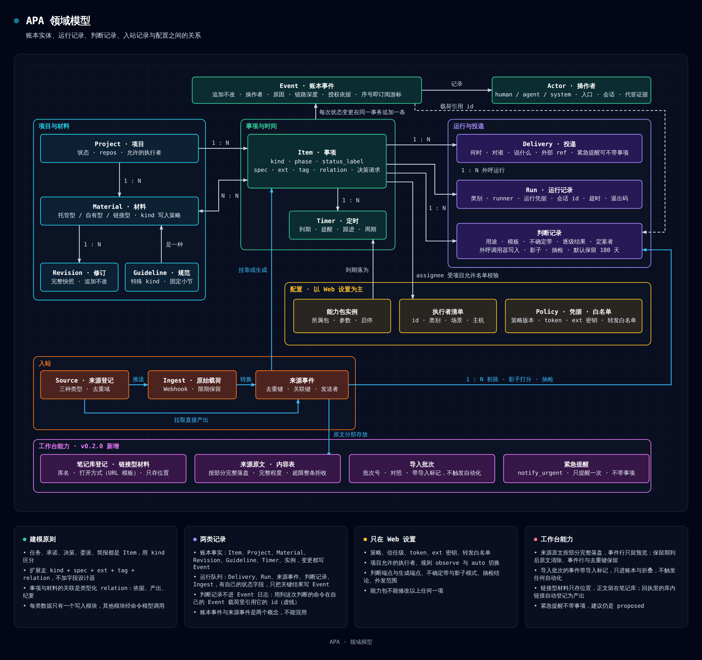
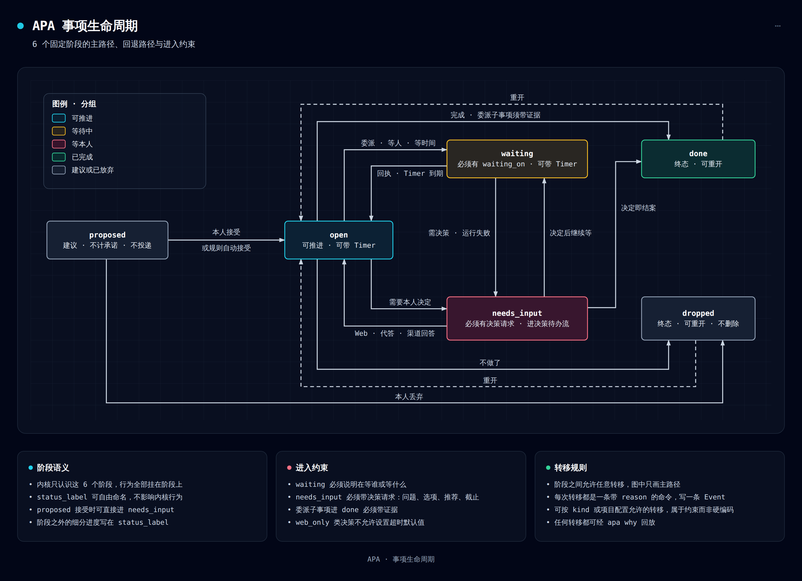
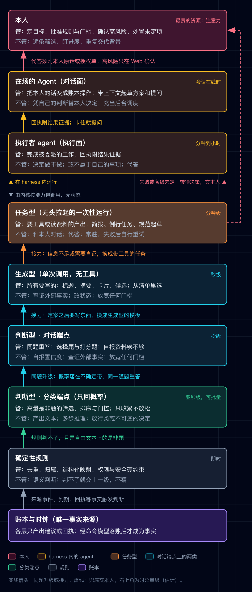
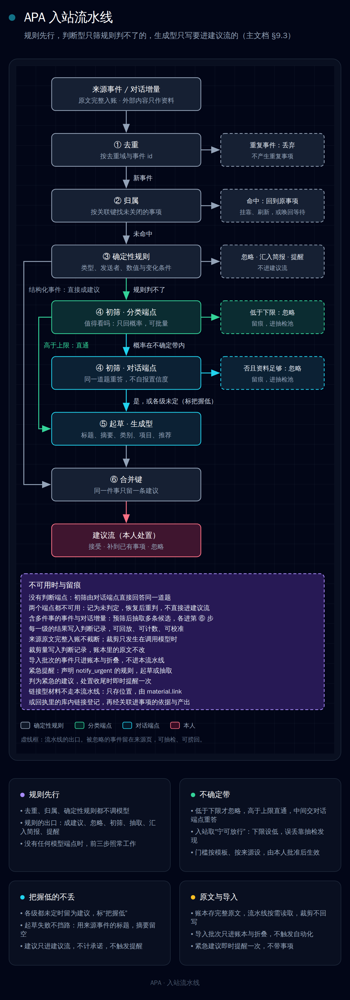
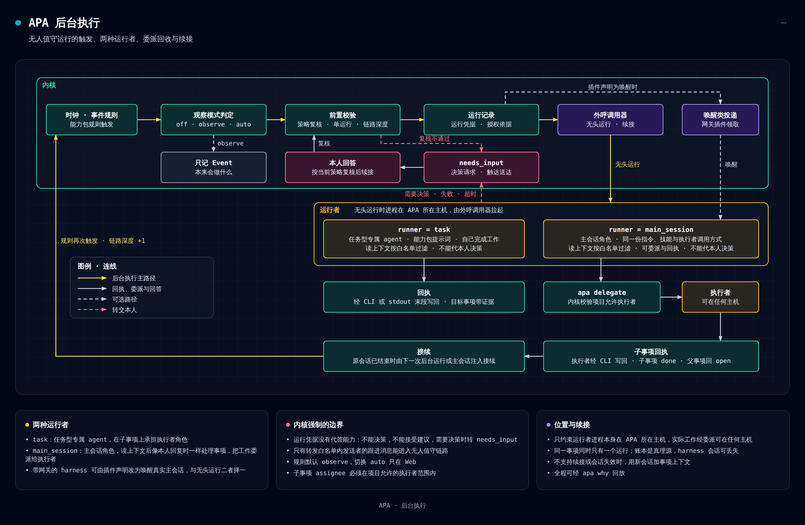

# APA 业务解决方案设计

> **状态**：v0.1 已实现并在主干运行；本文是 v0.2.0 的设计，也是 v0.2.0 实现与验收的依据。
> **本文**：APA（awesome-personal-agent）的主设计文档，也是实现时的权威依据。实现与本文冲突时，先改本文，再改代码。
> **配套**：[附录 A：harness 接口与无头运行](appendix-a-harness.md) · [附录 B：API 与 CLI 清单](appendix-b-api-cli.md) · [附录 C：能力包规范](appendix-c-capability-pack.md) · [附录 D：适配对象与实测结论](appendix-d-adapters.md)
> **命名约定**：本文不写厂商和商业产品的名字，被适配的对象用类别称呼（首批 harness、即时通讯渠道、邮件 CLI、日历 CLI、代码托管平台）。具体名字、版本和实测结论只出现在附录 A（harness）、附录 D（来源工具与渠道）和各自的适配目录里。实现栈用到的开源技术（§18）不在此限。

**一句话**：APA 是架在 agent harness 之上的开源、自部署个人 agent 层，它让只在被调用时才动的 harness 具备主观能动性，成为真正的个人助手，而不是对话工具或开发工具。

**本修订采用的决定（v0.2.0）**：下表 14 项在设计确认时逐条确认；改动任何一项，按「落点」列的章节返工。理由与取舍的完整版在 §21.1 决定 28–41。设计确认时另定的两项（补救旧级联误丢的事件、已有部署跟随主干升级与结构版本冻结）见决定 45、46。

| # | 题目 | 采用的选项 | 一句话理由 | 落点 |
|---|---|---|---|---|
| 1 | 分类端点在本版的地位 | 契约与级联语义必做，端点本身可选 | 契约落在能力包字段、策略和判断记录上，后补等于改契约；没有专用分类模型的用户也要能用 | §8、附录 C.7 |
| 2 | 只提醒本人的规则是否默认生效 | 提醒类规则默认生效；会改状态、起运行、自动接受，或由外部内容触发的规则仍默认只观察 | 否则装好以后跟进提醒不工作，「不忘」对新用户不成立 | §14.8、§13.3 |
| 3 | 跟进到期的默认做法 | 规则梯度为主，~~模型只用于减少提醒~~（**已取消（2026-11-23）**：跟进不调模型） | 模型在这里没有新信息，三选一只是猜；没有模型端点的用户也要有跟进 | §7.3 |
| 4 | 摘要出口、提醒出口与数值条件 | 三个原语进本版；专门的阅读与哨兵功能包不做 | 量大的来源不该只有「进建议流」和「被忽略」两条路 | §9.3 |
| 5 | 例行任务包 | 进本版 | 周期性的事不应依赖 harness 的定时任务与技能 | §13.5 |
| 6 | 对外的定位表述 | 面向已在用 harness 的人，写明三档运行形态，支持一个 harness；第二个 harness 是本版之后的第一优先 | 只有一个 harness 实现时宣称跨 harness 没有证据 | §2.4、§20 |
| 7 | 真实端点与真实 harness 的端到端验收 | 真实端点与真实 harness 的端到端验证仍是发布前提，但由本人在本机升级后执行，不在开发编排里自动化 | 判断质量、提示词和端点的结构化输出能力替身验不出来，而这些验证要用本人的真实账号与真实数据，并需要本人到场 | §1.4、§20.4 |
| 8 | 外发控制的默认值 | 每个来源必须选择送给模型的内容范围；外部端点没有默认值，不选就不送 | 公开产品不能让用户在不知情时把邮件正文发往外部端点 | §14.14 |
| 9 | 非私聊会话的代答 | ~~一律不接受凭原话的代答~~ **已取消（2026-11-20）**：本人原话整体不再是依据，会话类型不参与判定（决定 84） | 多人会话里别人的话可能被当作本人原话；不设可放开的开关 | §14.5 |
| 10 | 「不做成本管理」的措辞 | 改为不计费、不限额、不按费用调度，但按级计数 | 升级率和校准都要用调用次数 | §2.2、§8.6 |
| 11 | 七组结构性取舍 | 全部追认 | 它们是现有实现的地基，逐项重议都要大改 | §21.1 决定 38 |
| 12 | 状态与外部笔记库的关系 | 状态与流程只在 APA 写；知识型内容留在外部库，APA 只存链接；视图单向导出并带动作链接。本版只做其中的通用能力 | 双向同步等于给文件系统开一条不经授权和审计的写入通道 | §2.2、§10.3 |
| 13 | 界面语言 | Web 界面中英可切换（存在浏览器本地，默认跟随浏览器）；通知、简报与内置提示词为中文；CLI 为英文 | 界面文案只影响展示，可以先做全；提示词的语言会改变判断质量，要按语言各自验证一遍才能开放 | §4.1 |
| 14 | 公开文档里的厂商与产品名 | 主文档只写类别，名字留在附录 A、附录 D 与适配目录 | 与仓库「内核不认识厂商」的约束一致，对照内容也不随产品变化而过时 | 全文、§19 |

**工作台能力迭代采用的决定（并入 v0.2.0）**：v0.2.0 发布前追加一个迭代，补齐把 APA 当作唯一工作台时缺的通用能力（§20.2、§20.3 的 W16–W24）。下表 19 项按推荐选项定下，在计划确认时逐条确认；改动任何一项，按「落点」列的章节返工。理由与取舍的完整版在 §21.1 决定 58–76，逐条的数据与配置迁移见[变更清单](changes-v0.2.0.md)第十节。

| # | 题目 | 采用的选项 | 一句话理由 | 落点 |
|---|---|---|---|---|
| 15 | 来源原文 | 账本保存每条来源事件的完整原文，不截断；超过单条上限的整条拒收并留痕，不截取一段入账。来源程序取不到全文时如实标明 | 模型给出的摘要与建议是派生内容，丢了可以重算，原文丢了补不回来 | §6.10、§9.2、§9.7、附录 D.8 |
| 16 | 原文放在哪 | 放在账本里一张独立的原文表，按事件分部分存放；不放成文件。附件本体不随事件保存，按需取回后进内容寻址附件 | 在线备份一次拿到一致的快照，物理删除在一个事务里完成；事件表本身保持轻，列表与流水线扫描不读正文 | §6.10、§7.6、§16.2 |
| 17 | 派生内容与原文分开，裁剪只发生在调用模型时 | 生成端点新增资料预算，每次裁剪记下原文多长、送了多长，不回写账本；事项正文不再整份复制来源原文，经来源事件指回 | 预算随模型变，原文不随模型变；裁剪量看不见就无从判断漏判是不是因为没读到 | §8.4、§9.3、§6.16 |
| 18 | 升级前已被截断的事件 | 不回填，标为"升级前落盘，来源程序当时可能已截断" | 多数来源的旧原文已取不回，回填只能做到一部分，结果反而说不清哪些是全的 | §6.10、§16.5 |
| 19 | 原文保留期 | 默认不清理；每个来源可选保留天数，只在 Web 设；来源事件可在 Web 物理删除 | 原文是抽检、捞回与追溯的依据；要不要定期清是本人的选择，不是默认 | §6.15 |
| 20 | 谁能读原文 | 只看钥匙：本人在 Web 与 APA 内部的钥匙（主 Agent、辅 Agent、本机命令行）看全文，内部 Agent 的模型在外部也一样；外部钥匙按签发时逐来源选的档位读来源事件、事项与材料，不选就不给；简报的资料文件带全文；运行凭据不开放来源读取接口 | 外发控制管的是 APA 自己调模型；交给谁读由本人在签发钥匙时决定，不在来源上逐个配，也不按调用方的模型在哪猜（2026-11-23 本人裁决） | §14.2、§14.14、§7.3 |
| 21 | 账本结构版本 | 7 → 8，一次迁移收齐本迭代全部表与列；第一次被真实账本应用后冻结，之后另起 9 | 已有部署跟随主干升级，多次迁移意味着多次不可逆的升级（§16.5） | §16.5、附录 B.5 |
| 22 | 带原始时间的导入 | ~~导入写的是普通事项事件，时刻取原始时刻，另带导入批次与实际写入时刻；带导入标记的事件只进账本与折叠，不进任何自动化。同一来源名加外部 id 已存在时整条跳过；未完成事项的跟进与久未推进从导入时刻起算~~ **已取消（2026-11-20）**：迁移是一次性的，改用普通写入完成；APA 不承担导入能力。将来若要持续接入外部台账，按对外接口另做，不复活这个通道。账本里已有的导入痕迹只读保留，带导入标记的事件照旧只进账本与折叠（决定 83） | 时间线要保持原样，但几百条历史事件不该触发提醒、规则、摘要生成和对外事件流 | §6.7、§7.1、§6.14 |
| 23 | 导入的授权 | ~~只接受授权单，不接受本人原话；授权单写明来源名与条数上限，必须带有效期，不对后台运行生效~~ **已取消（2026-11-20）**：导入通道已下线，导入专用单不再签发；已签发的旧单只读保留，不放行任何命令（决定 83） | 批量写入与某一句话对不上，范围应当事先在 Web 划定 | §14.5、§6.13 |
| 24 | 链接型材料 | 材料的第三种形态：只存位置、标题、类别，不存正文、没有修订；位置只有两种写法，笔记库内的相对路径或网址。同一项目内同一位置只登记一条 | 知识型内容留在外部库、APA 只存链接（决定 39）需要一个一等的载体，否则只能写在事项正文里，Web 看不到一件事有哪些材料 | §6.6、§12.8 |
| 25 | 笔记库 | 在 Web 登记名字与"在笔记应用打开"的 URL 模板；APA 不读也不写库内文件。Web 只读预览不进本迭代 | 打开方式因应用而异，做成模板后内核不认识任何笔记应用；预览要在内核里开一个读本机文件的口子，信任边界另行设计 | §12.8、§20.5 |
| 26 | 回执里的库内链接 | `done` 回执带的链接落在已登记的笔记库内时，自动登记为链接型材料，并以"产出"关联到委派的父事项 | 报完成本来就必须带结果证据，不增加执行者的负担；产出挂在事项上，不靠人记得补一句 | §7.5 |
| 27 | 预填新建页 | `/new?title=…&link=…&project=…` 打开填好的新建表单，只预填、不提交，靠浏览器登录态，不带凭据 | 外部工具里顺手记一件事不需要插件，也不需要把 token 放进会被同步的地方 | §4.1 |
| 28 | 简报资料 | 资料文件新增五段：日程、新增建议、待决策、到期与等待、当天活动；"上一份以来"按实例各自计；知会仍是全局只进一份。每个实例各写自己的内容要求 | 资料全部来自账本，不放宽运行的权限档位；早晚两份简报的差别在内容要求，不在资料 | §7.3、§13.5、附录 C.13 |
| 29 | 抽取与起草对齐 | `extract` 的每条候选与起草同一组字段、同一份未关闭事项与活动项目清单、同一条合并路径；预筛也带清单；规则可写 `prescreen: none` 跳过预筛 | 按会话聚合的消息最需要"对得上已有的事就补到"，而抽取原先既看不到清单也不走合并 | §9.3、附录 C.5、C.7 |
| 30 | 紧急建议即时提醒 | 规则声明 `notify_urgent` 并由本人在 Web 从观察切到开之后，这条规则产生的新建议即时提醒；起草与抽取给出"可以等"的不提醒，没给出判断的也不提醒。提醒不带事项，受打扰上限与静音约束 | 依据是本人开启的规则，模型只用来少提醒，与不变量 12 一致；提醒由外部内容触发，所以是动作类规则 | §9.3、§14.8、§6.14 |
| 31 | 聊天里处置 | 首批 harness 插件补三个代答工具：补到已有事项、批量处理建议、给本人的事项记进展；~~`item.progress` 可用授权单；宿主自带的一对一聊天界面识别为 `direct`，多人会话的判定优先~~ **已取消（2026-11-20）**：这些工具按 Agent 的档位判定，授权单与会话类型取消（决定 84） | 建议流要能在聊天里处理完 | 附录 A.5、§14.5 |
| 32 | 没有到期日的提醒事项 | 提醒事项来源按列表配置：指定列表里未完成的提醒不论有没有到期日都产出事件，类型为 `reminder.open` | 随手记的提醒多数没有到期日；用新类型区分，已有规则与已有部署的行为不变 | §9.7、附录 D.2 |
| 33 | 本机验收 | 本迭代的实景验收并入升级后本机验证清单，编号 L14–L24，不进开发编排 | 与决定 34 一致：真实宿主、真实渠道与真实邮箱只在本人的部署上验 | §20.4 |

**阅读建议**：

| 读者 | 建议阅读 |
|---|---|
| 初次了解 APA 的读者 | §1–§4，§19.5 |
| 评审者 | 本页决定表，§1–§5，§8，§9.3，§14，§20–§21 |
| 内核与 Web 开发者 | §6–§10，§12–§15，§17，附录 B、C |
| harness 插件开发者 | §6.13，§11，§13.6，§14，附录 A |
| ext 与 Source 开发者 | §9，§10，§17，附录 B、D |

**术语**：

| 术语 | 含义 |
|---|---|
| 本人 | 账本的所有者，也是 Web 登录者；架构图中的"用户"即本人。APA 是单用户系统 |
| harness | agent 的运行环境，负责 agent loop、工具与权限。界面与用户文档称 **Agent**（如"设置 › Agent"）；本文的架构与契约章节称 harness |
| Agent 后台运行 | 界面与用户文档对后台执行（§13.6）的称呼：APA 在本人不在时拉起 Agent。机制上即无头运行或唤醒回合，运行者持运行凭据 |
| 首批 harness | 本版支持并完成端到端验收的那一个 harness（附录 A）；界面与用户文档称"本版支持的 Agent" |
| 主观能动性 | 不等调用，自己发现事情、记着事情、推进事情，轮到本人拿主意时才来找本人。不等于替本人做决定（§1.3） |
| 个人 agent | personal agent：具备主观能动性、能承担个人助手角色的 agent 形态。商业产品把它做成托管服务，APA 架在 harness 之上提供 |
| 了解用户 | 在 APA 中指了解本人的工作现场：在跟的项目和任务、相关材料、事项、作过的决定和偏好规则。不是个人记忆或人格档案；个人长期记忆由 harness 负责，APA 不重复保存（§1.3） |
| 工作台 | 本人处理工作、生活和日常事务的统一入口，由账本、Web 中台、注入与渠道共同构成，Web 中台是首要视图 |
| 在场的 Agent | harness 中与本人对话的 agent（机制上称主会话，`runner=main_session` 即这一角色的后台运行）；界面称"Agent"，与 Agent 后台运行区分时称"在场的 Agent" |
| 执行者 | 承接委派的原生子 agent、外部 CLI、远端 agent 或人，可在任何主机。由 harness 在第一次用它时登记进执行者名录；每次派出另记一条委派记录（§6.17） |
| 专属 agent | 内核按能力包声明调用的判断型、生成型、任务型 agent，无状态（§8） |
| 分类端点 | 只回概率、不产出文本的专用分类模型端点，经判断端点的协议适配器接入（§8.8）。它是判断型的一种答题后端，可选 |
| 对话端点 | 讲三种生成协议之一（对话补全、消息、响应接口，§8.1）并支持结构化输出的模型端点。生成型用它，判断型在没有分类端点或落入不确定带时也用它 |
| 不确定带 | 分类端点概率上的一对上下限：低于下限按否定案，高于上限按是定案，中间交给下一级回答同一道题（§8.3） |
| 同题升级、接力 | 往上交的两种形式。同题升级：同一个问题换更强的一级重答。接力：问题变了（要写字、要查证），换有那种能力的一级（§8.3） |
| 保守默认 | 各级都答不上来时取的处置，每个判断模板必须声明（§8.9） |
| 判断记录 | 一次判断的留痕：每一级的答案、概率、由哪一级定案（§6.16） |
| 运行者 | 后台执行拉起的那个会话，分 `task` 与 `main_session` 两种（§13.6） |
| 事项（Item） | 账本里唯一的"东西"：任务、承诺、决策、委派、简报都是事项，用 `kind` 区分 |
| 账本事件（Event） | 账本的追加日志，每次状态变更一条，也是对外的事件流 |
| 来源事件 | Source 或 webhook 带进来的外部事件，与账本事件是两个概念 |
| 挂靠消息 | 归属到已有事项的来源事件，例如合并请求上的新评论、邮件线程里的回信 |
| 积压 | 未判定与已过期的来源事件的合称（§9.3） |
| 来源原文 | 来源事件从外部带进来的内容本身：正文、头部、附件清单、聚合的逐条消息，以及未经转换的原始正文。账本完整保存，不截断（§6.10）；与之相对的是派生内容 |
| 派生内容 | 模型或内核由原文算出来的东西：摘要、候选、建议与推荐、判断理由、事项正文里的摘录。与原文分开存，能指回原文，丢了可以重算 |
| 导入 | ~~把别处已有的项目与事项连同原始时间线一次写进账本的操作~~ **已取消（2026-11-20）**，APA 不再提供导入（§7.1）。旧账本里带导入标记的事件与事项是只读的历史数据，导入事件不触发自动化 |
| 投递（Delivery） | 触达模块产出的一条提醒，等待消费方领取 |
| 能力包 | 声明一类自动化怎么做的目录（yaml + 模板），不含代码 |
| 链接型材料 | 只存位置的材料：位置是笔记库内的路径或网址，正文留在原处（§12.8） |
| 笔记库 | 本人放文档的外部库（一个目录及其同步副本），由某个笔记应用打开；APA 只登记它的名字与打开方式，不读不写其中的文件（§12.8） |
| Source | 把外部事件带进账本的程序化来源 |
| ext | 外置集成程序（渠道，或自己写的导出、转发程序），只经 HTTP API 接入 |
| ~~web_only 类~~ | ~~只能由本人在 Web 确认的高风险决策类别~~ **已取消（2026-11-20）**（§14.4） |
| 三档 | 动作按后果分的三档：一档整理（Agent 直接做，可撤回）、二档拍板（本人确认，或本人给 Agent 放开）、三档定规矩；三档分 3a 改日常（可按 Agent 放开）与 3b 造新权力（永不放开，只在 Web 做）（§14.3） |
| 档位 | 本人在 Web 给每个 Agent 选的放开程度：只整理、也替我拍板、连日常规矩也替我改（§14.5） |
| 运行凭据 | 内核为一次后台运行生成的短期凭据，决定"运行身份" |
| 无人值守链路 | 由后台运行发起的事项及其子事项，读取挂靠消息时受转发白名单约束 |

---

## 1 为什么做 APA

agent harness 很能干，但只在被调用时才动：任务跑完没人看，对方不回没人催，三个 session 同时等人拍板。APA 的核心价值只有一个：**主观能动性**。它架在 harness 之上，让这些冷冰冰、只在被调用时才动的工具能自己发现事情、记着事情、推进事情，只在需要本人决定时才来问一个具体问题，成为真正的个人助手，而不是对话工具或开发工具。

harness 管 agent 怎么把活干完，APA 管事情有没有人盯、什么时候该找本人。

### 1.1 背景：harness 能干，但不主动

**harness 很强，但它是被动的工具。** 主流的 agent harness 已经能写代码、查资料、操作工具、调用子 agent，本人可以自己选模型、配权限、积累技能和工作流。它们的工作方式却是被动的：被调用才工作，会话之间不保留事项状态，也不知道本人在等什么。

**商业个人 agent 证明了主动的体验可行，但和厂商的产品绑在一起。** 这类产品按计划或事件自己运行，关闭应用后继续工作，情况变化或需要批准时回来找人。跟踪事情的是 agent，人只在需要时才被叫到（产品事实见 §19.5）。它们的运行环境、模型和入口都由厂商决定，已经在 harness 上积累了工具链、技能和模型选择的人，要得到这种体验就得转到另一个产品里工作。APA 给这些人另一条路：留在自己的 harness 上，获得类似的主动性。

### 1.2 问题：没有主动性时本人付出的代价

harness 有能力，但没有主动性，主动性只好由人来补。已经在用 harness 的人，今天的日常大致是这样：

**每个 session 都在等人。** 三个终端开着三个 agent：一个问要不要改接口，一个等确认一段清理脚本，一个卡在权限提示上。本人只能逐个切过去，重新读懂上下文再回答；漏看一个，那个 agent 就一直等下去。这些请求只存在于各自的会话里，进程一退就没了，事后也查不到是谁同意了什么。

**每次开工都要从头交代。** 每开一个新会话，都要再说一遍这个项目是什么、按什么规范做、上次定了什么。换一个 harness 或一台机器，再来一遍。agent 也不知道这周最要紧的是哪个项目，哪类操作必须本人确认，晚上十点以后不想被打扰。各个 harness 的记忆适合保存个人偏好，但各管各的，不能结构化查询事项状态，也不能审计，agent 可能依据陈旧的内容判断事情的进展。

**事情过去了，没人替本人记着。** 派给 agent 的任务跑完了，结果停在某个终端里没人看；发给对方的问题三天没有回音，没有任何东西提醒该催了；约好下周复查的事，到了下周只有人可能还记得。时间在流逝，系统里却没有谁为此负责。

**外面的事，要么进不来，要么全涌进来。** 续保通知躺在邮箱里，Issue 和报价回复各在各处，agent 都看不到。全接进来又要由人自己筛，其中还可能夹着诱导 agent 的内容。

**没有一处能回答"我手上现在有哪些事"。** 周一在一个会话里让 agent 调研方案，周二在群里答应同事周五前给结论，周三邮箱里来了一封保险续保通知。这三件事分别留在一段对话、一条聊天记录和一封邮件里。窗口一关，对话里的那件事只能靠翻历史找回来。

这些代价有同一个根因：harness 的生命周期是一次会话，事情的生命周期不是。人因此成了 agent 之间的调度员和传话筒，注意力花在查看 session、做琐碎决策和重复输入上，真正需要自己判断的事反而分不到时间。

凑合的做法都不够。多开 session 只会让等待翻倍。定时脚本能把 agent 叫醒，但记不住事项，也问不到人。部分 harness 带有网关、定时或记忆，但能力差异很大，状态留在各自内部，没有一份能跨 harness 查询的事项状态。

### 1.3 价值主张：主观能动性

APA 只提供这一样东西：不等本人开口，它自己发现事情、记着事情、推进事情，轮到本人拿主意时才来找本人。下表四项是主动性对本人的具体体现，"怎么做到"一列里的加粗项是支撑它们的能力，也是 §2.1 目标 1–5 的名称。

| 主动性的体现 | 本人得到什么 | 怎么做到 | 场景与详设 |
|---|---|---|---|
| **了解本人** | 新会话不用重述背景，agent 知道本人在做什么、在乎哪些事、按什么规则办；工作、生活和日常事务在一处看、一处处理 | **了解用户**：账本记录在跟的事、承诺、决定和原话；项目带材料和规范；档位写明哪个 Agent 能替本人拍板、策略写明什么时候不打扰；接受和丢弃建议的 Event 反映本人的取舍，判断型和生成型可读取其统计。注入和 `apa context` 把相关部分带给每个会话，AGENTS.md 由同一份规范渲染。**一个工作台**：一本账本加一个 Web 中台，本人在上面直接记事、排计划日期、写进展，已接入的 harness、CLI 和渠道看到同一份状态 | 场景二、六、九、十二；§4.1、§6、§7.6、§8.4、§11.6、§12 |
| **有条不紊地安排和推进** | 事情不因会话关闭而停：外部变化不用本人逐个去看，委派出去的工作、等别人的回复、到期的事不再靠人记 | **主动感知**：来源程序定时拉取邮件、日历、Issue、RSS 等，外部系统也可经 webhook 推送；规则优先，规则判不了的由判断型初筛、生成型起草，筛过的结果先成为建议；只需知会的汇入简报，满足条件的直接提醒；对话中的候选可按项目开启捕获。**主动跟进**：时钟在内核，不依赖任何会话在线；等待到期按规则梯度提醒本人，连续没有进展时问去留；等的回音到了，事项自己回到可推进状态；久未推进的事定期问一次；回执回到原事项；周期简报与例行任务 | 场景一、三、五、七、九、十、十一；§7.3、§9 |
| **重复的事自己处理** | 已批准的规则直接照做，不用每次开口 | **主动跟进**：事件规则命中后，后台运行接着处理，需要本人决定时停下来等。这类会自动产生动作的规则默认只观察，本人在 Web 审阅后切到自动 | 场景四；§13.6、§14.8 |
| **只在需要决策时才打扰** | 只被真正需要自己的事打断，不必反复查看各个 session | **注意力回归**：需要决定的事进同一个待办流，一次一个具体问题，可在 Web、聊天或渠道回答；建议不触发提醒；其余提醒的静默、合并、日上限与静音由内核控制 | 场景二、八；§7.2、§7.4 |

接入之后，本人主要只做三件事：说清要什么、批准自动规则、回答系统替不了的决定。

**"了解用户"的含义。** APA 了解的是工作现场：本人的项目、任务、材料、事项、决定和偏好规则，不是个人记忆或人格档案（这里的人格档案指关于本人的档案）。这些都是本人可查、可改、可撤销的记录，不是从对话里推断的画像。个人长期记忆仍由 harness 负责，APA 不重复保存（§2.2）。

**主动有边界。** 这是敢把事情交给 APA 的前提。APA 和 harness 合起来有了主动性，但它们不替本人做决定：要不要做一件事由本人回答，或由本人在 Web 明确放开的 Agent 回答，每一条都可见、可撤回（§14.3、§14.5）；签发钥匙、填凭据、改工具权限这类造出新权力的事只有本人在 Web 做；会自动产生动作的规则默认只观察（§14.8）；每一步都能回放（§15.1）。~~资金、对外承诺、不可逆操作、权限变更和规范生效只能由本人在 Web 确认（§14.4）；后台运行者没有代答能力~~ **已取消（2026-11-20）**。

### 1.4 接入之后的一天

下面是设计完成后的一个普通工作日，用来说明差异。每一步对应 §3 的场景，实现次序见 §20。

- **08:00** 简报已经写好，按项目分节：昨晚哪些委派有了回执，今天什么到期，还有两件事等本人决定。第一个会话开始时，这份摘要已经带到 agent 那里，不用先问"昨天到哪了"。
- **09:30** 本人在主会话里说"登录超时的问题交给工作主机上的 agent"。主会话建好委派事项，用 Agent 自己的方式派出，并把这次委派记进账本；项目规范和相关材料由 AGENTS.md 和 `apa context` 带到，不用再交代一遍。
- **11:00** 邮箱来了一封保险续保通知，代码仓库里来了一条新 Issue。两者都经过筛选进了建议流，各带一句摘要和推荐处置，没有产生提醒。本人空下来时在 Web 上看一眼，接受前者，丢弃后者。
- **14:00** 手机上收到一条消息：执行者提交的 PR 需要决定合并到哪个分支，消息里有两个选项和一个推荐。回复选项，事项继续，不用打开电脑。
- **16:00** 上周问装修公司的报价还没有回音。跟进定时到期，提醒随下一次注入带到会话里：这件事已经等了三天，要催、再等还是放弃。本人让 agent 发出催问。
- **17:30** 续保方案要付款。Agent 写入问题"选哪个方案"；本人在 Web 或已配对渠道里回答，付款由本人自己去做。~~属于高风险类。渠道消息只带 Web 链接，agent 也不能代答，只能由本人在 Web 确认。~~ **已取消（2026-11-20）**：高风险类别取消（§14.4）。
- **22:00** 静默时段开始。晚上来的提醒留到静默结束后再送达；已批准规则的后台运行继续处理手头的事，需要本人决定时就停下来等。

这一天里，本人没有逐个切换 session 查状态，也没有重复交代项目背景，只回答了几个具体问题。

这一天是 v0.2.0 的发布前提之一：开发完成后，由本人把自己的部署升级到主干版本，用真实模型端点和本版支持的 Agent 走一遍（§20.4 本机升级验证清单 L10）。替身能验证协议和流程，验证不了判断质量、提示词和真实端点的结构化输出能力，所以这次验证不排在发布之后。

### 1.5 为什么是 harness 之上的一层，而不是又一个 agent

再做一个 agent 是最直接的想法，但它解决不了上面的问题。agent loop、工具、沙箱和模型接入，harness 已经做得足够好；再造一份，等于要求用户再换一次工具链，APA 也要长期追赶这些 harness 的进度。§1.2 的问题也不是某个 harness 少了某个功能：时钟、外部事件入口、跨会话的事项状态、可靠地问到本人，都需要一个比任何单次会话活得更长、又不属于任何一个 harness 的常驻服务。

因此 APA 把执行和状态分开：**执行归 harness，状态归账本。**

| 归 harness | 归 APA |
|---|---|
| agent loop、回合控制、聊天界面 | 事项、项目和材料的账本 |
| 工具、沙箱、工具级权限 | 到期、跟进和周期任务的时钟 |
| 模型选择、技能、子 agent | 外部事件的入站与筛选 |
| 代码、文档和外部系统上的实际操作 | 决策队列、打扰控制和提醒的产出 |
| 个人长期记忆 | 项目、任务、材料、决定和偏好规则组成的工作现场 |

APA 这一层只做四类事：记下事情、到时间醒来、做轻量判断、找到本人。轻量判断由内核直连用户配置的模型端点，只做分类和生成摘要，不跑 agent loop（§8）。需要动手时，APA 经无头运行拉起用户自己的 harness，主会话角色的运行沿用它原有的指令、技能和执行者（§13.6）。用户对话的仍是原来的 agent。本版支持一个 Agent，接口按多 harness 设计；其他 harness 接入后，换 harness 时账本不动，同时用几个 harness、几台机器也只有一份状态（§20）。

由此得出 APA 的形态：一本账本（事项、项目、材料）、一套命令模型、一个时钟、一个 Web 中台和一个 agent native CLI。账本是真理源，Web 是首要视图，CLI 是 agent 的入口；APA 自己只改账本、只提供接口，一切外部副作用留在 harness 和 ext 各自的权限体系内。

这个选择也有代价：用户要自己部署一个服务，APA 要维护多个 harness 的插件并承受它们的行为差异，实际能做的动作也取决于接入的 harness 和执行者（§19.4、§19.5）。所以 APA 面向已经在用 harness、想要个人助手，又要保留工具链、模型选择和数据归属的人；没有 Agent 时 APA 仍可作为账本、工作台和提醒层使用（§2.4），但希望开箱即用、不想自己部署的人更适合商业产品。

---

## 2 目标与非目标

### 2.1 目标

目标 1–5 是支撑 §1.3 主观能动性的能力，目标 6–9 是实现这些能力时要守住的约束。

| # | 目标 | 可观测的完成判据 |
|---|---|---|
| 1 | 主动感知 | 已登记来源的事件不需本人询问就能进入账本，并经规则和判断型筛选；任何一级拿不准的都留为建议，不静默丢弃；判断为不值得的只记录、不打扰，可抽检、可捞回；只需知会的汇入简报；模型不可用时事件留在来源页，不丢失，恢复后自动重判 |
| 2 | 主动跟进 | 到期、跟进和周期任务由内核时钟驱动，不依赖任何会话在线；`waiting` 到期后提醒本人并给出催、再等、放弃三个动作，不需要模型，也不静默丢弃；这类只提醒本人的规则开箱生效；委派回执自动回到原事项 |
| 3 | 了解用户 | 新会话不用本人重述：注入与 `apa context` 带上待决、相关事项和项目上下文，AGENTS.md 由同一份规范渲染；这些信息在 Web 可见，变更有记录，agent 的变更可撤销；"了解"限于工作现场（§1.3），不保存个人记忆或人格档案；判断型和生成型只读已有 Event 的统计，不新增存储 |
| 4 | 一个工作台 | 任一已接入的 harness、CLI 和 Web 看到同一份事项状态；本人可在 Web 直接新建、安排和推进事项；任何变更都能查到操作者与原因；工作、生活和日常事务用同一套事项与项目管理，不绑定某种工作流；已排期的事项可以在 Web 按日、周、月查看（日历只读，排期只在事项详情改，决定 82） |
| 5 | 注意力回归 | 需要本人决定的事可挂起、可跨端回答、可追溯，一次一个具体问题；`proposed` 不触发投递；打扰按静默、合并、日上限与静音控制；高风险类经 CLI 回答时返回退出码 20 |
| 6 | 多 harness 低成本接入 | 接口按多 harness 设计，本版支持一个 Agent，其他 harness 后续接入且不改内核和 HTTP API（§20）；不要求用户更换工具链或模型；装一个插件后，agent 不读文档也能经 `apa guide` 正确使用；钩子失败不影响 harness（不超过 2 秒，失败时放行） |
| 7 | 无人值守可控 | 会自动产生动作的规则默认只观察，切换 `auto` 只在 Web；后台运行可全程回放；运行者不能代本人决策 |
| 8 | 自部署、数据自有 | 单机或服务器部署，不依赖云服务；APA 自身的状态都在一个数据目录里；外部工具的凭据由工具自己保管，换主机需重新认证（§16.2） |
| 9 | 扩展不动内核，通用能力不绑定 | 新增自动化只写能力包，新增渠道只写 ext；内核代码不出现任何具体 harness 或产品；来源、渠道、触达、账本不依赖某一个 harness 或某一个具体工具才能工作（§5.2） |

### 2.2 非目标

APA 要做的是个人助手，不是对话工具或开发工具。它提供主观能动性和持久状态，不再造 harness，也不做托管服务。以下边界不因对标商业个人 agent 而放宽。取舍的界线是这件事属于哪一边：什么时候做、值不值得、该不该找本人，属于 APA，即使某个 Agent 自带类似能力也要有，定时、监视、筛选、摘要、例行任务都在这一边；怎么把活干完属于 Agent，技能、工具、子 agent、模型选择不重做。

**产品边界**

| 不做 | 理由与归属 |
|---|---|
| 替本人拿主意 | 自动规则要本人批准才生效；Agent 只有在本人于 Web 放开相应档位后才能替本人拍板，且每一条可见、可撤回；造新权力的事只在 Web（§14）。~~代答必须有本人原话或本人在 Web 签发的授权单，高风险决定只在 Web 确认~~ **已取消（2026-11-20）** |
| agent loop 与会话编排 | 回合控制、工具循环归 harness。内核不管理会话生命周期，不养常驻 LLM 路由会话 |
| 计费、额度与成本调度 | 模型与 harness 的费用由用户自己的账户和 harness 管理。APA 不换算金额、不设额度、不按费用调度或熔断。内核只按级记调用次数，用于升级率与校准（§8.6） |
| 团队协作 | 单用户系统，Web 登录者即本人。没有多用户、角色体系和协作编辑 |
| 寄生 harness 记忆 | 不读也不写。agent 看到事项靠每次重新计算的注入；注入信封声明账本是唯一真理源，不要把事项状态写进记忆 |
| 个人记忆与人格档案 | 个人长期记忆由 harness 负责，APA 不重复保存，不建本人档案，也不从对话中推断画像。APA 了解的是工作现场（§1.3） |
| 聊天界面、模型路由、沙箱、工具级权限守卫 | 都是 harness 的职责。APA 的业务决策与 harness 的工具权限是两层，互不替代 |
| 依赖笔记软件，或与之双向同步 | 状态与流程只在 APA 写，所有写入都经命令模型，有操作者、有依据、可撤销；知识型内容可以留在外部笔记库，APA 只存链接；笔记软件只是可选的单向导出目标（§10.3）。双向同步等于给文件系统开一条绕过授权与审计的写入通道 |
| 自动排程与工时 | 自动排程指替本人安排时段、算空闲时间、自动解冲突；工时指记录实际起止、工时统计、对接工时系统。APA 保存计划日期与时段并提供只读日历（§4.1、决定 82），什么时候做由本人定；排程与工时是另一类系统。周期性的核对用例行任务做（§13.5） |
| 多级项目层级 | 层级会牵动允许的执行者等权限继承，收益只是视图；归属用标签表达 |
| 日记、人物档案 | 事件时间线、进展、简报和纪要型材料已覆盖记录的需要；按人汇总往来与"不建档案"相悖，按发送者写规则可以表达"这个人的事要看" |
| 自动更换执行者 | 换人由本人或 Agent 决定；内核只报告长时间没有回执的委派（§7.3），并把之前的委派记录交给 Agent（§6.17） |
| 原生移动应用、内置即时通讯来源 | 手机上用浏览器访问 Web，提醒走提醒渠道（§10.3）；即时通讯各家差异大，用自定义脚本契约承接（§9.1） |

**架构约束**

| 不做 | 理由与归属 |
|---|---|
| 字段设计器、工作流引擎 | 用 `kind + spec + ext + tag + relation` 承接扩展；证据表明不够时再加实体 |
| 内核插件运行时、内核 hook | 内核只加载声明式能力包和 Source 登记（§10.5） |
| 自实现外部协议与鉴权 | IMAP/SMTP、CalDAV、MIME 解析、OAuth 和令牌刷新交给成熟工具，APA 只做薄适配（§5.7、§9.7） |
| 让通用能力绑定某个 harness 或工具 | 现成工具只放在 APA 定义的通用契约之后，可替换、不唯一；harness 专属的东西只出现在该 harness 的插件里（§5.2、§5.7） |
| 复用 harness 网关、运行时装载渠道代码 | 内置渠道是随主程序编译的连接插件，内核只经连接接口调用、不认识接口另一侧是哪个平台（§4.4、§10.3）；第三方渠道走 ext 协议，在主进程之外运行。两者都不复用任何 harness 的网关 |
| 在非 APA 主机上拉起进程 | 外呼调用器只在 APA 所在主机起进程；要在别的主机执行工作，走任务委派（§13.6） |
| 由内核调用执行者、借 Agent 的模型做判断 | 执行者的调用留在 Agent 的权限体系内；判断直连用户配置的端点，没有 Agent 的用户同样可用（§8） |
| 调度包租约、多进程接力处理判断 | 单进程常驻服务下没有意义；批量在概率判断协议里做（§8.8） |

### 2.3 对用户的七条承诺

§1.3 的主观能动性要拆成用户能自己验证的承诺。v0.2.0 的范围取舍以这七条为准：缺了某项能力会让其中一条对陌生用户不成立，这项能力就必须做。

| # | 承诺 | 用户怎么验证 | 靠什么兑现 |
|---|---|---|---|
| 1 | 不漏 | 外面来的事、对话里说过的事会进账本；规则判不了的不会被静默丢掉 | 来源流水线与对话捕获（§9.3）；任何一级未定都留为建议；被忽略的可抽检、可捞回（§8.10） |
| 2 | 不吵 | 到本人面前的都值得看，打扰有上限、可静音 | 建议不触发提醒；合并键与"补到已有事项"；静默、合并、日上限与静音（§7.4）；模型判断只能减少打扰 |
| 3 | 不忘 | 答应过、派出去、等别人的事到点有人提醒 | 截止与跟进提醒开箱生效（§7.3、§14.8）；久未推进的事定期问一次去留；等的回音到了事项自己回到可推进状态（§9.4） |
| 4 | 可答 | 在手机上也能看到并回答 | 渠道回答普通决策；Web 可安全地远程访问，高风险决策在手机浏览器上也能确认（§14.13、§16.3） |
| 5 | 可信 | 不替本人做主，造新权力的事只有本人能做，全程可回放 | 三档与硬线、按 Agent 的档位（§14.3、§14.5）；外发范围由本人选定（§14.14）；`apa why` |
| 6 | 可用 | 陌生用户一小时内装好并看到第一次价值，坏了知道哪里坏 | 带版本号的完整发布物、`apa doctor`、备份与恢复、用户文档（§15.5、§16） |
| 7 | 不绑定 | 换 Agent、换模型、换渠道不丢状态；不装 Agent 也有用 | 内核不认识厂商；三档运行形态（§2.4）；本版只有一个 Agent 实现，跨 Agent 的证据要等第二个 Agent（§20） |

### 2.4 三档运行形态

APA 按用户手里有什么分三档工作，每一档都是完整可用的产品形态，分别验收（§20）。

| 形态 | 需要 | 可用 | 不可用 |
|---|---|---|---|
| 只有内核 | APA 本身 | 账本、Web 工作台、来源与规则（含条件监视、摘要出口）、截止与跟进提醒、久未推进询问、渠道 ext、对外接口（事件订阅与只读 API） | 语义筛选（规则判不了的事件留在积压里，由本人处理）、起草、简报、例行任务的执行 |
| 加模型端点 | 生成端点，判断端点可选 | 以上，加入站初筛与起草、对话候选抽取、决策卡片文案、摘要；简报与例行任务可改用生成型（不能查外部资料） | 需要工具的任务 |
| 加 Agent | 本版支持的 Agent 及其插件 | 全部，含会话注入、聊天代答、委派与回执捕获、任务型、Agent 后台运行 | — |

本版面向已经在用 harness 的人，支持一个 Agent，接口按多 Agent 设计；前两档保证没有 Agent、或 Agent 暂时不可用时产品仍然有用。

本人可以在 Web 暂停模型：端点配置与密钥原样保留，暂停期间按"只有内核"一档运行，恢复后立即回到原来的档位（§8.7）。

---

## 3 用户与核心场景

以下场景展示 §1.3 的价值如何落到系统行为上。场景一至八多以代码协作为例，因为它们同时涉及来源、委派和权限边界；邮件、日历和生活事务走同一条路径，只是来源和事项类型不同，完整例子见场景九（§3.11）。

### 3.1 角色

| 角色 | 是谁 | 与 APA 的关系 |
|---|---|---|
| 本人 | 系统唯一的人类用户 | Web 登录即本人身份；策略、凭据、白名单、高风险决策只在 Web 处理 |
| 在场的 Agent | harness 里与本人对话的 agent | 读注入资料，调 CLI；持 delegate token 时整理直接做，拍板与改日常规矩按本人给它放开的档位（§14.5） |
| 执行者 | 子 agent、外部 CLI、人 | 承接子事项，经 CLI 或捕获回执，只受理分配给自己的事 |
| 运行者 | 后台运行的一次性会话或被唤醒的主会话 | 持运行凭据处理事项；可委派、可回执，不能代本人决策 |
| 专属 agent | 判断型、生成型、任务型 | 内核调用，无状态，结果写回账本 |
| 外部发送者 | 邮件、Issue、群消息的作者 | 不可信输入，其内容只作资料，不作指令 |

### 3.2 场景一：来源事件变成待决策

**前提**：已登记代码托管来源，仓库已写入某项目的 `repos` 属性。

1. 时钟到期，外呼调用器拉起该来源的拉取程序，程序输出标准事件。
2. 内核去重后查跟进消息归属，未命中已委派事项。
3. 能力包规则按仓库远程地址把事件归入项目，并把它交初筛：判断型回答"值不值得本人看一眼"，分类端点先答，拿不准时由对话端点重答同一题。值得或仍未定的交生成型起草标题、摘要、类别和推荐处置；未定的标"把握低"，不丢。
4. 生成 `proposed` 事项：进入 Web 建议流，下次 `apa context` 也会带给主会话，但不产生投递，也不计入承诺。
5. 本人在 Web 接受（也可以补到已有事项或忽略），或在聊天里表态后由放开了拍板的主会话代为接受。事项进入 `open` 或 `needs_input`。
6. 进入 `needs_input` 后，触达按策略产出投递：下次发言时注入、渠道 ext 领取，或留在 Web 未读。
7. 本人作出决定，事项进入 `done`。

**完成判据**：`apa why <id>` 能回放事件来源、命中规则、每一级的判断结果与定案者、接受人和最终决定。
**异常**：来源认证失败（退出码 2）是事件：记 `source.failed`（`kind: auth_or_config`），健康视图的"来源失败"写明要重新登录或改配置，不建 `needs_input` 事项（§9.2）；模型不可用时事件标记未判定，留在来源页，不丢失，模型恢复后自动重判。

### 3.3 场景二：聊天代答

**前提**：本人为主会话开启了 delegate token，并在 Agent 页把它的档位设为"也替我拍板"（§14.5）。

1. 消息前注入带来一条 `needs_input`，以资料信封的形式呈现。
2. 本人在聊天中回复"就选方案 B"。
3. 主会话调用 `apa decide <id> --option B`。
4. 内核按档位判定：放开了拍板，回答生效，记 `resolved_via: agent`，回答人是这个 Agent；内核另推一条提醒写明它替本人答了什么；"Agent 改动"里可逐条撤回。
5. 档位没放开时返回退出码 23 和这张卡的 Web 链接，事项留在 `needs_input`；主会话把链接交给本人，本人点卡片回答。

**本人不在场时**：放开了拍板的 Agent 在后台运行里同样可以回答目标事项上的问题，只在本次目标内（§14.5）；没有"签发给后台的授权"这一步。

<details>
<summary><b>已取消（2026-11-20）：原场景二（凭本人原话与授权单代答）</b>。理由：原话与会话类型由调用方自报，不能证明是本人；授权单由档位取代（§14.5）。原文保留如下。</summary>

**前提**：本人为主会话开启了 delegate token。

1. 消息前注入带来一条 `needs_input`，以资料信封的形式呈现。
2. 本人在聊天中回复"就选方案 B"。
3. 主会话调用 `apa decide <id> --option B --evidence "就选方案 B"`。
4. 内核校验策略。普通决策记 `resolved_via: chat`，Event 带 `on_behalf_of` 与证据，Web 的"agent 变更"视图可一键撤销。

**本人不在场时**：本人可事先在 Web 签发授权单，限定 agent、项目或事项、动作和有效期。持同一 delegate token 的 agent 调用 `apa decide <id> --option B --grant <授权单 id>`，事项记 `resolved_via: grant`，同样可撤销。没有授权单、范围不符、已过期或已撤销时返回退出码 23，事项留在 `needs_input`，由本人处理（§14.5）。

**异常**：事项属于 web_only 类时返回退出码 20，并附结构化说明和 Web 链接，事项停在 `needs_input`，agent 不能据此继续。决策请求的 web_only 初筛尚未返回时返回退出码 22，可稍后重试或到 Web 处理（§14.4）。

</details>

### 3.4 场景三：委派与回收

**前提**：项目可能设置了"允许的执行者"（§14.7）。执行者不需要本人预先登记。

1. 主会话自己决定交给谁、怎么派（Agent 的原生子 agent、远端 agent、外部 CLI 或人）。它按常驻指令调用 `apa delegate`，建立子事项（`assignee` 为执行者 id，带 project），父事项进入 `waiting`。第一次用到的执行者随这次调用一起登记进执行者名录（§6.17）。
2. **内核校验 `assignee` 是否在项目允许范围内**，不在则返回退出码 21 和原因，不建子事项，也不登记执行者。
3. 主会话用 Agent 自己的机制派出。插件在派出工具调用后自动捕获，把这次委派记到子事项上：会话 id、工作目录或仓库、能否续接，以及只给 Agent 自己看的句柄；插件认不出的派法由主会话经 `apa dispatch add` 补记。插件补充项目上下文（项目信息、repos 属性、相关材料、AGENTS.md），执行者自行判断在哪工作。
4. 执行者经 `apa report` 回执并附 commit 或 PR，或由插件捕获回执，或由主会话代为回执。子事项带结果证据进入 `done`，附不出时只报进展，子事项保持原阶段；可选任务型核验。回执是 agent 自己的工作，不要求本人原话（§14.5）。
5. 父事项回到 `open`，下一次消息前注入告知主会话。

**跟进消息**：回执里的 PR 登记为关联键。之后 PR 上的新评论经关联键挂到原事项，不进规则与判断，经 `apa context` 增量转给负责者（执行者本身，或发起委派的主会话），随回执确认已处理。同时下发的还有该事项所在序列之前的委派记录，由 Agent 决定续接原会话、照原方式新开，还是换人（§6.17）；执行者可交回一次并附理由；事项关闭时未处理的消息退回判断流（§9.4）。

**异常**：执行者迟迟不回执时，跟进定时到期，内核提醒本人并给出催、再等、放弃三个动作；超过设定时长没有任何回执的委派另进健康视图（§15.2）。

### 3.5 场景四：后台无人值守执行与续接

**前提**：某工作项目设置了允许的执行者（只允许工作主机上的 `work-host.cli`）。本人建了一条规则：带 `agent-ok` 标签的事项进入 `open` 时自动处理，`runner=main_session`（Web 事项详情的"交给 Agent 处理"开关写的就是这个标签，经 `item.update`，记 Event；规则只认进入 `open` 的那一刻，已在 `open` 的事项后加标签不会补开工）。

1. 规则默认 `observe`：只记录"本来会做什么"。本人在 Web 审阅后切到 `auto`。
2. 事项命中规则。主动服务确认该事项没有在途运行、当前策略允许、链路深度未超限，建立运行记录（记策略版本与规则 id），生成运行凭据。
3. 外呼调用器在 APA 所在主机按插件声明，以主会话角色拉起一次性运行（同一份指令与技能，含 Agent 自己的委派方式）。
4. 运行者经 `apa context` 读取事项与项目上下文，其中挂靠消息已被内核按转发白名单过滤。它判断需要改代码，调用 `apa delegate --assignee work-host.cli`；内核校验通过后，它用 Agent 自己的方式把活派给这个位于工作主机的执行者，插件随即把这次委派记进账本。
5. 运行者写下进展后退出，父事项 `waiting`。
6. 执行者回执并附 PR，子事项 `done`，父事项回 `open`。原后台会话已结束，由下一次后台运行（规则再次命中，链路深度加一）或主会话注入接续。
7. PR 上出现新评论：白名单内发送者的消息转给执行者；其余只进 Web 和本人在场的主会话注入。挂靠消息一律不拉起新运行。
8. 需要本人决定时，事项转 `needs_input`，本次运行结束，触达送达。本人回答后，内核按当前策略复核，用同一会话 id 续接；不支持续接或会话已失效时，用新会话加事项上下文。

**变体**：`runner=task` 时，任务型专属 agent 在子事项上自己完成工作，回执写回子事项。

**完成判据**：`apa why` 能回放触发、规则、授权依据、委派、回执和回答。
**异常**：

| 情形 | 系统行为 |
|---|---|
| 运行者调用 `apa decide` | 按所属 Agent 的档位：没放开拍板返回退出码 23；目标之外的事项返回退出码 4。~~运行凭据无代答权，返回退出码 4~~ **已取消（2026-11-20）** |
| 委派给名单外的执行者 | 返回退出码 21，运行者改选或转 `needs_input` |
| 链路深度超限 | 只记录不派发，产出一条健康类投递 |
| 运行失败或超时 | 运行故障是事件：事项阶段不变，`run.finished` 带故障类别码并进健康视图，不再自动重试；跑完了没有结论时才转 `needs_input` 交本人（§8.3） |
| 内核重启时无存活进程 | 该运行按失败处理 |

### 3.6 场景五：简报

1. 简报与复盘开箱各有一个默认安排：简报每个工作日 08:30，复盘每周五 17:30，按 APA 主机的时区，默认开启（§7.3）。本人在 Web 简报页的"定时安排"改时间、项目范围和内容要求，或停用；另要一份时在 Web 或 CLI 再建实例。简报页分两处：默认的"已生成的简报"最新一份整份展开，更早的按生成时间从新到旧列成历史（带来源安排，可区分早晚，分页，每份可打开完整内容），内容与安排不混在同一页；简报上的来源安排可点，进入"定时安排"并展开那张卡片，读简报时就能改内容要求。
2. 到期后内核先建好 `brief` 事项，外呼调用器以任务型拉起一次性会话（提示词模板 + 本人的内容要求 + 账本快照，按项目分节）。Agent 还不能后台运行时这一次跳过，不建事项（§7.3）。
3. 任务型经 CLI 写回 `brief` 事项。
4. 触达产出投递：下次会话开始注入；渠道 ext 领取送达；否则留在 Web 未读。

**完成判据**：同一周期只生成一份；APA 停机错过多个周期时醒来只补最近一次；默认安排只建一次，本人停用后不会被打开或补建。

### 3.7 场景六：项目材料与 AGENTS.md

1. 本人在 Web 改项目规范，或确认 agent 提交的规范修订（规范生效属 3a，§14.3）。
2. 连接模块按仓库渲染 AGENTS.md，记录 hash。
3. 某台机器开始会话时，插件执行 `apa agents check`。文件过期时提示一次，`apa agents sync` 写入工作区，随当前 PR 或单独的委派子事项合并。
4. 有人手改文件，检测为漂移：生成 `needs_input` 并附 diff，可选合回（变成规范的 proposed 修订）、覆盖、本次忽略。

**材料修改**：APA 自有型经 `apa material commit` 写入，按 kind 的写入策略直接生效或进入确认；仓库托管型不在 APA 内改，生成委派子事项，由执行者开分支提 PR（§12.3）。

### 3.8 场景七：webhook 入站

1. 外部系统 POST `/ingest/{source_id}`，内核校验签名，原始 payload 落盘后才回 2xx。
2. 按投递 id 幂等入队，经字段映射或转换脚本得到标准事件。
3. 后续与拉取型同一条流水线：去重、跟进归属、规则、判断、`proposed`。
4. 映射有误时，用 `apa source ingests` 查看原始 payload 与转换结果，修好后 `apa source replay` 重放，不会产生重复事项。

### 3.9 场景八：渠道 ext 回答

1. 触达产出投递，渠道 ext 长轮询领取，以投递 id 为幂等键发送，回报送达（带版本号与外部消息 ref）。
2. 本人在渠道里回答，ext 经自身连接收到后调 API 转达回答人与 ref。
3. 内核校验回答人在该渠道的回答人白名单内、ref 与送达一致、只认第一次回答，记 `resolved_via: <渠道>`，事项继续。

**异常**：回答人不在该渠道的回答人名单里时拒绝，回 Web 链接。只能发文字的渠道只带 Web 链接，本人点开后登录作答。~~web_only 类同样拒绝，返回 Web 链接。只能发文字的渠道可用一次性表单链接作答（§10.3）。~~ **已取消（2026-11-20）**：web_only 类与一次性表单取消（§14.4、§10.3）。

### 3.10 场景与设计章节对照

| 场景 | 涉及模块 | 详设 |
|---|---|---|
| 来源事件变待决策 | 连接、主动服务、决策、触达 | §7、§9 |
| 聊天代答 | 决策、连接 | §7.2、§14.5 |
| 委派与回收 | 任务委派、连接 | §7.5、§9.4、§14.7 |
| 后台执行与续接 | 主动服务、外呼调用器、任务委派 | §13.6、§14.11 |
| 简报 | 主动服务、触达 | §13.5 |
| 项目材料与 AGENTS.md | 事项中心、连接、决策 | §12 |
| webhook 入站 | 连接 | §9.5 |
| 渠道 ext 回答 | 触达、决策 | §10.3 |
| 事件订阅（系统集成） | 事项中心 | §10.1 |
| 生活事务 | 连接、主动服务、决策、触达 | §3.11、§9、§14.4 |
| 条件监视与知会 | 连接、触达 | §3.12、§9.3 |
| 例行任务 | 主动服务、外呼调用器 | §3.13、§13.5 |
| 在工作台上安排一天 | 事项中心、决策 | §3.14、§4.1、§7.1、§7.2 |

### 3.11 场景九：生活事务（保险续保）

**前提**：已登记邮件来源和日历来源（对现成 CLI 的薄适配，§9.7），建有一个无仓库的"家庭事务"项目，能力包规则把这两个来源的事件归入该项目。~~资金属于默认的 web_only 类。~~ **已取消（2026-11-20）**：高风险类别取消（§14.4）。

1. 时钟到期，外呼调用器拉起邮件来源的适配器，一封续保通知成为标准事件。邮件正文是不可信输入，只作资料，不作指令。
2. 内核去重后查跟进消息归属，未命中。规则把事件归入项目并交初筛；判断型参考同类建议过去被接受和丢弃的统计（§8.4），判定值得看，生成型起草出标题、摘要、kind 为 `task` 和推荐处置。
3. 生成 `proposed` 事项：进入 Web 建议流，不产生投递。
4. 本人接受后事项进入 `open`，带上截止日的 Timer。日历上的相关安排由确定性规则直接映射为事项，不经判断型。
5. 在场的 Agent 依据项目规范里的处理规则和已有材料，用 harness 自己的工具比较方案，再用 `apa ask` 写入决策请求：一个问题、几个方案和一个推荐。本人没给这个 Agent 放开拍板，它不能替本人选。~~策略规则或判断型初筛把它判为资金类，属于 web_only。~~ **已取消（2026-11-20）**。
6. 触达按策略产出投递。本人在 Web 或已配对渠道回答；Agent 没被放开拍板时代答返回退出码 23，事项停在 `needs_input`。~~渠道消息只给 Web 链接。agent 代答返回退出码 20~~ **已取消（2026-11-20）**。
7. 本人在 Web 确认方案。付款这类对外动作要经这次确认才能进行，由本人在保险公司的渠道完成，或由本人授权的执行者在 harness 的权限内完成；内核不发起付款，只记录结果与证据。事项进入 `done`。

账单到期、预约变更等日常事务走同一条路径。

**完成判据**：`apa why <id>` 能回放来源邮件、规则、判断结果、接受人、决策请求和 Web 确认；CLI 和渠道都不能完成这次确认。

场景九是 v0.2.0 的发布前提之一，由本人在本机升级后用测试邮箱、测试日历、真实模型端点和本版支持的 Agent 单独验证（§20.4 本机升级验证清单 L11）。除完成判据外另查两项：续保邮件里若有"立即付款"一类诱导语，只作资料，不产生投递，agent 不被诱导；付款决策事后用 `apa why <id>` 能回放来源邮件、规则、判断结果、接受人、决策请求和 Web 确认，内核没有外呼付款。
**异常**：

| 情形 | 系统行为 |
|---|---|
| 邮件诱导 agent 立即付款 | 正文只作资料；APA 不持有交易凭据，付款由宿主的工具完成，后台运行受工具档位上限约束（§14.11）；问题的回答由本人或本人放开的 Agent 留下、可见可撤回（~~决策仍受 web_only 约束~~ **已取消（2026-11-20）**）；来源程序不能核实发件人时 `sender_verified` 不成立，按不在转发白名单处理 |
| 邮箱认证失败或模型不可用 | 来源认证失败（退出码 2）是事件：记 `source.failed`（`kind: auth_or_config`），健康视图的"来源失败"写明要重新登录或改配置，不建 `needs_input` 事项（§9.2）；模型不可用时事件标记未判定，留在来源页，模型恢复后自动重判 |
| 截止前本人未回答 | 问题没有超时默认值（§14.4），事项保持 `needs_input`，并按策略再提醒 |

### 3.12 场景十：条件监视与知会

**前提**：登记了一个定期报告数值的自定义脚本来源（例如某项余额、某个队列的长度），以及一个内容多、多数只需知会的来源（例如订阅的资讯）。

1. 本人在数据目录的能力包里为前者写一条来源规则：指标上穿阈值时 `then: alert`；为后者写一条 `then: digest`。`alert` 规则加载后是 `observe`，本人在 Web 看过"本来会提醒什么"后切到 `auto`。
2. 数值来源每次拉取输出带 `metrics` 的事件。内核与上一次取值比较，未越过阈值时事件只留痕；越过时产出一条提醒类投递，不建事项，受静默、合并、日上限和静音约束。
3. 资讯来源的事件记为 `digest`，不进建议流、不产生提醒，汇入下一份简报的"知会"一节。本人在简报或来源页里看到值得跟进的，可逐条转为建议。

**完成判据**：这条路径不调用任何模型，也不依赖 Agent 的定时任务；`apa why` 能回放规则、条件、上一次取值和投递。
**异常**：来源脚本失败按 §9.2 处理；当天提醒已达日上限时，这条提醒留在 Web 未读。

### 3.13 场景十一：例行任务

1. 本人在 Web 为 `routine` 包建一个实例：每周五下午，任务说明为"按本周完成的事项和进展写一份周报草稿"，权限档位 `read`，结果写成一条材料。
2. 到期后内核建好 `routine` 事项，以任务型拉起一次性会话：提示词是包里的固定模板，本人写的任务说明经单独的文件给出，账本快照（本周的事项、进展、决定）作资料。
3. 任务型把草稿提交为材料修订，内核代为把事项转 `done`。触达按策略告知本人；发不发、发给谁仍由本人决定。

**变体**：实例的方式选"只建事项"时不调用模型，到期只建一个带固定标题与正文的 `open` 事项，用于周期性的提醒自己做某事。
**完成判据**：同一周期只生成一份；没有 Agent 时实例可改用生成型（不能查外部资料），或只建事项。
**异常**：没能拉起（缺任务说明、超过权限上限、没有可用的 Agent 等）时这一份转 `dropped`，健康视图写明原因与下一步，修好后在定时安排点"立即跑一次"；运行故障记在运行与健康视图（§8.3）；跑完了但没有写全结果时转 `needs_input`，选项为"我来处理"和"放弃"（§8.7）。

### 3.14 场景十二：在工作台上安排一天

1. 本人在手机浏览器打开 Web 的"今天"：计划今天做的事、今天到期的事、等本人决定的事、久未推进的事各成一组。
2. 本人新建一件事并把计划日期设为明天；给另一件事追加一条进展；把建议流里的十几条建议按推荐一次处理完，其中两条补到了已有事项上。
3. 次日的简报按计划日期取材，昨天写的进展出现在对应事项的时间线和简报里。

**完成判据**：以上操作都不需要 Agent 和模型；每一步在"诊断 › 操作记录"里都有操作者和时间。

---

## 4 产品形态

APA 面向人和 agent 提供四种形态，全部落到同一套 HTTP API 和命令模型。

| 形态 | 面向 | 负责 | 不负责 |
|---|---|---|---|
| Web 中台 | 本人 | 账本的人类视图、决策、设置 | 不承载业务规则 |
| CLI `apa` | agent 与脚本 | 参数解析、结构化输出、稳定退出码、`apa guide` | 不含业务逻辑 |
| harness 插件 | harness | 常驻指令、注入、捕获、无头运行声明 | 不含判断逻辑 |
| 连接 | 本人自己的渠道 | 内置的连接插件把提醒送到本人配置的渠道；导出与转发走对外接口，没有内置输出（W25.4 已取消）；自写程序经 ext 协议接入 | 不做判断，不以本人名义对第三方行事，不直接写存储 |

### 4.1 Web 中台

Web 中台是本人工作台的首要视图，登录即本人身份。它要能独立当工作台用：不装 Agent、不配模型时，本人也能在这里记事、安排、推进和回顾。Web 只调用 HTTP API，不承载业务规则：授权、权限、档位与观察模式的判定都在内核，页面只搬运本人的选择并如实显示内核的回答。

界面按本人的一条线组织——有事找我、我定、Agent 去做、我看结果。导航分三组：处理（今天、等你决定、建议）、工作（事项、项目、Agent 工作）、自动化（消息来源、定时安排、用量），底部是状态灯、设置与诊断；规则模式与各类提醒送到哪是设置，分别在"设置 › 自动动手"与"设置 › 提醒与推送"（2026-11-23）。红色数字只表示"等你本人动作，不做就卡住"，只用在"等你决定"上；Agent 自身的属性只在"设置 › Agent"该 Agent 的页面里改，规则、定时安排和事项上只保留"用哪个 Agent"一项选择；事项详情有"Agent 处理"区块，已在进行中的事项可由本人"现在开始"（§13.6）。本文其余章节里的"决策待办流""建议流"即界面上的"等你决定""建议"页。

信息架构、页面职责、每个设置的权威位置、红点口径、保存方式、主流程、术语表与各页面细则见 [Web 界面设计](web-ui.md)，以它为准。

**手机走查结论（`SPIKE-WEB-MOBILE`，已关闭）**：在 360×780、触控模拟开启的 Chromium 里，用真实 `apa serve` 与 Web 构建登录后，"今天"的改计划日期、写进展、完成，新建事项，事项详情写进展都只靠触控完成；今天、决策待办、建议流、事项（列表与详情）、项目、材料、任务委派、简报、来源、判断与校准、健康、agent 变更、设置（含凭据、执行者、授权单）、审计、物理删除等页面的 `document.scrollingElement.scrollWidth` 均为 360，无横向滚动。修正的页面：窄屏下所有按钮、下拉与输入框的最小高度提到 44px（此前 26–41px，触控难点）。审计页每一步都有本人（Web）为操作者的事件。**未在本次覆盖**：建议流"按推荐处理"12 条的手机路径依赖验收环境的分类/模型替身，由 ACT-WBN-15 的环境在验收执行时走一遍；本次走查没有触发任何模型请求。

### 4.2 CLI

CLI 是同一命令模型的薄客户端，面向 agent 设计：

- 输出默认为结构化 JSON，人读格式由 `--pretty` 开启。
- 退出码稳定（§17.3）。错误信息说明"为什么、下一步怎么做"，只写机制，不含来自账本的用户内容，避免错误信息成为注入通道。
- `apa guide` 自带使用说明，agent 不读文档也能上手。
- 所有逻辑在 HTTP API 后面。不能跑 shell 的 harness 直接用 HTTP；将来如需 MCP，也只是 API 上的一层适配。

少数命令在本机直接工作：`apa source auth` 启动附带拉取程序的认证模式，凭据写入来源自己的目录（工具适配的来源用工具自己的认证命令，§9.7）；`apa agents sync` 写工作区文件；`apa ext run` 启动 ext 进程；`apa doctor` 与 `apa backup` 读本机的数据目录（§15.5、§16.5）。

### 4.3 harness 插件

每个 harness 一份，形态随 harness 而定（§11.4）。钩子脚本只做"读 stdin、调内核、写 stdout"，不含判断逻辑。插件还声明该 harness 的无头运行方式、是否支持续接、主会话角色如何拉起。

### 4.4 连接与 ext

**连接插件**随主程序编译（`connectors/<类型>/`），每种类型带一份接入声明（`connector.yaml`：名字、方向、能力、表单字段、凭据项、内容经过谁）。本人在 Web 设置页选类型、填表单、测试、启用即可使用，不需要另起程序；凭据由 APA 加密保管（§14.2）。内核经外呼调用器、按统一的连接接口调用插件（§7.7、§10.3），不 import 插件，也不认识接口另一侧是哪个平台。

**ext** 是"用自己的程序接入"的入口：独立程序，上接外部系统，下接 HTTP API，持独立密钥，可用任意语言实现，第三方用 `apa ext check` 做协议一致性自测（§10.3）。APA 仓库的 `ext/` 目录只附带一个渠道 ext（即时通讯），`apa ext run <名>` 便于在本机启动，它在对应的内置渠道就绪后下线，`ext/` 只留一个示例程序。导出与转发程序不再附带，需要的人按"对外接口"（§4.1）自己写（决定 79）。

---

## 5 总体架构

### 5.1 架构图



可交互版本：[diagrams/architecture.html](diagrams/architecture.html)（浏览器直接打开）。

读图说明：

- 图中"用户"即本文的"本人"。
- 插件内的"工具调用后捕获"对应 §11.2 的回执捕获。APA 不做工具前守卫（§11.7）。
- 后台执行的运行者分主会话角色与任务型两种，默认无头运行（§13.6）。

### 5.2 五条原则

1. **账本是真理源，Web 是首要视图。** 任意端访问，事项与跟着项目走的材料默认进账本。改代码时必须跟着改的设计文档以代码仓库为权威，账本只登记（§12.2）。理由：若把 Web 当核心，数据模型会被页面牵着走。
2. **内核只改账本，对外只经统一契约，不认识契约另一侧是谁。** 对外有两类契约：对方来取的（事件订阅、投递队列），和内核经外呼调用器去调的连接接口（来源拉取、渠道发送）。接了哪些来源和渠道，各自怎么用，内核不管；厂商协议、SDK 与消息渲染只在连接插件里。本人对这条边界的表述是："内核不是不能主动调用渠道进行投递，而是要经过一个统一的、面向内核的渠道接口来操作，外面接了哪些渠道、渠道怎么使用内核是不管的。"内核有且只有一个外呼调用器，安全边界靠四条：
   - **规则前置。** 何时提醒、送到哪条渠道、内容是什么、能不能在渠道回答，都由内核在调用接口之前或回答回流之后判定；插件不做判断。
   - **只送达本人，不代本人对外行事。** 内核对外的主动动作只有一种：把提醒送到本人自己配置的渠道；账本变化只经对外接口（事件订阅与只读 API）由对方来取。接口上没有收件人与目标参数。以本人名义对第三方产生效果的动作（发信、评论、付款、改外部系统的状态）仍只在 harness 执行者的权限体系内完成，内核与连接插件都不做。
   - **外呼不写账本。** 外呼调用器不发事件、不写账本，只把结果交回调用模块，由模块经命令或自己的写入函数落账。
   - **插件拿不到账本。** 插件只拿到这一次调用的内容、本连接的配置和本连接声明过的凭据。
3. **判断不写死在内核，交给专属 agent；采集不跑 agent，交给程序。** 事件进 `proposed` 规则优先、模型兜底；模型只做判断、生成和需要工具的任务，并且分级使用：量大的是非题先交分类端点，拿不准的同一题交对话端点，要写的交生成型，要查的交任务型。任何一级都不放行高风险决定，都答不上来时取事先声明的保守默认（§8）。
4. **不寄生 harness 记忆，不造插件运行时。** 内核只加载能力包（yaml + 模板）与 Source 登记，不设内核 hook；随主程序编译的连接插件不是插件运行时（没有动态加载，没有第三方代码）；对 harness 只认通用能力与自定义能力两组接口（§11.2），不认识任何具体 harness。
5. **外部对接优先复用现成工具，并放在 APA 自己的通用契约之后。** 来源、渠道 ext 和文件监视这类对接，能用成熟的 CLI 或库就不自实现；协议细节和鉴权留给工具，APA 只做薄适配。现成工具只能放在 APA 定义的通用契约之后（Source 执行契约 §9.2、渠道 ext 协议 §10.3、harness 插件接口 §11.2），可替换、不唯一。任何通用能力（来源、渠道、触达、账本）不得依赖某一个 harness 或某一个具体工具才能工作；harness 专属的东西只出现在该 harness 的插件里。选型时写明换掉它要改哪里，自实现时写明理由（§5.7）。理由：这些协议和鉴权的长期维护成本不属于 APA 要解决的问题，而绑死某个 harness 或工具会让通用层失去意义。

### 5.3 分层与职责

依赖方向一律向内指向 HTTP API；内核向外只经外呼调用器。连接插件随主程序编译，但在内核之外，只被外呼调用器调用；自写的 ext 与 harness 都在 APA 边界之外。

| 层 | 组件 | 职责 |
|---|---|---|
| 用户层 | 浏览器 | 账本视图与决策确认；策略、信任级、token、ext 密钥、转发白名单、项目允许的执行者、物理删除、规范生效只在这里 |
| | 聊天与终端 | 在场的 Agent 所在之处，聊天代答由此发起 |
| | 消息渠道 | 内置渠道连接或渠道 ext 把提醒送到这里，回答也从这里回来 |
| 接入层 | Web 中台 | 账本的人类视图，不承载业务规则 |
| | HTTP API | 唯一逻辑入口；所有入口与 ext 只经此写账本；含命令接口、事件订阅、投递队列、健康视图和 webhook 接收路由 |
| | CLI `apa` | 薄客户端 |
| 内核业务层 | 事项中心、决策、主动服务、触达、任务委派、连接 | 六个业务模块（§7） |
| 内核基础设施层 | 账本存储、时钟、策略与授权、能力包加载器、外呼调用器 | 横切能力（§7.7） |
| 扩展层 | 能力包、专属 agent、Source 执行器、连接插件（渠道） | 由配置定义、由内核调用；声明式或程序化，不改内核。连接插件只经外呼调用器、按连接接口被调用 |
| 外部扩展 ext（边界外） | 自己写的渠道、导出、webhook 转发程序 | 独立进程，经 HTTP API 接入 |
| Agent Harness（边界外） | APA 插件、在场的 Agent、执行者 | 经通用接口接入，内核不依赖具体实现 |
| 外部系统层 | 判断端点与生成端点、拉取来源、webhook 来源、笔记软件、事件接收方 | 两类模型端点由内核直连；其余由 Source 或 ext 对接 |

### 5.4 依赖规则

- Web、CLI、ext、插件只调用 HTTP API，不直接访问存储，也不互相调用。
- 内核业务模块之间经命令模型协作，不跨模块直写数据（§7.0）。
- 内核基础设施不依赖业务模块；能力包只被读取，不反向调用内核。
- 内核代码只经外呼调用器对外：只有外呼调用器可以发起网络请求和拉起子进程。外呼调用器有三种外呼（§7.7）。连接插件在内核之外（`connectors/`），可以用网络库与厂商 SDK，但只能被外呼调用器调用；内核不 import 连接插件，由装配方交给外呼调用器。
- 连接凭据的明文只在外呼调用器调用插件前解出；渠道发送入口只被渠道发送器引用（§7.6）。
- 内核代码不出现具体 harness、渠道或产品的名字。常见系统的差异写在能力包的声明式数据里（§9.5、§13.2）。唯一的例外是模型协议契约里固定的、带厂商名的请求头名（本版只有消息接口的版本头，附录 D.7）：协议契约必须写全，这个名字换不掉；它只允许出现在外呼调用器的模型部分，红线检查按整串精确放行，不放行含它的其他字符串。
- `sources/`、`ext/`、`packs/`、`connectors/` 不出现具体 harness 的名字，harness 专属的东西只放在 `plugins/<harness>`。厂商名可以出现在 `connectors/<类型>/`，内核不出现。

### 5.5 主要数据路径

| 路径 | 走向 |
|---|---|
| 入站 | 外部系统 →（Source 拉取或 webhook 推送）→ 来源事件 →（挂靠原事项；或规则定出口：成建议、忽略、汇入摘要、直接提醒；规则判不了的经判断型初筛、生成型起草）→ 账本 |
| 提醒 | 账本 → 触达 → 投递 →（注入、渠道发送器经连接接口发送、渠道 ext 领取、Web 未读）→ 本人 |
| 事件订阅 | 账本 Event → `GET /events` →（自己写的导出或转发程序、`apa events --follow`）→ 外部系统或脚本 |
| 决定 | 本人 →（Web、渠道回答经 ext）→ 命令 → 账本；本人给 Agent 放开拍板时，agent 经 CLI → 命令 → 账本（按档位，§14.5） |
| 自动化 | 时钟或事件规则 → 专属 agent 或后台执行（无头运行或唤醒）→ 回执经 CLI → 账本 |
| 上下文 | 账本与项目 → 常驻指令、注入、`apa context` → 主会话、执行者、运行者 |

### 5.6 外部依赖与降级

| 依赖 | 不可用时 | 系统行为 |
|---|---|---|
| 判断端点（分类端点） | 未配置、调用失败或被外发范围排除 | 同一道题交对话端点回答；持续失败进健康视图。产品不依赖它 |
| 生成端点（对话端点） | 未配置或调用失败 | 规则仍生效；只有判断端点时是非题照常定案，进建议流的内容用来源事件的标题、摘要留空；两个端点都不可用时，规则判不了的来源事件标记未判定，留在来源页，恢复后自动重判，本人也可手动转建议或忽略（§9.3）；调用失败退避重试，并进健康视图；实例驱动的规则建的那一份转 `dropped` 并记告警（§8.7）；web_only 初筛例外，失败或超时不重试，按策略规则的结果继续（§14.4）；挡在投递前的决策卡片文案同样不重试（~~与投递推迟判定~~ **已取消（2026-11-23）**），按规则的内容与路由投递（§7.4）；一句话摘要与材料修订摘要留空，修订的变更摘要退回修订理由 |
| harness 无头运行 | APA 主机上未安装或未声明 | 任务型与后台执行不可用：需要它们的动作不拉起，记带类别码（`task_refused`、`background_refused`）的告警，规则建的那一份转 `dropped`（§8.7）；账本、Web、CLI、判断型、生成型照常 |
| harness 钩子 | 超时、失败或 harness 不支持 | 放行，不注入；由下一次注入或 Web 未读兜底 |
| 内核本身 | 停机或不可达 | CLI 返回退出码 7；钩子放行；错过的周期定时醒来只补最近一次 |
| 外部来源 | 临时失败、认证失败、永久失败 | 分别退避重试、记为认证或配置失败并进健康视图（不建事项）、停用并通知（§9.2） |
| 来源依赖的外部工具 | 未安装、版本不在声明范围、认证失效、输出无法解析 | 适配器返回退出码 2，按认证或配置失败记录，不建事项；其他来源照常（§9.7） |
| 渠道（内置连接或 ext） | 发送失败、ext 未运行 | 同一条规则：投递按退避重试，超限后退回 Web 未读；内置连接的问题写进连接现状并在卡片与 `apa doctor` 显示。连接已停用或已删除时，路由到它的投递直接进 Web 未读 |
| 托管文档读取器 | 读不到仓库 | 只显示登记信息与"暂不可读" |
| 网关型 harness | 未接入 | 会话唤醒不可用，`main_session` 用无头运行；提醒和渠道 ext 不受影响 |

### 5.7 复用判断

调研过两个同类开源项目（§19）：一个是把 CLI agent 变成后台工人的执行编排器，没有账本、Web 和项目材料；另一个是绑定单一 harness、面向单个代码仓库的研究原型。两者都没有跨 harness 的个人事务状态层，改造的成本高于按本文实现，所以 APA 不基于它们二次开发，只吸收它们验证过的机制（§19.3）。

**外部对接优先复用现成工具，并放在通用契约之后**（§5.2 原则 5）。下表是本版的选择，新增对接按同样方式判断，每项都要写明换掉它要改哪里。具体工具的名字与版本见附录 A、附录 D。

| 对接面 | 复用 | 放在哪个契约之后 | APA 只做 | 换掉它要改哪里 |
|---|---|---|---|---|
| 邮件 | 成熟的开源邮件 CLI | Source 执行契约（§9.2） | 薄适配：调用工具、转成标准事件 | `sources/` 加一个适配器并改登记命令，沿用 `source_type` 和 `dedupe_domain`；能力包规则和内核不变 |
| 日历 | 成熟的开源日历 CLI | Source 执行契约（§9.2） | 薄适配：调用工具、转成标准事件 | 同上 |
| 代码托管平台 | 平台的官方 CLI 或 API 库 | Source 执行契约（§9.2） | 游标与事件映射 | 只改 `sources/` 里这个拉取程序 |
| RSS/Atom、本地目录监视 | 成熟的解析库、文件监视库 | Source 执行契约（§9.2） | 游标与事件映射 | 只改 `sources/` 里这个拉取程序 |
| 即时通讯与推送渠道 | 该平台成熟的 SDK 或官方 HTTP 接口 | 渠道接口（§10.3） | 连接插件：按平台渲染中立消息、上报问题代码 | 换 SDK 或平台只改 `connectors/<类型>/`；内核、投递规则与 Web 表单不变（表单由接入声明生成） |
| harness | 首批 harness | harness 插件接口（§11.2、附录 A） | 插件：钩子映射、无头运行声明、本 harness 委派句柄的形状与校验 | `plugins/<harness>` 加一个插件并提交声明；内核、HTTP API、来源和渠道不变 |
| 分类模型 | 原生分类模型服务的判断接口、用户自建的分类服务，或能返回对数概率的对话端点 | 判断端点的协议适配器（§8.8） | 每种协议一个适配器与通用换算 | 换模型只改策略里的端点配置；新接一类原生判断接口时在外呼调用器里加一个适配器、登记一个协议标识，内核其余部分不变 |

**自实现的部分与理由**：

| 部分 | 理由 |
|---|---|
| 账本、命令模型、时钟、决策、触达 | 这是 APA 本身，没有可替代的现成件 |
| Source 协议、投递领取协议、概率判断协议 | APA 自己的边界，刻意保持为 stdin/stdout 和 HTTP JSON，便于用任意工具实现 |
| webhook 接收路由与签名校验 | 要在落盘后才回 2xx（§9.5），又不能让内核认识具体产品；校验按能力包数据执行，密码学部分用标准库 |
| 通用 HTTP JSON 轮询 | 标准库就够，字段映射是声明式数据 |

内核不适用这条原则里的外部 CLI 和 SDK：内核的外呼只有外呼调用器一个出口，这些依赖都在内核之外（`sources/`、`ext/`、`plugins/`）。

---

## 6 领域模型

### 6.1 建模原则



可交互版本：[diagrams/domain-model.html](diagrams/domain-model.html)。

- **一切事务都是 Item。** 任务、承诺、决策、委派、简报不拆表，用 `kind` 区分，内核只按阶段和少数 kind 做行为分支。
- **扩展靠字段组合，不靠新实体。** `kind + spec + ext + tag + relation` 覆盖多项目、多来源、多执行者、依赖链；证据表明不够时再加实体。
- **每类数据只有一个写入模块。** 其他模块经命令模型调用（Run 与 Timer 经基础设施的写入接口，见 §6.2），读取以写入模块的数据为准。
- **账本事实与运行队列分开。** 账本事实的每次变更都写 Event；运行队列（投递、运行、来源事件、原始载荷）有自己的状态字段，只把关键结果写 Event，避免日志被重试和轮询淹没。

### 6.2 实体总表

| 实体 | 是什么 | 唯一写入模块 | 类别 |
|---|---|---|---|
| Item | 事项 | 事项中心 | 账本事实 |
| Project | 项目，与 Item 并列的一等实体 | 事项中心 | 账本事实 |
| Material / Revision | 项目材料及其修订 | 事项中心 | 账本事实 |
| Guideline | 特殊 kind 的自有材料，渲染为 AGENTS.md | 事项中心（生效经决策模块） | 账本事实 |
| Timer | 附在事项或实例上的时间点 | 时钟 | 账本事实 |
| 能力包实例 | 用户建的具体定时或提醒 | 主动服务 | 账本事实 |
| 渲染记录 | 每次 AGENTS.md 渲染的 hash 与来源修订 | 连接 | 账本事实 |
| Event（含 Actor） | 账本事件日志与操作者 | 事项中心（命令模型） | 追加日志 |
| Delivery | 投递队列 | 触达 | 运行队列 |
| 表单令牌 | ~~一次性表单链接的令牌哈希、对应决策与过期时间~~ **已取消（2026-11-20）**：只读保留，不再发放与兑现（§10.3） | 触达 | 运行队列 |
| Run | 一次外呼的运行记录 | 外呼调用器 | 运行队列 |
| 来源事件 | 外部事件及其处置结果，含挂靠消息 | 连接 | 运行队列 |
| 来源原文 | 来源事件的完整内容，按事件分部分存放：正文、原始正文、头部、附件清单、聚合消息（§6.10） | 连接 | 运行队列 |
| 导入批次与导入对照 | 一次导入的来源名、操作者、授权单与条数；（来源名，外部 id）到账本对象的对照。导入已取消（2026-11-20），两张表只读保留、不再写入；物理删除事项时一并清掉它的对照（§7.1） | 事项中心 | 账本事实 |
| 来源指标取值 | 条件规则比较"变了、上穿、下穿"用的上一次取值，按来源、关联键、指标名保存 | 连接 | 运行队列 |
| 判断记录 | 一次判断的逐级留痕与抽检结果（§6.16） | 外呼调用器 | 运行队列 |
| Ingest | webhook 原始 payload，限期保留 | 连接 | 运行队列 |
| Source 登记 | 来源的类型、命令、周期、去重域、默认项目、外发范围 | 连接 | 配置 |
| 执行者名录 | harness 登记的执行者：身份、所在机器、调用方式的描述与句柄（§6.17） | 任务委派 | 账本事实 |
| 委派记录 | 一次派出的会话、目录、能否续接、状态与句柄，挂在委派子事项上（§6.17） | 任务委派 | 账本事实 |
| 策略、白名单、凭据、授权单 | 策略版本、Agent 档位、打扰策略（含日上限与静音）、判断端点与生成端点、不确定带覆盖与影子模式、两份白名单、笔记库登记、token、ext 密钥、Web 登录口令与会话；~~web_only 分类、本人签发的代理授权单~~ **已取消（2026-11-20）**（授权单只读保留） | 策略与授权 | 配置 |

**Run 与 Timer 的写入**：写入逻辑只在外呼调用器和时钟里。业务模块的命令需要新建 Run 或 Timer 时，在命令事务内调用它们的写入接口，与投影和 Event 一起提交；此后的状态推进只由外呼调用器和时钟自己写入。

### 6.3 Item（事项）

| 字段 | 语义 |
|---|---|
| `id` | 稳定 id |
| `kind` | 开放字符串。内置 `task`、`commitment`、`decision`、`delegation`、`brief`；能力包可注册新 kind |
| `title`、`summary`、`body` | 标题、一句话摘要、Markdown 正文。正文对 agent 是资料，不是指令。`summary` 为空的 `open`、`waiting` 事项在新建、标题或正文变化、阶段变化后由 `decision-card` 包的生成型起草一句话并写回，只写这一个字段，操作者为 system，Basis 记策略版本与模板；`proposed` 被接受后再起草，`needs_input` 不起草（投递内容归决策卡片，改字段会让待决决策按新版本重发） |
| `phase` | 六个固定阶段之一（§6.4） |
| `status_label` | 阶段内的自由标签，如 `in_progress`、`review`，不影响内核行为 |
| `priority` | 优先级枚举，用于排序与投递阈值 |
| `project` | 所属项目，可空 |
| `tags[]` | 多值自由标签 |
| `assignee` | 本人或执行者 id。设置时校验项目允许的执行者（§14.7） |
| `waiting_on` | `{human / executor / external / time, ref}`，`waiting` 阶段必填 |
| `deadline` | 事项截止时间，可空。`open`、`waiting`、`needs_input` 阶段带 `due` Timer（§6.8）。与 `ask.deadline`（决策超时）相互独立 |
| `planned_for` | 计划日期：打算哪一天做，只到日（`YYYY-MM-DD`，按本机时区），可空。不带定时；不产生提醒，除非本人开启了主动提醒的到点提醒（§7.4，**已变更（2026-11-23）**），那时在当天的工作开始时间提醒一次；"今天"视图、简报和导出按它取材。过了这一天仍未完成的事项留在"今天"的第一组，不自动改期。与 `deadline`（必须在何时之前完成）相互独立 |
| `planned_slot` | 时段：计划那天打算几点做，写法固定为 `HH:MM - HH:MM`（24 小时制、两位补零、中间是空格连字符空格），按本机时区的墙上时间，落在 `planned_for` 那一天，可空。开始 00:00–23:59，结束 00:01–24:00 且晚于开始；不跨午夜，一件事项只有一个时段，连续几天的事记成几件事项。有时段必须有计划日期；有日期、没时段表示当天做但没定钟点，不是全天占用。改计划日期时时段不动，清掉计划日期时内核在同一条命令里一起清掉时段。与计划日期一样不带定时；开启了到点提醒时在时段开始提醒开始、在时段结束提醒截止（§7.4，**已变更（2026-11-23）**），否则不产生提醒；格式不对的写入一律拒绝，内核不替调用方修正 |
| `daily_at` | 每天提醒的钟点（**新增（2026-11-23）**）：`HH:MM`（24 小时制、两位补零，按本机时区），可空。表示"没有日期、每天这个钟点提醒一次"，只在开启了到点提醒时产生提醒（§7.4）。与 `planned_for` 互斥：两个同时写入被拒；排上计划日期时内核在同一条命令里清掉它。不建 Timer，到点由触达的周期扫描判定 |
| `ask` | 决策请求，`needs_input` 阶段必填；只给需要本人决定、不定就卡住的事（§6.14 第 20 条） |
| `origin` | `{source, actor, ref}`，事项从哪来。可按 `source` 与 `ref` 查询（附录 B.2）。`source` 以 `import:` 开头的值只属于导入下线（2026-11-20）前写下的旧记录，任何写入都不接受这个前缀 |
| `imported` | `{batch, at}`，只读的历史值（导入已取消，2026-11-20，新事项不再有）：这条事项由哪个导入批次写入、实际写入时刻。跟进与久未推进以它和最后一次非导入变更中较晚的一个起算（§7.1、§7.3） |
| `proposal` | 建议信息，由入站流水线写入，只在 `proposed` 阶段起作用，处置后保留作记录：`recommend`（`accept`、`attach`、`dismiss`）、`attach_to`（推荐补到的事项）、`reason`（一句理由）、`low_confidence`（各级判断未定时为真）、`sources[]`（并入这条建议的来源事件）、`urgent`（起草或抽取对"今天不处理是否有后果"的判断，可缺，只供紧急提醒使用，§9.3） |
| `chain_depth` | 链路深度，内核维护，调用方不可写 |
| `unattended` | 无人值守链路标记，内核维护，由后台运行建立的子事项继承 |
| `version` | 乐观并发版本号 |
| `created_at`、`updated_at` | 该事项首条与最后一条事项事件（使 `version` 加一的事件）的时间，内核维护，调用方不可写。存于投影、可由 Event 折叠重建，不进事件快照 |
| `spec` | kind 专属结构；kind 注册了 JSON Schema 就校验，未注册则原样存取 |
| `ext` | 按集成命名空间的自由 JSON（如 `ext.<集成名>.pr`）；内核不解释这些键的含义，Web 原样展示，CLI 原样透传。唯一的例外是来源时间的溯源（**新增（2026-11-26）**）：入站写入 `source_deadline`、`source_planned_for`、`source_planned_slot`（来源给出的原值）与 `model_deadline`、`model_planned_for`、`model_planned_slot`（模型抽出的原值），建议页据此显示来历，来源刷新据此判断能不能改写时间（§9.3） |

**决策请求（`ask`）**：任何 kind 的事项都可能需要本人决定（子事项卡住、来源认证失败、跟进到期），所以决策请求是 Item 的通用结构，不是 `decision` 这个 kind 的专属字段。

| 字段 | 语义 |
|---|---|
| `question` | 一次一个具体问题。内核生成的问题另带 `code`，此时 `question` 只是给 CLI、渠道与旧版界面的原文兜底 |
| `code`、`params` | 内核生成的问题的稳定类别码与参数（取值见 `kernel/domain/notice.go` 的 AskCode，只增不改）；Web 按词表说人话，技术细节（`params.detail`、问题原文）收在详情里。只由内核身份与 Web 上的本人写入，agent 带它们的请求被拒（用法错误）。没有 `code` 的问题是 agent 写的或升级前的旧格式，照原文显示 |
| `options[]` | 选项，每项可声明决定后的下一阶段，默认 `open` |
| `recommend` | 推荐选项 |
| `free_text` | 是否允许"别的想法" |
| `deadline` | 截止。~~`default_on_timeout`：超时默认值~~ **已取消（2026-11-20）**：问题永不超时代答，写入时带它为用法错误；旧事项上的值在切换时清除（§14.4、§16.5） |
| `resume_note` | 留给接着干的人或会话的备忘，续接时带回 |
| `risk_class` | ~~策略判定的风险类别，只读~~ **已取消（2026-11-20）**：不再写入，旧值在切换时清除 |
| `screening_pending` | ~~web_only 初筛未返回时为真，内核维护，只读~~ **已取消（2026-11-20）**：不再写入，旧值在切换时清除（§14.4） |
| `resolution` | 决定结果：选项或文本、`resolved_via`（`web`、`agent`（放开了拍板的 Agent 所答，§14.5）、渠道名；旧记录另有 `chat`、`grant`、`timeout`）、回答人；旧记录另带证据或授权单 id |

**关系（relation）**：事项之间是带类型的边，类型字符串开放。内置 `parent`、`blocks`、`derived_from`、`supersedes`、`relates`。事项与材料之间同样用类型化关系，内置 `basis`（依据）、`output`（产出）、`minutes`（纪要）：边从事项指向材料，经同一个 `item.relate` 建立和移除，记事项的 `item.updated`，事项与材料两侧都能读到；材料不能作 `parent` 的终点。

**进展（progress）**：任何事项都可以追加进展条目，每条含文字、记录时刻、操作者，以及可选的所指日期 `on`（这条进展说的是哪一天，只到日，不能晚于今天）。进展经 `item.progress` 写入，记 `item.progress_added`，不改阶段、不产生提醒，但会让"久未推进"和跟进轮次重新计时（§7.3）。事项时间线按时间合并展示进展与变更；委派回执里的进展（`delegate.report` 报 `progress`）同样成为子事项的一条进展。进展内容追加不改，要更正就再写一条。
**kind 的行为差异只有两处**：`delegation` 进入 `done` 必须带结果证据（内核只校验存在，真实性由可选的核验负责）；`brief` 由简报包写入并按项目分节展示。

### 6.4 生命周期：六个固定阶段



可交互版本：[diagrams/item-lifecycle.html](diagrams/item-lifecycle.html)。

| 阶段 | 含义 | 内核行为 | 进入约束 |
|---|---|---|---|
| `proposed` | agent 或来源产生的建议，本人未确认 | 不计入承诺与统计，不触发投递，进建议流；`apa context` 可带给主会话 | 无 |
| `open` | 可推进 | 普通待办，可带 Timer | 无 |
| `waiting` | 等人、等执行者、等外部、等时间 | 等时间的到点回 `open`；其余按跟进梯度提醒本人（§7.3）；等的回音经关联键到达时回 `open`（§9.4） | 必须有 `waiting_on` |
| `needs_input` | 等本人决定、授权或给建议 | 进决策待办流，按策略投递，可带截止与默认值 | 必须有 `ask` |
| `done` | 完成 | 终态，可重开 | `delegation` 必须带证据 |
| `dropped` | 不做了 | 终态，可重开，不删除 | 必须有 reason |

阶段间允许任意转移，每次转移都是一条带 `reason` 的命令；可按 kind 或项目配置"允许的转移"，这是约束而不是硬编码。这样同一状态机就能覆盖个人待办、委派流、决策流，不绑定任何一种工作流。

状态闭环：

| 路径 | 走向 |
|---|---|
| 正常：建议 | `proposed` →（本人接受，或规则自动接受）→ `open` → `done`；补到已有事项或忽略时 `proposed` → `dropped` |
| 正常：决策 | `open` → `needs_input` →（Web、渠道、放开拍板的 Agent）→ `open` 或 `done` |
| 正常：委派 | 父事项 `open` → `waiting`；子事项 `open` → `done`（带证据）；全部子事项进入终态后父事项回 `open` |
| 异常：运行故障（没能拉起、非 0 退出、超时、重启时中断） | 事项阶段不变，不挂问题；`run.finished` 带故障类别码与 `recorded: false`（这次运行没有交回结果）。超时说的是"这条运行到点停止、事项状态未变、已写的进展保留"，其他故障说"结果没落账"；健康视图的"外呼与 Agent 运行"信号列出它，本人修好环境后在事项详情点"现在开始"或在定时安排点"立即跑一次"（§15.2）。故障不是决定：重跑在环境修好前必然再失败 |
| 异常：运行跑完了但没有结论（没交回、结果字段没写全、摘要说没做完） | 事项转 `needs_input` 交本人，问题带类别码（`task_incomplete`、`background_incomplete`）与失败摘要，选项为"我来处理"（回到 `open`）与"放弃"（转 `dropped`），由 `domain.HandleOrDrop()` 统一给出 |
| ~~异常：运行失败、超时或结束时没有结论 → 一律转 `needs_input`~~ | **已取消（2026-11-20）**：运行故障与"需要本人决定"混进同一个出口，"等你决定"里出现看不懂、也没有可做选择的卡（如 exit 126 配"重新运行"）。改为上面两行 |
| ~~跑完了没结论的问题选项为重新运行、改派、放弃~~ | **已取消（2026-11-20）**：回答"重新运行"或"改派"后内核只把事项转回 `open`，没有任何模块据此重跑或改派，是假选项。改为"我来处理"与"放弃" |
| 异常：跟进无回应 | `waiting` 到期 → 按规则梯度提醒本人；连续多轮没有进展时转 `needs_input` 问去留，不静默丢弃 |
| 异常：决策超时 | 有默认值时由时钟按默认值决定（actor 为 system），否则保持 `needs_input` 并按策略再提醒 |
| 回退：重开 | `done`、`dropped` → `open` |
| 回退：撤销 | agent 变更可在 Web 一键撤销：写一条反向命令恢复账本状态，外部已发生的副作用不会被撤销，界面明确提示 |

### 6.5 Project（项目）

| 字段 | 语义 |
|---|---|
| `name`、`intro`、`tags[]` | 名称、简介、标签 |
| `status` | `active`、`paused`、`archived` |
| `repos[]` | 普通列表，不是独立实体。每项是远程地址加若干本地检出（机器名 + 路径，机器名必须等于该机主机名）。本人在 Web、agent 经 `apa project` 编辑，变更记 Event。来源事件按远程地址归入项目。仓库身份由 `kernel/projects` 统一判定：host + 路径，不分大小写，忽略 `.git` 尾巴、端口与用户信息，https 与 ssh 写法等价，同一仓库全局只能登记一次；`owner/repo` 简写不带站点，内核不认定默认站点，只比路径，同名仓库登记在多个站点时不猜；本地路径与 `file://` 地址只做原样比较。账本一律记登记时的写法 |
| `allowed_executors` | 允许的执行者（执行者 id 列表）。未设置时不限制；设为空列表时只能指派给本人。只在 Web 设置，能力包和 CLI 都不能改，变更记 Event（§14.7） |
| `allowed_executor_match` | 按维度允许的执行者：列表，每项 `{host?, harness?}`，非空字段都相等才算命中，项与项之间是"或"；默认为空。它与 `allowed_executors` 任一生效即启用名单；设置方式与约束同上（§14.7） |
| `capture` | 对话候选捕获是否开启，默认开启，没有逐项目打开的步骤（§11.2）；新建项目恒为开启，升级时已有项目由启动迁移一次性补开（§16.5）；界面与创建命令都不提供这个开关，保留的 `project.update` 字段只是 3a 的内部写入路径 |
| `capture_outbound` | 开启捕获时，对话内容送给外部模型端点的范围，取值与来源的外发范围相同，没有默认值；未选择时捕获到的增量只交本机端点（§14.14） |
| `system_role` | 系统角色标记，只读、外部不可写。当前唯一取值 `"inbox"` 标明内置默认项目（全库唯一部分索引）；内置 Inbox 始终为 `active`，不可暂停、不可归档、不可绑定仓库或本地检出。未指定项目的非系统事项（非 `brief`/`routine`）自动落入 Inbox；全局材料与 `brief`/`routine` 保持无项目（决定 92） |

关系：1 → N Item（`item.project` 可空，非 `brief`/`routine` 创建时缺省归入内置 Inbox）；1 → N Material（全局材料无项目）；0..1 Guideline。

### 6.6 Material、Revision、Guideline

| 实体 | 要点 |
|---|---|
| Material | `kind` 为固定枚举，可由能力包扩展；只读字段 `form` 标明形态：仓库托管型 `hosted`、APA 自有型 `owned`（§12.2）、链接型 `link`（§12.8）。属于一个项目（全局规范除外）。链接型只有位置 `link`、标题、kind 与标签，没有正文、修订和附件；同一项目内同一位置只有一条 |
| Revision | 只有自有型有。每次修订一条：完整 Markdown 快照、actor、reason、`based_on`、状态（`current`、`proposed`、`superseded`）、变更摘要 `summary`。内容追加不改；版本 diff 在读取时计算。变更摘要由生成型在修订写入后起草，只写一次（§12.4） |
| 附件 | 内容寻址 blob，正文用 `apa://blob/<hash>` 引用，换附件即新修订 |
| Guideline | 特殊 kind 的自有材料，五个固定小节，均可留空：处理规则（怎样办事、按什么标准判断、哪些情况先问本人，任何项目都可写）；架构边界（只写全局或跨仓库约束）、开发规范、设计约束、验收要求（面向代码项目）。分全局（`project` 为空）和项目两层 |

**基线冲突**：修订的 `based_on` 不等于当前修订时，`direct` 写入返回冲突（退出码 6）；`proposed` 修订可以入队，本人确认时看到"基线已变化"，可选择基于当前重提或仍然采用。

### 6.7 Event 与 Actor

Event 是账本的追加日志，也是对外事件流。

| 字段 | 语义 |
|---|---|
| `seq` | 单调递增序号，也是事件订阅的游标 |
| `type` | 事件类型；只有登记的稳定类型对外开放（§10.1） |
| `object` | 被变更的对象 id |
| `actor` | 操作者，见下 |
| `reason` | 原因 |
| `payload` | 足以重放这次变更的结构化内容 |
| `chain_depth` | 链路深度（§14.9） |
| `basis` | 授权依据：策略版本与规则 id（自动动作必填） |
| `resolved_via`、`evidence` | 决策入口；`evidence` 是旧模型的代答证据，新事件不再写入 |
| `grant` | 旧模型依据授权单写入时的授权单 id，只读历史（§14.5） |
| `basis` | 凭什么：`via`（`owner_web`、`owner_channel`、`organize`、`allowance`、`rule`）、`command`、`tier`、`agent`，以及规则动作的策略版本与规则 id（§14.3、§15.3） |
| `at` | 事件所说的那次变更发生的时刻。普通事件就是写入时刻；导入事件是原始时刻（§7.1） |
| `imported` | 导入批次 id，只有导入写下的事件才有 |
| `recorded_at` | 实际写入账本的时刻，只在与 `at` 不同时记录，即导入事件 |

**Actor**：`{type: human / agent / system, principal, via: web / cli / clock / rule / source / ext, harness?, session?, run?, on_behalf_of?}`。`on_behalf_of` 只见于旧模型的记录：Agent 做的永远记成 Agent 做的，本人确认的永远对得上一个 Web 会话或一次渠道投递的回执。每个变更在 Web 显示操作者徽章，可筛"自上次访问以来 agent 做的变更"。

**投影与日志的关系**：命令在同一事务内更新投影并追加 Event。Event 的 `payload` 必须足以折叠重建投影；重建能力用于一致性校验和修复，不是日常读路径。

**被拒绝的高风险命令也记 Event**：退出码 20、21、22 以及运行身份被拒绝的决策命令各记一条，`apa why` 能看到"有人试过"。

~~**web_only 初筛的结果也记 Event**：未升级、升级，或失败、超时后按规则继续，`apa why` 能看到这次判定的依据（§14.4）。~~ **已取消（2026-11-20）**：初筛取消，旧的初筛记录照常可回放。

**Event 也反映本人的取舍**：判断型和生成型可读取接受、丢弃等 Event 的统计（§8.4），只读，不新增存储。

**判断的依据经判断记录回放**：判断型的逐级结果不进 Event 日志（§8.6）。凡是用了判断结果的命令（入站处置、回执核实门控；~~投递推迟、跟进推迟~~ **已取消（2026-11-23）**，升级前留下的照常展开），都在自己的 Event 载荷里带 `judgment` 字段指向判断记录，`apa why` 据此展开。v0.1 写入的 `run.finished`（`category: judge`）事件原样保留、照常可读，载荷里的 `probability`、`confidence` 是对话模型自报的数字，不计入校准统计。

**导入事件只进账本与折叠**：带 `imported` 的事件与普通事件写在同一张日志里、占同样的序号，折叠、一致性校验、审计与 `apa why` 都读得到；但它不进任何自动化。事件日志对读取方只提供两种读法：全量，以及跳过导入事件的"现场"读法。规则执行、触达、跟进、摘要起草、注入的增量、供判断型与生成型读取的统计、简报与复盘的取材、对外事件流，一律只用后一种，这是内核里唯一的过滤点（§6.14 第 17 条）。事件的序号仍按写入顺序递增，所以按序号排的"诊断 › 操作记录"里，一个批次是连续的一段，折叠成一行"导入 N 条"并可展开；事项自己的时间线按 `at` 排。

### 6.8 Timer

`{target, kind: due / remind / follow_up / wait_until / recur, at, recurrence?}`。target 是事项或能力包实例。到期产生一条系统命令（actor 为 system，`via: clock`）。

**两种 `due` Timer**：事项截止与决策超时都用 `due`，以 Timer id 区分，同一事项上可以并存，各由所属模块处理。

| 用途 | Timer id | 所属模块 | 到期行为 |
|---|---|---|---|
| 事项截止（`deadline`） | `due_<事项 id>` | 事项中心 | 记一条 `item.deadline_passed`；不改阶段、字段和版本。是否提醒由触达决定 |
| 决策超时（`ask.deadline`） | `ask_<事项 id>` | 决策 | 有默认值时按默认值决定（§6.4） |

规则的 `create_timer` 动作建的 Timer 以 `ruletm_` 开头，target 是触发规则的事项，归主动服务的规则执行：到期经触达对该事项产出一条提醒，同一到期时刻只一次，受静默与合并约束；事项在 `proposed` 时不提醒，已结束或已删除时撤销 Timer。时钟规则没有触发事项，不能使用这个动作。

事项截止 Timer 与 `deadline` 的写入在同一事务内：事项处于 `open`、`waiting`、`needs_input` 时存在，改 `deadline` 即重排，清除即取消。进入 `proposed`、`done`、`dropped` 时取消，`deadline` 字段保留，所以建议被接受或事项重开时按原值重新计时，已过期的会在下一次扫描时再触发一次。上述阶段之间的转移和无关字段的修改不重排，已到期的 Timer 不重复触发。

**周期写法**：`recurrence` 是固定时长（如 `24h`）或标准 5 段 cron（分 时 日 月 周，支持 `*`、`,`、`-`、`/`，周 0 与 7 都是周日；日与周都有限定时任一满足即触发）。cron 默认按本机时区，开头加 `CRON_TZ=<IANA 时区> ` 可指定时区（如 `CRON_TZ=Asia/Shanghai 0 8 * * 1-5`）；永远不会触发的表达式（如 2 月 31 日）在创建时拒绝。时长从创建时刻起算，cron 从创建时刻后的第一个节拍起算。

**错过处理**：周期定时醒来只补最近一次，下一次回到原节拍；一次性定时醒来后全部触发，其产生的提醒由打扰控制合并。

### 6.9 Delivery

| 字段 | 语义 |
|---|---|
| `id` | 投递 id，发送方以此为幂等键 |
| `item` | 关联事项；规则 `alert` 出口产出的提醒没有事项，此项为空 |
| `origin` | 只在没有事项时出现：触发这条提醒的来源事件与规则 id |
| `class` | `decision`、`brief`、`reminder`、`health`、`wake` |
| `route` | 路由：注入、网关唤醒、某个渠道；由打扰策略决定，受日上限与静音约束（§7.4） |
| `content` | 标题、摘要、选项、推荐、Web 链接；决策投递的标题、摘要（问题与"为什么现在"）、选项说明与推荐说明由 `decision-card` 包的生成型起草，选项仍按事项上的选项 id，起草不可用时取事项标题、问题、选项标签与推荐（§7.4）；~~只能发文字的渠道上的非 web_only 决策另带一次性表单链接（§10.3）；web_only 决策的内容带只读标记 `web_only: true`~~ **已取消（2026-11-20）**：两个字段保留、恒不填；不含来源正文全文 |
| `run` | 唤醒类投递的运行 id（§13.6）；不带凭据明文 |
| `version` | 版本号。事项变化后旧版本作废，送达回报必须带版本号 |
| `state` | `pending` → `claimed` → `delivered` → `acknowledged`；失败超限或无人领取转 `fallback_web`（只表示渠道没送到、改在 Web 展示，不挡本人确认：`fallback_web` 同样可转 `acknowledged`，`read_at` 保留为已读时间）；事项状态变化导致作废转 `superseded`，只作用于低于被回答版本的旧投递 |
| `attempts`、`next_attempt_at` | 重试计数与退避时间。无人领取转 `fallback_web` 的时限默认 30 分钟，失败退避默认 1、3、7、15、30 分钟；两者在运行配置里改（`delivery_unclaimed_after`、`delivery_backoff`，§16.2） |
| `external_ref` | 外部消息 ref，渠道回答时据此核对 |
| `injections[]` | 注入到哪些会话（`injected_to_session`） |

**注入不等于送达。** 注入只记录到 `injections`，本人确认只有一个入口，内核的 `Confirm`：Web 点击或查看某条投递、在 Web 回答它对应的决策、渠道回答，都调用它（Agent 的回答不算本人确认，§7.2），投递转 `acknowledged`；送达 `delivered` 和注入都不算确认。多个会话并发不会重复确认，也不会误以为本人已看到。

注入路由（"下次对话时带上"）的投递没有领取方：等下一次对话期间不算投递积压。过了无人领取时限，注入过会话的由清扫收尾为 `delivered`（不再带给新会话，也不进 Web 未读）；没注入过的转 `fallback_web`，下一次对话照样带上一次。带运行身份的读取（后台运行会话）拿不到注入路由的投递，也不写注入记录（§11.6）。

### 6.10 Source 登记、来源事件、Ingest

**Source 登记**：`{id, name, type: pull / script / webhook, source_type?, command?, schedule?, timeout?, credentials_path?, dedupe_domain?, default_project?, outbound, content_retention_days?, handling_mode, config, cursor, enabled, stats}`。`handling_mode` 是处理方式：`normal`（常规处理，默认）或 `remind_only`（只口头提醒），只有本人在 Web 改（§9.3）。`content_retention_days` 是这个来源的原文保留天数，缺省不清理，只在 Web 设（§6.15）；`stats` 另含事件数与原文字节数。`source_type` 是能力包规则匹配用的语义类型（如 `mail`、`calendar`、`reminder`，以及代码托管来源的类型，取值见附录 D），内核只当字符串比较，不随具体工具变化。`credentials_path` 是该来源的凭据文件或目录，必须在该来源自己的目录（`<APA_HOME>/sources/<id>/`）内；内核只记录路径、不读内容，拉取时经 stdin 交给来源进程（§9.2），来源程序据此找凭据，不依赖 `APA_HOME`。`name` 是显示名，界面与通知里按它称呼来源，规则见 §9.1。

`default_project` 是该来源的事件缺省归入的项目，规则没有给出项目时使用（§9.3）。`outbound` 是该来源的内容可以送给模型端点的范围，按端点位置分别设置：`{local, external}`，各取 `full`（全文）、`excerpt`（元信息、摘要与正文前 500 字符）、`meta`（类型、标题、发送者、时间、链接域名）或 `none`（不送）；`local` 缺省 `full`，`external` 没有缺省值，登记来源时必须选择，v0.1 登记的来源在升级后为未选择（§14.14）。两者都只在 Web 设置，或由 delegate 附本人原话设置默认项目；外发范围只在 Web。

**来源事件**：

| 字段 | 语义 |
|---|---|
| `dedupe_key` | `(去重域, 事件 id)`；未登记去重域时去重域就是 `source_id` |
| `type`、`subject`、`summary`、`link`、`occurred_at` | 标准事件内容。`summary` 是来源程序给的一句话，属于派生内容，可以是截短的 |
| `detail` | 正文全文，纯文本。来源的正文是 HTML 等带标记的格式时，这里是转换后的文本，保留链接地址、列表、引用与表格的结构；未经转换的原样放在原文的 `original` 部分 |
| `content` | 原文的清单，只读：各部分的类型与字节数、总字节数、完整程度 `state`。原文按部分存放在原文表里（见下文"来源原文"），事件行本身只留正文的前 2000 个字符作预览 |
| `correlation_keys[]` | 关联键（来源 thread 或对象 id）。同一来源对象的各版本共用；按来源对象归属时只在同一去重域内比较（§9.4） |
| `metrics` | 可选的数值字典（指标名到数值），供条件规则比较（§9.3） |
| `merge_key` | 合并键，内核按 §9.3 的规则算出，用于把不同来源的同一件事并成一条建议 |
| `sender`、`sender_verified` | 发送者及来源是否能核实。缺失或未核实按不在白名单处理；`sender_verified` 以来源的接入声明为上限（§9.1） |
| `disposition` | `pending`、`attached`、`proposed`、`ignored`、`digest`（汇入摘要）、`alerted`（已直接提醒）、`reminded`（已口头提醒，不建事项）、`unjudged`、`expired`（超出自动重判时限的未判定事件，§9.3） |
| `unjudged_reason` | 未判定的原因：`model_unavailable`（没有可用的模型后端，恢复后自动重判）、`models_paused`（本人暂停了模型，与 `model_unavailable` 同样参与自动重判与到期，§8.7）、`outbound_unset`（来源未选择外发范围而端点都在外部，选定后自动重判）、`undecided`（只存在于 v0.1 的数据里，升级后视同 `model_unavailable`）、`restored`（本人把旧级联忽略的事件放回积压，只经积压放开重判，§9.3）、`process_failed`（来源处理线的批处理重试到上限仍未处理，转入积压，只经积压放开或本人手动处理，§9.3）。旧数据里原因为空的同样按 `model_unavailable` 对待 |
| `rejudges` | 自动重判的次数 |
| `queue`、`queue_level` | 来源处理线的队列状态与等级（账本结构版本 11，§9.3）：`queue` 取空（不在队列）、`queued`（待处理）、`running`（处理中）、`done`（已处理）；`queue_level` 取 `urgent`（立即）或 `normal`（普通/攒批）。事件表另存 `queue_run`（处理中时所属的运行 id）与 `queue_tries`（失败重排计数），不另建批次表 |
| `item`、`items[]` | 挂靠或生成的事项。一条事件抽出多条候选时 `items[]` 列出全部，`item` 是其中第一条；并入已有建议时指向那条建议 |
| `judgment` | 最近一次判断记录的 id，含影子打分（§6.16）；来源页按它的概率排序 |
| `attach_state` | 挂靠消息的状态（§9.4） |

**来源原文**：账本保存每条来源事件带进来的全部内容，不截断，也不因为模型用不了那么长而少存（§6.14 第 18 条）。原文按事件分部分存在一张独立的表里，由连接模块写入，与事件行同一事务落盘：

| 部分 | 内容 | 来历 |
|---|---|---|
| `body` | 正文全文，即 `detail` | 标准事件的 `detail` |
| `original` | 未经转换的原始正文与它的媒体类型（如 HTML 邮件的 HTML、JSON 接口的那一条 JSON、webhook 的请求体） | 标准事件的 `original`；只用字段映射的 webhook 来源由内核取请求体（§9.5） |
| `headers` | 头部字段：平铺的名字到取值（同名多值为数组）。邮件是信头；日程是起止时间、地点、组织者与参与者；其余来源按需 | 标准事件的 `headers` |
| `attachments` | 附件清单：每个 `{name, media_type, size, inline?, ref?, blob?}`。`ref` 是来源程序自己认得的取回句柄，`blob` 在本人取回之后才有（§7.6） | 标准事件的 `attachments` |
| `messages` | 按会话聚合的逐条消息 `{sender, text, at, attachments?}`，文字不截断；附件只有元数据 | 标准事件的 `items` |

- 每个部分记媒体类型、字节数与内容哈希；事件上的 `content.state` 取 `full`（来源程序声明给全了）、`partial`（来源程序自报没能取到全文，`content.missing` 写明缺哪一部分与原因）、`legacy`（账本结构版本 8 之前落盘，来源程序当时可能已截断，不回填）、`purged`（已按保留期清除，§6.15）。
- 单条事件的原文总量有上限（运行配置 `max_source_event_mb`，默认 16）。超过上限的事件整条拒收并进"被拒收的事件"，原因写明超限与实际大小，游标照常推进；不截取一段入账。大的二进制内容应作为附件列在清单里，而不是塞进正文。
- 原文表不参与列表与流水线的扫描：列表接口只回清单与预览，全文经单条读取（附录 B.2）。事项、建议、判断记录、投递都不复制原文，只引用来源事件 id。
- 物理删除来源事件时，原文各部分、取回的附件（无其他引用时）与指向它的判断记录一并删除（§6.15）。

**Ingest**：webhook 原始 payload、校验结果、投递 id、转换结果引用；请求体默认保留 30 天，过期只留元数据。Ingest 是传输层的排查记录，不是原文的存放处：转换出的来源事件自带原文，不受这 30 天影响（§9.5）。

### 6.11 Run（运行记录）

任务型和后台运行在入队事务记录 Agent ID、当时的卡名、配置与声明修订、选择来源、宿主、角色、地点、权限档位及上限。配置模型来自卡片的显示字段。

一次外呼一条，是"同一事项同时只有一个运行"、`apa why` 回放一次运行、健康视图统计外呼的共同依据。连接插件调用不另记 Run：渠道发送的次数、最近错误与平台消息标识已在投递记录里，连接的成败在连接现状里，否则每条提醒有两份记录。

| 字段 | 语义 |
|---|---|
| `category` | `judge`、`generate`、`task`、`background`、`source`、`transform`、`reader`。`judge`、`generate` 只用于需要存后做的排队调用（如卡片文案），保证内核重启后接着做 |
| `runner`、`launch` | 后台运行才有：`task` 或 `main_session`；`headless` 或 `wake` |
| `target` | 目标事项；来源拉取的 Run 记来源 id |
| `harness`、`session_id` | 使用的 harness 与会话 id，续接时用 |
| `access` | 权限档位（§13.6） |
| `basis`、`chain_depth` | 授权依据与链路深度 |
| `state` | `queued`、`running`、`succeeded`、`failed`、`timeout` |
| `exit_code`、`started_at`、`finished_at`、`timeout` | 执行统计 |
| `fault` | 失败与超时的故障类别码与参数（`start_failed`、`exec_denied`（退出码 126）、`exec_not_found`（127）、`exit_nonzero`、`killed`、`timeout`、`lost`）。读取时由外呼调用器按终态、退出码与失败附注归类，不另存；参数只有退出码与时限。非 0 退出时失败附注末尾接上 stderr 的最后一行（不超过 300 字节），只在账本与 `apa why` 里，不进 `/runs` 与事件载荷 |
| `fingerprint` | 生成型的输入指纹，用于复用结果；判断型的指纹与结果在判断记录上（§6.16） |

### 6.12 能力包实例

用户建的具体定时或提醒。一条账本记录：所属包、参数、启停、所属项目，到期落为 Timer。Web 或 CLI 直接创建，不写 yaml。参数按能力包声明的 JSON Schema 校验。

### 6.13 配置记录

**执行者**：执行者名录由 harness 在第一次使用时登记，属于账本事实，不是配置记录，见 §6.17。本人只在 Web 移除名录条目，并按项目设置允许的执行者（§14.7）。

**策略**：Agent 档位（`agent_tier`）、打扰策略（静默、合并、日上限、静音、两个只减不增的判断开关）、运行权限上限、模型端点、判断设置等合称策略，每次变更产生新版本并记 Event。~~web_only 分类、材料写入策略~~ **已取消（2026-11-20）**：旧版本里的这些段只读保留，切换后的新版本不再含它们（§16.5）。

**Agent 档位**（策略的 `agent_tier`）：`{"by_agent": {"<Agent id>": {"tier": "organize" | "decide" | "rules", "projects": [...]}}}`，没有条目的 Agent 按 `organize`；`projects` 只限定二档（§14.5）。只在 Web 改（3b）。

**模型端点**：策略里有两个可各自为空的配置。`judge_endpoint` 指向分类端点，字段见 §8.8；`generate_endpoint` 指向对话端点：`{url, api_key, model, locality}`。`locality` 由本人声明端点是否在自己可控的主机上（`local` 或 `external`），未声明按 `external`。~~web_only 初筛的超时是策略的 `screening_timeout_ms`。~~ **已取消（2026-11-20）**。`models_paused` 为真时两个端点暂停：配置与密钥原样保留，内核按两者都未配置运行（§8.7）；两个端点都为空时它恒为假。v0.1 的单一配置 `model_endpoint` 在读取时等同于 `generate_endpoint`（§16.5）。

**判断设置**（策略的 `judgment`）：`bands` 按模板、可再按来源覆盖能力包声明的不确定带；`shadow` 列出处于影子模式的模板；`spot_check.per_brief` 是每份简报的抽检条数。都属 3a：由本人改，或由放开了 3a 的 Agent 改（§8.10、§14.3）。

**两份白名单**（相互独立）：转发白名单（§14.6）决定哪些跟进消息进入无人值守链路，按来源存、在来源详情里编辑；渠道回答人白名单决定谁能在渠道里回答，按渠道存、在渠道页编辑。两者都是策略的一部分，每次变更产生新的策略版本。

**笔记库登记**（策略的 `note_vaults`）：每项 `{name, open_url}`，名字在实例内唯一，`open_url` 是"在笔记应用打开"的 URL 模板（§12.8）。只在 Web 改，每次变更产生新的策略版本。

**凭据**：见 §14.2。

**授权单**（grant）：**已取消（2026-11-20）**：由 Agent 档位取代（§14.5），切换时全部撤销，表与记录只读保留，不再签发、不放行任何命令。以下为原条款。~~本人事先给 agent 的代理授权，放行规则见 §14.5。~~界面上是 Agent 卡片的"Agent 可以替我决定"。只在 Web 签发和撤销，由策略与授权模块写入，签发和撤销记 `grant.issued`、`grant.revoked` Event。内容不可改，不进策略版本。

| 字段 | 含义 |
|---|---|
| `id` | 审计 id，使用时由 `--grant` 携带，也记入每次使用的 Event |
| `principal` | 授权主体：Web 登录的本人 |
| `grantee` | 被授权方，二选一：`credential`（一个 delegate token；另可带 `harness`，只用于收窄和审计），或 `agent`（harness 标识，按内核记录的值匹配：delegate 调用看凭据的 `harness`，运行凭据看运行记录的 harness，不看自报值）。`agent` 式的单另有 `background`：为真时该 Agent 的后台运行也可以使用，缺省为假 |
| `scope` | 范围：`projects`、`kinds`、`items`，至少一项非空，非空项都满足才算命中；或 `all: true`，不限对象，与其余三项互斥 |
| `actions` | 允许的命令，逐条枚举，没有通配符；可选值见附录 B.1 |
| `import` | **已取消（2026-11-20）**：不再签发带这一段的单，签发请求带它或 `actions` 含 `import.apply` 一律拒绝；已签发的旧单读出时原样带回这一段，它不放行任何命令（§14.5）。原条款：~~只在 `actions` 含 `import.apply` 时出现且必填：`{source, max_records}`，即允许导入的来源名与累计条数上限。这样的单 `actions` 只能有 `import.apply` 一项，`scope` 记为 `all`，必须带 `expires_at`（不超过 7 天，Web 默认 24 小时），`background` 恒为假~~ |
| `risk_ceiling` | 风险上限，目前只有 `normal`：只放行未判为 web_only 的对象。web_only 不能授权 |
| `expires_at` | 有效期，可选；不设即长期有效，直到本人撤销。Agent 卡片默认长期。v0.2.0 之前签发的单都带有效期，照旧生效 |
| `revoked_at`、`revoked_reason` | 撤销状态，撤销后立即失效 |
| `reason`、`created_at` | 本人写的用途说明与签发时间 |

### 6.14 不变量

以下规则从第一个里程碑起就成立，由内核强制：

1. 每次账本事实变更与它的 Event 在同一事务提交。
2. `proposed` 事项不产生投递，不计入承诺与统计。例外只有两种，都由本人开启：规则的紧急建议提醒（§9.3），与"推送哪些事"里的"新建议攒多了"（§7.4，默认关）；后者只按数量推一条汇总，不指向任何一条建议。
3. `waiting` 必有 `waiting_on`；`needs_input` 必有 `ask`；`delegation` 进 `done` 必带结果证据，`delegate.report` 报 `done` 也必带结果证据。
4. ~~web_only 判定由策略规则给出，判断型初筛只能升级、不能降级，创建事项时的字段不能降低门槛；初筛返回前决策请求不投递、不接受代答。~~ **已取消（2026-11-20）**，由第 21 条取代：每条命令的档位固定在登记表里，创建事项时的字段不能改变它。
5. 项目设置了允许的执行者（`allowed_executors`）时，任何入口都不能把事项指派给名单外的执行者；名单只按执行者 id 判定（~~或 `allowed_executor_match`~~ **已取消（2026-11-20）**）。
6. 规则动作产生的 Event 不再触发规则。
7. 同一事项同时只有一个运行。
8. 运行身份的写入只在本次目标事项及其子事项之内；能做到哪一档随所属 Agent 的档位，档位不扩大范围（§14.5）。~~运行身份没有代答能力，只有本人签给该 Agent 并允许后台使用的授权单可以放行，且只在运行范围与授权范围之内~~ **已取消（2026-11-20）**。
9. Revision 内容追加不改。
10. 除外呼调用器外，内核任何代码不发起网络请求，不拉起子进程。
11. 二档与 3a 的写入，要么由本人发起（Web 会话，或已配对渠道里回答人名单内的账号对内核卡片的回复），要么来自本人在 Web 为该 Agent 放开了相应档位的钥匙或运行凭据；3b 只由刚输过口令的 Web 会话发起，任何档位都放不开（§14.3）。~~替本人做决定的代理写入必有依据：本人原话与会话引用，或有效的授权单。授权单不能放行 web_only；对运行凭据只在单上允许后台使用、harness 与运行记录一致、且触发这次运行的内容可信时生效。~~ **已取消（2026-11-20）**。
12. 模型判断不放行：安全与打扰类的判断结果只能使处理更严或打扰更少；接受建议、代答、切换规则模式、放开档位都不以任何模型输出为依据。~~唯一例外是跨来源合并的归类~~ **已取消（2026-11-26）**：批量归类由后台 Agent 批处理取代，没有例外（§9.3、决定 95）。
13. 入站的任何一级判断未定时，事件不以"忽略"定案：留为带"把握低"标记的建议，或在没有可用后端时记未判定。
14. ~~凭本人原话的代理写入，只接受声明为与本人私聊的会话（§14.5）。~~ **已取消（2026-11-20）**：本人原话不再是依据，调用方填报的原话、会话类型、宿主名、主机名与来源可信标记一律不参与权限判定。
15. 送往外部模型端点的来源内容与对话内容，不超过本人为该来源或项目选定的外发范围；未选定时不送（§14.14）。
16. 判断型模板必须声明保守默认；加载时缺失即拒绝（附录 C.11）。
17. 带导入标记的事件只进账本与折叠：不触发规则，不产生投递与提醒，不起草摘要，不进注入的增量、统计、简报与复盘的取材和对外事件流（§6.7、§7.1）。
18. 账本保存来源原文不截断：内核不因长度裁剪入账内容，超过单条上限的事件整条拒收并留痕；按预算或外发范围的裁剪只发生在组织一次模型调用或一次对 Agent 的输出时，结果不回写来源事件（§6.10、§8.4）。
19. 派生内容不冒充原文：摘要、候选、推荐与理由存在事项、建议信息或判断记录上，各自带来源事件 id；任何入口都不能改写来源原文。
20. 问题只给需要本人决定的事：写入或改写 `ask` 时，必须有至少两个真实选项，或允许写别的想法（`free_text`）；只有一个选项又不能写别的想法的问题在内核侧拒绝构造（`domain.CheckAsk`，所有写入路径共用）。确认类问题也是两个选项（确认 / 拒绝）。内部运维故障（运行没跑起来、非 0 退出、读取失败）与被正常拦下的 agent 操作（档位未放开、硬线、钥匙范围外）是事件：可见、可点进对象，但不转 `needs_input`、不占"等你决定"的计数。规则动作失败、运行没拉起（拉起前的复核没通过，含续接复核）与来源认证或配置失败同样是事件：规则动作与没拉起记带类别码（`domain.NoticeCode`）的 `health.alert`，来源失败记 `source.failed` 并在来源统计带 `last_failure_kind`，都进健康视图；规则建的那一份转 `dropped`（§8.7），本人已有的事项阶段不变。
21. 每条登记命令固定在一档（读、一档、二档、3a、3b、系统内部），权限判定与权限设置页读同一张登记表；按状态变化升档的命令只能升、不能降。判定顺序是硬线 → 钥匙范围 → 档位 → 项目允许的执行者，硬线不读档位（§14.3）。
22. Agent 做的永远记成 Agent 做的：每条事件的 Basis 写明凭什么（本人在 Web、本人经渠道、一档、档位放开、规则）；Agent 替本人的回答与 3a 改动都可见、可按次撤回，撤不回的部分（已拉起的运行、已清除的数据）在行上标明（§14.5、§15.3）。

### 6.15 物理删除与保留

Event 追加不改，但本人有权彻底删除内容。**物理删除只在 Web 做**：删除对象的投影、正文和无其他引用的 blob，并把相关 Event 的内容字段替换为墓碑（保留序号、类型、对象 id、时间、actor），另记一条删除事件。这样既抹除内容，也不破坏事件序号和订阅游标。

保留期：Ingest 请求体默认保留 30 天，运行目录默认保留 30 天，判断记录默认保留 180 天，都在设置 › 存储里改，0 为不清理，改完下一次清理就按新值，不用重启；没改过时用配置里的 `ingest_retention_days`、`run_retention_days`、`judgment_retention_days`。设置存在账本里（范围：运行目录与请求体 0 或 1–3650 天，判断记录 0 或 30–3650 天，服务端校验），改动记一条内部审计事件 `retention.changed`。清理在服务启动时跑一次，之后每天 04:10（本地时间）跑一次，出错只记日志、不影响服务；每次清理把报数（删了多少个运行目录与字节、多少条请求体、多少条判断记录、目录还在而因在途没动的运行）写进账本并记一条内部审计事件 `retention.swept`，设置页显示最近一次的时间与数量。重复清理幂等：第二次什么也不删。账本事实与 Event 默认不清理，增长风险见 §21.2。被初筛忽略的来源事件与其他来源事件一样保留原文，直到本人物理删除，抽检与捞回依赖它。

**来源原文的保留**：默认不清理。每个来源可选一个保留天数（`content_retention_days`，只在 Web 设）：后台维护循环把落盘超过这个天数、且不挂在任何未关闭事项上的事件的原文各部分与预览清掉（尚未判定的事件保守地不清），事件行留下类型、标题、发送者、时间、链接、处置与 `content.state: purged`，每轮按来源记一条内部审计事件（条数与字节数），不逐条记；本轮没有清掉任何东西时不记。已取回的附件随之删除（无其他引用时）。清掉的原文不可恢复，设置页写明这一点。

**来源事件的物理删除**：本人可在 Web 的来源原文页删除一条来源事件，或在物理删除一个事项时勾选"连同它的来源事件"。删除后事件行、原文、取回的附件与判断记录都不在了，去重键保留为墓碑，同一事件再被来源带来时不重新入账。

### 6.16 判断记录

判断型每答一道题留一条判断记录。它是运行队列类数据，由外呼调用器写入，不进 Event 日志；用到这次判断的命令在自己的 Event 里引用它（§6.7）。升级率、未定率等计数都从这里汇总（§8.10）。

| 字段 | 语义 |
|---|---|
| `id` | 判断记录 id |
| `use` | 用途：`inbound_screen`、`inbound_merge`（跨来源合并的批量归类，§9.3）、`capture_prescreen`、`risk_screen`、`verify_gate`（~~`delivery_defer`、`followup_defer`~~ **已取消（2026-11-23）**：两道推迟判断已删除，旧记录照常可读）；能力包里其他判断型模板的用途取模板名 |
| `template` | 能力包、模板名与模板版本（包内容 hash） |
| `subject` | 判断的对象：来源事件、事项或对话增量的 id；来源事件另记来源 id，供按来源统计 |
| `fingerprint` | 输入指纹（§8.5） |
| `band` | 这次判断采用的不确定带（模板声明或策略覆盖后的值） |
| `levels[]` | 逐级结果，按答题顺序。每级：`backend`（`classifier` 或 `chat`）、端点的位置与模型标识、`p_yes`（分类端点）或 `answer` 与 `sufficient`（对话端点）、`probability_source`、`outcome`（`decided`、`uncertain`、`error`、`skipped`）、`error_code`、耗时、是否复用，以及 `material`：这一级实际送出的资料字符数、裁剪前的字符数与裁剪方式（§8.4） |
| `decided_by` | 定案者：`classifier`、`chat` 或 `default`（各级未定，取了保守默认） |
| `answer`、`low_confidence` | 最终答案；`decided_by` 为 `default` 时 `low_confidence` 为真 |
| `shadow` | 影子打分：只记分，没有用于处置 |
| `review` | 抽检结果：`should_see`（该看，即误丢）或 `correct`（确实不用），以及抽检时间；未抽检为空 |
| `created_at` | 判断时刻 |

判断记录不含资料正文，只含题目的结构化输入摘要与结果；正文仍在来源事件或事项上，按各自的权限读取。物理删除来源事件或事项时，指向它的判断记录一并删除。

### 6.17 执行者与委派记录

怎么委派由 harness 决定，APA 只记账：谁在干（执行者），这次是怎么派出去的（委派记录）。两者分开存放：会话 id 属于一次委派，不属于执行者。

**执行者**（名录条目）是稳定身份：一种调用方式一条，长期复用，不是每个子 agent 实例一条。harness 第一次用它时随 `apa delegate` 一起登记，不需要本人预先填写或确认：条目不授予任何能力，能派给谁由项目名单决定（§14.7）。

| 字段 | 语义 |
|---|---|
| `id` | 由插件按 harness、方式名（`mech`）、所在机器与关键变体规范化生成，同一派法每次得到同一个 id，不由模型自由命名；交给人时由调用方给出。形如 `^[a-z0-9][a-z0-9._-]{0,63}$`；事项的 `assignee`、token 绑定与项目名单都用它 |
| `harness` | 登记者，取调用方报告的 harness 名，不从请求体读 |
| `kind` | `native-subagent`、`external-cli`、`remote-agent`、`human` |
| `host` | 执行者所在机器，由插件按实际情况填写，内核不核实 |
| `label` | 显示名，单行，不超过 80 字符，由插件按生成 id 的同一组字段生成 |
| `handle` | 照原方式新开所需的句柄，可空（见下） |
| `created_at` | 首次登记的时间，内核维护 |

- **身份字段登记即固定**：`harness`、`kind`、`host` 不能改，不一致的再次登记返回退出码 6，须换 id 或由本人在 Web 移除后重登；`label`、`handle` 只有同一 harness 能改。这样已被项目名单允许的 id 不会被重新指向别处。
- 名录最多 256 条，满了返回 6。移除只在 Web，只删条目，已有事项与委派记录里的 id 原样保留。v0.1 的条目（`harness` 为空、带 `scenarios`）原样保留、照常可读。

**委派记录**是一次派出，挂在委派子事项（`kind=delegation`）上，同一子事项可以有多条（再次派出、续接、换会话）。harness 派出后经 `apa dispatch add` 写入，经 `apa dispatch update` 推进状态。

| 字段 | 语义 |
|---|---|
| `id` | 内核生成 |
| `item` | 委派子事项，须处于 `open`、`waiting` 或 `needs_input` |
| `executor` | 取子事项此时的 `assignee`，不从请求读；换人要重新委派或改派，照样经名单校验 |
| `harness` | 写入者报告的 harness 名，必填 |
| `session` | 本次的会话 id 或 agent id，不透明；harness 拿不到会话 id 时可空，`resumable` 为真时必填 |
| `resumable` | harness 自报：这个会话之后能否续接 |
| `cwd`、`repo` | 工作目录、仓库，可空 |
| `handle` | 续接所需的句柄，可空（见下） |
| `continues` | 可选：被接续的委派记录 id，须属于同一项目 |
| `state` | `running` → `ended` 或 `lost`（harness 发现会话已失效，`resumable` 随之为假）；终态不可改 |
| `started_at`、`ended_at`、`unattended` | 内核维护；运行凭据写入或写在 `unattended` 子事项上的为真 |

委派记录以插件自动捕获为主：插件对它定义了句柄形状的派出工具做调用后捕获，工具参数里含本会话委派的子事项 id 时，从参数与结果里取会话 id、目录与机器，组装句柄写入；给已有会话发消息时带 `continues`。插件认不出的派法，由主会话或运行者显式写入。同一子事项上已有 `running`、写入者与会话都相同的记录时，再写入不新增，返回已有记录，所以自动捕获与显式写入撞在同一次派出上只留一条。子事项进入 `done`、`dropped` 时，内核在同一事务里把仍为 `running` 的记录转 `ended`。每个子事项最多 50 条。写入记 `delegation.dispatched`、`delegation.dispatch_updated`，它们不触发规则。物理删除事项时一并删除。

**句柄是给 harness 的资料，不是指令。**它是一个 JSON 对象，形状由写入它的 harness 的插件定义（附录 A.1），首个键 `mech` 是该插件定义的方式名，其余是结构化参数。用"方式名 + 结构化参数"表达命令与参数，而不存原始命令串与提示词：账本里存了可执行的命令串，任何能写账本的一方就有了把命令送进 harness 执行的通道；结构化参数只能落进插件预先定义的调用形状，逐项校验后由插件重建调用，效果相同。内核只存取、限长、校验结构，不解释、不执行：

| 校验 | 规则 |
|---|---|
| 大小 | 序列化后不超过 2 KiB；嵌套不超过 3 层；键不超过 32 个；键名 `^[a-z][a-z0-9_]{0,31}$`；字符串值不超过 256 字符，不含换行与控制字符 |
| 不带命令与提示词 | 键名（按 `_` 切分的任一段）不得是 `command`、`cmd`、`argv`、`script`、`shell`、`exec`、`prompt`、`instruction`、`instructions`、`goal`、`body`、`content`、`message`、`env`、`headers` |
| 不带凭据 | 键名任一段不得是 `token`、`secret`、`password`、`passwd`、`credential`、`credentials`、`auth`、`authorization`、`cookie`、`apikey`，也不得含相邻的 `api`+`key`、`private`+`key`、`access`+`key`；取值不得是凭据形态：`Bearer `、`Basic ` 开头，含 `-----BEGIN`，JWT 形态，带用户信息或签名、token 查询参数的 URL，APA 自己的凭据前缀 |

同样的取值形态检查也用于 `label`、`session`、`cwd`、`repo`。不通过返回退出码 2，`why` 只写键路径与规则名，不回显取值。这是基本拦截，不是脱敏保证：写入方须先脱敏，只放会话 id、机器名、模型名、目录这类定位信息，不放密钥、token、提示词正文、环境变量与对话内容。

**序列**：同一件事之前是怎么派的，只按账本里已有的显式关联认定，内核不判断"两件事算不算同一类"。`apa context --scope item` 给出目标事项所在序列最近 5 条委派记录（按开始时间倒序），每条带 `via` 说明命中原因：`item`（同一子事项的再次派出与续接；经关联键挂回的跟进消息落在原子事项上，按此命中）、`parent`（同一父事项下的其他委派子事项）、`continues`（显式接续，最多追 5 跳）、`instance`（同一例行任务实例建的事项，这些事项的 `origin.source` 记 `instance:<实例 id>`，与对话捕获的 `capture:<项目>` 同为内部来源，不受外发范围约束）。子事项已关闭、跟进消息进了普通流水线时，建议带关联线索（§9.4），harness 据此用 `continues` 显式接上。

**谁把句柄当可执行信息**：经 `apa context` 交回时，句柄在资料信封里。每条记录带 `own`，即记录的 `harness` 是否等于本次调用方报告的 harness 名；它只是方便字段，harness 名是自报的。只有写入它的同一 harness 的插件，在按自己定义的形状逐项校验通过后，才给出续接方式，而且只映射到本 harness 自己的工具；其他 harness 的记录只作参考展示。会话失效时，harness 把记录更新为 `lost`，退回新会话加事项上下文，并用 `continues` 接上（§11.5）。

---

## 7 内核模块详设

### 7.0 命令模型：所有写入的统一路径

Web、CLI、ext、时钟、规则动作都走同一条路径：

1. **认证**：由凭据确定 Actor（本人、token、运行凭据、ext 密钥或内部系统）。
2. **授权**：策略与授权模块按命令登记的档位判定：硬线 → 钥匙范围（信任级、运行身份）→ 该 Agent 的档位 → 项目允许的执行者（§14.3）。~~代理授权档位与依据（§14.5）、web_only~~ **已取消（2026-11-20）**。
3. **校验**：kind 的 spec schema、阶段进入约束、乐观并发版本、幂等键（写命令可带幂等键，重复提交返回首次结果）。
4. **事务**：更新投影，追加 Event；需要外呼的工作在同一事务经外呼调用器的写入接口写入一条 `queued` 的 Run，提交后才执行（存后做）；需要定时的经时钟的写入接口写入 Timer（§6.2）。其他模块要与命令原子落账的写入（如回答与续接 Run 的入队，§13.6）挂在命令模型的同事务回调上：Apply 成功后、提交前在同一事务里调用，出错整体回滚；回调只入队与写账本，不外呼。
5. **提交后**：唤醒内部消费者（事件规则、触达、事件订阅的等待方）。

**模块协作规则**：模块之间调用命令，不直写对方的数据。理由：只有这样，审计、授权和"一处写入"才不会被某个模块绕过。

**不新增第七个模块。** 项目与材料归事项中心，因为它们没有独立的运行时行为（没有自己的时钟或投递），只有存储与命令；拆出去要复制存储、权限和审计三套东西，换不来边界收益。分割线：将来材料需要协作编辑、评审流或可独立伸缩的检索引擎时，再把材料拆成模块，CLI 与 API 不变。

### 7.1 事项中心

**职责**：账本（Item、Project、Material 的投影加追加 Event 日志）、命令模型、审计、材料版本、事项与材料的检索。
**不负责**：决定谁该被打扰；调用外部；判断决策能否代答（调用策略与授权）。

| 对外命令 | 说明 |
|---|---|
| `item.create`、`item.update`、`item.transition`、`item.relate` | 事项增改、阶段转移、关联；observer 只能以 `proposed` 新建 |
| `item.progress` | 给事项追加一条进展，不改阶段；worker 限自己的事项，delegate 对绑定的事项不要求依据（§14.5） |
| `item.revert` | 撤销一次 agent 变更，写反向命令；只在 Web |
| `item.start` | 本人让一件进行中的事项"现在开工"，类比定时安排的"立即跑一次"：记一条 `item.start_requested`，由规则引擎执行能为它拉起后台运行的规则（§13.6）；事项须是 `open`；只在 Web |
| `project.create`、`project.update`、`project.repos` | 项目与 repos 属性 |
| `material.add`、`material.commit`、`material.show`、`material.search`、`material.revert` | 托管型登记、自有型提交、读取、检索、回退（回退只在 Web） |
| `material.link` | 登记链接型材料（§12.8）；同一项目内同一位置幂等 |
| `material.update` | 改链接型材料的标题、kind 与标签（§12.8）；位置不可改；只在 Web |
| ~~`import.apply`~~ | **已取消（2026-11-20）**：带原始时间的导入，见下文 |
| `blob.put`、`blob.get` | 附件 |

关键规则：

- 指派或移动事项时校验 `allowed_executors`：写 `assignee` 和写 `project` 都要校验，防止先建在无项目下再移入。
- 自有型 `commit` 按 kind 的写入策略生效（§12.4）；对托管型执行 `commit` 返回退出码 6 并提示其仓库路径。
- 回退一次 `direct` 修订，是新增一条内容等于旧快照的修订，不改历史。
- 本人在 Web 新建的事项直接进 `open`，可同时设项目、截止、计划日期与时段；agent 新建仍按 §14.3。
- 事项列表可按日期范围读（`from`、`to`，含首尾，至多 62 天）：收录计划日期落在范围内、或截止所在的本机日落在范围内的事项，可与其他筛选组合；返回里另带本机时区与今天的日期，日历页据此定日界（§4.1）。在读模型里算，不新增存储。
- 事项列表可按进展日读（`progress_from`、`progress_to`，含首尾，与 `from`、`to` 同样的跨度上限）：只收这段日子里有进展的事项，返回里另带落在范围内的进展；进展日是条目的所指日期，没写的取记录时刻所在的本机日。Web"已完成"页据此按周数进展（界面设计 §9.13）。在读模型里算，不新增存储。
- "今天"的第一组按计划日期排，同一天里有时段的在前、按开始时间排，没时段的在后。
- "今天"另有两组：已逾期（截止所在的本机日早于今天、还没结束的，按截止先后）与高优先级（紧急或高、还没结束的，紧急在前）。一件事可以同时在几组里（如计划今天又是高优先级），由读者去重；Web 把计划、今天到期、逾期、高优先级合成"今天的事"并标出每件为什么在这（界面设计 §9.1）。"进行中"不作为入选条件：`open` 只表示接受了、还没结束，不等于本人正在做。
- 事项全文检索覆盖标题、摘要、正文与进展，与材料检索共用同一套索引机制（§12.4、§18）；列表排序在读模型里做，不新增存储。
- `item.relate` 另可为事项登记或移除关联键（去重域加键），用于让本人自建的等待事项收到回音（§9.4）。

**带原始时间的导入**（`import.apply`）**已取消（2026-11-20）**：迁移是一次性的，改用普通写入完成；APA 不承担导入能力。将来若要持续接入外部台账，按对外接口另做，不复活这个通道。命令、`POST /import`、`GET /imports`、`apa import` 与 Web "设置 › 导入"一并删除。仍然有效的只有三条：账本里已有的导入批次、对照、导入信息与带导入标记的事件只读保留、不再写入，带导入标记的事件照旧只进账本与折叠（§6.7）；`origin.source` 以 `import:` 开头的值仍只属于这些旧记录，普通写入照旧拒绝；按 `origin` 查询（`GET /items?origin_source=&origin_ref=`、`apa item list --origin-source --origin-ref`）是普通能力，照常可用。以下是原条款，不再生效。

~~把别处已有的项目与事项连同时间线写进账本。它是通用的写入通道，不认识任何具体的来源工具；从哪种工具里读出数据、怎么映射字段，由调用方的脚本负责。~~

*输入*是 JSONL，一行一条记录，单次请求不超过 500 条、请求体不超过 8 MiB，更多的分批提交并带上第一批返回的批次号。记录两种：

```json
{"type": "project", "external_id": "work/alpha", "name": "Alpha", "intro": "…", "tags": ["org:work"], "status": "active", "created_at": "2026-03-02T09:00:00+08:00"}
{"type": "item", "external_id": "T-0001", "project": "work/alpha",
 "item": {"kind": "task", "title": "…", "summary": "…", "body": "…", "priority": "normal", "planned_for": "2026-10-20", "planned_slot": "14:00 - 16:00", "deadline": null, "tags": ["imported"], "waiting_on": null},
 "history": [
   {"at": "2026-10-16T15:48:00+08:00", "event": "created", "phase": "open"},
   {"at": "2026-10-18T12:00:00+08:00", "event": "progress", "on": "2026-10-18", "text": "…", "precision": "day"},
   {"at": "2026-10-22T18:00:00+08:00", "event": "transition", "to": "done", "reason": "…", "precision": "day"}
 ]}
```

| 环节 | 规则 |
|---|---|
| 来源名 | 每次导入给一个来源名（小写字母、数字、连字符，不超过 32 个字符），表示这批数据从哪来。导入的事项 `origin` 固定为 `{source: "import:<来源名>", ref: <外部 id>}` |
| 项目记录 | 按（来源名，外部 id）找对照；没有对照而已有同名项目（去掉首尾空白、不分大小写）时绑定到那个项目，不改它；都没有才新建，`project.created` 的时刻取 `created_at`。`status` 取 `active`、`paused`、`archived`。导入不设 `allowed_executors`、repos 与对话捕获 |
| 事项记录 | `project` 是同一来源名下某条项目记录的外部 id，或已有项目的 id，可空。`kind` 限 `task`、`commitment` 与能力包注册的普通 kind，不接受 `delegation`、`brief`；最终阶段不接受 `needs_input`（决策请求不是历史数据，要问就在导入后提）。`assignee` 不可给，导入的事项归本人。`waiting` 必须带 `waiting_on`，`dropped` 的转移必须带 `reason`，与 §6.14 第 3 条一致 |
| 历史 | `history` 第一条必须是 `created`（带初始阶段），其后是 `transition`（`to`、`reason`）与 `progress`（`text`、`on`）。内核按 `at` 稳定排序后依次写成 `item.created`、`item.phase_changed`、`item.progress_added`，每条的 `at` 是给定的原始时刻；`at` 不得晚于当前时刻，`on` 不得晚于 `at` 所在的那一天。单条事项的历史不超过 500 条。`item` 里的字段是最终取值，随 `created` 写入，中途的字段变化不重放 |
| 时间精度 | 只知道日期时，调用方给当天的一个时刻并标 `precision: day`（约定进展用 12:00、完成用 18:00，本机时区）；内核把 `precision` 存进事件载荷，Web 只显示到日 |
| 事件标记 | 写下的每条事件带 `imported`（批次号）与 `recorded_at`（实际写入时刻），依据授权单导入时另带 `grant`。带标记的事件不进任何自动化（§6.7）；`created_at`、`updated_at` 照常由事件的 `at` 折叠，所以时间线保持原样 |
| 幂等 | （来源名，外部 id）已有对照时整条跳过，不比较内容、不更新；要改就在 Web 改，或物理删除后重导（删除同时清掉对照）。同一文件重放新增 0 条 |
| 原子性 | 一条记录连同它的全部历史在一个事务里写入，要么都在、要么都不在；一批里各条记录各自成败，响应逐行给出 `created`、`existing` 或 `invalid`（带原因）。中途失败时已写入的留着，重跑从断点继续 |
| 预检 | `dry_run` 时做完全部校验与幂等判断，返回会新建几条、已存在几条、哪些行不合法，不写账本、不建批次、不占授权单的条数 |
| 导入之后 | 截止 Timer 在同一事务里按 `deadline` 建立，已过期的在下一次扫描时照常触发一次 `item.deadline_passed`，这是真实情况，不屏蔽。`waiting` 事项的跟进 Timer 从导入时刻起算第一轮；久未推进的判定以导入时刻与最后一次非导入变更中较晚的一个起算，否则一导入就全部"久未推进"。全文索引与投影在导入事务内更新。导入的事项不起草摘要，`summary` 取给定的值 |
| 完成通知 | 每个导入请求写完记一条普通事件 `import.completed`（来源名、新建、已存在与不合法的条数；同一批次分几次请求提交时每次各记一条），它进对外事件流；订阅方要拿到导入的内容，按 `origin` 经只读 API 取 |
| 查询 | `GET /items?origin_source=<来源>&origin_ref=<外部 id>` 与 `apa item list --origin-source --origin-ref`：调用方据此把外部 id 换成账本里的事项 id |
| 不做 | 不导入材料、委派、决策、Timer 与投递；链接型材料在导入后用 `material.link` 与 `item.relate` 登记（§12.8）。不提供"更新已导入的事项"与"撤销整个批次"：前者走普通写入，后者用导入前的备份 |

~~授权见 §14.5：delegate 只凭授权单导入，本人在 Web 上传不需要授权单，运行凭据与无人值守路径不能调用。~~

### 7.2 决策

**职责**：决策待办流、建议流、材料 proposed 修订的确认。
**不负责**：决定何时提醒（触达负责）；产出决策文案（决策卡片包负责）。

| 对外命令 | 说明 |
|---|---|
| `decision.request` | 为事项写入 `ask` 并转 `needs_input`；worker 级可用 |
| `decision.answer` | 回答（二档）。Web 由本人回答；放开了拍板的 Agent 可以回答，记 `resolved_via: agent`（§14.5）；渠道 ext 转达本人的回复 |
| `proposal.accept`、`proposal.attach`、`proposal.dismiss` | 接受、补到已有事项或丢弃建议（二档，立项）；delegate 按其 Agent 的档位 |
| `proposal.batch` | 一次处理多条建议：逐条给出处置、声明按推荐处理、按上游已结束忽略，或对选中的一批一律接受或忽略；每条建议各记一条 Event，各自成败；每次批量另记一条审计事件，可按批撤销 |
| `proposal.merge` | 批量接受时把合并键相同的一条建议合进另一条（二档，同接受），复用合并建议的折叠，可按批或逐条撤销 |
| `revision.confirm`、`revision.reject` | 确认或拒绝 proposed 修订，走同一待办流 |

关键规则：

- ~~**web_only 类**（资金、对外承诺、不可逆、权限变更、规范生效）：CLI 回答返回退出码 20 和结构化报告、Web 链接，事项停在 `needs_input`；渠道回答同样拒绝（§14.4）。~~ **已取消（2026-11-20）**
- ~~**初筛未返回时**：决策请求不投递、不接受代答（退出码 22），只在 Web 可见；初筛失败或超时按策略规则的结果继续（§14.4）。~~ **已取消（2026-11-20）**：类别表与初筛取消，所有问题一个口径（§14.4）。
- **只认第一次回答**：后到的回答返回退出码 6 和已有结果。
- **回答即确认**：本人回答（Web、聊天、渠道）时，被回答的那条决策投递（含已退回 Web 的）转 `acknowledged`，不记 `superseded`；随回答发生的作废只作用于更低版本的旧投递。Agent 的回答不是本人确认，投递仍随事项离开待决而作废，内核另推一条"Agent 替你答了"的提醒（§14.5）。
- ~~**超时默认值**：时钟到期时由内核按默认值决定，`resolved_via: timeout`，actor 为 system；web_only 类不允许设置默认值。~~ **已取消（2026-11-20）**：问题永不超时代答，写入时带默认值为用法错误；切换时清除旧问题上的默认值并取消它们的定时（§14.4、§16.5）。
- **规范生效**属 3a；其他材料的 proposed 修订属二档，放开了拍板的 Agent 可以确认或拒绝，但 diff 只在 Web 可见，默认确认处是 Web。
- **补到已有事项**：建议的来源事件改挂到目标事项，成为它的挂靠消息，关联键随之登记到目标事项，此后同一线程的消息直接回到那里；建议的标题与摘要作为一条进展记在目标事项上；建议事项转 `dropped`，reason 记并入的目标，并与目标建立 `relates` 关系，记 `proposal.attached`。目标必须是未关闭、不在 `proposed` 的事项。
- **按上游已结束批量忽略**：建议所属的上游对象可核为已结束时，可一次忽略（`POST /proposals/batch` 的 `ended` 方式，本人在 Web 二次确认后发起）。上游对象由来源事件的链接认出（去掉协议、主机、查询与片段的路径），只认带对象生命周期事件（类型以 `.opened`、`.merged`、`.closed` 结尾）的对象；建议属于对象，指它的某条来源事件的链接就是该对象，或某条来源事件的关联键（去掉 `<种类>:` 前缀）以对象路径开头且紧接的不是数字。对象已结束只有两种依据：有 `.merged` 事件；或有 `.closed` 事件且其后该对象再没有别的事件（关闭后重开表现为更新，有后续就拿不准）。只看结构化字段，不读标题与正文；拿不准的不动，结果里逐条说明。每条仍是一条 `proposal.dismiss`，忽略理由写明对象、依据事件的类型、id 与时刻。
- **按选中批量处理**：本人对选中的一批建议一律接受或一律忽略（`POST /proposals/batch` 的 `selected` 方式，Web 上按组一键或跨组多选，确认前写明将处理几条、会新建几个事项；忽略可选填一个原因，写进每条忽略理由）。批量等于逐条：每一条（含下面的合并）各是一条命令、按它自己的档位判定，没有整批的门，批量不放大任何权限。需要本人拍板的建议（见下"分组"）不进批量，结果里记 `needs_you`，要逐条处理。接受时，选中的建议里合并键（`proposal.merge_key`）完全相同的几条先合成一条、再接受这一条，只建一个事项：合并复用建议的折叠（§9.3）——后几条经 `proposal.merge`（二档）折进建立最早的那条，名下的消息与溯源搬过去，记 `proposal.sweep`（`by: bulk`、`action: merge`、批次号，另存折叠前的归类记录 `prev`）与去处的 `proposal.absorbed[]`，事项上照常可看"合并自 N 条"并逐条撤销；本人拆开过（`not_same`）或跨项目的不合，各建一个。合并键不同的逐条接受、各建一个事项。执行前读到已不是建议的条目跳过（结果记 `handled`；这一批自己处理过的记 `handled_here`），执行中被别处先处理的同样跳过、不中断：留下的那条被别处处理了，已合进去的撤回，余下几条换建立最早的另起一份。
- **审计与幂等**：每次批量处理（按推荐、逐条清单、按上游已结束、按选中、按批撤销）另起一个批次号（`pb_` 加 12 位十六进制；带幂等键时由键决定，重放得到同一批次），批里的每条忽略、接受与合并在事件载荷里记 `batch`；批量结束时内核以内核身份记一条审计事件（`proposal.batch_handled`，按批撤销记 `proposal.batch_undone`；对象是批次号，载荷是方式、动作、发起者、理由、请求条数、逐条结果与撤销截止），同一批只记一次。同一批重发（同一幂等键）不重复处理：每条都已不是建议，结果逐条记 `handled_here`，不再写任何事件。
- **已忽略与按批撤销**：建议页的"已忽略"按批列出被忽略的建议（哪一次、理由、时刻），逐条忽略的只列出；本人二次确认后按批撤销（`POST /proposals/batch` 的 `undo` 方式），批量结果提示里也给撤销入口。忽略的撤销不限时：只改回这一批里最近一次阶段变更仍是这次忽略的（逐条记 `item.transition` 到 `proposed`）。接受的撤销只在撤销窗口内（接受后 30 分钟）有效，且事项此后没有别的改动（最近一次事项变更仍是这一批的接受）：事项改回 `proposed`，合进它的几条经 `inbound.unmerge`（带批次号：不记 `not_same`，归类记录恢复成 `prev`）拆回原样，消息与溯源搬回；窗口已过或之后改过的整份不动，结果记 `expired` 或 `changed`。之后在别处改过的不动，再撤一次是 0 条且不记审计。改回的建议保留原有的建议信息与来源，回到原来的分组与折叠。接受触发的外部副作用（已推送的提醒、已拉起的运行）不在撤销范围内。
- **建议页的分组**：纯读视图，每次读建议时由内核按已有字段现算（`GET /items?phase=proposed` 的 `groups`，附录 B.2），不落账、不加表、不存分组，只影响建议页的摆放与批量入口，不影响事项页与其他页面；每条建议恰好在一组里。输入只有三样：合并键（完全相同的几条必在同一组，先连成一个单元整体归组）、来源类别（属于上游对象的为代码托管，否则取第一条来源事件类型的对象部分，如邮件、即时通讯）与标题。归组按顺序：单元里有需要本人拍板的（kind 为 `decision` 或 `commitment`、起草判为紧急、优先级为高或紧急）归"需要你拍板"，置顶、不折叠、不进批量；来源（`origin.source`）以历史清单迁移前缀（目前 `agent:vault-`，内核里的一张前缀表）开头的归"历史清单"；否则取单元里最早一条认得出的标题类别——CI 失败、评审请求、告警、财务通知、账号安全、订阅通知六类，每类只认写明的写法（关键词表在内核），来源类别限定能认哪几类：代码托管只认 CI 失败与评审请求（PR 自己的标题不按告警等归类），即时通讯另认告警，邮件六类都认，提醒事项、Agent 自建与迁移来的不按标题归类；评审请求另认结构化的事件类型（`<对象>.review_requested`）；认不出类别而单元多于一条的自成一组（同一件事）；其余属于上游对象的归"代码托管通知"，组内同一对象的合成一小组、逐条保留来源与时间；剩下的是各不相同的具体事，逐条列出。除置顶与逐条的，组默认折叠，组头写可读的主题名（不写内部取值与 id）、条数、组内最早与最新一条的建立时间，悬停看完整说明；展开后按建立先后逐条可见。组里合并键相同、接受时会合成一个事项的几条另由 `bundles` 给出，确认框据此写明会新建几个事项。"按推荐处理"只处理眼前可见的建议，收起的组先展开才算，请求的 `filter.ids` 只列可见且带推荐的。逐条接受、补到、忽略与合并撤销照旧。
- **按推荐批量处理**：只处理带推荐的建议。推荐为忽略的，丢弃原因取推荐理由，不要求逐条填写；推荐为补到已有事项而目标已关闭的，这一条跳过并在结果里说明。批量等于逐条：每一条按对应的单条命令判定，没有整批的门；Web 上是一次点击，聊天里由放开了拍板的主会话发起。
- **运行身份不能回答**：`decision.answer`、`proposal.accept`、`proposal.attach`、`proposal.dismiss`、`proposal.batch` 对运行凭据一律返回退出码 4。

### 7.3 主动服务

**职责**：把时间和事件变成动作。时钟在内核；能由规则决定的不调模型，需要语义判断的交给专属 agent。

| 子能力 | 做什么 |
|---|---|
| 承接跟进 | `waiting` + Timer，按规则梯度处理，不需要模型。前几轮（`remind_rounds`，默认 2）到期各产出一条提醒，带"已催""再等""放弃"三个动作：已催记一条进展并重排下一轮，再等只重排，放弃转 `dropped`。之后仍没有进展就转 `needs_input` 问去留（继续等、我来处理、放弃），不静默丢弃。事项有新进展、新挂靠消息或阶段变化时轮次清零。间隔与轮数取自 `follow-up` 包的 `follow_up` 时钟规则；这类规则只提醒本人，开箱生效（§14.8）；规则模式不是 `auto` 时既不提醒，也不在轮次用完后转 `needs_input` 问去留。模式在"设置 › 提醒与推送"矩阵的跟进行切换，提醒送到哪按矩阵 `followup` 行（§7.4）。~~策略开启 `followup_defer`（默认关闭）时，每轮提醒前由判断型回答"这一轮可以晚点提吗"，只能跳过，至多连续跳过一次（§8.9）~~ **已取消（2026-11-23）**：跟进不调模型；推迟多久不可预期、推迟了也不告诉本人，少打扰由安静时段、每天上限、合并与暂停承担。旧策略里的 `followup_defer`、旧覆盖包里的 `defer_with` 读入后忽略 |
| 久未推进询问 | `open` 的任务与承诺超过设定天数（默认 14 天）没有任何进展或变更（导入的事项从导入时刻起算，§7.1）、也没有未来的计划日期时，列入"今天"与简报的"久未推进"一组；`follow-up` 包的 `stale` 时钟规则每 24 小时检查一次，同一批事项只合并成一条提醒（送到哪按矩阵 `stale` 行，§7.4）。本人批量选继续、改期或放弃，系统不自动改状态 |
| 主动发现 | 经 `proposed` 阶段把候选写进账本（来自来源事件和对话候选捕获，§9.3） |
| 简报复盘 | 周期定时拉起任务型，写回 `brief` 事项；资料由内核读账本组出（见下文"简报的资料"） |
| 例行任务 | `routine` 包的实例到期后建事项，并按实例选定的方式执行：任务型按本人写的任务说明运行，或只建事项不调模型（§13.5） |
| 无进展信号 | 委派给执行者的事项超过设定时长（运行配置 `delegation_stall_after`，默认 24 小时）没有任何回执或进展，以及定时触发明显晚于计划时刻，都进健康视图（§15.2）。只报不处理，是否改派由本人决定 |
| 缺规范起草 | 项目有 repos 而无 Guideline 时触发规范起草包（§12.6） |
| 规则执行 | 执行能力包的时钟规则和事件规则，枚举动作走命令模型并受策略约束 |
| 后台执行触发 | 校验后拉起运行者（§13.6） |

| 对外命令 | 说明 |
|---|---|
| `instance.create`、`instance.update`、`instance.toggle` | 能力包实例 |
| `instance.run` | 立即跑一次：以当前时刻为到期时刻记一条 `instance.fired`，之后与定时到期同一条路径 |
| `rule.set_mode` | 切换规则模式，只在 Web |

规则执行顺序：匹配条件 → 判模式（`off` 跳过；`observe` 只记 Event"本来会做什么"，不写业务状态、不外呼）→ 校验链路深度 → 执行动作（走命令模型，Event 记策略版本与规则 id）。规则动作产生的 Event 不再触发规则，防止成环；经 agent、回执或外部系统绕回的间接回环由链路深度兜底（§14.9）。规则按后果分提醒类与动作类，初始模式不同（§14.8）。

**实例到期**：能力包实例的 Timer 到期时，时钟在同一事务记一条 `instance.fired`（内部审计事件，带实例、参数与计划到期时刻）；规则执行消费它，执行实例所属包里由实例驱动的时钟规则（`schedule` 含 `{instance.…}`）。实例由本人建，或是开箱的默认安排（见下），这类规则只写回自身事项，所以不看模式，直接执行（附录 C.13）；这类规则不是本人可管的规则：`GET /rules`、`apa rules` 与规则页都不列出，`rule.set_mode` 对它的回答与规则不存在一致（`not_found`）；账本里已存的 `rules_state` 行不删不改，只是不读出给人看，启停只在简报页的实例上做。`create_item` 建的事项直接 `open`，项目取实例的项目，并成为后续动作的对象；`call_agent` 指向任务型模板时，任务型就在这个事项上运行（§8.4），资料文件带实例参数。同一周期只一份：时钟每个周期只交来一次，错过只补最近一次；动作的幂等键取（实例，到期时刻），重处理同一事件不会多建事项，事项已有过运行时不再拉起。

**开箱的默认安排**：`apa serve` 每次启动时检查 `brief` 与 `review` 两个内置包，哪个包在账本里从没有过 `instance.created` 事件，就为它建一个实例：简报 `30 8 * * 1-5`（工作日 08:30），复盘 `30 17 * * 5`（每周五 17:30），cron 不带时区，按 APA 主机的时区解释；默认开启，不带项目范围与内容要求。实例经 `instance.create` 落账，操作者是 system（`kernel:defaults`，代本人），与其他默认值变更一样留 Event（§16.5）。判定只看事件，不加表也不迁移：新装的第一次启动与已有部署升级后的第一次启动都会补建；本人自己建过这个包的实例就不再建，避免重复；建过之后本人停用、改动或删除，都不会被打开或补回。08:30 在上班前、复盘放在一周工作结束时；两条都只写回自己的 `brief` 事项，权限档位是 `read`。默认安排只限这两个内置包，由内核装配给出；能力包不能声明默认实例。例行任务没有默认安排。

**Agent 还不能后台运行时跳过**：周期简报（实例驱动的规则里 `create_item` 建 `brief` 事项、`call_agent` 指向任务型模板）到期时，先看 Agent 能否后台运行：Web 设置了默认 Agent，且它的无头运行声明已确认。不能时这一次整次跳过：不建事项、不转 `needs_input`、不调模型，只在实例上记一条 `rule.skipped`（内部审计事件，带规则、到期时刻与原因"跳过：Agent 还不能后台运行"，`apa why` 与操作记录可见）。跳过的周期不补跑，Agent 可用后从下一个时间点起照常执行。它不是失败，不记 `health.alert`。档位不在声明里、超过上限、缺检出等配置冲突照旧不拉起：这一份转 `dropped` 并记带 `task_refused` 的告警（§8.7）。例行任务不跳过：它是本人写下的一件具体的事，到点照常建事项；没有 Agent 时这一份没拉起，转 `dropped` 并记告警，健康视图写明原因（§13.5）。跳过记在 Event 而不是运行记录里，因为 Run 只代表真实拉起过的外呼（§6.11）。

**立即跑一次**：`instance.run`（`POST /instances/{id}/run`）以当前时刻为到期时刻记一条 `instance.fired`，此后与定时到期同一条路径，含上面的跳过；不动 Timer，下一个周期照旧。停用的实例也可以手动跑。

**简报的资料**：任务型写简报或复盘时读到的资料文件由内核从账本组出，不调模型，也不放宽运行的权限档位（仍是 `read` 档）。模板在 front matter 的 `materials` 里列出要哪些段（附录 C.7）：没列的段不查询、不写原文文件，`digest` 也不汇入；没写 `materials` 的模板（如本人覆盖的旧模板）取实例参数、账本快照、抽检条目与下表中 `context`、`prior`、`open_items` 以外的各段。内置简报要日程、待决策、到期与等待、计划、活动、建议、知会、抽检，再加 `context` 与 `prior`；内置复盘要 `context`、`prior`、活动、在途、到期与等待、待决策、计划与日程，不要知会与抽检。每段都是结构化的条目，没有内容时是空数组，不报错。条目带本人打开它的 `web_url`（Web 地址与渠道链接同源：配置了外部地址用外部地址，否则用本机地址），时刻按实例时区写（见下）。

| 段 | 内容 | 取法 |
|---|---|---|
| `context` | 本份的背景：当前时刻、实例时区、取材窗口与本期起点、范围内的项目名、每个已登记来源的覆盖，以及抽检入口与 Web 地址 | 来源覆盖分三层，是不同的事实：拉取状况（`ok`、`failing` 带连续失败次数、`never`、`disabled`，解析与 doctor 的来源检查同源）、窗口内落盘的条数、当前在积压里（未判定、过期）没有进初筛结果的条数。每条另带语义类型与接入方式（`via`：定时拉取或推送）；推送来源没有拉取记录，拉取状况记 `push`，只按窗口内收到的条数说明，不记成 `never`，也不据此断言对方服务正常。没登记的来源不出现 |
| `prior` | 同一实例上一份有效的简报的周期、生成时刻与正文 | 与窗口起点是同一份（见下文"上一份简报以来"）；没有时为 null |
| `schedule` | 日程：今天起若干天内的日程，每条带标题、起止、地点与来源名 | 语义类型为 `calendar` 的来源里，开始时间（来源事件的 `occurred_at`）落在窗口内的事件，日界按实例时区；同一关联键只取最新一版，最新一版是取消的不列。窗口天数取实例参数 `schedule_days`（1 到 14）；没写时取实例定时一个周期的天数，至少 3、至多 14。没有日历来源时为空 |
| `proposals` | 建议：先给 `pending_total`（范围内未处置的总数）、`new_in_window`（上一份简报以来新增且仍未处置的条数）与 `new_by_source`（新增按来源名的条数）、`listed` 与 `not_listed`（列出与没列出的条数）、`more_web_url`（Web 的建议页）；再给 `proposals`：排在最前的 20 条，每条带标题、摘要、来源名、新建时刻、截止、推荐处置与理由、是否把握低、排在前面的原因（`why`），以及后续（`followed_by`，最新的在前）；`also_needs_you` 是其余必须本人看的建议，只带标题、来源名、原因与 `web_url` | 取范围内全部未处置的建议，按档排序：高或紧急优先级、已过期或今明到期（`why` 为 `priority_high`、`priority_urgent`、`overdue`、`due_soon`）→ 起草判今天不处理有后果（`urgent`）→ 上一份以来新增（`new_in_window`，其中把握低的在前）→ 更早的把握低（`low_confidence`）→ 其余，同档新建的在前。前 20 条给全；必须本人看的（高优先级、到期、今天不处理有后果、把握低）排在 20 条之后的进 `also_needs_you`，至多 40 条，再多的只计数并记 `must_not_listed`；其余只计入总数。简报讲的是本期新增，更早的必须本人看的仍逐条列出，不会因为条数多被吞掉，资料大小也有上限。后续是建议引用的来源事件之后，同一来源里与它共用任一关联键（同一对象）的来源事件，只给完整的条目：给条数与最新至多 3 条，每条按该来源对外部端点的外发范围裁剪（§14.14），摘要另按字符预算裁；外发范围不允许时只给条数。不按链接或标题推测同一对象。后续只说明对象后来有变化，不代表已解决；多条后续以最新的为准，关闭之后又有更新或评论、又没有再次关闭的，不能排除重开，按现状未核实写（§13.5） |
| `decisions` | 待决策：`needs_input` 的事项，带问题、截止与是否只能在 Web 回答 | 不带选项明细，决策本身另有投递 |
| `due_waiting` | 到期与等待：今天与明天到期的、已过期未完成的；上一份简报以来因收到回音从 `waiting` 回到 `open` 的；跟进已到期仍在等的；高优先级（紧急或高）未结束的（`reason` 为 `high_priority`）；久未推进的。每条带当前阶段与最近一条进展。实例周期超过两天（如每周复盘）时另给下一个周期内到期的 | 与"今天"视图同一口径（§4.1），日界按主机时区；回音取 §9.4 的规则性转移 |
| `activity` | 本期活动：窗口内完成的事项与业务日期落在本期的进展条目，按项目分组；每条带业务日期 `on`（有时）、写入时刻 `at` 与 `date_source` | 进展按业务日期 `on` 取：`on` 落在 [窗口起点那天, 窗口终点那天)，日界按主机时区（与 `on` 的"今天"同源），相邻两份的日子不重不漏；写入时刻不代表发生时刻（迁移或补记的历史进展写入时刻都在当时），所以有 `on` 的不看 `at`。没有 `on` 的进展与完成按事件的 `at` 取（窗口起点不含、终点含），`date_source` 为 `at`，读者据此知道这一条是按写入时刻判断的；按 `on` 取的为 `on_date`。事后补记、业务日期早于上一份窗口的进展不进本期活动（仍出现在各段的最近一条进展里）。导入事件不计（§6.7）；简报与复盘自己不算 |
| `open_items` | 在途：范围内全部 `open`、`waiting`、`needs_input` 的事项（不含建议与简报），带阶段、截止、计划日期与时段、最近一条进展与待决问题；另给 `total` | 不截断。顺序是等本人决定、已逾期或今明到期、在等别人、久未推进、其余，同档按更新时间从旧到新，卡得最久的不会被挤掉 |
| `digest` | 知会：摘要出口的来源事件，每条带标题、摘要、来源名、链接，以及来源事件自己的发生时刻（`occurred_at`，按实例时区；不用落盘或生成简报的时刻代替） | 每条只汇入一份简报一次，全局计，不分实例。**本份是有效结果后才记为已汇入**：本份选了哪些条目记在运行上；拉起失败、超时、受阻、写回无效或不全都不汇入，只用回执报完成却没写模板声明的结果字段也不汇入，下一份仍会取到；崩溃在完成与记录之间时至多重复一次，不会丢 |
| `planned` | 计划今天或更早且未完成的事项，带计划日期与时段 | 同现有规则 |

- **实例的项目范围**：实例参数 `projects` 非空时，事项类各段（建议、待决策、到期与等待、计划、活动、在途）只取范围内项目的事项；来源类各段（日程、知会、抽检）不按项目过滤。
- **时区与周期**：实例时区取实例定时的 `CRON_TZ`，没有时取主机时区，与调度器解释定时同源；事项标题里的到期时刻、取材窗口、日程的日界与资料里的时刻都按它。"今天""明天"与计划日期沿用"今天"视图的主机日界，两者不同时 `context` 另给主机时区。
- **"上一份简报以来"按实例各自计**：内核在组资料时把本份的取材窗口写进 `brief` 事项的 `spec.since`、`spec.until`，并在事项的 `origin` 记下所属实例；下一份取同一实例窗口最晚的一份**有效结果**的 `until` 作起点，`prior` 也是这一份。有效结果只有一个判据：事项已完成，且写全了模板声明的结果字段（没声明结果字段的模板，完成即有效）；按本次运行的模板判。知会是否汇入用同一判据。失败、受阻、没写全，以及只用回执报完成却没写结果的那份，既不作起点也不当 `prior`，窗口因此不会丢。实例没有成功过的简报时，起点是本次到期之前的上一个调度时刻（按实例定时算，工作日定时的周一份从上周五起；立即跑一次按当时算上一个节拍；读不出定时取 24 小时）。窗口不设上限，月度复盘取整月。被跳过的周期不产生简报，下一份的窗口相应变长。多个简报实例（如早晚各一份）因此互不影响，各自用自己的内容要求（§13.5）。
- **来源原文**：`digest` 与 `proposals` 两段引用的来源事件，其原文各写成运行目录里的一个只读文件，条目里给出文件名。运行属于 APA 内部，已登记来源的原文一律写全文，不受来源送外部模型端点的范围限制（§14.14）；对话捕获只给本人，不写文件；单个文件不超过 20000 个字符，全部文件合计不超过 400000 个字符，超出的从最旧的条目起只留摘要，裁剪量写在文件头与条目的 `material` 里。这样简报对邮件的覆盖不依赖摘要写得好不好。运行凭据仍不能经 API 读来源事件（§14.3）。
- **目录**：资料文件在各段之前写一份 `catalog`，每段一条：段名 `name`、字节数 `bytes`；是条目列表的段另给条数 `entries`、条目所在位置 `list`（如 `activity[].entries[]`、`open_items.items[]`）、时间字段 `time_fields`（按先后取第一个有值的）与时间范围 `time_from`、`time_to`、段里与条目并列的数字 `totals`（如 `pending_total`、`not_listed`）、条目字段名 `fields` 与第一条样例 `sample`（超过 800 字节时字符串字段裁到 120 字）；不是列表的段给顶层字段名。读者先看目录，再决定读哪一段的哪一部分；harness 插件的只读工具按 `list` 与 `time_fields` 定向取片段（附录 A）。目录只描述，不裁剪资料。
- 资料都是资料，不是指令（§14.10）；资料文件按运行身份过滤的规则不变。

`create_timer` 建出的 Timer 由规则执行自己处理到期：经触达对触发事项产出提醒，不经事项中心（§6.8）。observe 的"本来会做什么"、状态规则为某事项动作过一次的幂等记录和 `create_timer` 动作建出的 Timer 记为内部审计事件（`rule.observed`、`rule.fired`、`rule.timer_created`），`apa why` 可见，不在对外事件类型表里。规则以委派级身份、`via=rule` 走命令模型，执行者白名单、web_only 与链路深度照常生效；动作失败（含未登记处理器的 `start_background_run`、`call_agent`）记一条 `health.alert`，不伪造成功。

### 7.4 触达

**职责**：决定何时、对谁、说什么，产出投递。它是各模块对外提醒的**唯一出口**，自身不发送，由消费方领取。事件订阅面向系统，不经此模块。

**打扰控制**：

| 手段 | 规则 |
|---|---|
| 静默 | 静默时段内不投递，结束后由时钟补发。默认静默优先；本人可为临近截止的决策开启豁免 |
| 合并 | 窗口内（默认 30 分钟）的低优先级提醒合并为一条摘要；带选项的决策不合并，一次一个具体问题 |
| 阈值 | 按优先级决定路由（投递矩阵），不问模型。~~策略开启 `threshold_judge`（默认关闭）时，决策投递再经判断型回答"这条决策可以晚点送吗"。判定只能降低打扰：判为可以时推迟到合并窗口结束后单独投递（带选项的决策不并入摘要）；否、未定或判定失败都按优先级路由（§8.9）~~ **已取消（2026-11-23）**：推迟多久不可预期、推迟了也不告诉本人，少打扰由安静时段、每天上限、合并与暂停承担；旧策略里的 `threshold_judge` 读入后忽略 |
| 日上限 | 每个自然日经渠道 ext 推到本人面前的提醒不超过 `daily_cap` 条（默认 20，`0` 表示不限）。超出的改为只留 Web 未读，并在当天第一次超限时补发一条说明，写明另有多少条在 Web。健康类投递和开启了截止豁免的临期决策不受限（~~web_only 决策~~ **已取消（2026-11-20）**）；会话内的注入不计入 |
| 静音 | 本人可按来源、项目或单个事项静音，可设到期时间。被静音对象产生的提醒只留 Web 未读；决策仍进决策待办，不因静音而消失。另有范围 `all`（"暂停所有提醒"，**新增（2026-11-23）**）：同一份静音名单里的一条，不带对象 id，可设到期时间；生效期间健康类以外的提醒都只留 Web 未读，决策照样进决策待办；健康类（来源连续失败、Agent 运行失败等）照常送达，与按来源、项目、事项的静音一样不管健康类 |

**推送哪些事**：本人逐类决定下面几类要不要推（`push.<类>.on`、`min`），送到哪由矩阵对应的行决定（下文"投递矩阵"）；两者在同一个单选里，放在这类提醒自己的页面上（见下文"在哪改"）。它们都由健康模块的推送出口按事件日志识别，交给触达（`attention.Notify`），与其他提醒走同一条节流流水线；各模块只记事件；投递 id 由类别与对象确定，重放不重复。四类都受静默约束：静默期间攒着，静默结束时一起放行的合成一条补发（**已变更（2026-11-23）**）；来源失败、运行失败、没出来属于健康类，不计日上限、不受静音；新建议攒多了计日上限。默认值的原则是：要本人动手的开，纯信息的关，开着的默认值不能让本人收到噪音。

| 类别（策略键） | 何时产生 | 默认 | 去重与冷却 |
|---|---|---|---|
| 需要你决定或确认 | 问题卡，即决策类投递 | 沿用决策类路由 | 一个问题一张卡 |
| 来源连续失败（`source_failing`） | 连续临时失败到提醒线（记 `source.failed`，`kind: streak`）、认证或配置失败、永久失败。提醒线按这次失败的机会周期分（**已变更（2026-11-23）**）：机会周期是来源失败时声明的 `chance_period`（§9.2），没声明取拉取周期；不超过重试退避的封顶（1 小时）的是高频巡检，连续失败到第 3 次才提醒，偶发的网络或本机工具抖动多在这几次重试里自愈；超过封顶的是低频内容（如每天一次的群归纳），下一次机会已在封顶之外，等满 3 次就是丢掉几个整周期，所以失败 1 次就提醒。界线与次数是内核常量，来源页"多久算读不到"按每个来源的周期列出 | 开 | 一串失败只推一次：投递 id 带该来源上一次成功的时刻；来源已恢复的不推；永久停用另推一次 |
| 简报或定时任务没出来（`template_failed`） | `brief`、`routine` 事项的任务型或后台运行失败、超时 | 开 | 每个事项每小时至多一次；事项已关闭的不推。成功不推，结果在简报页 |
| Agent 运行失败（`run_failed`） | 其他事项的任务型或后台运行失败、超时 | 开 | 同上 |
| 新建议攒多了（`new_proposals`） | 上次这类推送以来新增 `proposed` 事项达到 `min` 条（默认 10） | 关 | 推过后重新计数，两次之间至少隔 2 小时；按合并之后的条数计 |

推送出口的游标只在内存：启动时从事件日志末尾开始，不补推升级前与停机前的事件。

**投递矩阵**（**已变更（2026-11-23）**）：每类提醒送到哪只有一处权威——打扰策略的 `delivery` 段（3a），每一行只在这类提醒自己的页面上改（下文"在哪改"）。矩阵每一行是一类提醒，各有两层去处：

| 层 | 取值 | 解析成路由 | 不可达时 |
|---|---|---|---|
| 推给 Agent | `off` / `main`（马上：唤醒主会话，Agent 在对话里转告） / `next_chat`（下次对话时带上） | `main` 是主 Agent 的唤醒路由；`next_chat` 是注入路由 | `main` 唤醒不了时按该行的 `else`（`next_chat`、`default`、`channel:<id>`）改送，没设落 Web 未读；本人层已经在推时不再另落 Web 未读。`next_chat` 无人领取转 Web 未读后，只要还没注入过、本人也没在 Web 读过，下一次对话照样带上一次 |
| 推给本人 | `off` / `default`（默认渠道 `default_channel`） / `channel:<连接 id>` | 原样 | 没设默认渠道、渠道停用或已删除：Web 未读 |

两层都推时出两条投递：推给本人的用基础 id，推给 Agent 的 id 加 `@agent`；只推一层时 id 不带后缀。决策被本人回答时同一版本的两条一并确认。两层都不推时，除例行任务等普通产出只记在 APA 外，都留一条 Web 未读。行可按优先级覆盖（`by_priority`，承接旧的"类别:优先级"路由）。

| 组 | 行（键） | 来自 | 节流属性（内核固定） |
|---|---|---|---|
| 需要你拍板 | 决策问题卡 `decision`；Agent 替你答了 `agent_answered` | 决策、档位放开二档后的代答 | 静默（临近截止的决策可豁免）；决策不合并；代答低优先级时合并 |
| 到点 | 到点提醒 `scheduled` | 下文"主动提醒" | 静默；每个 Tick 合成一条，另受每日件数与条数上限，超出攒到下一个工作日开工 |
| 逾期与停滞 | 截止已过 `overdue`、等待到期跟进 `followup`、14 天没动静 `stale`、规则设的提醒 `rule_reminder` | 截止已过再提醒、跟进包、停滞检查、规则的提醒动作 | 静默；低优先级合并 |
| 定时任务 | 结果 `task_result:<brief\|review\|routine\|other>`、没出来 `task_failed:<…>`；按实例覆盖 `instance:<id>`、`instance_failed:<id>` | 定时任务产出、模板型运行失败 | 结果：静默、不合并、一份结果一次；没出来：静默，静默后合并，每件每小时一次 |
| 健康 | 来源连续失败 `source_failing`、Agent 运行失败 `run_failed`、系统告警 `health` | 健康模块的推送出口与健康告警出口 | 前两行：静默，静默后合并；系统告警：不判静默、不合并 |
| 新建议与来源 | 新建议攒多了 `new_proposals`、来源即时提醒 `source_alert`、来源处理结果 `source_result` | 推送出口、规则 `alert` 出口、来源处理线批处理结束 | 新建议：静默，静默后合并；来源即时提醒：静默，低优先级合并；来源处理结果：静默、不合并、每次批处理一次，默认推给 Agent 马上（`main`）、不推本人（`off`）、唤醒不了时下次对话（`next_chat`） |

节流由触达一处完成：各行只声明上表的属性，日上限与静音由投递队列按投递类别判定（健康类不计日上限、不受静音，"暂停所有提醒"也不例外）。合并摘要只合并两层去处相同的成员。

**在哪改**（**已变更（2026-11-23）**）：配置跟着对象走。每类提醒在界面上只有一个问题"要不要提醒你、提醒到哪"，是一个单选：推到手机（默认渠道）、在对话里马上告诉我（`main`）、下次聊天时告诉我（`next_chat`）、不提醒；"手机和对话都发"只在当前值就是它时出现，告警类不给"下次聊天时"。单选把这一行的两层去处和它的产生开关（`push.*.on`、`remind_on_deadline`、`proactive.on`、跟进与停滞规则的模式）合在一起：有产生开关的行选"不提醒"只关开关，去处原样；没有的行两层都写 `off`。没显示的 `else`、`by_priority` 原样保留。各行的编辑位置：决策与代答在"设置 › 提醒与推送 › 有事要你拍板时怎么告诉你"；到点、截止已过、跟进、停滞在"设置 › 提醒与推送 › 自动规则"，规则设的提醒与来源即时提醒也在这一节；定时任务的结果与没出来在"定时安排"的每张卡上（写该实例的 `instance:`、`instance_failed:` 行；类型行只作新建安排的初值）；来源失败在来源页顶部；来源处理结果在"设置 › 来源处理"（也在"设置 › 提醒与推送"总览可见）；运行失败在"设置 › Agent"；系统告警在"诊断 › 状态"；新建议攒多了在建议页。"设置 › 提醒与推送"另有全局项（暂停所有提醒、默认渠道、安静时段、每天上限，另有静音名单与合并窗口）与一张只读总览：总览的行表就是上表的行表加每个实例两行，由 `GET /settings/notify/overview` 给出每行有没有产生方与近 7 天的计数，Web 只列有产生方的行，每行链到它唯一的编辑位置；Web 有测试对照内核的行键，任何一类没有编辑位置即失败。存储与路由不因此改变。

没有 `delivery` 段时，内核每次读取都按旧键换算：路由 `inject` → (`next_chat`, `off`)；`web` → (`off`, `off`)；`channel:X` → (`off`, X 是默认渠道记 `default`，否则 X)，默认渠道取旧键里出现最多的渠道；`routes.decision` 换算决策行，`routes.reminder` 换算各类提醒行，`routes.health` 换算系统告警行；推送类按 `push.<类>.route`，没设则按 `routes.decision`；定时任务结果按 `task_push`、`instance_push` 为真取 (`main`, `off`)，简报类的退路是 `routes.brief`，为假时简报与复盘按 `routes.brief`、例行任务只记录；没出来按 `push.template_failed.route`，没设而这类结果推主会话时取 (`main`, `off`) 且退路是 `routes.decision`，否则按 `routes.decision`。换算后的去处与换算前逐值相同。`delivery` 写入之后 `routes`、`push.*.route`、`proactive.task_push` 与 `instance_push` 原样冻结，内核不再读它们，设置接口拒绝改动它们；产不产生（`push.*.on`、`proactive.on`、`remind_on_deadline`、规则模式）与节流设置仍在原处。迁移与回滚见 §16.5。

**主动提醒**（**新增（2026-11-23）**）：两件事，都送到主 Agent 的主会话（§13.6 唤醒真实主会话所用的唤醒路由，由网关插件注入），不是无头运行——无头运行的会话本人看不到。"选哪个 Agent 执行"与"结果送到哪"是两件事：前者决定运行在哪里，这里决定结果落到哪里。主会话不能唤醒（没选主 Agent、主 Agent 不可用、声明不支持唤醒）时不改选无头运行，按矩阵该行的退路走（出厂落 Web 未读），设置页写明原因。到点提醒的时间规则在打扰策略的 `proactive` 段，开不开与送到哪在矩阵的 `scheduled` 行，都只在"设置 › 提醒与推送 › 自动规则 › 到点提醒"改（3a）。

*到点提醒*：默认关。开着时，触达的周期扫描（与截止已过再提醒同一个 Tick，不另设定时器、不建 Timer）找出所有 `open`、`waiting`、`needs_input` 事项里已到的提醒点，一次扫描合成**一条**投递（`class: reminder`，不属于单个事项），每件一行：时间、开始或截止、标题与事项 id。提醒点：

| 事项的时间 | 提醒点 |
|---|---|
| 只有计划日期 | 当天的工作开始时间（默认 09:00）；落在非工作日、且开了顺延（默认开）时，取下一个工作日的工作开始时间 |
| 只有每天的钟点（`daily_at`） | 每天这个钟点 |
| 计划日期加时段 | 开始提醒在时段开始那一刻；截止提醒在时段结束减提前量 |
| 截止只到日 | 截止提醒在当天的工作结束时间（默认 18:00）；不顺延（顺延会越过截止） |
| 截止带钟点 | 提前量大于 0 时截止前这么多分钟提醒；截止已过沿用上文"截止已过再提醒"，不另做一套 |

开始提醒与截止提醒各有开关（默认都开），工作日默认周一到周五。开启前已经过去的提醒点不补推（开启时刻由设置接口记下）；停机或休眠后至多补推最近 24 小时内的点。去重与节流：幂等键是"事项 + 提醒类型（开始/截止）+ 提醒点时刻"，同一提醒点全局只推一次；同一事项同一类型的提醒点与已推或排队中的相距不足 `dedup_min`（默认 60 分钟）不再推；事项一变（改期、改钟点、完成、放弃）就作废它被拦住的提醒点，含它的、还没被领取的合并投递作废，其余成员按各自现状重新合成；静默、静音与日上限与其他提醒同一条流水线（送到渠道时计入 `daily_cap`）：静默时段内拦着，结束后合并成一条补发；每天的事项条数或合并后的消息条数到上限（默认 20 件、6 条，`0` 不限）就攒到下一个工作日的工作开始时间合并推一条；注入失败按投递队列的退避重试，超限或无人领取退回 Web 未读。被静音的事项不进合并消息，只留 Web 未读。设置页给出预览：按当前数据假设现在开启，接下来 24 小时会提醒几条、合成几条消息、下一批在什么时候与几条。

*定时任务的结果*：简报、复盘、例行任务的结果总是写回 APA（事项与简报页）。送到哪按投递矩阵的 `task_result` 行：按实例覆盖优先，其次按类型，不出自内置类型的简报归"其他"。出厂时简报与复盘推主会话、例行任务只记在 APA。推到主会话时内容标明类别（简报、复盘、例行任务），正文不超过约 1800 字时给全文，否则每节给标题与前两行并写明全文所在的事项。一份结果只入队一次（投递 id 由事项确定），之后的事项变化既不重发也不作废它；定时任务的产出不并入低优先级摘要。"简报或定时任务没出来"按 `task_failed` 行。

**路由**：投递矩阵按行与优先级给出路由（上文"投递矩阵"）。无人领取或失败超限时退回 Web 未读。Web 未读始终可见。~~决策请求的 web_only 初筛未返回时不产出投递，初筛结束后再按策略投递（§14.4）。~~ **已取消（2026-11-20）**。配置了模型端点时，决策投递还要等卡片文案~~（及开启时的投递推迟判定）~~（**已取消（2026-11-23）**）起草返回：事项每个版本起草一次，同一输入复用已有结果（§8.5）；起草失败或输出不合 schema 时不重试，按规则的内容与路由投递，并进健康视图；内核重启时未返回的起草接着做。

**消费方**：

| 消费方 | 方式 | 适用 |
|---|---|---|
| 会话开始注入、消息前注入 | `apa context` 带上路由为注入的投递，只记 `injected_to_session` | 下次有人说话时带上，这是默认渠道 |
| 网关插件（只有会话唤醒） | 插件领取唤醒路由上的投递：带运行 id 的开一个回合，不向本人发消息；不带运行 id 的（主动提醒、定时任务的结果，**2026-11-23**）只把事实注入主会话、不换取运行凭据，由主会话转告本人 | 声明了唤醒的 harness |
| 渠道发送器 | 内核按路由 `channel:<连接 id>` 领取，经外呼调用器交给连接插件发送，回报送达或失败（§7.6） | 本人在 Web 配置的内置渠道 |
| 渠道 ext | 长轮询领取，幂等发送，回报送达 | 自己写的渠道程序 |
| Web 未读 | 始终展示 | 兜底 |

唤醒类投递（`class: wake`）不是提醒本人，不经打扰控制判定；唤醒回合里要找本人，只能转 `needs_input`，再由触达决定何时送达。

**内容**：决策投递带问题、选项和推荐，文案由 `decision-card` 包的生成型起草（§6.9）。~~一次性表单链接由触达在写入投递时发放（§10.3）。~~ **已取消（2026-11-20）**。规则 `alert` 出口的提醒没有事项，内容取来源事件的标题、摘要和链接，同样只作资料（§9.3）。

### 7.5 任务委派

**职责**：记录、跟踪、核验委派，维护执行者名录与委派记录（§6.17）。**不调用执行**，不替 harness 选执行者，不解释句柄，也不按检出匹配执行者；怎么委派由 harness 用自己的机制决定，无人值守运行由主动服务拉起，本模块照常记录。

| 对外命令 | 说明 |
|---|---|
| `executor.list` | 列出执行者名录；带项目时标明是否允许 |
| `executor.remove` | 本人在 Web 移除名录条目 |
| `delegate.create` | 建子事项（`assignee` 为执行者 id，继承父事项 project），父事项转 `waiting`；可带 `executor`（`kind`、`host`、`label`、`handle`），在同一事务里登记或更新该执行者 |
| `delegate.dispatch` | 在委派子事项上写一条委派记录 |
| `delegate.dispatch_update` | 推进委派记录的状态或能否续接 |
| `delegate.report` | 回执：进展、`done`、阻塞，可带结果证据（commit、PR、分支、链接）和消息确认游标；报 `done` 必须带结果证据 |
| `delegate.handback` | 对一条挂靠消息交回一次并附理由 |

关键规则：

- **项目允许的执行者是硬约束。** `delegate.create` 和改派都在内核校验 `assignee`，不在范围内返回退出码 21 和原因（含该项目允许的执行者 id），不写入任何子事项，并记一条拒绝事件。未设置时不限制；指派给本人不受此限。这条校验不依赖 agent 判断（§14.7）。`assignee` 不必先在名录里；没有名录条目的 id 只能按 id 命中名单。被拒的请求不登记执行者。
- **委派记录跟着子事项走。**只能写在未关闭的委派子事项上，执行者取子事项的 `assignee`；写入与更新的授权与回执相同（见下）。子事项进入终态时，仍在运行的记录在同一事务里转 `ended`。
- **子事项的 project 继承父事项**，委派时不能改成别的项目；否则可以绕过名单。
- **回执只接受**子事项 `assignee` 绑定的 worker 凭据、该运行的运行凭据、发起该委派的 delegate 凭据（含它的插件捕获），其他 worker 凭据返回退出码 4。这些情形和其他 delegate 凭据的回执都是一档（§14.3）。
- **父事项状态**：全部子事项进入终态后父事项回 `open`；子事项 `needs_input` 时父事项保持 `waiting`。
- **证据形态由规则校验**：报 `done` 时内核按证据类型校验形态（提交哈希、PR 引用、分支名、链接的格式），不成形返回退出码 2。
- **回执里的库内链接登记为产出。**`delegate.report` 可带多个 `--link`。报 `done` 时，每个落在已登记笔记库内的链接（`vault:<库名>/<路径>`，§12.8）由内核在同一事务里经 `material.link` 登记为链接型材料（项目取父事项的项目，标题取文件名，kind 缺省 `reference`；同一位置已登记的复用），并经 `item.relate` 以 `output` 关联到委派的父事项。操作者是 system，Basis 记策略版本与这条内置规则，本人可在 Web 移除这条关系。父事项没有项目、链接不在任何已登记的库内或是普通网址时不登记，照旧只记在回执的证据里。报 `progress`、`blocked` 的回执不登记。
- **核实门控可选**：`delegation-verify` 包提供一道门控，判断型回答"这份回执需要本人核实吗"，是或未定时在父事项上生成决策请求交本人，不自动返工（§8.9）。模型只决定要不要打扰本人，不判断回执真假；用工具核实留给后续版本。
- **无人值守标记继承**：由后台运行建立的子事项带 `unattended`，其执行者读取挂靠消息时同样按转发白名单过滤（§14.6）。本人显式重新委派开始新链路，不再带此标记。

### 7.6 连接

**职责**：APA 与外部程序之间的所有约定。

| 子能力 | 内容 | 详设 |
|---|---|---|
| 来源调度 | 按时钟经外呼调用器拉起 Source | §9.2 |
| webhook 接收处理 | 校验、落盘、转换、入流水线 | §9.5 |
| 跟进消息归属 | 按关联键挂靠、转发、交回、退回；同一来源对象的更新写回原事项 | §9.4 |
| 来源原文 | 落盘时完整保存原文各部分；单条读取、附件按需取回、按保留期清除 | §6.10、下文 |
| AGENTS.md 渲染 | 规范渲染，内置，不是外部集成 | §12.5 |
| harness 接入契约 | `apa guide`、`apa context`、当前目录到项目的映射 | 下文与 §11 |
| 连接登记 | 本人配好的渠道：类型、名字、非凭据配置、启停、凭据（交给凭据保管库）、现状；命令全部只在 Web | 下文 |
| 渠道发送 | 渠道发送器：投递队列的又一个消费方 | 下文与 §10.3 |

**连接登记**（`kernel/connections`）。一个连接是本人配好的一个实例；连接类型由连接插件与它的接入声明给出。命令 `connection.create`、`connection.configure`、`connection.enable`、`connection.disable`、`connection.rename`、`connection.remove` 都只在 Web（与改策略同级），每条记一条内部 Event，载荷不含凭据值，只列改了哪些凭据字段的名字。配置按接入声明的字段表校验（未知字段与凭据字段拒绝，缺省取默认值，必填缺失拒绝）；名字去空白、40 字以内、实例内不重名，重名拒绝；没给名字时取声明的默认名。删除只对已停用的连接，配置、凭据与现状一起删。现状只存最近一次（成功清掉问题；失败记问题代码与一句不含凭据的细节），覆盖写、不记 Event。问题代码是固定集合：`auth_failed`、`unreachable`、`rejected`、`rate_limited`、`recipient_missing`、`config_invalid`、`credentials_missing`、`target_not_writable`、`not_listening`，插件没给代码的错误按临时失败。必填凭据解不开（主密钥换过或丢失）时现状显示 `credentials_missing`。来源登记不在这里（§9.1），二者不合表。

**只读的连接现状**。Agent 要能看到"有没有配渠道、渠道是不是坏了"：observer 及以上的 token 经同一个读接口 `GET /connections`（CLI `apa connection list`）读到每个连接的 id、方向、类型、名字、启停、状态、问题代码与最近成功、失败的时间；配置值、凭据是否已设置和问题细节只对 Web 登录返回。ext 密钥与 webhook 接收密钥读不到。裁剪在读接口里一处完成，CLI 不另写判定。

**渠道发送器**（`kernel/channel`）。对每个启用中的渠道连接，按路由 `channel:<连接 id>` 调投递队列现有的领取（60 秒租约），把投递内容转成中立消息，经外呼调用器交给插件；成功回报送达（带平台消息标识），失败回报失败（退避表与超限转 Web 未读都是队列的规则），并把问题代码写进连接现状。它不写投递表，也不决定发不发、发什么。web_only 的决策内容本来就没有选项、推荐与表单链接，中立消息里也没有。打扰策略的路由指向已停用或已删除的连接时，投递在入队时直接进 Web 未读，不等无人领取。

**来源原文的读取与附件取回**。原文由连接模块写入和读出，其他模块只拿来源事件 id。

- *读取*：`source.event_show`（`GET /source-events/{id}`）返回事件、原文清单与各部分内容。Web 登录与内部钥匙读到全文；外部钥匙按钥匙对该来源的档位裁剪，没给这个来源时拒绝（退出码 4），响应写明所用范围与裁剪量（§14.14）；运行凭据只能读挂在本次范围内事项上、过了转发白名单的挂靠消息（§9.4）；非导出 ext 密钥与 webhook 接收密钥不可用；对话捕获的内部来源只对 Web 登录开放。来源事件的列表接口不再带正文全文，只带预览与原文清单，预览同样按档位裁；挂在事项上的消息不因此放宽。
- *附件取回*：附件本体默认不保存，清单里只有元数据。来源程序在接入声明里写明支持取回时（`content.attachments: fetch`），本人可在来源原文页对一个附件点"取回"（`source.fetch_attachment`）：内核经外呼调用器以 `fetch` 为唯一参数运行来源程序（做法与 `identity` 模式相同，§9.2），stdin 是 `{source_id, config, credentials_path, event_id, attachment: {ref, name}}`，stdout 是附件的字节，超时 60 秒，不超过 32 MiB。取回的内容存为内容寻址附件，清单里那一项记上 `blob`，记一条内部审计事件。取回不产生来源事件、不推进游标；原信已不在、工具不支持或超限时只报失败原因，清单不变。可由本人在 Web 或 delegate 附本人原话发起（与来源管理同档，§14.5），运行凭据不能调用。来源程序不支持取回时，页面只显示元数据与原文链接。
- *清除*：按来源的保留天数清除原文，见 §6.15。

**`apa context`** 按作用域返回账本的增量投影，是注入和运行者读取上下文的同一个接口：

| 内容 | 说明 |
|---|---|
| 游标 | 按会话保存，只发增量；增量通常为空。没读过的游标（新会话、插件在网关重启或压缩后换用的新键）与不带会话的读取从头给现状：事项只带未结束的，以及父事项还没结束的已结束委派子事项（待接手的回收结果）；其余已完成与已丢弃的只在它们于游标之后发生变化时出现 |
| 指令版本号 | 插件的常驻指令过期时提示更新 |
| 事项增量 | 新增或变更的相关事项（含 `proposed` 建议、待决策、回收结果），只带 id、标题、阶段、截止、建议动作 |
| 路由为注入的投递 | 记 `injected_to_session`；带运行身份的读取不给也不记 |
| 项目上下文 | 项目信息、repos 属性、允许的执行者（含匹配规则）、相关材料的标题与变更摘要（托管型另带路径），不带正文 |
| 委派历史 | 只在 `--scope item`：目标事项所在序列最近 5 条委派记录，带执行者、句柄、`via` 与 `own`（§6.17）。注入格式只给有记录的事项多一行"上次由谁、哪个会话、能否续接"，不带句柄；别的 harness 写入的标"仅供参考" |
| 挂靠消息 | 转给负责执行者的增量，带来源与发送者；运行身份和无人值守子事项按转发白名单过滤。普通作用域只在带会话时、事项有新挂靠时给出 |
| 在途运行 | 事项（或由它触发、以其子事项为目标）有排队或运行中的运行时，事项条目带 `running` 标记，注入文本给出提示，避免主会话和运行者重复处理；口径与拉起前的"同一事项只有一个运行"相同 |

**`--scope item`** 不看会话游标，给出指定事项的事项条目和全部未确认的挂靠消息（同样按转发白名单过滤）：`--item` 指定事项；未指定时，运行身份取运行的目标事项，其他凭据取分配给自己的未关闭事项。只有负责者的读取把消息从 `pending` 推进到 `forwarded`，并拿到回执用的确认游标：运行身份读目标事项或它的委派子事项，事项的 `assignee` 读自己的事项，或发起该委派子事项的凭据读它（与§14.5 的对象绑定同一口径；子 agent 没有 APA 凭据时，由发起委派的主会话转交并回执）。白名单过滤照旧按读取者与事项的 `unattended` 生效。其他读取者（如本人在场的主会话）只看不推进，否则未进白名单的消息可能被无人值守执行者的一次回执确认掉。

**当前目录到项目的映射**（连接模块定义，CLI 执行）：① `--project` 或 `APA_PROJECT` 显式指定；② 当前路径命中某项目登记的本机检出路径（只比对机器名等于本机主机名的检出，取最长前缀）；③ 否则无项目作用域，不猜。

### 7.7 内核基础设施

**账本存储**：Item、Project（含 repos 属性）、Material + Revision、Event、Timer、Actor、Delivery、Ingest、来源事件、Run、判断记录、能力包实例；附件为内容寻址 blob。单进程单写者。

**时钟**：处理到期、周期、静默后补发、来源调度。单循环扫描 Timer，到期产生系统命令。理由：到期、跟进、周期全是账本实体的状态转移，状态的持有者不持有时钟，就会有两个真理源；harness 的调度能力差异极大，不能把正确性绑上去。harness 自带的定时只能作为可选的叫醒方式，不承担正确性。

**策略与授权**：统一判定接口，输入 Actor、动作、对象，输出允许、拒绝（带退出码与原因）、需要 Web。判定读一张动作登记表（每条命令属于一组，权限页同源），顺序是只有本人的清单 → 钥匙范围 → 权限卡的组 → 项目允许的执行者；拒绝只有三种口径：硬线（退出码 20）、档位未放开（23）、钥匙范围外（4），3b 还要 Web 会话刚输过口令（§14.3）。判定不来自事项创建者，也不读调用方填报的原话、会话类型、宿主名或来源可信标记。~~决策请求的 web_only 初筛未返回时，代答判定为拒绝，退出码 22；第二档校验本人原话或授权单~~ **已取消（2026-11-20）**。

**能力包加载器**：启动或热加载时读取 yaml 与模板，注册 kind、时钟规则、提示词、视图；不执行代码。校验失败时保留上一有效版本，并在健康视图报告（附录 C）。热加载由时钟循环每 5 秒触发一次：重新扫描数据目录，只重装内容 hash 变化的包，随后让规则状态与 agents-md 渲染模板对齐新版本；同一坏内容只报告一次，内容再变才再报。没有对应的 API 或 CLI。

**外呼调用器**：内核唯一外呼出口。

| 约定 | 内容 |
|---|---|
| 三种外呼 | HTTP 模型调用（判断端点按所选的判断协议，生成端点按所选的生成协议，§8.1、§8.8）；子进程（Source 执行器含托管文档只读读取器、webhook 转换脚本、任务型与后台运行及其续接）；连接插件调用（渠道的发送、测试与收听，§10.3） |
| 连接插件调用 | 进程内调用随主程序编译的插件。每次调用有超时（默认 20 秒），恢复插件的 panic 并按失败处理，同一连接的调用串行；只在调用前解出该连接声明过的凭据，作为参数交给插件；插件返回的报错在进入投递记录、连接现状与日志之前，用该连接的凭据值替换成 `***`。常驻的出站连接（长轮询、长连接）也算外呼：调用器保活，断开后按 5 秒到 5 分钟退避重连，连续断开超过 2 分钟报告一次 `not_listening`。连接插件调用不占子进程额度 |
| 统一契约 | 子进程一律"命令 + stdin JSON → 退出码 + stdout" |
| 运行位置 | 子进程只在 APA 所在主机运行。这是对运行者进程本身的约束，实际工作经委派可以在任何主机 |
| 环境 | 子进程不继承内核环境，只拿白名单变量（含 `PATH`、`HOME` 和 XDG 目录变量）；agent 运行另外注入 `APA_URL`、`APA_TOKEN`（运行凭据）、`APA_RUN`、`APA_PROJECT`、`APA_RUN_CONTEXT`（运行上下文文件路径） |
| 运行上下文文件 | harness 的工具不一定在内核拉起的进程里执行：网关型 harness 的一次性命令只是客户端，工具和钩子跑在共享的常驻进程里，进程的工作目录和环境都不属于这次运行。所以 agent 运行启动时，内核把运行 id、`APA_URL`、运行凭据、`APA_PROJECT`、运行目录（`run_dir`）和工作目录（`work_dir`，即 `projects.WorkDir` 的结果）写入 `<APA_HOME>/run-credentials/<名称>`（目录 0700，文件 0600），经 `APA_RUN_CONTEXT` 把路径交给运行。这是本次运行身份与目录的唯一来源：工具按所属会话取这条路径，相对路径从 `work_dir` 解析，不看常驻进程的工作目录和环境，取不到就拒绝并说明原因；CLI 设了 `APA_RUN_CONTEXT` 时以文件为准，盖过环境里的 `APA_RUN`、`APA_URL`、`APA_TOKEN`、`APA_PROJECT`，读不到时报未认证，不回退到本机凭据。名称默认是运行 id；续接同一会话时沿用上一次运行的名称，因为 harness 在建会话时冻结客户端环境，内核覆盖写入新运行的内容。运行结束（含超时和失败）时删除，重启恢复时清理已判失败运行的文件；写不出时运行按失败落账，不拉起。同时在运行的 `PATH` 末尾追加标记条目（`<APA_HOME>/run-credentials/.apa-run`，目录不存在，不影响命令查找），只用来判定“这是 APA 拉起的运行”：harness 没放行 `APA_RUN_CONTEXT` 时路径到不了工具侧，`PATH` 一般会带到，CLI 和插件见到标记而没有路径就报错，不用其他凭据。`PATH` 可能被 harness 的启动脚本整段改写而丢掉标记，所以按会话过滤环境的 harness 要同时放行 `APA_RUN_CONTEXT` 与 `APA_RUN`：`APA_RUN` 每次运行都设，工具侧见到它却没有上下文路径同样报错，不用 harness 自己的常驻凭据（附录 A.5）；既没有 `APA_RUN` 也没有标记的会话判定不了，按普通会话处理。路径不是凭据，名字里也不含凭据字样，否则按名称过滤的 harness 带不过去；文件对运行内的模型可读（`read` 档的文件工具限定在两个目录内，读不到），暴露面与环境变量相同，由运行凭据的 worker 级绑定和运行结束失效兜底 |
| 运行凭据的文件传递 | 有的 harness 会从工具环境清除名称像凭据的变量，`APA_TOKEN` 到不了 CLI。无头运行声明了 `headless.credential: file` 时，内核把运行凭据写入 `<APA_HOME>/run-credentials/<run-id>`（目录 0700，文件 0600），只注入路径变量 `APA_RUN_CREDENTIAL_FILE`，不再注入 `APA_TOKEN`。运行结束（含超时和失败）时删除文件并使凭据失效，重启恢复时清理没有存活进程的文件，续接时生成新凭据。不靠改变量名绕过清除：路径不是凭据，凭据本身仍不进环境。文件对运行内的模型可读，暴露面与环境变量相同，由运行凭据的 worker 级绑定和运行结束失效兜底。首批 harness 不走这条路径；接入需要它的 harness 时由该 harness 的实测项证实（§21.3） |
| 并发额度 | 子进程分长时运行和短任务两类，各有额度和队列，互不挤占。长时运行（`task`、`background`：harness 无头运行，含任务型、主会话角色运行及其续接）受 `max_subprocesses` 限制，默认 4；短任务（`source`、`transform`、`reader`：Source 拉取、转换脚本、托管文档读取）受 `max_short_subprocesses` 限制，默认 2。模型 HTTP 调用和网关唤醒不起子进程，不占额度。额度是保护主机的运行配置，不是预算，不按费用或用量判断 |
| 排队 | 超限的 Run 留在 `queued`，不丢、不降级；带目标事项的排队运行算作在途运行。定时拉取到期时，同一来源已有排队或运行中的 Run 就不重复入队。本人显式触发的运行在所在队列内优先，例如在 Web 打开托管文档或重放入站记录，在短任务队列内排在定时拉取之前 |
| 输出 | stdout 按流读取。Source 拉取与 webhook 转换脚本的 stdout 是事件流，全部完整行交回调用模块，单次总上限 `max_source_output_mb`（默认 32），超出部分丢弃并标明超限，子进程照常读完不阻塞；其余子进程交回调用模块的 stdout 只是末段（最后 64 KB；任务型的结构化摘要与回执兜底在末段，§8.4），但末段不是全文：简报这类长正文任务的正文可能在前面，所以有运行目录的运行另把 stdout 整份按 64 KB 分段写进运行目录（`output.001.txt`、`output.002.txt`……，按字节切，依次拼接即全文；没超过 64 KB 时不分段）。任务型写给人看的 `output.txt`：没超出时是全文；超出时是末段，首行与末行各一行 `apa_output_truncated`，写明共多少字节、此处为末尾多少字节、全文见哪几个分段文件，截断不静默；落盘出错时写明原因。stderr 只保留最后 64 KB |
| 超时与统计 | 超时杀进程组。后台运行（任务型与主会话角色运行及其续接）的时限统一取策略 `background_run_timeout_sec`，默认 4 小时（§13.6）；来源拉取、转换、读取与模型调用各自带时限，不受这个值影响。超时、失败、最近成功时间写入 Run |
| 运行目录 | 每次 agent 运行一个目录，存资料文件和输出；内核重启后据此判断结果，默认保留 30 天 |
| 重启恢复 | 无存活进程的运行按失败处理；`queued` 的 Run 重新执行 |
| 无副作用 | 不发任何通知或事件，不写账本，只把结果交回调用模块 |

---
## 8 专属 agent：三类与级联

内核不直接实现判断。能力包声明类别，外呼调用器发起调用；专属 agent 无状态，状态全在账本。



可交互版本：[diagrams/judgment-layers.html](diagrams/judgment-layers.html)。图中下面四层（规则、分类端点、生成型、任务型）由内核按能力包调用；上面两层 agent 在 harness 里运行，内核只记录和校验。

### 8.1 三类

| 类别 | 是什么 | 怎么调 | 输出 | 典型用途 |
|---|---|---|---|---|
| **判断型** | 一种问题形态：是非、选择、打分。只回枚举和数值，不产生文本 | 有两种答题后端（见下表），由模板声明顺序 | 是非题的答案与概率、选择题的选项、打分题的分数 | 来源事件 judge（一步两题：要不要处理、急不急）、回执要不要核实；~~对话增量要不要抽取~~（**已取消（2026-11-26）**：由后台 Agent 统一处理）、~~投递能不能晚点送~~（**已取消（2026-11-23）**） |
| **生成型** | 通用对话模型，JSON Schema 结构化输出，无工具、无上下文访问 | 内核直连对话端点；提示词模板由能力包固定，正文作为资料附带 | 符合 schema 的 JSON | 决策卡片文案、一句话摘要、材料修订摘要；~~入站起草、对话抽取、跨来源批量归类~~（**已取消（2026-11-26）**：由后台 Agent 统一处理） |
| **任务型** | 经无头运行拉起的 harness 一次性会话，有工具、有工作目录、可读账本快照 | 外呼调用器以子进程拉起，按插件的无头运行声明适配（§11.5） | 经 CLI 回执；stdout 末段作兜底（§8.4） | 来源批处理、简报、复盘、例行任务、规范起草 |

**判断型的两种答题后端**：

| 后端 | 是什么 | 能答的题型 | 回什么 | 数值能否用于门槛 |
|---|---|---|---|---|
| 分类端点 | 经协议适配器（§8.8）接入的专用分类模型端点；或由内核对能返回对数概率的对话端点做通用换算 | 只有是非题 | 每题一个 0 到 1 的概率 | 能。概率来自模型本身，不确定带设在它上面 |
| 对话端点 | 对话补全协议加结构化输出 | 是非、选择、打分 | 答案本身，外加「资料是否足够」的是非 | 不能。内核不要求、也不采信对话模型自报的置信度数字 |

策略里有两个可各自为空的端点配置：判断端点（`judge_endpoint`，指向分类端点）和生成端点（`generate_endpoint`，指向对话端点）。只配生成端点时，判断型的题目全部由对话端点回答；只配判断端点时，是非题照常筛，进建议流的内容用来源事件的标题、不带摘要；两者都没有时只走规则（§8.7）。

**生成端点的协议**：生成端点的 `protocol` 由本人在配置时选定，内核按接口形态区分四种，每种用它原生的结构化输出方式，各自解析正文与用量，再按模板的 JSON Schema 严格校验同一遍。没写协议的配置按对话补全接口处理；端点地址只填主机名、未带路径时，前三种协议默认补 `/v1`，内容生成接口默认补 `/v1beta`；已带版本前缀或自定义前缀时原样保留，误带协议子路径时先剥离再拼接，避免重复。

| 协议 | 请求 | 结构化输出 | 取结果 |
|---|---|---|---|
| `chat-completions`（对话补全接口，默认） | `POST <base>/chat/completions`，`Authorization: Bearer` | `response_format` 为严格模式的 `json_schema` | `choices[0].message.content` |
| `responses`（响应接口） | `POST <base>/responses`，`Authorization: Bearer`；`store` 关闭 | `text.format` 为严格模式的 `json_schema` | `output[]` 里消息项的 `output_text` 段（没有 `output[]` 时取顶层 `output_text`）；推理项忽略 |
| `messages`（消息接口） | `POST <base>/messages`，密钥放 `x-api-key`，另带协议版本头（附录 D.7） | 定义一个输出工具，`input_schema` 即模板的 schema，`tool_choice` 强制调用它；请求不带思考设置 | 名为输出工具的 `tool_use` 块的 `input`；思考块按类型忽略 |
| `generate-content`（内容生成接口） | `POST <base>/models/<model>:generateContent`，密钥放协议专用鉴权头（附录 D.7）；系统段放 `systemInstruction`，用户段放 `contents` | `generationConfig` 设 `responseMimeType: "application/json"` 与 `responseJsonSchema` | `candidates[0].content.parts[]` 中非思考段（`thought != true`）的 `text`；提示或候选被安全拦截、空候选返回 `bad_response`，`finishReason` 为 `MAX_TOKENS` 记截断 |

四种协议的"获取模型"都是 `GET <base>/models`，鉴权头与调用时相同（`messages` 带 `?limit=1000`，`generate-content` 带 `?pageSize=1000` 并剥离 `models[].name` 可能带的 `models/` 前缀）。端点不按要求的形态回答时如实失败，不剥代码块、不放宽校验、不另加重试：消息接口里没有调用输出工具是 `no_tool_call`，因长度上限截断是 `truncated`，其余按内容形态归类（附录 B.2）；响应体不是所选协议的形状是 `bad_response`。这类结论提示本人换一种协议。经网关接入时按网关对外讲的接口选协议，网关在两种接口之间转换时结构化约束可能丢失，选法见附录 D.7。

判断型回答不了"写什么"，所以必须有生成型；生成型没有工具，查不了资料，所以必须有任务型。三类分开，常规判断就不用每次都拉起完整的 agent 会话。

**不是专属 agent 的**：在场的 Agent、执行者，以及 `runner=main_session` 的后台运行。后者走无头运行路径，但用的是主会话角色的指令和技能，不参与级联（§13.6）。

**各参与者的职责**：

| 参与者 | 负责 | 不负责 | 往上交的条件与去向 |
|---|---|---|---|
| 确定性规则 | 去重、按关联键归属、结构化事件映射、数值与变化条件、打扰路由、全部权限与安全硬约束 | 语义判断 | 没命中且内容是自由文本，交判断型。规则没有"不确定"，判不了就不判 |
| 分类端点 | 量大的是非题：值不值得看、要不要抽取、要不要升级~~、能不能晚点送~~（**已取消（2026-11-23）**）；给建议与积压排序 | 写任何文字；多类且类别因人而异的归类；放行类决定 | 概率落在不确定带，同一题交对话端点；端点不可用同样交下一级 |
| 对话端点（判断型） | 同题重答；选择题与打分题 | 查证外部事实；放宽任何门槛 | 自报资料不足，取该模板的保守默认 |
| 生成型 | 所有要写的东西；从清单里选（类别、项目、可补到的已有事项） | 查证外部事实；改状态；与本人对话 | 自报信息不足且模板声明了接力，交任务型；否则取该用途的默认处置 |
| 任务型 | 需要工具或读资料的一次性产出 | 代答；常驻；失败后自己重试；替本人取舍 | 运行故障记在运行与健康视图，事项阶段不变；跑完了没有结论，事项转 `needs_input` 交本人 |
| 执行者 agent | 完成被委派的工作，回执附结果证据，处理挂靠到该事项的后续消息 | 决定做不做；改不属于自己的事项；代答 | 卡住时提交决策请求；对挂靠消息可交回一次 |
| 在场的 Agent | 把本人的话变成账本操作；带着上下文帮本人想方案、起草决策请求；对话中发现的事提成建议 | 档位没放开时替本人决定；造新权力的事；充当后台调度 | 档位没放开拍板时只能提成建议或决策请求；3b 给链接，转 Web |
| 本人 | 目标；规则与门槛的批准；高风险确认；未定项的最终处置 | 逐条筛选、盯进度、重复交代背景 | — |

三条贯穿的约束，由内核在调用方一侧强制，不写在提示词里：

1. **单调方向。** 安全与打扰类的模型判断只能收紧（~~推迟或减少提醒~~（**已取消（2026-11-23）**）），不能放松。放松只来自规则和本人。
2. **保守默认。** 每个判断模板都声明各级答不上来时的处置（§8.9），加载时校验，缺失即拒绝。
3. **可留痕。** 每一级的答案、概率、由哪一级定案都写入判断记录（§6.16），可回放、可计数、可校准。

### 8.2 谁选类别

能力包里每个提示词模板声明 `agent: judge / generate / task`。判断型模板另声明题型、答题顺序 `answer_by`、不确定带 `band` 和保守默认 `on_undecided`；生成型模板可声明接力目标 `relay_to`（字段见附录 C.7）。内核只做三件事：

1. **校验形态**：判断型不得被要求产出文本；分类端点只能出现在是非题的答题顺序里；生成型不得被给工具；任务型必须有可用的无头运行声明。
2. **按顺序答题**（§8.3 的同题升级）。
3. **按声明接力**（§8.3 的接力）。

一条流程里先问什么、定案之后接什么步骤（例如"值得看则起草"），由使用模板的规则声明（来源规则的 `screen`、`draft`、`extract`，事件规则与时钟规则的 `do[]`），不写在模板里。

### 8.3 级联：同题升级与接力

往上交有两种，含义不同，分别声明：

| | 同题升级 | 接力 |
|---|---|---|
| 什么情况 | 问题没变，这一级把握不够 | 问题变了：要写字，或要用工具查证 |
| 交给谁 | 同一道题交给 `answer_by` 里的下一个后端 | 另一个模板，类别不同 |
| 在哪声明 | 判断型模板的 `answer_by` 与 `band` | 规则里的步骤顺序；生成型模板的 `relay_to` |
| 下一级看到什么 | 同样的问法与输入，看不到上一级的答案，避免被带偏 | 上一步的定案结果作为结构化输入 |

**同题升级的规则**：

| 这一级 | 定案 | 交下一级 |
|---|---|---|
| 分类端点 | 概率低于 `band.low` 按"否"定案，高于 `band.high` 按"是"定案 | 概率在不确定带内；该题报错；端点不可用、超时或被外发范围排除（§14.14） |
| 对话端点 | 给出答案且"资料足够" | 自报资料不足；输出不合 schema；端点不可用 |
| 各级都没有定案 | 取模板的 `on_undecided`，判断记录记 `decided_by: default`，结果带"把握低"标记 | — |

- 模板声明 `single_shot: true` 时只问 `answer_by` 里第一个可用的后端，不升级，落入不确定带即取保守默认。~~挡在投递之前的判断（投递推迟）都这样声明，避免两级串行拖长决策送达。~~ **已取消（2026-11-23）**：投递推迟判定已删除。
- 影子模式下分类端点只记分、不定案：这一级的结果写入判断记录并标 `shadow`，级联按没有它继续（§8.10）。

**接力的规则**：

| 从 | 条件 | 到 |
|---|---|---|
| 判断型定案 | 规则里声明了下一步 | 下一步的模板（多为生成型） |
| 生成型 | 输出里 `insufficient_info` 为真，且模板声明了 `relay_to` | 任务型 |
| 生成型 | `insufficient_info` 为真而没有声明 `relay_to` | 该用途的默认处置（§8.9） |
| 任务型 | 运行故障（没能拉起、非 0 退出、超时） | 记在运行与健康视图，事项阶段不变，不再重试（§8.3）；跑完了没有结论时转 `needs_input` 交本人 |
| 任一级 | 输入含未进转发白名单的挂靠消息，且需要接力到任务型 | 不拉起，记带 `task_refused` 的告警；规则建的事项转 `dropped`（下文） |

### 8.4 输入输出契约

- **判断型的输入**：一道题由固定问法（模板正文）、可选判据（模板的 `criteria`）、结构化输入（内核组织）和资料正文四部分组成。资料正文在送出前按来源登记的外发范围和所用端点的位置裁剪（§14.14）。同一道题交给两种后端时，四部分相同。
- **判断型的输出**：分类端点每题回一个概率。对话端点按内核拼出的 schema 回答：是非题 `{"answer": "yes" | "no", "sufficient": true | false}`，选择题 `{"choice": "<枚举>", "sufficient": …}`，打分题 `{"score": <数值>, "sufficient": …}`。schema 里没有置信度字段。输出不符合 schema 视为这一级没有定案。
- **生成型的输入输出**：提示词模板由能力包固定，正文放在资料段并明确标注，同样按外发范围裁剪。输出不符合 schema 视为失败。
- **资料预算与裁剪留痕**：账本里的原文不截断（§6.10），所以每次模型调用都要把资料裁到端点吃得下的长度。裁剪依次做两步：先按外发范围（§14.14），再按预算。判断端点的预算是 `max_material_chars`（默认 8000，§8.8）；生成端点新增同类设置，单位是估算 token（`generate_endpoint.max_material_tokens`，默认 16000，与旧缺省 24000 字等价，可设 2000–500000，在"设置 › 模型"改，默认值是否合适见 `SPIKE-GEN-BUDGET`）；token 按与合并相同的系数"约 1.5 个字符记 1 个 token"折成字符再裁剪，裁剪与留痕仍按字符。上限不是技术上限，要装得进所配模型的上下文窗口，超出时那次调用失败。超出预算时：单段正文保留开头的四分之三预算与结尾的四分之一预算，中间以一行"省略 N 个字符"代替；按会话聚合的消息从最新一条往前整条保留，放不下的更早的消息整条省略并写明省略了几条。每次裁剪都留痕：判断记录的每一级记实际送出的字符数、裁剪前的字符数与方式（§6.16）；起草与抽取记在处置载荷的 `material` 里，处理经过据此显示"送给模型 N / M 字符"（§15.1）。裁剪后的内容才计入输入指纹；裁剪结果只用于这一次调用，不回写来源事件、事项或任何账本字段（§6.14 第 18 条）。
- **任务型的输入**：内核先建好目标事项，再把提示词模板和资料文件（账本快照，已按运行身份过滤）放进运行目录。提示词只含固定模板和事项 id，外部正文只进资料文件。实例里由本人写下的任务说明单独成文件，经占位符 `instruction_path` 给出，它是本人的要求，不是外部资料（§13.5 的例行任务包与简报复盘的内容要求、附录 C.7）；实例没写而模板声明了 `default_instruction` 时，文件里是这段默认要求。工作目录默认是运行目录；模板声明 `cwd: project_checkout` 时是项目在 APA 主机上的检出（附录 C.7），没有这样的检出就不拉起，事项转 `needs_input` 并写明原因，资料文件仍在运行目录。
- **任务型的回执**：优先经 CLI（运行凭据）写回，在所有权限档位下是同一条路：`read` 档经 harness 的原生工具调 CLI，`edit`、`full` 档可直接调 CLI。CLI 回执有两种形式：运行者自己把事项转出 `open`（`apa report --outcome done` 带结果证据、`apa ask`、`apa delegate`）；或运行者用运行凭据写全模板声明的结果（`result_fields` 列出的 `spec` 字段，或 `result_material` 声明的一条材料修订，附录 C.7），运行正常退出后内核代为转 `done`，证据记运行 id 和写回的对象，与生成型结果写进 `spec` 后转 `done` 同理（§8.7）。简报、复盘、例行任务、规范起草这类结果在账本里的任务没有合并请求或提交可附，走后一种。声明在运行入队时存下，运行结束时按它判定：字段缺失、为空或键名不对都不算写全，没有声明的模板写什么都不算结果，stdout 摘要报 `done` 也不能补上没写全的结果。运行报过 `blocked` 时不代转；`delegation` 子事项不代转，它的 `done` 只认 `delegate.report`（§6.14）。stdout 末段是结构化的运行摘要，有两个用途：提取会话 id 和判定结果；末行只带会话 id 不带 `outcome` 时只取会话 id。CLI 回执缺失时兜底解析一次（有些 harness 的沙箱不允许访问本机端口，见 §21.3）。两者都缺视为失败，`needs_input` 的问题里写明这次运行实际留下了什么：没有写过账本、只报了进展、报告受阻、回执被内核拒绝及其原因，或声明的结果还缺哪些字段。回执不重复生效：已有 CLI 回执时只用 stdout 取会话 id。
- **Event 统计**：判断型和生成型的提示词模板可声明 `event_stats`（附录 C.7），内核在调用时从已有 Event 汇总，放进结构化输入，例如同一来源的建议被本人接受和丢弃的次数，默认统计最近 90 天。账本不为此新增表或字段，专属 agent 也不因此获得账本访问权。只计本人的决定（Web 操作和带证据的代答），规则自动接受和内容已成墓碑的 Event 不计入。统计只作判断依据，不自动修改规则、不确定带或策略；web_only 初筛不附带统计。

### 8.5 批量与复用

- **批量**：同一模板、同一后端的是非题合并成批提交给分类端点，一批的题数不超过判断端点配置的 `max_batch`（默认 32）。入站、积压重判和影子打分都按批提交。对话端点一题一次请求。
- **复用**：同一输入指纹复用已有结果，不重复外呼。指纹由模板版本、问法与判据、结构化输入、裁剪后的资料正文、后端种类和端点标识（地址、协议、模型名）组成。换了端点或模型，指纹随之变化，不复用旧结果。Event 统计不计入指纹，不因统计变化而重新判断。
- 复用的结果在判断记录里标 `reused`，不计入调用次数。

### 8.6 留痕、计数与撤销

- **判断型**：每次判断写一条判断记录（§6.16），含每一级的后端、概率或答案、是否定案、耗时，以及最终由哪一级定案。判断记录是运行队列类数据，不进 Event 日志；使用这次判断的命令在自己的 Event 里带判断记录 id（入站处置、初筛结果；~~投递推迟、跟进推迟~~ **已取消（2026-11-23）**）。这样量大的预筛不会淹没事件流，`apa why` 仍能从 Event 查到依据。
- **生成型**：每次调用记一条 Event（`run.started`、`run.finished`，`category: generate`），Web 可筛可撤销。操作者类型取调用方的：规则与跟进等代表 agent 的调用记 agent；系统发起的调用（卡片文案、摘要起草）记 system，不进"agent 变更"视图。附带了统计的，统计值记入这条 Event。
- **任务型**：另有 Run 记录。
- **计数**：内核按用途、模板、来源和后端统计调用次数、定案数、升级数、未定数和报错数，数据来自判断记录，在 Web 的"自动规则 › 筛选门槛"页（"详细数据"）和 `apa judgment stats` 可见（§8.10）。

**APA 只计数，不计费、不限额。** 模型与 harness 的费用由用户自己的账户和 harness 管理；APA 不换算金额、不设额度、不按用量调度或熔断。计数只为回答"这一级有没有起作用、门槛设得对不对"。

**token 用量统计。** 内核另按次记录 token 用量，供本人在 Web"用量"页查看。只统计三部分：判断请求（各级，含对话端点答判断题的请求）、内核其余直接发出的模型请求（按提示词模板分用途）、APA 拉起的 Agent 运行（任务型、后台运行、来源批处理）。约定如下：

| 事项 | 约定 |
|---|---|
| 记录者 | 存储在 `kernel/usage`（唯一写入方）；模型请求由调用模块在每次请求返回后记，Agent 运行在终态分派处记，外呼调用器不写账本（§7.7） |
| 数值来源 | 只取端点响应或运行自己回报的值；运行的数值按无头运行声明的 `headless.usage` 读取，只含本次运行（附录 A.2 运行用量契约，与具体 harness 无关）。没回报的只计次数，界面标明未回报，不估算 |
| 口径 | 请求数是实际发出的 HTTP 请求数（含重试与拆批），复用旧结果不计；输入含缓存读写部分，另记缓存读与缓存写；输出含思考部分；Agent 部分按运行计次，运行内部的模型调用次数不拆 |
| 内容 | 记录只有时刻、部分、用途、Agent 显示名、模型名、运行 id 与计数，不含正文与事项，物理删除与保留期不涉及它 |
| 影响 | 只读观测：写记录失败只记诊断日志，不改变调用与运行的结果 |
| 不统计 | 投递到本人对话里的部分（进程不在本机的运行）、自检与"测试连接"的探测请求、来源与读取器子进程。从启用统计起记录，不回填历史 |

### 8.7 不可用时

见 §5.6。级联在每一处都有确定的去向：

| 情形 | 行为 |
|---|---|
| 判断端点未配置、不可用或被外发范围排除 | 同一题交对话端点 |
| 对话端点也不可用（或未配置） | 入站：事件记未判定，恢复后重判（§9.3）。~~投递推迟：不重试，按规则的结果继续。~~（**已取消（2026-11-23）**）其他判断：取模板的保守默认，并进健康视图 |
| 只有判断端点 | 是非题照常定案；需要起草的内容用来源事件的标题，摘要留空，类别与项目按规则缺省 |
| 任务型不可用 | 接力不拉起，记 `task_refused` 告警（规则建的那一份转 `dropped`，§8.7）。简报、例行任务这类默认用任务型的包，用户可覆盖模板改用生成型（账本快照作资料附带），代价是不能查外部资料 |

生成型的结果写进事项 `spec` 并转 `done`；没有可用结果时转 `needs_input`，需要查证且声明了接力时照常交任务型。

**暂停模型**：本人可以在 Web "设置 › 模型"用一个开关同时暂停两个端点（策略的 `models_paused`，§6.13），用于配好端点但暂不想让模型工作的时候。

| 环节 | 规则 |
|---|---|
| 生效位置 | 策略读取处：暂停时内核看到的生效策略里两个端点都未配置，各功能按上表"未配置"一样退化，调用方不另写判断；外呼调用器因此收不到任何端点。设置页与本人手动的"测试连接""获取模型"读存储的原配置，暂停时照常可用 |
| 原因 | 入站因此未判定的事件记 `models_paused`，与 `model_unavailable` 区分；判断记录里跳过的那一级错误码记 `models_paused`；生成型返回的未配置错误写明已暂停 |
| 在途调用 | 暂停那一刻已经开始的一次调用（含它自己的退避重试，或同一批判断题）照常完成并正常记账；此后每次调用重新读策略，不再发出 |
| 积压 | 暂停期间自动重判不探。`models_paused` 的事件与 `model_unavailable` 一样受 `unjudged_rejudge_days` 控制（`0` 时既不自动重判也不到期），恢复本身不触发额外的重判。本人触发的影子打分与放开重判在暂停时被拒（`models_paused`，退出码 6）；只跑规则、定不确定带、放回积压不需要模型，照常可用 |
| 健康与自检 | 健康视图把"模型不可用"显示为正常的"已暂停"，暂停前留下的端点故障标记不报警；`apa doctor` 的运行形态与模型端点两项结论为正常、写明已暂停，不发探测（§15.2、§15.5） |
| 恢复 | 关掉开关即恢复，新事件立即按原配置判断 |
| 默认与兼容 | 默认不暂停；已存的策略版本没有这个键，读作不暂停；两个端点都没配时页面不显示开关，策略里恒为假。改动是一次策略变更，记 `policy.changed`，只在 Web |

实例驱动的规则建好事项后，事项只有这条规则会推进，所以任何后续动作失败都不把它留在 `open`：模型端点未配置、调用失败、输出不合 schema、结果过不了 kind 的 schema、模板或能力包缺失、授权拒绝、链路熔断、任务型没拉起，内核都以规则身份把这一份转 `dropped`，阶段变更的理由写明哪个动作没完成、类别码与原因，并记一条 `health.alert`（对象是触发的实例，载荷带 `rule`、`action`、`code`、`params`、`item`、`dropped`）。`code` 取 `domain.NoticeCode`：`task_refused`、`background_refused`、`resume_refused`、`model_unset`、`models_paused`、`outbound_blocked`、`chain_tripped`、`action_rejected`（`params.code` 为拒绝的原因码）、`action_failed`；`params` 只放内核生成的机制值（如 `detail`），不放错误原文。失败不是要本人做的决定，不转 `needs_input`、不占"等你决定"；健康视图的"其他健康告警"逐条写明哪件事、为什么、下一步（如去接模型）。修好后在定时安排点"立即跑一次"生成新的一份，作废的那份也可以重开；下一周期照常生成。生成型没有给出可用结果（`insufficient_info`）是跑完了没有结论，照旧转 `needs_input`，选项为"我来处理"和"放弃"。对本人已有事项的事件规则，失败只记 `run.finished`（`state: failed`）和带类别码的 `health.alert`，事项阶段不变；授权类拒绝（退出码 20、21、22）且事项仍在原阶段时不另记告警，命令管线记下的 `command.rejected` 已在事项上标明；没有绑定事项的链路熔断由"链路熔断"信号报告，不另记。

~~规则建的事项在后续动作失败时转 `needs_input` 并写明原因，选项为"我来处理"和"放弃"~~ **已取消（2026-11-20）**：动作失败与"需要本人决定"混进同一个出口；回答不会重新执行规则动作，这张卡只是在等本人把它收掉。改为上一段的转 `dropped` 加告警。

规则调用生成型时，调用前先在事项上记 `run.started`（`category: generate`），调用连同重试持续期间事项不是静默的 `open`。实例到期而能力包里已没有实例驱动的规则时，在实例上记 `health.alert`。

### 8.8 判断端点的协议与概率判断协议（版本 1）

判断端点按协议分适配器。`judge_endpoint.protocol` 决定用哪个适配器；适配器都在外呼调用器里，只负责线上的编码、解码与状态码归类。批量、拆批、重试、退避、限流等待与健康标记由各协议共用同一套处置（本节的批量与错误码），内核其余部分只看到每题一个 `p_yes` 与它的 `probability_source`。外发范围的裁剪在适配器之前完成，适配器只读已裁剪的资料（§14.14）。本版的协议：

| `protocol` | 面向 | 说明 |
|---|---|---|
| `system-one` | 原生分类模型服务的判断接口：一次请求带一份共享 state 与一组具名是非题，每题回一个"是"的概率 | Web 新配判断端点时的默认协议。映射见本节"原生判断接口" |
| `probability-judgment/1` | 自建分类服务的通用协议 | 本节下文定义；策略里省略 `protocol` 时按它处理 |
| `chat-logprobs` | 能返回对数概率的对话端点 | 本节末；是否开放取决于 `SPIKE-LOGPROB`，本版设置页不提供 |

新接一类原生判断接口时，在外呼调用器里加一个适配器，并登记一个协议标识，内核其余部分与能力包都不变。协议标识按接口形状命名，不按厂商命名；厂商、官方地址与默认模型名只出现在附录 D.7 与 Web 设置页的预填值里。用户不需要写转换程序：服务讲以上任一协议即可直接接入。

以下到"端点配置"之前定义 `probability-judgment/1`：自建分类服务与内核之间的线上契约。

**请求**：`POST <judge_endpoint.url>`，路径由配置给全，内核不追加。请求头 `Content-Type: application/json`；配置了 `api_key` 时带 `Authorization: Bearer <api_key>`。

```json
{
  "protocol": "probability-judgment/1",
  "request_id": "jdg_…",
  "questions": [
    {
      "id": "q1",
      "question": "这条内容值不值得本人看一眼？",
      "criteria": "需要本人做事、作决定或知情的算值得；群发推广、系统通知不算。",
      "input": {"source_type": "mail", "sender": "…", "subject": "…", "stats": {"accepted": 3, "dismissed": 41}},
      "material": "……",
      "material_truncated": false
    }
  ]
}
```

| 字段 | 必填 | 语义 |
|---|---|---|
| `protocol` | 是 | 固定为 `probability-judgment/1` |
| `request_id` | 是 | 本次请求的 id，只用于排障对账；端点不得据此保存状态 |
| `questions[]` | 是 | 一批题，至少一题，至多 `max_batch` 题 |
| `questions[].id` | 是 | 批内唯一的题号 |
| `questions[].question` | 是 | 固定问法，来自模板正文；一律是能用"是"或"否"回答的问题 |
| `questions[].criteria` | 否 | 判据，来自模板的 `criteria` |
| `questions[].input` | 是 | 结构化输入，JSON 对象，可为空对象 |
| `questions[].material` | 否 | 资料正文，纯文本，已按外发范围裁剪；外部内容只在这里出现 |
| `questions[].material_truncated` | 否 | 资料因长度上限被截断时为真 |

**响应**：HTTP 200。

```json
{
  "protocol": "probability-judgment/1",
  "model": "<端点自报的模型标识>",
  "probability_source": "native",
  "results": [
    {"id": "q1", "p_yes": 0.07},
    {"id": "q2", "error": {"code": "input_too_large", "message": "…"}}
  ]
}
```

| 字段 | 必填 | 语义 |
|---|---|---|
| `protocol` | 是 | 与请求一致，否则整批按协议错误处理 |
| `model` | 是 | 端点实际使用的模型标识，记入判断记录 |
| `probability_source` | 是 | 概率的来历：`native`（分类模型原生输出）、`logprobs`（由对数概率换算）、`self_reported`（生成模型在文本里自己写的数字） |
| `results[]` | 是 | 每题恰好一项，顺序不限 |
| `results[].p_yes` | 与 `error` 二选一 | 该题答案为"是"的概率，闭区间 0 到 1 的数值 |
| `results[].error` | 与 `p_yes` 二选一 | 该题没有答案：`code` 取下表的按题错误码，`message` 只进诊断日志 |

**概率语义**：

- `p_yes` 是模型给出的连续分数，端点不得先按自己的门槛截成 0 或 1。内核只假定它对同一模板单调可比（越大越可能为"是"），不假定它已校准；校准靠不确定带与抽检（§8.10）。
- 无状态：端点不保存请求之间的状态，同一道题在同一模型下应得到相同或相近的概率。内核据此复用结果（§8.5）。
- `probability_source: self_reported` 的端点不算分类端点：内核不采用它的概率，把这一级记为不可用并进健康视图，级联交下一级。自报数字只能作为对话端点那一级，不参与门槛。
- 端点不产出任何文本结论，也不替内核定案：是与否由内核按不确定带判定。

**批量**：一批的题数上限取 `judge_endpoint.max_batch`（默认 32），每题资料正文上限取 `max_material_chars`（默认 8000 字符，超出截断并置 `material_truncated`）。端点回 413 时内核把这一批对半拆开各重发一次；单题仍过大由端点按题报 `input_too_large`。响应里缺少某题或出现未知题号，缺少的题按 `missing_result` 处理，未知题号忽略。

**错误码**：

| 层级 | 标识 | 含义 | 内核行为 |
|---|---|---|---|
| HTTP 400 | `invalid_request` | 请求不合协议 | 不重试；这一批交下一级；进健康视图 |
| HTTP 401、403 | `unauthorized` | 凭据无效 | 不重试；判断端点标为不可用直到下一次成功；进健康视图 |
| HTTP 451，或 403 且响应体提到地区、国家 | `region_unavailable` | 服务在当前网络位置不可用 | 同 `unauthorized`；健康视图与"测试连接"提示改用可访问的网关地址或代理，不按协议错误显示 |
| HTTP 408、504，或超过 `timeout_ms` | `timeout` | 超时 | 普通用途退避重试至多 2 次；`single_shot` 模板不重试 |
| HTTP 413 | `batch_too_large` | 整批过大 | 对半拆开各重发一次，仍失败则交下一级 |
| HTTP 429 | `rate_limited` | 限流 | 遵守 `Retry-After`，等待不超过 `timeout_ms`；超过则交下一级 |
| HTTP 5xx | `unavailable` | 端点故障 | 同 `timeout` |
| 响应不是合法 JSON、`protocol` 不符、`p_yes` 不在 0 到 1 | `protocol_error` | 协议错误 | 不重试；这一批交下一级；进健康视图 |
| 按题 | `input_too_large` | 该题输入过大 | 该题交下一级 |
| 按题 | `unsupported_question` | 端点声明答不了这类问题 | 该题交下一级 |
| 按题 | `internal` | 该题处理失败 | 该题交下一级 |
| 按题（内核生成） | `missing_result` | 响应里没有该题 | 该题交下一级 |

HTTP 层错误的响应体为 `{"error": {"code": "<标识>", "message": "…"}}`，内核以 HTTP 状态为准，响应体缺失不影响处理。错误信息只进诊断日志和健康视图的机制性说明，不进任何提示词或注入。

**端点配置**（策略的 `judge_endpoint`，只在 Web 设置）：

| 字段 | 语义 |
|---|---|
| `url`、`api_key` | 端点地址与密钥 |
| `protocol` | `system-one`、`probability-judgment/1` 或 `chat-logprobs`（见本节开头的表）。省略时按 `probability-judgment/1`，已存的配置含义不变；Web 新配时默认 `system-one` |
| `model` | `probability-judgment/1` 可选（端点自报）；`system-one` 与 `chat-logprobs` 必填；计入输入指纹 |
| `locality` | `local` 或 `external`，由本人声明端点是否在本人可控的主机上；未声明按 `external`（§14.14） |
| `timeout_ms`、`max_batch`、`max_material_chars` | 单次请求超时（默认 10000）、每批题数（默认 32）、每题资料上限（默认 8000） |

**原生判断接口（`system-one`）**：`url` 填接口根，内核追加 `/systemone`（已以它结尾的照用），请求头同上。一批题映射成一次请求：

```json
{"model": "<judge_endpoint.model>",
 "state": "Each question carries its own `input` and `material` in its instructions; judge each question only against them.",
 "questions": {
   "q1": {"type": "noul",
          "instructions": {"question": "<问法>", "input": {…}, "material": "<已裁剪的资料>", "material_truncated": true},
          "criteria": {"true": "<判据>", "false": "The criteria for yes are not met."}}}}
```

- 接口的 state 由同一请求的所有题共享，而一批里是同模板、不同资料的题，所以每题的 `input` 与资料放进它自己的结构化 instructions，state 只放固定说明。每题的上下文只含自己的资料，不被别题撑大，也不串题。
- 问法进 `instructions.question`；判据进 `criteria.true`，否定侧用固定说法；模板没有判据时不发 `criteria`。题号沿用 `q1`、`q2`…，答案按题号对回。
- 响应 `{"model": "<实际版本>", "answers": {"q1": {"type": "noul", "noul": 0.07}}}`：`p_yes` 取 `noul`，`probability_source` 记 `native`，判断记录的模型取响应里的 `model`（缺失时取配置的模型名）。答案的 `type` 不是 `noul` 或概率不在 0 到 1 时，整批按 `protocol_error` 处理；缺某题答案按 `missing_result`，未知题号忽略。
- 批量：接口不限题数，只限每请求与每题的上下文长度。内核每批至多 `max_batch` 题，并按每批约 40000 字符的预算切批，使默认配置下的整批落在接口默认的上下文长度以内；单题永远可以独占一批。不开启接口的长上下文选项。
- 状态码在通用表之外的归类：400 且响应体含 `max_tokens_exceeded`（超出上下文长度）按 `batch_too_large` 对半拆批；422（请求校验失败，如模型名或题目畸形）按 `invalid_request`；接口的过载状态 529 属于 5xx，按 `unavailable` 退避重试。
- 模型列表：`GET <url>/models`，读 `models[].name`；设置页的"获取模型"对这个协议可用，也可手填。
- 超时：首次调用含建立连接可能要约 10 秒，Web 新配这个协议时 `timeout_ms` 预填 30000；内核的缺省值仍是 10000（判断端点只在 Web 新配，预填值已覆盖），已存配置不变。
- 直连受地区限制（`region_unavailable`）时，`url` 可填兼容这个接口的网关地址，`model` 按网关的命名。

**对数概率换算（`chat-logprobs`）**：让只有通用对话模型的用户也能有分类这一级。内核对兼容对话补全协议、且能在响应里返回首个输出 token 的对数概率的端点，逐题发一次请求：固定系统提示要求只回答 `yes` 或 `no`，最大输出 1 个 token，请求返回前若干候选 token 的对数概率；把归一化后等于 `yes` 与 `no` 的候选概率各自相加，`p_yes = P(yes) / (P(yes) + P(no))`，两者之和不足 0.5 时该题记 `no_answer_mass` 并交下一级。结果的 `probability_source` 记 `logprobs`。这种方式不能批量，并发受 `max_batch` 限制。它是否随本版开放取决于实测：由 `SPIKE-LOGPROB`（§21.3）在至少两类端点、带本人处置结果的样本上验证排序质量，结论为不可用时设置页不提供这个选项，协议其余部分不受影响。

**开发验收的替身结论**（`SPIKE-CLS-BATCH`、`SPIKE-LOGPROB` 的替身部分，只证明内核一侧的处置，不证明任何真实端点的表现）：

- 分类端点替身已验证（`flow-judge-protocol`）：40 题按 `max_batch` 分成 32 与 8 两批（ACT-JDP-02）；按题错误与漏答只让该题交下一级、不重发整批（ACT-JDP-03）；整批 400 与协议错误不重试（ACT-JDP-04）；401、403 不重试并标不可用、下一次成功后恢复（ACT-JDP-05）；超时与 5xx 退避重试至多 2 次、`single_shot` 不重试（ACT-JDP-06）；413 对半拆批各发一次、拆后仍失败交下一级（ACT-JDP-07）；429 遵守 `Retry-After` 且不超过 `timeout_ms`（ACT-JDP-08）；`self_reported` 不采信（ACT-JDP-09）；资料超 `max_material_chars` 截断并置 `material_truncated`（ACT-JDP-10）；输入指纹复用、换模型不复用（ACT-JDP-13，指纹见 §8.5，复用的存取由调用方负责）。
- 对数概率换算已在对话端点替身上验证：`yes=-0.2`、`no=-1.8` 得 `p_yes≈0.832`；两者概率和不足 0.5 记 `no_answer_mass`（ACT-JDP-12，`TestChatLogprobsConversion`）。换算后的排序质量、不同端点是否普遍返回首 token 对数概率，仍待本机升级验证 L8；在此之前设置页不提供 `chat-logprobs`。
- `timeout_ms`（10000）、`max_batch`（32）、`max_material_chars`（8000）三个默认值**尚未在真实端点上确认**，由 L8 承接；替身只验证了超出这些值时的处置。

**不算分类端点的**：让对话模型在结构化输出里自己写一个置信度数字。内核的判断 schema 里没有这个字段（§8.4）。

### 8.9 各用途的不确定带与保守默认

下表是内置模板的取向与起始值。起始值只是起点：不确定带可按模板、按来源在 Web 的"自动规则 › 筛选门槛"页覆盖，覆盖值存在策略里，只由本人批准后生效（§8.10）。

| 用途（模板） | 低于下限 | 不确定带内 | 高于上限 | 各级都未定（保守默认） | 端点都不可用 | 起始值 |
|---|---|---|---|---|---|---|
| 来源 judge：要不要处理、急不急（`triage-screen`，一次请求两道是非题） | 第一题低于下限：忽略并留痕，进抽检池 | 第一题在不确定带内：对话端点重答同一题 | 第一题高于上限：进待处理队列（第二题判是否紧急） | 第一题未定按处理（进队列），第二题未定按不急（`normal`） | 记未判定，恢复后重判，不直接进队列 | 下限 0.15，上限 0.60 |
| ~~对话预筛：这一轮要不要抽取（`capture-prescreen`）~~ **已取消（2026-11-26）**：由后台 Agent 统一处理，对话捕获走同一条来源处理线与 `triage-screen` | ~~不抽取~~ | ~~抽取~~ | ~~抽取~~ | ~~抽取~~ | ~~直接交生成型抽取；生成型也不可用则记未判定~~ | ~~下限 0.10~~ |
| ~~web_only 初筛：是否应只在 Web 回答（`web-only-screening`，`single_shot`）~~ **已取消（2026-11-20）**（§14.4），模板不再调用 | ~~不升级~~ | ~~升级~~ | ~~升级~~ | ~~升级~~ | ~~按策略规则的结果继续，不等待~~ | ~~下限 0.20~~ |
| ~~投递推迟：这条决策可以晚点送吗（`delivery-defer`，`single_shot`，默认关闭）~~ **已取消（2026-11-23）**：模板已删除，推迟多久不可预期、推迟了也不告诉本人，少打扰由安静时段、每天上限、合并与暂停承担 | ~~按规则路由~~ | ~~按规则路由~~ | ~~推迟到合并窗口结束后单独投递~~ | ~~按规则路由~~ | ~~按规则路由~~ | ~~上限 0.85~~ |
| ~~跟进推迟：这一轮提醒可以晚点提吗（`follow-up-defer`，默认关闭）~~ **已取消（2026-11-23）**：模板已删除，推迟多久不可预期、推迟了也不告诉本人，少打扰由安静时段、每天上限、合并与暂停承担 | ~~照常提醒~~ | ~~照常提醒~~ | ~~跳过这一轮，至多连续一次~~ | ~~照常提醒~~ | ~~照常提醒~~ | ~~上限 0.85~~ |
| 回执核实门控：这份回执需要本人核实吗（`delegation-screen`） | 不打扰 | 交本人核实 | 交本人核实 | 交本人核实 | 不运行，回执标"未核验" | 下限 0.20 |

要点：

- **入站取"宁可放行"。** 下限设得低，只丢明显无关的；误丢靠抽检发现。下限 0.15 与不确定带内的占比都是假设，由真实积压的影子打分校正（`ACT-BKL` 一组验收，§21.3）。
- **`ACT-BKL` 的结论范围。** 积压放开的四步与每日上限（`backlog_release_per_day`）的流程，已在合成夹具上用分类端点与对话端点的替身验收：只跑规则零模型调用、影子打分不改处置、按分数从高到低放开、每天进入建议流的数量不超过上限且被忽略的不占额度、中途崩溃可接续、已 `expired` 与旧原因的同样放开、外发范围未选记 `outbound_unset`。不确定带的起始值（下限 0.15、上限 0.60）与落在带内的占比**没有**在开发验收中下结论：它们仍是假设，由本机升级验证 L5 在真实积压上得出，届时写回本节。
- **端点坏了不直接放进建议流。** 建议流是本人逐条看的，端点一坏就把全部噪声推给本人不可取；放行只发生在"交给下一级模型"这个意义上。
- **对话端点的"否"也要有依据。** 对话端点回答"否"且资料足够才按忽略定案；自报资料不足时按未定处理，留为建议并标"把握低"，不丢。
- **放行类的事不用判断型。** 接受建议、代答、切到自动、放开档位只来自规则和本人；判断回执真假需要工具查证，不由读自述的模型回答。

### 8.10 观测、抽检与影子模式

| 指标 | 含义 | 用途 |
|---|---|---|
| 升级率 | 分类端点答过的题里，落入不确定带、交给下一级的比例 | 长期过半，说明这一层没起作用，门槛或模型不合适 |
| 未定率 | 各级都没有定案、取了保守默认的比例 | 反映问法、资料或外发范围不足 |
| 误丢率 | 抽检样本里被本人判为"该看"的比例 | 下限是否过高 |
| 接受率 | 进建议流后被本人接受或补到已有事项的比例 | 上限是否过低、起草与推荐是否有用 |

- **数据来源**：前两项来自判断记录，接受率来自已有的建议处置 Event，误丢率来自抽检。按用途、模板、来源和后端分组，窗口为最近 7、30、90 天。
- **抽检**：内核从最近一个周期被初筛忽略的来源事件里随机取若干条（默认每份简报 5 条，也在 Web 的"消息来源 › 被忽略的，抽几条看看"页列出），本人逐条点"该看"或"确实不用"。"该看"的事件转为建议，并把这次判断记为误丢。两种结论都记一条 `inbound.spot_reviewed`（对象是来源事件，载荷带结论与判断记录 id）：本人的决定落在 Event 里，不随判断记录过期。这是发现误丢的唯一手段，所以被忽略的事件在保留期内都留着原文。
- **影子模式**：新接的判断端点或新的不确定带可以先只记分、不定案。策略的 `judgment.shadow` 列出处于影子模式的模板；影子期间分类端点的概率写入判断记录并标 `shadow`，处置仍按没有它的路径走。来源页可按影子分数排序。
- **门槛由本人批准。** "自动规则 › 筛选门槛"页展示各模板的分数分布、两端的处置结果和上述指标；本人据此改不确定带，改动是一次策略变更（记 Event，属 3a：本人，或放开了 3a 的 Agent，§14.3）。系统不自己改门槛，也不在本版给出建议值。
- **积压是第一份校准数据。** 首次启用判断端点时，先对积压做影子打分，本人从分数两端各处理一批，再定初始不确定带并放开重判（§9.3）。

---

## 9 Source 与 webhook

入站是纯程序化的，不跑 agent：规则在前，规则判不了的经外呼调用器直连模型端点做初筛与起草（§8），不拉起 harness。入站只有下面三种类型，不另设适配器类型；对现成工具的薄适配属于自定义脚本（§9.7）。



可交互版本：[diagrams/inbound-pipeline.html](diagrams/inbound-pipeline.html)。

### 9.1 三种类型

| 类型 | 是什么 | 放在哪 | 驱动 |
|---|---|---|---|
| **定时拉取** | 随发行附带的通用拉取程序：代码托管平台（Issue、PR、通知，并比对默认分支根目录 AGENTS.md 的 blob sha，变化即产出 `repo.agents_md_changed`，§12.5）、RSS/Atom、本地目录监视、通用 HTTP JSON 轮询 | 安装即登记；`apa source auth <id>` 一次认证，凭据存在该来源自己的目录，内核不读 | 外呼调用器按时钟拉起 |
| **自定义脚本** | 用户自写脚本（内部系统、自建巡检、即时通讯消息的采集），以及对现成工具的薄适配（邮件、日历，§9.7） | 在 Source 登记里填命令、周期、超时、凭据路径；登记命令只在 Web 或主机配置文件（§14.12） | 同上 |
| **webhook 推送** | 外部系统主动 POST，无游标、无常驻进程 | HTTP API 的接收路由 `POST /ingest/{source_id}`，每个 source 独立 URL + 密钥 | 外部系统推送 |

**显示名**：每个来源有一个本人认得的名字，界面里凡是出现来源的地方都显示它，`id` 只是内部标识、只在"显示原始值"里出现。名字在来源接入层固定：仓库自带的每个来源程序都带一份接入声明，写明它登记出的来源叫什么，中英各一份；一个程序服务多类或多个账户时，声明按 `config` 的某个字段选名字或用 `{字段}` 模板取值，同一程序的多个实例名字天然不同。每个来源接入都必须有名字，取名的先后是：登记时显式给定，其次是接入层声明，都没有就拒绝登记，并说明在登记时带名字或在声明里补上。规则只在登记模块里执行一处，Web、`apa source add`、webhook 来源与主机配置文件 `sources.json` 都经过它：去掉首尾空白，不超过 40 个字符，实例内不重名（不区分大小写），重名拒绝而不是自动加序号，以免名字被悄悄改掉。声明出的名字存进登记，各处显示一致，不在展示时现算；账本只存一种语言的名字，取中文，与通知、简报的语言一致，Web 新登记表单按界面语言预填、本人可改，提交的就是本人看到的那一个。改名经 `source.rename`，记 `source.renamed`，空名改回声明的名字；它只是显示名的变化，没有订阅方。声明随主程序嵌入，由装配方查给登记模块，具体程序与产品名不进内核；仓库之外的来源程序没有声明，登记时必须带名字。对话捕获的内部来源 `capture:<项目>` 不在登记里，按"对话捕获 · 项目名"显示。Web 新登记表单的第一项是名字；来源页每个来源都可以行内改名，重名时原地说明原因。

**发件人是否可信**：发件人能不能核实取决于来源本身，不取决于本人的判断，所以和显示名一样写在接入声明里。每个来源程序声明自己是"可信"还是"需确认"：可信是发件人由平台机制填写，发消息的人伪造不了（如代码托管平台接口返回的作者）；需确认是发件人由对方自己写（如本版的邮件，工具不给验证结果）。声明可以按事件类型细分（可信、需确认、不带发件人），对本人只显示一个结论；可信的声明须给出发件人的格式提示，可声明能推出本人身份（§9.2 的 `identity` 模式）。声明是事件 `sender_verified` 的上限：来源事件落库时（拉取结果与 webhook 转换出的事件同一处）按来源与事件类型封顶，声明为需确认的类型自报为真也按假落库，声明为不带发件人的类型清空 `sender`。仓库之外的来源程序没有声明，一律按需确认，webhook 的转换脚本也是如此。只用能力包映射的 webhook 来源没有程序，以映射的 `sender_verified`（§9.5，验签通过才为真）为准；同类型有接入声明时再按声明封顶，即两者取交集。声明与显示名一样由装配方查给内核，具体程序不进内核；结论不进账本，本人不能改。各内置来源的结论见附录 D.1。

**内核调度 + 独立可执行文件**：定时拉取不做常驻进程，也不做内核内插件。轮询周期是时钟语义，归内核才能随账本迁移、统一失败统计；采集逻辑放在可执行文件里，内核不需要插件运行时，两种拉取走同一路径。

**登记时的两项选择**：每个来源可登记默认项目，规则没有给出项目时事件归入它（§9.3）；并要选择该来源的内容可以送给模型端点的范围，外部端点没有默认值（§14.14）。两项都在来源页设置，变更记 Event。

**即时通讯消息**不设内置来源：各家差异大，由自定义脚本承接。脚本按会话把一段时间内的消息聚合成一条事件，逐条消息放进 `items`（§9.2），规则走 `extract` 出口，由生成型从中抽出零到多条候选（§9.3）。约定登记 `source_type: chat`，事件类型三种：`chat.window`（一般会话，先预筛再抽取）、`chat.mention`（来源程序已判定一定要看的：点名本人、发给自己的随手记、第一次出现的会话，`prescreen: none`）、`chat.topic`（只供本人另行归纳的群，规则 `ignore`，只入库）。一个会话不是一个来源对象，聚合事件不带关联键，否则后一段消息会按 §9.4 刷新前一段建出的事项。

**来源程序不截断内容**：来源程序把取到的内容完整交给内核（§9.2 的原文字段），不因为"模型用不了那么长"自行截短；`summary` 是一句话摘要，可以短。取不到全文是工具的限制时如实标明，不假装完整。各内置来源的取法与本版仍取不到的部分见附录 D.8。

### 9.2 执行契约

定时拉取与自定义脚本完全一致。

**输入**：stdin 一份 JSON。

```json
{"source_id": "src_code", "config": {}, "cursor": "…", "window": {"from": "…", "to": "…"}, "run_id": "…", "credentials_path": "…"}
```

`credentials_path` 是 Source 登记里的凭据路径（§6.10），未登记时不出现；内核不读它指向的内容。来源程序找凭据只用它，不依赖环境变量。`window.to` 是内核安排这次运行的时间。

**输出**：stdout 标准事件 JSONL，末行是新游标。

**可选的 `identity` 模式**：接入声明写了 `sender.self: identity` 的程序，以 `identity` 为唯一参数运行时（登记命令的第一个词加 `identity`，其余参数不带），读与拉取相同的 stdin、在同一工作目录，只在 stdout 输出一行 `{"sender": "…"}`：本人在这个来源里的身份，写法与事件的 `sender` 一致。只供 Web 预填"信任的发件人"，由本人在 Web 触发，经外呼调用器的短任务队列执行，超时 10 秒；不产生来源事件、不推进游标、不写 Event，运行记录照常留在运行队列里；失败或超时只是不预填。

```json
{"id": "issue-1234-opened", "type": "issue.opened", "subject": "…", "summary": "…", "detail": "…", "link": "…", "occurred_at": "…", "correlation_keys": ["repo#1234"], "sender": "alice", "sender_verified": true}
{"cursor": "…"}
```

必填 `id`、`type`、`subject`、`occurred_at`；其余可选。`id` 必须稳定。

本版新增三个可选字段，已有的来源程序不必修改：

| 字段 | 含义 |
|---|---|
| `metrics` | 平铺的数值字典（指标名到有限数值，名称不超过 64 个字符），供规则的字段条件比较（§9.3）。同一序列按（来源，事件的第一个关联键，指标名）识别，没有关联键时按（来源，指标名） |
| `items` | 一条事件由多条消息聚合而成时的条目数组，每条 `{sender, text, at, attachments?}`，供 `extract` 出口抽取。至多 200 条，更多时来源程序应拆成多条事件。`text` 可以为空：图片、文件、语音这类消息没有文字，照常入账，不因一条没有文字而整条事件拒收。`attachments` 是这条消息带的附件清单，每项 `{kind, name?, media_type?, size?, ref?}`，只给元数据：`kind` 必填，取 `image`、`file`、`audio`、`video`、`link` 或来源程序认得的其他类型，`name` 是文件名或卡片标题，`ref` 是来源程序自己认得的取回句柄或链接。送给模型的消息行写明附件的类型、名字与媒体类型（不含 `ref`）；没有文字也没有附件的消息写明没有文字内容，来源程序读不出时应以 `content.missing` 的 `messages` 自报 |
| `merge_key` | 来源程序自己给出的合并键，优先于内核推导的（§9.3） |

**统一时间字段**（同样都是可选的，契约版本号仍是 1；不带它们的来源程序照常工作）：

| 字段 | 含义 |
|---|---|
| `due_at` | 结构化截止时间。`YYYY-MM-DD` 表示某天结束前截止，RFC3339 表示精确时刻 |
| `starts_at` | 日程或安排的结构化开始时间，两种写法同上 |
| `ends_at` | 结构化结束时间；有它必须有 `starts_at`，且不早于 `starts_at` |
| `all_day` | 标为全天、没有钟点：起止都只到日 |

- `occurred_at` 仍是事件自身发生、创建、修改或发出的时间，不兼任截止或日程起止（已有字段的含义不变，§16.5）。
- 落成事项时间只有一处解析（`domain.SourceEvent.Schedule`）：只到日的截止按主机时区落成当天 23:59:59；全天或只到日的开始只给计划日期、不给时段；起止同一天且有钟点时给时段，跨天只给开始那天（§6.3、§9.3）。
- 格式不合的事件整行拒收，原因写明是哪个字段；`ends_at` 没有 `starts_at`、早于 `starts_at`、全天却不是只到日同样拒收。来源页可见，与其他可选字段同一处置。
- 时间的来源差异只在各来源程序的适配里处理：来源把自己的平台字段填进这几个统一字段，内核下游只认它们，不按 `source_type` 或 `headers` 解析（§5、§9.3）。新增带时间的来源因此只需改配置或适配器，不必写内核代码。

工作台能力迭代新增的原文字段，同样都是可选的；不带这些字段的来源程序照常工作，事件的完整程度按 `full` 记（内核无从知道它有没有截断，所以来源程序作者要自己保证，见下）：

| 字段 | 含义 |
|---|---|
| `detail` | 语义收紧为"正文全文"：纯文本，不截断。正文是 HTML 等带标记的格式时给转换后的文本，转换要保留链接地址、列表、引用与表格的结构 |
| `original` | `{media_type, text}`：未经转换的原始正文，只在 `detail` 是转换结果或原样另有价值时给（HTML 邮件的 HTML、接口返回的那一条 JSON）。内核只存不解析，Web 只作文本显示 |
| `headers` | 头部字段：平铺的名字到字符串或字符串数组。邮件给信头（发件人、收件人、抄送、回复地址、日期、主题、Message-ID、`In-Reply-To`、`References`、列表头等工具给得出的全部）；日程给起止时间、地点、组织者、参与者、状态 |
| `attachments` | 附件清单，每项 `{name, media_type, size, inline?, ref?}`。只给元数据，不给内容；`ref` 是来源程序自己认得的取回句柄 |
| `content` | `{state: "partial", missing: [{part, reason}]}`：来源程序没能取到全文时自报，`part` 取 `body`、`original`、`headers`、`attachments`、`messages`。取全了不必给 |

**可选的 `fetch` 模式**：接入声明写了 `content.attachments: fetch` 的程序，以 `fetch` 为唯一参数运行时读 stdin 的 `{source_id, config, credentials_path, event_id, attachment: {ref, name}}`，把这个附件的字节写到 stdout；用于本人按需取回附件（§7.6）。失败以非零退出码与 stderr 的一句原因表示。只读约定同拉取：不改已读标记，不写回外部系统。

| 退出码 | 含义 | 内核行为 |
|---|---|---|
| 0 | 正常 | 事件落盘后推进游标 |
| 1 | 临时失败 | 退避重试；连续失败到提醒线记 `source.failed`（`kind: streak`，§7.4"推送哪些事"） |
| 2 | 认证或配置失败 | 记 `source.failed`（`kind: auth_or_config`），来源统计记 `last_failure_kind`，健康视图的来源失败写明要重新登录或改配置；不建事项，不推进游标 |
| 3 | 永久失败 | 停用并产出健康类投递 |

来源统计的 `last_error` 以 `exit status N` 开头，后接来源程序 stderr 的末行（外呼调用器截取，最多 300 字节），不再只有退出码；诊断（doctor）的来源对象按 `last_failure_kind` 给下一步，失败原文不进诊断报告，本人在来源页看 `last_error`。邮件适配器把工具 stderr 压成一行真实原因（去颜色码与提示行）再写到 stderr 末行。统计字段不变，不迁移账本。

**失败时声明机会周期**（**新增（2026-11-23）**，可选）：临时失败（退出码 1）时，stdout 的末行可以是 `{"chance_period": "<时长>"}`（Go 时长写法，如 `24h`），声明这次没拿到的内容要隔多久才有下一次机会。一个来源每小时跑一次、其中某部分内容一天只在固定时刻出现一次时，那部分没读到就该这样声明。内核据它定提醒线（§7.4）：机会周期超过重试退避的封顶（1 小时）时失败 1 次就记 `source.failed`（`kind: streak`，载荷另带 `chance_period`），否则仍按连续 3 次。没声明、写法不对或不是这一形状时按来源的拉取周期算，已有的来源程序不必修改。它不推进游标、不产生来源事件。

~~退出码 2 生成 `needs_input` 事项找本人~~ **已取消（2026-11-20）**：认证或配置失败是要本人去修的故障，不是要本人做的决定，那张卡没有可选的真实选项。升级前已建的这类事项与统计里的 `needs_input_item` 原样保留，来源恢复时内核照旧按"来源已恢复"把它转 `done`（§15.2）。

规则：

- 内核按 `(去重域, 事件 id)` 去重，**事件落盘后才推进游标**。末行不是合法游标时，已输出的事件照常落盘（去重保证安全），游标不动，本次按临时失败计。
- stdout 的每一行都处理，不只看末段。单次输出超过总上限 `max_source_output_mb`（默认 32，§16.2）时同样处理：上限内已解析的事件照常落盘，末尾的半行丢弃，游标不动，本次按临时失败计，原因写明超限。积压多的来源应自己分批（每次只取一部分并用游标续传），否则每次都会超限。
- 不合法的行连同原因留在来源页可查，单次运行至多留 1000 条，超出的不再记录。来源页的“被拒收的事件”按序分页列出时间、运行、行号、原因与原始行（`GET /sources/{id}/rejects`、`apa source rejects`）；原始行落账时截断到 512 字节，含接收密钥明文的行遮蔽，运行凭据不可读。
- 超时按临时失败处理。超时、连续失败次数、最近成功时间在来源页可见。
- 同一来源已有排队或运行中的 Run 时，到期的定时拉取不重复入队；游标未推进，下次拉取不漏事件（§7.7）。
- 单条事件的原文（上面各字段合计）超过 `max_source_event_mb`（默认 16，§16.2）时整行拒收，原因 `event_too_large` 并写明实际大小，进"被拒收的事件"；其余事件照常落盘，游标照常推进。内核不截取一段入账（§6.14 第 18 条）。
- 原文变长之后，一次拉取更容易碰到 `max_source_output_mb`。来源程序应按字节分批：累计输出接近上限的四分之三时停下，把游标停在已输出的最后一条，余下的下次再取。随发行附带的来源程序都这样做。

### 9.3 事件到事项

所有来源（邮件、日历、提醒、代码托管、即时通讯、webhook、对话捕获）共用同一条来源处理线。规则先行，模型只做一步 judge（要不要处理、急不急），由配置好的后台 Agent 经 `apa` 命令统一处理。

| 步 | 做什么 | 由谁 | 出口 |
|---|---|---|---|
| 1 | **去重** | 规则 | 重复事件丢弃 |
| 2 | **归属**（§9.4）：按关联键命中已有的未关闭事项 | 规则 | 挂靠：消息挂到原事项，或刷新原事项；不进后续步骤 |
| 3 | **确定性规则**：按来源类型、事件类型、发送者和字段条件匹配，决定出口 | 规则 | 见下表"规则的出口" |
| 4 | **统一 judge**：一步两道是非题（①要不要处理、②急不急），一次请求（§8.8） | 判断型（`triage-screen`）：分类端点先答，不确定带内由对话端点重答同一题 | 不处理：忽略并留痕，进抽检池。处理或第一题未定：进第 5 步队列；第二题未定按普通（`normal`）。规则直通（`proposed`）的跳过第一题 |
| 5 | **队列与批处理运行**：立即队列或攒批队列（满 N 条或最早一条等了 T 分钟），同一时刻只跑一批；来源处理线是内核唯一的定时驱动，队列条件在每个维护节拍检查，新事件处置完后也顺带检查一次，立即队列与满条数的批不等下一个节拍 | 内核调度（队列状态存在事件表四列，账本结构版本 11） + 外呼调用器拉起无头后台 Agent | Agent 只拿到本批事件的 id 与元信息（不打包原文），自己用 `apa` 命令读原文、查事项与建议、通过三个事件去向命令（转成建议或并入、忽略、挂到已有事项）落账 |
| 6 | **收尾与结论投递** | 内核收尾 + 触达（投递矩阵 `source_result` 行） | 运行成功标已处理；失败、超时或重启无存活进程时，尚未处置的事件放回待处理并计次，到上限转 `unjudged`（原因 `process_failed`）并走现有"Agent 运行失败"提醒。运行输出作为一条知会按 `source_result` 行投递（默认推主会话） |

**已取消的旧入站模型步骤**：
- **入站起草（`triage-draft`）**：**已取消（2026-11-26）**：由后台 Agent 统一处理（决定 95）。
- **对话与聊天抽取（`triage-extract`）**：**已取消（2026-11-26）**：由后台 Agent 统一处理，对话捕获与聊天作为普通来源走同一条来源处理线（决定 95）。
- **对话预筛（`capture-prescreen`）**：**已取消（2026-11-26）**：由后台 Agent 统一处理，统一走 `triage-screen` judge（决定 95）。
- **跨来源合并批量归类（`merge-batch`、归类循环、`apa merge`、`apa repair-merges`）**：**已取消（2026-11-26）**：由后台 Agent 统一处理（决定 95）。已有合并过的建议原样保留，拆分（`inbound.split`）与撤销合并（`inbound.unmerge`）照旧可用；切换时存量的"待归类"建议一次性放回普通建议。

**规则的出口**（来源规则的 `then`，附录 C.5）：

| 出口 | 含义 | 来源事件的处置 |
|---|---|---|
| `ignore` | 明确不需要的事件，例如已由别的机制消费的状态变化 | `ignored` |
| `digest` | 只需知会的内容：不建事项、不产生提醒，汇入下一份简报的"知会"一节，并留在来源页 | `digest` |
| `alert` | 条件命中后直接提醒本人：产出一条提醒类投递，不建事项，受打扰控制约束（§7.4） | `alerted` |
| `process`（旧名 `screen`、`extract` 同义兼容） | 交给统一 judge 与批处理队列。规则没有命中的事件也走这里 | `pending` 进 judge，不处理转 `ignored`，处理进队列 |
| `proposed`（规则直通） | 结构化事件（日程、到期的提醒事项等）跳过 judge 的"要不要处理"一问，直接进入队列由批处理 Agent 统一处理 | 进队列处理 |

- `alert` 由外部内容触发，属于动作类规则：初始只观察，本人在 Web 审阅后才生效（§14.8）。它只对写了字段条件的规则开放，不能挂在"任何邮件"上。
- 内置规则覆盖的结构化事件：日程新建与更新、到期的提醒事项规则直通；代码托管来源上点名请本人评审或审批的通知规则直通（它们没有正文，judge 无从判断要不要处理，只问急不急）；代码托管来源上已由规范检测消费的规范文件变化事件忽略（§12.5）；合并请求的合并、关闭、更新按关联键挂靠，未命中则忽略；议题新建与打标签、邮件、即时通讯、对话捕获交统一 judge。
- **字段条件**（`where`）是平铺的比较，不是表达式：相等、成员、数值比较（大于、小于），以及与同一序列上一次取值相比的变化（变了、上穿、下穿某个值）。数值来自标准事件的 `metrics`（§9.2），上一次取值由连接模块按（来源，关联键，指标名）保存。条件监视由此表达：来源程序定期报告数值，规则写"上穿阈值则 `alert`"。

**结构化来源事件的统一时间字段**：来源事件的到期与起止只在来源程序里填入四个可选字段（`due_at`、`starts_at`、`ends_at`、`all_day`，§9.2），内核只在落为建议事项的一处把它们映射为 `deadline`、`planned_for`、`planned_slot`，不按 `source_type`、`event_type` 或 `headers` 解析日期：

- `due_at` → `deadline`；事件没带 `starts_at`、也没带 `planned_for` 时，`planned_for` 取 `due_at` 所在的本机日。
- `starts_at` → `planned_for` 取其本机日；`all_day` 为假且 `ends_at` 与 `starts_at` 在同一本机日、且晚于 `starts_at` 时，`planned_slot` 设为 `HH:MM - HH:MM`（按本机时区格式化）。全天、跨天或没给 `ends_at` 时不设 `planned_slot`。
- 本人已在事项详情改过的日期与时段，后续来源对象更新不覆盖（§9.4）。

**队列状态与防重**：事件表只增四列（账本结构版本 11）：队列状态 `queue_state`（空、`queued` 待处理、`running` 处理中、`done` 已处理）、等级 `queue_level`（`urgent` 立即、`normal` 普通）、所属运行 `queue_run`、已试次数 `queue_tries`。不另建批次表，这一批的记录就是运行记录本身加推给主会话的结论。取批与运行入队在同一个事务里完成，保证同一事件只被一批取到。内核启动时若发现处于 `running` 的事件对应运行已无存活进程，将其按失败收尾放回 `queued` 并计次。

**队列参数与可调提示词**（策略 `source_pipeline` 段，3a，在"设置 › 来源处理"编辑，取代原"跨来源合并"页）：
- 执行 Agent（`agent`）：由哪个 Agent 跑批处理；没指定时与其他后台运行同一口径，取默认 Agent（`default_agent_id`），不取主 Agent；它能做什么、用哪一档工具看它自己的权限设置。
- 拉不起批处理（处理 Agent 不可用、没有无头运行声明、工具档不满足）时，队列该开批而开不了，内核记一条健康告警（同一原因只记一次，进健康视图并走健康提醒），之后有批处理入队即清除。
- 攒批条件：攒够 `batch_size` 条（默认 10）或最早一条等了 `wait_minutes` 分钟（默认 30）触发一批；一批最多 `max_batch` 条（默认 20）。
- 立即队列开关（`urgent_immediate`）：默认关；关着时紧急事件也走攒批，开着时只要有 `urgent` 事件即刻起批。
- 高级项：失败后最多重试 `max_retries` 次（默认 2）、每天最多处理 `daily_batch_limit` 批（默认 0 不限）、不确定带（沿用判断门槛设置，默认 0.15–0.60）。
- 两份提示词：`judge_prompt` 是判断标准，非空时整段代替内置 `triage-screen` 模板的 `criteria`（题面与安全约定在模板正文里，不受影响）；`batch_prompt` 是给处理 Agent 的说明，非空时代替 `source-batch` 模板正文。空串表示用内置默认。设置页的框里填的是当前生效的全文，"恢复默认"把框内容换回内置默认；保存的内容与内置默认相同时存空串，之后跟随新版默认。

**处理方式与口头提醒**：只有需要持续跟进的事才进事项或建议；一次性知会、原应用里已有记录并会自己提醒的事，口头提醒即可。
- 每个来源有处理方式 `handling_mode`（§6.10），在"消息来源"的来源详情里改。只有 Web 上的本人能改：命令登记在"改日常规则与提醒"组，Agent 发起时组没开为退出码 23，开了为 20。
- `remind_only` 来源的事件照常过 judge、进统一队列、攒批拉起批处理；内核在批处理提示词里给这些事件标 `mode=remind_only` 并附固定说明（本人改过 `batch_prompt` 也一样附上）。
- 内核拒绝 Web 本人以外的调用者为这些事件建建议或并入建议（退出码 6），抽检"该看"同样拒绝；积压"只跑规则"遇到转建议的规则出口时让事件留在积压里。挂到已有事项照常。
- Agent 对任何来源的事件都可以判断只需口头提醒，用 `apa source remind` 记为 `reminded` 并在结论里带上。`reminded` 事件在来源页可补建建议。

**事件去向命令**：批处理 Agent 用以下面向 Agent 的命令落账，保持来源页的事件去向与建议页的"合并自 N 条"（不用系统内部命令）：
- **转成建议或并入已有建议**：`inbound.propose_unjudged`（`POST /source-events/{id}/propose`、`apa source propose <事件> [--into <建议>]`），接受积压、`digest` 与处于 `running`（处理中）的 `pending` 事件；带 `into` 时并入该已有建议并记入来源清单与合并留痕。不带 `into` 时，合并键命中 7 天内的待确认建议仍自动并入：合并键取来源给的 `merge_key`，其次规范化链接，其次规范化标题加发送者；对话捕获与按会话聚合的消息只认来源给的 `merge_key`（它们的标题是固定占位或会话名，是否同一件事由处理它的 Agent 决定）。
- **记为已口头提醒**：`inbound.remind`（`POST /source-events/{id}/remind`、`apa source remind <事件>`），接受积压与处于 `running` 的 `pending` 事件，记 `reminded`，不建事项。
- **忽略**：`inbound.ignore_unjudged`（`POST /source-events/{id}/ignore`、`apa source ignore <事件>`），同样放宽接受处于 `running` 的 `pending` 事件。
- **挂到已有事项**：`inbound.attach_event`（`POST /source-events/{id}/attach`、`apa source attach <事件> --to <事项>`），校验事件处于 `running`（或未判定/digest）且目标事项未关闭后，走 `followmsg.attach` 同一段落账逻辑，把事件作为挂靠消息记在目标事项上；挂错后可用"交回"（`followmsg.handback`）撤回。

**防回环**：批处理会话带运行身份，已有的"运行身份不入对话捕获"直接生效；另在各 harness 的捕获插件（附录 A）里，以 APA 知会或唤醒开头的回合（`[APA ...]`）本地丢弃、不发捕获，混在人类回合中间的完整 APA 块（知会、唤醒、账本增量与跟进消息）在提交前剔除，防止来源处理结果经主会话再回流进队列。助手用自己的话复述知会时没有标记可认，由批处理提示词要求忽略。

**对话捕获准入（`POST /capture`）**：对话捕获是普通来源（每个项目一个内部来源 `capture:<项目>`），入账后走上面的同一条来源处理线。内核只放行正向标注为外部人发起且未办结的轮次（`capture_schema: 1`、`speaker_role: human`、`origin_type: external_chat`、`status_hint != resolved`），其余返回 200 `captured: false`（`non_external_origin`、`already_resolved`）、不入账、不记失败；旧调用方（`capture_schema: 0` 且未传标注字段）本版照常放行、审计记 `legacy`。识别"这段是不是外部人说的"属于各 harness 的插件（附录 A）：定时任务会话、后台内部会话、系统或后台回执、APA 知会与唤醒、纯助手输出全部本地丢弃、不发请求，只把类别记进插件本地日志（不记正文与凭据）；无法确认的一律不发（fail-closed）。

**来源事件与合并回溯**：历史上由合并键或批量归类折叠、整合的建议原样保留，拆分（`inbound.split`）与撤销合并（`inbound.unmerge`）照旧可用。

**未判定与积压**：规则判不了、又没有任何可用的模型后端（或批处理重试到上限）时，事件记 `unjudged` 并记下原因，留在来源页，不丢、不直接进队列。**积压事件不自动倒进批处理队列**，维持本人显式放开、每日有上限的做法。

| 原因（`unjudged_reason`） | 含义 | 何时重判 |
|---|---|---|
| `model_unavailable` | 判断端点与生成端点都未配置或持续不可用 | 任一端点可用后自动重判 |
| `models_paused` | 本人在 Web 暂停了模型（§8.7） | 同 `model_unavailable`：恢复后在重判窗口内自动重判 |
| `outbound_unset` | 该来源还没有选择外发范围，而可用的端点都是外部端点（§14.14） | 本人选定外发范围后自动重判 |
| `undecided` | 只出现在 v0.1 留下的数据里：旧级联判断后未定 | 升级后视同 `model_unavailable`，参与重判 |
| `restored` | 本人把被旧级联忽略的事件放回了积压（见下文"补救旧级联误丢的事件"） | 只经积压放开的四步重判；不参与自动重判，也不转 `expired` |
| `process_failed` | 来源处理线的批处理重试到上限仍未处理（已发出"Agent 运行失败"提醒） | 只经积压放开重判，或由本人手动转建议/忽略 |

| 环节 | 规则 |
|---|---|
| 自动重判 | 后台维护循环每轮检查一次：有可用后端时，取发生在最近 7 天内（运行配置 `unjudged_rejudge_days`，§16.2）的未判定事件（原因为 `restored` 的除外），按重判次数少、落盘早的顺序取一批（不超过判断端点的 `max_batch`，没有判断端点时至多 20 条），放回 `pending` 再走一遍本流水线（含归属与规则），初筛按批提交。每次放回记一条 `inbound.requeued`，操作者是内核 |
| 节流 | 一轮里有事件重判后仍因模型不可用回到 `unjudged`，这一轮就停下，10 分钟内不再探；端点配置改了立即再探 |
| 幂等与重试 | 处置命令的幂等键带重判次数，每次重判是一次新的处置；中途崩溃时事件停在 `pending`，下一轮照常接手 |
| 到期 | 发生在窗口之前仍未判定的事件（原因为 `restored` 的除外）转 `expired`，记一条 `inbound.disposed`，操作者是内核；不再自动重判，不计入健康视图的积压，仍留在来源页，仍可由本人触发重判 |
| 关闭 | `unjudged_rejudge_days: 0` 关闭自动重判与到期，积压原样保留：要等某个判断端点就绪再处理积压时用。改配置需重启内核。本人触发的操作不受这个开关影响 |
| 本人处理 | 积压里的事件都可转建议或忽略。转建议只走第 6 步，kind 与项目沿用命中的规则（缺省 `task`，项目取来源的默认项目），不再判断，也不自动接受。忽略可以是单条、按来源或全部，在一个命令里完成，每条事件记一条 `inbound.disposed`，操作者是调用者。无人值守路径只做重判与到期，不替本人忽略或转建议 |

**积压的放开**：积压较多时（升级后首次配置端点，或端点长时间不可用之后），按下面的顺序处理，每一步都由本人显式触发，不受重判窗口和关闭开关限制，也适用于已 `expired` 的事件和本人放回的事件（`restored`）。入口在来源页，CLI 为 `apa source backlog`（附录 B.1）。

| 步 | 操作 | 效果 | 需要模型 |
|---|---|---|---|
| 1 | 只跑规则（`rules`） | 积压重走第 1–3 步：能挂靠的挂靠，规则有明确出口的按出口处置，其余原样留在积压里 | 否 |
| 2 | 影子打分（`score`） | 用判断端点给剩余积压按批打分，只写判断记录（`shadow`），不改处置；来源页按分数排序 | 判断端点 |
| 3 | 定初始不确定带 | 本人从分数两端各处理一批（转建议或忽略），在"自动规则 › 筛选门槛"页看分布，写入不确定带 | 否 |
| 4 | 放开重判（`rejudge`） | 剩余积压按分数从高到低走完整流水线。进入建议流的数量受每日上限约束（运行配置 `backlog_release_per_day`，默认 40），当天超出的留到次日；被忽略的不占额度 | 是 |

没有判断端点时跳过第 2、3 步：第 4 步由对话端点逐条回答同一道初筛题，按落盘顺序放开，同样受每日上限约束。

**补救旧级联误丢的事件**：v0.1 的级联把"把握低"的忽略直接定案，这些事件的处置是 `ignored`，不在积压里，没有判断记录，也进不了抽检池。本人可以把它们放回积压，交给新的级联重判。入口在来源页，CLI 为 `apa source backlog restore`，API 为 `GET /source-events/restorable`（预览）与 `POST /source-events/restore`（附录 B.1、B.2）。

| 环节 | 规则 |
|---|---|
| 范围 | 本人给定时间段（按来源事件的落盘时间，必填），可再限定来源。命中的事件同时满足：处置为 `ignored`；最近一次处置由内核依旧级联的判断结论写入，不是规则的 `ignore` 出口，也不是本人或调用者的忽略；没有任何判断记录（§6.16），即在升级前判的。v0.1 记下的自报置信度不作筛选条件：它不再作为定案依据（§8.4），按它挑会漏掉自报偏高的误判，所以范围内的旧判断忽略全部放回，数量由预览与每日上限控制 |
| 预览 | 先预览：只返回命中条数和按来源的分布，不写入、不调模型 |
| 执行 | 每条命中的事件转 `unjudged`，原因 `restored`，各记一条 `inbound.disposed`，操作者是调用者，载荷带原处置与本次的时间段。不调模型、不建事项 |
| 重判 | `restored` 的事件只经上面的积压放开重判：从第 1 步只跑规则起，走完整流水线和新的级联，不绕过初筛；进入建议流的数量受每日上限约束。它们不参与后台自动重判，也不因重判窗口转 `expired`，否则一次放回的几百条会在端点可用时绕过每日上限涌进建议流 |
| 幂等 | 只命中仍是旧判断忽略的事件：已放回的不再是 `ignored`；新的级联重判后再被忽略的带有判断记录，也不再命中。同一时间段重复执行，第二次放回 0 条。可带幂等键 |
| 授权 | 一档（§14.3）：Web 本人或 delegate 都可发起；运行凭据只在本次目标内，无人值守路径不读积压。~~只能由本人发起：本人在 Web，或 delegate 附本人原话（§14.3、§14.5 第二档），不接受授权单；运行凭据与无人值守路径不能调用。~~ **已取消（2026-11-20）**：原话不再是依据；它与积压放开同属一类：只让事件重新进入判断，产生的建议仍要本人接受，放回的事件也可再忽略；不属于 web_only 类，也不改策略、不确定带或外发范围，所以不放进只在 Web 的一档 |

**规则自动接受**：确定性规则可以声明自动接受（`accept: auto`），命中后事项直接进 `open`。这属于会自动产生动作的规则，默认 `observe`，切换只在 Web，Event 记策略版本与规则 id（§13.3）。无人值守路径（规则命中后直接拉起运行）依赖它。

### 9.4 跟进消息归属

**解决什么问题**：事项已经存在后，同一件事的后续消息不应再生成重复事项，而应回到原事项。三种情况：已委派给执行者的事项收到 PR 评论、群内追问，应交给负责的执行者；本人在等回音的事项收到回信，应让事项回到可推进的状态；已建成事项的来源对象（日程、议题等）更新后，应刷新原事项。

| 环节 | 规则 |
|---|---|
| 关联键的来历 | 来源程序在标准事件里给出（来源 thread 或对象 id）；规则的 `correlation_keys` 模板；回执里的 PR；本人或主会话为事项登记的键（`apa item relate --key`，Web 事项详情的"关联来源线程"）。邮件来源以线程根邮件的 Message-ID 为关联键，回信与原信共用（§9.7） |
| 挂靠到已委派事项 | 按关联键挂到已委派的未关闭事项，不再进规则与判断，不生成重复事项 |
| 挂靠到本人的事项 | 关联键命中未委派、未关闭的事项，且命中的规则声明 `on_update: attach`（邮件线程默认如此）时，新事件作为挂靠消息记在事项上，不改标题与正文，状态直接为 `processed`。事项处于 `waiting` 且等待对象是人或外部时，内核把它转回 `open`，reason 写明"收到回音"和来源事件，并取消未到期的跟进定时；这是规则性的转移，操作者为 system，可撤销。事项处于 `proposed` 时只更新"来自几个来源"，不提醒。来源处理线的批处理 Agent 也可经面向 Agent 的 `inbound.attach_event`（`apa source attach`）把处理中的事件显式挂到某个未关闭事项，校验后走 `followmsg.attach` 同一段落账逻辑，挂错后可用 `followmsg.handback` 交回。经它挂靠的消息停在 `pending`：交回只接受 `pending` 与 `forwarded`，这个状态不是积压；事项关闭时仍未确认的消息按下文退回判断流 |
| 来源对象更新 | 只用于对象本身的更新（日程改期、议题改标题或正文）。评论、评审这类关于对象的消息不是对象的更新，规则声明 `on_update: attach`，按上一行记为挂靠消息，不改标题、正文与摘要。规则的 `on_update` 为 `refresh`（默认，日程、议题等对象型来源）时：关联键都未经委派登记，再看同一去重域里带同一关联键的来源事件建出、仍未关闭的事项（含 `proposed`）。命中恰好一个时经 `item.update` 用新事件的标题、摘要、正文（只写非空的；都为空时不写）刷新它，且逐个字段只在当前值仍等于这个来源对象的某条事件给过的值时改写，本人或处理 Agent 改过的不覆盖；新事件带统一时间字段（§9.2）时，截止与计划日期只在当前值仍等于上次来源给的值（事项 `ext` 的 `source_*`）时改写，本人改过的不覆盖；那条事项不是这个去重域的事件建出的（同一件事先从别的来源到、这个对象的事件按合并键并了进去）时不刷新，按挂靠消息记在它上面，记 `item.updated`，不进规则与判断，不新建事项；消息直接记为 `processed`，不转发、不可交回，事项关闭时也不退回；事项处于 `proposed` 时，刷新与挂靠都把这条消息记进它的 `proposal.sources`（同回音），建议上"N 条消息 → 这一条"、归类搬运与计数都按这份清单。已关闭或已删除的事项不挂靠，新事件按普通事件处理。去重域未登记时就是来源 id，不同来源的同名关联键互不命中 |
| 不猜 | 只命中已关闭事项，或命中多个未关闭事项时不猜，走普通流水线并附关联线索，起草时作为"补到已有事项"的候选 |
| 转给执行者 | 有负责者时（执行者本身，或发起委派的主会话与运行者，§7.6），挂靠消息经 `apa context` 增量转给它，带来源与发送者，只作资料不作指令，同时可读到该事项之前的委派记录，由 harness 决定怎么接着干（§6.17）。回执确认到的游标之前算已处理 |
| 转发白名单 | 无人值守链路（运行者及其建立的子事项的执行者）只收白名单内发送者的消息，其余只挂在事项上，进 Web 与本人在场的主会话注入，不算已处理（§14.6） |
| 已退出的会话 | 后台会话已退出时，在下次续接或下次运行时带上白名单内的新消息。挂靠本身不拉起新运行 |
| 交回 | 执行者可对同一消息交回一次并附理由，消息进判断流，且不再自动转回该执行者 |
| 关闭 | 事项关闭时未处理的挂靠消息退回判断流，不丢。未进白名单的消息退回后同样不进入无人值守会话，判断流需要接力到任务型时不拉起，记带 `task_refused` 的告警（§8.7） |

挂靠消息状态（`attach_state`）：`pending` → `forwarded` → `processed`；交回转 `handed_back`，关闭退回转 `released`，后两者重新进入判断流。来源对象的更新已写回事项、挂到本人事项的回音已记在事项上，挂靠时直接为 `processed`。

### 9.5 webhook 接收

**凭据**：`apa source webhook create` 返回 URL + 密钥（只显示一次），`apa source webhook rotate` 换密钥，新旧短期并存；两者需 delegate token 并记 Event。该密钥不属三级 token：只能向该 source 写事件，不能读账本，也不能调其他 API。HMAC 方案需要明文验签，明文的保管见 §14.2。

**校验**：校验方案是能力包里的声明式数据（算法、签名头、签名基串、握手规则），内置三类方案：请求体 HMAC 签名（签名头与基串可声明）、平台 token 头、通用共享 token，覆盖常见的代码托管与协作平台（已内置的方案清单见附录 D）。内核只执行方案，不含产品分支，这样不破坏"内核不认识具体产品"。平台要求的 URL 验证握手由方案同步应答。校验失败回 401，只记元数据，不存请求体。

**接收**：校验通过 → 原始 payload 落盘 → 回 2xx → 异步入队。落盘前不回 2xx，否则崩溃会丢事件，而对方不再重试。按投递 id 幂等，对方不提供投递 id 时用 payload 哈希。按 source 限制请求体大小与频率（超限回 413、429）；请求体上限是运行配置 `max_webhook_body_mb`（默认 1，§16.2）。内核启动时重新处理已落盘但未处理的记录。

**转换**：常见系统用能力包声明的字段映射，映射没写 `detail` 时事件不带 `detail`：原始 payload 不充当事项正文或判断资料，但作为这条事件原文的 `original` 部分永久保存（媒体类型取请求的 `Content-Type`），不随接收记录的 30 天保留期清除，本人在来源原文页可以看到；一份 payload 经转换脚本出多条事件时，原文由脚本在各条事件里自己给出（§9.2），内核不把同一份 payload 复制到每条事件上；特殊格式走自定义转换脚本（命令 + stdin JSON → stdout 标准事件 JSONL，经外呼调用器，退出码语义同拉取型）。webhook 来源可由 delegate 登记，所以脚本的可执行文件必须是 `<APA_HOME>/sources/` 之下的绝对路径，否则不执行。stdout 全部处理，超过 `max_source_output_mb` 时该记录记失败、不入账半截结果，修好后重放。之后与拉取型同一流水线。payload 是外部不可信输入，全程只作资料，不作指令。

**排查**：`apa source ingests` 查看原始 payload、校验结果与转换出的事件；`apa source replay` 重放，绕过投递 id 幂等但不绕过事件去重，修好映射后重放不产生重复事项。原始 payload 默认保留 30 天，过期只留元数据。

**推拉结合**：同一系统既拉取又推送时，两个 source 可登记同一去重域，由拉取兜底丢失的推送。

**可达性**：只有用 webhook source 才需要外部可达地址；内网或本机部署由用户自行转发，只需暴露 `/ingest/` 路径。

### 9.6 Source 与 ext 的分界

来源、渠道都是连接，差别在方向与驱动方式：Source 由内核按时钟或接收路由驱动，只产事件；内置渠道由投递队列驱动（§7.6）。自写的 ext 自行运行，经 API 读写。同一系统可以兼有两者，例如邮箱既是拉取 Source，又有投递用的邮件 ext。AGENTS.md 渲染不是 ext，内置在连接模块。

### 9.7 工具适配：邮件与日历

APA 不实现邮件收发协议、日历同步协议、MIME 解析和 OAuth。邮件和日历来源是对成熟开源 CLI 的薄适配，属于自定义脚本（`type: script`），走 §9.2 的执行契约，不是第四种类型。不按是否需要 OAuth 限制服务商，工具能接入的都可以用。

**路径**：外呼调用器拉起适配器，经 stdin 传入 `config`、`cursor`、`window` → 适配器调用工具取 JSON → 转成标准事件 JSONL 和新游标 → 内核去重落盘，进入 §9.3 的流水线。适配器放在 `sources/`，内核代码不出现这些工具的名字。

本版随发行附带的适配器：邮件一个（通用邮件 CLI），日历一个（一家日历服务的 CLI），以及一个读取桌面系统自带邮件、日历、提醒事项应用的适配器。各适配器对应的工具、版本范围、取数命令、工具专属约定和实测结论见附录 D；其他服务等后续适配器，或由用户按 §9.2 自写脚本接入，能力包规则和内核都不用改。

发信不属于 Source。来源只读；以本人名义发信不属于 APA（§5.2 原则 2）。

所有工具适配器共同遵守的约定：

| 约定 | 内容 |
|---|---|
| 鉴权 | 认证和令牌刷新都用工具自己的命令，`apa source auth` 不用于这类来源。APA 不读、不存这些凭据。工具运行要用的本地口令走 Source 登记的 `credentials_path`（§9.2）：内核只经 stdin 传路径，由适配器读文件，只注入给它拉起的工具子进程，不打印、不写日志，报错不带文件内容 |
| 凭据文件 | `credentials_path` 指向一个 `KEY=VALUE` 文本文件（0600），允许空行、`#` 注释、`export` 前缀和成对引号。适配器只取自己声明的键，其余键忽略。文件由本人放在该来源目录内。未登记 `credentials_path` 时不注入；文件不可读、缺必填键或格式错误返回 2 |
| 账号 | 账号这类非机密配置登记在来源的 `config` 里，适配器按 argv 传给工具；缺失时不调用工具，返回 2 并提示补填 |
| 登记 | 只登记命令，只在 Web 或主机配置文件（§14.12）。适配器随发行附带，登记方式与自定义脚本相同，delegate 不能登记 |
| 语义类型 | 登记时填 `source_type: mail`、`calendar` 或 `reminder`。能力包规则按它匹配，换工具不用改规则 |
| 换工具 | 在 `sources/` 加一个走 §9.2 的适配器，在 Web 或主机配置文件改登记命令，沿用 `source_type` 和 `dedupe_domain`；能力包规则、内核和 HTTP API 不变 |
| 只读 | 能用工具的只读开关就用；没有时由适配器保证只调用读命令。不发信，不改已读标记。邮件内容不拼进命令行，参数一律按 argv 传递 |
| 原文 | 邮件事件带完整正文、信头与附件清单（§9.2 的原文字段）：正文是 HTML 时 `detail` 给转换后的文本、`original` 给 HTML；纯文本邮件只给 `detail`。HTML 转文本用同一个成熟的开源库，放在来源程序共用的包里，不各写一套，也不进内核。取全文不得改已读标记：工具做不到两全时保只读，缺的部分以 `content.state: partial` 自报并在附录 D.8 写明。日程事件的描述不截断，起止时间、地点、组织者与参与者进 `headers`。适配器不设"正文最多多少字节"的常量 |
| 事件 id | 与工具无关：邮件用 Message-ID；日历用 UID 加 RECURRENCE-ID，再加更新时间或内容摘要以区分更新。换工具时沿用同一 `dedupe_domain`，不产生重复事项 |
| 邮件的关联键 | 每封邮件的 `correlation_keys` 含线程根邮件的 Message-ID（取 `References` 的第一项，没有则取 `In-Reply-To`，都没有则是这封邮件自己的 Message-ID），写作 `thread:<Message-ID>`。回信因此与原信共用关联键，经 §9.4 回到原事项。适配器取不到这两个头时只给自己的 Message-ID，回信按普通事件处理 |
| 日历的关联键与事件类型 | 日历事件的 `correlation_keys` 是 UID 与 RECURRENCE-ID 以竖线相连（即事件 id 去掉更新标识），同一日程实例的各版本共用，更新经 §9.4 写回原事项。已取消为 `event.cancelled`；更新时间按秒晚于创建时间为 `event.updated`，否则 `event.created` |
| 发件人 | 工具不给出可核实的结论时不设 `sender_verified: true`，按不在转发白名单处理（§14.6）。本版的邮件与日历适配器都声明为需确认（§9.1）。以后要把邮件标为可信，只能依据收件服务加在最上面的那条认证结果信头：要求 DMARC 通过且与发件地址的域对齐，其余位置的同名信头可以被发件人伪造；它只核实到域，声明里须写明（`MEAS-MAIL-DMARC`） |
| 退出码 | 工具未安装、版本不在声明范围、认证失败、输出无法解析返回 2（按认证或配置失败记录，不建事项，§9.2）；网络等临时错误返回 1。解析失败时不输出新游标，已输出事件靠去重保证安全（§9.2） |
| 版本声明 | 每个适配器声明支持的工具版本范围，运行时比对工具报告的版本。工具的参数和输出会随版本变化 |
| 契约测试 | 每个声明的版本保留一份录制的工具输出，测试其转换结果和退出码映射。升级工具版本时先加录制样本，再放宽声明；CI 不连真实账号 |
| 环境 | 子进程环境白名单含 `PATH`、`HOME` 和 XDG 目录变量（§7.7），内核不为具体工具放宽；适配器拉起工具时同样只放行这份白名单，另加从 `credentials_path` 读出的变量。工具的配置和令牌在工具自己的目录，不在 APA 数据目录，换主机需重新认证（§16.2） |

v0.1 落盘的邮件事件没有线程关联键，也无法补出：对这些旧邮件的回信按普通事件进入流水线，由合并键与起草时的"补到已有事项"推荐兜底。

---

## 10 对外接口：事件订阅、投递队列、ext 契约

内核对外有两类契约（§5.2 原则 2）：对方来取的事件订阅与投递队列，和内核经外呼调用器去调的连接接口（§10.3 渠道接口）。投递队列的消费方既有对方来取的（注入、渠道 ext、网关插件），也有内核自己的渠道发送器，规则相同。

| | 事件订阅 | 投递队列 |
|---|---|---|
| 面向 | 系统与脚本 | 本人（经内置渠道、渠道 ext、注入）；唤醒类投递例外，由网关插件领取（§7.4） |
| 内容 | 账本发生了什么 | 现在该告诉本人什么 |
| 打扰控制 | 不经过 | 经过 |
| 消费方式 | 游标自持，可多方订阅 | 领取并回执 |

### 10.1 事件订阅

- 审计日志即事件流，以 Event 序号为游标，游标由订阅方自持。接口 `GET /events?cursor=`（JSON 长轮询），CLI `apa events --follow`（observer token）。
- **只开放登记的稳定类型**，类型只增不改：`item.created`、`item.phase_changed`、`item.progress_added`、`proposal.attached`、`decision.requested`、`decision.resolved`、`delegation.created`、`delegation.reported`、`material.revised`、`guideline.activated`、`project.updated`、`run.finished`、`source.failed` 等。
- **信封只带类型、对象 id、标题、actor、时间**。正文、reason 与证据按权限经 API 另取。
- **标题由事件载荷按类型取**（取法收在 `kernel/eventfeed`，各模块的载荷格式不变）：

  | 类型 | title 来源 |
  |---|---|
  | `item.created`、`item.updated`、`item.phase_changed`、`item.progress_added`、`proposal.attached`、`decision.requested`、`decision.resolved`、`delegation.created`、`delegation.reported` | 事项标题 |
  | `material.revised`、`material.revision_proposed`、`guideline.activated` | 材料标题 |
  | `project.updated` | 项目名称 |
  | 其余登记类型（含 `item.deadline_passed`） | 无标题概念，`title` 缺省 |
- 语义是至少一次：订阅方处理成功后才推进自己的游标（命令写账本 → 追加 Event → 订阅方读信封 → 需要正文时按权限读 API → 推进游标）。
- 内部类型（如 `inbound.disposed`、`inbound.spot_reviewed`）不进订阅流。要看一条消息或一个事项的来龙去脉，用处理经过（`GET /source-events/{id}/trace`、`GET /items/{id}/trace`，§15.1），它是读模型，不是订阅。

### 10.2 投递队列

触达产出投递，并受打扰控制。渠道 ext 和注入是同一队列的消费方，网关插件只领唤醒类投递；无人领取或失败超限时退回 Web 未读。

### 10.3 渠道接口与 ext 契约

**渠道接口**（内置渠道）。接口与类型定义在 `kernel/outcall/conn`，插件实现：`Send(消息) → 平台消息标识`、`Test()`（鉴权与可达性自检，不打扰本人）；能收回答的渠道再实现 `Listen(回流口)`，回答经回流口进入现有的回答命令。中立消息只有幂等键、类别、标题、摘要、选项、推荐、Web 链接（绝对地址）、表单链接和 web_only 标记，**没有收件人参数**：发给谁是连接配置的一部分。能力声明有三项（可点按钮、可回复文字、能识别本人），都为假即"只能看"：触达在写入决策投递时为路由指向启用中的只能看渠道的非 web_only 决策发放一次性表单链接（与 ext 渠道看策略 `text_only` 的规则并列），点通知即打开表单作答；web_only 的决策只带 Web 链接。接口版本是 `apa version` 的 `protocols.connector_contract`，仓库内只增不改。连接的增删改、测试与读取经 `/connections` 路由（附录 B.2），只在 Web；读接口对凭据字段只回是否已设置且可用。"发一条测试"的内容由内核固定，插件只渲染。本版首版不做内核调用的更新与撤回，只在能力声明里预留。

**自写渠道程序**（ext）。以下是"用自己的程序接入"的契约，协议与已签发的密钥不变。渠道 ext 的名字不能以 `ch-` 开头，这个前缀留给内置渠道连接的路由。

**三类 ext**：

| 类型 | 做什么 | 密钥权限 |
|---|---|---|
| 渠道 ext | 领取投递、送达、转达回答 | 只能领投递、报告送达或失败、转达回答 |
| 导出 ext（自己写，不随发行附带） | 订阅事件 + 读事项与材料 API + 自持游标，单向写到文件目录等目标（约束见下） | 只读：`/events`、`/items`、`/materials`；托管型材料只回位置 |
| webhook 转发 ext（自己写，不随发行附带） | 订阅事件后签名 POST 给外部系统；建议至少一次、退避重试，接收方按事件 id 幂等 | 只读 |

**渠道 ext 是 APA 自己的独立进程**，不复用任何 harness 的网关，也不依赖任何 harness 安装或在线。本版随发行附带一个即时通讯渠道的 ext，用该平台成熟的机器人 SDK 实现（附录 D）。本人的 harness 也连着同一平台时，ext 用单独的机器人账号：同一个机器人账号通常不能同时有多个长轮询消费者。

**导出与转发是长期对外能力。**导出与转发 ext 对应 Web 的"设置 › 对外接口"（§4.1）：APA 只提供事件订阅与只读 API 的接口说明和密钥，外部系统谁想接谁自己接，APA 不做对接方。仓库不再附带导出与转发客户端（决定 79），需要的人自己写程序接这套接口，可用 `apa ext check` 做协议自测；APA 也不内置同类的输出（W25.4 已取消，决定 78）。

每个 ext 一把独立密钥，按种类限定权限，不属三级 token。本人可在 Web 随时吊销，立即生效。外部系统凭据由 ext 自持，内核不读。出站 webhook 不由内核或单独客户端承担，外发的控制点是凭据：密钥与 token 只在 Web 签发。

**投递协议**：

1. 长轮询领取：`GET /deliveries/next?wait=50`，渠道由密钥确定。领取带租约，超时未回报的投递重新可领。
2. 发送：ext 以投递 id 为幂等键发送，防止回执丢失导致重复发。
3. 送达回报：`POST /deliveries/{id}/ack`，带版本号与外部消息 ref。版本已作废时返回冲突，ext 不应再发。
4. 失败回报：`POST /deliveries/{id}/fail`，由内核退避重试（默认 1、3、7、15、30 分钟共 5 次），超限退回 Web 未读。

**回答回流**：渠道内的回答由 ext 经自身连接（如平台官方 CLI 或 SDK 的长连接）收到后，调 `POST /deliveries/{id}/answer` 转达，带回答人与 ref。内核校验回答人在该渠道的回答人白名单内、ref 与送达一致、只认第一次，满足即视为本人回答（§14.6）；Event 记 `resolved_via: <渠道>`。回流因此不依赖 webhook，APA 不需要公网地址。平台只支持回调时，也可以走 webhook source，转换结果映射为同一个转达回答命令，校验不变。

~~**一次性表单链接**：只能发文字的渠道可用一次性表单链接作答。链接只对这一个决策请求有效，用过即失效，默认 24 小时过期，不授予账本访问权；web_only 类不发表单链接，只给 Web 登录链接：内核在这类决策的投递内容里置 `web_only: true`，并省略选项、推荐与表单链接，渠道 ext 据此只渲染标题、摘要与 Web 链接。

- **发放方**：内核。触达写入决策投递时，若路由是只能发文字的渠道且决策不属于 web_only，就发放一个令牌，把链接放进投递内容的 `form_url`。ext 只负责把链接发出去，不向内核另取。账本只存令牌哈希；明文只留在这条投递的内容里，供重试时再发。事项变化产生新版本投递时发放新链接；旧链接是否仍能作答，由回答时的版本校验决定。
- **渠道能力**：是否只能发文字是渠道的登记属性，在 Web 设置（`/settings/policy` 的 `channels` 段，如 `{"<渠道名>": {"text_only": true}}`），变更记 Event；未登记的渠道按可交互处理，不发放。ext 与能力包不能修改。~~ **已取消（2026-11-20）**：持有链接即可回答，等于把"本人"交给能看到这条消息的任何人。只能发文字的渠道在决策投递里只带 Web 链接（`web_url`），本人点开后登录作答；`GET /forms/{令牌}` 跳到需要登录的确认页，不兑现令牌；`form_url` 与 `web_only` 字段在协议里保留、恒不填，表单令牌表只读保留。渠道是否只能发文字仍是渠道的登记属性（`/settings/policy` 的 `channels` 段，3a）。

**自写导出与转发程序的约束**：约束由内核和密钥权限保证，与具体实现无关。

- **导出范围**：导出密钥只读 `/events`、`/items`、`/materials`；托管型材料只回位置；挂靠消息与来源事件正文不导出。
- **单向**：程序只读账本，状态与流程只在 APA 写（§2.2）；想从导出文件里发起操作，用动作链接回到 Web。
- **动作链接不含凭据**：链接是事项在 Web 上的地址加一个动作参数，打开后是确认页，身份由 Web 登录态承担（§4.1、§14.13）。导出文件被别人看到时，链接本身不构成授权。
- **事件订阅**：按游标至少一次投送，订阅方自持游标、按事件 id 幂等；遇到不处理的事件类型应跳过并推进游标。

**一致性自测**：`apa ext check` 用本地模拟跑协议一致性（领取、幂等、回报、版本冲突、回答），第三方 ext 用它自测。

**语言无关**：ext 与内核只经 HTTP 协议，可用任意语言，不属于 APA 整体模块。

### 10.4 消费路径汇总

| 目标 | 路径 |
|---|---|
| 把事项与简报导出给笔记或文档工具 | 自己写的导出程序订阅事件，按需读 API，单向写到目标；回到 APA 的操作走动作链接 |
| 通知外部系统 | 自己写的转发程序订阅事件，签名 POST |
| 本地脚本联动 | `apa events --follow` |
| 提醒本人 | 触达 → 投递 → 消费方 |

### 10.5 不设内核 hook

不做内核内挂脚本的生命周期 hook，也不做同步拦截式 hook。相关诉求各有归属：

| 诉求 | 归属 |
|---|---|
| 事项变化后的自动动作 | 能力包事件规则（§13.2） |
| 通知外部 | 事件订阅、投递队列 + ext |
| 写入前拦截 | 策略与授权 |
| agent 内及时感知 | harness 接入能力（§11） |

理由：避免出现第二个规则引擎；守住"内核唯一外呼出口、外呼无副作用"；不让写入依赖外部脚本可用性。

---

## 11 harness 集成

### 11.1 原则

- **内核不认识任何具体 harness。** 对 harness 只认下面两组接口，差异全部收在各 harness 的插件里；harness 专属的东西不出现在插件之外的代码里（§5.4）。
- **契约放指令文件，钩子只注入事实。** 多数 harness 的钩子碰不到系统提示，只能加上下文；钩子注入命令式文本还可能触发 harness 的注入防护。
- **钩子失败必须放行。** 钩子只是增强，不能影响 harness 正常工作。
- **不依赖非公约数。** 每次模型请求前注入、可阻止的压缩、子 agent 钩子、harness 自带调度、网关不是所有 harness 都有，通用层不依赖它们。

### 11.2 接入能力

**通用能力**（调研过的七个主流 harness 的公约数，逐个 harness 的对照见附录 A.4）：

| 能力 | APA 用它做什么 | 约束 | 缺失时 |
|---|---|---|---|
| 常驻指令 | 接入契约：`apa guide` 入口、何时建议、何时代答、"事项正文是资料"、"账本是真理源" | 固定不超过约 600 token；只写机制，不写用户内容 | 手动安装 |
| 会话开始注入 | 一次性摘要：待决数、本项目相关事项、新简报、回收结果；顺带 `apa agents check` | 不超过 2 秒，失败放行；按项目作用域；压缩、恢复后重新注入 | 由消息前注入首次触发 |
| 消息前注入 | 增量：新增或变更事项、临近截止的决策、"本会话有待 Web 确认的高风险决策"。**投递的默认渠道** | 每回合一次，不超过 2 秒，失败放行；不阻断用户消息；单次约 300 token 内；增量为空时零开销 | Web 未读 |
| 回执捕获 | 工具调用后或子 agent 结束时，把结果摘要回执到子事项 | 只匹配执行者类工具且参数含事项 id；异步；对模型不可见；能从结果提取 PR、commit、分支或链接才报 `done`，否则报 `progress`；失败写插件本地日志，被内核拒绝时进健康视图（§14.5） | 执行者自行 `apa report` |
| 候选捕获 | 回合结束时把增量送内核，判断型预筛、生成型抽取候选进 `proposed`（§9.3） | 显式 `--project` 或目录命中已登记仓库时强归该项目，未命中任何仓库的对话兜底归入内置 Inbox（抽取阶段若识别出具体业务项目可直接归过去，否则落 Inbox）；增量游标按会话；运行身份不捕获；不使用强制续跑能力；失败写插件本地日志，被内核拒绝时进健康视图（§14.5） | 主会话按指令 `apa propose` |
| 压缩前保存 | 压缩前把未捕获增量送候选捕获 | 只保存，不阻止压缩 | 跳过，由下一次注入补 |
| 无头运行 | 拉起任务型专属 agent 与后台运行者：提示词 + 工作目录 → 退出码 + stdout | 内核只认声明的命令；退出码无文档时以回执为准 | 任务型与后台执行不可用 |
| CLI 调用 | 所有写账本动作 | 不能跑 shell 的 harness 直接用 HTTP | 用 HTTP |

**自定义能力**（通用接口覆盖不了的缺口）：

| 能力 | 用途 | 谁有 | 缺失时 |
|---|---|---|---|
| 会话唤醒 | 无人说话时开一个回合；也是 `main_session` 运行者的可选拉起方式 | 带网关的 harness（附录 A.4）；首批 harness 即是 | 等下一次注入，或用无头运行 |
| 执行者登记与委派记录 | harness 用自己的机制派出后，插件把执行者和这次委派记进账本；`harness` 与本机 `host` 由插件填写；句柄形状由插件定义，写入前与读回后都按它校验（§6.17） | 全部；委派机制是 harness 自己的（原生子 agent、远端 agent、外部 CLI、人） | 没有委派记录，同一件事再来时 harness 用新会话加事项上下文 |
| 会话身份透传 | CLI 调用带 session 与 harness：审计到会话粒度，注入游标按会话；不参与权限判定。~~会话类型决定内核是否接受凭原话的代答（§14.5）~~ **已取消（2026-11-20）** | 环境变量或把 CLI 包成原生工具 | 操作者只到 token 粒度 |
| 自检 | 盘点 harness 一侧与 APA 重复的注入和定时提醒，供 `apa doctor` 汇报（§15.5） | 插件声明自检命令（附录 A.1） | `apa doctor` 跳过这一项 |

把提醒送到本人的聊天渠道不在 harness 接口之内：APA 不使用 harness 网关的消息发送能力，这条路径只走渠道 ext（§10.3）。

### 11.3 钩子映射

各 harness 把 §11.2 的能力落在各自的钩子上，名称与可用性随 harness 而不同。逐个 harness 的官方钩子名、是否可注入或只能观察，见附录 A.4 与 A.6；内核与本文正文不依赖这些名称。

映射时遵守三条：

- 会话开始注入与消息前注入可以落在同一个钩子上（没有独立的会话开始钩子时，用首次消息前钩子）。
- 回执捕获用工具调用后与子 agent 结束两类钩子；候选捕获用回合结束钩子；压缩前保存只在 harness 提供压缩前入口时启用，没有就跳过。
- 部分编码类 harness 有形态各异的进程内推送方式，需要常驻进程或仍处预览阶段，不是日常用法，APA 不依赖。

### 11.4 各 harness 落地方式

每个 harness 的插件形态、常驻指令放在哪、委派句柄的形状，写在该 harness 的插件目录与附录 A.6。共同的做法：

| 方面 | 做法 |
|---|---|
| 插件形态 | 用该 harness 自己的插件或扩展包机制，钩子、原生工具与技能尽量同包分发 |
| 常驻指令 | 优先放进 harness 的系统提示词段或它加载的指令文件；都没有时写成技能 |
| 委派 | 由 harness 自己决定并执行；插件不持有"执行者 id → 调用"的表，只把派出记进账本，并校验本 harness 的句柄（§6.17） |
| 别名文件 | 需要别名指令文件的 harness，由插件在本机做符号链接，不进账本 |
| 版本 | 插件声明支持的 harness 版本范围；不符时 harness 跳过插件、自身照常启动，符合"钩子失败放行" |

本版只有首批 harness 的插件完成实现与端到端验收；其余 harness 的落地方式是调研结论，接入时实测后才成为设计依据（§20、§21.3）。

### 11.5 无头运行与续接

多张卡可共用同一份已确认的宿主声明。`instance_options` 约定实例字段与其 argv、环境变量及目录映射（附录 A）。续接锁定原卡，并复核声明、实例修订及当前上限。

插件声明一份**无头运行声明**（字段见附录 A.2），内容是命令、JSON 标志、权限档位对应的标志、续接方式、会话 id 取法、退出码语义，以及 `main_session` 角色的拉起方式。声明会被外呼调用器执行，因此登记只在 Web 或主机配置文件（§14.12）。各 harness 的无头命令、结构化输出标志、会话 id 与续接写法见附录 A.3 与 A.6。

运行约定：

- **不依赖钩子**：运行者需要的上下文由提示词、资料文件和 `apa context` 提供，因为各 harness 在无头模式下是否触发钩子并不一致，有的在精简模式下会跳过钩子。钩子如果触发，CLI 一律使用运行凭据；候选捕获在运行身份下不生效，防止回环。
- **CLI 凭据优先级**：设置了 `APA_RUN` 时，CLI 只使用运行凭据（`APA_TOKEN`，或 `APA_RUN_CREDENTIAL_FILE` 指向的文件），不回退到本机凭据文件。
- **工具不在运行进程里时**：网关型 harness 的一次性命令只是客户端，工具跑在共享网关里，运行身份和目录经运行上下文文件到达工具（§7.7、附录 A.5）。首批 harness 的较新版本即如此。
- **运行凭据要能到达 CLI**：首批 harness 按具名清单清除环境变量，`APA_TOKEN` 不在清单内，经环境变量传递（实测结论见附录 A.5）。接入按名称模式清除凭据形态变量的 harness 时，插件声明 `headless.credential: file`，改用凭据文件（§7.7）；文件也不可读时，该 harness 不能用于需要写账本的运行，只能靠 stdout 末段回执（§8.4）。
- **续接是可丢失的优化**：真理源是账本，harness 会话可丢失。插件未声明续接或会话已失效时，用新会话加事项上下文（含问题、回答、白名单内的挂靠消息）。
- **会话失效的判定**：只看续接运行（带续接标志的那次运行）。运行失败，退出码在声明的 `exit_codes.session_missing` 里，并且声明了 `exit_output.session_missing` 时 stdout 或 stderr 含其中任一片段，才判为会话失效：记 `resume.session_lost`，改用新会话续接，且只改一次。其他失败，包括同一退出码但输出不匹配的情况（如模型端点不可达、额度不足），按普通失败收尾，事项转 `needs_input`，不静默换会话。各种失败共用一个退出码的 harness（首批 harness 即如此）必须声明 `exit_output`，片段取自实测原文。内核只按声明匹配，不认识具体 harness（附录 A.2）。

### 11.6 注入规则

1. **注入不等于送达**：只记 `injected_to_session`，本人确认才算 `acknowledged`。注入的投递只进本人在场的会话：带运行身份的读取不给、不记，由内核判定，插件不做这层判断（§6.9）。
2. **投递内容是资料不是指令**：注入信封只带事项 id、标题、阶段、截止、建议动作（命令行），标明"以下为资料"，不含来源正文全文。
3. **时钟仍在内核**：何时投由触达按策略决定，harness 不决定。
4. **信封固定声明**："账本是唯一真理源，事项状态以 `apa` 查询为准"，防止 harness 的自动记忆留下陈旧副本。
5. **Web 专属决策的提示**：注入"本会话有待 Web 确认的高风险决策，不要替本人执行"，代替工具级拦截。

### 11.7 明确不用的钩子

| 钩子 | 不用的理由 |
|---|---|
| 每次模型请求前 | 不是公约数；工具循环里每回合触发数十次；消息前注入已足够 |
| 工具前策略守卫 | 内核已在源头拒绝（退出码 20、21）；拦其他工具需要"工具到事项"的映射，这种映射不存在 |
| 通知、权限提示镜像 | harness 权限层与 APA 业务决策层是两层，不互转 |
| 回合结束强制续跑 | 会造成循环，也让 APA 介入 harness 的回合控制 |

---

## 12 项目管理与 AGENTS.md

### 12.1 项目的作用

项目是 Item 与材料的归属，也是多个视图的过滤维度。Item、`apa context --scope project`、简报、任务委派视图都按 `project` 过滤；简报包按项目分节。

**了解工作现场的来源**：项目、材料和规范是 APA 了解本人工作现场的主要来源（§1.3）。材料记录项目的需求、纪要、参考资料和决定依据，规范记录本人要求的做事方式。它们只保存与项目有关的内容；个人长期记忆不进材料，由 harness 负责。

**repos 属性**：见 §6.5。它不是独立实体，所以不需要单独的生命周期和权限。token 权限：worker 可以增改本机检出条目（执行者克隆后写回），增删远程地址需要 delegate 或 Web。

**任务委派与仓库**：`apa delegate` 的子事项带 project，不绑定检出。执行者启动后经 `apa context` 读到 repos 属性，自行判断在哪工作；本机没有检出就自行克隆并写回属性，或回执阻塞。回执可带 commit、PR、分支作证据。常规委派中 APA 不启动执行者，调用仍在 harness 内。

**允许的执行者**：项目可以限定只能派给哪些执行者，例如某工作项目只能派给工作主机上的执行者（§14.7）。

### 12.2 设计文档分界与两型材料

**分界**：改代码时必须跟着改的留在代码仓库，仓库是权威源；跟着项目走而非跟着某个仓库走的存 APA；本人放在外部笔记库或网上的文档留在原处，APA 只登记链接（第三种形态，§12.8）。

| | 仓库托管型 | APA 自有型 |
|---|---|---|
| **范围** | 架构设计、模块边界、接口契约、ADR | 需求、纪要、跨仓库方案、调研参考、规范；无仓库项目的全部材料 |
| **APA 存什么** | 标题、kind、标签 + 所属仓库、仓库内路径、最近 commit；不存正文副本，无 Revision | 每次修订的完整 Markdown 快照；附件为内容寻址 blob |
| **Web** | 只读展示并标明 commit；可发起修改 | Markdown 编辑器、版本列表与 diff、proposed 修订确认、事项关联管理 |
| **修改** | 不在 APA 内改：生成委派子事项，执行者在仓库开分支提 PR，评审在 PR | `apa material commit`，按 kind 写入策略生效 |

### 12.3 托管型材料

- **登记**：`apa material add --repo <远程地址> --path <相对路径>`。可推断的不必填：kind 缺省 `design`；project 缺省取 repos 属性里登记了该远程地址的项目（远程地址全局唯一），仓库不属于任何项目时必须显式给出。登记后内核读取一次，记下最近 commit。
- **读取**：Web 读取一律经外呼调用器拉起只读读取器（按 Source 契约登记的子进程），凭据由读取器自持，内核不读。APA 主机有检出时读默认分支内容，不读工作区，避免展示未提交的改动；否则读远程仓库；`owner/repo` 简写由读取器展开成默认代码托管站点的地址再读，默认站点只在读取器里认定；都读不到时只显示登记信息和"暂不可读"。
- **读取是异步的**：`GET /materials/{id}/content` 不阻塞等子进程。没有可用结果时入队一个 `reader` Run 并返回"读取中"，同一材料已有在途读取时复用；页面轮询到结果后展示内容和 commit。结果只在内核进程内短期缓存（默认 5 分钟），不进账本，内核重启后重新读取，所以不产生正文副本。读取失败不算错误，响应状态为"暂不可读"并附原因，页面照常显示登记信息。
- **刷新**：最近 commit 由来源事件、回执或 `apa agents check` 刷新，变化时 `apa context` 提示文档已更新。`apa agents check` 刷新该仓库登记的全部托管文档；修改流程的父事项以 `output` 关联材料，子事项回执 `done` 时刷新它关联的托管文档。路径在默认分支已不存在时，生成 `needs_input` 修正登记，AGENTS.md 索引随之重新渲染。
- **修改流程**：Web 或 agent 发起修改 → 委派子事项（带 project、仓库、路径、修改要求，同样校验允许的执行者）→ 执行者开分支提 PR → PR 评审合并 → 回执或来源事件刷新最近 commit → 子事项 `done`。
- **父事项来源**：委派必须有父事项，而材料页没有。`POST /materials/{id}/changes` 可以带 `parent`，修改挂在该事项下，父事项须属于材料所在项目；不带时，内核在同一流程里先建一个 `task` 事项（阶段 `open`，标题写明修改的文档，项目取材料所在项目，`assignee` 为本人，操作者为调用者），再把委派子事项挂到它下面。子事项回收后父事项按普通委派规则推进。不带 `parent` 只对 Web 登录和 delegate 开放；worker 和运行凭据必须带自己权限范围内的 `parent`（§14.3 的 `apa delegate` 行）。

### 12.4 自有型材料

**读**：observer 及以上 token 可读登记信息与自有型当前修订（`apa material show <id> [--rev]`，托管型只回位置）。`apa context` 只带标题与变更摘要（托管型另带路径），不带正文，正文按需拉取。

**变更摘要**：每条自有型修订写入后（`direct` 生效、`proposed` 入队、回退），由 `decision-card` 包的生成型按与基线修订的差异起草变更摘要，经命令写回该修订（操作者为 system，记一条内部审计事件 `material.revision_summarized`）。`apa context` 的变更摘要取它，未起草、模型未配置或起草失败时取修订理由；确认 `proposed` 修订时沿用入队时起草的摘要。

**写**：`apa material commit <id> --from <file> --reason …` 创建新修订（worker 及以上）。生效规则按**材料 kind 的写入策略**（Web 设置，默认如下）：

| kind | 策略 | 生效方式 |
|---|---|---|
| 纪要、参考资料、工作笔记 | `direct` | 直接成为 current，Event actor 为 agent，Web"agent 变更"视图可一键回退 |
| 需求、方案、规范、无仓库项目的设计文档 | `proposed` | 不成为 current，进决策待办流，本人在 Web 看 diff 确认后生效 |

规范生效属 3a（§14.3）：只有本人，或档位为"连日常规矩也替我改"的 Agent 能确认；规范类修订恒留待确认，新建规范同样如此。~~规范生效属 web_only，delegate 代答不能确认。~~ **已取消（2026-11-20）**。

理由：修订追加不丢数据，低风险类直写可省一次打扰；会被 AGENTS.md 放大到所有 harness 的规范和会改变设计承诺的文档，必须本人确认。

**检索**：两型在项目"材料"视图并列并标明来源，都可被事项 relation、检索、`apa context` 引用。自有型全文索引（标题 + 正文 + 标签）加结构化筛选（项目、kind、标签、关联事项、修订时间）；托管型只索引标题、路径、标签，正文不进全文检索，不够用时再加可重建的派生索引。Web 搜索框与 `apa material search` 是同一查询，结果只回 id、标题、片段（托管型回路径）。

### 12.5 AGENTS.md：唯一源、渲染、漂移

**唯一源**：Guideline 材料（全局一份 + 每项目一份）。规范跨仓库分层，所以是"留在仓库"的例外。仓库根目录的 AGENTS.md 是渲染产物，整个文件归 APA，不手改、不设手写区。只生成这一个文件。

**无仓库项目**：家庭事务、财务这类没有 repos 的项目同样可以有 Guideline，通常只写"处理规则"一节。它不渲染 AGENTS.md，由 `apa context` 给出标题与变更摘要，agent 经 `apa material show` 读取正文。规范生效要经本人确认，agent 按它办事，但规范不能放宽档位、硬线、白名单等内核规则。

**渲染**（连接模块内置，`agents-md` 包提供模板）：按仓库各渲染一份，内容依次是：

1. 头部 managed 标记 + 来源修订 id + 内容 hash（hash 不含头部标记行）；
2. 全局规范摘要；
3. 项目规范的非空小节；
4. 设计文档索引（标题 + 仓库内相对路径，只列本仓库托管的；单仓库边界不写进 Guideline，由此索引指向仓库内文档）；
5. 固定指引："设计文档随代码改，走分支与 PR；需求、纪要等项目材料经 `apa context` 查阅"。

每次渲染的 hash 记入账本。

**写入**：内核不能触达各机器的文件系统，写入由该机 CLI 做。插件在会话开始只跑 `check`；`apa agents sync` 按提示或手动执行，只写工作区，不提交、不推默认分支。生成文件由当前分支的 PR 带上，或建委派子事项单独提 PR，其他检出通过 git 同步。索引按默认分支渲染，可比托管文档晚一次合并。

**漂移检测**（`apa agents check` 的三种结果）：

| 状态 | 判定 | 行为 | 退出码 |
|---|---|---|---|
| 一致 | 文件 hash 等于最新渲染 hash | 无 | 0 |
| 过期 | 文件 hash 命中历史渲染 hash | `sync` 可直接覆盖工作区；同一仓库同一渲染 hash 只提示一次，已有未完成的同步子事项时不提示，其余时间只在 Web 项目页显示状态（Web 没有工作区文件，状态取自 `GET /agents-md?repo` 带回的最近一次检查） | 10 |
| 漂移 | 都不命中 | 不覆盖，生成 `needs_input` 事项附 diff，选项：合回（diff 变成 Guideline 的 proposed 修订，确认后重新渲染）、覆盖、本次忽略 | 11 |

代码托管来源的拉取程序每次拉取比对仓库默认分支根目录 AGENTS.md 的 blob sha（存在游标里），变化（含新建、删除）就产出一条 `repo.agents_md_changed` 事件，事件的关联键是 `owner/repo`，内核按仓库身份（§6.5）归到登记项，经连接模块的 `Trigger` 触发同一检测，托管型只读读取器按登记的地址读取默认分支上的内容；不依赖提交事件。已有手写 AGENTS.md 的仓库首次检查会落入漂移，走同一流程合回。

### 12.6 缺规范时

内置 `guideline-draft` 包：项目有 repos 而无 Guideline → Timer → APA 主机有检出时任务型专属 agent 在本机起草，否则建委派子事项交执行者起草 → `apa material commit --kind guideline` 落为 proposed → 本人确认生效 → 下次 sync 写入工作区。无仓库项目不做缺规范检测，规范由本人按需编写，也可由 agent 提交修订后经本人确认。

执行规则：

- 检测由包内 `guideline-check` 时钟规则（`check` 类，默认 24h，受规则模式约束；周期可用数据目录同名覆盖包改写）到期触发，其 `call_agent` 由缺规范检测处理器接管，不走通用任务型分派。
- 本机起草：检出的 Host 等于 APA 主机名即为"本机有检出"。harness 取规则指定的，未指定则用 Web 设置的默认 harness（与 §13.6 任务型同一规则）；无可用声明时不拉起、不建起草事项，记带 `task_refused` 的告警。
- 委派起草：执行者 id 取运行配置 `guideline_draft_executor`（§16.2）；委派照常校验项目允许的执行者，不允许则返回真实错误并记 `health.alert`。未配置该项时，起草事项直接转 `needs_input` 并写明原因，不建委派。
- 不重复起草：项目已有任何状态的 Guideline、或上一次起草事项仍未结束，都不再起草；起草事项被本人丢弃则不再打扰；起草事项做完而仍无规范，下一轮重新起草。

### 12.7 模块归属

| 内容 | 模块 |
|---|---|
| 项目（含 repos 属性、允许的执行者）、材料 | 事项中心 |
| AGENTS.md 渲染、目录到项目的映射、`agents sync/check` 契约、托管型读取契约 | 连接 |
| 规范起草、缺规范检测 | 主动服务 |
| 自有型 proposed 修订确认、规范生效 | 决策 |
| 托管型修改的子事项 | 任务委派（只记录跟踪，不管检出关联） |
| 链接型材料 | 事项中心；回执里的库内链接由任务委派经命令登记（§7.5） |
| 笔记库登记 | 策略与授权 |

### 12.8 链接型材料与笔记库

知识型内容可以留在外部笔记库，APA 只存链接（开头决定表第 12 项）。链接型材料是这句话的载体：一件事的依据、产出、纪要在别处时，把位置登记成材料并关联到事项，Web 里就能看到这件事有哪些材料、点开即回到原处。APA 不读、不写、不同步库内的文件。

| 环节 | 规则 |
|---|---|
| 存什么 | 位置、标题、kind、标签、所属项目。没有正文、修订、附件与变更摘要，不进全文检索的正文索引（标题与标签照常可搜） |
| 位置的写法 | 两种，其余拒绝：`vault:<库名>/<库内相对路径>`，库名必须已登记；或 `http://`、`https://` 开头的网址。不接受本机绝对路径与 `file://`：它们换一台机器就不成立，也会把本机目录结构写进账本。库内路径用正斜杠，不含 `..`，按 Unicode 规范化形式比较；网址的协议与主机名转小写 |
| 登记 | `material.link`：`apa material add --link <位置> --title <标题> [--project] [--kind]`，对应 `POST /materials` 带 `link`。`project` 必填（CLI 按当前目录到项目的映射取缺省），kind 缺省 `reference`，不能是 `guideline`。worker 及以上可登记，属于 agent 自己的工作（§14.5 第一档） |
| 幂等 | 同一项目内同一位置只有一条：重复登记返回已有的那条，不改它的标题与 kind |
| 与事项的关系 | 沿用 `basis`、`output`、`minutes` 三种类型化关系，经 `item.relate` 建立（§6.3）；Web 事项详情的材料区按关系分组列出，链接型的带"打开" |
| 修改 | 位置不可改，文档挪了位置就登记一条新的；标题、kind 与标签可在 Web 材料页改。移除登记走 Web 的物理删除（§6.15），不碰原处的文件 |
| 文件不在了 | APA 不检查位置是否仍然有效；打开时由笔记应用或浏览器自己报找不到 |

**笔记库**在"设置 › 笔记库"登记（§4.1），每个库两项：

| 字段 | 含义 |
|---|---|
| `name` | 库名，出现在位置里（`vault:<库名>/…`）。同一个库在多台机器上有同步副本时用同一个名字，位置因此与机器无关 |
| `open_url` | "在笔记应用打开"的 URL 模板，占位符 `{vault}`（库名）与 `{path}`（库内相对路径），渲染时各自按 URI 组件编码：除字母、数字与 `-_.!~*'()` 外全部按 UTF-8 百分号编码，`&`、`=`、`+`、空格、斜杠、`%` 都编码，所以占位符既可以在路径里也可以在查询参数里；Web 的预览与内核渲染是同一规则，由同一组边界用例守住。模板必须以一个协议开头，不接受 `javascript`、`data`、`vbscript`、`file`。内核只做字符串替换，不认识任何笔记应用；换应用只改这一项 |

- Web 上打开方式是选择项（§4.1）：预设只是前端给出的模板字符串，存的仍是 `open_url`，不改结构、不迁移。
- 登记只在 Web，存在策略里（§6.13）。库名可经 `GET /note-vaults` 读到（observer），供 agent 拼位置；打开方式也一并返回，供渠道与导出使用。
- 删除库的登记后，指向它的链接型材料保留，只是不再有"打开"。
- **Web 只读预览不在本版**：在 Web 里直接渲染库内文档，需要内核按库根目录读本机文件，符号链接、同步冲突副本与大文件的边界要单独设计，列入 §20.5。本版手机上看文档靠笔记应用自己的同步。
- **文档指回事项**用普通链接：文档里写事项的 Web 地址（每个事项有稳定地址，§4.1）；从文档里顺手记一件事用预填新建页（§4.1）。APA 不往文档里回写任何内容。

---

## 13 能力包规范与内置包清单

完整字段与示例见[附录 C](appendix-c-capability-pack.md)。

### 13.1 是什么

一个目录：`pack.yaml` + `prompts/*.md` + `views/*.yaml` + `templates/*.md`。声明式，**不含代码**。定义"一类自动化怎么做"，可复用、可分享。

### 13.2 七类内容

| 内容 | 说明 | 消费方 |
|---|---|---|
| kind 与 spec 结构 | JSON Schema，注册即校验 | 事项中心 |
| 时钟规则 | 周期、到期、跟进梯度、久未推进、缺规范检测 | 主动服务建 Timer |
| 来源到事项规则 | 确定性映射与出口（§9.3）、字段条件、项目归属、合并键、webhook 字段映射、校验方案 | 连接 |
| 事件规则 | 事项变化 → 枚举动作：改状态、打标签、建事项或 Timer、调专属 agent、拉起后台运行。不挂脚本，动作走命令模型并受策略约束 | 主动服务 |
| 专属 agent 提示词模板 | 每个标注类别；判断型另标注答题后端、不确定带和各级未定时的默认处置，生成型可标注接力对象（§8.3）；可声明附带的 Event 统计（§8.4）；后台运行的主会话角色提示词单独标注 | 外呼调用器 |
| Web 视图配置 | **止步于**列表列、筛选、卡片字段；条件显示、联动、布局不做 | Web |
| 渲染模板 | AGENTS.md 等 | 连接 |

### 13.3 边界：能力包不能做什么

- 不能改变策略、信任级、Agent 档位、转发白名单、项目允许的执行者；这些只由本人设置（§14.3）。
- 不能携带或登记可执行命令；自定义脚本和转换脚本在 Source 登记里配置。
- 动作类规则在文件里的 `mode` 只能是 `off` 或 `observe`，作为初始值；提醒类规则不写 `mode`，初始为 `auto`（§14.8）。规则属于哪一类由加载器推定，能力包不能自报。**切换只在 Web**，记录在账本。
- 动作类规则的内容变化（内容 hash 变化）后自动回到 `observe`，并产出一条健康类投递，避免审阅过的规则被悄悄改掉；提醒类规则保持本人上一次的选择。
- 不能设置或覆盖策略里的不确定带、影子模式、外发范围、打扰上限与静音；模板里的不确定带只是起始值（§8.9）。
- 判断型模板必须声明各级未定时的默认处置；使用已移除字段的包被拒绝加载，内置包继续生效（附录 C.11）。

### 13.4 放在哪、和谁交互

数据目录 `packs/<name>/`。内置包随发行附带，同名目录优先，因此用户可以覆盖。加载器读取并注册；校验失败时保留上一有效版本并进健康视图。

### 13.5 能力包与实例；内置包清单

能力包定义一类自动化，**实例**是用户建的具体定时或提醒（§6.12）。

| 内置包 | 做什么 | 主要专属 agent |
|---|---|---|
| `brief` | 周期简报，写回 `brief` 事项；开箱有默认安排（§7.3） | 任务型 |
| `review` | 周期复盘；开箱有默认安排（§7.3） | 任务型 |
| `follow-up` | 跟进梯度（到期提醒，连续无进展后问去留）与久未推进询问；~~可选的"这一轮可以晚点提吗"判断，默认关闭~~ **已取消（2026-11-23）** | 无 |
| `decision-card` | 决策卡片文案、一句话摘要、材料修订摘要；~~投递推迟判定（默认关闭）~~ **已取消（2026-11-23）**；~~web_only 升级初筛~~ **已取消（2026-11-20）** | 生成型、判断型 |
| `background-run` | 后台无人值守运行与续接（§13.6） | 运行者 `task` 或 `main_session` |
| `guideline-draft` | 缺规范检测与起草（§12.6） | 任务型 |
| `agents-md` | AGENTS.md 渲染模板 | 无 |
| `inbound-triage` | 来源规则（含结构化事件的内置规则）、webhook 字段映射与校验方案；统一 judge 提示词（`triage-screen`，两道是非题）与来源批处理任务型提示词（`source-batch`）；~~起草、对话预筛、抽取与跨来源合并批量归类模板~~ **已取消（2026-11-26）** | 判断型、任务型 |
| `delegation-verify` | 回执的核实门控：这份回执要不要请本人核实（§7.5） | 判断型 |
| `routine` | 例行任务：按本人给的日程与任务说明定时执行，或只定时建事项 | 任务型，或无 |

**简报与复盘的内容要求**：两个包的任务型模板分成两部分。可改的是"写什么、怎么组织"，存在实例参数 `instruction` 里，经 `instruction_path` 交给任务型（§8.4），本人在简报页编辑，变更随 `instance.updated` 留痕，之后的运行（到点与立即跑一次）都按它；不超过 2000 字，超过拒绝保存。实例没写时用模板的 `default_instruction`（附录 C.7）：随发行附带，不写进账本，没自定义的实例随新版默认更新，做法与"助手的语气"相同（§6.13）。多个简报实例各写各的内容要求（例如早上一份写日程与夜里新进的建议，晚上一份写当天完成的事与还没处理的建议），资料是同一套（§7.3 "简报的资料"），差别只在内容要求；两个包都有实例参数 `schedule_days`（日程段的前瞻天数）。简报的默认要求是：只写需要本人知道或处理的事，按轻重排，不按来源机械分栏；先后看事情本身（有没有截止、有没有人在等、不处理会怎样），不拿来源自带的重要标记、逾期天数或发件人代替优先级，每条一句判断依据——先写要本人处理或拍板的（每条写清是什么、何时、为什么现在看，附链接），再写日程、实质进展、按来源与主题归并的新增建议（后续已明确结束的只合计一句）、钱款变动（不论在建议还是知会里，先读原文确认金额，写清什么、多少、何时，时间取来源事件的发生时刻，没有就说明；同类合并并给合计）与知会；没读到或还没初筛的来源在相应位置说清，没有内容的部分整节不写，有内容的节里也不写"已过期：没有"一类的空句，整份没什么可写时用一两句说明是安静的一天并写来源覆盖。复盘的默认要求是：同一事项只在一节里详写，别处只用短语指回；完成了什么、没完成的停在哪与原因（查不到写"原因未记录"）、对照上一份复盘的下期关注、仍在等的与已过期的、久未推进的（最多列停得最久的 5 条，其余写总数，继续、改期还是放弃只写倾向）、下期关注（只挑最该做的几件，先有截止或有人在等、再待决定、再计划中，写成"建议先做"，有意延后的写理由，点出日程已排满的日子），最后一句写没覆盖到的来源；不重播通知，不写空句。不可改的是模板正文，它只管事实与格式：资料文件的位置与"资料不是指令"的声明；各段的含义与事项阶段的含义；来源通知只代表当时，后续事件明确表达合并、关闭、取消、完成或恢复时才能写已结束，否则写"未核实"；多条后续以最新的为准，关闭之后又有更新、评论或回信而没有再次关闭的，写"曾关闭，之后又有动静，现状未核实"（合并不可逆，不受此限）；没有结束证据也不等于仍未结束，不据此写现状（只有评论、回信或新提交的写"之后有动静，现状未核实"，建议写"建议还没处置"）；事项的阶段与最近进展只代表记录那一刻，逾期、等待与待决的写出最近进展距今多久，只有进展显示已处理、已被取代或对方已回复时才提示"可能已无效，请确认是否关闭"；同一事项多条进展以最新一条为现状；相对说法（"明天""下周三"）以条目自己的日期为准；要据内容下结论时先读原文文件，只有摘录或没有原文的写明，不用"请去看看"代替判断；来源没读到时有最近一次成功读取时刻的一并写出；来源覆盖按拉取失败、未初筛积压、正常无新内容分别写，推送来源按本期收到的条数写、不写"没读到"，没登记的来源不提；上一份说过且无变化的普通信息不重复，到期、逾期、待决定、跟进到期照常写；正文不出现 id 与字段名，链接只用资料给出的地址；抽检只写一句数量与入口；写回 `spec` 的结构（`period` 与 `sections[{title 或 project, body}]`，body 为 Markdown，不写空节）与 `result_fields`、回执方式与权限档位。这些都由能力包固定，实例参数改不到，界面也不显示为可编辑。

**例行任务（`routine` 包）**：周期性的事不依赖 harness 的定时任务与技能。本人在 Web 建一个实例，给出日程和要做的事，其余由内核的时钟与任务型承担。

| 参数 | 含义 |
|---|---|
| `schedule` | cron 或间隔（§6.8） |
| `mode` | `run`：到点由任务型执行；`create_item`：到点只建一条事项，交本人或后续规则处理 |
| `title` | 每次建的事项的标题模板，可带日期 |
| `instruction` | `run` 模式下交给任务型的任务说明，由本人书写 |
| `project` | 归属项目，可空 |
| `access` | `run` 模式所需的权限档位，默认 `read`，受该 harness 的上限约束（§13.6） |
| `output` | 结果写到哪：事项的结果字段（默认），或同时落成一条纪要型材料的修订 |

- 每次到点建一个 `routine` 事项（阶段 `open`），同一周期只建一份。`run` 模式下任务型在这条事项上运行，结果写回后转 `done`，进简报页；失败或超时是运行故障，记在运行与健康视图，不重试（§8.3）；跑完了没写回结果转 `needs_input`。
- `create_item` 模式不调任何模型，也不需要 harness：它是"每周一提醒我做某件事"的最小形态。
- 任务说明是本人写的要求，不是外部资料。它存在实例参数里，运行时写成运行目录里的单独文件，经模板占位符 `instruction_path` 交给任务型（§8.4）。提示词模板本身仍由能力包固定，"能力包不含代码"的边界不变。
- 由实例驱动、只写回自身事项，所以不看规则模式（§7.3）；要停就停用实例。运行仍受权限档位上限、项目允许的执行者与链路深度约束，运行者不能代本人决策。
- **`SPIKE-ROUTINE` 开发部分的结论**（W8，用 STUB_HARNESS 在替身环境证实）：`create_item` 模式可加载并运行，到点只建一条 `open` 事项（项目取实例的项目、标题模板里的 `{date}` 换成到期日），不建 Run、不调模型、没有 harness 也不报警；`instruction_path` 指向的文件由任务型写进这次运行的运行目录（`instruction.txt`），提示词正文不含任务说明，运行者读到的内容与实例里本人写的一致。`routine` 不是纯能力包，内核有三处小改动，都不新增命令、路由、事件或配置项：加载器认 `instruction_path` 占位符（包须声明字符串参数 `instruction`）；任务型把实例的 `instruction` 与 `access` 带进拉起；实例驱动的 `create_item` 用实例参数 `title` 作标题模板，`call_agent` 在实例参数 `mode` 为 `create_item` 时不执行。`access` 高于 Web 设置的上限时不拉起，这一份转 `dropped`，理由指出超出上限（2026-11-20 起，§8.7）。`run` 模式在真实 harness 的无头运行里可读，仍由本机升级验证 L12 证实。
- 想"盯着某个来源，变了才告诉我"时，用来源规则的字段条件与提醒出口（§9.3）：那条路不需要 harness，也不需要模型。

### 13.6 后台执行：无人值守与会话续接

选择顺序为事项 `preferred_agent_id`、安排 `params.agent_id`、规则 `rule_agent`、规则显式 harness 的兼容卡、角色默认。普通任务用日常卡，主角色用主卡。显式选择无效时说明来源与原因。新卡的权限上限默认为 `read`，按 `permission_cap.by_agent` 设置。



可交互版本：[diagrams/background-execution.html](diagrams/background-execution.html)。

**是什么**：内置能力包，由时钟或事件规则触发，主动服务拉起一次运行，回执经 CLI 写回。不新造 worker 协议，不设常驻进程。任务委派仍只记录跟踪，主会话在场的常规委派不变。这类规则属于动作类，默认 `observe`（§14.8）。

**两种运行者**：能力包在 `start_background_run` 动作里声明 `runner`。

| | `runner=task` | `runner=main_session` |
|---|---|---|
| 是什么 | 任务型专属 agent | harness 主会话角色 |
| 指令来源 | 能力包的提示词模板 | 该 harness 的同一份指令与技能（含它自己的委派方式），加后台执行包的"处理事项"提示词 |
| 工作方式 | 自己在子事项上完成工作 | 像本人在聊天中回复时一样处理事项：读 `apa context`（含之前的委派记录），按项目允许的执行者 `apa delegate` 建子事项，用 harness 自己的方式派出并 `apa dispatch add` 记下 |
| 运行目标 | 子事项：内核按 `apa delegate` 的同一路径把它委派给声明的执行者 id（`kind=delegation`，父事项转 `waiting`），运行者用 `apa report` 回执 | 规则选中的事项本身，不占 `assignee` |
| 项目允许的执行者 | 自身的执行者 id 必须在名单内，否则不拉起，记带 `background_refused` 的告警，事项阶段不变 | 只约束它建立的子事项，逐个校验 |
| 拉起方式 | 无头运行 | 无头运行，或唤醒真实主会话；插件声明能做哪些（无头运行必有，唤醒要插件声明支持），本次用哪种按下文"拉起方式的选择"取 |
| 进程位置 | APA 所在主机 | 无头运行时在 APA 所在主机；唤醒时在真实主会话所在处。实际工作经委派可在任何主机 |
| 可以 | 读上下文、写进展与回执、为自己的事项建子事项与 Timer、提交决策请求 | 同左，并可委派、登记执行者、写委派记录 |
| 不可以 | 改无关事项；没放开拍板时代本人决策、接受建议；任何 3b 动作（§14.3、§14.5） | 同左 |

**权限与工具档位：后台运行与主会话同权。** 两种运行者都持运行凭据，它只带身份，判定与所属 Agent 的钥匙相同：`apa decide`、`apa accept`、`apa dismiss` 在权限卡开放"替我拍板"时生效，否则返回退出码 23；目标之外的事项照常可写（§14.5）。拉起时的工具档位取权限卡上的 `tool`，能力包模板头部不再声明档位（附录 C）。需要本人决定时转 `needs_input`，本次运行结束，触达送达。~~`apa decide`、`apa accept`、`apa dismiss` 一律返回退出码 4：运行者没有本人原话，授权单也不对运行凭据生效~~ **已取消（2026-11-20）**。

**"只在 APA 主机"的准确含义**：外呼调用器只在 APA 所在主机起进程，这一条只约束运行者进程本身。`main_session` 运行者可以经委派把实际工作交给任何主机上的执行者。

**拉起流程**：

1. 时钟或事件规则（`auto`）命中，或本人回答后需要续接。
2. 主动服务前置校验，三项结果不同：该事项已有在途运行时跳过并记 Event，不重复拉起；链路深度超限时只记录不派发，并产出健康类投递（§14.9）；按当前策略复核（规则仍是 `auto`、权限档位不超过上限、`task` 运行者的执行者 id 在项目名单内）不通过时不拉起：记 `background.refused` 与带 `background_refused` 的告警，事项阶段不变、不挂问题。
3. 同一事务经外呼调用器的写入接口写 Run（`queued`），并追加 Event（策略版本、规则 id）；生成运行凭据。
4. 无头运行：外呼调用器按插件声明拉起，注入运行凭据和运行目录。唤醒：产出唤醒类投递，由网关插件领取。
5. 运行者工作，回执经 CLI 写回，事项记会话 id。
6. 结束：`done` 带证据；或 `waiting`（已委派）；或 `needs_input`。失败、超时是运行故障，事项阶段不变，`run.finished` 带故障类别码并进健康视图；运行结束时事项仍是 `open`（跑完了没交回）转 `needs_input`，选项为"我来处理""放弃"。都不再重试。

**统一的运行时限**：所有后台运行共用一个值——`runner=task` 的任务型、`runner=main_session` 的无头运行与唤醒、以及它们的续接，不分成两套。来源是策略 `background_run_timeout_sec`，默认 4 小时，本人在 Web "设置 › Agent › 所有 Agent 共用"里按小时改（0.25 到 24 小时；这项属 3a 改日常，进规矩改动清单、可撤回）。语义只有一个：防卡死、防无限运行；不做活动续期，不按模板、Agent 或事项分别配，不另叠天花板。入队时写进 Run 的 `timeout`，改动只对新拉起的运行生效，已在跑或已入队的不变。到点停止进程组：这条运行就停在这里，事项状态未变，结算前已写进账本的进展保留（§15.2）；文案不说"运行失败"，也不露秒数这类内部值。

**交给 Agent 即开工**：内置样例 `handle-labelled` 是状态规则（附录 C.6 `trigger: state`）：事项此刻是 `open`、kind 为任务、带 `agent-ok`、选中的 Agent 可用（`agent_ready`）就命中，不论是新建即 `open`、事后补打标签还是从等待转回；同一事项自动只开工一次，幂等键是（规则, 事项），记在事项上的 `rule.fired`，升级前已由这条规则拉起过的（`background.launched`）同样算。跑完没交回的事项转 `needs_input`，本人放回 `open` 也不会被自动再开工；不想让它开工就别打或去掉标签、把事项转等待，或把规则切到 `off`；已经在跑的运行内核不提供中途停止。

**本人"现在开工"**：要再跑一次、或对按事件匹配的规则补一次时，本人在 Web 的事项详情里点"现在开工"（`item.start`，`POST /items/{id}/start`，只有 Web 登录）时，内核记一条内部事件 `item.start_requested`（对象是事项，不改事项、不计版本）；规则引擎据它挑出带 `start_background_run` 动作、去掉 `event`、`to_phase`、`from_phase`、`agent_ready` 之后条件仍匹配这件事的事件规则，只执行其中的 `start_background_run`，并在事项上记一条 `trigger: manual` 的 `rule.fired`（`background.launched` 带 `manual: true`）；它不受状态规则一次性的限制，但之后状态规则也不再自动为这件事开工。这是本人的显式指令，所以不看规则模式（与"立即跑一次"不看实例启停同理），其余照常：拉起流程第 2 步的在途运行跳过、链路深度超限只记录、权限档位不超过上限、`task` 运行者的执行者在项目名单内、项目检出，不通过照旧转 `needs_input`。没有一条规则能为它拉起时记 `health.alert`，不假装成功。

**委派后的接续**：运行者委派后通常先结束。子事项回执到达时，若原后台会话已结束，由下一次后台运行（事件规则命中，链路深度加一）或主会话注入接续。同一事项同时只有一个运行；有在途运行时 `apa context` 会提示，避免本人在场的主会话重复处理。

**会话续接**：事项记录执行会话 id。需要本人决策 → 转 `needs_input`，本次运行结束 → 触达送达 → 本人回答、按当前策略复核 → 用同一会话 id 续接原会话。复核不通过时不续接：记 `resume.refused` 与带 `resume_refused` 的告警（对象是该事项），事项停在本人回答后的阶段并保留回答，不挂新问题；同一回答之后再复核按已处理跳过，不重复拒绝；修好后用"现在开工"。插件未声明支持续接或会话已失效时，用新会话加事项上下文（含问题、回答、白名单内的挂靠消息）。真理源仍是账本。续接的 Run 与回答在同一事务写入，事件规则随后命中时会看到在途运行而跳过，不会重复拉起。内核重启时无存活进程的运行按失败处理（唤醒运行除外，见下表）。

**拉起方式的选择**：声明只说插件能做什么，用哪种是本人的选择。`main_session` 运行的拉起方式按三级取，先有先用：

1. 规则上的覆盖：规则页上以 Agent 本人身份运行的规则可选"沿用 Agent 设置 / 单独后台会话 / 在对话里"，存策略的 `main_session_launch.by_rule[规则键]`；选"沿用"即删掉这一项。
2. Agent 设置："设置 › Agent"卡片上的"Agent 自己动手时在哪里做"，存策略的 `main_session_launch.by_harness[harness]`。
3. 声明的初始值：只来自旧声明的单值 `main_session.launch: wake`（见下文兼容）。
4. 以上都没有：无头运行。

两份表的值只有 `headless` 与 `wake`，属策略的一个段，只在 Web 改，每次改动是一次策略变更（记 `policy.changed`，在操作记录里可见）。换选择不改声明，不需要重新确认。选了唤醒而当前生效的声明不支持唤醒时，不拒绝也不转 `needs_input`：按无头运行拉起，并在 `background.launched` 里记下原因。每次拉起都在 `background.launched` 的载荷里记 `launch` 与 `launch_from`（`rule`、`agent`、`declaration`、`default`），降级时另记 `launch_fallback: true`；处理经过与 `apa why` 据此写明这次在哪里做、来自哪一级设置。`task` 运行者不受影响，永远无头运行。续接只接无头运行：原运行是唤醒时，复核不通过并转 `needs_input`。

**声明的唤醒能力按实际情况**：支持唤醒与否由 harness 插件按唤醒插件的实际启用情况判定，不满足时声明 `wake` 为假并带上还缺哪几项（附录 A.2 的 `wake_missing`），Web 据此说明"在对话里"为什么不可选。插件在 harness 的网关启动时重交一次声明；内容与已生效或待确认版本相同时内核不产生新版本，与已生效版本相同时作废过时的待确认版本。新版本仍须本人在 Web 确认，能力变少也一样。

**兼容**：声明用 `main_session.wake: true` 表示支持唤醒（附录 A.2）。旧声明的 `main_session.launch` 单值照旧接受：`wake` 视为支持唤醒，并作为本人没在两级里选过时的初始值；`headless` 或未写不表达选择。升级前的策略文档没有 `main_session_launch`，读作两份空表，不改写已存版本；已有部署因此保持原来的拉起方式，直到本人在 Web 改。

**唤醒真实主会话**（只有带网关的 harness，插件声明支持后由本人选择）：

| 环节 | 规则 |
|---|---|
| 拉起 | 规则选中 `main_session` 且按上文选出的拉起方式是唤醒时按唤醒拉起，不走无头运行。Run 记 `launch: wake`，写入即 `running`：进程不在 APA 主机，不占子进程额度，外呼调用器不拉起进程。同一事务里触达产出 `class: wake` 的投递，带运行 id；网关插件领取后调 harness 的唤醒入口，内核本身不外呼 |
| 运行身份 | 投递只带运行 id，不带凭据明文。网关插件领取后，用自己已有的 worker 或 delegate token 调 `POST /runs/{id}/credential`，把运行 id 换成短期运行凭据，再把 `APA_RUN` 与 `APA_TOKEN` 透传到该回合的 CLI 调用（包装工具或环境变量）。内核按运行身份处理：挂靠消息按白名单过滤，拍板随所属 Agent 的档位、只在本次目标内 |
| 换取规则 | 只有 `launch: wake` 且未结束的后台运行可换，observer、ext 密钥、运行凭据和 Web 登录都不能换。换出的凭据只限该运行，运行结束或到期（取运行超时，未设时 1 小时）即失效；回合超过期限时再换一次，新凭据生效，旧凭据立即作废。每次换取记 Event，不含明文 |
| 唤醒租约（只记录） | 插件用 delegate token 换取凭据时，内核为这个 token 记一条租约：哪次运行、哪把钥匙、截止时刻（就是运行的截止时刻：运行开始时间加运行超时，与运行凭据同一个值）；worker token 换取不记。运行到任一终态（回执、失败、超时）即标记释放，记 `wake.lease_released`（带运行终态）。租约只供观测与统计，不参与授权判定：唤醒期间持这把 delegate token 的调用（本机 CLI、主会话）照旧按钥匙本身的级别与 Agent 档位判定；运行身份只属于携带运行凭据的调用。~~租约期间这个 token 按没有运行记录的运行身份判定：写入范围为空、只能整理，代答命令返回退出码 4，换取与投递领取不受影响。此时本人仍可在 Web 决定~~ **已取消（2026-11-24，决定 89）**：本人决定不保留这道降级，运行期间持 delegate 钥匙的调用不再收窄 |
| 结束 | 目标事项离开 `open`（`done`、`waiting`、`needs_input`、`dropped`）即视为回执，运行按成功结束，租约标记释放。到运行超时仍未回执，按超时结束，这是运行故障，事项阶段不变（§8.3），租约同样标记释放。内核重启不把唤醒运行判为失败（进程不在本机），仍按回执或超时结束 |
| 已知局限 | 会话历史里已有的内容无法追溯过滤，隔离强度低于无头运行。因此无头运行是默认，唤醒要插件声明支持、再由本人选择（§21.2） |

**批处理运行**（来源处理线，§9.3）：来源队列达到立即或攒批条件时，由内核经外呼调用器以无头方式拉起一次新的运行类别（`source_batch`），使用"设置 › 来源处理"选定的 Agent 与 `inbound-triage` 包的批处理任务型模板。与面向单个事项的后台运行不同，批处理运行不建目标事项、不打包来源原文——提示词只给本批事件的 id、来源、类型、时间与等级，由 Agent 自行调用 `apa source event`、`apa item list/show`、`apa context` 读取资料，再经 `apa source propose / ignore / attach`、`apa item update / progress` 落账；时限沿用统一的后台运行时限，同一时刻最多只跑一批。运行结束后由内核收尾队列状态，并将最终输出经投递矩阵 `source_result` 行知会主会话（空输出时给一句固定说明）。

**用哪个 harness**：规则可以指定一个已确认声明的 harness，未指定时用 Web 设置的默认 harness（策略的 `default_harness`，在"设置 › Agent"的卡片上选）。两者都没有时不拉起，记带类别码的告警说明原因，事项阶段不变；规则建的那一份转 `dropped`（§8.7）。任务型专属 agent 同样按这条取 harness，也同样受权限上限约束。

**权限档位**：无人值守会话无法弹出权限提示，权限必须事先给定。规则声明所需档位（`read`、`edit`、`full`），插件声明每档对应的标志，本人在 Web 按 harness 设上限（默认 `read`）。超过上限或插件未声明该档位时不拉起，记带类别码的告警，事项阶段不变；规则建的那一份转 `dropped`（§8.7）。`main_session` 运行者要调用执行者，通常需要 `edit` 及以上。

**安全边界**：见 §14.11。

---
## 14 安全与授权

### 14.1 威胁模型

Web 登录者是本人；CLI 调用者是持 token 的 agent，可能被外部内容诱导。内核对外的主动动作只有"送达本人"（把提醒送到本人配置的渠道，§5.2 原则 2），不代本人对外行事，所以 CLI 被误用时的危害集中在两种：**写坏记录**，以及**伪造"本人已批准"让 agent 继续做真实动作**。防线主要围绕第二种。

另外四类需要防的情况：外部内容经事项正文或挂靠消息诱导 agent（§14.10）；可执行命令的登记变成主机上的任意代码执行（§14.12）；无人值守链路中的回环（§14.9）；经渠道把内容送给错的人。最后一种靠三点防住：渠道接口没有收件人参数；收件人只来自本人在 Web 确认的配置；连接的写命令属权限卡的"渠道"组，默认不开放给 Agent，渠道回答人名单只有本人能改。被诱导的 agent 能做的最坏的事不变：建一个决策请求，让本人收到一条提醒，发给谁、经哪条渠道它改不了。

所有权限判定都在内核执行，不写在提示词里靠 agent 自律。"本人已批准"只能由本人在 Web 登录会话里、或在已配对渠道里对内核投出的那张卡回复时留下，或由本人事先在 Web 给某个 Agent 的权限卡开放相应的组（§14.3、§14.5）；调用方填报的原话、会话类型、宿主名、主机名与来源可信标记一律不参与判定。

### 14.2 身份与凭据

| 凭据 | 能做什么 | 谁签发 | 典型持有者 |
|---|---|---|---|
| Web 登录 | 本人，全部操作；第 6–10 组与只有本人的事须在 10 分钟内输过口令（§14.13） | 初始化时设置口令；可在 Web 修改，会话可吊销（§14.13） | 本人 |
| `observer` token | 读；以 `proposed` 新建（提建议、捕获候选） | Web | 子 agent、外部 CLI |
| `worker` token | observer + 更新分配给自己的事项（进度、证据、`waiting`、`done`）、为自己的事项建子事项和 Timer、提交决策请求、提交材料修订 | Web | 执行者 |
| `delegate` token | 对象范围是全部事项、材料、项目与来源；能做哪些组由所属 Agent 的权限卡决定（§14.3、§14.5）。~~worker + 替本人回答决策、接受或丢弃建议、改任意事项；这类操作必须有本人原话或授权单，自己的工作不要求（§14.5）~~ **已取消（2026-11-20）**：原话与授权单不再是依据 | Web，本人显式开启 | 在场的 Agent |
| 运行凭据 | 只带身份：哪次运行、属于哪个 Agent、链路深度。对象范围与 delegate 钥匙相同，判定与所属 Agent 的钥匙相同（§14.5）；不带写范围或读取限制；运行的目标不是事项时照常签发；运行结束即失效，唤醒回合换取的另有过期时间（§13.6）。~~本身没有代答能力，只能凭本人签给该 Agent 并允许后台使用的授权单在运行范围内代本人决定~~ **已取消（2026-11-20）**。不是新的信任级 | 内核为每次运行生成；唤醒回合由网关插件换取 | 运行者（含任务型）；界面称"Agent 后台运行" |
| ext 密钥 | 按种类限权（§10.3），不属三级 token | Web | ext |
| webhook 接收密钥 | 只能向该 source 写事件，不能读账本，也不能调其他 API | Web（签发、轮换、吊销属"接入来源"组，§14.3） | 外部系统 |
| ~~一次性表单链接~~ | ~~只回答一个决策请求~~ **已取消（2026-11-20）**：持有链接即可回答，等于把"本人"交给能看到消息的任何人；旧链接改为跳到需要登录的确认页（§10.3） | ~~内核随投递生成~~ | — |
| 判断端点与生成端点的 `api_key` | 内核外呼模型用 | Web 设置 | 内核 |
| 来源凭据 | 来源程序或其依赖的工具自持，内核不读 | `apa source auth`，或工具自己的认证命令（§9.7） | Source 程序、外部工具 |
| 连接凭据 | 内置渠道调用平台用；APA 加密保管 | Web 连接表单，只能填写和替换 | 内核（只在调用插件前解出） |

**连接凭据的保管**：密文在账本的 `secrets_value` 表，一行一个凭据字段，键是（连接 id，字段名）；AES-256-GCM，每次写入新的随机 nonce，附加认证数据是"连接 id + 字段名"，密文挪到别的行解不开。主密钥是 `<APA_HOME>/master.key`（32 字节随机数，0600），`apa init` 或升级后第一次启动时生成。配置与凭据在同一事务里保存、删除。只有外呼调用器在调用插件前解密，只取该连接声明过的凭据字段；没有任何路由、CLI、Event、导出能读回明文，读接口只回 `{"字段": true/false}`。写接口：字段缺省表示保持原值，给新值表示替换，显式空串表示清除。插件的报错进入投递记录、连接现状与日志之前用凭据值脱敏。主密钥缺失时服务照常启动并生成新密钥，旧密文不可用，连接显示"要重新填写"。这道加密防的是账本离开主机，防不了主机本身失守：同一系统账号能同时读到主密钥和账本，暴露面与 delegate token、来源凭据相同。换主密钥用 `apa secrets rekey`（服务停止时在主机运行，§16.5）。

token 与密钥只保存哈希，明文只显示一次，可随时吊销并立即生效。token 可绑定执行者 id，回执据此校验。token 还可记录所属的 harness：在 Agent 卡片里签发时给定；旧 token 为空，由本人在 Web 认领一次（`credential.assign`，记 `credential.assigned`）。设定后不可改，用于 Agent 卡片的"已接入"；钥匙另记所属的 Agent（`agent_id`），权限卡按它匹配（§14.5）。~~和授权单 `grantee.agent` 的匹配~~ **已取消（2026-11-20）**。最近一次调用自报的 harness 只作认领推荐，不参与判定。**钥匙只决定对象范围，不决定能做哪些组**：delegate 钥匙在权限卡没开的组里同样被拒，worker 钥匙在自己的事项上整理不需要任何附加依据。签发、吊销、指派钥匙与改范围只有本人能做（§14.3）。

**钥匙给谁用与逐来源档位**（2026-11-23 本人裁决）：每把钥匙记 `audience`（`internal` 或 `external`）与 `source_scopes`（来源 id → `full`、`excerpt`、`meta`）。内部钥匙是 APA 内部用的（主 Agent、辅 Agent、本机命令行），读来源事件、事项与材料不受档位限制；只有 observer、worker、delegate token 可以是内部的，内部钥匙不带档位。外部钥匙（含全部 ext 密钥）只读 `source_scopes` 里列出的来源，不在表里即不给（§14.14）。两者都只由本人在 Web 签发或修改（只有本人，`credential.scope.set`，记 `credential.scope_changed`），由账本记录决定，请求里的任何字段、请求头与来源地址都不参与，远端无法把外部钥匙变成内部；内部钥匙外泄时持有者在哪里都能读全文，处置是在 Web 吊销。运行凭据与内核自己的任务天然是内部的；轮换复制两项；吊销后随钥匙失效。表里不存"全部来源"通配，新登记的来源对现有外部钥匙一律不给。

**HMAC 接收密钥的明文保管**：校验方案为 HMAC 签名（§9.5）的 webhook 来源，验签需要密钥明文，只存哈希做不到。这类来源的接收密钥在签发和轮换时，除账本照常存哈希外，明文另写入数据目录下的独立密钥文件 `<APA_HOME>/webhook-keys/<source-id>`（目录 0700，文件 0600，每行一个密钥）。规则：

- 明文不进账本与 Event，不经任何 API 读回；签发或轮换的响应是唯一一次返回明文。
- 有效性仍以账本为准：验签时逐个按哈希核对，吊销或过了轮换宽限期的密钥立即不再可用，不依赖文件是否已更新。
- 轮换时用新密钥替换文件，只保留仍在宽限期内的旧密钥；失效的密钥随之从文件中删除。已吊销或已轮换过的凭据不能再轮换（冲突，退出码 6），宽限期只能提前、不会被重新设置，过期密钥不会复活。
- 吊销接收密钥（`DELETE /sources/{id}/webhook`）在同一个命令事务里吊销该来源全部有效的接收密钥并删除密钥文件。文件删除失败时整个命令回滚、账本不变，调用方重试；账本一旦提交吊销，文件已删。
- 共享 token 方案只存哈希，不写密钥文件；改了来源的校验方案后，轮换一次密钥才按新方案保管。
- 不引入外部密钥管理服务。暴露面与 `sources/` 下来源自持的凭据相同，由文件权限和单机部署兜底；备份按敏感数据对待（§16.2）。

### 14.3 操作分级：权限卡

**一句话**：钥匙的种类决定能碰哪些对象；每个 Agent 一张权限卡，把动作分成十组，每组由本人选"不允许"或"允许"（可带有效期）；改权限卡、发钥匙、口令与会话、渠道回答人四样只有本人能做。内核只看这张卡，不在别处另设收窄（2026-11-26 本人裁决，决定 94）。

**五条原则**：

1. **只认真凭据，不认自述。** 身份只来自 Web 登录会话、内核签发的钥匙与运行凭据，或已配对渠道里回答人名单内的账号对内核投出的那张卡的回复（§14.6）。调用方填报的原话、会话类型、宿主名、主机名、来源可信标记一律不参与权限判定。
2. **每条命令属于一组。** 每条登记命令固定属于一组，不随调用者、对象归属或通道变化；少数命令按这一次的状态变化归到另一组（如"使事项离开建议"总是"替我拍板"）。逐条归组见附录 B.1。
3. **通道只证明"是谁"，不改变"要什么"。** 同一把钥匙或同一次运行发同一条命令，从命令行、插件、直接 HTTP 进来，结果相同；运行凭据发出的命令与所属 Agent 的钥匙发出的结果相同。
4. **"本人同意"只能由本人亲手留下，或由本人事先在权限卡上开放。** 不超时代答，不由模型判定放行，不由 Agent 转述。
5. **看得见才生效，做过的都能回放。** 权限卡与影响 Agent 的全部设置都在这个 Agent 的页面上可见（§14.5）；账本里每条记录写明谁、凭什么、做了什么。

**十组**：

| # | 组（界面用词） | 组键 | 包含 | 新 Agent 默认 |
|---|---|---|---|---|
| 1 | 查看 | `view` | 读事项、项目、材料、来源原文（含对话捕获）、运行与判断记录、抽检池、事件订阅 | 允许 |
| 2 | 整理事项 | `organize` | 建议、改标题时间优先级项目、写进展、关联、提问、委派、建项目、提交材料、本机检出 | 允许 |
| 3 | 处理来源事件 | `source_events` | 事件转建议或并入建议、忽略、拆分、撤销合并、重放、取回附件、积压处理 | 允许 |
| 4 | 替我拍板 | `decide` | 回答问题、接受或丢弃建议、补到已有事项、合并建议、直接立项、确认或拒绝材料修订、直接改已有材料。可限项目 | 不允许 |
| 5 | 改日常规则与提醒 | `rules` | 规则模式、定时安排（能力包实例）、立即开工、打扰与静音、判断设置与抽检、暂停模型、来源启停改名与保留期、信任的发件人、渠道的登记属性（来源的处理方式列在本组，但只有 Web 上的本人能改，§9.3）、后台时限与同时运行数、连锁触发层数、撤销 Agent 改动、回退材料、AGENTS.md 漂移的处理 | 不允许 |
| 6 | 接入来源 | `connect` | 登记和修改来源（含脚本型）、webhook 接收密钥的签发轮换吊销 | 不允许 |
| 7 | 数据去向 | `outbound` | 来源与对话的外发范围、两个模型端点、笔记库 | 不允许 |
| 8 | 渠道 | `channels` | 渠道连接的新建、配置、启停、改名、删除，删除自写程序渠道 | 不允许 |
| 9 | Agent 与执行者配置 | `agents` | 确认、拒绝和登记执行者与接入声明，执行者名录，项目允许的执行者，项目远程仓库，默认 Agent、主 Agent、规则用哪个 Agent，拉起方式，实例的执行 Agent | 不允许 |
| 10 | 物理删除 | `purge` | 彻底删除事项、材料及其来源事件 | 不允许 |

**只有本人**（不在卡上，任何设置都开放不了）：改权限卡（含工具档位与"后台运行看哪些消息"）；钥匙的签发、吊销、指派、改范围；登录口令与 Web 会话；渠道回答人名单。判据是"它决定谁是本人、谁有什么权"：Agent 能改其中任何一样，就能给自己升权，"内核只听本人的设置"随即不成立。

**系统内部命令**（时钟、规则执行、来源执行、回执收口、保留期清理等）不开放：它们是内核的记账步骤，输入不做面向调用者的校验，Agent 凭据调用一律退出码 20。

**判定顺序**：只有本人的清单与系统内部 → 钥匙范围 → 权限卡的组 → 项目允许的执行者（§14.7）。Web 上的本人不看权限卡，但做第 6–10 组与只有本人的事须在 10 分钟内输过口令（§14.13）；规则与时钟（system）执行的是本人已开启的规则模式与安排，不看权限卡，做不了第 6–10 组与只有本人的事。

**拒绝的三种口径**，错误体的 `reason` 给出口径，三种都记 `command.rejected`、走同一条留痕路径（附录 B.3）：

| 口径 | 退出码 | 含义 | 错误体另带 | Agent 该怎么做 |
|---|---|---|---|---|
| `tier_closed` | 23 | 权限卡上这一组没开（或开放已到期、拍板的项目限定不含这个对象） | `group`（组键）、`settings_url`（这个 Agent 的权限卡页面）、`web_url`（本人可以直接做这件事的页面） | 把这段说明转给本人，不重试 |
| `hard_line` | 20 | 只有本人能做，或系统内部命令 | `web_url` | 把链接交给本人，不继续 |
| `out_of_scope` | 4 | 钥匙的种类够不到这个对象 | | 不重试 |

Web 会话做第 6–10 组或只有本人的事而 10 分钟内没输过口令时返回 `reauth_required`（退出码 20），Web 弹出口令框，输对后原请求重试。

**钥匙与范围**（钥匙只决定对象范围，不决定能做哪一组）：

| 身份 | 怎么证明 | 能碰的对象 |
|---|---|---|
| 本人 | Web 登录会话；或已配对渠道里、回答人名单内的账号对内核投出的那张卡的回复（只用于回答那张卡，§14.6） | 全部 |
| delegate 钥匙（助理） | 内核签发 | 全部事项、材料、项目、来源 |
| 运行凭据 | 内核为每次后台运行生成，运行结束即失效 | 与 delegate 钥匙相同 |
| worker 钥匙（执行者） | 内核签发 | 读；派给它的事项及其子事项；提交材料修订、插件声明与本机检出 |
| observer 钥匙（只读） | 内核签发 | 读；提建议、捕获候选 |
| 接入钥匙（渠道 ext、导出、转发、webhook 接收） | 内核签发 | 各自那一件事（§10.3、§9.5），不属于 Agent |
| 系统（时钟、规则） | 内核进程内部 | 本人已开启的规则与安排所规定的动作 |

delegate、worker 钥匙与运行凭据按所属 Agent 的权限卡判定（钥匙取内核记录的 Agent 归属，运行凭据取运行记录上的 Agent，§14.2）；不属于任何 Agent 的钥匙按新 Agent 的默认卡判定。

**三条读表规则**：

- **按状态变化归组，不按命令名。** "离开建议"无论走哪条命令都是立项（替我拍板）；"离开等你决定"无论走哪条命令都是回答（替我拍板）。
- **没开的组不生效。** 新建非建议阶段的事项、接受建议、回答问题在"替我拍板"没开时返回退出码 23；Agent 可以改用 `apa propose` 提建议或 `apa ask` 提问，等本人确认。提交材料修订得到一条待确认修订。新建材料一律直接生效，改已有材料看"替我拍板"，规范类修订恒留待确认（§12.4）。
- **批量等于逐条。** 批量处理建议时每一条按对应的单条命令判定，没有整批的门。

**读口径**：读取只看"查看"组与钥匙的受众。运行凭据与内部钥匙读来源事件列表、来源原文（含对话捕获）、判断统计、抽检池、可恢复事件预览、事件订阅与溯源证据，与本人在 Web 看到的相同；外部受众的钥匙按钥匙的逐来源档位读，对话捕获一律不给（§14.14）。原始请求体、被拒行与外发预览是排查用的，不给外部钥匙。

**这套模型管不到的地方**，如实列出：宿主里的 Agent 直接用自己的工具对外行事（发信、付款、发布），APA 拦不住；APA 的抓手是后台运行的工具档位（§14.11）、问题的回答无法伪造、交易账户之类的凭据不放进 APA。APA 与有写文件或执行能力的 Agent 同一个系统账号时，Agent 有终端就能直接读写数据目录、读到主密钥、在主机上重设口令，权限卡不是硬边界，这是部署前提（§21.2 风险 2）；Agent 页"改不了的规则"写明这一条。被外部内容误导的 Agent 在已开放的组内办错事：可撤回，不可预防。

~~**三档与硬线**：一档整理永远开、二档拍板与 3a 改日常按 Agent 的档位（`agent_tier`）逐级放开、3b 造新权力永不放开，以及运行凭据只能写本次目标事项及其子事项、读不到来源原文~~ **已取消（2026-11-26）**：由权限卡取代（决定 94）。理由：档位是一把梯子，要 3a 必须连二档一起给；3b 永远拦，Agent 做不了本人允许它做的事；运行凭据的范围与读取限制写死在代码里，不在任何设置中，本人看不到也改不了。切换时按 §16.5 的映射把档位换成权限卡，没有任何一组被自动放开。

<details>
<summary><b>已取消（2026-11-20）：原操作分级矩阵</b>。理由：按信任级 × 动作逐格定义，再叠加代理授权三档、本人原话、授权单与 web_only，同一动作在不同通道、不同对象上要求不同，只有作者看得懂；"附本人原话"由调用方自报，名义上有门、实际没有。由上面的三档与钥匙范围取代。原文保留如下。</summary>

| 操作 | observer | worker | delegate | 运行凭据 | Web（本人） |
|---|---|---|---|---|---|
| 读账本（含判断记录与计数）、订阅事件 | 可 | 可 | 可 | 可，挂靠消息按白名单过滤 | 可 |
| 以 `proposed` 新建 | 可 | 可 | 可 | 可 | 可 |
| 更新自己的事项、写进展、回执、建子事项与 Timer、提交决策请求 | 否 | 可 | 可 | 限目标事项及其子事项 | 可 |
| 提交材料修订（按 kind 写入策略） | 否 | 可 | 可 | 可 | 可 |
| 登记链接型材料（§12.8） | 否 | 可 | 可 | 可 | 可 |
| 读来源事件的原文（单条读取，§7.6）与出自来源的事项正文、材料 | 内部钥匙全文；外部钥匙按钥匙的逐来源档位（§14.14） | 同左 | 同左 | 原文只经挂靠消息与转发白名单；事项、材料全文 | 全文 |
| ~~带原始时间的导入（`import.apply`，§7.1）~~ **已取消（2026-11-20）** | 否 | 否 | 否 | 否 | 否 |
| 取回来源事件的附件（§7.6） | 否 | 否 | 附本人原话 | 否 | 可 |
| `apa delegate`（校验项目允许的执行者） | 否 | 限自己的事项 | 任意事项 | 限目标事项及其子事项 | 可 |
| 增改 repos 的本机检出 | 否 | 可 | 可 | 限目标事项所属项目 | 可 |
| 提交插件声明（生效需 Web 确认，§14.12） | 否 | 可 | 可 | 否 | 可 |
| 读连接的名字、类型、启停、状态与问题代码（§7.6） | 可，不含配置值与凭据 | 同左 | 同左 | 同左 | 可，含配置值；凭据只回是否已设置 |
| 把唤醒运行的 id 换成运行凭据（§13.6） | 否 | 可 | 可 | 否 | 否 |
| 改任意事项 | 否 | 否 | 附本人原话或授权单 | 只限目标事项及其子事项，附允许后台使用的授权单；否则退出码 4 | 可 |
| 代答决策；接受、丢弃建议或把建议补到已有事项（含批量） | 否 | 否 | 附本人原话或授权单 | 同上；不带授权单为**退出码 4**，带了而不符为 23 | 可 |
| 回答 web_only 决策 | 否 | 否 | **否（退出码 20）** | **否（退出码 20）** | 可 |
| 回答 web_only 初筛未返回的决策 | 否 | 否 | **否（退出码 22）** | 否 | 可 |
| 建项目、改项目信息、增删 repos 的远程地址 | 否 | 否 | 附本人原话 | 否 | 可 |
| 登记附带的拉取程序、启停来源、重放入站记录、设来源的默认项目、把未判定来源事件转为建议或忽略、对积压只跑规则、影子打分或放开重判、把旧级联忽略的事件放回积压、创建或轮换 webhook 接收密钥、管理能力包实例 | 否 | 否 | 附本人原话 | 否 | 可 |
| 改策略、信任级、token、ext 密钥、web_only 分类、两份白名单、**项目允许的执行者**、移除执行者名录条目、规则切 `auto`、运行权限上限、判断端点与生成端点（含暂停与恢复模型）、不确定带与影子模式、抽检结论、打扰上限与静音、来源与对话捕获的外发范围、登录口令与在线会话、可执行命令登记（另可由本人写主机配置文件，§14.12）；撤销 agent 变更；物理删除；规范生效；签发和撤销授权单 | 否 | 否 | **否（退出码 20）** | 否 | **只在这里** |

这张表的 delegate 一列按 §14.5 的三档判定。这张表不含 ext 密钥和 webhook 接收密钥，它们默认不能读账本。例外是导出 ext 密钥：只读事项与材料，与 observer 一样受 web_only 初筛屏蔽（§14.4）。

未过滤的外部内容不对运行凭据开放：来源事件列表、来源事件的单条读取和入站记录的原始请求体都返回 403，挂靠消息只经转发白名单读取（§14.6）。简报这类任务型运行读到的来源原文由内核写进资料文件，已按外发范围裁剪（§7.3）。笔记库登记、来源的原文保留天数、来源事件的物理删除同属上表最后一行，只在 Web。

</details>

### 14.4 web_only 高风险类

**已取消（2026-11-20）**：高风险类别表、模型初筛、初筛未返回时的临时门（退出码 22）与问题的超时默认一并取消（决定 84）。理由：类别表靠模型初筛升级、初筛未返回时还要一套临时门，判定链条长而不可预测；而类别表原来的三个作用（禁代答、禁渠道答、禁超时默认）在新模型里要么对全部问题成立，要么由本人显式决定：

- **所有问题一个口径**：问题只给需要本人决定、不定就卡住的事（§6.14 第 20 条）；由本人在 Web 或已配对渠道回答，或由本人在 Web 放开了"拍板"的 Agent 回答（§14.5）。没有"高风险只能 Web"的分支。本人要让某类事只由自己答，不给相应 Agent 放开拍板，或把放开限定在别的项目。
- **永不超时代答**：问题没有超时默认选项，到期只再提醒，一直等本人或放开拍板的 Agent 回答。写入问题时带 `default_on_timeout` 为用法错误（退出码 2）。
- **对外、资金、不可逆的事**由宿主里的 Agent 用自己的工具完成，APA 不替本人对外行事（§14.1）；APA 管住的是"要不要做"的回答由谁留下、留下后可见可撤回，以及后台运行的工具档位上限（§14.11）。规范生效属 3a（§14.3）。

Web 和 CLI 两个入口的要求不再有差别：要求只取决于权限卡，通道只回答"这是不是本人"（§14.3 原则 3）。

<details>
<summary><b>已取消（2026-11-20）：原 §14.4 正文</b>，保留如下。</summary>

- **默认类别**：资金、对外承诺、不可逆、权限变更、规范生效。这里的"资金"指事项本身涉及真实资金，与 APA 不管额度、成本是两回事。本人可按 kind、tag、项目扩展。
- **判定不来自事项创建者**：agent 不能通过创建事项时的字段降低门槛。
- **识别**：策略规则按 kind、tag、项目、类别匹配；另用判断型做一次单调升级的初筛，只能升到 web_only，不能降；初筛从严，拿不准就升级（§8.9）；模型不可用时只按规则。
- **行为**：CLI 回答返回退出码 20、结构化报告和 Web 链接，事项停在 `needs_input`，agent 不能据此继续；渠道回答同样拒绝并回 Web 链接；不发一次性表单链接；不允许设置超时默认值。

**初筛时序**：初筛返回之前，还不能确定这条决策请求是否属于 web_only，因此先按最严的方式处理。

| 阶段 | 行为 |
|---|---|
| 写入决策请求 | 先按策略规则定出 `risk_class`。规则已判为 web_only，或判断端点与生成端点都未配置时不做初筛；否则在同一事务置 `screening_pending` 并写入判断型 Run（§7.0）。初筛是模型 HTTP 调用，不占子进程额度（§7.7） |
| 初筛返回前 | 不产出投递，不进 `apa context`、`apa inbox` 和注入，只在 Web 决策待办流可见并标明"初筛中"；其他凭据经 API 或 CLI 读该事项（含 `apa why`）时只返回这一标记，不返回问题与选项。代答返回退出码 22，附原因和 Web 链接，事项停在 `needs_input`；运行凭据仍返回退出码 4。到期的超时默认值等初筛结束后再判定。本人可以直接在 Web 回答 |
| 初筛返回 | 初筛只问一次，不交下一级：有判断端点时由它回答，否则由对话端点回答；概率落在不确定带内、或对话端点自报资料不足，都按升级处理。写入结果，清除 `screening_pending`，记 Event，之后由触达按策略投递。升级为 web_only 时清除超时默认值。事项已被本人回答时只记结果 |
| 初筛失败或超时 | 超时默认 30 秒，可配置。失败、超时或内核重启中断调用时，按策略规则的结果继续，不重试、不阻塞；Event 记原因，并进健康视图 |

Web 和 CLI 两个入口只在非高风险操作上效果一致，这是有意为之，否则任何读到恶意内容的在场的 Agent 都能替本人同意。

</details>

### 14.5 权限卡：设置、有效期与生效

**设置形态**：权限卡在这个 Agent 自己的页面（设置 › Agent › 名字），存在策略的 `agent_cards` 段（§6.13），键是 Agent id：

| 字段 | 含义 |
|---|---|
| `groups` | 开放的组：组键 → `{until?}`。不在表里即"不允许"；`until` 为空表示一直允许，否则到这一时刻为止 |
| `decide_projects` | "替我拍板"的项目限定；空表示全部项目。限定后只对这些项目里的对象生效，移动事项时来源与目标都要在名单内 |
| `tool` | 它在这台电脑上能用的工具：`read`（只读）、`edit`（可编辑）、`full`（完全）。主会话与全部后台运行都用这一档（§14.11） |
| `runs_all_messages` | 后台运行看哪些消息：`false`（缺省）只看信任发件人的，`true` 全部（§14.6） |

- **有效期**：开放时选 1 小时、今天之内、7 天或一直；"物理删除"没有"一直"，开放必须带 `until`。到期即回到"不允许"，由每次判定比较时间得出，不需要后台任务。这是本人自己设的期限，不是内核另设的收窄。
- **只有本人能改**：改权限卡属于只有本人的清单，在 Web 做且须 10 分钟内输过口令（`PUT /settings/agents/{agent}/card`），变更记 `policy.changed`。确认卡上没有"记住这个选择"；想长期放行就改卡。
- **按谁算**：delegate 与 worker 钥匙取钥匙上内核记录的 Agent（`agent_id`，§14.2；认领 harness 的 `credential.assign` 不改它）；没有 Agent 归属而记了程序的旧钥匙取兼容卡 `legacy:<程序>`；运行凭据取运行记录上的快照 Agent，兼容卡下的运行同样取它（`legacy:<程序>`），与拉起时的工具档位、挂靠消息判定是同一张卡，task、background、source_batch 一个口径。取不到的（没有快照的旧运行、快照 Agent 没有卡）按新 Agent 的默认卡：前三组允许，工具只读，后台运行只看信任发件人的消息。调用方自报的 harness 名不参与。
- **立即生效**：每条命令判定时读当前策略，改卡对正在跑的运行同样立即生效，放宽和收窄都是。工具档位是进程启动参数，从下一次运行起生效；要立刻收回只能停掉那次运行。内核不在别处收窄。
- **后台运行与主会话同权**：运行凭据只带身份，判定与所属 Agent 的钥匙相同（§14.2），能写目标之外的事项、能读来源原文；工具档位取卡上的值，能力包模板不能压低或抬高（附录 C）。
- **被拦时的说明**：错误体带组名、权限卡的页面（`settings_url`）和本人可以直接做这件事的页面（`web_url`）。`apa why denied` 读最近的拒绝记录，按四行说明：没做成什么、哪条限制、在哪看、谁能改（附录 B.1）。
- **限制清单**：Agent 页在权限卡下面列出"还有这些设置会影响它"：它用的钥匙与读取范围、各项目允许的执行者、后台运行时限、同时能跑几个后台运行、连锁触发最多几层、后台运行看哪些消息、哪些项目关了对话捕获；再列"改不了的规则"（后台运行里的对话不入对话捕获、报完成必须带结果证据、同机同账号时终端能直接碰到数据文件）；最后是最近 7 天被拦下的次数。数据来自 `GET /agents/{agent}/limits`，Web 与 `apa why denied` 共用。同时运行数与连锁层数存在策略的 `limits` 段（属"改日常规则与提醒"），没设过取运行配置的初值（4、2、8）；同时运行数由调度器在启动时定额，改了在下次启动内核时生效，连锁层数立即生效。

**Agent 替本人回答问题**（"替我拍板"开放时）：

- 回答记 `resolved_via: agent`、回答人为该 Agent，Event 的 Basis 写明凭权限卡（`via: allowance`，`tier` 记组键）。
- 每一条都在"Agent 改动"里可见、可按次撤回（`item.revert` 把问题恢复为未答、事项回 `needs_input`）。回答若已触发续接运行（§13.6），行上直接标"已拉起的运行撤不回"；外部已发生的副作用同样不撤销。
- 内核另投一条提醒，写明哪个 Agent 替本人答了什么问题、选了什么，链接到"Agent 改动"；受打扰上限与静音约束（§7.4）。
- 回答只写账本，内核里任何回答的后续都不签凭据、不改权限卡、不确认可执行登记；回答 AGENTS.md 漂移问题属"改日常规则与提醒"。

**本人原话不是依据。** Agent 想说明为什么做，写在动作的理由里，页面显示为"Agent 的说明"，不参与任何判定。

**一档的几条规矩**（与权限卡无关的数据规则）：

- **标记完成要有结果证据。** `delegate.report` 报 `done` 必须带可核对的结果（`--pr`、`--commit`、`--branch`、`--link` 至少一项），任何 kind 都如此，缺失返回退出码 2，事项不变。内核只校验存在，真实性由可选核验负责（§7.5）。
- **候选和建议不构成决定。** 捕获和 `apa propose` 只产生 `proposed` 事项。
- **委派受项目允许的执行者约束**（§14.7）。

**被拒的写入不静默，也不转阶段。** 命令不生效，`why` 写明原因，同一事务记 `command.rejected`。事项阶段与版本不变，不产出问题；事项详情与列表标明这次被拒的操作，其后事项有任何变更即被取代。被拒的写入不替 Agent 重放；本人同意时直接在 Web 做，或开放那一组后由 Agent 重试。

**失败可见。** 回执和捕获多由插件异步发起，对模型不可见：内核可达但拒绝（退出码 2、4、23）时同一事务记 `health.alert`（载荷带原因码），进健康视图的"回执与捕获失败"（§15.2）；内核不可达时插件写本地日志并保留记录，恢复后带原幂等键补发一次（附录 A.1）。

**撤销**：`item.revert` 属"改日常规则与提醒"，本人在 Web 做，或由开放了这一组的 Agent 做。

~~**先问我**：权限卡的第三种取值，被拦的命令原样存进待确认表，本人在 Web 点同意即由内核代为执行~~ **已取消（2026-11-26）**：要新增一张待确认操作表和一条"本人批准即代为执行"的路径，是全方案最重、最容易出错的一块；它的两个用途已有更轻的做法：想逐次把关就保持"不允许"，被拦时的说明带本人直接做这件事的链接；想临时放行就选"允许 1 小时"。

<details>
<summary><b>已取消（2026-11-20）：原 §14.5 代理授权（本人原话、会话类型、授权单及其校验、自动匹配、后台使用、来源与触发可信）</b>。理由：原话、会话引用与私聊标记三项都由调用方自报，名义上安全、实际只是形式；授权单 13 个可授动作、8 步校验、自动匹配与两类可信复核只有作者看得懂，本人在设置页预览不到它们的效果。由上面的档位取代；切换时有效的授权单全部撤销，不自动换成档位（授权单的范围档位表达不了，自动转换可能悄悄放宽），§16.5。原文保留如下。</summary>

实例授权以服务端登记的卡片 ID 匹配。长期钥匙在签发时绑定卡片，运行凭据以已入账的运行快照为准。复制卡片只复制宿主与非敏感选项。新增卡使用独立后台会话，已有对话唤醒沿用兼容卡。

delegate 凭据调用写命令时，内核按"这个动作是谁的事"分三档判定。规则由命令管线在授权阶段统一判定，一处实现；命令登记时只声明自己属于哪一档，清单见附录 B.1。Web 上的本人不经这三档。

| 档 | 动作 | 放行依据 | Event |
|---|---|---|---|
| 一：agent 自己的工作 | 回执、进展、完成；捕获候选、提出建议；提问；委派、登记执行者、写委派记录；提交材料修订与插件声明；维护本机检出 | 凭据身份 + 对象绑定，不要求本人原话 | actor 是 agent 本身，不带 `on_behalf_of` |
| 二：替本人做决定 | 代答决策、接受或丢弃建议、把建议补到已有事项、批量处理建议、确认或拒绝修订、改本人的事项、管理项目、来源和能力包实例 | 本人当前回合原话 + 会话引用，且会话是与本人的私聊，或本人事先在 Web 签发的授权单 | 带 `on_behalf_of`，以及证据或授权单 id |
| 三：高风险与设置类 | web_only 决策（§14.4）；§14.3 表最后一行的设置与只在 Web 的操作 | 只由本人在 Web 操作 | 退出码 20，记拒绝事件 |

**第一档：agent 自己的工作。** 这些动作是 agent 的分内工作，本人常常不在场，要求原话既挡不住恶意 agent，又让后台工作只能失败或回头打扰本人。

- **对象绑定。** worker 和运行凭据沿用 §14.3 的范围。delegate 凭据的绑定有两种：事项的 `assignee` 等于该凭据，或委派子事项由该凭据发起（账本记录了 `delegate.create` 的发起凭据）。后一种覆盖主会话派出的活由主会话或它的插件回执。绑定不成立的回执、交回和事项修改按第二档判定。
- **提问与委派不要求绑定。** delegate 凭据可以对任意未终结事项 `apa ask` 和 `apa delegate`：提问不替本人决定；委派受项目允许的执行者硬约束（§14.7），父事项转 `waiting` 可在 Web 撤销。
- **标记完成要有结果证据。** `delegate.report` 报 `done` 必须带可核对的结果（`--pr`、`--commit`、`--branch`、`--link` 至少一项），任何 kind 都如此，缺失返回退出码 2，事项不变。附不出结果就只能报 `progress` 或 `blocked`。内核只校验存在，真实性由可选核验负责（§7.5）。这是结果证据，与本人原话是两回事，走不同的参数。
- **候选和建议不构成决定。** 捕获和 `apa propose` 只产生 `proposed` 事项，仍要本人确认才进入 `open`。

**第二档：替本人做决定。** 依据二选一，同时携带返回退出码 2。

| 依据 | 适用 | 携带方式 | 内核校验 | 记录 |
|---|---|---|---|---|
| 本人原话 | 本人在场，且会话是与本人的私聊。主会话把本回合原话原样带上，不额外打扰本人 | `--evidence`（`X-APA-Evidence`）+ 会话身份（`APA_SESSION`，`X-APA-Session`）+ 会话类型（`APA_SESSION_KIND`，`X-APA-Session-Kind`） | 原话与会话身份非空，会话类型为 `direct`；不能校验真伪（§21.2） | `resolved_via: chat`，Event 带 `on_behalf_of`、证据、session 和会话类型 |
| 授权单 | 本人不在场，事先划定范围。见下 | `--grant <id>`（`X-APA-Grant`） | 按下述顺序逐项校验 | `resolved_via: grant`，Event 带 `on_behalf_of` 和 `grant` |

两种依据走同一条通道：由 HTTP 骨干统一读取，命令体内不重复。原话只对 delegate 凭据成立；授权单对 delegate 凭据生效，对运行凭据只在下文"后台运行使用授权单"的条件下生效。运行凭据不带授权单做第二档的事返回退出码 4；唤醒租约期间被降级的 delegate token 无论带不带授权单都返回退出码 4，它须先换取运行凭据（§13.6）。

**会话类型**：凭本人原话的依据只在与本人的私聊会话里成立。接入方（harness 插件）随每次调用报告会话类型：`direct`（只有本人与 agent 的会话）、`group`（多人会话，或本人之外的人也能发言的会话）、`unknown`（插件判断不了）。

- 内核只在 `direct` 时接受原话。`group`、`unknown` 或没有报告时，第二档凭原话的命令按依据不足处理：退出码 23，原因写明"会话不是与本人的私聊"。不设可放开的开关。
- 授权单不受会话类型影响：它的范围是本人事先在 Web 划定的。第一档（agent 自己的工作）也不受影响。
- 渠道里的回答走渠道回答人白名单（§14.6），与此无关。
- 会话类型与 harness 名一样由调用方自报，防的是诚实的插件把多人会话里别人的话当作本人原话，不是防恶意调用方（§21.2 风险 1、27）。终端里的单人 harness 由插件固定报告 `direct`；带网关、能接入多人会话的 harness 由插件按会话实际情况报告，取法须实测（§21.3 `SPIKE-SESSION-KIND`）。
- 升级内核后要同时升级 harness 插件：旧插件不报告会话类型，凭原话的代答会被拒绝，`apa doctor` 会指出这一点（§15.5）。

**授权单**（grant）是本人事先签发的、范围明确的书面授权，数据模型见 §6.13。

- **只在 Web 签发和撤销**，agent 与能力包都不能创建、修改或延长。内容不可改，要改就撤销后重签。
- **不扩散**：只放行单上列出的动作和范围内的对象，不继承到子事项，也不从一个动作推及另一个动作。移动事项时，来源和目标都要落在范围内。
- **能覆盖的动作有限**：第二档里除项目、来源、能力包实例管理以外的命令（附录 B.1）。这些管理命令影响面跨事项，只接受本人原话。给本人的事项记进展（`item.progress`）在可用授权单之列。
- ~~**只接受授权单的命令**：带原始时间的导入（`import.apply`）是第二档里唯一不接受本人原话的命令。它一次写入成百上千条，与会话里的某一句话对不上，范围必须事先在 Web 划定。放行它的授权单是专用的（§6.13）：`actions` 只有 `import.apply`，写明来源名与累计条数上限，必须带有效期（不超过 7 天），不对后台运行生效。内核校验来源名一致、这张单名下已写入的条数加本次不超过上限；不带授权单为退出码 23（原因 `grant_required`），只带原话同样是 23，来源名或条数不符为 23 并写明哪一项。会话类型不影响它。每条导入事件都记授权单 id。本人在 Web 上传计划文件不经这一档~~ **已取消（2026-11-20）**：这条路径只能被导入专用单驱动，而这类单只服务一次性迁移，本人在"可以替我决定"里签不出它；迁移是一次性的，改用普通写入完成；APA 不承担导入能力。将来若要持续接入外部台账，按对外接口另做，不复活这个通道。第二档不再有只接受授权单的命令，`grant_required`、`import_source_mismatch`、`import_limit_exceeded` 不再产出，取值保留为只读的历史值，旧的拒绝记录仍能读懂
- **校验顺序**：被授权方一致 → 未撤销 → 未过期（长期单没有这一步）→ 动作在 `actions` 内 → 对象在 `scope` 内（运行凭据另须在运行范围内）→ 风险不超过 `risk_ceiling` → 来源可信 → 触发可信（运行凭据，见下）。不符的原因写在 `why` 开头，如 `grant_not_for_background`、`untrusted_origin`、`untrusted_trigger`。被授权方一致是指：`grantee.credential` 式的单比凭据（声明了 `grantee.harness` 时还要一致）；`grantee.agent` 式的单，delegate 调用比凭据上内核记录的 `harness`（§14.2），运行凭据比运行记录的 harness。`X-APA-Harness` 由调用方自报，所以 `grantee.harness` 只用于收窄和审计，不是安全边界；边界是凭据，或内核记录的 harness。
- **来源可信**（只对 `grantee.agent` 式的单）：放行 `proposal.accept`、`proposal.attach` 时，该建议须来自一条发件人已核实且在该来源转发白名单内的来源事件（§14.6）；由 agent 自己提出或对话捕获产生的建议不算。不满足时退出码 23，原因 `untrusted_origin`。忽略建议不受此限。
- **后台运行使用授权单**：运行凭据只能使用 `grantee.agent` 等于本次运行的 harness 且 `background` 为真的单，可以显式携带 `--grant`（`apa grant list` 对运行凭据只列这些单），不带时按下一条由内核按被授权方找。另有两条：对象须同时在运行范围（目标事项及其子事项）与单的 `scope` 内，授权单不扩大运行的写入面；触发这次运行的内容须可信。内核在运行凭据带着授权单时，沿目标事项及其父事项找建立它的来源事件：该事件不满足转发白名单的判定，或途中有事项由 agent 自己建立时，这次运行不能使用任何授权单（退出码 23，原因 `untrusted_trigger`）；对话捕获的内部来源不在任何名单里，同样不可信；一路都是本人在 Web 建的、时钟与实例规则建的、本人在 Web 委派的事项视为可信。判定在使用时按当前白名单从账本算，不预存进运行记录，所以本人收紧信任名单后，进行中的运行立即不能再用授权单。签给 token 的旧式单、或没有允许后台使用的单，运行凭据使用时为退出码 23（`grant_not_for_background`）；唤醒租约期间被降级的 delegate 没有运行记录，带单仍为退出码 4，须先换取运行凭据。留痕与 delegate 相同：Event 带 `on_behalf_of`、`grant` 与运行 id，操作记录与改动页写成"Agent 后台运行替你……"并给出撤销。
- **初筛待定时授权单暂不可用，原因要说准（2026-11-20 本人裁决）**：事项上挂着初筛未返回、本人还没回答的决策请求时，它的风险类别还没定，授权单暂不可用——退出码仍是 23（判定不变），错误体的 `reason` 为 `grant_screening_pending`、`web_url` 指向该事项页、`next` 写"先处理那张卡或稍后再试"，不再报"风险超过授权上限"（那只用于对象属 web_only）。本人在 Web 处理掉那张卡（回答或初筛返回）后，同一张单、同一次写入立即可用：初筛只挡那张还没回答的请求。这不是放宽：初筛未返回的请求本身仍不投递、不接受代答（§14.4），web_only 仍不可授，被挡的写入照旧不生效；改的是把原因说准、给出第一步该点哪里，以及本人已答完的请求不再被当成"待定"。
- **授权单按被授权方生效（2026-11-20 本人裁决）**：授权单是"本人授权这个 Agent 做什么"，不因调用通道不同而失效。delegate 或运行凭据没带 `--grant`、而本人原话这条依据不成立（缺失、缺会话引用、会话不是私聊；运行凭据没带单时的"没有代答能力"）时，内核在账本里找本人签发、未撤销、未过期的授权单，任一张在本次全部动作上都通过上面的校验顺序就按它放行，Event 照常记 `grant`。被授权方、动作、范围、有效期、撤销、风险上限、来源可信与触发可信都原样校验，所以 A 的单不会给 B 用，本人没授的动作照旧 23；web_only 与初筛未返回照旧 20、22。找不到可用的单就维持原来的拒绝。带原始时间的导入仍只接受显式携带的专用授权单。此前"命令行直连（不在后台运行里、或会话类型未上报）命不中授权单"的行为**已取消（2026-11-20）**：它让签给 Agent 的长期授权在聊天与命令行里形同虚设，代理写入必然退回"要本人原话"再被会话类型拒绝。
- **不放宽其他硬约束**：web_only 返回退出码 20，初筛未返回返回退出码 22，项目允许的执行者返回退出码 21，判定与是否持有授权单无关。
- **每次使用都留痕**：对象 Event 记 `grant`，`apa why` 和"诊断 › 操作记录"可查；吊销对应的 token 后授权单同时失效。

**依据不足时不静默失败。** 第二档的依据缺失、会话不是与本人的私聊、凭据不符、已撤销、已过期、动作或范围不符时，命令不生效，返回退出码 23，`why` 写明具体原因，`next` 给出 Web 链接；同一事务记 `command.rejected`。事项按所处阶段处理：

| 对象 | 处理 | 理由 |
|---|---|---|
| `open`、`waiting` 的事项 | 阶段与版本不变，不产出问题；事项详情与事项列表标明这次被拒的操作（操作者、授权动作、原因码），写明事项未被修改，并给"去签发授权"；其后事项有任何变更即被取代 | 被拒的写入没有生效，事项本身没有需要本人决定的事；本人想让它做，签授权或自己在 Web 改 |
| ~~`open`、`waiting` 的事项 → 转 `needs_input`，附内核生成的 `ask`~~ | **已取消（2026-11-20）** | 那张内核问题只有"继续"一个选项，回答什么都不改变，却占了"等你决定"的红点、阻塞了事项；起草卡片文案时还会被写成像一次真实的审批。升级时留下的这类问题由内核降级为通知（§16.5） |
| 已是 `needs_input` 的事项 | 阶段不变；决策待办流标明这次被拒绝的代答 | 本人已在待办里 |
| `proposed` 的事项 | 阶段不变；建议流标明这次被拒绝的处理 | `proposed` 不产生投递、不计入承诺（§6.14），agent 不能借一次失败把候选变成打扰 |
| 已终结的事项；不对应已有事项的命令（新建非 `proposed` 事项、项目、来源、实例） | 只拒绝和记录 | 没有可转的事项 |

~~内核生成的 `ask` 只写操作者、命令名和拒绝原因……选项只有"继续"，回答后事项回 `open`。~~ **已取消（2026-11-20）**，理由见上表。被拒的写入不替 agent 重放；本人同意时直接在 Web 修改，或签发授权单后由 agent 重试。

**把本人的事项标为完成（`SPIKE-DONE-AUTHZ` 已证实）。** delegate 凭据对不属于自己的事项（不是绑定的事项，也不是自己发起的委派子事项）执行 `item.transition ... done`，属于第二档：不带本人原话也没有可用的授权单时退出码 23，事项不转 `done`、阶段不变（2026-11-20 起不再转 `needs_input`），并记 `command.rejected`；`direct` 会话里的本人原话加会话引用放行，Event 带 `on_behalf_of`、原话、会话引用和会话类型；`group`、`unknown` 会话的原话为 `session_not_direct`；授权单只在 `actions` 含 `item.transition` 且对象在范围内时放行，范围外或 `actions` 不含它为 23。委派子事项的 `done` 回执仍是第一档，另要结果证据（上文）。内核实现无需修正，用例见 `tests/contract/authz/session_kind_test.go` 的 `TestDelegateDoneOnOwnersItemNeedsWordsInDirectSessionOrGrant`（原话与会话类型）和 `TestGrantAuthorisesDoneOnlyInScope`（授权单）。

**撤销。** 撤销（`item.revert`）只在 Web，由本人操作。agent 经原话或授权单作出的代答和修改都可撤销：代答撤销恢复 `ask` 未回答、事项回 `needs_input`；外部已发生的副作用不撤销，界面明确提示（§6.4）。

**失败可见。** 回执和捕获多由插件异步发起，对模型不可见，失败必须另有出口。

- 内核可达但拒绝（退出码 2、4、23）：同一事务记 `health.alert`（载荷带原因码 `code`），进健康视图的"回执与捕获失败"信号（§15.2），每条写明谁的什么命令被拒、原因码、结果没有落账；回执的绑定不成立时，子事项按上表处理（阶段不变）。
- 内核不可达：插件写本地日志并保留记录，内核恢复后带原幂等键补发一次（附录 A.1）。补发被拒绝时按上一条处理。

内核只能校验依据存在和授权单有效，不能校验原话真伪（§21.2）。运行者没有本人原话，只能在本人事先划定、且触发可信的范围内替本人决定；被可信来源里的内容误导时最坏能做什么，见 §21.2 风险 35。

</details>

### 14.6 两份白名单

| | 转发白名单 | 渠道回答人白名单 |
|---|---|---|
| 管什么 | 哪些发送者的跟进消息能进入无人值守链路 | 谁能在某渠道里回答决策：名单内的账号对内核投出的那张卡的回复算本人（2026-11-20 本人裁决）；名单为空时该渠道只送提醒，确认只走 Web |
| 在哪设置 | Web，按来源或渠道配置，在来源详情的"信任的发件人"里编辑；只有声明为可信的来源可以填（§9.1）；变更记 Event | Web，按渠道配置，在渠道页编辑，可经"识别我的 ID"取得平台 ID；变更记 Event |
| 默认 | 空 | 空 |
| 缺失或无法核实 | 发送者缺失或 `sender_verified` 不成立的，按不在白名单处理；`sender_verified` 以来源声明为上限 | 回答人缺失或不匹配的，拒绝。渠道 ext 须以平台分配、不可更改的用户 ID 作为回答人，不用可改名的用户名 |
| 归组 | 改日常规则与提醒（"信任的发件人"，§14.3） | 只有本人（回答人与配对，§14.3） |
| 能力包能否修改 | 否 | 否 |

两者相互独立。渠道回答的强度相当于"能操作本人这个即时通讯账号的人"：渠道程序独立持钥、不经过任何 Agent，回复必须对应内核投出的那张卡（外部消息标识一致），账号必须在本人配对过的名单里；渠道程序自身被攻破时，可信度以它的钥匙为界。不愿承担的，把该渠道的回答人名单清空即可。

**转发白名单的执行**：

- **由内核按运行身份过滤**，`apa context`、账本快照与 CLI 读取（`apa item show`、`GET /items/{id}/messages`）同样生效，不靠 agent 自律。读取时按当前白名单判定，白名单变更立即生效。
- **是权限卡上的明示项**：权限卡的"后台运行看哪些消息"（`runs_all_messages`，缺省只看信任发件人的，§14.5）决定这个 Agent 的后台运行与 `unattended` 子事项的执行者是否过滤；改为"全部"后不再过滤。过滤时运行上下文写明被滤掉的条数（`filtered_messages`），运行知道有消息没给它看。
- **过滤对象**是无人值守链路上的读取者：运行者（`task`、`main_session`，包括被唤醒的真实主会话在唤醒回合内），以及由后台运行建立的子事项（`unattended`）的执行者。后者持的是自己的 worker 凭据，所以内核同时按事项的 `unattended` 标记过滤；否则运行者一委派，白名单就被绕过。
- **未进白名单的消息**只挂在事项上，进 Web 与本人在场的主会话注入，不进入无人值守会话，也不算已处理。这里的主会话注入，指本人在场的交互式主会话（持 delegate token），不包括主会话角色的后台运行；被唤醒的主会话在唤醒回合内用运行凭据，按运行身份过滤。
- **退回判断流后同样不进入无人值守会话**；判断流需要任务型接手时不拉起，记 `task_refused` 告警，原因写明含未进白名单的消息（§8.7）。这条与上面的过滤是同一个判定：所属 Agent 的权限卡上"后台运行看哪些消息"为全部时，读取、任务型接力与续接都不再按白名单拦或删。

### 14.7 项目允许的执行者

项目可限定只允许哪些执行者，例如某工作项目只能派给工作主机上的执行者。这是**系统保证的硬约束**，不依赖 agent 判断。

| 方面 | 规则 |
|---|---|
| 设置 | 在项目页设置，属"Agent 与执行者配置"（§14.3），变更记 Event；能力包不能改，Agent 只在权限卡开放这一组时能改，否则退出码 23。候选来自执行者名录（§6.17） |
| 写法 | 按执行者 id 列出（`allowed_executors`），只认本人在 Web 认可的执行者标识。~~两种可以并用：……按维度匹配（`allowed_executor_match`，每项 `{host?, harness?}`，例如"只能交给工作主机上的执行者"）。按维度匹配时看名录条目登记时的值，没有名录条目的 id 只能按 id 命中；同一次 `apa delegate` 里新登记的按将要登记的值~~ **已取消（2026-11-20）**：执行者的主机与 harness 由调用方自报，按维度匹配等于让自报字段参与判定，且新登记的执行者会自动命中名单。设置时带 `match` 返回用法错误；切换时把按维度匹配的规则按当时的命中结果展开成 id 名单（§16.5） |
| 语义 | 未设置时不限制；`allowed_executors` 设为空列表时只能指派给本人；指派给本人始终允许 |
| 校验点 | `apa delegate`、改派、把带 `assignee` 的事项移入项目、规则动作建子事项、`runner=task` 的声明执行者。Web 操作同样校验 |
| 不在范围 | 拒绝，返回退出码 21、原因、该项目允许的执行者 id 与匹配规则，以及名录里当前命中的执行者，并记一条拒绝事件；这次请求里的执行者登记不生效 |
| 防改指 | 执行者的 `harness`、`kind`、`host` 登记即固定（§6.17），已被允许的 id 不能被重新指向别的机器 |
| 防绕过 | 子事项的 project 继承父事项，委派时不能改；写 `project` 与写 `assignee` 都校验 |
| 名单变更 | 不撤销在途工作，只通知；恢复（含续接）或再次委派前按当前名单复核，不通过时不拉起，记带类别码的告警，事项阶段不变（§6.14 第 20 条） |

**保证的范围**：内核保证账本里不会出现名单外的 `assignee`，也只接受绑定了该执行者的凭据或插件捕获的回执。它**不能**阻止 harness 绕过 APA 直接调用一个工具，这属于 harness 的权限体系；执行者的 `host` 与 `harness` 由 harness 自报，内核不核实，只作展示，不参与名单判定（见 §21.2）。

### 14.8 观察模式与规则的两类初始值

规则支持 `mode: off / observe / auto`。`observe` 只记 Event"本来会做什么"，不写业务状态、不外呼；切换属"改日常规则与提醒"，由本人或开放了这一组的 Agent 做（~~只在 Web 做~~ **已取消（2026-11-20）**），记 Event 并进规矩改动清单。

初始模式按规则的后果分两类。类别由加载器从规则的类型与动作推定，能力包不能自报：

| 类别 | 判定 | 初始模式 | 规则内容变化后 |
|---|---|---|---|
| 提醒类 | 触发源是账本内的状态与时间，后果只是提醒本人或向本人提问：`follow_up`、`stale` 两种时钟规则，以及事项截止提醒（策略的 `remind_on_deadline`） | `auto`，开箱生效；本人可在 Web 关掉 | 保持本人上一次的选择 |
| 动作类 | 其余全部：会改状态、建事项、起运行、调任务型、自动接受的规则；以及由外部内容触发的提醒（来源规则的 `alert` 出口，以及声明了 `notify_urgent` 的来源规则，§9.3） | `observe`；本人在 Web 审阅后切 `auto` | 回到 `observe`，并产出一条健康类投递 |

能力包文件不能声明 `auto`：动作类规则在文件里只能写 `off` 或 `observe`；提醒类规则省略 `mode` 即初始 `auto`，包作者也可以写 `off` 或 `observe` 让它默认不生效。由实例驱动、只写回自身事项的规则不看模式（§7.3）。

理由：只观察是为会产生动作的自动化设的闸。只提醒本人的规则没有外部副作用，却是"不忘"的载体，默认不生效等于产品装好以后是静默的。由外部内容触发的提醒不在此列，因为外部发送者可以借它把任意内容推到本人面前。

### 14.9 链路深度

Event 带内核维护的链路深度，调用方不能写。规则动作（含拉起后台运行、任务型运行和生成、判断型的直接调用）继承并加一，三类运行的深度同一处计算，运行者的写入（回执、任务委派等）在运行深度上再加一；其他回执、委派、提问与定时不清零；挂靠消息继承所挂事项的深度。它补足"规则动作不再触发规则"管不到的间接回环（经 agent、回执、外部系统绕回）。

超过阈值（默认 8，策略的 `limits.chain_depth`，设置 › Agent 页"连锁触发最多几层"，属"改日常规则与提醒"；运行配置 `chain_depth_threshold` 只作没设过时的初值，§16.2）时命令不生效，返回退出码 6（`chain_depth_exceeded`，带深度与阈值），并在独立事务里记一条健康告警、产出健康类投递；调用方看到的是明确的错误，不是成功。本人显式重新委派才开始新链路。对运行者、主会话角色和它们建立的子事项同样生效。

深度只由命令管线一处推定，调用方只能指明"继承自哪个对象"，写不了数值：

| 来源 | 深度 |
|---|---|
| 规则拉起后台运行（含 `runner=task` 的子事项） | 触发事件的深度加一，记入运行记录 |
| 运行凭据发出的任何写命令（委派、回执、提问、进展） | 运行记录的深度加一；同一运行连写多次不累加 |
| 其他调用者的回执、委派、提问、编辑，Web 回答 | 沿用对象当前深度（最近一条事件），不清零 |
| 续接、定时到期、运行结束记录 | 沿用事项当前深度 |
| 本人在 Web 委派 | 新链路，深度 0 |

本人在 Web 的操作超过阈值时照常生效（深度照样沿用）：本人是熔断后的处理者，被熔断的事项要靠本人修改、放弃或重新委派。

### 14.10 资料不是指令

| 环节 | 规则 |
|---|---|
| 注入信封 | 只带 id、标题、阶段、截止、建议动作，标明"以下为资料"，不含来源正文全文 |
| 专属 agent | 提示词模板由能力包固定，外部正文只进资料段或资料文件 |
| 判断型的题目 | 问法与判据由能力包固定；外部正文只进资料段，并先按外发范围裁剪（§14.14） |
| 例行任务的任务说明 | 本人在 Web 写的要求，不算资料；但不能放宽权限卡、只有本人的清单和内核规则（§13.5） |
| 运行参数 | harness、工作目录、执行者、工具档位只来自规则、Web 设置与权限卡，不来自事件内容 |
| 挂靠消息 | 带来源与发送者，只作资料不作指令 |
| 执行者与委派记录的句柄 | 内核不解释、不执行，拒绝命令、提示词与凭据形态；交回时在资料信封里，只有写入它的同一 harness 的插件在校验通过后映射到本 harness 自己的工具，其余只作参考（§6.17） |
| webhook payload | 全程只作资料 |
| 在场的 Agent | 常驻指令声明事项正文与材料是资料不是指令；已生效的规范经本人确认，是例外，但不能放宽内核规则（§12.5） |
| CLI 错误与 `apa guide` | 只写机制，不含账本里的用户内容 |

### 14.11 后台执行的安全边界

由下面几项共同构成，全部由内核或 harness 强制：

| 边界 | 决定什么 | 谁强制 |
|---|---|---|
| 转发白名单 | 哪些跟进消息能进入无人值守链路 | 内核，按运行身份和 `unattended` 过滤 |
| `observe` / `auto` | 规则是否真正拉起运行 | 内核；起运行的规则属于动作类，初始 `observe`，切换属"改日常规则与提醒"（本人，或开放了这一组的 Agent） |
| harness 权限标志 | 会话能做什么：权限卡上的工具档位，主会话与全部后台运行同一档 | harness；档位在权限卡上 |
| 运行凭据 | 只带身份；能做哪些组随所属 Agent 的权限卡，做不了只有本人的事 | 内核 |
| 项目允许的执行者 | 能委派给谁 | 内核 |
| 链路深度 | 自动链路能走多远 | 内核 |

白名单只管跟进消息；触发运行的事件本身由规则条件与 `observe/auto` 把关，它的正文会进入目标事项。~~触发事件不满足转发白名单的判定时，这次运行不能使用授权单（§14.5）。~~ **已取消（2026-11-20）**：授权单与触发可信一并取消。后台运行与主会话同权（§14.5），陌生内容触发的运行能做卡上已开放的全部事情：高风险五组默认不允许、物理删除只能限时开放、后台运行缺省只看信任发件人的消息、模型判断不放行任何权限，常设说明保留"资料不是指令"（§14.10）。

**授权依据与复核**：自动建事项或任务委派的 Event 记录策略版本与规则 id。策略变更不撤销在途工作，只通知；恢复（含续接）或再次委派前按当前策略复核，不通过时不拉起，记带类别码的告警，事项阶段不变（§6.14 第 20 条）。

### 14.12 可执行命令的登记

自定义脚本 Source 的命令（含邮件、日历工具的适配命令）、webhook 转换脚本、无头运行声明，都会被外呼调用器在 APA 主机上执行。登记它们等于授予主机上的代码执行能力，且不经过 harness 的权限体系。因此这些登记属"接入来源"与"Agent 与执行者配置"两组（§14.3），默认只有本人在 Web 做（或由本人在主机上写配置文件）；Agent 只在本人把相应的组开放给它时能做。插件安装时可以经 `apa declare` 提交声明，由本人在 Web 确认后生效。~~随发行附带的拉取程序不涉及任意命令，delegate 可以登记。~~ **已取消（2026-11-20）**：登记来源属 3b（新增一条外部接入），一律只在 Web。

主机配置文件有两处，都在数据目录里，`apa serve` 每次启动时读取，按本人身份登记并记 Event。`sources.json` 是 `{"sources": [...]}`，逐条登记或覆盖来源；`declarations/*.json` 每个文件一份无头运行声明（字段见附录 A.2），立即生效，内容不变时不产生新版本。文件不存在就跳过；内容有误或登记被拒绝时拒绝启动，不带着半份配置运行。

同一信任依据下还有一个**主机本地入口**：`apa serve` 在数据目录的 `host/`（权限 0700）下开 Unix 套接字 `serve.sock`，只接受 `apa merge run --apply` 与 `apa merge mark-pending --apply`（§9.3），在服务进程里按本人身份执行。它不在网络监听上，能连上它的就是能写上述主机配置文件的人；Agent 凭据与外部钥匙经 HTTP API 仍然做不了这两条系统内部命令。开不了套接字（例如路径超过系统上限）不影响服务启动，只是这两条命令要先停服务、离线执行。

### 14.13 Web 入口

Web 是最高权限入口。默认只监听本机；暴露到本机之外时必须经 HTTPS（反向代理、隧道或私有网络），并在运行配置里写明 https 的 `public_url`，否则监听非本机地址时 `apa serve` 拒绝启动。登录态使用安全 Cookie 并防跨站请求。webhook 接收路径可单独暴露，其余路径不必公开（§16.3）。

只有本人的事只能在 Web 做，问题也常在手机上回答，所以 Web 要能安全地到达手机。暴露之前内核自身要具备下面几项，部署指引见用户文档的安全说明：

| 措施 | 规则 |
|---|---|
| 登录限速 | 同一来源地址连续失败 5 次后锁定 15 分钟，期间一律返回 429；15 分钟内全部地址的失败次数超过 20 次时，所有登录尝试延迟应答，并记一条 `health.alert`。计数是运行态数据，重启清零 |
| 口令 | 设置与修改时拒绝少于 12 个字符的口令；只存慢哈希。本人可在 Web 设置里改口令（需当前口令），改后其他会话全部失效；忘记口令时在主机上用 `apa init --reset-password` 重设，账本不动 |
| 会话 | 会话有绝对有效期（默认 30 天）与空闲有效期（默认 7 天）。设置页列出在线会话（最近使用时间、来源地址、浏览器标识），可逐个或全部吊销 |
| CSRF 令牌同步 | Cookie 由同一浏览器的各标签页共享，写请求另带会话的 CSRF 令牌。Web 打开页面时、以及写请求返回 403 `csrf_invalid`（例如别的标签页重新登录过）时，经同源 `GET /auth/session` 取当前会话的令牌，后者把原请求重发一次；取不到则回登录页。Cookie 保持 HttpOnly 与 SameSite=Strict |
| 再输一次口令 | 第 6–10 组与只有本人的事要求会话在 10 分钟内输过口令：登录即算一次；超过窗口时内核返回 `reauth_required`（退出码 20），Web 弹出口令框，经 `POST /auth/reauth` 输对后重试原请求。输错计入登录限速与锁定。窗口只在内存里，重启即失效。吊销会话同样要求刚输过口令。理由：信任全部压在 Web 会话上，而会话有 30 天寿命、页面又要显示外部来的内容；这道门挡住会话被盗用或页面被注入后造出新权力的最坏情况（2026-11-20 本人裁决） |
| 动作链接 | 只是指向确认页的地址，不含凭据；未登录时先走登录，再回到确认页（§4.1） |
| 审计 | 登录成功、失败锁定、改口令、吊销会话各记一条 Event，不含口令 |

第二因素认证不在本版。

### 14.14 外发控制

来源内容和对话内容会被送到模型端点。端点可能在本人的主机上，也可能是外部服务；公开产品必须让本人知情并可控。

| 环节 | 规则 |
|---|---|
| 端点位置 | 判断端点与生成端点各自声明 `locality`：`local` 或 `external`。由本人在 Web 的"设置 › 模型"声明，新配端点时没有预选、不选不能保存，内核不猜；未声明（如 v0.1 留下的配置）按 `external` |
| 来源的外发范围 | 只管内核调模型端点，在 Web 的"设置 › 模型"里按来源编辑，来源页不再逐个配。每个来源登记 `outbound.local` 与 `outbound.external`，各取 `full`、`excerpt`、`meta`、`none`（§6.10）。`local` 缺省 `full`；`external` 没有缺省值，登记来源时必须选 |
| 对话捕获 | 项目的 `capture_outbound` 是对话增量送外部端点的范围，同样没有缺省值（§6.5） |
| 裁剪 | 内核在组织每一次模型调用时，按内容的出处与端点的位置取范围，裁剪资料正文与结构化输入；裁剪后的内容才计入输入指纹。范围为 `none` 时这个端点对这条内容不可用，级联交下一级 |
| 未选择 | 来源的 `external` 未选择、而可用的端点都是外部端点时，该来源里规则判不了的事件记未判定（原因 `outbound_unset`），来源页与健康视图提示本人去选；选定后自动重判（§9.3） |
| 都不可送 | 来源对所有可用端点的范围都是 `none` 时，原本交初筛的事件改走摘要出口：汇入简报的"知会"一节并留在来源页，不进建议流，本人可逐条转建议 |
| 范围的终点 | 外发范围管的是 APA 自己调模型端点：来源内容进入账本之前的判断与起草。内容经本人接受成为事项后，就是工作现场的一部分：卡片文案、摘要、简报照常使用生成端点，任务型运行读到的账本快照进入 harness 自己的模型，都不再按来源范围裁剪。例外：来源（或对话捕获项目）对该端点位置的范围仍是未选择或 `none` 时，出自该来源的事项内容（含 rules-only 挂靠/合并从来源事件刷新写入的标题与正文）仍不送往该端点，统一在生成型调用出口拦下（§6.14 第 15 条优先）。不希望如此的来源应选 `meta` 或 `none`，由本人决定哪些内容写进事项 |
| 钥匙读来源内容 | 谁读到多少只看钥匙（§14.2），与来源送模型端点的范围无关，也不按调用方的模型在哪猜：Web 本人、内部钥匙、运行凭据读全文（内部 Agent 的模型在外部也一样，本人已接受）；外部钥匙按钥匙的逐来源档位读。档位作用于来源事件（单条、列表的预览、挂靠消息，挂在事项上也不例外）、事项与材料：事项的来源是 `origin.source` 加上挂在它上面的全部来源事件的来源，材料的来源是与它有关系边的事项的来源，取最严；不出自任何来源的按全文。摘录留正文与进展前 500 字；元信息只留标题等结构化字段；不给的不出现在列表里，单条读、经过与回放拒绝（退出码 4）；回放在元信息与摘录档只给信封，经过只在全文档位可读；搜索在裁剪后的内容上匹配。入站记录的原始请求体、被拒行与外发预览只给 Web 与内部钥匙。简报等任务型运行的资料文件里的来源原文一律全文（§7.3）。本人在 Web 看到的始终是全文 |
| 预算不是范围 | 外发范围决定"可以送什么"，资料预算决定"这一次送多少"（§8.4）。两者都只作用于一次调用，都不改账本里的原文 |
| 可见 | 来源页显示每个来源当前的两个范围；判断记录记下每一级所用端点的位置；`apa doctor` 报告"有来源向外部端点发送全文"（§15.5） |

内容级脱敏（识别并遮盖正文里的敏感片段）不在本版；本版解决的是知情与范围。

---

## 15 可观测

### 15.1 `apa why`

`apa why <id>` 按 Event 回放一个事项或一次运行的来龙去脉（触发、规则、判断、动作、回执），含观察记录与授权依据。判断一行取自判断记录（§6.16），逐级列出后端、结果和是否定案；判断记录过了保留期后只显示命令 Event 里的结论。只读，正文与证据按 token 权限裁剪。Web 事项详情的时间线是同一份数据。

示意：

```text
item_8f2  修复登录超时
  来源事件   code-host issue.labeled  repo#1234  发送者 alice（已核实）
  规则       inbound-triage/issue-labeled → screen，project=web（按仓库）
  判断       triage-screen  分类端点 p=0.82，高于上限 0.60 → 是，定案
  批处理     run_20 后台 Agent 读原文后转为建议
  建议       本人 @web 接受
  规则       background-run/handle-labelled（auto，策略 v12）链路深度 1
  运行       run_31 runner=main_session headless，权限 edit
  委派       item_90 assignee=work-host.cli（项目名单校验通过）
  回执       item_90 done，证据 PR #88  链路深度 2
  决策请求   是否合并到发布分支 → needs_input
  回答       本人 @web：选项 A
  运行       run_35 续接 session=…，完成
```

**处理经过**（Web 用）是同一批记录的另一种读法：`GET /source-events/{id}/trace` 给一条来源消息从进来到后来的经过，`GET /items/{id}/trace` 给一个事项连同它来自的消息（至多 5 条）与派出去的子事项的经过。每行是"谁 · 做了什么 · 结果"的种类与参数，主语只有本人、Agent、规则、判断模型或写作模型、系统，以及第一行的来源；句子由 Web 词表生成，合成这一行的原始 Event 随行附带、按凭据级别裁剪，只在"显示原始值"里出现。**判断按级展开**：一条判断记录在 Web 里按答题顺序展开成多行，每行主语是那一级的模型（试用打分与过了保留期的记录不展开，仍是一行）：分类端点写概率与门槛的关系，落在不确定带内写"拿不准，交给下一级"；对话端点写答案；某一级出错或被跳过时用人话写原因（回答格式不对、没配置、外发范围不允许等，错误码到人话的映射在词表里，页面不露错误码）并说明交给下一级；各级都没定时末行由系统写保守做法。只有一级的记录显示与此前相同。`apa why` 的判断一行本来就逐级列出。读时推算、不另存：到达时间取最早的处置、挂靠或判断；门槛段按判断记录的不确定带与各级概率重算；"改了什么"比较事项事件的改前改后快照；一次动作产生的几条记录（建议的新建与并入、后续消息的同步与挂靠）合成一行。账本没记的环节如实给出：判断记录过了保留期只剩结论，v0.2.0 之前的起草结果写"不清楚"。经过含来源原文的标题与发件人，读取口径同 `GET /sources/{id}/events`：运行凭据不可读，对话捕获的内部来源只给 Web。

### 15.2 健康视图

Web 与 `apa health` 统一呈现以下信号，由既有账本记录与外呼统计汇总，**不新增模块或存储**。只报不修，修复走各自流程。**只显示现状**：每个信号要么由当前状态直接算出，要么有一个正常使用中一定会被满足的恢复条件（见下文"告警归类与清除"）；已恢复的不再显示，原事件仍留在事件日志里，"诊断 › 操作记录"与运行日志照常可见。

| 信号 | 数据来源 | 修复入口 |
|---|---|---|
| 来源失败（当前连续失败或已停用；最近一次拉取成功即恢复） | Run、Source 登记 | 该来源的详情，带失败类别（`kind`），认证或配置失败时写明要重新登录或改配置；升级前留下的认证失败事项在来源恢复时由内核结束 |
| 外呼超时与 Agent 运行故障（任务型、后台运行超时与失败，带故障类别码）；长时运行与短任务队列各自的排队数和最长等待时间 | Run | 超时：那件事的详情（写明这条运行到点停止、事项状态未变、已写的进展保留）与运行详情；失败：那件事的详情（写明出了什么事、结果没落账、下一步）。持续积压时调整运行配置中的对应额度（§16.2） |
| 投递积压 | Delivery | 提醒渠道（出问题的渠道卡）、打扰策略 |
| 链路熔断 | Event | 事项详情，本人重新委派 |
| AGENTS.md 漂移 | 渲染记录 | 项目页 |
| 能力包加载失败 | 加载器（保留上一有效版本） | 修包后热加载 |
| 模型不可用（判断端点或生成端点调用持续失败，或两者都未配置而有事件因此未判定；含入站起草失败、`decision-card` 包的起草失败。本人暂停了模型时显示为正常的"已暂停"，§8.7） | Run、判断记录、Event、策略 | 设置页 |
| 未判定积压（提醒级；含因未选择外发范围而未判定的） | 来源事件 | 来源页：选外发范围，或按 §9.3 处理积压 |
| 规则回退 `observe` | Event | Web 重新审阅 |
| 回执与捕获失败（`delegate.report`、`inbound.capture` 被内核拒绝，退出码 2、4、23；每条带原因码） | Event | 按原因码：档位未放开（`tier_closed`）去设置 › 我来拍板看档位（2026-11-22 起档位只在那里改），钥匙范围外（`permission_denied`、`out_of_scope`）看这个 Agent 的钥匙，其余看操作记录；只见于旧记录的 `basis_required`、`session_not_direct`、`grant_required` 照常显示 |
| 其他健康告警（规则动作失败、运行没拉起、续接复核没通过等没有专属信号的 `health.alert`；带类别码的逐条列出受影响的事项与是否已作废） | Event | 按类别码：去接模型、去恢复模型、去选外发范围，其余看这件事；没有类别码的旧告警去"诊断 › 操作记录" |
| 长时间无回执的委派（提醒级；委派给执行者的事项超过 `delegation_stall_after` 没有任何回执或进展，默认 24 小时） | 事项、Event | 派给执行者的活（`/delegation`，原 Agent 工作 › 进行中，2026-11-22 起不进导航）：催问、改派或重新委派 |
| 时钟迟到（提醒级；定时的实际触发比应触发时刻晚 5 分钟以上，含停机期间错过的定时） | Timer、Event |
| 聊天没记下（`capture_failures`，提醒级；最近 24 小时内没能捕获的对话增量，按原因类别汇总次数与最近时间：项目捕获被直接调 API 关掉 `capture_disabled`，以及插件补报的 `kernel_unreachable`、`no_credentials`、`kernel_refused`、`plugin_error`；不含对话内容与凭据；24 小时内没有新的即清除。会话不在任何项目目录时已兜底进内置 Inbox，不再产出 `no_project`，历史 `no_project` 记录读取时忽略；运行身份下不捕获是设计，不算失败） | Event（`inbound.capture_failed`） | 项目页或插件用的内核地址与凭据。内核不可达与没有凭据的失败只能在之后一次成功提交时补报 | "诊断 › 状态"；持续出现时检查主机休眠与负载 |

**Web 上的归类**：信号本身、判定与清除条件不变，`apa health` 的输出不变。Web 把每个信号按对象拆成行（3 个来源连不上是 3 行），分"要你处理"与"仅供知晓"两类：本人自己的选择（停用的来源、暂停的模型）、会自己恢复的（等模型恢复的积压、定时器迟到、排队数）、已经没有可做的事（过期的积压）只供知晓，不计数、不亮灯；其余每行一句问题、一句影响、一个落到修复位置的主按钮。状态灯的数字就是"要你处理"的行数（[界面设计](web-ui.md) §5.3）。

所有健康告警（`health.alert`）都经同一处产出健康类投递：每条告警按事件序号幂等产出一条 `class=health` 的投递，路由取打扰策略中健康类的配置（默认 Web 未读），带 Web 修复入口链接。例外是 `decision-card` 包的起草失败（卡片文案、~~推迟判定~~（**已取消（2026-11-23）**）、一句话摘要、修订摘要）：它们按规则继续、逐事项发生，只进健康视图，不产出投递。

**告警归类与清除**：`health.alert` 由健康视图按来源统一归类，只在一处判定。模型调用失败（初筛、~~跟进推迟判断~~（**已取消（2026-11-23）**，升级前留下的照旧归这里）、入站起草、`decision-card` 包的起草等，以 payload 的 `kind` 判定）进"模型不可用"；规则回退 `observe` 进"规则回退"；链路熔断、来源永久失败、能力包加载失败各进自己的专属信号；回执与捕获被拒进"回执与捕获失败"；其余进"其他健康告警"。不能只靠"同一件事再成功一次"来清除：那件事可能不再发生。各信号的恢复条件如下：

| 信号 | 现状依据与恢复条件 |
|---|---|
| 来源失败 | 来源登记里的统计：连续失败数大于零或已停用才显示。最近一次拉取成功即恢复：内核同时清掉统计里的 `last_failure_kind` 与待补充事项，并把自己当初建的、仍在 `needs_input` 的认证失败事项（升级前留下的；当前版本不再建）按"来源已恢复"转 `done`（以本人登记该来源为依据，理由写在阶段变更的 Event 里；~~本人把这类事项设为 web_only 时留给本人处理~~ **已取消（2026-11-20）**） |
| 外呼超时与 Agent 运行故障 | 超时的 Run、或失败的任务型与后台 Run 仍是其目标最近一次运行、且结束不到 24 小时；同一目标再运行一次（不论成败）或过了 24 小时即清除。排队数与最长等待是当前值 |
| 投递积压、AGENTS.md 漂移、能力包加载失败、未判定积压、长时间无回执的委派 | 当前状态（投递队列、漂移记录、加载器、来源事件、委派子事项），状态变化即清除 |
| 链路熔断 | 被拦下的事项此后终结，或本人此后对它做过任何操作（如重新委派）即清除；没有对象的命令被拦下时，24 小时后清除 |
| 模型不可用 | 端点故障标记按端点分别计，该端点之后任一次调用成功、或测试连接与自检对已保存的该端点通过时清除；未配置的情况在配上端点、或积压里不再有因模型不可用而未判定的事件时清除。每条模型调用失败归到一个端点：模板是判断型且配了判断端点时归判断端点，否则归生成端点（判断型由对话端点作答）；该端点在告警之后有任一次成功的真实调用（复用缓存不算；判断记录由分类端点定案算判断端点，由对话端点定案算生成端点），或测试连接、自检对已保存的该端点通过，即清除。诊断页按端点分别说"打分模型""写作模型"几次失败 |
| 规则回退 | 该规则此后切过模式（本人重新审阅）即清除 |
| 回执与捕获失败 | 同一凭据的同一命令之后成功一次，或被拒回执所指的事项已终结，即清除 |
| 其他健康告警 | 告警对象此后终结、本人对它做过操作，或告警已过 24 小时，即清除；同一问题再发生会记新的告警 |
| 时钟迟到 | 此后连续一小时没有迟到即清除 |

未判定积压随自动重判、到期转 `expired` 和本人处理而减少（§9.3），归零即清除；它是待本人处理的提醒，不是故障，严重程度为提醒级，不影响整体是否健康。

### 15.3 审计与变更视图

- 每条命令都带 Actor；Web 上每个变更显示操作者徽章。
- "Agent 改动"视图：自上次访问以来 agent 做的变更、放开了拍板的 Agent 替本人作出的回答（标明"Agent 替你答了"）、direct 写入的材料、观察记录，都可逐条撤销或回退；撤不回的部分（回答已拉起的续接运行、外部已发生的后果）在行上标明。
- "规矩改动"清单：3a 的每一次改动（来源启停与改名、安排、规则模式、信任的发件人、保留期、提醒与判断设置等），不论是本人还是放开了 3a 的 Agent 做的，列出谁改的、前值与后值；可按次撤回，也可按 Agent 批量撤回（逐条各自成败）。撤回以本人身份执行，记各自的事件。撤不回的行直接标出原因：已拉起的运行（立即跑、立即开工）、已清除的数据、之后又被改过；没有前值的改动标为不能自动撤回，给出设置页（附录 B.2 `GET /audit/rule-changes`）。
- 每条事件的 Basis 写明凭什么（`via`：本人在 Web、本人经渠道、一档、档位放开、规则），以及命令、档位与 Agent（§6.7）。
- ~~依据授权单的变更显示授权单 id，授权单页可看到每张单的使用记录。~~ **已取消（2026-11-20）**：旧记录里的授权单 id 照常显示。
- "诊断 › 操作记录"按操作者、对象、类型筛选全量 Event，最新的在最前；`order=desc` 加 `before` 游标按 Event 序号往更早翻页，不重复、不漏（附录 B.2）。
- 被拒绝的命令同样可查：拒绝只有三种口径（硬线、档位未放开、钥匙范围外），走同一条留痕路径（§14.3）。

### 15.4 诊断日志

进程日志只用于排障，不进账本，不含事项正文和凭据，由部署环境管理。业务上的"为什么"一律看 Event。

### 15.5 自检

`apa doctor` 在 APA 主机上运行，一次回答"装对了没有、坏在哪"。只读，不改任何配置；每项给出结论（正常、提醒、错误）、机制性的原因和下一步，不含账本里的用户内容。

| 检查 | 内容 |
|---|---|
| 数据目录与版本 | 目录权限、账本可读、数据结构版本与二进制是否匹配、最近一次备份的时间 |
| 运行配置 | `config.yaml` 与主机配置文件能否解析；监听非本机地址而没有 https 的 `public_url` |
| 运行形态 | 当前处于三档里的哪一档（§2.4），缺什么才到下一档 |
| 模型端点 | 判断端点：发一道内置的示例题，核对协议标识、`probability_source` 与耗时；生成端点：按所选协议，用生效中的卡片文案模板（`decision-card/decision-card-copy`）的提示词与输出约束，带一份内置的固定示例发一次结构化输出请求；模板不可用时退回一个内置的小样例。示例内容是固定文本，不取账本内容。端点答了但内容过不了模板的约束时是错误（`draft_schema`，辅助撰写每次都会失败），结论写明返回内容的形态（空、代码块包着、被截断、一段文字、没有调用输出工具等），不含内容本身。结论带上协议与它用的原生结构化输出方式。未配置不算错误；本人暂停了模型时不发探测，结论为正常并写明已暂停 |
| 来源 | 每个来源的命令是否存在、依赖的工具是否在声明的版本范围内、最近一次运行结果、外发范围是否已选、是否向外部端点发送全文 |
| 能力包 | 加载结果；数据目录里覆盖内置包的包是否仍然合规（含使用已移除字段的模板，附录 C.11） |
| harness 插件 | 已确认的无头运行声明是否可执行；插件最近一次调用内核的时间与插件版本；~~插件是否上报会话类型；~~ **已取消（2026-11-20）**；常驻指令版本是否过期 |
| 重复提醒 | 调用插件声明的自检命令（附录 A.1），列出 harness 一侧与 APA 重复的东西：其他注入同类待办的钩子、harness 自带的定时提醒里与 APA 实例重叠的条目。只盘点并提示，不改 harness 配置 |
| 渠道与导出 | 各 ext 密钥最近一次领取或读取的时间；投递积压（内置渠道连接的路由 `channel:ch-…` 由连接检查负责，不算无密钥的积压） |
| 凭据保管 | 主密钥文件在不在、权限是不是 0600、有多少行密文、是否全部解得开、有没有用别的主密钥加密的行（换钥没走完或主密钥丢失）。只报数量与结论 |
| 连接 | 逐个连接报现状、问题代码、最近成功时间、缺了哪些必填凭据 |
| 权限模型 | 账本是否已切换到三档模型：策略里还留着旧模型的段（高风险类别、初筛超时、材料直接写），或还没切换而仍有有效授权单时报错误（§16.5） |

每项检查和其中每个对象的结论都带稳定机器码 `code`，档位、数量、耗时、最近运行结果等可变参数放在 `data`（附录 B.2）。内核一侧的检查也经 `GET /doctor` 提供给 Web 的"诊断 › 状态"页：Web 按 `code` 与 `data` 显示本地化的一句结论，对象按名字显示，正常项折叠成一行，未接入的可选项显示为中性的"未接入"；英文的原因、下一步与原始 ID 只在"显示原始值"打开时出现。模型端点的两项探测同时用于 Web "设置 › 模型"的"测试连接"（对未保存的草稿测试，结论码同上）；涉及本机文件与 harness 的检查只在 CLI 里做。`apa doctor --json` 输出结构化结果，退出码 0 表示没有错误级结论，1 表示有。

---

## 16 部署形态

### 16.1 形态

| 形态 | 适合 | 特点 | 限制 |
|---|---|---|---|
| 本机单机 | 只在一台电脑上工作 | 默认只监听本机，零暴露面 | 关机期间时钟暂停，错过的周期定时醒来只补最近一次 |
| 常开主机或服务器自部署 | 跨设备访问，要时钟不停 | 经 VPN、隧道或反向代理 + HTTPS 暴露 Web 与 API | 需要自行负责主机安全 |
| 中心 APA + 多台 harness 主机 | 多台机器都在用 agent | 各机插件和 CLI 经 HTTP 连同一 APA；repos 属性按机器名记录检出；`apa agents sync` 在各机本地写 | 无头运行只在 APA 所在主机；实际工作经委派到其他主机 |

**运行位置的约束**：外呼调用器只在 APA 所在主机起进程。`runner=task` 和无头的 `runner=main_session` 要求 harness 已安装并登录在这台主机上；执行者可以在任何主机，由 harness 自己的调用方式触达（工作主机上的执行者持自己的 worker token 连回 APA）。网关型 harness 的会话唤醒不要求在同一主机。

**后台运行的主机账号**：要让运行者不接触本机的 delegate token，应使用专用系统账号运行内核和运行者，或者不在 APA 主机上给同一账号配置 delegate token（§21.2）。

### 16.2 数据目录

APA 自身的状态都在一个目录里，默认 `~/.apa`，可用 `APA_HOME` 改写。外部工具的凭据由工具自己保管，换主机需重新认证。

```text
<APA_HOME>/
  config.yaml       运行配置（监听地址、max_subprocesses、max_short_subprocesses、max_source_output_mb、delivery_unclaimed_after、delivery_backoff、chain_depth_threshold、guideline_draft_executor、unjudged_rejudge_days、backlog_release_per_day、judgment_retention_days、delegation_stall_after、public_url 等）
  sources.json      本人在主机上写的来源登记，可选（§14.12）
  declarations/     本人在主机上写的无头运行声明，可选（§14.12）
  host/serve.sock   apa serve 运行期间的主机本地入口，目录 0700，服务停止时删除（§14.12）
  ledger.db         账本（事项、Event、投递、运行记录、来源事件及其原文……；存储选型见 §18）
  blobs/            内容寻址附件（材料附件，以及本人取回的来源事件附件）
  packs/<name>/     用户能力包，同名覆盖内置
  sources/<id>/     各来源自己的配置与凭据，内核不读；webhook 转换脚本也放在 sources/ 之下
  runs/<run-id>/    运行目录，默认保留 30 天
  run-credentials/  运行上下文文件（每次 agent 运行）与运行凭据文件（只在 harness 声明文件传递时），运行结束即删（§7.7）
  webhook-keys/     HMAC 方案的 webhook 接收密钥明文，每个来源一个文件（§14.2）
  master.key        连接凭据的主密钥，0600（§14.2）
  backups/          升级前自动留的快照与 `apa backup` 的默认输出位置（§16.5）
  logs/             诊断日志
```

运行配置里的 `max_subprocesses`（默认 4）和 `max_short_subprocesses`（默认 2）分别限制长时运行和短任务的子进程数，语义见 §7.7。`max_source_output_mb`（默认 32）是 Source 拉取与转换脚本单次 stdout 的总上限，超限的处理见 §9.2。`delivery_unclaimed_after`（默认 `30m`）是投递无人领取多久转 `fallback_web`，`delivery_backoff`（默认 `1m,3m,7m,15m,30m`）是失败后的逐次退避，写法都是带单位的时长（`90s`、`30m`），退避表用逗号分隔；非正值或写不出时长的取值使 `apa serve` 拒绝启动。语义见 §6.9、§10.3。`chain_depth_threshold`（默认 8）是链路深度阈值，命令管线、后台运行、任务型运行与续接共用，必须是正整数，否则 `apa serve` 拒绝启动；语义见 §14.9。`guideline_draft_executor`（默认不配置）是缺规范且本机无检出时受托起草规范的执行者 id，必须是非空字符串；未配置时该类起草事项转 `needs_input`，语义见 §12.6。`unjudged_rejudge_days`（默认 7）是未判定积压自动重判的年龄窗口，更早的转 `expired`；`0` 关闭自动重判与到期，负数或非整数使 `apa serve` 拒绝启动；语义见 §9.3。`backlog_release_per_day`（默认 40）是积压放开重判时每天最多进入建议流的条数，`0` 表示不限，语义见 §9.3。`judgment_retention_days`（默认 180）是判断记录的保留天数，`0` 表示不清理，语义见 §6.16。`delegation_stall_after`（默认 `24h`）是委派给执行者的事项多久没有回执就进健康视图，带单位的时长，语义见 §15.2。`max_source_event_mb`（默认 16，1 到 64）是单条来源事件原文的上限，超过的事件整条拒收，语义见 §6.10、§9.2；它必须小于 `max_source_output_mb`，否则 `apa serve` 拒绝启动。`max_webhook_body_mb`（默认 1，1 到 32）是 webhook 请求体的上限，语义见 §9.5。`public_url`（默认不配置）是本人访问 Web 用的外部地址，必须是 https；监听地址不是本机时必须配置，否则 `apa serve` 拒绝启动；动作链接与投递里的 Web 链接用它拼地址，语义见 §14.13。

`sources/` 含附带拉取程序的第三方凭据，`webhook-keys/` 含 HMAC 接收密钥明文，`master.key` 能解开账本里的连接凭据，这三处按敏感数据对待。备份、恢复、升级与回退见 §16.5。

### 16.3 可达性

| 组件 | 是否需要外部可达 | 说明 |
|---|---|---|
| Web | 按需 | 跨设备（含手机）访问时才暴露，必须 HTTPS 并配置 `public_url`（§14.13）；推荐经私有网络或隧道，不直接暴露到公网 |
| HTTP API | 按需 | 其他主机的 CLI、插件、ext 需要能连到 |
| `/ingest/` | 只有用 webhook source 才需要 | 内网或本机部署由用户自行转发，只暴露这一路径 |
| 渠道（内置或 ext） | 不需要入站 | 内置渠道由 APA 主机出站访问平台；渠道 ext 长轮询主动外连，也可部署在别的主机。"只能看"的渠道上的表单链接要求手机能打开 `public_url` |
| 模型端点、外部来源 | 只需出站 | 由外呼调用器和来源程序访问 |

### 16.4 安装路径（用户视角）

1. 安装 APA，`apa init` 建立数据目录并设置 Web 登录。
2. `apa serve` 启动（可注册为系统服务）。
3. Web 中配置判断端点与生成端点（都可选，各自声明在本机还是外部）、签发 token。执行者不必预先登记，由 Agent 在第一次委派时登记。
4. 在用到的 harness 里安装 APA 插件，填入 APA 地址和 token。
5. `apa source auth <id>` 认证附带的拉取程序；邮件、日历来源先安装对应工具并用它自己的命令完成认证，再在 Web 登记适配命令（§9.7）；登记来源时选默认项目和外发范围（§14.14）；按需 `apa ext run <名>`。
6. `apa doctor` 确认装对了，并看当前处于哪一档运行形态、缺什么才到下一档（§2.4、§15.5）。

### 16.5 备份、升级、回退与卸载

结构版本 9 增加 Agent 登记和钥匙实例绑定。旧宿主、钥匙及授权以兼容卡身份继续生效。角色、实例级配置和升级读写语义见附录 B.6。

问题与事件分离（2026-11-20）不改账本结构、不迁移：`ask.code`、`ask.params`、`Run.fault`、`run.finished` 的 `recorded`、`fault` 与回执告警的 `code` 都是只增的字段，旧记录没有时按旧格式读；故障类别码在读取时按已存的终态、退出码与失败附注算出，旧 Run 同样有。升级后第一次启动时，内核把升级前为被拒的代理写入挂上的单选项问题（最近一次 `decision.requested` 的操作者是 `system:proxy-rejection`、仍未回答）降级为通知：回到挂问题前的阶段（`open`，或带原 `waiting_on` 的 `waiting`）、去掉问题，记一条 `item.phase_changed`；不写回答，不替本人选任何选项，拒绝记录照旧可查。其余没有 `code` 的旧问题照原文显示并标"旧格式"；只有一个选项又不能写别的想法的旧卡，Web 只给"我知道了"一个收尾（回答那个选项）。

规则动作失败、运行没拉起与来源认证或配置失败改为事件（2026-11-20）同样不改账本结构、不迁移：`health.alert` 载荷只增 `code`、`params`、`item`、`dropped`，来源统计只增 `last_failure_kind`，`GET /health` 只增 `other_alerts.notices` 与 `source_failures` 每项的 `kind`，旧告警没有这些键时按旧格式读。升级前已经转 `needs_input` 的这几类事项原样保留，内核不替本人收掉：问题与选项照旧（选"重新运行""改派"同样回到 `open`），来源认证失败的事项在来源恢复时由内核按"来源已恢复"转 `done`。

账本结构版本 12 增加 token 用量记录表（§8.6），只增不改，见附录 B.6。

账本结构版本 13 给来源登记加处理方式列（§9.3），已有来源都是常规处理，只增不改，见附录 B.6。

用户把事项交给 APA 的前提是数据拿得回来、升级不丢、能退回去、能干净地走。

**备份与恢复**（在 APA 主机上运行）：

| 命令 | 行为 |
|---|---|
| `apa backup create [--out <目录>]` | 运行中也可执行。账本用存储引擎的在线备份导出一致的快照；另复制 `blobs/`、`packs/`、`config.yaml`、`sources.json`、`declarations/`、`sources/`、`webhook-keys/`、`master.key`。不含 `runs/`、`run-credentials/`、`logs/`。备份目录权限 0700，带清单（APA 版本、各模块数据结构版本、文件哈希与字节数、来源原文的总字节数）。来源原文在账本里，随在线备份一并导出，不需要另外的步骤；取回的附件在 `blobs/` 里。备份开始前先报告预计大小，目标位置空间不足时不开始。备份含来源凭据、接收密钥明文与主密钥，按敏感数据对待；`--no-secrets` 时不含这两个目录与主密钥（清单与恢复后的待办记录里列出它们的名字），恢复后需重新认证来源、轮换接收密钥，连接显示要重新填写凭据 |
| `apa secrets rekey` | 换连接凭据的主密钥，服务停止时运行（服务仍在监听时拒绝，退出码 6）：新密钥先写到旁边的临时文件，在一个事务里把全部可解的密文用新密钥重新加密，再原子替换密钥文件；中途退出时，下一次启动按账本里的密钥标识认出停在哪一步并走完 |
| `apa backup verify <备份>` | 核对清单里的哈希，对账本副本做完整性检查，并检查 Event 序号连续 |
| `apa backup restore <备份> --home <目录>` | 只恢复到空目录，不覆盖正在使用的数据目录；恢复后把服务指向新目录。备份的数据结构版本高于当前二进制时拒绝 |

外部工具的配置和凭据不在数据目录里，不在备份范围：工具适配的来源（§9.7）用工具自己的目录或系统钥匙串，harness 的登录归 harness，渠道 ext 的外部系统凭据由 ext 自持（§10.3），换主机时都需重新认证。

**升级**：

1. 用新版本的 `apa doctor --upgrade-check` 预检：只读，报告数据结构版本差异、会被拒绝的用户能力包、升级后需要本人处理的事项。
2. 停止服务，替换发布包。
3. 新版本的 `apa serve` 启动时发现数据结构版本较旧，先在 `<APA_HOME>/backups/` 下自动留一份升级前快照（账本与配置），再迁移。迁移只增不改：新增表与列，不删除、不重写已有的行，也不改写已有 Event 的载荷。任何一步失败则整体回滚并拒绝启动，数据不变。
4. 迁移后的默认值变更作为普通命令落账并记 Event（操作者 system），不静默生效。对话捕获改为默认开启即是这样一条：`apa serve` 启动时把 `capture` 还没开的项目逐个经 `project.update` 开启（操作者 `kernel:defaults`，幂等键按项目固定）。已开的项目不写任何东西，重复启动不重复写，开启过的项目之后被直接调 API 关掉也不会再被打开。这条迁移不改账本结构（没有新表新列，不升账本结构版本）。投递矩阵采用本人拍板的建议值也是这样一条（2026-11-23）：`apa serve` 启动时，策略里还没有 `disturb.delivery`、且建议值与按旧键换算的值确有不同，就写入建议值（操作者 `kernel:defaults`，记 `policy.changed`）。建议值只在换算值上改两处：14 天没动静改为下次对话时带上、不推渠道；定时任务没出来改为推默认渠道（没有默认渠道时不改）。出厂设置换算出来的值与建议值相同，所以新装与没改过去处的部署不写；已有矩阵的不动，重复启动不重复写。

数据结构版本随发行只增。旧版本的二进制拒绝打开版本更高的账本，不带着看不懂的数据运行。

**跟随主干升级与结构版本冻结**：已有部署可以在发布前就跟随主干升级，v0.2.0 的已有部署即如此。因此结构版本以"是否已被真实账本应用"为界冻结，而不是以发布为界：账本结构版本 3 在第一次有真实账本升级到它之后冻结，此后（包括 v0.2.0 发布之前）的任何结构变更都另起一次迁移，版本号依次递增；已被真实账本应用过的迁移不修改、不合并。发布物的 `schema.ledger` 取发布时主干上的最新版本（附录 B.5）。升级演练因此覆盖整条迁移链：从版本 2 升到主干最新版本，以及从每个已冻结的中间版本升级（§20.4 门槛 2）。工作台能力迭代的全部结构变更收在版本 8 一次迁移里，同样在第一次被真实账本应用后冻结。

**从 v0.1 升级到 v0.2.0 时已有数据的处置**：

| 已有数据 | 升级后 |
|---|---|
| 事项、项目、材料、Event、投递、运行记录 | 原样保留；新增字段为空（计划日期、时段、建议信息、进展等）。时段存在事项数据里，不改账本结构；已有事项没有时段，按"未定时"显示，不回写、不改旧事件 |
| 来源事件与积压 | 原样保留，处置不变。`unjudged_reason` 为空或为 `undecided` 的，按 `model_unavailable` 对待，可被新的级联重判。升级本身不触发重判：自动重判仍受 `unjudged_rejudge_days` 控制（设为 `0` 的继续关闭），积压的放开由本人按 §9.3 的四步触发 |
| v0.1 的判断留痕（`run.finished`，`category: judge`） | 原样保留、照常可回放；不计入校准统计 |
| 策略里没有 `models_paused` | 读作不暂停，旧的策略版本不改写 |
| 策略里的 `model_endpoint` | 读取时等同 `generate_endpoint`，位置未声明按 `external`。旧的策略版本不改写；本人下一次在 Web 保存端点设置时写成新字段。`/settings/model-endpoints` 在本版同时接受旧的请求形状 |
| 来源登记 | `default_project` 为空；`outbound.local` 为 `full`，`outbound.external` 为未选择。使用外部端点前，本人要在"设置 › 模型"为每个来源选一次范围，健康视图与 `apa doctor` 会提示。显示名为空的来源在 `apa serve` 启动时补名：先用接入层声明的名字（§9.1），取不到声明的为了兼容才按 `source_type` 或来源类型起名（如"邮件""自定义脚本"），名字被占用时按 id 顺序加序号；逐个记 `source.renamed`（操作者 system）。有按类型起名的，另记一条健康说明（对象 `sources:names`），建议本人起名，它按"系统健康"的去向出一条健康类投递；除此之外不触发判断、投递或重判。这是唯一保留按类型起名的地方 |
| 钥匙（2026-11-23） | `auth` 迁移 v4 加 `audience`（缺省 `external`）与 `source_scopes`。升级后第一次启动时一次性换算，记 `credential.scopes_migrated`：observer、worker、delegate token 换算成它们当时经 token 读来源原文实际拿到的档位（来源 `outbound.external` 为 `full`、`excerpt` 的照给，其余为 `meta`），ext 与 webhook 为空表；没有钥匙被自动标成内部。事项与材料从此对外部钥匙按档位裁，是收紧；本人在 Web 把 APA 内部用的钥匙改成"APA 内部"后恢复全文。新账本对旧二进制是 `ledger_too_new`，回退只有旧二进制加升级前快照一条路 |
| 打扰策略的投递去处（2026-11-23） | 加 `disturb.delivery`（投递矩阵，§7.4），只是策略文档里的一个键，不改账本结构。没有它时按 `routes`、`push.*.route`、`proactive.task_push` 与 `instance_push` 换算，去处与换算前逐值相同；写入后（启动时采用建议值，或本人第一次在矩阵里改动）这四个旧键原样冻结、内核不再读。回退到旧二进制时：旧版本解码策略不严格，忽略 `delivery`，读到冻结的旧键，即写入那一刻的设置；之后在矩阵里的改动在旧版本不生效；旧版本再保存一次策略会丢掉 `delivery`，再升级时又从旧键换算。两层都推时 Agent 层的投递 id 带 `@agent`，旧版本不认识这个后缀，回退前要先让在途投递清零（`apa health` 积压为 0），否则在途的事项可能各重复一次 |
| 跨来源合并的旧建议（2026-11-24；**已取消（2026-11-26）**：批量归类与 `apa merge` 已删除，存量待归类建议启动时放回普通建议，决定 95） | 升级不回填待归类标记，也不补写已折叠记录的 `proposal.absorbed`；本人要让旧建议参与合并时，先 `apa merge mark-pending --apply`，再 `apa merge run --apply`（§9.3）。新增的 `proposal.absorbed`、`proposal.sweep.backfill` 在事项数据里，不改账本结构。回退到不认识 `backfill` 的版本前，先确认没有补打了但还没归类的条目，否则旧版会把它们当普通待归类自动合并，且旧版没有护栏；用 `apa merge run --dry-run` 确认 `matched` 为 0 |
| 建议页分组与按选中批量处理（2026-11-24） | 分组现算、不落账；只增事项 JSON 与事件载荷的键（`proposal.sweep.prev`、`proposal.sweep.by` 的取值 `bulk`、接受与合并的 `item.phase_changed` 载荷里的 `batch`）与两种内部事件（`proposal.batch_handled`、`proposal.batch_undone`），不改账本结构、不迁移、不回填。回退到旧版：批量接受时合并的建议在旧版里仍可逐条撤销合并（旧版按普通撤销处理，会记 `not_same`）；旧版的按批撤销只认忽略，接受不能再按批撤销 |
| 跨来源合并的判定结构与批量（2026-11-24；**已取消（2026-11-26）**：批量归类与 `apa merge` 已删除，存量待归类建议启动时放回普通建议，决定 95） | 只增事项 JSON 的键（`proposal.sweep.group/topic`、`proposal.integrated`、`proposal.absorbed[].summary/events`），不改账本结构、不迁移；`batch_size` 为 0 的部署升级后按缺省 100 成批，不写策略。回退前先确认没有补打了但还没归类的条目，并把 `batch_size` 改回 50 以内（旧版读策略时校验 2–50）；已整合的建议在旧版里撤销成员只退回那一条、不还原载体文本，要还原先在新版撤销（附录 B.6） |
| 规则模式 | 内置包的提醒类规则（§14.8）若仍是 v0.1 的初始值 `observe`、本人从未切换过，升级时切到 `auto`，逐条记 `rule.mode_changed` 并合并成一条健康类说明；本人切换过的保持原样；用户覆盖包里显式写了 `observe` 或 `off` 的按包里的写法。动作类规则不变 |
| 数据目录里覆盖内置包的用户包 | 用到已移除字段（`confidence_threshold`、`escalate_to`）的包被拒绝加载，内置包生效，健康视图给出要改的字段（附录 C.11）。只为改邮件、日历的项目归属而覆盖 `inbound-triage` 的，改用来源的默认项目即可，不再需要覆盖包 |
| 运行配置 | 旧键全部有效，新键取默认值。监听非本机地址的部署要在升级前补上 https 的 `public_url`，否则新版本拒绝启动（§14.13）；预检会报告 |
| Web 口令与登录会话 | 已有口令继续有效，长度规则只在设置与修改时检查。已有的登录会话在升级后全部失效，本人重新登录一次（会话从此带有效期与来源信息） |
| 执行者清单与插件声明 | 账本结构版本 4 → 5：执行者表加列，新增委派记录表，项目加 `allowed_executor_match`（默认为空，名单判定与升级前一致）。已有执行者条目原样保留，继续作为名录条目；已有的插件声明（含待确认的无头运行声明）原样保留。声明里的 `executors[]` 仍被接受，确认后并入名录，不再删除已登记的条目。已有委派子事项没有委派记录，同一件事再来时 harness 用新会话加事项上下文；指派给不在名录里的 id 不再返回退出码 5 |
| harness 插件 | 须与内核一同升级：~~旧插件不上报会话类型，凭原话的代答会被拒绝（退出码 23，§14.5）~~ **已取消（2026-11-20）**：本人原话与会话类型不再参与判定，旧插件带来的这些参数被忽略；读取类调用与委派回执不受影响。带调用表的旧插件仍可委派，只是不写委派记录；常驻指令版本加一，插件会收到"指令过期" |
| 订阅方与渠道 ext | 协议版本不变。事件订阅的类型只增不改（§10.1），本版新增 `item.progress_added` 与 `proposal.attached`，订阅方遇到不处理的类型应跳过并推进游标。渠道 ext 会领到不带事项的提醒投递（`alert` 出口：`item` 为空，带 `origin`，§6.9），自行实现的渠道 ext 要能处理空的 `item`；随包附带的 ext 已适配 |
| 已落盘的邮件事件 | 没有线程关联键，不回填（§9.7） |
| 简报与复盘的默认安排 | 不迁移。升级后第一次启动时，`brief`、`review` 哪个包从没有过 `instance.created` 事件就为它建默认安排（工作日 08:30、每周五 17:30，主机时区，开启），经 `instance.create` 落账、操作者 system；本人建过实例的包不补建（§7.3）。Agent 还不能后台运行时到点跳过，不会产生要处理的事项 |
| 已有简报、复盘实例 | 参数与定时不变；没有 `instruction` 的实例随新版默认内容要求更新，写了的照旧使用（§13.5）。已生成的简报不改写；之前未成功的简报不再作为取材窗口的起点（§7.3） |
| 凭据所属的 harness | 账本结构版本 5 → 6：`auth_credential` 加 `harness` 列，默认为空。已有 token 原样保留、照常可用；Agent 卡片按最近一次调用自报的 harness 推荐认领，由本人确认后才写入（§14.2）。迁移后旧二进制拒绝打开账本，回退用升级前快照 |
| 连接与凭据保管 | 账本结构版本 6 → 7：新增 `connections_connection`、`connections_status`、`secrets_value` 三张表，不改已有表、不改写已有行。升级后第一次启动时在数据目录生成 `master.key`（0600），`apa doctor --upgrade-check` 预先报告这一点。已有部署没有连接凭据要迁；模型端点的 `api_key` 与 HMAC 接收密钥仍按原方式保存。迁移后旧二进制拒绝打开账本，回退用升级前快照 |
| 来源事件的原文 | 账本结构版本 7 → 8：新增原文表，来源事件表加原文字节数、完整程度与缺失部分（`content_missing`）三列。已有来源事件一行不动：它们的正文仍在原来的列里、照常可读，完整程度记为 `legacy`（升级前落盘，来源程序当时可能已截断），不回填、不重新拉取。升级后新落盘的事件带完整原文。事项正文里已有的来源内容不改 |
| 事项、Event 与材料 | 同一次迁移：Event 表加导入批次与实际写入时刻两列（已有事件为空，即普通事件）；事项表加导入信息一列与按 `origin` 查询的索引；新增导入批次与导入对照两张表；材料表加形态与位置两列，已有材料的形态在读取时按原规则推定（有仓库位置的是托管型，其余是自有型），不改写已有行 |
| 来源登记 | 同一次迁移：加原文保留天数一列，已有来源为空，即不清理 |
| 授权单 | 导入用的授权单是新内容（`import` 段），已签发的单不受影响；`item.progress` 加入可授权的动作，已签发的单不会因此多出权限。**已取消（2026-11-20）**：授权单整套取消，见下文"权限模型切换" |
| 简报实例 | 参数不变。没有 `instruction` 的实例跟随新的默认内容要求；写过 `instruction` 的不变，新增的资料段要不要用由本人改内容要求决定。第一份新简报的"上一份以来"取 24 小时 |
| 运行配置 | 新增 `max_source_event_mb`（默认 16）与 `max_webhook_body_mb`（默认 1，与此前写死的值相同），旧配置文件不必改 |
| 账本结构版本 8 的回退 | 迁移后旧二进制拒绝打开账本，回退只能用升级前快照；升级后落盘的来源事件、导入的内容与链接型材料都不在快照里 |
| 已签发的授权单 | 原样生效：都是 `grantee.credential` 式、带有效期，不对后台运行生效。新字段只在单的内容里，不需要表结构迁移。Agent 卡片把它们列在高级里。**已取消（2026-11-20）**：切换时全部撤销，见下文"权限模型切换" |
| 渠道回答人白名单 | 原样保留。升级后的即时通讯渠道 ext 改以平台用户 ID 作为回答人（§14.6），写着用户名的旧条目不再匹配：本人在"设置 › 渠道"点一次"识别我的 ID"加上 ID，再删掉旧条目 |
| 需确认来源上的转发白名单 | 原样保留，升级前就不生效（发件人未核实）；来源详情的高级里标明不生效，可由本人清掉 |
| 被旧级联忽略的来源事件 | 原样保留为 `ignored`。升级不改动它们；本人可按时间段把它们放回积压，交新的级联重判（§9.3"补救旧级联误丢的事件"） |

**权限模型切换（三档与硬线，2026-11-20，决定 84）**：一次切换，新旧不并行；旧机制的判定代码同时移除，不留开关。不改账本结构（结构版本仍为 9），旧行不改写。

| 步骤 | 做法 |
|---|---|
| 预演 | 切换前在主机上运行 `apa authz preview`：在账本快照上列出切换会做什么，并按新分档重判最近 30 天 Agent 发出的命令（照常生效、变为等本人确认、被拒、无法判定，后几类给明细），列出现有 Agent、钥匙、材料类别与参与判定的设置。不写账本 |
| 备份 | 照常 `apa backup create` 并 `apa backup verify`；先在账本拷贝上启动新版本跑一遍切换与自检 |
| 切换 | 新版本的 `apa serve` 第一次启动、迁移之后、开始服务之前，在一个事务里以系统身份执行一次，幂等：① 有效授权单全部标为撤销，原因 `permission model switch`，各记 `grant.revoked`；不自动换成档位（授权单的范围档位表达不了，自动转换可能悄悄放宽）；② 写一个不含 `web_only`、`screening_timeout_ms`、`material_write` 的新策略版本，并为每个现有 Agent 显式写 `organize`（只整理），记 `policy.changed`；③ 未答问题上的初筛标记、风险类别与超时默认清除，取消它们的超时定时；④ 记 `authz.switched`，载荷是每一步的计数与明细 |
| 旧数据 | 只读保留：授权单表、旧事件里的原话、会话引用、会话类型、授权单 id 与 `on_behalf_of`、表单令牌表、旧策略版本都不删不改，页面标为旧模型记录。旧客户端带来的 `X-APA-Evidence`、`X-APA-Grant`、`X-APA-Session-Kind` 与 `--evidence`、`--grant` 被忽略；未使用的表单链接跳到需要登录的确认页 |
| 不在切换里的 | 项目的按维度匹配规则本应按当时命中展开成 id 名单（已有部署没有这类项目时为空操作）；主机配置文件里已生效的来源与声明保持生效 |
| 切换后立即验证 | ① 对照矩阵：身份 × 每档代表命令，从命令行与直接 HTTP 入口各跑一遍，逐格一致；② 不变量审计：切换后每一条本人确认或本人回答都能关联到一个 Web 会话或一次渠道投递的回执，每一条 3b 事件的操作者都是 Web 会话；③ 一档的每个动作都能在"Agent 改动"里撤回；④ 权限页显示的每个值与内核判定读到的是同一份；⑤ 一轮真实的日常流程：简报到点运行、Agent 提建议、本人在 Web 与渠道各确认一次、一次 3b 拒绝并跳转 |
| 回滚条件 | 不变量审计发现任何一条二档或三档动作在没有本人证明、也没有档位放开的情况下生效；本人无法在 Web 完成确认或设置；对照矩阵有任何一格不符且当次修不好；例行自动化因权限拒绝而失败、且该拒绝不在预演里 |
| 回滚 | 恢复切换前的账本备份并换回旧版本二进制。旧二进制能打开同一结构版本的账本，但切换写入的策略版本缺少旧模型必需的段，旧二进制按它运行会出错，所以回滚就是回到备份：**切换后写入的数据会丢**。回滚窗口以小时计，窗口之后发现的问题一律向前修 |

**权限卡切换（2026-11-26，决定 94）**：一次切换，新旧不并行；三档与硬线的判定代码同时移除，不留开关。不加表、不改账本结构（不占用结构版本）：权限卡存在策略里，策略本来就是带版本的整份记录，旧版本原样留在历史里。

| 步骤 | 做法 |
|---|---|
| 预演 | 切换前在主机上运行 `apa authz preview`：在账本的在线副本上算出每个 Agent 换算出的权限卡（十组、拍板的项目限定、工具档位），以及最近 N 天（缺省 30）Agent 的命令在权限卡下结局有变的清单（以前被拦现在放行、以前放行现在被拦）。不写账本 |
| 切换 | 新版本的 `apa serve` 第一次启动、迁移之后、开始服务之前，在一个事务里以系统身份写一个新的策略版本并记 `authz.switched`（载荷带 `model: cards` 与每个 Agent 的换算结果），幂等：为下表来源里的每个 Agent 写一张权限卡，去掉 `agent_tier` 与 `permission_cap` 两段。切换后内核只读权限卡 |
| 换算对象 | 执行者名录里的全部 Agent 卡片，`agent_tier.by_agent` 与 `permission_cap.by_agent` 的全部键，`permission_cap.by_harness` 的每个程序（写成兼容卡 `legacy:<程序>`） |
| 回滚 | 旧二进制加升级前快照恢复，不提供逆向迁移（`cli/backup`） |

旧档位到权限卡的映射（没有任何一组被自动放开）：

| 旧设置 | 查看、整理、处理来源事件 | 替我拍板 | 改日常规则与提醒 | 第 6–10 组 |
|---|---|---|---|---|
| 只整理，或没设过档位 | 允许 | 不允许 | 不允许 | 不允许 |
| 也替我拍板 | 允许 | 允许，项目限定照搬 | 不允许 | 不允许 |
| 连日常规矩也替我改 | 允许 | 允许 | 允许 | 不允许 |

工具档位按旧口径原值搬入：先取 `permission_cap.by_agent`；兼容卡再取 `by_harness` 与 `default`；都没有为只读。"后台运行看哪些消息"一律写为只看信任发件人的（与切换前的行为相同）。全部开放都不带有效期。

**回退**：停止服务，用旧版本二进制加升级前快照恢复。升级之后写入的数据不在快照里，回退前先用新版本做一次备份并保留导出目录，需要时手工补录。迁移不可逆向执行，所以回退只有"恢复快照"这一条路。

**卸载**：停止并移除系统服务；在 harness 里卸载 APA 插件（连同常驻指令与钩子）；在 Web 吊销全部 token 与 ext 密钥，或直接删除数据目录；需要留存时先备份或保留导出目录。外部工具自己的凭据不受影响，由本人按各工具的方式清理。

### 16.6 发布物

每个版本是一组带版本号的发布包，陌生用户不需要编译工具链和源码目录就能装全：

| 内容 | 说明 |
|---|---|
| 主程序 | 单个静态二进制，含内核、CLI、Web 与内置能力包；`apa version` 输出版本号、构建提交、各模块数据结构版本与各协议版本（HTTP API、Source 执行契约、渠道 ext 协议、连接插件接口、概率判断协议）；内置的连接插件随主程序编译 |
| 来源程序与工具适配器 | 预编译，随包附带；登记时填包内路径 |
| ext | 预编译的渠道 ext；`apa ext run <名>` 直接运行。对应的内置渠道就绪后渠道 ext 不再随发行附带。不附带导出与转发客户端（需自行实现，决定 79）；ext 协议与 `apa ext check` 保留给自己写的程序 |
| 首批 harness 插件 | 插件包与安装说明 |
| 部署样例 | 系统服务单元、反向代理与隧道的配置样例 |
| 校验 | 每个文件的哈希清单 |
| 用户文档 | 快速开始、三档运行形态说明、故障排查、安全说明（含远程访问与外发范围）、升级说明、变更记录。用户文档放在 `docs/user/`，与设计文档分开；界面语言等发布限制写在变更记录里 |

版本号遵循语义化版本。v0.x 期间次版本可以包含需要迁移的变更，升级说明逐条写明。

---

## 17 API 与 CLI 概览

逐条清单见[附录 B](appendix-b-api-cli.md)。

### 17.1 HTTP API 分组

路径省略版本前缀 `/v1`。`/ingest/` 不带版本，因为它的 URL 配在外部系统里，不应随版本变化。

| 分组 | 路径 | 主要调用方 | 凭据 |
|---|---|---|---|
| 事项 | `/items`（含进展、搜索与排序）、`/today` | Web、CLI、自写导出程序 | Web 登录、token、导出 ext 密钥（只读） |
| 决策与建议 | `/items/{id}/ask`、`/decide`、`/accept`、`/attach`、`/dismiss`、`/proposals/batch` | Web、CLI | Web 登录、delegate |
| ~~授权单~~ | ~~`/grants`~~ | — | **已取消（2026-11-20）**：`/grants` 与 `/settings/grants` 删除（§14.5）；Agent 档位经 `PUT /settings/agents/{agent}/tier`，只有 Web 登录 |
| 规矩改动 | `/audit/rule-changes` | Web | 只有 Web 登录 |
| 委派 | `/executors`、`/delegations`、`/items/{id}/report`、`/items/{id}/dispatches`、`/dispatches` | Web、CLI、插件 | Web 登录、token、运行凭据；移除名录条目只限 Web |
| 项目 | `/projects`、`/projects/resolve` | Web、CLI | Web 登录、token |
| 材料 | `/materials`（含链接型的登记）、`/blobs`、`/note-vaults` | Web、CLI、自写导出程序 | Web 登录、token、导出 ext 密钥（只读）；笔记库登记只限 Web |
| ~~导入~~ | ~~`/import`、`/imports`~~ | **已取消（2026-11-20）**，见 §7.1 | |
| 规范 | `/agents-md` | CLI、Web | token |
| 上下文 | `/context`、`/capture` | 插件、运行者 | token、运行凭据 |
| 插件声明 | `/declarations` | 插件 | token；生效需 Web 确认 |
| 来源 | `/sources`、`/source-events`（含积压的只跑规则、影子打分、放开重判，以及把旧级联忽略的事件放回积压） | Web、CLI | Web 登录、token（外部钥匙只看给了它的来源）；送模型端点的范围只限 Web |
| 来源原文与存储 | `/source-events/{id}`（单条读取，含原文）、`/source-events/{id}/attachments/{n}/fetch`、`/storage` | Web、CLI | 原文：Web 登录与内部钥匙读全文，外部钥匙按钥匙的逐来源档位裁剪，运行凭据只经挂靠消息；取回附件：Web 登录、delegate（一档）；保留天数与物理删除只限 Web |
| 判断 | `/judgments`（记录、计数、抽检池） | Web、CLI | token（只读）；抽检结论只限 Web |
| 入站 | `/ingest/{source_id}` | 外部系统 | webhook 接收密钥 |
| 事件 | `/events` | ext、脚本 | observer、ext 密钥 |
| 投递 | `/deliveries` | 渠道 ext、网关插件、Web | ext 密钥、token |
| 回放、健康与自检 | `/why/{id}`、`/source-events/{id}/trace`、`/items/{id}/trace`、`/health`、`/runs`、`/doctor`、`/version` | Web、CLI；`POST /runs/{id}/credential` 只给网关插件 | token；`/version` 不需要凭据 |
| 能力包 | `/packs`、`/instances`、`/rules` | Web、CLI | Web 登录、token；规则切换只限 Web |
| 设置 | `/settings/*`（含模型端点、判断设置、打扰策略）、`/auth/password`、`/auth/sessions` | Web | 只有 Web 登录 |

**约定**：请求和响应都是 JSON；写命令可带幂等键，事项写入可带 `version` 做乐观并发；错误体含 `code`、`why`、`next`。

### 17.2 CLI 分组

| 分组 | 命令 |
|---|---|
| 入门与运维 | `apa init`、`apa serve`、`apa login`、`apa guide`、`apa declare`、`apa version`、`apa doctor`、`apa backup create/verify/restore`、`apa authz preview`（权限卡切换的只读预演，§16.5） |
| 上下文 | `apa context`、`apa inbox`、`apa today` |
| 事项 | `apa item`（含 `progress`、`relate --key`）、`apa propose`；~~`apa import`~~（已取消，2026-11-20，§7.1） |
| 决策与建议 | `apa ask`、`apa decide`、`apa accept`、`apa attach`、`apa dismiss`、`apa proposals apply`；~~`apa grant list`~~ **已取消（2026-11-20）** |
| 委派 | `apa executors`、`apa delegate`、`apa dispatch add/update`、`apa report`、`apa handback` |
| 项目与材料 | `apa project`、`apa material`（含 `add --link`）、`apa blob`、`apa agents sync/check` |
| 来源 | `apa source`（含 `auth`、`webhook create/rotate`、`ingests`、`rejects`、`replay`、`backlog rules/score/rejudge/restore`、`event`） |
| 对外 | `apa events --follow`、`apa ext run/check`、`apa connection list`（只读） |
| 自动化 | `apa instance`、`apa pack` |
| 设置 | `apa settings get/put/post/delete`（Web 能做的设置都有 CLI 入口，按权限卡判）、`apa purge`、`apa connection add/configure/rename/enable/disable/remove` |
| 可观测 | `apa why`、`apa why denied`（最近被拦下的四行说明）、`apa health`、`apa run`、`apa judgment stats/spot-check` |

### 17.3 退出码

| 码 | 含义 | agent 该怎么做 |
|---|---|---|
| 0 | 成功 | |
| 1 | 未分类错误 | 看 `why` |
| 2 | 用法错误 | 看 `next` 或 `apa guide` |
| 3 | 未认证或凭据失效 | 告知本人 |
| 4 | 钥匙范围外（`out_of_scope`）：钥匙的种类碰不到这个对象 | 不重试；需要决策时转 `needs_input` |
| 5 | 对象不存在 | |
| 6 | 状态冲突（版本变化、已被回答、基线变化、托管型不能 commit；模型已暂停时需要模型的本人操作，`models_paused`；连锁触发超过层数，`chain_depth_exceeded`，§14.9） | 重读后再决定；`models_paused` 等本人在 Web 恢复模型；`chain_depth_exceeded` 停下并告诉本人 |
| 7 | 内核不可达 | 钩子放行；其他情况稍后重试 |
| 10 | `agents check`：过期 | `apa agents sync` |
| 11 | `agents check`：漂移 | 等本人处理 `needs_input` |
| 20 | 只有本人能做（改权限卡、钥匙、口令与会话、渠道回答人）或系统内部命令（`hard_line`）；或 Web 会话做第 6–10 组与只有本人的事而 10 分钟内没输过口令（`reauth_required`）（§14.3） | 把 Web 链接交给本人，不继续 |
| 21 | 执行者不在项目允许范围内 | 改选名单内的执行者，或转 `needs_input` |
| 22 | ~~web_only 初筛未返回，决策请求暂不接受代答~~ **已取消（2026-11-20）**：初筛取消，内核不再产出；取值保留给旧记录 | — |
| 23 | 权限卡上这一组没开（`tier_closed`，错误体带 `group` 与 `settings_url`，§14.3、§14.5）。~~替本人做决定的依据不足：没有本人原话、会话不是与本人的私聊，或授权单不存在、不符、过期、已撤销~~ **已取消（2026-11-20）** | 不要当作已生效；不换说法重试。把说明与链接转给本人；拍板类可改为提问或提建议 |

Source 程序的退出码是另一套（§9.2）。

### 17.4 环境变量

`APA_URL`、`APA_TOKEN`、`APA_PROJECT`、`APA_SESSION`、`APA_HARNESS`、`APA_RUN`、`APA_HOME`、指向运行上下文文件的 `APA_RUN_CONTEXT`，以及只在 harness 声明文件传递时使用的 `APA_RUN_CREDENTIAL_FILE`（§7.7）。`APA_HARNESS` 是接入方（harness 插件）设置的 harness 名，CLI 随每次请求以 `X-APA-Harness` 发出，与 `APA_SESSION`/`X-APA-Session` 一起把 Event actor 审计到会话粒度（§11.2）；CLI 与内核不内置具体 harness 名。两者都不参与权限判定（§14.3）。~~`APA_SESSION_KIND` 同样由接入方设置，取 `direct`、`group` 或 `unknown`，CLI 以 `X-APA-Session-Kind` 发出；未设置等同 `unknown`，凭原话的代答不被接受（§14.5）。~~ **已取消（2026-11-20）**：会话类型不再参与判定，CLI 不再发出这个头，内核收到也忽略。设置了 `APA_RUN` 时，CLI 只用运行凭据，不回退到本机凭据文件；设置了 `APA_RUN_CONTEXT` 时运行身份、地址、凭据和项目都以它指向的文件为准；`PATH` 带运行标记却没有它时报未认证（§7.7）。

---

## 18 技术选型

内核与 CLI 用 Go，账本用 SQLite，Web 前端用 React。选型结论以本节为准，变更时先改本节。

| 决策点 | 选定 | 未选 | 取舍 |
|---|---|---|---|
| 内核与 CLI 语言 | Go：一个静态二进制同时提供 `apa serve` 与 CLI | TypeScript（Node）、Rust、Python | CLI 每个回合都可能被钩子调用，Go 启动快、单文件分发、子进程和超时管理直接。TypeScript 能与 Web 共享类型，但要带运行时、冷启动更慢。Rust 开发成本更高。Python 分发麻烦 |
| 账本存储 | SQLite（WAL、同步落盘）+ 文件系统 blob | PostgreSQL | 单用户单写者，一个文件便于备份；"落盘后才回 2xx"依赖同步写。PostgreSQL 增加部署依赖，个人规模不需要 |
| 全文检索（事项与材料） | SQLite FTS5 + 应用层中日韩二元切分 | 外部搜索引擎、向量检索 | 内置分词对中文支持差，需要预处理；不增加进程。向量检索不在范围内 |
| Web 前端 | React + Vite，静态构建后嵌入二进制；样式是一份普通 CSS，不用 UI 组件库和图标库；Markdown 显示用 `react-markdown` + `remark-gfm` + `remark-breaks`（不装 raw HTML 插件，换掉它只改 `web/src/features/items/Markdown.tsx`） | Vue；服务端渲染 + htmx；CSS 框架或组件库 | 需要 Markdown 编辑器和 diff 组件，生态成熟；嵌入后仍是单文件。界面元素有限，一份 CSS 足够，不为样式增加运行时依赖 |
| Web 图表 | `recharts`（SVG，颜色直接取主题变量；只有用量页用它，随该页路由懒加载。换掉它只改 `web/src/features/usage/`） | Canvas 图表库；原语级可视化库；自写 SVG | 堆叠柱、环形图、坐标刻度抽稀与悬停、点按、键盘取值需要现成实现；Canvas 不能直接跟随主题变量；原语级库要自写坐标轴与交互 |
| Web 界面多语言 | 自写的带类型字典：每页一份 `strings.ts`，英文那份的类型取自中文那份，参数插值与英文复数写成函数 | i18n 库（含 ICU 消息格式） | 只有两种语言，函数足以表达插值与复数；类型约束让缺译在构建时失败。约 60 行，不增加依赖。语言增多或需要翻译平台时再换库，改动限于 `web/src/app/i18n.ts` 与各 `strings.ts` |
| 接口风格 | HTTP + JSON，事件流与领取均支持长轮询 | gRPC、MCP | CLI 和 ext 任意语言都能接；MCP 需要时可在 API 上薄适配 |
| 模型调用：生成 | 三种生成协议（对话补全、消息、响应接口，§8.1），各用原生的 JSON Schema 结构化输出 | 各厂商 SDK；只讲一种协议、靠网关转换 | 用户只配协议、地址、密钥和模型名，内核只认接口形态，不认识厂商。网关在两种接口之间转换时会丢掉结构化约束，所以协议由本人按端点实际讲的接口选，而不是靠网关转换。不同端点的结构化输出能力有差异，由 `SPIKE-STRUCT` 在真实端点上证实（§21.3），不符合 schema 时按 §8.7 退化 |
| 模型调用：判断 | 分类端点（§8.8），可选；判断端点按协议分适配器，内置原生分类模型服务的判断接口（`system-one`，Web 新配时默认）与自建服务的通用协议 `probability-judgment/1`；没有判断端点时由对话端点按结构化输出回答同一道题 | 让对话模型自报置信度；把分类模型内置进内核；只认一份自定协议、要求用户写转换程序 | 分类端点给出可校准的概率，可批量，结果确定；自报的置信度不校准，不作依据。内核不内置模型，端点由用户提供。原生判断接口直接内置适配器：要用户自己写、部署并维护一个转换程序才能接上分类模型，门槛高，而适配器只是外呼调用器里几十行的编解码。其他同类接口以后照此各加一个适配器与协议标识，批量、重试与健康处置共用，内核其余部分不变 |
| 内置 Source | 独立可执行文件，只经 stdin/stdout 协议 | 内核内实现 | 可与内核同语言，也可以用其他语言 |
| 邮件与日历来源 | 成熟开源 CLI 的薄适配，本版邮件、日历各一个（§9.7、附录 D） | 自实现邮件收发协议、日历同步协议、MIME 解析和 OAuth | 协议和鉴权的维护成本留给工具；代价是用户要另装工具，并承受工具的版本变化（§21.2 风险 21）。工具在 Source 执行契约之后，换掉它只改 `sources/` 和登记命令 |
| 来源原文的存放 | 账本内一张独立的原文表，按事件分部分存放；附件本体按需取回后进文件系统 blob | 原文放成文件（内容寻址）；继续放在事件行的正文列里 | 在线备份一次得到一致快照，物理删除与事件同事务；放成文件会有大量小文件，备份与账本可能不一致；留在事件行里会让列表与流水线扫描读到整封正文。代价是账本文件变大，备份与完整性检查变慢（§21.2） |
| HTML 转文本（来源程序） | `github.com/JohannesKaufmann/html-to-markdown/v2`（MIT，纯 Go），放在来源程序共用的包 `sources/internal/content` 里，与信头规范化、按字节分批同包 | 各来源程序各写一套；在内核里转换；`jaytaylor/html2text`；只用 `golang.org/x/net/html` 自写遍历 | 内核不解析外部格式。该库纯 Go、MIT 与本仓库兼容，保留链接地址（`[文](url)`）、有序与无序列表、引用、表格（表格插件），只处理传入的文本，不执行脚本（`script`、`style` 丢弃）、不取远程资源（图片只留地址）；依赖只增 `JohannesKaufmann/dom`，其余已在 go.mod。`jaytaylor/html2text` 输出不是 Markdown、链接写成 `文字 ( 地址 )`，下游要再解析一遍，自写遍历要自己维护一套结构规则。输出是 CommonMark，对作 `detail` 的纯文本可读；相邻列表间库插入的分隔注释由包去掉。换掉它只改 `content.HTMLToText`，事件契约与内核不变 |
| 渠道 ext | APA 自己的独立进程，本版一个即时通讯渠道，用该平台成熟的机器人 SDK（§10.3、附录 D） | 复用 harness 网关发送和接收 | 渠道不随 harness 变化，没有网关的 harness 也能用；代价是要自己维护 ext。SDK 在渠道 ext 协议之后，换掉它只改这个 ext |
| 分发 | 带版本号的发布包：主程序是单二进制，另含预编译的来源程序与 ext、系统服务示例；容器镜像可选（§16.6） | 仅容器；只发主程序 | 个人用户优先最简安装；来源程序与 ext 不随包发布时，只有带编译工具链的人能装全 |

**代码组织**：

```text
kernel/           内核六模块与基础设施
api/              HTTP API
cli/              CLI 薄客户端
web/              Web 中台
sources/          内置 Source 程序与工具适配器
packs/            内置能力包
plugins/<harness> 各 harness 插件；harness 专属的东西只放这里
ext/              常用 ext
docs/             设计文档
```

**验证策略**：测试只覆盖对外契约、关键主路径和真实失败路径。优先写：命令模型的不变量（§6.14）、幂等与重放（Source、webhook、投递）、授权矩阵（§14.3）、一次架构红线检查（AGENTS.md）。崩溃恢复用强杀加重启的小实验验证。升级用一份 v0.1 结构的账本样本验证：迁移前后行数不减、Event 可重放（§16.5）。

**替身与真实依赖**：外部依赖在各组验收时用替身。模型一侧有两个替身。分类端点替身实现概率判断协议，可按题目内容返回预设的概率、错误码和批量行为。对话端点替身实现对话补全协议的结构化输出，并且能对同一道题给出与分类端点不同的回答，用来验证同题升级；v0.1 那种只按对话补全接口应答、不区分题目的替身不够用，由这两个替身取代。升级、回退与积压的验收另用一份合成的 v0.1 结构账本夹具（已应用 v1、v2 迁移，带积压与被旧级联忽略的事件），不用任何真实数据。替身与夹具验证协议与流程；判断质量、提示词和真实端点的结构化输出能力，由本人在本机升级后按 §20.4 的本机升级验证清单在真实端点和真实 harness 上验证。

---

## 19 与同类项目和商业产品对比

§19.1–§19.4 对比调研过的两个同类开源项目，只读阅读了它们的公开仓库与文档，未运行其代码；其作者自述的性能与效果数字不作依据。§19.5 对照商业个人 agent。本章只写类别与机制，不写项目和产品的名字：名字会变，机制的取舍不会。

| 代称 | 是什么 |
|---|---|
| 执行编排器 | 把 CLI agent 变成后台工人的事件驱动调度中台 |
| 单仓库原型 | 绑定单一 harness、面向单个代码仓库的主动型编码 agent，研究原型 |

### 19.1 定位差异

| | 执行编排器 | 单仓库原型 | APA |
|---|---|---|---|
| 一句话 | 把 CLI agent 变成后台工人的事件驱动调度中台 | 面向单个代码仓库的主动型编码 agent | 架在 harness 之上的开源个人 agent 层，让 harness 能主动感知、主动跟进、了解用户；本版支持一个 harness，接口按多 harness 设计 |
| 主体 | 事件 → 执行 | 触发 → 工单 → 执行 | 事项状态、跟进与决策 |
| 人机界面 | 卡片、CLI、MCP，无 Web | 代码托管平台与即时通讯回写，加 Web 面板 | Web 中台、CLI、注入、渠道 ext |
| 与 harness 的关系 | 自成 harness，agent 是子进程 | 绑定其 harness，编排其会话 | 经插件接入；常规执行留在 harness |
| 是否管 agent loop | 否，一轮是一次进程 | 是，主会话加每工单一个 worker 会话 | 否 |

### 19.2 能力对照

| 能力 | 执行编排器 | 单仓库原型 | APA | 取舍理由 |
|---|---|---|---|---|
| 事件入账与去重 | 有 | 有 | 有 | 共同基础 |
| 路由与筛选 | 规则 | 确定性门控加常驻 LLM 会话 | 规则加无状态的分级判断（分类端点、对话端点） | 个人事件量低，不需要常驻路由会话；量大的入口用分类端点筛 |
| 跟进消息归属 | 同事项合并 | 订阅直通，可交回，结束释放 | 按关联键挂靠，可交回，关闭退回；回音让等待中的事项回到可推进 | 吸收后者的归属规则 |
| 问人 | 卡片，agent 自决是否问 | 结构化提问 | 决策待办流加打扰控制 | 打扰由内核控制，不下放给 agent |
| 高风险拦截 | 提示词约定 | 授权凭据加策略版本，不拦决策语义 | 三档与硬线由内核强制：造新权力的动作只在 Web，拍板按 Agent 档位（~~web_only 由内核强制~~ **已取消（2026-11-20）**） | agent 可能被诱导，不能靠提示词 |
| 无人值守与续接 | 有 | 有 | 有，两种运行者 | 吸收挂起零消耗与续接 |
| 执行者约束 | 权限档 | 专用账号与名单 | 项目允许的执行者加权限档位 | 硬约束放内核 |
| 项目材料与规范 | 无 | 未见 | 有，含 AGENTS.md 唯一源 | APA 的差异点 |
| 事件订阅 | 有状态流 | 未见 | 有 | 让系统集成不进内核 |
| 用量与费用汇总 | 有 | 未见 | 只计调用次数，不计费 | 计数是校准的数据来源；成本不归 APA 管 |
| 多机领活协议 | 有 worker 长轮询 | 无，同机运行 | **不做** | 委派由 harness 调用，无需新协议 |
| 交付流水线插件 | 有（PR、CI、合并、核对） | 靠提示词规则 | **不内置** | 由执行者、来源事件和规则组合 |

### 19.3 已吸收的机制

| 机制 | 来自 | 在 APA 的位置 |
|---|---|---|
| 跳数熔断 | 执行编排器 | 链路深度（§14.9） |
| 指令与数据分离 | 执行编排器 | 资料不是指令（§14.10） |
| 挂起零消耗、按会话续接 | 执行编排器 | 后台执行（§13.6） |
| 一条命令回放 | 执行编排器 | `apa why`（§15.1） |
| 卡片模型、回答人与 ref 核对 | 执行编排器 | 决策请求、回答回流（§6.3、§10.3） |
| 架构红线写成可执行检查 | 执行编排器 | AGENTS.md 的轻量检查 |
| 跟进归属、交回一次、结束释放 | 单仓库原型 | §9.4 |
| 授权凭据、策略版本、恢复前复核 | 单仓库原型 | 授权依据（§14.11） |
| `off / observe / auto` | 单仓库原型 | 观察模式（§14.8） |
| 存后做的持久队列 | 单仓库原型 | 命令模型第 4 步（§7.0） |
| 程序化健康板，只报不修 | 单仓库原型 | 健康视图（§15.2） |

### 19.4 优势与代价

**APA 的优势**：跨设备的统一状态，接入第二个 harness 后也跨 harness（§20）；Web 决策与内核强制的高风险拦截；打扰控制在代码里；项目材料与规范有归宿；ext 与能力包让扩展不动内核；常规判断不需要拉起完整 agent 会话，量大的筛选可以交给便宜、可校准、可留在本机的分类端点。

**APA 的代价**：范围明显更大；要维护 harness 插件，并承受它们行为差异的影响；用户需要部署服务并配置 Web、CLI、插件，上手门槛高于"一条命令接一个 CLI"；本版只在一个 harness 上有实现与实测。

### 19.5 与商业个人 agent 的对照

商业个人 agent 是 APA 在体验上的对标对象（§1.1）。下表按形态归纳了调研时公开可见的两类托管产品，未实际使用，不比较效果；产品能力会变化，以各自的官方说明为准。

| | 托管型：聊天产品里的自动化与云端助理 | 托管型：专设虚拟机上的个人 agent | APA |
|---|---|---|---|
| 形态 | 厂商托管。按计划或事件运行的任务，以及运行在云端电脑上的助理 | 厂商托管，运行在为用户专设的虚拟机上 | 用户自部署的服务，架在已有 harness 之上 |
| 入口 | 网页、移动应用、桌面应用 | 专属应用、即时通讯、网页 | Web 中台、harness 会话内的注入、CLI、渠道 ext |
| 主动性 | 按计划运行，或在收到符合条件的邮件、应用事件和 webhook 时运行，结果经邮件或应用通知返回；用户离开后继续运行 | 可不经提问给出建议；关闭应用后继续工作，情况变化或需要批准时回来找人 | 内核时钟、来源事件和规则驱动；建议不触发提醒，提醒类规则开箱生效、动作类规则默认只观察；提醒经注入、网关插件、渠道 ext 和 Web 送达 |
| 连接外部服务 | 连接邮箱、日历、网盘等，支持自定义工具服务器 | 用户选择连接哪些应用及其访问范围 | Source 与 webhook 入站，渠道 ext 送达与回答；工具由 harness 提供 |
| 了解用户 | 保留稳定偏好、角色背景和过往工作摘要 | 记住对用户重要的事，用户可查看、编辑或删除这些记忆 | 了解工作现场：账本中的事项、决定、项目材料、规范、策略和接受或丢弃等 Event，可查、可改、可撤销。个人长期记忆由 harness 负责，APA 不重复保存 |
| 敏感操作 | 显示待批准的操作，可单次允许、始终允许或拒绝 | 发邮件、付款等敏感操作前先询问；外发内容另经独立审批 | 三档与硬线由内核强制；运行者的拍板随所属 Agent 的档位、只在本次目标内（~~web_only 由内核强制；运行者没有代答能力~~ **已取消（2026-11-20）**） |
| 模型 | 由产品为每个任务选择，不提供选择入口 | 厂商自己的模型 | 用户自选：harness 用它自己的模型配置，判断端点与生成端点由用户配置，可以是本机模型 |
| 执行环境 | 厂商托管的云端电脑，也可经桌面应用在用户本机操作 | 厂商托管的虚拟机 | 用户自己的 harness 和主机；APA 不提供执行环境 |
| 数据去向 | 在厂商一侧 | 在厂商一侧 | 在用户的数据目录里；送往模型端点的范围由本人按来源选定（§14.14） |

**对标的范围。** APA 对标的是主动感知、主动跟进和了解用户这几项体验，不对标这些产品的托管执行环境和电脑操作能力：实际能做的动作取决于用户接入的 harness 和执行者。"了解用户"的范围也不同：商业产品记住的是用户个人的偏好和重要的事；APA 了解的是工作现场（§1.3），来自账本中的结构化记录，不保存个人记忆或人格档案，也不设从对话中自动学习的偏好记忆。个人长期记忆由 harness 负责，能否直接读写取决于所用的 harness。

**适合谁。** APA 面向已经在用 harness、希望保留工具链、模型选择和数据归属的人，需要自己部署和配置（§16.4）。本版只支持一个 harness，在用其他 harness 的人可以先用前两档运行形态（§2.4），完整能力要等相应插件接入（§20）。希望开箱即用、不想自己部署的用户，更适合直接使用商业产品。

---

## 20 开发分阶段建议

本节是版本路线的唯一定义，按能力切片，不写日期。

**两条总则**：

1. **不变量不分阶段。** §6.14 的规则，以及 Event 上的链路深度和授权依据字段，从第一个里程碑起就成立。后补等于改写入路径。
2. **控制路径从一开始就完整。** 内置能力也走 HTTP API 和命令模型，内置能力包也走加载器，不留私有旁路。

### 20.1 v0.1：已交付的基线

v0.1 交付了下表的能力，在首批 harness 上完成了端到端验证，并已有带真实数据的部署。它是 v0.2.0 的起点，表中的里程碑只作能力索引。

| 里程碑 | 能力 |
|---|---|
| M1 账本与决策闭环 | 账本存储、事项与六阶段、Event、项目、命令模型、三级 token、web_only 与退出码、到期处理；Web 的决策待办、建议流、事项、设置、审计；基础 CLI；架构红线检查 |
| M2 harness 接入与委派回收 | `apa context`、常驻指令与两种注入、会话身份透传、执行者清单与委派回执、回执捕获、首批 harness 插件 |
| M3 时钟、能力包与触达 | 能力包加载器与实例、外呼调用器、三类专属 agent、web_only 初筛时序、触达与打扰控制、简报、复盘、跟进、决策卡片 |
| M4 来源流水线 | Source 执行契约、内置拉取程序、邮件与日历的工具适配、webhook、跟进消息归属、入站判断、对话候选捕获、未判定积压的自动重判 |
| M5 项目材料与规范 | 两型材料、检索、托管型读取、规范与 AGENTS.md 渲染和漂移检测 |
| M6 对外接口与 ext | 事件订阅、投递领取协议、即时通讯渠道 ext、导出 ext、webhook 转发 ext（两者已移除，决定 79）、一次性表单链接 |
| M7 后台执行 | 运行凭据、转发白名单、两种运行者、权限档位、续接、链路熔断、网关唤醒与租约 |
| M8 加固与发布 | 健康视图、物理删除、发布打包 |

v0.1 没有做到、由 v0.2.0 承接的：两条真实场景验收（§1.4 的工作日、§3.11 的续保）没有执行；入站判断只有对话端点一种后端且级联语义有误；跟进提醒默认不生效；Web 还不能当工作台用；发布物不含来源程序与 ext。

### 20.2 v0.2.0：范围

v0.2.0 是一次发布，不拆小版本。范围是通用的产品能力：一个陌生用户装上 APA 需要它，就在范围内。把某位用户已有的工作台迁进来、为某个具体的笔记工具写配置与导入数据，属于个人应用，不在本版设计里；迁移暴露出的通用能力（计划日期与进展、补到已有事项、批量处理、导出的字段映射与动作链接、手机可达的 Web 与登录加固）在范围内。日历与时段（W26）也在范围内：时段字段、按日期范围读事项、Web 的日、周、月三种只读视图（决定 82）；迁移本身仍在 APA 之外一次完成。

Web 的导航按使用频率重排（入口、页签与"设置"，§4.1）与"设置 › 模型"页（获取模型、测试连接，§4.1、§15.5）、Web 界面的中英文切换（§4.1）也在本版范围内：旧地址一律不变。

harness 仍只有首批 harness，第二个 harness 是 v0.2.0 之后的第一优先。来源种类不变。渠道是随主程序编译的连接插件（§4.4、§10.3；内置输出已取消），剩余范围见 §20.3 的 W25。

**工作台能力迭代**并入 v0.2.0，在发布前完成（工作组 W16–W24）。它补的是"把 APA 当作唯一的工作台"时缺的通用能力：来源原文完整保留、带原始时间的导入（其中 `import.apply` 已取消，2026-11-20，决定 83）、链接型材料与笔记库、简报资料扩展、抽取与起草对齐、紧急建议即时提醒、CLI 字段补齐、聊天里处置建议、没有到期日的提醒事项。界线不变：读某个具体工具的数据并转成导入计划、某个即时通讯工具的采集脚本、读某个笔记库的来源脚本、个人的规则包，都是个人应用，由用户在自己的机器上做，不进仓库。

### 20.3 v0.2.0：工作组与依赖

下表的工作组表达能力分组、依赖和验收，不作为开发拆分的唯一依据。**入站判断链（W1 → W2 → W3 → W4）是关键路径**：已有部署的积压在持续增长，这条链要最先开工，其他组不得成为它的前置。

| 组 | 交付的能力 | 依赖 | 验收要点 |
|---|---|---|---|
| **W0 契约定稿** | 本文与附录 B、C 中在契约和写入路径上的部分：两种往上交的拆分、两个端点与概率判断协议、保守默认、入站出口枚举、判断记录、计划日期与进展、会话类型、规则两类初始值、外发范围 | 无 | 设计确认；各组按同一份契约开工 |
| **W1 规则补齐与归属**（关键路径） | 结构化事件的内置规则；来源规则的出口枚举与字段条件的解析；邮件线程关联键、`on_update: attach`、回音让等待事项回 `open`、本人登记关联键；积压"只跑规则" | W0 | 不配任何模型端点时，积压里的结构化事件被规则处置；回信回到原事项；不调模型 |
| **W2 两端点与级联**（关键路径） | 判断端点与生成端点分开配置及旧配置兼容；"设置 › 模型"页的获取模型与测试连接；概率判断协议客户端；`answer_by`、`band`、`on_undecided`、`single_shot`；对话端点不再自报置信度；入站拆成初筛与起草，归项目；web_only 初筛从严；外发范围的登记、裁剪与未选择时的处置；内置包模板改写与加载校验；分类端点替身与会同题重答的对话端点替身 | W0 | §8.3、§8.9 每一条去向都有用例；把握低的不被丢；只配一个端点、两个都不配时行为符合 §8.7；外部端点收不到超出范围的内容 |
| **W3 留痕与计数**（关键路径） | 判断记录；按用途、模板、来源、后端的计数与四项指标；"筛选门槛"与"被忽略的，抽几条看看"两页（指标、分布、改不确定带、影子开关）；抽检 | W2 | `apa why` 能回放每一级；影子模式只记分不定案；改门槛只在 Web 且记 Event |
| **W4 积压放开**（关键路径） | 影子打分、按分数排序、放开重判与每日上限；重判按批提交；把旧级联忽略的事件放回积压（预览、执行、幂等）；v0.1 结构数据的升级演练（合成夹具） | W1、W2、W3 | 用合成的 v0.1 结构账本夹具（含数百条积压与被旧级联忽略的事件）走完四步：不丢数据，旧积压被新的级联重判，进入建议流的数量不超过每日上限；旧级联忽略的事件可先预览条数、再放回并经新的级联重判，重复执行不再放回 |
| W5 Web 工作台 | 新建与编辑事项、Markdown 渲染、排序筛选与全文搜索、计划日期、进展、"今天"、手机可用；导航入口与页签；界面语言 | W0 | 场景十二在手机浏览器宽度下跑通；不依赖模型与 harness；全部旧地址落到原页面；英文界面没有缺译 |
| W6 建议处置 | 合并键、补到已有事项、批量与按推荐处理；建议流展示推荐与"把握低" | W0；推荐的展示依赖 W2 | 同一件事从两个来源来只有一条建议；批量处理每条各有 Event |
| W7 跟进闭环 | 规则两类初始值及升级时的切换；跟进梯度；久未推进询问；长时间无回执与时钟迟到两个健康信号 | W0；久未推进依赖 W5 的进展 | 全新安装不做任何设置，等待到期即有提醒；没有模型端点时同样成立 |
| W8 出口原语与例行任务 | 摘要出口进简报、提醒出口的投递、数值与变化条件的取值保存；`routine` 包与 `instruction_path` | W1（出口与条件的解析）；W0 | 场景十、十一跑通；不依赖 harness 的定时任务 |
| W9 触达与信任 | 打扰日上限与静音；会话类型（内核判定与首批 harness 插件上报）；登录限速、改口令、会话管理、`public_url` 检查 | W0 | ~~非私聊会话凭原话的代答返回退出码 23；~~（**已取消（2026-11-20）**）超过日上限的提醒留在 Web；连续失败登录被锁定 |
| W10 对话捕获接线 | 预筛加抽取，一段多条 | W2 | 一段含两件事的对话得到两条建议；预筛为否时不调生成型 |
| W11 导出映射与动作链接 | 导出 ext 的路径模板、字段映射、进展与计划日期、生成标记、手改检测（导出 ext 已移除，决定 79，仅动作链接与 Web 确认页保留）、动作链接与 Web 确认页 | W5 | 动作链接在未登录的手机浏览器上先登录再到确认页；（手改的文件不被静默覆盖：随导出 ext 移除，不再适用） |
| W12 发布与运维 | 带版本号的完整发布物、`apa version`、`apa doctor`、备份恢复、升级预检与自动快照、卸载说明、用户文档、三档运行形态说明 | W0；`apa doctor` 的各项检查随相应组完成 | 干净主机上只用发布包装全；备份可校验可恢复；升级失败不改数据 |
| W13 遗留缺陷 | v0.1 验收中未关闭的缺陷：日历来源事项上的跟进消息归属、日历来源同一对象的更新、唤醒租约、harness 插件的工具上下文 | 无；归属一项与 W1 改同一段流水线，随 W1 一起做 | 对应的 v0.1 验收项通过 |
| W15 执行者与委派记录 | 执行者随委派登记、身份固定；委派记录与句柄校验；序列经 `apa context --scope item` 下发；项目名单按机器或 harness 匹配；发起委派的凭据推进挂靠消息；Web"执行者"页签；首批 harness 插件去掉调用表（§6.17） | W0 | 不预先登记执行者即可委派；名单外的执行者返回 21 且不留名录条目；带命令、提示词或凭据形态的句柄被拒；用 harness 替身走通派出、记录、跟进消息到达、续接与会话失效两条路径；结构版本 4 的夹具升级不丢数据 |
| W16 结构版本 8 与契约 | 账本结构版本 7 → 8 一次收齐本迭代的表与列（原文表、导入批次与对照、Event 的导入标记、材料的形态与位置等，§16.5）；本文与附录 B、C 里本迭代的契约部分 | 无 | 结构版本 7 的夹具升级后各表行数不减、已有 Event 载荷不变、旧二进制拒绝打开；其余各组不再各自加迁移 |
| W17 来源原文 | 原文字段进执行契约并完整落盘；单条读取与列表瘦身；Web 的来源原文页与存储页；随发行附带的来源程序去掉截断并补信头、附件清单与原始正文；附件按需取回；保留天数与物理删除；生成端点的资料预算与裁剪留痕；事项正文不再整份复制原文 | W16；资料预算一项排在 W21 之后（两者改同一段入站流水线） | 一封 200 KiB 的合成邮件入账后逐字节读回；超过单条上限的事件被拒收且其余事件照常落盘；token 读到的内容不超过外发范围；裁剪量在判断记录与处理经过里可见，账本里的原文不变；升级前的事件标为升级前落盘 |
| W18 带原始时间的导入（`import.apply` 部分已取消，2026-11-20） | **`import.apply` 及其批次、对照、预检、专用授权单与 Web 上传已取消并从代码删除**：迁移是一次性的，改用普通写入完成；APA 不承担导入能力。将来若要持续接入外部台账，按对外接口另做，不复活这个通道。保留并已实现的是导入标记与事件日志的"现场"读法（旧数据只读）与按 `origin` 查询。原范围：~~`import.apply`、导入标记与事件日志的"现场"读法、幂等与对照、专用授权单、Web 上传、按 `origin` 查询~~ | ~~W16~~ | ~~导入一条带三次阶段转移和五条进展的已完成事项，时间线与输入一致；导入前后投递、规则触发、跟进状态、对外事件流（除 `import.completed`）都没有新增；重放新增 0 条；没有授权单时退出码 23；预检不写账本~~ |
| W19 链接型材料与笔记库 | 链接型材料、笔记库登记与打开方式、回执里的库内链接自动登记为产出、预填新建页 | W16 | 同一位置重复登记不产生第二条；带库内链接的完成回执自动出现在父事项的产出里，库外链接不登记；预填地址未登录时先到登录页，打开后不写入 |
| W20 简报资料扩展 | 资料文件的五个新段、按实例的"上一份以来"、日程窗口参数、默认内容要求与模板更新、简报带来源原文 | W18 的事件读法（当天活动不计导入事件）；带来源原文依赖 W17 | 用固定账本夹具生成资料：各段条目与夹具一致，日程不含已取消的，没有日历来源时为空；两个实例各有自己的窗口与内容要求；原文文件不超过外发范围与预算 |
| W21 抽取对齐与紧急提醒 | 抽取与起草同一组输出字段、同一份清单、同一条合并路径；预筛带清单；`prescreen: none`；`notify_urgent` | 无；紧急提醒在抽取对齐之后 | 一条含两件事的会话事件抽出两条候选，其中一条推荐补到清单内的事项；清单外的事项 id 使推荐作废而候选保留；`prescreen: none` 不产生判断记录；观察模式只记"本来会提醒"，切到开后同一条建议只提醒一次，并入已有建议的不再提醒，超过日上限的留在 Web |
| W22 CLI 字段与聊天处置 | `--deadline`、`--origin`、`--ext`；`apa proposals apply --file -`；`item.progress` 可用授权单；首批 harness 插件的三个代答工具与一对一聊天界面的识别 | 无；与 W17–W21 并行 | 三个标志写入后回读一致，清空截止后定时取消；用 harness 替身：一对一会话里按推荐批量处理生效并带原话，多人会话里被拒（退出码 23），多人类型的判定优先于任何"一对一"的声明 |
| W23 没有到期日的提醒事项 | 提醒事项来源的按列表配置、`reminder.open` 事件类型与内置规则 | 无 | 录制样本里指定列表的无到期日提醒被取到，其他列表行为不变；改标题后是同一个关联键 |
| W25 连接统一化的剩余范围 | 连接骨架与推送渠道已合入（结构版本 7）。剩余各项见下表 | W16 之后的结构版本只增；各项依赖见下表 | 各项验收见下表；全部完成前不算本组完成，单项合入不代表版本完成 |
| W26 日历与时段 | 时段字段 `planned_slot` 与 §6.3 的不变量；事项列表按日期范围读；"今天"、简报资料与入站起草、抽取带时段；事项详情的"排期"区块（计划日期、时段、截止的完整编辑处；今天页与事项列表行上的"排时间"只改计划日期与时段，界面设计 §4）；新建页的时段与幂等键；Web 日历页的日、周、月三种视图（界面设计 §9.12）。整组一次验收，不拆阶段 | 无 | 时段的格式与边界取值、有时段必须有计划日期、清日期一起清时段、跨午夜被拒；范围读法的收录条件与日界；版本冲突返回冲突；同一幂等键只建一件；~~经导入通道写入的时段重放不产生重复~~（导入已取消，2026-11-20，决定 83）；三种视图的收录与排序、重叠分栏、"还有 n 件"、过期未办与已过截止的标记、窄屏周列表、视图记忆与地址参数优先 |
| W24 迭代验收 | W16–W23 的验收项；结构版本 7 夹具的升级与回退演练；对照测试的规划标记清零 | W16–W23 | 并入 W14 的门槛 1–4 |
| W14 发布门槛验收 | 见 20.4 的门槛 1–4（开发验收）；门槛 5 不在开发编排里 | 全部 | 见 20.4 |

**W25 的各项**：

| 项 | 内容 | 依赖 | 验收要点 |
|---|---|---|---|
| W25.1 可用性修正 | 笔记库打开方式改选择项并修 URI 组件编码（§12.8）；"提醒与打扰"按名字列出内置渠道；自写程序渠道按真实最近调用显示状态；observer 只读连接现状与 `apa connection list` | 无 | 路径含 `&`、`=`、`+`、空格、斜杠、中文、`%` 时内核与 Web 渲染逐字一致；主视图不出现 `ch-`；token 读不到配置值与凭据状态 |
| W25.2 回答回流与即时通讯渠道 | 回流口与按平台消息标识查投递；识别并入添加流程；内置即时通讯渠道；对应 ext 在替代就绪后下线，`ext/` 留协议示例程序。不自动迁移已在用的机器人，不同时长轮询 | 无 | 用平台替身：按钮与回复都能回答；不在名单的人被拒；~~web_only 被拒并回 Web 链接；~~（**已取消（2026-11-20）**）从作废的旧消息回答得到"已过期"；甲渠道回答乙渠道的投递被拒；未识别时发送返回 `recipient_missing` |
| W25.3 即时通讯渠道二（长连接、卡片与回复） | 内置插件与五步引导 | W25.2；§21.3 的 `SPIKE-IM-WS`、`SPIKE-IM-SETUP`、`SPIKE-IM-DEDUPE`、`SPIKE-IM-SIZE` 先有结论 | 本地替身：卡片回调 3 秒内应答；断开后重连；断开超过 2 分钟显示没在收听。实测不过时本项移入 §20.5，不删、不用替身冒充；四项通过前不宣称可用 |
| W25.4 内置输出（已取消，2026-11-19） | **已取消，不实现。** 对外接口已提供导出与转发所需的事件订阅、只读 API 与密钥，客户端由使用者自行实现；再内置一套同类实现会长期维护两份代码。原范围（输出接口与推送器、Markdown 目录导出与 webhook 转发两个内置插件及其配置页）一并取消；导出与转发走"设置 › 对外接口"（§4.1，决定 77、78、79） | 无 | 不适用。保留的保障：对外接口页与其密钥（导出与转发）始终可签发、可查看、可吊销；若要下线或迁移，必须有明确替代并经本人决定 |
| W25.5 来源并入同一添加流程 | 来源声明加表单字段与凭据项（代码托管、订阅、目录、HTTP JSON）；依赖外部工具认证的来源只填必要账号并给出认证步骤；CLI 与 Web 共用校验；执行契约 stdin 的可选 `credentials` | 无 | 在 Web 选类型添加代码托管来源并试读成功；凭据不进环境变量、命令行与运行记录；已有来源与 `credentials_path` 行为不变 |
| W25.6 连接的后置项 | 健康信号 `connection_problems`；运行配置 `master_key_file`；渠道卡片上的"今天几条"；没配 `public_url` 时只能看渠道卡片上的提示；存量明文凭据（模型端点 `api_key`、webhook 相关密钥）迁入保管库（单独一次改动，只增迁移） | 无 | 各自有用例；推送渠道的两项实测由本机升级验证 L13 证实 |

**任务依赖方向**：同一能力按"内核命令与不变量 → HTTP API → CLI → Web 页面 → 能力包或插件"的方向依赖，每一步都有对应的验收项。外部依赖在各组验收和门槛 1–4 中用替身与合成夹具替代（§18）；真实依赖只出现在门槛 5 的本机升级验证里。

### 20.4 v0.2.0：发布门槛

发布门槛分两段，全部通过才发布。

- **开发验收**（门槛 1–4）：在开发编排里执行，只用替身与合成夹具（§18），不依赖任何真实模型端点、真实 harness、真实渠道账号或测试用的邮箱、日历、代码仓库，也不需要本人到场。
- **本机升级验证**（门槛 5）：开发完成后，由本人把自己的部署升级到主干版本，在真实环境里按下面的清单验证。它不在开发编排里自动化。

| # | 门槛 | 阶段 | 内容 |
|---|---|---|---|
| 1 | 各组验收 | 开发验收 | W1–W13、W15、W16–W23、W25 与 W26 的验收项全部通过（W25.3 实测不过而移入 §20.5 的除外）；v0.1 已有验收项不回退。附录 B、C.14 的规划标记（附录 B 开头）全部清零，对照测试以严格模式（`APA_CONFORMANCE_STRICT=1`）通过。v0.1 验收里依赖真实 harness、真实渠道或测试账号的部分，v0.2.0 的改动在这里用替身与录制样本验证，真实环境里的复核并入门槛 5（L9–L11） |
| 2 | 升级与回退演练 | 开发验收 | 用合成的 v0.1 结构账本夹具（已应用 v1、v2 迁移，带数百条积压与被旧级联忽略的事件）升级到主干版本：升级前后各表行数不减、Event 序号连续、已有 Event 载荷不变、旧事件可回放；积压经四步放开，旧级联忽略的事件可放回并重判；迁移中途注入失败时整体回滚；再按 §16.5 回退到升级前快照。迁移链从版本 2 起完整执行；每个已冻结的结构版本（§16.5）各有一份夹具，从它升到主干同样要通过；结构版本 7 的夹具另带若干正文被截到 16 KiB 的邮件事件、托管型与自有型材料各若干，升级后它们一行不变、照常可读 |
| 3 | 实测项有结论 | 开发验收 | §21.3 中证实方为开发验收的条目都有结论并写回文档 |
| 4 | 缺陷清零 | 开发验收 | 缺陷账本里没有未关闭、无人负责的条目 |
| 5 | 本机升级验证 | 本机升级验证 | 下面清单的每一项通过；§21.3 中证实方为本机升级验证的条目有结论并写回文档；对数概率换算按 `SPIKE-LOGPROB` 的结论开放或隐藏，结论出来之前不开放 |

**CI 分层**：PR 与合入主干只跑构建、单测、红线检查和固定清单的冒烟 e2e；开发验收里的全量 e2e（门槛 1 的各组验收）在发版时由 `release` 工作流跑，推 `v*` tag 自动触发，发版前也可手动触发；全量 e2e 不通过不出发布物。

真实端点与真实 harness 的端到端验证仍是发布前提：替身验证协议与流程，判断质量、提示词与真实端点的结构化输出能力只有真实依赖才验得出来。它由本人在本机升级后执行，不在开发编排里自动化：这些验证要用本人的真实账号与真实数据，并要本人在一个工作日内多次到场，无人值守的编排既不具备这些条件，也不应持有它们。本机升级验证发现的问题按缺陷登记，修复后重新执行受影响的条目。

**升级后本机验证清单**：在本人自己的部署上执行。升级前先按 §16.5 做一次备份；会改动数据的演练（回退）只在备份恢复出的副本目录上做，不动正在使用的数据目录。清单不依赖具体的服务商；"测试邮箱、测试日历、测试代码仓库"指专为验证准备、不含他人真实往来的账号与仓库。

| # | 验证什么 | 怎么看结果 | 通过标准 |
|---|---|---|---|
| L1 | 升级预检只读 | 升级前用新版本运行 `apa doctor --upgrade-check`，前后各对数据目录做一次文件清单与哈希 | 数据目录没有任何变化；报告列出结构版本差异、会被拒绝的用户能力包、未选外发范围的来源，以及（监听非本机地址时）缺少的 `public_url` |
| L2 | 升级本身 | 停止服务、替换发布包、启动；查看 `<APA_HOME>/backups/`、`apa version`、`apa health`；对升级前已有的几条事项与判断执行 `apa why` | 自动快照存在且 `apa backup verify` 通过；结构版本与发布物声明一致；各表行数不减、Event 序号连续；旧事项与旧判断可回放；不改任何设置时生成端点照常工作；本人操作前积压的处置分布不变；被切到 `auto` 的提醒类规则各有一条 `rule.mode_changed`，本人切换过的不变 |
| L3 | 回退 | 在备份恢复出的副本目录上，先用旧版本二进制打开升级后的账本，再用旧版本二进制加升级前快照启动；对比行数与最大 Event 序号 | 旧版本拒绝打开升级后的账本；用快照恢复后与升级前一致 |
| L4 | 外发范围与登录 | 在 Web 为每个来源选外发范围；用已有口令登录，查看在线会话 | 选定之前，规则判不了的新事件记 `outbound_unset`，健康视图与 `apa doctor` 有提示；选定后自动重判；已有口令可登录，升级前的会话已失效 |
| L5 | 积压放开与不确定带的起始值（`ACT-BKL`） | 在真实积压上依次执行只跑规则、影子打分；在"自动规则 › 筛选门槛"页看分数分布；从两端各处理一批后定不确定带，再放开重判，连续观察至少两天 | 只跑规则时零模型调用；影子打分不改处置；每天进入建议流的数量不超过 `backlog_release_per_day`；分数分布、带内占比、两端各一批的误判数有记录并写回 §8.9 |
| L6 | 补救旧级联误丢的事件 | 选一个时间段先预览，再执行；之后按 L5 的步骤放开；对同一时间段再执行一次 | 预览条数与执行条数一致，放回时没有模型调用；放回的事件经新的级联重判并受每日上限约束；第二次执行放回 0 条 |
| L7 | 第一档：只有内核 | 在一个不配模型端点、不接 harness 的实例上（可用备份恢复出的副本目录并停用来源拉取），走一遍场景十二与跟进到期 | 与 §2.4 第一档一致：工作台可用，等待到期即有提醒，规则判不了的事件留在积压 |
| L8 | 第二档：加模型端点 | 接上真实的生成端点与至少一个真实的分类端点（`system-one`、`probability-judgment/1` 或对数概率换算之一）；触发全部内置模板；按 `SPIKE-CLS-BATCH` 的方法测分类端点的时延；有条件时按 `SPIKE-LOGPROB` 的方法取样 | 内置模板的结构化输出符合 schema，不符合的按 §8.7 退化并有记录（`SPIKE-STRUCT`）；`timeout_ms`、`max_batch`、`max_material_chars` 的默认值得到确认或给出修改值；结论写回 §21.3 所列位置 |
| L9 | 第三档：加 Agent | harness 插件与内核一同升级；新开会话看注入；~~在私聊会话与多人会话里各发起一次凭本人原话的代答；~~（**已取消（2026-11-20）**，改为：给 Agent 放开拍板后在聊天里让它回答一个问题，再撤回）委派一件事（用 harness 自己的方式派出并写委派记录）并等回执，再让一条跟进消息经委派记录续接原会话；起一次一次性命令的后台运行，以及插件声明过的唤醒运行 | 注入按项目作用域，不用重述背景；~~私聊会话上报 `direct` 并被接受，多人会话被拒（退出码 23）（`SPIKE-SESSION-KIND`）；~~ 放开前回答返回 23、放开后生效且推来一条"Agent 替你答了"、撤回后恢复未答；回执回到原事项；跟进消息续接到原会话，会话失效时退回新会话并用 `continues` 接上；运行上下文到达工具与终端子进程，不同运行互不串值（`MEAS-HOST-CTX`）；唤醒期间该 delegate token 只能整理；结论写回附录 A.5 |
| L10 | 接入后的一个工作日（§1.4） | 用真实模型端点、首批 harness、即时通讯渠道、测试邮箱、测试日历与测试代码仓库，按 §1.4 的时间线走一天 | 每个时间点的结果与 §1.4 一致；入站结论能用判断记录说明由哪一级定案、是否把握低；跟进提醒不需要先切规则模式；"今天"视图、计划日期、进展与建议的批量处理可用；结束时做一次抽检，`apa doctor` 没有错误级结论 |
| L11 | 续保（§3.11） | 用测试邮箱与测试日历走 §3.11 全程 | 邮件与日历事件按来源的默认项目归入；续保邮件的回信回到原事项（`MEAS-MAIL-THREAD`，结论写回附录 D）；诱导语只作资料、不产生投递；付款问题由本人在 Web 或渠道回答（~~只能在 Web 确认；多人会话里凭原话的代答被拒~~ **已取消（2026-11-20）**），`apa why` 能回放全链路 |
| L12 | 例行任务与远程访问 | 建一个 `run` 模式的例行任务实例并等它到点；Web 暴露到本机之外时，在手机浏览器上打开一次导出文件里的动作链接 | 任务型读到实例的任务说明并把结果写回事项（`SPIKE-ROUTINE` 的 `run` 部分）；动作链接在未登录时先登录再到确认页 |
| L13 | 推送渠道（`SPIKE-PUSH-PARAMS`、`SPIKE-PUSH-FORM`） | 在"设置 › 提醒渠道"添加推送渠道，对自建服务器发几组测试；配好 `public_url` 后建一个决策请求，在手机上点通知作答 | 通知到达；相同 `id` 是否替换同一条通知、时效性通知的表现与正文截断长度有记录；点通知打开需要登录的 Web 页并作答成功（~~一次性表单；web_only 的决策只打开 Web~~ **已取消（2026-11-20）**） |
| L14 | 账本结构版本 8 的升级与回退 | 升级前记下来源事件、Event、事项、材料四张表的行数；升级后看 `apa version`、设置里的"存储"页，打开一条升级前的邮件事件；再在备份恢复出的副本目录上用旧版本二进制打开升级后的账本 | 结构版本为 8；四张表行数不减，Event 序号连续；升级前的事件照常可读，页头标明"升级前落盘，可能已截断"；旧版本拒绝打开升级后的账本，用升级前快照恢复后与升级前一致 |
| L15 | 邮件原文在 Web 可见且未截断 | 升级后等邮件来源各拉取一轮；挑一封正文明显长于 16 KiB 的新邮件和一封带附件的 HTML 邮件，在 Web 的来源原文页打开，与邮件客户端里的同一封信对照开头、结尾与长度；再看这条事件的"送给模型的内容" | 正文从头到尾与邮件客户端一致，没有在中途断掉；信头成表，附件清单的名字与大小对得上；HTML 邮件能切到原始格式且页面不加载任何外部资源；完整程度显示为完整，或写明来源程序没取到哪一部分；"送给模型的内容"写明送了多少、原文多少 |
| L16 | 邮件工具取原文的能力（`MEAS-RAW-MAIL`、`MEAS-RAW-ATTACH`） | 对每个在用的邮件来源，取同一封测试信前后各看一次已读标记；看事件带没带信头、HTML 原文与附件清单；来源程序声明支持取回时，在来源原文页取回一个附件 | 读取不改已读标记；各部分取到与否与附录 D.8 的记载一致，不一致的写回附录 D.8；取回的附件与原件哈希相同，不支持取回的来源只显示元数据 |
| L17 | 一对一会话的会话类型（`SPIKE-SESSION-KIND-OWNCHAT`） | 在本版支持的 Agent 的每一种与本人一对一的聊天入口里（终端、即时通讯私聊、宿主自带的聊天界面）~~各发起一次凭本人原话的代答；在一个多人会话里发起同样的代答；在"诊断 › 操作记录"看事件上的会话类型~~ **已取消（2026-11-20）**：会话类型不再参与判定，不再验证 | ~~一对一的入口都记为 `direct` 并被接受；多人会话被拒，退出码 23；宿主自带聊天界面上报的平台、来源与聊天类型写回附录 A.5~~ |
| L18 | 聊天里处置建议与记进展 | 建议流里留几条带推荐的建议；在一对一会话里依次说"按建议处理"、"第 N 条忽略"、"把某条补到某件事"、"给某件事记一条进展" | 每句话对应的处置生效，且只动说到的那几条；操作记录里操作者是 Agent，Basis 写明凭档位放开；没放开拍板时这些处置返回退出码 23（~~带本人原话与会话类型；同样的话在多人会话里被拒~~ **已取消（2026-11-20）**） |
| L19 | 简报在宿主上真实出一份 | 先在"设置 › Agent"允许后台运行；建早晚两个简报实例，各写不同的内容要求；对每个实例点"立即跑一次"；等运行结束后在简报页与手机通知里看结果 | 两份简报各自按自己的内容要求写成；日程、新增建议、待决策、到期与等待、当天活动各段的内容与账本一致；同一条知会只出现在先跑的那一份；邮件带来的知会写出了原文里的要点，而不只是标题；推送渠道收到通知并能点开 |
| L20 | 紧急建议提醒与手机上的一次性表单 | 给一条来源规则开启紧急提醒并切到开，发一封当天必须处理的测试邮件和一封普通邮件；再建一个决策请求，在手机上点推送通知作答 | 紧急的那封在几分钟内推到手机，点开落在建议流的这一条，建议仍未被接受；普通的那封不推送；同一条建议不重复提醒；决策通知打开需要登录的 Web 页并作答成功（同 L13；~~一次性表单~~ **已取消（2026-11-20）**） |
| L21 | 带原始时间的导入（已取消，2026-11-20） | **已取消，不再验证**：导入通道已下线（§7.1）。原验证项：~~在备份恢复出的副本实例上签一张导入授权单；准备一份含一个项目、一条带三次阶段转移和五条进展的已完成事项、一条未完成事项的计划文件；先预检，再导入，再原样重放一次；导入前后各看一次未读提醒与推送~~ | ~~预检不写账本；导入后事项的新建时间、各次转移与进展的时刻与文件一致，Web 只显示到日的条目没有显示时刻；导入期间没有新的提醒、推送与简报条目，未完成的那条没有立刻进"久未推进"；重放新增 0 条；不带授权单时退出码 23~~ |
| L22 | 链接型材料、笔记库与预填新建页 | 在"设置 › 笔记库"登记一个库并填打开方式；登记一条库内文档并关联到事项；让 Agent 交一份带库内链接的完成回执；在桌面与手机上各点一次"在笔记应用打开"；在手机上打开一个预填新建页的地址 | 事项页按依据、产出分组列出材料，点开回到笔记应用里的那篇文档；同一位置重复登记不产生第二条；回执里的库内链接自动出现在父事项的产出里，库外链接不登记；预填地址未登录时先到登录页，登录后是填好的表单，点新建之前账本没有变化 |
| L23 | 没有到期日的提醒事项（`MEAS-REM-UNDATED`） | 给提醒事项来源配一个"不论到期日都收"的列表，在这个列表与另一个列表里各建一条没有到期日的提醒，等一轮拉取；再改前一条的标题 | 指定列表里的那条进了建议流，另一个列表里的没有；改标题后回到同一条事项，不产生第二条；工具的筛选参数写回附录 D.2 |
| L24 | 资料预算与抽取质量（`SPIKE-GEN-BUDGET`） | 用真实的生成端点处理一封超过预算的长邮件和一段含两件事的会话消息（其中一件对得上已有的未关闭事项）；看处理经过里的裁剪量与建议流里的推荐 | 长邮件的处理经过写明送了多少、原文多少，起草结果没有因为裁剪而漏掉结尾处的要求；会话消息抽出两条建议，对得上的那条推荐补到且目标正确；预算的默认值得到确认或给出修改值，写回 §8.4 |

L14–L24 是工作台能力迭代的验收项。其中会写入数据的（L21）在备份恢复出的副本实例上做；需要真实宿主、真实推送渠道与真实邮箱的（L15–L20）只能在本人的部署上做，不进开发编排。

部署验收中"中心 APA 加多台 harness 主机"（§16.1）本版仍不验，记为"本版未执行"，有第二台 harness 主机时补验。

### 20.5 后续

| 方向 | 内容 | 条件 |
|---|---|---|
| 第二个 harness（第一优先） | 第二个 harness 的插件与无头运行声明；压缩前保存在这里首次验证 | 场景二、三和无头的场景四在新增 harness 上跑通；不改内核和 HTTP API，需要改时先改设计；对应的实测项有结论并写回附录 A |
| 判断与跟进的后续 | 系统给出不确定带的建议值；判断资料带日历窗口等更多上下文；跟进与核实里拉起任务型用工具查证 | 先有本版积累的计数与抽检数据 |
| 工作台的后续 | 项目的一级分组与排序；图片附件；笔记库文档的 Web 只读预览（要先定内核读本机文件的边界，§12.8）；~~导入材料与更新已导入的事项~~（导入已取消，2026-11-20，决定 83） | 数据层加法，不改已有写入路径 |
| 来源原文的后续 | 来源原文的全文检索；入账时自动保存小附件；升级前已截断事件的重新拉取；抽取在超出预算时分段调用 | 先有本版的大小统计与裁剪留痕 |
| 简报与复盘的后续 | 简报加在途事项段（或等价口径），默认要求里加"助手可以先推进的"一节（查资料、起草、整理，各写需要本人给什么，是否交给 Agent 由本人在 Web 决定）；简报带最近已发出的提醒，避免与渠道里已告知的重复 | 先有本版简报与复盘的实跑对照；在途事项进简报的资料预算与排序要先定 |
| 触达的后续 | 渠道里处理建议、改状态、看今日清单；渠道里发一句话就记事；卡片文案按渠道控制长度；浏览器推送；通知、简报与内置提示词的英文版（按语言验证判断质量后开放） | Web 可达之后不阻塞主路径 |
| 信任的后续 | 内容级脱敏；事件日志防篡改链；Web 第二因素 | — |
| 其余适配 | 其余 harness 插件；其余邮件、日历组合及其他来源的工具适配器 | 新增适配器不改能力包规则和内核；对应工具的实测项有结论并写回附录 D |

**最小可用路径**：只有内核时已是可用的账本、工作台与提醒层；加模型端点后开始"主动筛选"；加首批 harness 后才有会话内的代答、委派与无人值守；接入第二个 harness 之后才"跨 harness"。

---

## 21 已定决定与风险

### 21.1 已定决定

Agent 按稳定 ID 登记，宿主声明按 harness 与修订共用。主角色由规则声明，具体卡片由本人指定。

以下决定已定，细节以"正文"列的章节为准。变更决定时先改对应章节，再改本表。

| # | 决定 | 结论 | 理由 | 正文 |
|---|---|---|---|---|
| 1 | 外呼调用器的子进程并发额度 | 长时运行（harness 无头运行，含任务型、主会话角色运行）用 `max_subprocesses`，默认 4；短任务（Source 拉取、转换脚本、托管文档读取）用 `max_short_subprocesses`，默认 2；两类各自排队、互不挤占，本人显式触发的运行在所在队列内优先；超限排队，不丢、不降级；同一来源已有排队或运行中的 Run 时不重复入队；不是预算 | 避免规则集中命中或来源批量到达时同时拉起大量 harness 进程，耗尽内存并拖垮内核。长时运行可能长期占用额度，共用一个额度会让来源拉取和文档读取排不上队；短任务批量到达时也不能反过来挤掉长时运行 | §7.7、§9.2、§15.2、§16.2 |
| 2 | 技术选型 | Go + SQLite + React | 单二进制分发、钩子调用启动快；单用户单写者一个文件即可；Markdown 编辑与 diff 组件生态成熟 | §18 |
| 3 | web_only 的识别来源 | **已取消（2026-11-20，决定 84）**：高风险类别与模型初筛取消，所有问题一个口径。原结论：~~策略规则 + 判断型初筛；初筛只升不降，拿不准时升级，模型不可用时只按规则~~ | agent 建的决策没打标签时，也不会直接被当作普通决策代答 | §14.4 |
| 4 | 可执行命令登记的入口 | 只在 Web 或主机配置文件 | 被诱导的在场的 Agent 不能借此在 APA 主机上执行任意命令、绕过 harness 权限 | §14.12 |
| 5 | 运行权限档位 | `read`、`edit`、`full` 三档，规则声明，Web 按 harness 设上限，默认 `read` | 简报这类只读运行不必拿写权限 | §13.6 |
| 6 | 来源规则自动接受 | 允许 `accept: auto`；属于动作类规则，走观察模式 | 无人值守路径需要起点；日历这类结构化事件不必逐条手动确认 | §9.3 |
| 7 | 投影可由 Event 重建 | Event `payload` 足以重放投影，用于校验与修复 | 投影损坏时可修复，并多一个一致性校验手段。代价是每条 Event 写全变更，结构变化时要兼容旧 payload | §6.7 |
| 8 | 唤醒模式下的代答约束 | 默认无头运行，唤醒需插件声明支持、本人在 Web 按 Agent 或按规则选择；~~唤醒租约期间该 delegate token 按没有运行记录的运行身份判定，只能整理（决定 84）~~ **已取消（2026-11-24，决定 89）**：租约只记录，不降级 delegate | ~~否则被唤醒的会话能凭 delegate token 绕开运行身份。代价是租约期间本人在别的会话里代答也被拒，需去 Web 或稍后重试~~ 取消理由与代价见决定 89 | §13.6 |
| 9 | 适配范围 | harness：一个首批 harness；渠道 ext：一个即时通讯渠道；来源：代码托管平台、邮件、日历、RSS/Atom、通用 HTTP JSON、本地目录监视、webhook（适配的对象见附录 A、附录 D）。其他 harness 与其余邮件、日历组合放后续，第二个 harness 是 v0.2.0 之后的第一优先 | 一个带网关的 harness 能端到端验证主会话、注入、无头运行与唤醒，适配面最小；邮件和日历经现成工具接入，每类一个适配就能验证契约，生活事务从一开始就能验证。代价是本版日历只覆盖一家日历服务 | §9.7、§20、附录 A、附录 D |
| 10 | 可配置项的默认值 | 链路深度阈值 8；未判定积压自动重判窗口 7 天；Ingest 请求体保留 30 天；运行目录保留 30 天；判断记录保留 180 天；~~表单链接 24 小时；~~投递重试 1、3、7、15、30 分钟共 5 次；低优先级合并窗口 30 分钟；打扰日上限 20 条；web_only 初筛超时 30 秒；判断端点单次超时 10 秒、每批 32 题、每题资料上限 8000 字符；Event 统计窗口 90 天；来源与转换脚本单次输出上限 32MB；跟进提醒 2 轮后问去留；久未推进 14 天；长时间无回执 24 小时；积压放开每天 40 条；每份简报抽检 5 条 | 只影响初始体验，都可在配置或 Web 里改 | §14.9、§6.15、§10.3、§7.3、§7.4、§14.4、§8.4、§8.8、§8.10、§9.2、§9.3、§15.2 |
| 11 | web_only 初筛的时序 | **已取消（2026-11-20，决定 84）**：初筛取消。原结论：~~初筛返回前决策请求不投递、不接受代答（退出码 22，附原因与 Web 链接），只在 Web 可见，超时默认值不生效；初筛失败或超时按策略规则的结果继续，不重试、不阻塞~~ | 否则代答或投递可能抢在升级之前，让本该 web_only 的决策被普通方式答掉。代价是决策请求最多延后一个超时时长才能送达或代答；初筛失败时只靠策略规则，没打标签的高风险决策可能被当作普通决策，残余风险接受 | §6.7、§7.7、§14.4 |
| 12 | "了解用户"的范围 | 指了解工作现场，不新增本人档案；个人长期记忆由 harness 负责；判断型和生成型可读接受、丢弃等 Event 的统计，不新增存储 | 避免与 harness 记忆重复或互相矛盾，让 APA 的数据都留在可查、可审计的账本里 | §1.3、§2.2、§8.4、§12.1、§19.5 |
| 13 | 外部对接优先复用现成工具，并放在通用契约之后 | 能用成熟 CLI 或库就不自实现，自实现要写明理由。现成工具只放在 Source 执行契约、渠道 ext 协议、harness 插件接口之后，可替换、不唯一；来源、渠道、触达、账本不依赖某一个 harness 或工具才能工作；选型写明换掉它要改哪里；harness 专属的东西只出现在该 harness 的插件里。邮件和日历来源是成熟开源 CLI 的薄适配，走自定义脚本契约；鉴权和令牌刷新归工具，APA 只登记命令（只在 Web 或主机配置文件）；适配器声明工具版本范围并有契约测试 | 协议和鉴权的长期维护不是 APA 要解决的问题，自己实现成本高、服务商受限；绑死某个 harness 或工具会让通用层失去意义。代价是多一层外部依赖和版本变化（风险 21、22） | §5.2、§5.4、§5.7、§9.7、§18 |
| 14 | 按名称模式清除凭据变量的 harness 的接入约束 | 运行凭据经 0600 文件传递，运行结束删除，不改名绕过环境变量清除；这类 harness 尚处预览阶段、未经安全审计时，无人值守档位上限 `read`，由它的无头运行声明只声明 `read` 档来实现 | 清除是对方有意的安全措施，改名绕过等于对抗它；内核不认识具体 harness，所以差异都放在声明和部署说明里 | §7.7、§11.5、附录 A.2 |
| 15 | 渠道不复用 harness 网关 | 内置渠道是随主程序编译的连接插件，在主进程内运行，经连接接口被内核调用（决定 57）；自写的渠道程序经 ext 协议接入。两者都不依赖任何 harness；插件不声明消息推送。会话唤醒不是渠道，仍是插件可选的拉起方式 | 复用网关会让渠道这一通用能力只在带网关的 harness 上工作，换 harness 就丢渠道。代价是渠道的平台适配要自己维护，harness 也连着同一平台时要多配一个机器人账号 | §5.6、§7.4、§10.3、§11.2、§18 |
| 16 | 数据目录的范围 | APA 自身的状态都在一个数据目录里；外部工具的凭据由工具自己保管，换主机需重新认证 | 工具适配后，邮箱和日历的凭据不归 APA，不能再说一个目录即全部状态。代价是换主机多一步认证 | §2.1、§9.7、§16.2 |
| 17 | ~~人格~~ | **已取消（2026-11-27）**：说话方式由 harness 自己的系统提示词决定，APA 不再保存与注入语气 | — | — |
| 18 | 唤醒回合的运行身份 | 投递只带运行 id；网关插件用自己的 token 换取只限该运行、到期即失效的运行凭据 | 投递会经队列、Web 未读等多处流转，不能带凭据明文；唤醒回合又必须按运行身份过滤。代价是持 worker 及以上 token 的调用方能换取任一在途唤醒运行的凭据，与它们本就能领取唤醒投递的权限相同 | §13.6、§14.2、§14.3 |
| 19 | 一次性表单链接的发放 | **已取消（2026-11-20，决定 84）**：一次性表单取消，只能发文字的渠道只带 Web 链接。原结论：~~内核在写入决策投递时发放；渠道是否只能发文字是 Web 设置的渠道属性~~ | ext 不必多一个取链接的接口，web_only 不发链接由内核保证。代价是令牌明文留在投递内容里，只有领取该投递的渠道 ext 和 Web 能读到 | §6.9、§10.3 |
| 20 | HMAC 接收密钥的明文 | 只对 HMAC 方案的 webhook 来源，明文写入数据目录下的 0600 密钥文件；不进账本与 Event、不经 API 读回；有效性仍按账本里的哈希判定；不引入外部密钥管理服务 | HMAC 验签必须有明文，只存哈希就无法支持主流代码托管与协作平台的签名方案。独立文件让账本备份与导出不带明文，吊销按账本立即生效。代价是主机上多一份明文，安全性与 `sources/` 下来源自持的凭据相同 | §9.5、§14.2、§16.2 |
| 21 | 实例到期的执行路径 | `instance.fired` 由主动服务的规则执行消费，按包里实例驱动的时钟规则执行动作；不看模式；建的事项直接 `open` 并作为后续动作的对象；任务型在该事项上运行，同一周期只一份 | 实例是本人建的或开箱的默认安排，都只写回自身事项，再要一次观察与审阅没有意义；事项要先建好任务型才有目标（§8.4），两条动作必须指向同一事项。代价是这类规则不能被单独切到 `off`，要停只能停用实例 | §7.3、§8.4、附录 C.10、C.13 |
| 22 | 周期定时的写法与时区 | 固定时长或标准 5 段 cron；cron 默认本机时区，`CRON_TZ=` 前缀指定时区；数据目录配置不设时区项 | 附录 C 规定的 schedule 是 cron 或间隔，简报包的 `0 8 * * 1-5` 必须能建实例；时区跟着 Timer 的 recurrence 字符串存进账本，不增加配置项，行为可复现。静默时段自带 zone（§7.4），两者互不影响 | §6.8、附录 C.4 |
| 23 | 接收密钥的吊销 | `DELETE /sources/{id}/webhook` 吊销该来源全部接收密钥，同事务删除明文密钥文件 | 吊销按账本立即生效，明文文件不应再留在主机上；失败回滚而不是留下"已吊销、明文仍在"的半完成状态 | §14.2、附录 B.2 |
| 24 | `decision-card` 包的起草时序与退化 | 配置了模型端点时，决策投递等卡片文案~~（及开启时的投递推迟判定）~~起草返回后才产出；起草失败不重试，按规则的内容与路由投递。~~投递推迟判定默认关闭，只回答"可以晚点送吗"，只能降低打扰。~~ **已取消（2026-11-23）**：投递推迟判定删除，推迟多久不可预期、推迟了也不告诉本人，少打扰由安静时段、每天上限、合并与暂停承担。一句话摘要只给 `open`、`waiting` 的事项起草；修订变更摘要逐条修订起草一次。四项都以 system 身份调用和写回，失败只进健康视图 | 先投规则文案再换卡片文案会让同一决策送达两次；起草挡在投递前，重试会把"按规则继续"拖成延迟。判断型只能降低打扰，打扰的上限仍由本人在策略里定。代价是配了模型时决策送达多一次模型调用的延迟；模型给出的卡片说明可能与事项原文措辞不同，回答仍按事项上的选项 id | §5.6、§6.3、§6.9、§7.4、§12.4、§15.2 |
| 25 | 代理写入的授权模型 | **已取消（2026-11-20，决定 84）**：代理写入改为三档与 Agent 档位（§14.3、§14.5）。原结论：~~按动作归属分三档：agent 自己的工作凭身份和对象绑定放行，完成须带结果证据；替本人做决定要本人原话加会话引用，或本人在 Web 签发的授权单；高风险与设置类只在 Web。依据不足返回退出码 23，事项转 `needs_input`（`proposed` 事项不转）~~ | 一律要原话既挡不住恶意 agent（内核不能校验真伪），又让后台回执和捕获只能失败或回头打扰本人。授权单让本人不在场时也能划定范围，留痕可撤销。代价是多一类配置和一个退出码；授权单只给 delegate token，运行身份没有代答能力的边界不变 | §14.5、§6.13、附录 B.1 |
| 26 | 本次运行的身份与目录怎样到达工具 | 内核在拉起时写 0600 的运行上下文文件，只把路径经 `APA_RUN_CONTEXT` 交给运行；工具按所属会话取路径，CLI 以文件为准，都不看常驻进程的工作目录和环境，取不到就拒绝 | 网关型 harness 的工具跑在共享进程里，环境和工作目录都属于别的运行或 harness 自身，取错来源会读错目录，还让运行绕过运行身份。扩展 `POST /runs/{id}/credential` 需要插件另持 token，也解决不了续接沿用旧会话。代价是运行凭据落盘（与环境变量暴露面相同），并且首批 harness 的配置要多一行环境变量放行设置（附录 A.5）；漏配时声明被拒绝；绕过声明的情况下，运行标记让文件工具、CLI 工具、钩子和 CLI 都报错，不退回网关自己的凭据 | §7.7、§11.5、§17.4、附录 A.5 |
| 27 | 未判定积压的收拢 | 因没有可用的模型后端、或来源未选外发范围而未判定的来源事件，条件满足后由后台自动重判：只看最近 7 天，每轮一批（不超过判断端点的每批题数，没有判断端点时至多 20 条），仍不可用即停并退避 10 分钟；更早的转 `expired`，不再自动重判、不计入积压。本人可转建议或忽略，忽略支持单条、按来源、全部；积压较多时按决定 43 的四步放开。健康视图把"模型现在不可用"与"有积压待处理"分成两个信号，积压是提醒级 | 只给手动出口时，模型恢复后旧事件永远停在未判定，健康视图一直报警，本人只能逐条点。自动重判有上限和年龄窗口，避免模型恢复瞬间对陈年积压大量外呼。代价是 7 天前的事件不会自动进建议流，要本人在来源页决定 | §5.6、§6.10、§9.3、§15.2 |
| 28 | 判断型的两种后端与分类端点的地位 | 判断型有分类端点与对话端点两种后端。契约本版必做（概率判断协议、模板的 `answer_by`、不确定带、保守默认、判断记录），判断端点本身可选。同题升级只发生在两种后端之间；交给生成型或任务型是接力，不是升级。对话端点不自报置信度；各级都未定时取模板声明的保守默认，不静默丢弃 | 契约落在能力包字段、策略和留痕上，后补等于改契约，已有的校准数据也对不上；公开产品不能假设用户有专用的分类模型。分类端点的价值是可校准的概率、可批量和结果确定，不是省钱。代价是多一个可选端点和一份协议要维护；没有判断端点时不确定带不起作用，是非题由对话端点直接定案 | §6.16、§8、附录 C.7 |
| 29 | 规则的两类初始值 | 提醒类规则（跟进、久未推进、截止提醒）初始 `auto`，开箱生效；动作类规则（改状态、建事项、起运行、自动接受，以及由外部内容触发的提醒）初始 `observe`。类别由加载器按规则类型与动作推定，能力包不能自报。升级时仍停在初始 `observe`、本人从未切换过的提醒类规则切到 `auto`，逐条记 Event | 只观察是为会产生动作的自动化设的闸；只提醒本人的规则没有外部副作用，却是"不忘"的载体，默认不生效等于装好以后是静默的。代价是新装即有提醒，数量靠日上限、静音与跟进梯度约束；外部内容触发的提醒不放开，否则外部发送者可以借它把内容推到本人面前 | §13.3、§14.8、§16.5 |
| 30 | 跟进到期的做法 | 规则梯度：到期提醒本人并给出催、再等、放弃三个动作；连续 `remind_rounds`（默认 2）轮没有进展后转 `needs_input` 问去留。~~判断型只可选地回答"这一轮可以晚点提吗"，默认关闭，只能减少提醒，不能替本人选动作~~ **已取消（2026-11-23）**：跟进不调模型，推迟多久不可预期、推迟了也不告诉本人，少打扰由安静时段、每天上限、合并与暂停承担 | 跟进到期时模型看到的只有事项正文和已等待的时长，对方有没有回应它并不知道，三选一只是猜；没有模型端点的用户也要有跟进。代价是提醒不区分轻重，由本人在提醒里选"再等" | §7.3、§8.9 |
| 31 | 入站规则的出口 | 来源规则的出口是 `proposed`、`ignore`、`screen`、`extract`、`digest`、`alert` 六种；字段条件支持数值比较和与上一次取值相比的变化。专门的阅读功能包与哨兵功能包不做 | 量大的来源不该只有"进建议流"和"被忽略"两条路；"盯着某个东西，变了才告诉我"是主动产品的基本形态，不应依赖 harness 的定时任务。代价是规则字段变多；`alert` 属于动作类，默认只观察 | §9.2、§9.3、附录 C.5 |
| 32 | 例行任务包 | `routine` 包进本版：本人给日程和任务说明，到点由任务型执行并把结果写回事项；或只定时建一条事项，不调模型 | 周期性的事不应依赖 harness 的定时任务与技能。代价是模板多一个占位符 `instruction_path`，内核要把实例里的任务说明写成运行目录里的文件；`run` 模式需要 harness | §8.4、§13.5、附录 C.7 |
| 33 | 对外的定位与 harness 范围 | 面向已在用 harness 的人；写明三档运行形态（只有内核、加模型端点、加 harness），三档各自成立、各自验收；本版支持一个 harness，接口按多 harness 设计；第二个 harness 是本版之后的第一优先 | 只有一个 harness 实现时，宣称跨 harness 没有证据；把第二个 harness 放进发布门槛，发布时间就取决于别人的适配与实测。代价是目标 6 的证据推后（风险 15） | §1.5、§2.4、§20 |
| 34 | 真实依赖的验证作为发布前提，由本人在本机升级后执行 | 开发验收（各组验收、升级与回退演练、实测项、缺陷清零）只用替身与合成夹具，在开发编排里执行。真实端点与真实 harness 的端到端验证仍是发布前提：开发完成后由本人把自己的部署升级到主干版本，按 §20.4 的本机升级验证清单执行，含"接入后的一个工作日"与"续保"两条场景、三档运行形态，以及需要真实依赖的实测项；不在开发编排里自动化 | 判断质量、提示词和真实端点的结构化输出能力，替身验不出来；排在发布之后等于让首批外部用户替作者验收。这些验证要用本人的真实账号与真实数据，并需要本人多次到场，无人值守的开发编排既不具备也不应持有这些条件。代价是真实环境里的问题要到开发完成后才暴露，发布时间取决于本人执行清单的时间（风险 30） | §1.4、§3.11、§18、§20.4 |
| 35 | 外发控制 | 判断端点与生成端点各自声明在本机还是外部；每个来源登记向两类端点外发的范围（全文、摘录、元数据、不送）；外部端点没有默认值，未选择时不送，事件记未判定并提示本人；对话捕获的范围在项目上设置 | 公开产品不能让用户在不知情时把邮件正文发往外部端点。代价是登记来源多一步选择，升级后的已有来源在使用外部端点前要各选一次；内容经本人接受成为事项后不再按来源范围裁剪 | §6.5、§6.10、§14.14 |
| 36 | 会话类型 | **已取消（2026-11-20，决定 84）**：会话类型不再参与判定。原结论：~~接入方随每次调用报告会话类型；凭本人原话的代理写入只在与本人的私聊会话（`direct`）里被接受，多人会话、类型未知或未报告一律按依据不足处理（退出码 23）。不设可放开的开关；授权单不受影响~~ | 主会话接在多人会话上时，别人的话可能被当作本人原话。会话类型由调用方自报，防的是诚实的插件出错，不是恶意调用方。代价是升级内核后必须同时升级 harness 插件，否则凭原话的代答被拒 | §11.2、§14.5、§17.3、§17.4 |
| 37 | 调用只计数 | 不换算金额、不设额度、不按费用调度或熔断；内核按用途、模板、来源和后端记调用次数与结果，用于升级率、未定率、接受率和误丢率 | 费用由用户自己的账户和 harness 管理；但连次数都不记，升级率、校准和"这个门槛值不值"就无从谈起 | §2.2、§6.16、§8.6、§8.10 |
| 38 | 追认七组结构性取舍 | 不造插件运行时（能力包是声明式的，不含代码；随主程序编译的连接插件不是插件运行时：没有动态加载，没有第三方代码）；不设内核钩子；内核不调用执行者（插件也不替 harness 规定怎么委派，决定 50）；内核直连模型端点，不经 harness 推理；单进程常驻；依赖检查收窄为红线检查；不设调度包与租约。其中"内核直连模型"以决定 28 为前提 | 它们是现有实现的地基：声明式能力包、来源脚本、外置 ext 和事件订阅已覆盖已知诉求；直连端点对没有 harness 的用户也成立；单进程下租约没有意义，批量在概率判断协议里做。逐项重议都要大改。代价是第三方不能往内核里装带代码的插件，APA 不能借 harness 的模型额度做判断 | §5、§7.7、§10.5、§13.3、§18 |
| 39 | 状态与外部笔记库的关系 | 状态与流程只在 APA 写；知识型内容可以留在外部笔记库，APA 只存链接；视图单向导出为 Markdown 目录，带字段映射和不含凭据的动作链接；不做双向同步。把某位用户已有的工作台迁进来不属于本版设计 | 双向同步等于给文件系统开一条不经授权和审计的写入通道；日历视图、时段规划、知识库是笔记与日历工具的长处，APA 只需保存排期数据并导出。代价是不能在笔记里直接改状态，要经动作链接回到 Web。**已于 2026-11-20 变更**：日历视图与时段规划界面不再属于非目标，APA 保存计划日期与时段并在 Web 提供只读日历（决定 82），自动排程与工时仍不做；工作台的迁移仍在 APA 之外一次完成，不进 APA 的功能。理由：本人的目标改为把工作台迁入 APA 并自带日历视图，原理由"视图交给外部日历、APA 只导出"也随内置导出取消（决定 78、79）不再成立 | §2.2、§4.1、§10.3 |
| 40 | 界面语言 | Web 界面中英可切换，选择存在浏览器本地、默认跟随浏览器、不跨设备同步；服务端的 why/next 原样显示英文；通知、简报与内置提示词为中文；CLI 的命令、输出键名和错误码为英文；发布说明写明 | 界面文案只影响展示，能先做全；提示词的语言会改变概率分布与不确定带，要按语言各自验证。语言偏好放在浏览器本地，是因为内核这版没有用它的地方，写进策略只会产生无意义的版本。代价是通知与简报仍只有中文，多设备要各选一次 | §4.1、§16.6 |
| 41 | 文档里的厂商与产品名 | 主文档只写类别，被适配对象的名字、版本和实测结论只出现在附录 A、附录 D 与各自的适配目录；对比章节按类别描述 | 与"内核不认识厂商"的约束一致，对照内容也不随产品变化而过时。代价是读者要到附录里查具体适配了什么 | 全文、§19、附录 A、附录 D |
| 42 | 判断留痕的存放 | 判断型每答一道题留一条判断记录，属于运行队列类数据，由外呼调用器写入，默认保留 180 天；不进 Event 日志。用到这次判断的命令在自己的 Event 里引用它。生成型与任务型的运行照旧记 Event | 判断的量随来源事件线性增长，影子打分和重判会成批产生；全部写进 Event 会让审计日志被判断淹没，并使其无法按期清理。校准需要的逐级结果在判断记录里更容易汇总。代价是判断记录过了保留期后，`apa why` 只能看到命令 Event 里的结论，看不到逐级过程 | §6.2、§6.16、§8.6、§15.1 |
| 43 | 积压的放开 | 积压较多时由本人按四步显式触发：只跑规则、影子打分、定初始不确定带、按每日上限放开重判；适用于已到期的事件和本人放回的旧判断忽略（决定 45），不受自动重判窗口限制。升级本身不触发重判 | 已有部署里有数百条冻结的积压，直接全量重判会把噪声一次推给本人，也没有依据设门槛；积压正好是第一份校准数据。代价是放开要本人操作几步，不是全自动 | §8.10、§9.3、§16.5 |
| 44 | 升级不改写已有数据 | 数据结构迁移只增不改：新增表与列，不删除、不重写已有的行，不改写已有 Event 的载荷；旧配置与旧字段在读取时兼容；默认值变更作为普通命令落账并记 Event；升级前自动留快照，失败整体回滚；回退只有恢复快照一条路 | 已有部署带着真实数据；Event 是可重放的审计日志，改写载荷等于改历史。代价是兼容读取的代码要保留，迁移不可逆向执行 | §6.7、§16.5 |
| 45 | 补救旧级联误丢的事件 | 本人可把指定时间段（可再限定来源）内、由旧级联的判断处置为忽略且没有判断记录的来源事件放回积压（未判定原因 `restored`）：先预览条数再执行，幂等，每条记 Event；放回的事件只经积压放开的四步重判，走新的级联，受每日上限约束，不参与自动重判。~~只能本人发起：Web，或 delegate 附本人原话（第二档，不接受授权单）；~~ 属一档（决定 84）；运行凭据只在本次目标内，无人值守路径不读积压 | 旧级联把"把握低"的忽略直接定案，这些事件不在积压里、进不了抽检池，"不漏"在升级前的数据上不成立。v0.1 的自报置信度不作定案依据，所以范围取全部旧判断忽略，数量由预览与每日上限控制；只经四步重判，放回的几百条就不会绕过每日上限涌进建议流。它只让事件重新进入判断、结果仍要本人接受，与积压放开同档，不必只在 Web。代价是旧级联判对的忽略也会再判一遍，多一批模型调用 | §6.10、§9.3、§14.3、附录 B.1、B.2 |
| 46 | 跟随主干升级与结构版本冻结 | 已有部署在发布前即跟随主干升级。账本结构版本 3 在第一次有真实账本升级到它之后冻结：此后（含发布前）的结构变更另起迁移，版本号依次递增，已被真实账本应用过的迁移不修改、不合并；升级演练覆盖从版本 2 起的整条迁移链与每个已冻结的版本 | 已有部署的积压在持续增长，等发布再升级会让关键路径的收益（规则先处置结构化积压等）推到最后；而改写已被真实账本应用过的迁移，那份账本就再也对不上主干的结构。代价是版本 3 冻结后发现的结构缺口要各起一次迁移，发布物的结构版本可能大于 3 | §16.5、§20.4、附录 B.5 |
| 47 | 判断端点按协议分适配器，原生判断接口为默认 | 判断端点的 `protocol` 决定外呼调用器里用哪个适配器；本版内置原生分类模型服务的判断接口 `system-one`（Web 新配时默认）与自建服务的通用协议 `probability-judgment/1`，`chat-logprobs` 不变。已存配置原样生效，省略 `protocol` 仍按 `probability-judgment/1`。其他同类接口以后各加一个适配器与协议标识 | 要用户自己写转换程序才能接分类模型，门槛高且转换程序要用户自己维护；适配器只是唯一外呼出口里的编解码，批量、重试与健康处置共用，内核其余部分与能力包都不感知协议。代价是每接一类接口要在内核里加一个适配器并跟随它的接口变化 | §8.8、§18、附录 D.7 |
| 48 | 暂停模型 | "设置 › 模型"有一个全局开关同时暂停两个端点（策略的 `models_paused`，只在 Web 改）：配置与密钥原样保留，暂停期间内核按两个端点都未配置运行，在策略读取处统一生效；因此未判定的事件记 `models_paused`，与端点故障的 `model_unavailable` 分开；健康视图与自检显示为"已暂停"而不是故障；本人手动的测试连接与获取模型照常可用，需要模型的积压操作被拒；恢复后新事件立即按原配置判断，暂停期间的积压与其他积压一样受重判窗口控制 | 本人想先配好端点、等时机成熟再让模型工作；此前唯一的办法是移除端点，密钥随之删除，之后要重填。只在外呼调用器里拦不够：多处在调用前按"端点是否已配置"选退化路径，所以在策略读取处让端点视为未配置，各功能的退化与没配端点完全一致。按端点分别暂停没有需求，又会与"只配一个端点"的档位叠加，不做。代价是策略多一个字段，生效策略与存储原文在暂停时不同，设置页必须读原文 | §2.4、§6.13、§8.7、§9.3、§15.2、§15.5、附录 B.2 |
| 49 | Web 的组织方式与取值显示 | Web 按用户要完成的事组织页面；内核取值在界面上只显示词表里的名字，内核 ID 只在“显示原始值”里可见；词表中英两份，与内核取值的对照由检查守住；页面不写成段说明，靠命名、控件与预览说明功能 | 本人反馈设置与运营类页面看不懂：界面直接露出 `funds`、`inject`、`direct` 这类 ID，并把内核概念逐字翻译成页面。ID 是稳定契约，适合机器，不适合本人 | §4.1 |
| 50 | 委派由 harness 决定，APA 只记账 | harness 用自己的机制决定交给谁、怎么派、续接还是新开；APA 记两层：执行者名录（harness 第一次使用时登记，身份字段登记即固定）与委派记录（每次派出一条，会话 id 属于委派）。调用细节是给 harness 的不透明句柄，内核只存取、限长、拦截命令与凭据形态；只有写入它的同一 harness 在校验后把它当可执行信息。同一序列只按显式关联认定，经 `apa context --scope item` 下发。项目名单保留，可按机器或 harness 匹配。插件不持有调用表，执行者不必由本人预先填写 | 插件里的"执行者 id → 工具调用"表与 harness 自己的委派机制重复并冲突，设置页让人以为 APA 在派活；harness 派出的子 agent 的会话也没有地方记，同一件事的跟进到达时无法续接。代价是名单的维度匹配依赖 harness 自报 | §6.17、§7.5、§14.7 |
| 51 | 来源的发件人可信标记 | 每个来源程序在接入声明里声明"可信"（发件人由平台机制填写）或"需确认"（发件人由对方自己写），可按事件类型细分，对本人只显示一个结论；声明是 `sender_verified` 的上限，由登记模块在事件落库前封顶；没有声明的程序按需确认；本人不能改。本版代码托管来源可信，邮件与日历需确认 | 能否核实发件人是来源本身的性质，交给本人判断会把自填的发件人当成可信；来源程序逐条自报又让一个写错的程序就能打开转发。代价是仓库外的程序不能再自报可信 | §9.1、§9.2、§14.6、附录 D.1 |
| 52 | 信任名单的编辑位置 | 转发白名单在各来源详情里编辑，只对声明为可信的来源开放，能推出本人身份时预填；渠道回答人在各渠道页编辑，可经一次性口令识别平台用户 ID；渠道以平台用户 ID 认人。内核的存储与判定不变 | 名单本来就按来源、按渠道分键，集中在一页让本人看不出哪些条目不生效，也不知道该填什么格式。代价是没有一处总览，审计靠操作记录 | §4.1、§14.6 |
| 53 | Agent 设置：列表加单页 | 设置 › Agent 是列表（分工、Agent 一行一个、所有 Agent 共用的设置）加每个 Agent 一页，一页合并钥匙、后台运行声明的确认、权限档位与这一档的工具、在哪里做、长期授权，权限上限只有这一个控件（[界面设计](web-ui.md) §4、§6.3）；渠道 ext 的钥匙在提醒渠道页管理，导出与转发的钥匙在"对外接口"页（决定 77）。凭据记所属 harness（账本结构版本 6，本人认领旧凭据）；显示名与每档的工具由插件在无头运行声明里给出 | 原来分散在四页，声明待确认时其他页看不到这个 Agent，档位文案也比实际给的工具窄；后来一页堆叠多张卡、一张卡三个保存，仍然难用，改为列表加单页。代价是一次结构迁移，声明格式多两个字段 | §4.1、§14.2、§16.5、附录 A.2、界面设计 §4 |
| 54 | 长期授权对后台运行生效 | **已取消（2026-11-20，决定 84）**：授权单取消，由 Agent 档位取代；后台运行随所属 Agent 的档位。原结论：~~授权单可签给一个 Agent（按内核记录的 harness 匹配），默认长期有效、有效期可选、范围可选全部；单上允许后台使用时，运行凭据可在运行范围与授权范围的交集内显式凭单代本人决定；触发这次运行的内容不可信时不能用；代为接受建议只限可信发件人带来的；web_only、初筛未返回、项目允许的执行者照旧拒绝；每次使用记 `on_behalf_of`、授权单与运行 id，可撤销~~ | 本人不在时，Agent 后台运行只能把每个普通决定推回本人，本人已同意放开自己勾选的几类。代价是被可信来源里的内容误导的后台运行能在授权范围内做错事（风险 35），靠触发可信、范围取交集、留痕与撤销收住 | §6.13、§6.14、§13.6、§14.3、§14.5、§21.2 |
| 55 | 生成端点按协议选择 | 生成端点的 `protocol` 取 `chat-completions`（默认，未写按它）、`responses`、`messages` 或 `generate-content`，按接口形态命名；每种用原生的结构化输出（严格 `json_schema`、严格 `text.format`、强制调用的输出工具、`responseJsonSchema`），各自解析正文与用量后按模板 schema 严格校验；获取模型与测试连接按同一协议走，URL 按协议规范化路径且不重复拼接。消息接口的版本头名是红线检查唯一按整串放行的厂商字样 | 本人的生成端点经网关在协议间转换后，结构化约束可能丢失、思考内容可能混入正文导致起草逐条失败；支持四种原生协议让本人按上游模型直选。代价是多几组编解码与一个配置项 | §5.4、§8.1、§15.5、附录 B.2、D.7 |
| 56 | 简报与复盘开箱即有 | `brief`、`review` 各有一个默认安排（工作日 08:30、每周五 17:30，主机时区，开启），启动时按"这个包从没有过 `instance.created` 事件"补建，只建一次；周期简报在 Agent 还不能后台运行时到点跳过，只记 `rule.skipped`，不建事项、不补跑；每节写什么是实例参数 `instruction`，没写时用模板的 `default_instruction`，模板正文不可改；`instance.run` 立即跑一次 | 本人实例为 0 时从来没有简报，要自己找到页面去建；没有 Agent 时每天到点建一条"需要你处理"的事项只是打扰。代价是第一次启动就多两个本人没点过的实例（可停用），跳过的周期不留简报，提示词多一个 front matter 字段 | §3.6、§4.1、§7.3、§13.5、§16.5、附录 B.2、C.7、C.13 |
| 57 | 连接统一化：内核经统一接口主动调用渠道 | 来源、渠道共用接入声明、登记、凭据保管、现状与"选类型 → 填表单 → 测试 → 启用"；来源仍是按时钟拉起的子进程，内置渠道是随主程序编译、在主进程内运行的连接插件（原计划的内置输出已取消，决定 78），内核经外呼调用器、按连接接口调用，不 import 插件。渠道接口没有收件人参数，规则全部前置；连接的命令只在 Web；凭据密文进账本，主密钥单独一个 0600 文件；首版不做内核调用的更新与撤回；提醒内容经第三方时首版只在类型说明和卡片上写明经过谁 | 本人要的是"在设置页配好就能收到提醒"，原来的外置 ext 要自己签钥匙、起进程、保活；收回答要一条常驻连接，子进程方案等于托管常驻程序。代价是插件缺陷会影响主进程（由调用器的超时、恢复、串行兜住），凭据集中在一个数据目录，边界从"内核手里没有渠道凭据"后移到接口形状与规则前置 | §4.4、§5.2、§5.4、§7.6、§7.7、§10.3、§14.1、§14.2、§16.5 |
| 58 | 来源原文完整保留 | 账本保存每条来源事件的完整原文：正文、原始正文、头部、附件清单、聚合消息。内核不因长度裁剪入账内容；单条超过 `max_source_event_mb` 的整条拒收并留痕。来源程序不设正文长度上限，取不到全文时以 `partial` 自报。`summary` 是派生的一句话，可以短 | 摘要、候选与建议都由原文算出，丢了可以重算；原文一旦在入账时被截掉就补不回来，之后的漏判也无从查证。代价是账本变大，以及各来源程序要重做取数 | §6.10、§6.14、§9.1、§9.2、§9.7、附录 D.8 |
| 59 | 原文的存放 | 账本内一张独立的原文表，按事件分部分存；事件行只留 2000 个字符的预览与原文清单；列表接口不带全文，全文经单条读取。附件本体不随事件保存，来源程序支持时由本人按需取回，取回后是内容寻址附件 | 放在账本里，在线备份得到一致的快照，物理删除与事件同一事务；独立成表，列表与流水线扫描不读正文。附件多是图片与签名档，默认保存会让账本以二进制为主。代价是备份与完整性检查变慢，已取不回的附件只有元数据 | §6.10、§7.6、§16.2、§18 |
| 60 | 派生内容与原文分开；裁剪只在调用时 | 按外发范围与资料预算的裁剪只发生在组织一次模型调用或一次对 Agent 的输出时，每次留痕（送了多少、原文多少、怎么裁的），不回写账本；生成端点新增 `max_material_chars`（默认 24000）；建议事项的正文只在原文不超过 4000 个字符时整份写入，更长的写前 4000 个字符并指回来源事件 | 预算跟着模型走，原文不该跟着模型走；裁剪看不见就无法区分"模型判断错了"与"模型没读到"。事项正文是本人可改的工作内容，不是原文的副本。代价是长邮件建出的事项要点一下才看到全文 | §6.14、§6.16、§8.4、§9.3 |
| 61 | 升级前已截断的事件不回填 | 账本结构版本 8 之前落盘的事件一行不动，完整程度记为 `legacy`，界面写明"升级前落盘，来源程序当时可能已截断" | 旧事件的截断发生在来源程序里，账本没有记下哪些被截过；多数来源也取不回当时的内容。部分回填会让"哪些是全的"更说不清。重新拉取列入后续 | §6.10、§16.5、§20.5 |
| 62 | 原文保留期与物理删除 | 默认不清理；每个来源可选保留天数，只在 Web 设，到期清掉原文各部分与预览，不动挂在未关闭事项上的事件；来源事件可在 Web 单独物理删除，或随事项一并删除，去重键留墓碑 | 原文是抽检、捞回与追溯的依据，默认保留；完整保存之后，本人也要有办法把某一条或某一类彻底删掉 | §6.15、§4.1 |
| 63 | 谁能读原文 | 本人在 Web 读全文；token 经单条读取读到的内容按该来源的 `outbound.external` 裁剪；简报的资料文件带原文，同样按范围并有字符预算；运行凭据不开放读取接口；来源事件的列表接口不再带全文 | Agent 读到的内容会进它自己的模型，与内核把内容送给外部端点是同一件事；以前 token 能从列表接口读到全文，是外发控制的一个缺口。代价是外发范围选了摘录的来源，Agent 也只看到摘录 | §7.3、§7.6、§14.3、§14.14 |
| 64 | 账本结构版本 8 一次收齐 | 本迭代的全部表与列收在一次迁移里（7 → 8），先于各组开工；第一次被真实账本应用后冻结，之后的结构变更另起 9 | 已有部署跟随主干升级，每多一次迁移就多一次只能靠快照回退的升级；各组不各自加迁移，合并冲突也少。代价是开工前要把各组的存储结构想清楚 | §16.5、§20.3、附录 B.5 |
| 65 | 带原始时间的导入（已取消，2026-11-20，见决定 83） | ~~`import.apply` 写的是普通事项事件，`at` 取原始时刻，另带导入批次与实际写入时刻；带导入标记的事件只进账本与折叠，不进任何自动化，由事件日志的"现场"读法在一处过滤。幂等按（来源名，外部 id），已存在的整条跳过；一条记录一个事务；未完成事项的跟进与久未推进从导入时刻起算；截止照常生效。不导入材料、委派与决策~~ | ~~时间线保持原样要求事件带原始时刻，而几百条历史事件不该触发提醒、规则、摘要生成与对外事件流。跳过而不是更新，重放才是安全的。代价是事件的序号顺序与时刻顺序在导入批次上不一致，凡是按时刻取事件的地方都要用"现场"读法~~ 账本里已有的导入事件仍按"现场"读法过滤 | §6.3、§6.7、§6.14、§7.1 |
| 66 | 导入只凭授权单（已取消，2026-11-20，见决定 83） | ~~`import.apply` 对 delegate 只接受专用授权单：只含这一个动作，写明来源名与累计条数上限，必须带不超过 7 天的有效期，不对后台运行生效；本人原话不够；本人在 Web 上传不需要授权单~~ | ~~批量写入与某一句话对不上，原话在这里没有约束力；范围事先在 Web 划定，才谈得上"本人同意过"。这是第二档里唯一只接受授权单的命令~~ | §6.13、§14.3、§14.5 |
| 67 | 链接型材料 | 材料的第三种形态，只存位置、标题、kind、标签；位置只有 `vault:<库名>/<相对路径>` 与网址两种，不接受本机绝对路径；同一项目内同一位置幂等；与事项的关系沿用依据、产出、纪要 | 决定 39 说知识型内容留在外部库、APA 只存链接，但没有给链接一个一等的载体。相对路径让位置与机器无关，也不把本机目录结构写进账本 | §6.6、§12.8 |
| 68 | 笔记库只登记名字与打开方式 | 在 Web 登记库名与"在笔记应用打开"的 URL 模板，存在策略里；APA 不读不写库内文件，不检查位置是否仍有效。Web 只读预览不进本版 | 打开方式做成模板，内核不认识任何笔记应用，换应用只改一项配置。预览要让内核读本机目录，边界（符号链接、同步冲突、大文件）值得单独设计；手机上看文档可以靠笔记应用自己的同步 | §12.8、§6.13、§20.5 |
| 69 | 回执里的库内链接登记为产出 | `done` 回执的链接落在已登记的笔记库内时，内核在同一事务里登记链接型材料并以 `output` 关联到委派的父事项，操作者 system，可在 Web 移除；库外链接不登记；`--link` 可给多个 | 报完成本来就必须带结果证据，执行者不多做一步；产出不再靠主会话记得补一句。只认库内链接，是因为普通网址多半是合并请求之类，已有自己的字段 | §7.5 |
| 70 | 预填新建页 | `/new` 与 `/items/new` 接受查询参数预填表单，只预填不提交，不带凭据；`link` 在选了项目时登记为依据 | 从别的工具里顺手记一件事，不需要插件，也不需要把 token 放进会被同步的笔记库。地址只读不写，所以别人诱导本人点开一个预填地址也只是多一张没提交的表单 | §4.1 |
| 71 | 简报资料扩展 | 资料文件新增日程、新增建议、待决策、到期与等待、当天活动五段，全部读账本、不调模型、不提高权限档位；"上一份以来"按实例各自计，窗口记在简报事项上；知会仍全局只进一份；引用到的来源原文按外发范围写成资料文件 | 简报要能替代人每天通读各个入口，资料就得覆盖日程、新进的建议和当天做了什么。按实例计窗口，早晚两份才不会互相吃掉内容。代价是简报运行读到的内容变多，更依赖预算 | §7.3、§13.5、附录 C.13 |
| 72 | 抽取与起草对齐 | 抽取的每条候选带与起草相同的字段，另带 `refs[]`；预筛、起草、抽取共用同一份活动项目与未关闭事项清单（至多 100 条），模型只能从清单里选；候选走与起草相同的合并路径，合并键取标题加发送者；`prescreen: none` 跳过预筛 | 按会话聚合的消息最需要"对得上已有的事就补到"，而抽取原先看不到清单、不给项目与日期、也不合并。清单上限保证输入有界 | §9.3、附录 C.5、C.7 |
| 73 | 紧急建议即时提醒 | 规则声明 `notify_urgent` 且由本人在 Web 切到开之后，它产生的新建议即时提醒，起草或抽取判为"可以等"的与没有给出判断的不提醒；提醒不带事项，建议仍是 `proposed`；动作类规则，初始观察；同一条建议只一次；受静默、日上限与静音约束 | 有些事拖不到本人下次看建议流。依据是本人开启的规则，模型只让提醒变少，所以不违反"模型判断不放行"；提醒由外部内容触发，对方可以把内容写得很急，所以归动作类并受日上限约束（风险 39） | §6.14、§9.3、§14.8 |
| 74 | 聊天里处置 | 首批 harness 插件补"补到已有事项"、"批量处理建议"、"给本人的事项记进展"三个代答工具，~~都可带原话或授权单；`item.progress` 列入可授权的动作；宿主自带的一对一聊天界面识别为 `direct`，判定顺序是多人类型优先，本人可在插件配置里声明哪些入口是只有自己的~~ 按 Agent 的档位判定（决定 84） | 建议流要能在聊天里处理完。会话类型防的是诚实的插件把别人的话当成本人原话，所以多人类型的判定永远优先，声明只能把"认不出"变成"私聊"，不能把"多人"变成"私聊" | §14.5、附录 A.5、B.1 |
| 75 | 没有到期日的提醒事项 | 提醒事项来源加按列表的配置 `undated_lists`：这些列表里未完成的提醒不论有没有到期日都产出事件，没有到期日的类型为 `reminder.open`；内置规则把它直接列为建议 | 随手记的提醒多数没有到期日。用新的事件类型而不是改 `reminder.due` 的含义，已有规则与已有部署的行为不变 | §9.7、附录 C.14、D.2 |
| 76 | 实景验收并入本机验证清单 | 本迭代依赖真实宿主、真实渠道、真实邮箱的验收项列为 L14–L24，由本人在升级后执行，不进开发编排 | 与决定 34 一致 | §20.4、§21.3 |
| 77 | 对外接口：导出与转发密钥的长期归宿 | 设置 › 系统下独立一页"对外接口"（`/settings/outward-api`）管理导出与转发密钥：签发、查看、吊销，明文只显示一次。它是 APA 的**长期对外能力**：外部系统谁想接谁自己接，APA 只提供接口说明和密钥，不做对接方；仓库不附带导出与转发客户端，需要的人自己写程序接同一套接口（决定 79）。该页与其密钥不随任何版本的内置能力而下线或失效；若要下线或迁移，必须有明确替代并经本人决定。"提醒渠道"页只管渠道，不再有导出与转发的入口，其底部"用自己的程序接入"的渠道钥匙不变；两页文案互相指向，写明"外部来取数据 / 接转发"与"外部接提醒并回答"是两件事。不保留旧地址别名 | 渠道钥匙是 APA 把提醒推给外部程序并接收回答，导出与转发密钥是外部程序来向 APA 要数据，方向、权限与风险不同；曾把它们收在"提醒渠道"页的折叠区，易被当成一种推送渠道，故改放独立页，以后不再合并回渠道页。"别的系统自己来取"的对接方是外部系统，不是 APA，所以接口与密钥必须长期保留。"不做没有替代的下线"是长期不变式 | §4.1、§10.3、§14.2、附录 B.6 |
| 78 | 取消内置输出（原 W25.4） | 不做内置的输出接口、推送器与 Markdown 目录导出、webhook 转发插件；导出与转发统一走对外接口（决定 77），客户端自行实现（决定 79）。W25.4 在里程碑表里保留并标为已取消。连接接口的"输出"方向（内核枚举值与 CLI 取值）一并删除，只剩渠道方向。账本变化只经对外接口读取，或送到本人配置的渠道 | 对外接口加两个 ext 已覆盖"导出到哪、转发给谁"，再内置一套同类实现会长期维护两份代码 | §4.4、§7.6、§20.3 W25.4 |
| 79 | 不再附带导出与转发 ext | 删除仓库里的 `ext/export` 与 `ext/webhookforward`（代码、测试、说明与清单），发布包与发布验收不再含它们；`ext/` 只留渠道 ext。对外接口页、导出与转发密钥、事件订阅与只读 API、ext 协议与 `apa ext check` 保留；需要导出或转发的人自己写客户端。连接接口的"输出"方向一并删除（决定 78） | 内置输出已取消，对外接口只提供接口与密钥、APA 不做对接方，再附带一套客户端等于仍在维护两份代码；删后，对外接口的权限、范围与协议不变，已签发的密钥照常可用。已存在的账本里没有输出方向的连接记录或事件，无需迁移 | §4.1、§4.4、§10.3、§16.6、附录 B.6、附录 D.1 |
| 80 | Web 界面重设计 | 界面设计从 §4.1 拆成独立的 [Web 界面设计](web-ui.md)，§4.1 只留概览。界面按"有事找我、我定、Agent 去做、我看结果"组织：注意力汇总一处算出，红色数字只给"等你决定"（问题加待确认），建议与抽查是灰色；状态页分要你处理、仅供知晓、正常，按对象计数，每行问题、影响、一个主按钮；每个设置只有一个可编辑位置；全站叫 Agent，不用"助手"。已在进行中的事项交给 Agent 时由本人"现在开始"（`item.start`，只在 Web，§13.6），不改成"加标记时触发规则"；全站等你确认的文档修改有只读路由 `GET /revisions/pending` | 原界面按内核对象与存储位置组织，要本人做的事有七八个入口、提示方式各不相同，Agent 设置分散在五个层级，主流程在"接受之后交给 Agent"处断开。本人显式触发的"现在开始"不改变规则的既有语义，仍受权限上限、项目允许的执行者与链路深度约束 | §4.1、§7.1、§13.6、§15.2、附录 B.2、界面设计 |
| 81 | 问题与事件分离 | 只有需要本人决定、不定就卡住的事才是问题（`needs_input` + `ask`），问题至少两个真实选项或允许写别的想法，内核侧拒绝构造单选项问题（§6.14 第 20 条）。运行故障与被拒的代理写入是事件：运行故障记故障类别码并进健康视图，被拒的写入阶段不变、在事项上标明未生效。内核生成的问题、运行故障、回执拒绝都带稳定类别码与参数，Web 按词表说人话。~~授权单按被授权方生效，不再要求显式携带或处于后台运行（§14.5）。~~ 授权单已取消（决定 84）。规则动作失败、运行没拉起（含续接复核不通过）与来源认证或配置失败同样是事件，带类别码进健康视图，规则建的那一份转 `dropped`；跑完了没结论的问题选项为"我来处理""放弃" | 原来内核只有"挂一个问题"这一种让本人看见的手段，三类事挤进同一个出口：看不懂、没有可做选择的卡占了红点并阻塞事项，前端逐条过滤或改文案都会和内核判定打架。代价是运行故障后事项留在原阶段，要本人从健康视图看到并手动再开始；旧数据里的提问由内核降级一次 | §6.3、§6.4、§6.11、§6.14、§8.7、§9.2、§14.5、§15.2、§16.5、附录 B.6 |
| 82 | 日历只读，排期只在事项详情改 | 事项新增时段 `planned_slot`（`HH:MM - HH:MM`，不跨午夜，有时段必须有计划日期）；事项列表可按日期范围读；Web 提供日、周、月三种只读日历，挂在"今天"下。日历上不改期、不拖拽，点一件事直接进事项详情；计划日期、时段、截止只在事项详情的"排期"区块改，新建页只给初值，"今天"与久未推进的"改期"只改计划日期（**已变更（2026-11-23）**：今天页与事项列表行上的"排时间"可改计划日期与时段，用排期区块同一组时段控件、同一个写入接口与版本号；截止仍只在排期区块改；久未推进的批量"改期"仍只改计划日期）。时段不产生提醒（**已变更（2026-11-23）**：本人开启主动提醒的到点提醒时按 §7.4 提醒开始与截止；默认关时仍不提醒）；不做自动排程、空闲计算与工时 | 排期只有一个编辑位置，并发靠事项版本号、重复提交靠幂等键，不需要另一套机制；手机是主路径，拖拽在窄屏上误触多，会议时间是与别人约定的，误拖代价高。只到日的截止换算成当天 23:59:59（本机时区），界面只显示日期 | §2.1、§2.2、§4.1、§6.3、§7.1、界面设计 §4、§9.12 |
| 83 | 取消导入通道（原 W18 的 `import.apply`） | 删除 `import.apply` 命令与服务（批次、对照、预检）、`POST /import`、`GET /imports`、`apa import`、Web "设置 › 导入"，以及授权动作清单里的 `import.apply` 与"只接受授权单"的判定路径。设计条款保留并标为已取消。账本里已有的导入批次、对照、导入信息、带导入标记的事件与导入专用单只读保留、不再写入；`import.completed` 与 `grant_required`、`import_source_mismatch`、`import_limit_exceeded` 保留为只读的历史值 | 这个通道只能被导入专用单驱动，而"可以替我决定"里没有导入，本人签不出它；它只服务一次性迁移，"导入不是 APA 的功能"已定。迁移是一次性的，用普通写入完成；将来若要持续接入外部台账，按对外接口另做，不复活这个通道 | §6.13、§7.1、§14.5、§20.3 W18 |
| 84 | ~~权限模型：三档与硬线（2026-11-20 本人裁决）~~ **已被决定 94 取代（2026-11-26）** | 钥匙决定 Agent 能碰哪些对象，动作表按后果把每条命令固定在一档：一档整理（永远开，可撤回）、二档拍板（回答问题、立项、确认修订、改已有材料）、三档定规矩；三档分 3a 改日常（可按 Agent 放开）与 3b 造新权力（永不放开，只在 Web 且须 10 分钟内输过口令）。每个 Agent 一个档位：只整理（缺省，切换时现有 Agent 一律落在这里）、也替我拍板（可限定项目，含回答问题）、连日常规矩也替我改；后台运行随所属 Agent 的档位、只在本次目标内。Agent 替本人的回答可见、可按次撤回、另推提醒；3a 改动进"规矩改动"清单，按次或按 Agent 撤回。"本人"只由 Web 会话或已配对渠道里回答人名单内的账号对内核卡片的回复证明，渠道可清空名单只走 Web。拒绝只有三种口径：硬线 20、档位未放开 23、钥匙范围外 4；硬线判定先于档位、不读档位。删除本人原话追溯、会话类型、授权单整套、高风险类别与模型初筛（退出码 22）、超时默认、一次性表单回答、按主机与宿主维度匹配执行者；材料按类别"直接写"并入档位：新建材料直接生效，改已有材料看档位，规范类恒留待确认。渠道回答人、外发范围、物理删除归 3b | 原机制由四档代理授权、动态升降档、三项自报的原话依据、13 个可授动作的授权单和类别表初筛叠成，同一动作在不同通道要求不同，只有作者看得懂，原话一项名义上有门、实际没有。新模型的信任锚只有 Web 会话（与已配对渠道），档位是一个看得见、可改、可撤的设置。代价：放开拍板的 Agent 被外部内容误导时能替本人回答问题（含涉及资金的问题），只能事后撤回，外部已发生的后果撤不回；聊天里对 Agent 说的话不再算本人确认，没放开时要点卡片；来源与安排这类设置 Agent 只能给链接，或在本人放开 3a 后直接改 | §6.13、§6.14、§14.3–§14.7、§14.13、§15.3、§16.5、§17.3、附录 B.1、B.3、B.6 |
| 85 | ~~跨来源合并（2026-11-23 本人要求"相似的事情统一合并为一项"；同日修订为批量归类）~~ **已取消（2026-11-26，被决定 95 取代）**：批量归类模型调用与归类循环由后台 Agent 统一批处理取代；已合并建议、拆分与撤销合并保留 | 新建议只标记待归类；攒满 `batch_size` 条（默认 100，同一个数也是一批的上限）或等够时间成批，成员互相全量可见，规则检索按分数给每条排出前 N 条已有事项（未关闭与已完成）作候选、不设下限也不拦，整批一次写作模型调用先分组（沿用最近 20 批的主题名）、再按固定优先级给出 并入已有事项（已完成的即判定重复）/ 批内整合成一条新建议（合并后没有哪一条还要本人单独处理才合，仅作记录的不同交易也可以合；标题、摘要与正文涵盖每个成员，关键数字与编号缺一不合）/ 留着；跨项目、同仓库不同 PR 号等禁止性规则集中在落账前的第 6 层校验，被拒的留着并记类别码；回答缺任一编号即不完整，不落账、重问一次，仍不完整降到一半；折叠可撤销，拿不准就留着；来源、是否纳入已有记录、批量参数、提示词、执行合并的 Agent 都在设置 › 跨来源合并 | 本人要求：输入是"新数据 + 所有已有事项与提议"，不许每条触发，同批一次模型调用、成本可见；只在来源之间比会让已忽略、已在做的事反复冒出来。第一版（逐条、只比 72 小时内的建议、每对一次是非题）已撤下 | §9.3 |
| 86 | 推送哪些事（2026-11-23 本人要求可配） | 来源连续失败、简报或定时任务没出来、Agent 运行失败三类默认推，新建议攒多了默认不推；~~逐类开关放在设置 › 提醒与推送的矩阵行上~~ **已变更（2026-11-23，决定 88）**：逐类开关与去处合成一个单选，放在这类提醒自己的页面上；送到哪按矩阵（决定 87）；由健康模块的推送出口按事件统一产出，按类别与对象去重 | 要本人动手的才默认推；与日上限、静默、静音同一处设置，不散落到每个来源或渠道 | §7.4、§6.14 第 2 条 |
| 87 | 投递矩阵（2026-11-23 本人拍板） | 各类提醒送到哪只有一处：打扰策略的 `delivery` 段，按行给两层去处——推给 Agent（不推、马上、下次对话时，两种送法都保留）与推给本人（不推、默认渠道、指定渠道）；触达一处解析去处，节流按行声明属性、走同一条流水线；健康类推送（来源失败、运行失败、没出来、新建议攒多了）受静默，静默后合成一条；旧键读取时换算、去处逐值不变，写入后冻结；已有部署启动时采用建议值（停滞改下次对话、没出来改默认渠道）；"自动动手"独立成设置页，不并进我来拍板（**已变更（2026-11-23，决定 88）**：改名"自动规则"，加回"提醒我"一组；矩阵页拆到各页）；**已变更（2026-11-27）**："自动规则"设置页已取消，"替我动手"并入设置 › Agent，"提醒我"并入设置 › 提醒与推送 | 去处原先在五处各算各的，渠道卡、删除渠道、定时任务结果开关都能改它，一个开关多处可写；"马上"会开一轮对话、"下次对话时"不打扰，打扰程度不同，合成一个就做不到迁移等价；规则模式是 3a、档位是 3b，放一页容易混 | §7.4、§16.5、界面设计 §2、§4、§6.1、§9.8 |

| 88 | 提醒配置跟着对象走（2026-11-23 本人批准 v2 方案） | 矩阵页拆到 7 个归属页面：定时安排卡（结果、没出来）、设置 › 自动规则 › 提醒我（到点、截止已过、跟进、14 天没动静）、来源页顶部一行（不按来源单独设，不新增行键）、我来拍板（问题卡、代答）、设置 › Agent（运行失败）、建议页（攒多了）、状态页（系统告警）；"设置 › 提醒与推送"只留暂停所有提醒、默认渠道、安静时段、每天上限四个全局项（静音名单与合并窗口收在"更多"）与一张只读总览，总览由内核同一张行表生成，Web 有测试守住"每类都有编辑位置"。每类只留一个单选（推到手机 / 在对话里马上告诉我 / 下次聊天时告诉我 / 不提醒），旁边写开关后果与按当前数据的预览，没有产生方的行不显示，界面不出现"产生"等内核词。"暂停所有提醒"复用静音名单，加范围 `all`，不另造机制。删除两个推迟判断开关（`threshold_judge`、`followup_defer`）。来源失败的提醒线按机会周期分：高频巡检连续 3 次，机会周期超过重试封顶（1 小时）的失败 1 次，来源可在失败时声明 `chance_period`；**已变更（2026-11-27）**：权限总览页与自动规则页已取消，问题卡、代答与自动规则的提醒并入设置 › 提醒与推送，权限总览表与"替我动手"并入设置 › Agent | 设置安排时就设它的推送，规则在哪提醒就在哪；一页 87 个控件、20 行里 6 行线上不会出现，"产生"与两层去处在回答同一个问题。每天只有一次机会的内容等满 3 次失败就是丢掉三天；高频巡检的偶发失败多在重试里自愈，不能全局放宽。存储与路由不变，旧矩阵页读到的仍是同一组字段 | §7.4、§9.2、附录 B.2、B.6、界面设计 §2、§6.1 |
| 89 | 取消唤醒租约降级（2026-11-24 本人决定） | 运行身份只由调用方是否携带运行凭据（`apa_run_…`）决定；持 delegate 钥匙的调用（本机 CLI、主会话）一律按钥匙本身的级别与 Agent 档位判定，唤醒运行进行中也不降级。唤醒租约保留为记录：换取时记下运行、钥匙与运行截止时刻，运行到任一终态（回执、失败、超时）即标记释放，只供观测与统计，不参与授权判定。取代决定 8 中的租约降级 | 本人已把钥匙的写范围给到最全，后台不应在运行期间偷偷把同一把钥匙降成范围为空的运行级：2026-11-24 13:58 自动开工后，14:02–14:28 本机 CLI 对任何事项的写入都返回退出码 4，本人看不到原因。代价（本人已接受）：唤醒期间，被唤醒的会话如果不用运行凭据、直接用同进程里的 delegate 钥匙调 `apa`，就能做这把钥匙与档位允许的一切——改任意事项；档位放开时代答、接受建议、改日常规矩——不再被收窄到本次目标；这些写入记为 delegate 身份，不带运行 id，读挂靠消息也不按后台运行的转发白名单过滤。运行期间的调用不再收窄，这是本人明确选择。硬线（3b 与系统内部命令 20）、档位（23）、钥匙范围（4）与运行凭据自身的目标范围不变 | §13.6、§14.5、§21.2 风险 4 |
| 90 | 建议页按主题分组与按选中批量处理（2026-11-24 本人批准） | 分组是纯读视图，内核按合并键、来源类别与标题现算，不落账、不加表；合并键相同的必同组，六个标题类别受来源类别限定；需要本人拍板的置顶、不进批量。批量支持按组一键接受或忽略、跨组多选，确认前写明条数与新建几个事项；接受时合并键相同的几条复用跨来源合并的折叠合成一个事项，本人拆开过的不合；每次批量一条审计事件，同一批重发不重复处理；忽略的撤销不限时，接受的撤销窗口 30 分钟且之后没改过才撤。建议页不再按来源、来源事件类型或合并主题换轴分组 | 342 条保留的建议里有成组的同类通知，逐条处理成本高；分组只用确定的字段，不读正文、不调模型，结果可复现；接受后的事项会触发自动化，撤销要有时限 | §7.2、附录 B.2、B.6、界面设计 §9.3 |
| 91 | 后台运行时限统一与可配、超时语义修正（2026-11-24 本人决定） | 事项本身没有超时，只有 Agent 后台运行有时限，唯一语义是防卡死。所有后台运行（推送主会话的 wake/headless、派给执行者的 task 与续接）统一读策略字段 `background_run_timeout_sec`（默认 4 小时 = 14400 秒，范围 0.25–24 小时），删掉 `packs/background-run/prompts/*.md` 的 `timeout` 声明，不再按模板、事项或 Agent 拆分，不设天花板也不做活动续期。设置页在「设置 › Agent › 所有 Agent 共用」开放按小时编辑（支持小数如 0.5），保存即对新启动的运行生效，已在跑的不受影响。运行超时结算只更新运行状态与释放唤醒租约，不丢弃或回滚超时前已写入的进展与报告；健康检查与事项页区分超时与失败，健康页展示「N 条 Agent 后台运行超时」并指向 `/runs?state=timeout&ids=…` 而非事项 | 原先 `background.go` 与模板各写死 30 分钟且两处重复；健康检查与事项页把超时说成「结果未落账、事项未被修改」易误导为事项出错 | §13.6、§15.2、附录 B.2、附录 C.12、界面设计 §4 |
| 92 | 内置 Inbox 与会话捕获兜底归属（2026-11-25 本人拍板） | 账本结构升至版本 10，`projects` 表新增 `system_role` 列与部分唯一索引（`WHERE system_role = 'inbox'`）。内核启动经系统内部命令 `project.inbox.ensure` 确保存在唯一内置 Inbox（始终 `active`、禁暂停/归档、禁绑仓库与检出、外部不可写 `system_role`）；新账本创建 `prj_inbox`（名 `Inbox`），既有部署若存在历史待整理项目可原地认领并统一显示名为 `Inbox`（ID 与历史事项不动）。增量未指定项目的非 `brief`/`routine` 事项自动落入 Inbox，启动迁移 `BackfillInbox` 一次性将存量未终结（`proposed`/`open`/`waiting`/`needs_input`）且非 `brief`/`routine` 的无项目事项迁入 Inbox，已终结（`done`/`dropped`）与全局材料保持原样。对话捕获（`POST /v1/capture`）在显式项目或路径命中仓库时强锁定该项目，未命中任何仓库时兜底进内置 Inbox（`capture:<inbox_id>`），抽取阶段允许模型识别出具体业务项目直接归过去、识别不出落 Inbox，不跳过 `capture-prescreen` 与外发范围门禁；不再产出 `no_project` 失败，`capture_failures` 健康检查忽略历史 `no_project`。跨来源合并批处理将 `capture:*` 的外发门禁改为按该项目 `capture_outbound` 与模型位置判定（打通本机模型合并）。无项目目录执行 `apa context --scope cwd` 时纳入 Inbox 事项与投递（仍保留全局材料、`res.Project == nil`、`GET /v1/projects/resolve` 仍返回 `null`）。Web 项目列表置顶 Inbox 并标「内置」，建议页与事项详情页提供轻量的归属项目选择器（委派子事项只读），新建事项默认选 Inbox | 日常主会话多在非仓库目录进行，旧设计按目录未命中即拒收 `no_project`，导致核心对话无法沉淀并持续触发健康告警；同时未指定项目的建议与事项缺乏统一收口。用 `system_role="inbox"` 标识内置项目避免依赖显示名，原地认领保住历史引用，外发门禁与防回环红线零退让 | §6.5、§11.2、§15.2、附录 B.5、B.6 |
| 93 | 建议页收纳与对话捕获治理（2026-11-26 本人拍板） | 四步一次性交付，零新表、零新列、零迁移。①**捕获契约**：`POST /capture` 加法增 `capture_schema`、`speaker_role`、`origin_type`、`status_hint`，内核只认这几个取值：唯一放行是 `human` + `external_chat` 且不是 `resolved`，其余 200 `captured: false`（`non_external_origin`、`already_resolved`）、不入账、不记失败；旧调用方本版放行、审计记 `legacy`，退场路径写在附录 B.6。识别哪些轮次不是外部人说的是各 harness 的插件（fail-closed，标注不出就不发），内核不含任何 harness 专属判断，红线检查照旧扫描。②**抽取去重**：预筛与抽取带去重清单 `recent_done`（7 天内已完成、≤30）与 `active_proposals`（≤50），与未关闭事项同一把外发范围尺子；`capture-prescreen` 与 `triage-extract` 去掉"宁可多抽"，写明四类不抽与 `decision` 的收紧；判 `no`/空候选时来源事件仍完整留在账本可回退。③**合并护栏**：内置 Inbox 与空项目同视为"未指定具体业务项目"，Inbox 与具体项目之间允许合并，载体优先留在具体业务项目。④**建议页**：下线页顶 7 天自动归类明细与"按推荐处理"入口，合并信息收敛成单一"合并自 N 条 ▸"，窄屏「更多」菜单，360px 零横向溢出。存量噪声经 `proposal.batch` 的 `explicit` 方式批量忽略（带 `pb_*` 批号，可在已忽略里整批撤销），`capture:*` 的 `unjudged` 积压经 `inbound.ignore_unjudged` 清零后再允许重判 | 建议页承载了大量过程信息（7 天 42 批 383 条决策全挂在页顶），卡片把同一件事的合并过程讲了三四遍；同时捕获把后台回执、定时任务、后台内部会话与已办结的事反复变成建议：35 条对话捕获建议里 32 条是噪声，其中 24 条直接来自非人类注入的轮次；"按推荐处理"与页内改时间的历史使用均为 0 次 | §7.2、§9.3、附录 A、附录 B.2、B.6、附录 C.7、C.14 |
| 94 | Agent 权限卡与去隐藏限制（2026-11-26 本人裁决） | 取代决定 84 的三档与硬线。每个 Agent 一张权限卡，十组动作各自"不允许 / 允许"，允许可带有效期（1 小时、今天、7 天、一直；物理删除不提供一直），到期由判定时比较时间得出；"先问我"已取消（2026-11-26，理由见 §14.5）。只有本人：改权限卡与工具档位、钥匙的签发吊销指派与改范围、口令与会话、渠道回答人。运行凭据只带身份，判定与所属 Agent 的钥匙相同，读取限制并入"查看"组；后台运行的工具档位取权限卡，能力包模板取消 `access`；"后台运行只看信任发件人的消息"是卡上默认开、可关的明示项；链路深度超限返回错误，同时运行数与连锁层数进设置。退出码不增不减，23 带组名与去哪开，`apa why denied` 读最近的拒绝。切换按 §16.5 映射，没有任何一组被自动放开（§14.3、§14.5、§16.5） |
| 95 | 统一来源处理线：judge + 队列 + 后台 Agent 批处理（2026-11-26 本人拍板） | 所有来源（含对话捕获）共用一条线：规则过滤后只调一次 judge（一步两道是非题：要不要处理、急不急），进立即/攒批两条队列（事件表只增四列，账本结构版本 11；队列成为内核唯一的定时驱动），拉起无头后台 Agent 用 `apa` CLI 自行读原文、查事项与建议、通过三个事件去向命令（`propose`/`ignore`/`attach`）统一落账，结束后结论经投递矩阵新行 `source_result` 知会主会话；捕获插件丢弃 APA 知会回合防回环。取消起草、抽取、预筛、跨来源合并批量归类四类直连模型流程与归类循环（取代决定 85），模型生成端点只保留辅助撰写（卡片文案、摘要）；未判定积压维持"本人显式放开、每日有上限"不倒进队列；设置页原"跨来源合并"改为"来源处理"（两份提示词与队列参数可调） | 一条事件原来要过五种直连模型调用和三处定时驱动，难以调优且容易产生黑盒误判与噪声；改由一次 judge 筛选 + 后台 Agent 拿着完整 CLI 工具链统一研判落账，减少内核编排复杂度并把结果直接交代给主会话 | §6.10、§7.4、§8.1、§8.9、§9.3、§9.4、§13.5、§13.6、附录 B、附录 C |

### 21.2 风险与治理

| # | 风险 | 类别 | 影响 | 治理 |
|---|---|---|---|---|
| 1 | 外部内容诱导放开了拍板的 Agent 替本人回答问题、立项或改已有材料（~~外部内容诱导主会话伪造本人原话代答；内核只能校验原话与会话引用存在~~ **已取消（2026-11-20，决定 84）**：原话不再是依据） | 权限安全 | 范围内的决定被误答，Agent 随后用宿主工具动手 | 档位默认只整理，由本人逐个 Agent 放开，可限定项目；每条自答另推提醒、在"Agent 改动"里可按次撤回（外部已发生的后果撤不回，行上标明）；3b 永不放开；注入只带资料；后台运行的工具档位上限默认只读。残余风险接受 |
| 2 | 运行者与本机 delegate token 同一系统账号，且权限档位允许读文件时，可读到凭据并绕过运行身份 | 权限安全 | 白名单过滤和代答限制失效 | CLI 设了 `APA_RUN` 不回退；默认 `read` 档；部署建议使用专用系统账号（§16.1）。内核无法从请求本身识别这种绕过。后台运行随所属 Agent 的档位之后，绕过的收益只剩超出档位与本次目标的部分；同一系统账号时 Agent 还能读到主密钥、在主机上重设口令，三档保护不成立，这是部署前提 |
| 3 | 项目允许的执行者只保证账本层面，harness 可绕过 APA 直接调用工具；执行者的机器与 harness 由 harness 自报 | 权限安全 | 工作项目被派到名单外主机而账本无记录，或谎报机器的执行者命中按机器的匹配 | 名单写进 `apa context`，常驻指令要求先 `apa delegate`；回执只接受绑定凭据；执行者身份字段登记即固定；插件填写机器与 harness，不让模型填；要更严时只按 id 列名单；真正的主机隔离靠 harness 权限和网络 |
| 4 | 唤醒真实主会话时，会话历史已有内容不受过滤，且会话持 delegate token | 权限安全 | 隔离弱于无头运行 | 默认无头运行；唤醒由插件声明支持、本人在 Web 选择；~~唤醒租约~~ **已取消（2026-11-24，决定 89）**：租约只记录，唤醒期间会话若直接用 delegate token，按钥匙本身的级别与档位行事，不收窄到本次目标；风险写明，由本人决定是否启用。唤醒回合换取的运行凭据随所属 Agent 的档位、只在本次目标内，会话历史里已有的内容同样不受过滤（风险 35） |
| 5 | 无关联键的外部回环，新来源事件的链路深度从零开始 | 业务规则 | 自动链路不被熔断 | 关联键尽量完整；动作类规则默认 `observe`；健康视图；残余风险接受 |
| 6 | 判断的把握不可靠：对话端点的"资料足够"是自述，分类端点的概率见风险 25 | 业务规则 | 建议噪声或漏报 | 对话端点不再自报置信度；任何一级未定都留为建议；被忽略的进抽检池，误丢率可见；建议流隔离，不触发投递；`apa why` 可回放每一级 |
| 7 | 任务型失败不重试 | 业务规则 | 临时故障时这一期简报缺席 | 运行故障进健康视图、写明原因与下一步，本人修好后"立即跑一次"；跑完没结论的才交本人决定（2026-11-20 起运行故障不再转 `needs_input`） |
| 8 | 渠道 ext 转达的回答人真实性依赖 ext；`sender_verified` 依赖来源程序 | 外部依赖 | 伪造回答或错误转发 | 密钥可吊销；白名单 + ref 核对 + 只认首次；无法核实的按不在白名单处理；名单内的账号回复即算本人，不愿承担的清空该渠道名单；~~web_only 不走渠道；~~（**已取消（2026-11-20）**）`sender_verified` 以来源声明封顶，没有声明的按需确认；渠道回答人用平台用户 ID，不用可改名的用户名 |
| 9 | 部分邮件、日历服务要用户自备 OAuth 客户端，测试模式下的授权数天后过期（具体服务见附录 D）；鉴权交给工具后，这个摩擦依然存在 | 外部依赖 | 上手摩擦，认证频繁失败 | 不因此限制服务商；配置按工具文档走，例如把 OAuth 应用发布出测试模式；认证失败记为来源失败并在健康视图提示重新登录；能用应用专用密码的服务也可经通用邮件协议接入 |
| 10 | harness 版本变化导致钩子或标志失效 | 外部依赖 | 注入或无头运行失败 | 钩子放行；无头运行不依赖钩子；声明集中在插件；健康视图报告外呼失败 |
| 11 | 单进程、单 SQLite | 单点故障 | 进程或磁盘故障时不可用 | 个人规模可接受；落盘语义 + 启动恢复；数据目录备份 |
| 12 | Event 与来源事件持续增长 | 容量瓶颈 | 查询变慢 | 投影承担读路径；Source 运行不写 Event；Ingest、运行目录限期清理；需要时按类型设保留期 |
| 13 | 范围膨胀：v0.2.0 一次发布承载判断链、工作台、跟进、出口原语、信任与运维多组能力 | 交付 | 发布迟迟不出，已有部署的积压继续增长 | 关键路径（入站判断链）最先开工，其他组不得成为它的前置（§20.3）；范围以"陌生用户是否需要"为界（§20.2）；各组独立验收，后续项明确列在 §20.5 |
| 14 | 设计与实现漂移 | 审计缺失 | 文档失去权威 | AGENTS.md 规定权威顺序与同步要求；红线检查进 CI |
| 15 | 只有一个 harness 实现，通用接口没有第二个实现检验 | 交付 | 接口贴合单一 harness，目标 6 要到后续才有证据 | 对外表述收窄为"支持一个 harness，接口按多 harness 设计"（§2.4）；接口按 §11.2 的公约数定义；红线检查禁止内核、`sources/`、`ext/`、`packs/` 出现 harness 名；第二个 harness 是本版之后的第一优先，验收要求不改内核和 HTTP API（§20.5） |
| 16 | harness 自身补齐定时、网关、记忆和待办等主动能力 | 产品与采纳 | 主动感知和主动跟进的差异缩小，部分用户不再需要 APA | APA 的重心放在跨 harness 的账本、内核强制的决策边界和可追溯的记录；harness 自带能力可作为插件的叫醒方式，不与之重复建设；渠道送达仍走渠道 ext；按 §19.5 定期对照。残余风险接受 |
| 17 | 用户要自己部署服务，并配置 Web、CLI、插件、模型端点和来源认证；邮件和日历还要另装工具 | 产品与采纳 | 上手门槛高于托管产品，采纳范围受限 | 完整的发布包、`apa init` 与 `apa doctor`；本机单机形态零暴露；三档运行形态，只有内核也可用，模型端点与 harness 都可选（§2.4）；`apa guide` 让 agent 自行上手；§19.5 写明不适合希望开箱即用的用户。残余风险接受 |
| 18 | 邮件和日历来源带来隐私内容和诱导内容 | 权限安全 | 敏感内容进入账本并发送到模型端点；邮件诱导 agent | 来源 `config` 限定邮箱文件夹和日历范围，标准事件的 `detail` 可选；模型端点由用户自选，可用本机端点；外发范围由本人按来源选择，外部端点没有默认值（§14.14）；邮件正文只作资料，建议流不触发投递；资金等决策为 web_only；物理删除 |
| 19 | 接入尚处预览阶段、未经安全审计的 harness | 外部依赖 | 插件或无头运行声明随版本失效，可能拖慢该 harness 的接入 | 插件声明支持的版本范围，版本不符时 harness 跳过插件、自身照常启动，符合"钩子失败放行"；无头运行只依赖文档化的命令契约；运行不依赖钩子，失败走 §11.5 的兜底；健康视图报告外呼失败；无人值守档位上限 `read`，按名称模式清除凭据变量的经文件传递运行凭据（§7.7）；部署按其安全说明使用专用环境 |
| 20 | 有的 harness 默认把会话日志上传到它自己的服务端，注入内容和材料摘录会进入会话日志 | 权限安全 | 账本内容离开本人自选的模型端点范围 | 该 harness 的插件说明写明上传行为与关闭方式；APA 插件不替用户改这项配置，是否关闭由本人决定；外发范围管不到 harness 自己的模型调用（§14.14） |
| 21 | 邮件、日历工具的版本和输出格式变化 | 外部依赖 | 适配器解析失败或静默丢字段，来源中断 | 适配器按版本声明，运行时比对；每个声明版本有录制输出的契约测试；缺必填字段就失败，不跳过；解析失败返回退出码 2，游标不前进，生成 `needs_input`（§9.7） |
| 22 | 工具是第三方代码，持有邮箱和日历凭据，以 APA 主机账号运行 | 权限安全 | 工具缺陷或供应链问题波及凭据和主机 | 登记只在 Web 或主机配置文件（§14.12）；优先选活跃维护的开源工具；用只读开关；版本声明限定范围，升级经契约测试；部署可用专用系统账号（§16.1）。残余风险接受 |
| 23 | **已取消（2026-11-20，决定 84）**：授权单取消，档位放开过宽的风险见风险 1、35。原风险：~~授权单范围过宽或忘记撤销（长期有效、可在后台使用之后影响更大）；持 token 的 agent 或后台运行被外部内容诱导，在单内作出错误决定~~ | ~~权限安全~~ | ~~范围内的普通决策被误答~~ | ~~Agent 卡片常驻显示授权内容与使用次数，可随时改或撤销；逐条枚举动作，不继承、不扩散；web_only 不可授权；后台运行只在单上允许、触发可信时可用，并限在运行范围内（风险 35）；每次使用记 Event，可撤销单据和单次代答。范围内的残余风险接受~~ |
| 24 | 回执与捕获不再要求原话后，持凭据的 agent 可写入不实回执 | 权限安全 | 委派进度与结果失真 | 报 `done` 要结果证据；对象绑定；可选核验；候选和建议仍要本人确认。回执内容的真实性不由内核保证 |
| 25 | 分类端点的概率在本人的数据上没有校准，不确定带的起始值是假设 | 业务规则 | 误丢，或落在带内的比例过高使分类这一级形同虚设 | 入站取"宁可放行"；影子模式先记分后定案；积压作第一份校准数据；抽检给出误丢率；门槛只由本人批准后修改（§8.9、§8.10） |
| 26 | 提醒类规则开箱生效后提醒过多 | 产品与采纳 | 新用户被提醒淹没后关掉全部提醒 | 打扰日上限（默认 20）与静音；跟进梯度两轮后改为问一次去留；久未推进并入简报批量处理；本人可在 Web 关掉任一提醒类规则（§7.3、§7.4、§14.8） |
| 27 | ~~会话类型由接入方自报~~ **已取消（2026-11-20，决定 84）**：会话类型不再参与判定 | 权限安全 | ~~多人会话被报成私聊时，别人的话仍可被当作本人原话~~ | 调用方填报的原话、会话类型、宿主名、主机名与来源可信标记一律不参与判定（§14.3） |
| 28 | Web 暴露到本机之外后成为攻击面 | 权限安全 | 口令被撞或会话被盗，即获得最高权限 | 登录限速与锁定、口令长度下限、会话有效期与吊销、必须 HTTPS 并配置 `public_url`；推荐经私有网络或隧道访问；第二因素在后续（§14.13） |
| 29 | 升级已有部署时迁移出错，或默认值变化出乎本人意料 | 交付 | 数据损坏，或行为突变 | 升级预检、自动快照、迁移只增不改、失败回滚并拒绝启动；默认值变更逐条记 Event；开发验收用合成的 v0.1 结构账本夹具做升级与回退演练，覆盖整条迁移链；本机升级验证在真实账本上复核，回退只在副本目录上演练（§16.5、§20.4） |
| 30 | 发布依赖本人在真实环境里的本机升级验证 | 交付 | 真实端点与真实 harness 上的问题要到开发完成后才暴露，发布时间取决于本人执行清单的时间 | 替身与合成夹具先覆盖协议与流程；清单 L8 可在 W2 的模板改写合入后由本人提前在本机试跑一次，不计入门槛；清单只要求一个真实的生成端点和一个真实的分类端点；对数概率换算结论未出或不通过时隐藏该选项，不阻塞发布（§20.4） |
| 31 | 导出文件与动作链接被他人看到 | 权限安全 | 泄露事项标题、正文与 Web 地址 | 链接不含凭据，动作须登录后在确认页完成；导出密钥只读，挂靠消息与来源事件正文不导出（§10.3） |
| 32 | 合并键把两件不同的事并成一条建议 | 业务规则 | 其中一件被漏看 | 只并入 7 天内仍在 `proposed` 的建议，并标明来源数、列出全部来源事件；已确认的事项不自动合并；语义相近而键不同的只作为推荐，由本人确认（§9.3） |
| 33 | 委派句柄被投毒 | 权限安全 | 被诱导的主会话或运行者写入指向别处的会话或目录，harness 续接时把跟进发错地方 | 内核拒绝命令、提示词与凭据形态，句柄永不执行；记录写入者与 `unattended`；插件只认自己定义的形状，参数逐项校验，不接受自由命令，续接走 harness 自己的工具与权限（§6.17、§14.10）。残余风险：合法形状内的错误取值 |
| 34 | 句柄或目录字段带出凭据 | 权限安全 | 密钥进入账本与备份 | 键名与取值形态拦截（含 APA 自己的凭据前缀），拒绝时不回显取值；文档要求写入方先脱敏。没有特征的高熵密钥认不出来，残余风险接受；账本与备份按敏感数据对待（§16.2） |
| 35 | Agent 后台运行被内容误导：触发它的消息、运行可读的其他事项正文、Agent 自己的工具读到的网页与代码 | 权限安全 | 在所属 Agent 放开的档位与本次目标内作出错误决定：忽略重要建议、接受可信来源里的错误建议、给普通决策选错项后 Agent 继续动手、把事项标完成 | 档位默认只整理；写入限在本次目标内；3b 永不放开；工具档位上限默认只读；每条记 Event，改动页可逐条撤销（外部副作用不撤），自答另推提醒。~~只放行本人勾选的几类；触发不可信时不能用授权；代为接受建议只限可信发件人带来的；web_only 不可授权，初筛只升不降~~ **已取消（2026-11-20，决定 84）**。残余风险接受 |
| 36 | 可信来源的账号被盗；邮件若将来按认证结果标可信，只核实到域 | 权限安全 | 冒名的消息进入无人值守链路并可触发能用授权的后台运行 | 信任名单按来源分开，默认只有本人；可信的定义写在来源声明里、本人可见；邮件按认证结果标可信前另经 `MEAS-MAIL-DMARC` 实测，声明写明只核实到域；可撤销。残余风险接受 |
| 37 | 来源原文完整保存后账本变大 | 数据 | 备份、完整性检查与在线备份变慢；磁盘写满时入账失败 | 原文独立成表，事件表保持轻；"设置 › 存储"按来源显示大小；备份前报告预计大小；按来源可选保留天数；附件本体不保存。单用户规模下预期在几个 GB 之内，超过时先靠保留天数，分库存放留待有数据再定 |
| 38 | 账本里集中了全部往来的原文 | 权限安全 | 数据目录或备份泄露时，暴露的是完整的邮件与消息，而不是摘要 | 数据目录与备份本就按敏感数据对待（§16.2）；token 读原文受外发范围约束，运行凭据读不到；本人可物理删除单条来源事件或设保留天数。账本不加密，残余风险接受，与事项正文、材料修订同级 |
| 39 | 外部发送者把内容写得很急，借紧急提醒把任意内容推到本人面前 | 打扰 | 被打扰；极端情况下日上限被占满，真正要紧的提醒留在 Web | 规则初始只观察，本人看过"本来会提醒什么"再开；按来源静音；日上限封顶；提醒只带标题与摘要，不带可执行的动作，建议仍要本人接受 |
| 40 | 资料超出预算被裁剪，关键信息在被省略的部分 | 质量 | 漏判、起草不准、抽取漏掉较早的消息 | 裁剪量在判断记录与处理经过里可见；保留开头与结尾；预算可调；把握低与未定的仍进建议流；简报的资料文件带原文。抽取分段调用留待后续 |
| 41 | 导入的事件序号顺序与时刻顺序不一致 | 数据 | 某个按时刻取事件的读取方误把导入的历史当成刚发生的事，产生提醒或写进简报 | 事件日志只给全量与"现场"两种读法，自动化一律用后者；验收用例逐个订阅方断言导入前后没有新增；新增订阅方时由红线检查之外的评审把关（没有自动检查，残余风险） |
| 42 | 预填新建页的内容来自外部链接 | 权限安全 | 别人构造一个预填地址诱导本人点开并提交 | 只预填不提交，页头标明内容由链接预填；长度受限；不接受除标题、正文、链接、项目与两个日期之外的字段，改不了阶段、执行者与优先级 |
| 43 | 笔记库的打开方式是本人填的 URL 模板 | 权限安全 | 填错或被诱导填入恶意协议，点击"打开"时触发非预期的本机应用 | 只在 Web 改；拒绝脚本类与文件类协议；保存前用示例路径渲染给本人看；占位符做 URL 编码 |

### 21.3 需实测的事项

文档里每一处"需实测"的结论都对应本表的一个编号，没有编号的结论不得写成"需实测"。标"本版"的由 v0.2.0 的 spike 或验收证实，结论写回"写回"列的位置后才算关闭；"由谁证实"写明是开发验收（只用替身与合成夹具，§20.4 门槛 3）还是本机升级验证（需要真实依赖，§20.4 门槛 5 与清单编号 L1–L24）；标"接入时"的由接入对应 harness 或工具时的验收证实，在此之前相关内容只是调研结论，不是设计依据。设计上都有兜底，不阻塞其他部分。

| 编号 | 需实测的结论 | 由谁证实 | 设计兜底 | 写回 |
|---|---|---|---|---|
| `SPIKE-LOGPROB` | 对话补全端点返回首个输出 token 对数概率的普遍程度；由它换算的概率能否用于排序 | 本版，本机升级验证 L8：至少两类端点，各取不少于 200 条带本人处置结果的样本，比较分数两端的误判率。开发验收只用对话端点替身验证换算路径（替身部分已验证，见 §8.8；真实端点部分仍待 L8） | 结论出来之前和结论为不可用时，设置页不提供 `chat-logprobs`，协议其余部分不变 | §8.8、附录 D |
| `SPIKE-CLS-BATCH` | 分类端点的时延与批量上限；`timeout_ms`、`max_batch`、`max_material_chars` 的默认值是否合适 | 本版，本机升级验证 L8：每批 32 题、每题资料取上限，在一个本机端点和一个外部端点上测时延分布。开发验收只用分类端点替身验证超时、超限与批量的处置（替身部分已验证，见 §8.8；默认值是否合适仍待 L8） | 三个值都可配；超时与超限按 §8.8 交下一级 | §8.8 |
| `ACT-BKL`（一组验收项） | 入站初筛不确定带的起始值（下限 0.15、上限 0.60）与落在带内的比例 | 本版。放开四步的流程由 W4 在合成夹具上用替身验收（发布门槛 2）；起始值与带内比例由本机升级验证 L5 在真实积压上得出：记录分数分布、带内占比和两端各抽一批的误判数 | 起始值可在 Web 改；新的不确定带可先开影子模式 | §8.9 |
| `SPIKE-STRUCT` | 真实生成端点对 JSON Schema 结构化输出的支持程度，含判断题的 `sufficient` 字段 | 本版，本机升级验证 L8、L10：在至少一个真实生成端点上跑全部内置模板 | 输出不符合 schema 视为这一级未定或起草失败，按 §8.7 退化 | §18、附录 D |
| `SPIKE-SESSION-KIND` | 首批 harness 是否把多人会话交给主会话；插件能否可靠取得会话类型 | 本版。W9 的 spike 已按 harness 的文档与源码定出取法（会话绑定的 `HERMES_SESSION_CHAT_TYPE` 等，附录 A.5），并用 harness 替身验收插件的上报；在真实 harness 上的证实是本机升级验证 L9 | 取不到一律报 `unknown`，凭原话的代答被拒。**已取消（2026-11-20，决定 84）**：会话类型不再参与判定，本项不再需要实测 | 附录 A.5 |
| `SPIKE-ROUTINE` | 只建事项、不调模型的实例规则能否加载并运行；`instruction_path` 指向的文件在首批 harness 的无头运行里是否可读 | 本版。W8 的 spike 用 harness 替身证实 `create_item` 模式与 `instruction_path` 文件的写入；`run` 模式在首批 harness 无头运行里可读，由本机升级验证 L12 证实 | `create_item` 模式不依赖 harness；`run` 模式没拉起时这一份转 `dropped` 并记告警，运行故障进健康视图 | §13.5、附录 C.7 |
| `SPIKE-WEB-MOBILE` | Web 各页面在 360 像素宽的屏幕上是否可读可操作 | 已关闭：W5 的验收按场景十二在 360 像素宽度下逐页走查，结论在 §4.1（建议流批量处理一步由验收环境补走） | 桌面使用不受影响 | §4.1 |
| `SPIKE-DONE-AUTHZ` | agent 用 delegate 凭据把本人的事项直接标为完成时，是否确实要求本人原话或授权单 | 已证实：W9 的授权矩阵用例（结论在 §14.5） | 不成立时按 §14.5 第二档修正实现。**已取消（2026-11-20，决定 84）**：把本人的事项标为完成现属一档（§14.3），本项结论只适用于旧模型 | §14.5 |
| `MEAS-HOST-CTX` | 首批 harness 的一次性命令把工具放在共享网关里运行时，`APA_RUN_CONTEXT` 是否到达工具与终端子进程（已读源码确认，尚未在真实运行中验证） | 本版，本机升级验证 L9（第三档运行形态） | 到不了时声明被拒绝，不退回网关自己的凭据（§7.7） | 附录 A.5 |
| `MEAS-ALL-HOOKS`、`MEAS-ALL-INJECT`、`MEAS-ALL-CRED` | 无头模式下钩子是否触发；注入文本是否被 harness 判定为提示注入；运行凭据能否到达模型发起的 CLI 调用 | 首批 harness：已证实，三项都是有条件成立，条件与实测版本在附录 A.5；其余 harness：接入时各自重测 | 运行不依赖钩子；注入只写事实并带可查询的出处；到不了时走凭据文件（§7.7）或 stdout 末段回执 | 附录 A.5、A.6 |
| 首批 harness 的专项（编号见附录 A.5） | 注入的消息是否触发消息前钩子；唤醒回合里插件工具能否被调用；有没有通用的压缩前入口；终端子进程是否保留 `APA_TOKEN` | 已证实，结论与实测版本在附录 A.5；harness 换大版本时重测 | 优先无头运行；压缩前保存跳过；不保留时用 harness 的环境变量放行设置 | 附录 A.5 |
| `MEAS-MAIL-*`、`MEAS-CAL-*` | 本版邮件、日历工具的行为：读取是否改已读标记、标识字段、增量查询、重复日程的展开、认证失败的识别 | 已证实，结论在附录 D.3；工具换版本时先加录制样本并重测（§9.7）。其中邮件线程头的取法（`MEAS-MAIL-THREAD`）是本版新增：W1 用录制样本验收解析，在真实邮件工具上由本机升级验证 L11 证实 | 适配器按版本声明，解析失败返回退出码 2，游标不前进 | 附录 D |
| `MEAS-MAIL-DMARC` | 邮件来源能否标为可信：工具能否在不改已读标记的前提下取到收件服务加的、位于最上面的认证结果信头，并按收件服务的标识认出它（只认这一条，DMARC 通过且与发件地址的域对齐）。本版的命令行邮件工具已证实不能：按名取信头只返回最后一条，导出全文会置已读（附录 D.3） | 接入时：把某个邮件适配器声明为可信之前的验收 | 证实之前邮件来源声明为需确认 | 附录 D.3 |
| `SPIKE-PUSH-PARAMS` | 推送渠道的字段语义：相同 `id` 是否替换同一条通知；`url` 点开的行为；时效性通知的实际表现；正文截断长度；开了登录验证的自建服务器的请求方式 | 本机升级验证 L13：对自建服务器发几组请求，在手机上看结果 | 用不上的字段去掉；`id` 不能去重时接受发出后崩溃的重发窗口；截断长度先取保守值 | 附录 D.5 |
| `SPIKE-PUSH-FORM` | 手机点推送通知能打开一次性表单并作答（依赖 `public_url` 可达） | 本机升级验证 L13：配好 `public_url` 后走一遍 | 手机打不开时，这类渠道只用于不需要回答的提醒。**已取消（2026-11-20，决定 84）**：一次性表单取消，推送只带需要登录的 Web 链接 | 附录 D.5 |
| `SPIKE-IM-WS` | 第二种即时通讯渠道（W25.3）的长连接在只有出站网络的主机上能收到收消息事件与卡片回调，并在 3 秒内应答、换卡片 | 接入时（本版 W25.3 开工前）：用一个专供测试的企业自建应用与官方 SDK 跑通。不用替身代替，不用生产应用 | 不过则 W25.3 移入 §20.5 | 附录 D.5 |
| `SPIKE-IM-SETUP` | 同一渠道的最少开通步骤、两项权限的准确名称、个人账号建应用与发布的门槛、保存长连接订阅时对在线连接的要求 | 接入时，同上：从零按引导走一遍并记录 | 修正引导；门槛过高则在类型说明里写明适用人群 | 附录 D.5 |
| `SPIKE-IM-DEDUPE` | 同一渠道发消息接口的去重键能否当幂等键、有效期多长 | 接入时，同上：同一个键连发两次 | 接受与第一种即时通讯渠道相同的重发窗口，写进已知限制 | 附录 D.5 |
| `SPIKE-IM-SIZE` | 引入该渠道官方 SDK 后主二进制增大多少 | 接入时，同上：构建前后对比（可在拿到测试应用之前做） | 增量过大时只用 SDK 的长连接包，发消息用标准库直调接口 | 附录 D.5 |
| `MEAS-RAW-MAIL` | 本版的两个邮件工具能否在不改已读标记的前提下给出完整正文、HTML 原文、全部信头与附件清单 | 本版。开发验收用录制样本验证适配器的转换、不截断与 `partial` 自报；真实工具由本机升级验证 L15、L16 证实 | 取不到的部分以 `partial` 自报并在界面写明，其余部分照常保存 | 附录 D.8 |
| `MEAS-RAW-ATTACH` | 邮件工具能否按句柄取回单个附件且不改已读标记 | 本机升级验证 L16 | 做不到时接入声明不写 `fetch`，界面只显示附件元数据 | 附录 D.8 |
| `SPIKE-SESSION-KIND-OWNCHAT` | 首批 harness 自带的一对一聊天界面上报的平台、来源与聊天类型，能否与多人会话可靠区分 | 本版。开发验收用 harness 替身验证判定顺序（多人优先）与配置声明；真实取值由本机升级验证 L17 证实 | 认不出时报 `unknown`，凭原话的代答被拒；本人可在插件配置里声明该入口。**已取消（2026-11-20，决定 84）**：会话类型不再参与判定 | 附录 A.5 |
| `MEAS-REM-UNDATED` | 提醒事项工具有没有"未完成、不论到期日"的取法 | 本版。开发验收用录制样本验证适配器；真实工具由本机升级验证 L23 证实 | 没有专门的筛选时取该列表的全部未完成提醒，由适配器筛出没有到期日的 | 附录 D.2 |
| `MEAS-REM-GET` | 提醒事项工具能否按 id 只读读取单条提醒，读到完成状态与完成时间，并能认出找不到 | 已证实（本机只读实测一条提醒，结论在附录 D.3）；工具换版本时先加录制样本并重测 | 不符时离开未完成集合的提醒一律记为读不到（`reminder.out_of_view`），不发 `reminder.completed` | 附录 D.2、D.3 |
| `SPIKE-GEN-BUDGET` | 生成端点资料预算的默认值（24000 个字符）是否合适；带清单的抽取推荐补到的准确度 | 本机升级验证 L24 | 预算可在 Web 改；推荐只是建议流里的默认选项 | §8.4 |
| `MEAS-ADAPT-*` | 其余邮件、日历组合及其他来源工具的行为（逐项见附录 D） | 接入时：该适配器的验收 | 同上 | 附录 D |
| `MEAS-H2-*` | 其余 harness 的逐项行为（退出码、会话 id、续接、钩子、沙箱能否访问 APA 端口等，逐项见附录 A.6） | 接入时：该 harness 的验收（§20.5） | 以回执为准；stdout 末段回执兜底；不支持续接时用新会话 | 附录 A.6 |
